# 549 — Nốt đặc phúc mạc không xác định: gieo rắc LÀNH vs ÁC & ngưỡng sinh thiết

**Tags:** `pattern:not-phuc-mac` `pattern:di-can-phuc-mac` `vung:phuc-mac` `vung:mong` `score:PCI` `protocol:sinh-thiet-hinh-anh` `incidentaloma:not-phuc-mac`
**Mức chắc chắn (certainty):** tổng hợp y văn (literature synthesis) — tổng hợp nhiều ca nguyên văn có mô bệnh + cohort có đối chiếu mô bệnh, chưa phải một ca đơn lẻ.

## 1. Tổng quan bệnh học – cơ chế hình ảnh

- **Phúc mạc (peritoneum)** gồm lá thành và lá tạng, liên tục qua **mạc nối (omentum)**, **mạc treo (mesentery)** và **túi cùng Douglas**. Nốt đặc ở đây chỉ là *hình thái*, không phải chẩn đoán: cùng một nốt 1 cm có thể là **di căn phúc mạc**, **lao phúc mạc**, **splenosis**, **lạc nội mạc**, **u mô đệm cơ tử cung lan phúc mạc (LPD)**, **hạch mạc treo**, **mảnh mỡ hoại tử (peritoneal loose body)** hoặc **nhồi máu mạc nối**.
- **Con đường lan:** (1) **xuyên khoang phúc mạc (transcoelomic)** — tế bào u bong vào dịch, gieo theo dòng dịch và trọng lực → túi cùng, mạc nối, mặt hoành; (2) **mạch máu** — sarcoma, melanoma; (3) **mạch bạch huyết** — carcinoma buồng trứng/đại tràng; (4) **cấy ghép sau mổ/chấn thương** — splenosis, LPD sau morcellation. Vì vậy **tiền sử mổ/chấn thương** là dữ kiện ngang hàng với hình ảnh.
- **TẠI SAO nhìn thấy trên CT:** mô u thay mỡ mạc nối (mỡ −80 đến −120 HU) bằng mô mềm **30–50 HU**, nên nốt nổi bật trên nền mỡ. **Splenosis** ngấm thuốc **đồng nhất, tương đương nhu mô lách** (khoảng 80–100 HU thì động mạch, 60–80 HU thì tĩnh mạch cửa) vì mô lách lạc chỗ có xoang mạch bình thường. **Mảnh mỡ hoại tử** có **vôi hóa trung tâm/vỏ** (> 100 HU) và **di động theo tư thế**; **nhồi máu mạc nối** là **dải mỡ tăng đậm độ** không tạo khối đặc thật.
- **TẠI SAO nhìn thấy trên MRI:** nốt tế bào giàu → **hạn chế khuếch tán** (DWI b800–1000 sáng, ADC thấp); tổ chức xơ → **T2 tối**; máu cũ/lạc nội mạc → **T1 sáng không mất khi fat-sat**; nhầy → **T2 rất sáng**. Đây là lý do không thể chốt lành/ác chỉ bằng kích thước.
- **Ngưỡng định lượng dùng trong bài:**
  - **Splenosis:** nhiều nốt **0,8–2,5 cm**, bờ rõ, ngấm đồng nhất; chẩn đoán xác nhận bằng **Tc-99m HDRBC** (hồng cầu bị gia nhiệt đánh dấu) — độ tập trung **tương đương lách gốc**.
  - **Peritoneal loose body:** thường **0,5–2,5 cm**, có thể **5–10 cm**; **vôi hóa trung tâm/đồng tâm kiểu “vỏ trứng”**, **di động**.
  - **PCI (Peritoneal Cancer Index, Sugarbaker):** **13 vùng**, mỗi vùng 0–3 điểm → **0–39**; trên MRI, **PCI ≤ 20** dự báo cắt u tối ưu (AUC **0,94**), **PCI > 20** gợi ý không cắt triệt căn được (Konidari 2026, n = 46).
  - **CA-125 không phân biệt được lao và ung thư:** ca lao phúc mạc có **CA-125 758,3 U/mL**; ADA dịch báng tăng (trung bình **45,8 U/L**, ngưỡng thực hành thường **30–40 U/L**).
  - **Sinh thiết lõi (core needle):** kim **18G**, lấy **≥ 2–3 mảnh**, ưu tiên vùng ngấm thuốc/không hoại tử; với tổn thương mạc nối, **CEUS** giúp thấy kim và chọn vùng còn sống.

## 2. Mẫu hình + chẩn đoán phân biệt theo vị trí (gamut)

- **Mạc nối (omental nodule / omental cake):**
  - **Ác:** di căn buồng trứng – đại tràng – tụy – dạ dày; **“omental cake”** (mạc nối dày, thâm nhiễm lan, mất cấu trúc mỡ); ung thư biểu mô phúc mạc nguyên phát; u trung biểu mô.
  - **Lành/giả u:** **splenosis**, **lao phúc mạc**, **LPD**, **nhồi máu mạc nối**, **peritoneal loose body**, **lạc nội mạc**, **hạch mạc treo**.
- **Mạc treo:** hạch (target sign lành), **xơ mạc treo (sclerosing mesenteritis)** dạng khối mỡ bọc, **desmoid**, **carcinoid** (co kéo, canxi hóa), di căn.
- **Túi cùng Douglas:** di căn gieo (ung thư buồng trứng/dạ dày), **lạc nội mạc**, **áp-xe**, **u quái**, **gliomatosis peritonei**.
- **Dưới hoành:** **splenosis** (thường sau vỡ lách), di căn, **hội chứng Fitz-Hugh–Curtis** (dính bao gan do Chlamydia/Gonococcus).
- **Mnemonic “SIMPLE”:** **S**plenosis · **I**nfection (lao, áp-xe) · **M**etastasis · **P**rimary peritoneal (mesothelioma) · **L**ymphoma/LPD · **E**ndometriosis/endosalpingiosis.

## 3. Bảng so sánh phân biệt (ma trận đối chiếu)

| Thực thể (entity) | Hình ảnh điển hình (CT/MRI) | Chốt vào (rule-in) | Chốt loại (rule-out) | Gợi ý xác nhận |
|---|---|---|---|---|
| **Splenosis** | Nhiều nốt **0,8–2,5 cm**, bờ rõ, ngấm **đồng nhất như lách**; thường quanh mạc nối/đại tràng trái | **Tiền sử vỡ lách/cắt lách + nốt ngấm giống lách** | **Tc-99m HDRBC âm** (không có mô lách lạc) → loại splenosis | **Tc-99m HDRBC** khẳng định, **không sinh thiết** |
| **Di căn phúc mạc / omental cake** | Mạc nối dày lan, nốt bờ không đều, **ngấm thuốc + hạn chế khuếch tán**; kèm báng, hạch, u nguyên phát | **Nốt ngấm + DWI sáng + u/báng nguyên phát** | Nốt **không ngấm, không hạn chế khuếch tán**, canxi hóa đồng tâm → nghĩ lành | Sinh thiết lõi + IHC (PAX8, WT1, CK7/20, CDX2, SATB2) |
| **Lao phúc mạc** | Nốt **miliary** đều, dày phúc mạc, báng, hạch hoại tử; **CA-125 cao** | **Báng lympho ưu thế + ADA tăng + IGRA dương** | **Nốt > 2 cm không đều + u buồng trứng** → nghi ác hơn | **Soi ổ bụng + sinh thiết** mô bệnh (u hạt, tế bào Langhans), PCR/IGRA |
| **Peritoneal loose body** | Khối **vôi hóa trung tâm/“vỏ trứng”**, bờ rõ, **di động**, không ngấm | **Vôi hóa đồng tâm + di động theo tư thế** | **Ngấm thuốc + dính cố định** → không phải mảnh mỡ rời | So sánh 2 tư thế; cắt bỏ qua nội soi nếu có triệu chứng |
| **Nhồi máu mạc nối** | **Dải mỡ tăng đậm độ** khu trú, thường hố chậu phải, không tạo khối đặc | **Đau khu trú + dải mỡ, không sốt cao** | **Khối đặc ngấm thuốc + hạch** → loại nhồi máu | Theo dõi lâm sàng/CT 1–2 tuần; tránh mổ |
| **LPD (leiomyomatosis peritonealis disseminata)** | Nhiều nốt tròn, **cùng tín hiệu/ngấm như u xơ**, báng ít; tiền sử morcellation | **Nốt giống u xơ + báng ít + tiền sử mổ u xơ** | **Báng lớn + bánh mạc nối + “khía” gan lách** → carcinomatosis | MRI; sinh thiết nếu không điển hình |
| **Lạc nội mạc phúc mạc** | Nốt nhỏ, **T1 sáng không mất khi fat-sat**, T2 shading, dính | **T1 sáng + đau chu kỳ** | **T1 không sáng sau fat-sat** → loại máu cũ | MRI; đáp ứng hormone |

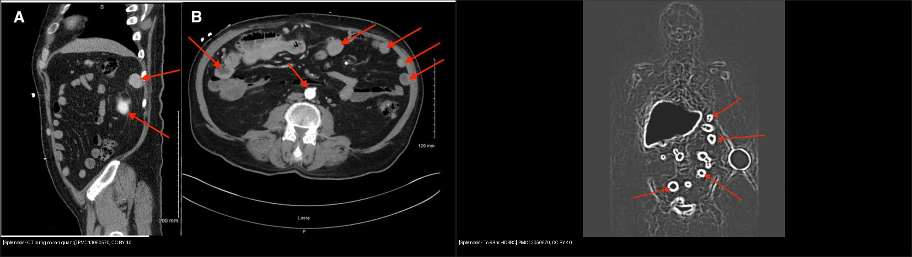
*Trái: nhiều nốt mô mềm ngấm thuốc trong ổ bụng, khó phân biệt với di căn. Phải: Tc-99m HDRBC cho thấy hoạt độ trong các nốt **tương đương lách** — chốt splenosis, tránh sinh thiết. Nguồn: Memari K et al., Cureus 2026, PMC13050570, CC BY 4.0. Ảnh ghép letterbox.*

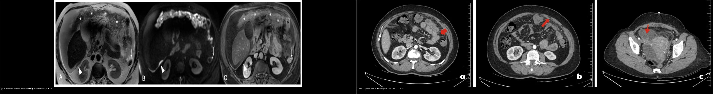
*Trái: MRI T2 — mạc nối thay mỡ bằng “bánh” mô mềm (dấu sao), nốt nhỏ ở rãnh cạnh đại tràng. Phải: CT — báng + nốt miliary + dày phúc mạc, sau đó mô bệnh là lao. Nguồn: Konidari M et al., Cancers 2026, PMC12785020 (CC BY 4.0); Ceyhan ME et al., Cureus 2026, PMC13502480 (CC BY 4.0).*

## 4. Protocol chụp + hệ phân độ & chiến lược sinh thiết

- **CT bụng–chậu có cản quang (portal venous phase), lát ≤ 1 mm:** đánh giá mạc nối, mạc treo, túi cùng, báng, hạch; ghi **vị trí, số nốt, kích thước lớn nhất (mm), có canxi hóa/mỡ/ngấm thuốc**.
- **MRI bụng–chậu khi nốt nhỏ hoặc CT không kết luận:** T2 fat-sat, **DWI b800–1000 + ADC**, T1 in/out-phase, T1 fat-sat trước/sau tiêm. Chỉ số cần ghi: **ADC (×10⁻³ mm²/s)**, mức ngấm, có/không có thành phần mỡ–máu–nhầy.
- **PET/CT** khi chưa rõ u nguyên phát: hữu ích định vị ổ ác, nhưng **lao/viêm cũng FDG dương** → không chốt ác tính một mình.
- **PCI trên CT/MRI** (13 vùng, 0–39) khi nghi carcinomatosis: **PCI ≤ 20** ủng hộ cắt u tối ưu; **> 20** cân nhắc hóa trị tân bổ trợ thay vì mổ ngay.
- **Chiến lược sinh thiết (khi hình ảnh không chốt được):**
  1. Chọn **nốt dễ tiếp cận và an toàn nhất**, không nhất thiết là u nguyên phát (ví dụ nốt mạc nối thay cho u tụy sát động mạch lách).
  2. **US/CEUS dẫn đường** cho nốt nông, có cửa sổ; **CT dẫn đường** cho nốt sâu sau phúc mạc; **sinh thiết qua túi cùng/âm đạo** cho nốt Douglas.
  3. Kim **18G core**, **≥ 2–3 mảnh**, tránh vùng hoại tử; gửi **IHC + sinh học phân tử** (CLDN18.2, HER2, MSI...) nếu nghi ung thư.
  4. **Không sinh thiết mù** khi nghi splenosis, pseudomyxoma, nang sán hoặc tổn thương mạch máu.

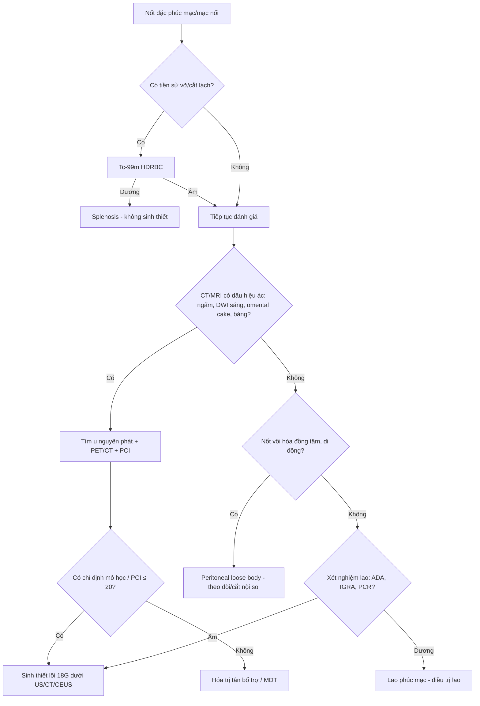

## 5. Biến thể bình thường và cạm bẫy

- **Splenosis** là cạm bẫy lớn nhất: nốt **0,8–2,5 cm**, ngấm mạnh, xuất hiện nhiều năm sau chấn thương — **sinh thiết có thể chảy máu và hoàn toàn không cần thiết**. Luôn hỏi tiền sử cắt lách/vỡ lách; xác nhận bằng **Tc-99m HDRBC**.
- **Peritoneal loose body** (“peritoneal mouse”): khối **vôi hóa trung tâm**, **di động**, có thể 4 × 3 cm và chèn ép trực tràng; đừng gọi là “u mạc treo/desmoid” rồi mổ lớn. So sánh **hai tư thế** để thấy di động.
- **Nhồi máu mạc nối** tự giới hạn: dải mỡ đơn độc, không sốt cao, không khối đặc — **điều trị bảo tồn**, tránh mổ oan.
- **Lao phúc mạc** có thể **CA-125 rất cao** và hình ảnh “y hệt carcinomatosis”; đừng chốt ung thư chỉ vì CA-125. Cần **ADA dịch báng, IGRA, PCR** và **mô bệnh**.
- **Pseudomyxoma peritonei:** **không chọc hút/dẫn lưu qua da** vì nguy cơ gieo mầm và rò; chuyển trung tâm CRS + HIPEC.
- **Sinh thiết đường kim ở carcinomatosis** có thể gieo mầm đường kim; nếu tổn thương **đơn độc, cắt được** và là di căn duy nhất, cân nhắc **cắt bỏ luôn** thay vì sinh thiết.
- **Cạm bẫy mặt cắt:** nốt mạc nối ở **rãnh cạnh đại tràng** dễ bị đọc nhầm là hạch; nốt **dưới hoành phải** dễ nhầm di căn phổi/gan — dùng cửa sổ mỡ và đối chiếu đa bình diện.

## 6. Tự lượng giá — Blind Quiz

**Ca 1 — Nam 60 tuổi, tiền sử chấn thương bụng/cắt lách cách đây nhiều năm, tình cờ thấy nhiều nốt mô mềm trong ổ bụng khi chụp CT vì nhiễm khuẩn huyết.**

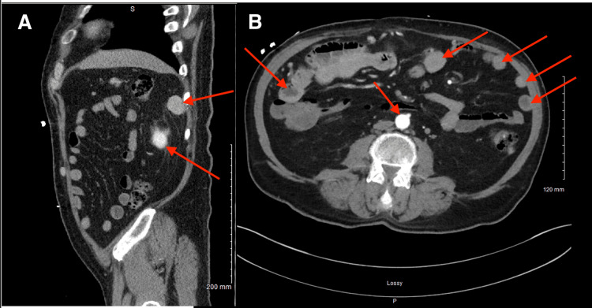

- Câu hỏi: Nốt nằm ở đâu, kích thước bao nhiêu? Ba chẩn đoán phân biệt? Xét nghiệm nào chốt mà **không cần sinh thiết**?

<b>Bấm để hiện đáp án</b>

- Findings: nhiều nốt bờ rõ, ngấm thuốc **đồng nhất**, đường kính **0,8–2,5 cm**, rải rác phúc mạc/thành bụng và tiểu khung; không có báng, không có u nguyên phát.
- Chẩn đoán: **splenosis** sau vỡ/cắt lách (mô lách tự cấy). Chốt bằng **Tc-99m HDRBC**: hoạt độ trong nốt **tương đương lách gốc**.
- Vì sao: mô lách lạc chỗ giữ xoang mạch → ngấm thuốc và bắt xạ hình giống lách; **không sinh thiết** vì có thể chảy máu và không đổi xử trí.
- Nguồn: Memari K et al., Cureus 2026, PMC13050570, CC BY 4.0 (Fig 1–2).

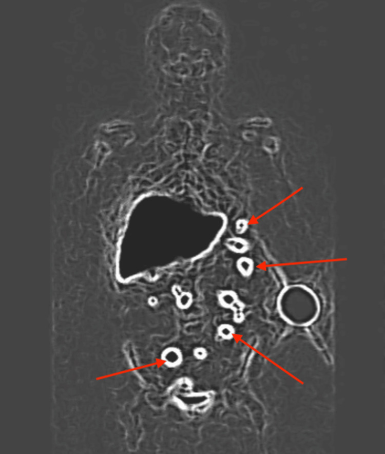

**Ca 2 — Nam 55 tuổi, táo bón mạn, đau bụng; CT thấy khối trong tiểu khung chèn trực tràng, có vôi hóa trung tâm.**

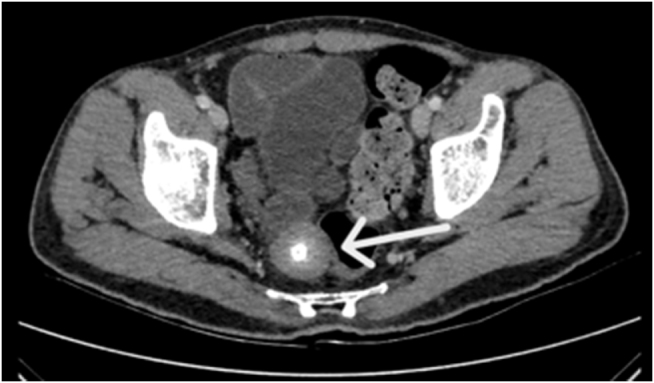

- Câu hỏi: Dấu hiệu chốt? Chẩn đoán? Có cần sinh thiết không?

<b>Bấm để hiện đáp án</b>

- Findings: khối **35 × 33 mm**, bờ rõ, **vôi hóa trung tâm/đồng tâm kiểu “vỏ trứng”**, không ngấm thuốc, **di động** khi đổi tư thế; chèn ép trực tràng.
- Chẩn đoán: **peritoneal loose body** (“peritoneal mouse”) — mảnh mỡ hoại tử của phần phụ mạc nối bị xoắn, tự đứt, canxi hóa.
- Xử trí: theo dõi nếu không triệu chứng; **cắt qua nội soi** nếu chèn ép/triệu chứng. Không cần sinh thiết trước.
- Nguồn: Dholakia V et al., Int J Surg Case Rep 2026, PMC13340654, CC BY-NC-ND 4.0 (giữ nguyên bản, không crop/ghép).

**Ca 3 — Nữ 47 tuổi, đau bụng 3 tháng, báng, nhiều nốt phúc mạc; CA-125 758,3 U/mL.**

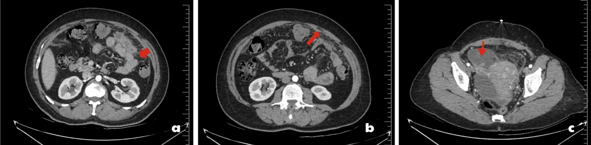

- Câu hỏi: Hai chẩn đoán hàng đầu? Dấu hiệu nào giúp phân biệt? Bước tiếp theo?

<b>Bấm để hiện đáp án</b>

- Findings: báng tự do, **thâm nhiễm mỡ mạc nối**, **nhiều nốt nhỏ trên phúc mạc/mạc nối**, dày phúc mạc; hình ảnh **không phân biệt được** lao và carcinomatosis.
- Chẩn đoán trong ca này: **lao phúc mạc** — mô bệnh có u hạt hoại tử trung tâm + tế bào khổng lồ Langhans; QuantiFERON dương.
- Chốt: **ADA dịch báng tăng** (trung bình 45,8 U/L), **báng lympho ưu thế**, IGRA/PCR; **CA-125 cao không loại trừ lao**.
- Bước tiếp theo: **soi ổ bụng + sinh thiết mạc nối/phúc mạc**, gửi mô bệnh + AFB/PCR.
- Nguồn: Ceyhan ME et al., Cureus 2026, PMC13502480, CC BY 4.0.

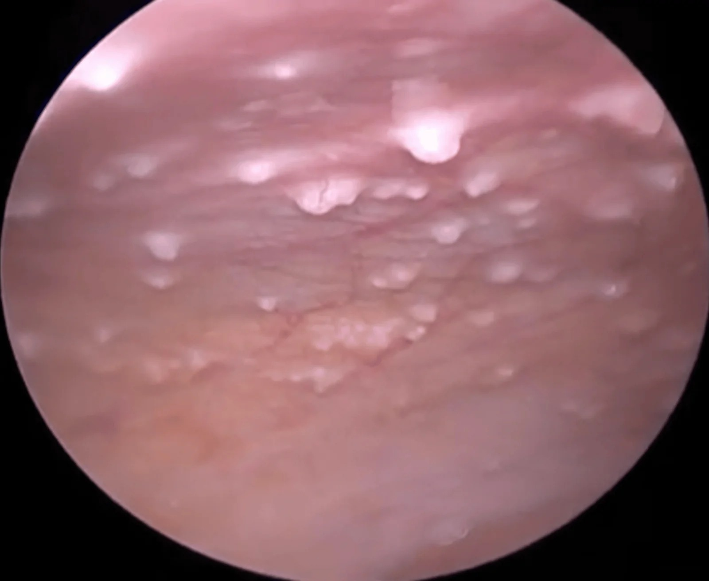

**Ca 4 — Nữ 56 tuổi, báng, mạc nối dày; MRI bụng–chậu trước mổ.**

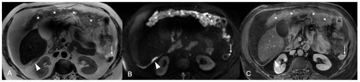

- Câu hỏi: Mô tả dấu hiệu? Cách tính PCI? Ngưỡng PCI gợi ý mổ triệt căn?

<b>Bấm để hiện đáp án</b>

- Findings: mạc nối thay mỡ bằng **“bánh” mô mềm** (omental cake), nốt **15 mm** khoảng Morrison, nốt **5 mm** rãnh cạnh đại tràng trái; nốt **ngấm thuốc** và **hạn chế khuếch tán** trên DWI.
- PCI: chia ổ bụng **13 vùng**, mỗi vùng 0–3 điểm (0 = không u; 1 = ≤ 0,5 cm; 2 = 0,5–5 cm; 3 = > 5 cm hoặc dày dính) → **0–39**.
- Ngưỡng: **PCI ≤ 20** dự báo cắt u tối ưu (AUC 0,94); **> 20** nên cân nhắc hóa trị tân bổ trợ/MDT.
- Nguồn: Konidari M et al., Cancers 2026, PMC12785020, CC BY 4.0.

**Ca 5 — Bệnh nhân đau hố chậu phải, không sốt; CT có dải mỡ mạc nối, không thấy ruột thừa viêm.**

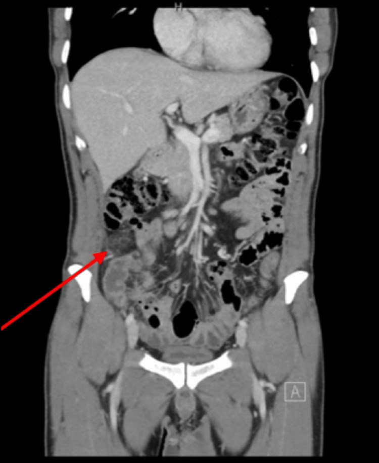

- Câu hỏi: Chẩn đoán? Có cần mổ không?

<b>Bấm để hiện đáp án</b>

- Findings: **dải mỡ tăng đậm độ** trong mạc nối hố chậu phải, không tạo khối đặc, không có hạch bệnh lý; ruột thừa bình thường.
- Chẩn đoán: **nhồi máu mạc nối nguyên phát (primary omental infarction)** — nguyên nhân đau bụng cấp hiếm, tự giới hạn.
- Xử trí: **bảo tồn** (giảm đau, kháng viêm), hết triệu chứng trong khoảng 1 tuần; tránh mổ nội soi không cần thiết.
- Nguồn: Alabdouli A et al., Cureus 2026, PMC13215769, CC BY 4.0.

**Ca 6 — Nốt mạc nối ở bệnh nhân ung thư tụy, u nguyên phát sát động mạch lách; cần mô học và CLDN18.2.**

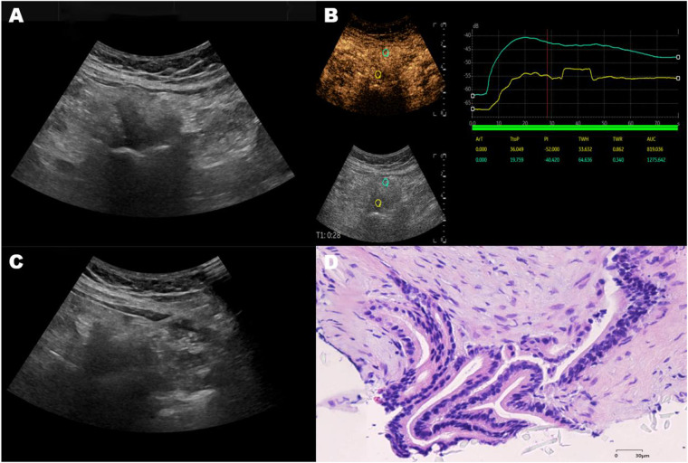

- Câu hỏi: Vì sao chọn nốt mạc nối thay vì u tụy? Kỹ thuật và cỡ kim? Lợi ích của CEUS?

<b>Bấm để hiện đáp án</b>

- A: siêu âm 2D thấy nốt mạc nối; B: **đường cong thời gian–cường độ (TIC)** trên CEUS, ROI vàng tại tổn thương ngấm mạnh hơn mô lành; C: **kim lõi xuyên nốt dưới CEUS**; D: H&E — **adenocarcinoma**.
- Lý do: u tụy **sát động mạch lách**, EUS-FNB khó/nguy hiểm; nốt mạc nối **nông, an toàn**, vẫn đại diện mô u và đủ cho **IHC CLDN18.2**.
- Kỹ thuật: kim lõi **18G**, **≥ 2–3 mảnh**, CEUS để tránh vùng hoại tử và xác nhận kim trong tổn thương.
- Nguồn: Yin H et al., Front Radiol 2026, PMC13416683, CC BY 4.0.

## Bài liên quan chéo
- [100 – Tổng quan hệ Bụng](../100-tong-quan-he-bung/lesson.md)
- [141 – Phúc mạc](../141-phuc-mac/lesson.md)
- [518 – Morcellation & LPD](../518-morcellation-LPD/lesson.md)
- [539 – Pseudomyxoma peritonei](../539-pseudomyxoma-peritonei/lesson.md)
- [577 – Theo dõi & phát hiện tái phát ung thư phụ khoa](../577-theo-doi-tai-phat-ung-thu-phu-khoa/lesson.md)

> Không dùng để chẩn đoán độc lập khi chưa có người hướng dẫn.
