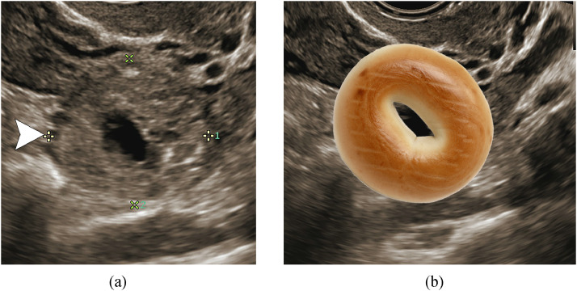
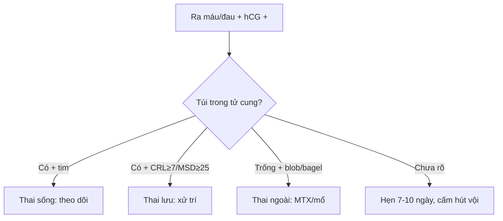

# 550 — Thai sớm: SRU, ngoài tử cung & vòng lửa / Early pregnancy

**Tags:** `pattern:thai-som` `vung:tu-cung-phan-phu` `score:SRU` `protocol:TVUS-thai-som`
**Mức chắc chắn (certainty):** tổng hợp y văn (literature synthesis) — nhóm tự biên từ y văn mở, chưa gắn ca nguyên văn đơn lẻ.

## 1. Tổng quan — ngưỡng SRU là đặc hiệu 100%, dưới ngưỡng là chờ

- SRU 2013: **CRL ≥ 7 mm không tim** hoặc **MSD ≥ 25 mm không phôi** = thai lưu chắc chắn — TẠI SAO: qua ngưỡng này phôi sống không thể chưa có tim (độ phân giải TVUS hiện đại); dưới ngưỡng (CRL 5–6,9 mm / MSD 16–24 mm) chỉ "nghi ngờ" + hẹn 7–10 ngày (tránh hút nhầm thai sống!).
- Thai ngoài: β-hCG ≥ 3.500 (vùng phân biệt) + tử cung trống + khối tách buồng trứng (blob/bagel, PPV > 95–96%) + máu ổ bụng — TẠI SAO blob tiến thành bagel: túi thai lớn dần tạo lỗ trung tâm.
- **Vòng lửa (ring of fire) gặp cả hoàng thể lẫn thai ngoài** — TẠI SAO: cả 2 đều tăng sinh mạch; vị trí TRONG vs NGOÀI buồng trứng mới là chốt.

## 2. Gamut ra máu/đau 3 tháng đầu (Gamut)

- **CRL ≥ 7 mm không tim / MSD ≥ 25 mm không phôi:** thai lưu — hút/nội khoa (không cần chờ).
- **Dưới ngưỡng + còn sống được:** hẹn 7–10 ngày (14 ngày sau túi chưa yolk / 11 ngày sau yolk).
- **Tử cung trống + hCG cao + blob/bagel tách buồng trứng:** thai ngoài — methotrexate/mổ.
- **Vòng lửa TRONG buồng trứng:** hoàng thể (theo dõi); NGOÀI + máu = thai ngoài.

## 3. Bảng so sánh phân biệt (ma trận đối chiếu)

| Thực thể (entity) | Hình ảnh điển hình | Chốt vào (rule-in) | Chốt loại (rule-out) | Gợi ý xác nhận |
|---|---|---|---|---|
| Thai lưu chắc chắn | **CRL ≥ 7 mm không tim / MSD ≥ 25 mm không phôi** | **Vượt ngưỡng SRU = 100%** | Dưới ngưỡng → hẹn lại | Hút/nội khoa, không chờ |
| Thai ngoài | **Blob/bagel tách buồng trứng + máu + hCG cao** | **Blob→bagel + tách buồng trứng (PPV > 95%)** | Vòng lửa trong trứng → hoàng thể | MTX/mổ + hCG theo dõi |
| Hoàng thể | **Vòng lửa TRONG buồng trứng + thai trong tử cung** | **Trong trứng + thai tử cung sống** | Ngoài trứng + máu → thai ngoài | Theo dõi (tự teo) |
| Thai kẽ/vết mổ | **Lệch sừng + cơ bao < 5 mm + interstitial line** | **Cơ mỏng + line (+) + vết mổ cũ** | Giữa tử cung + cơ dày → trong tử cung | MTX/mổ (vỡ = tử vong!) |

*Từ blob đặc 3 ngày trước tiến thành bagel; mổ xác nhận thai vòi. Nguồn: Lima et al., Radiol Case Rep 2021 Fig. 2, CC BY-NC-ND 4.0 (giữ nguyên bản).*

## 4. Protocol TVUS thai sớm

- **TVUS + β-hCG + hẹn lại đúng ngày** (7–10 / 11 / 14 ngày theo mốc); blob/bagel + máu = báo động đỏ + định lượng hCG.

## 5. Cạm bẫy

- **Hút thai dưới ngưỡng SRU** = giết thai sống — hẹn lại là luật sống còn.
- **Vòng lửa = thai ngoài** mù quáng — hoàng thể cũng vòng lửa (vị trí mới chốt!).
- **Thai vết mổ/vòi kẽ vỡ** tử vong — cơ < 5 mm + line (+) là MTX/mổ sớm, đừng chờ.
- **Vùng phân biệt β-hCG (1.500–3.000 TVUS, bảo tồn 3.500)** — dưới ngưỡng + tử cung trống là "thai chưa rõ vị trí", hẹn hCG 48h (tăng < 53% = bất thường!), đừng kết luận vội.

## 6. Tự lượng giá — Blind Quiz

**Ca 1 — Thai 6 tuần đau + ra máu, hCG 225→1657 sau 3 ngày. Đọc siêu âm.**

- Hỏi: blob hay bagel? Thai ngoài hay hoàng thể? Xử trí?

<b>Bấm để hiện đáp án</b>

- Dấu hiệu (findings): nhẫn dày âm vang + dịch giữa tách buồng trứng = **bagel sign** (từ blob 3 ngày trước).
- Chẩn đoán (diagnosis): **thai ngoài tử cung vòi (PPV > 95%)** — mổ/MTX + hCG theo dõi (hoàng thể nằm TRONG trứng).
- Nguồn: Lima et al., Fig. 2, CC BY-NC-ND 4.0 (nguyên bản).

**Ca 2 — CRL 6 mm không tim, thai phụ khóc xin hút:** hút luôn hay hẹn? *(Bảng mục 3.)*

<b>Bấm để hiện đáp án</b>

- **Hẹn 7–10 ngày:** dưới ngưỡng 7 mm chỉ "nghi ngờ" (hút vội có thể giết thai sống!).

## Bài liên quan chéo
- [500 – Tổng quan Vú & SPK](../500-tong-quan-vu-san-phu-khoa/lesson.md)
- [530 – Phần phụ](../530-buong-trung-ORADS-sieu-am-MRI/lesson.md) (blob vs hoàng thể)
- [160 – Bụng cấp GI](../160-bung-cap-GI/lesson.md) (đau hố chậu nữ)

> Không dùng để chẩn đoán độc lập khi chưa có người hướng dẫn.
