# 551 — Bệnh nguyên bào nuôi thai kỳ: thai trứng toàn phần/bán phần & ung thư nguyên bào nuôi

**Tags:** `pattern:nang` `pattern:qua-san-tu-cung` `vung:tu-cung` `score:FIGO-WHO` `protocol:sieu-am-Doppler`
**Mức chắc chắn (certainty):** tổng hợp y văn (literature synthesis) — tổng hợp từ 2 bài review mở, 1 bài cập nhật phân giai đoạn FIGO 2026, 2 ca mô bệnh học và 1 ca choriocarcinoma di căn nguyên văn; các số liệu đều đối chiếu trực tiếp với bài gốc/PMCID.

## 1. Tổng quan bệnh học – cơ chế hình ảnh

- **Phổ bệnh (spectrum):** bệnh nguyên bào nuôi thai kỳ (gestational trophoblastic disease – GTD) gồm **thai trứng toàn phần** (complete hydatidiform mole – CHM), **thai trứng bán phần** (partial hydatidiform mole – PHM), **thai trứng xâm lấn** (invasive mole), **ung thư nguyên bào nuôi** (choriocarcinoma), **u nguyên bào nuôi tại vị trí nhau** (placental site trophoblastic tumor – PSTT) và **u nguyên bào nuôi dạng biểu mô** (epithelioid trophoblastic tumor – ETT). CHM/PHM là tổn thương **tiền ung thư**; invasive mole và choriocarcinoma nằm trong nhóm **bệnh nguyên bào nuôi thai kỳ ác tính** (gestational trophoblastic neoplasia – GTN).
- **Hai con đường di truyền quyết định hình ảnh và mô bệnh:**
  - **CHM:** trứng không có nhân (enucleate oocyte) được thụ tinh bởi 1 tinh trùng rồi nhân đôi → **46,XX (khoảng 90%)** hoặc 46,XY, **toàn bộ DNA nhân từ bố**. Không có phôi/thai; **p57 âm** vì gen *CDKN1C* chỉ biểu hiện từ alen mẹ.
  - **PHM:** 2 tinh trùng thụ tinh 1 trứng → **thể tam bội 69,XXX/69,XXY/69,XYY**, có thành phần mẹ; thường có phôi/thai không sống; **p57 dương**.
- **TẠI SAO siêu âm thấy "bão tuyết" (snowstorm):** gai nhau phù nề do ứ dịch trong mô đệm, tạo các **nang dịch nhỏ** (hydropic vesicles) ± bể trung tâm (central cistern). Mỗi mặt phân cách dịch–mô phản xạ sóng âm mạnh → vô số ổ trống âm nhỏ chen trong khối hồi âm dày, tạo hình **"chùm nho" / "bão tuyết"**. Vì là dịch, các ổ này **không có tín hiệu Doppler** bên trong; mạch máu nằm ở phần mô nguyên bào nuôi quanh nang.
- **TẠI SAO Doppler có giá trị tiên lượng:** nguyên bào nuôi tăng sinh xâm nhập làm mạch máu tử cung **giãn, tăng tốc độ và giảm sức cản**. **Chỉ số sức cản (resistive index – RI) < 0,4** và **chỉ số đập (pulsatility index – PI) ≤ 1,38** được xem là gợi ý nguy cơ GTN sau thai trứng; dòng chảy vượt qua nội mạc vào cơ tử cung gợi ý thai trứng xâm lấn.
- **TẠI SAO MRI khác siêu âm:** dịch trong gai nhau **tăng tín hiệu mạnh trên T2W**; các ổ xuất huyết **tăng tín hiệu trên T1W** (methemoglobin) và có thể có mức tín hiệu. Phần nguyên bào nuôi tăng sinh **ngấm thuốc**, giúp phân biệt mô sống với máu tụ/cục máu đông. MRI là phương tiện đánh giá **xâm lấn cơ tử cung** và mạch máu quanh tử cung khi siêu âm không kết luận được.
- **TẠI SAO CT thấy xuất huyết:** máu tụ cấp **50–70 HU**, đậm hơn cơ và dịch; choriocarcinoma di căn thường **tăng sinh mạch, dễ vỡ** nên hay biểu hiện bằng **xuất huyết** (phổi, gan, não, âm đạo) hơn là khối đặc điển hình. Vì vậy mọi "máu tụ không rõ nguyên nhân" ở phụ nữ tuổi sinh sản phải nghĩ tới GTN và **đo β-hCG**.
- **Định lượng cốt lõi:**
  - Tần suất thai trứng khoảng **1–2/1.000 thai kỳ** toàn cầu; Đông Nam Á, Mỹ Latinh, một phần châu Phi cao hơn **10–15 lần**; Bắc Mỹ/Tây Âu **0,5–1/1.000**.
  - Yếu tố nguy cơ: **tuổi < 15 hoặc > 40** (nguy cơ tăng gấp ~5 lần sau 40, ~2,5 lần sau 35), tiền sử thai trứng, thiếu vitamin A.
  - **CHM → GTN sau hút nạo: khoảng 15–20%** (có nguồn ghi tới 20%); **PHM: 1–4%**. Nguy cơ tăng tới **40–50%** khi hCG > 100.000 IU/L, có nang hoàng thể hóa (theca lutein cyst) hoặc mẹ > 40 tuổi.
  - Tái phát thai trứng **1–2%**; sau **2 lần liên tiếp** tăng lên **10–20%**.
  - Thai đôi có 1 thai bình thường + 1 thai trứng toàn phần: **1/20.000–1/100.000** thai kỳ.

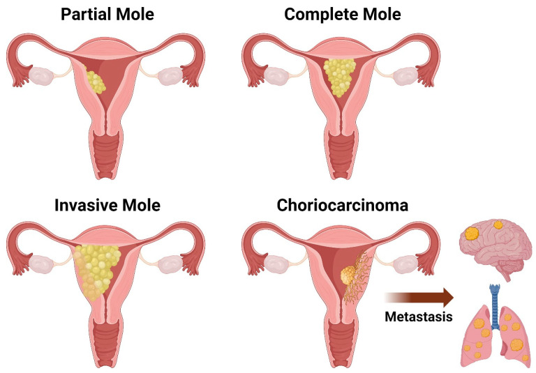
*Sơ đồ: thai trứng bán phần (tổn thương khu trú, còn thai), thai trứng toàn phần (toàn bộ buồng tử cung), thai trứng xâm lấn (vào cơ tử cung) và choriocarcinoma (khối xâm lấn + di căn não/phổi). Nguồn: Gonzalez J et al., Diseases 2024, PMC11276430, CC BY 4.0.*

## 2. Mẫu hình + chẩn đoán phân biệt theo vị trí (gamut)

### 2.1. Khối dạng nang trong buồng tử cung, KHÔNG có thai
- **Thai trứng toàn phần (CHM):** toàn bộ buồng tử cung là khối nang hỗn hợp, không thấy túi thai/phôi; tử cung thường **to hơn tuổi thai**; có thể kèm **nang hoàng thể hóa hai bên**.
- **Thai lưu/trứng thoái hóa nước (missed abortion with hydropic degeneration):** gai nhau phù nhưng **còn mạch máu trong gai**, không tăng sinh nguyên bào nuôi; khối nhỏ, ít nang, hCG thấp hơn.
- **Sản phẩm thụ thai tồn lưu (retained products of conception – RPOC):** khối hồi âm không đều trong buồng tử cung, **có mạch máu nuôi từ nội mạc**, hCG giảm dần; không có hình "bão tuyết".
- **Thai trứng lạc chỗ (ectopic molar pregnancy):** buồng tử cung rỗng + khối hỗn hợp ở vòi trứng; hCG cao không tương xứng; chẩn đoán xác định bằng mô bệnh học.

### 2.2. Khối dạng nang + CÓ thai
- **Thai trứng bán phần (PHM):** thai không sống ± thai chậm phát triển, bánh nhau có **ổ nang khu trú**; p57 dương.
- **Thai đôi: 1 thai bình thường + 1 thai trứng toàn phần:** thai sống bên cạnh bánh nhau hỗn hợp, có vùng nang; nguy cơ cao **tiền sản giật, cường giáp, xuất huyết, sinh non**; karyotype thai thường **lưỡng bội**.
- **Dị sản trung mô bánh nhau (placental mesenchymal dysplasia – PMD):** bánh nhau dày, nhiều nang giống PHM nhưng **thai thường bình thường**, p57 bình thường, **không tăng sinh nguyên bào nuôi**; liên quan hội chứng Beckwith–Wiedemann.

### 2.3. Khối xâm lấn cơ tử cung
- **Thai trứng xâm lấn (invasive mole):** khối nang trong cơ tử cung, mất liên tục vùng chuyển tiếp (junctional zone), mạch máu tăng sinh mạnh; hCG còn cao/không giảm sau hút nạo; nguy cơ **thủng tử cung, chảy máu**.
- **Choriocarcinoma:** khối đặc–hoại tử–xuất huyết, ngấm thuốc mạnh, xâm lấn cơ và mạch máu; hCG rất cao; di căn sớm.
- **Phổ nhau cài răng lược (placenta accreta spectrum – PAS):** tiền sử mổ lấy thai, bánh nhau bám mặt trước–đoạn dưới, mất lớp tối T2, mạch máu bàng quang; **hCG bình thường theo tuổi thai**, không có khối nguyên bào nuôi.
- **Dị dạng động–tĩnh mạch tử cung (uterine AVM) / giả phình sau nạo:** dòng chảy hỗn loạn tốc độ cao, "khoang phủ" thuốc; có thể là **di chứng sau hút nạo**, không phải GTN.

### 2.4. hCG cao nhưng tử cung trống / tổn thương xuất huyết đa ổ
- **Choriocarcinoma di căn** (phổi, gan, não, âm đạo) — có thể **không thấy khối nguyên phát** ở tử cung vì đã thoái triển.
- **Thai ngoài tử cung** (kể cả thai trứng lạc chỗ), **GTN tồn tại sau mổ tử cung**, **PSTT/ETT** — nhóm mô bệnh riêng, phân giai đoạn I–IV theo FIGO 2026 với **khoảng cách < 48 tháng (yếu tố tốt) vs ≥ 48 tháng (yếu tố xấu)**.
- **Nguyên nhân ngoài thai:** hCG "ma" (phantom hCG) do kháng thể dị loài; hCG tuyến yên; u tiết hCG không phải nguyên bào nuôi.

## 3. Bảng so sánh phân biệt (ma trận đối chiếu)

| Thực thể (entity) | Hình ảnh điển hình (US/CT/MRI) | Chốt vào (rule-in) | Chốt loại (rule-out) | Gợi ý xác nhận |
|---|---|---|---|---|
| **Thai trứng toàn phần (CHM)** | Buồng tử cung toàn khối nang "bão tuyết", **không thai**, tử cung to hơn tuổi thai; Doppler giàu mạch | **Không thấy túi thai/phôi + khối nang toàn buồng tử cung + hCG rất cao** (thường > 100.000 IU/L) | Có phôi/thai sống → không phải CHM; khối nhỏ, ít nang, hCG thấp → nghĩ thai lưu | Mô bệnh + **p57 âm**; karyotype 46,XX/46,XY |
| **Thai trứng bán phần (PHM)** | Thai không sống + bánh nhau dày, **ổ nang khu trú**; tử cung không to nhiều | **Có thai + vùng bánh nhau dạng nang**; p57 dương | Không có thai → CHM; bánh nhau dày nhưng thai bình thường, không tăng sinh nuôi → PMD | Mô bệnh + p57 dương; karyotype **69** |
| **Thai trứng xâm lấn** | Khối nang trong cơ tử cung, mất vùng chuyển tiếp, mạch máu xuyên cơ; có thể thủng | **hCG không giảm/không đạt âm sau hút nạo + khối xâm lấn cơ** | Khối cơ trơn điển hình (u xơ) không có nang/hCG âm; PAS có tiền sử mổ, hCG bình thường | MRI chậu + hCG động học; mô bệnh nếu mổ |
| **Choriocarcinoma** | Khối đặc–hoại tử–xuất huyết, ngấm mạnh; di căn phổi/gan/não/âm đạo; có thể không thấy u nguyên phát | **hCG rất cao + tổn thương xuất huyết đa ổ + mô bệnh choriocarcinoma** | Khối lành tính đơn độc, hCG âm; máu tụ do chấn thương không có hCG tăng | Sinh thiết (thận trọng vì nguy cơ chảy máu) + hCG; staging CT/MRI |
| **Thai đôi: thai + CHM** | Thai sống + bánh nhau hỗn hợp có vùng nang; karyotype thai lưỡng bội | **Thai sống + vùng bánh nhau dạng trứng + karyotype thai bình thường** | Toàn bộ bánh nhau dạng nang, không thấy thai → CHM đơn thuần | Siêu âm chuỗi + chọc ối karyotype; theo dõi sản khoa |
| **Dị sản trung mô bánh nhau (PMD)** | Bánh nhau dày, nhiều nang, thai thường bình thường; có thể gan lách to | **Thai bình thường + bánh nhau dạng nang + p57 bình thường/không tăng sinh nuôi** | p57 âm + tăng sinh nguyên bào nuôi → CHM | Mô bệnh; theo dõi Beckwith–Wiedemann |
| **Thai lưu thoái hóa nước / RPOC** | Khối hồi âm không đều, ít nang, có mạch từ nội mạc; hCG thấp và giảm | **hCG giảm dần + khối nhỏ + có mạch nuôi** | hCG tăng/plateau + khối nang toàn buồng tử cung → GTN | hCG lặp lại; siêu âm Doppler; mô bệnh nếu nạo |
| **PAS / AVM tử cung** | PAS: bánh nhau đoạn dưới, mất lớp tối T2, mạch bàng quang; AVM: dòng hỗn loạn tốc độ cao | **Tiền sử mổ lấy thai + bánh nhau bám bất thường, hCG theo tuổi thai** (PAS); **dòng chảy xoáy sau nạo, hCG âm** (AVM) | Khối nguyên bào nuôi có hCG cao/plateau → GTN | MRI/Doppler; hCG; mô bệnh |

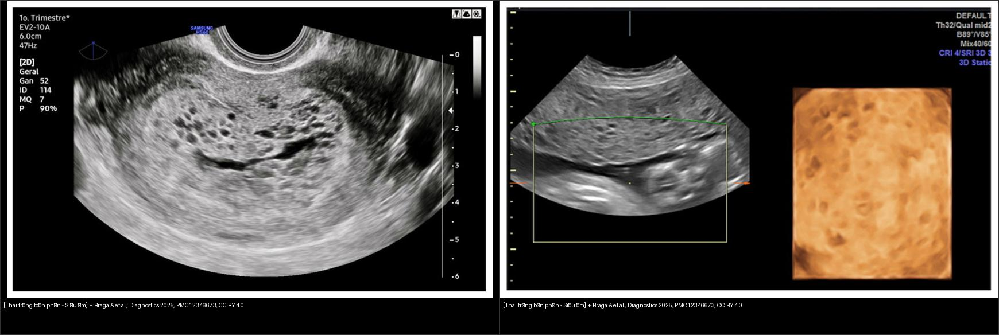
*Trái: thai trứng toàn phần — buồng tử cung toàn khối nang, không thấy thai. Phải: thai trứng bán phần — bánh nhau có ổ nang, có thai không sống. Nguồn: Braga A et al., Diagnostics 2025, PMC12346673, CC BY 4.0. Ảnh ghép letterbox, giữ nguyên tỷ lệ.*

### 3.1. p57 — "công tắc" phân biệt toàn phần và bán phần
- **p57 (p57^KIP2, CDKN1C)** là gen **in dấu mẹ** (maternally imprinted, paternally expressed): chỉ biểu hiện khi có **nhiễm sắc thể mẹ**.
- **CHM (androgenetic) → p57 ÂM** ở nguyên bào nuôi tế bào và mô đệm gai nhau.
- **PHM (có thành phần mẹ) → p57 DƯƠNG**; thai lưu/thai bình thường cũng dương.
- Đây là chốt **loại trừ** mạnh nhất khi mô bệnh học không rõ ràng; karyotype/ploidy là bằng chứng bổ sung.

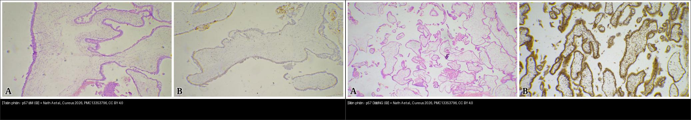
*Trái: CHM — nhuộm p57 ÂM ở nguyên bào nuôi và mô đệm gai nhau. Phải: PHM — p57 DƯƠNG. Nguồn: Nath A et al., Cureus 2026, PMC13353796, CC BY 4.0. Ảnh ghép letterbox.*

## 4. Protocol chụp + hệ phân giai đoạn/điểm chuẩn hóa

### 4.1. Protocol
- **Bước 1 — siêu âm đầu dò âm đạo (transvaginal ultrasound – TVUS) + Doppler màu/phổ:** đánh giá buồng tử cung, bánh nhau, cơ tử cung, buồng trứng (nang hoàng thể hóa), tìm thai ngoài tử cung. Ghi **kích thước tử cung, chiều dày cơ, RI/PI** nếu có dòng chảy bất thường.
- **Bước 2 — MRI chậu có cản quang** khi: siêu âm không phân biệt CHM/PHM, nghi xâm lấn cơ, khối lớn, hoặc cần đánh giá mạch máu trước can thiệp. MRI **không thay thế** mô bệnh học.
- **Bước 3 — phân giai đoạn (staging):** X-quang ngực + **CT ngực** (đếm số di căn phổi; **chỉ đếm tổn thương ≥ 1 cm** theo FIGO 2026); **CT hoặc MRI bụng–chậu**; **MRI não có cản quang** nếu có di căn phổi ≥ 1 cm hoặc choriocarcinoma.
- **Nguyên tắc thời điểm:** GTN có thể **tăng gấp đôi thể tích mỗi 24–48 giờ**; chụp phân giai đoạn **càng gần lúc bắt đầu hóa trị càng tốt**.
- **Xét nghiệm nền:** β-hCG định lượng (cùng một phòng xét nghiệm), công thức máu, chức năng gan/thận, tuyến giáp (cường giáp do hCG), nhóm máu.

### 4.2. Tiêu chuẩn chẩn đoán GTN sau thai trứng (FIGO 2026)
- **Cao nguyên (plateau):** thay đổi **< 10%** (tăng hoặc giảm) qua **4 lần đo** trong **≥ 3 tuần** (ngày 1, 7, 14, 21).
- **Tăng:** **> 10%** qua **3 lần đo hằng tuần** trong **≥ 2 tuần** (ngày 1, 7, 14).
- **Mô bệnh học:** chẩn đoán xác định **choriocarcinoma, PSTT hoặc ETT**.

### 4.3. Phân giai đoạn FIGO 2026
| Giai đoạn | Mô tả |
|---|---|
| **I** | U giới hạn trong **thân tử cung và cổ tử cung** |
| **II** | Lan tới **phần phụ, âm đạo, dây chằng rộng** nhưng còn trong cơ quan sinh dục |
| **III** | Di căn **phổi**, ± tổn thương sinh dục, ± hạch **dưới cơ hoành** |
| **IV** | Mọi vị trí khác, gồm **hạch trên cơ hoành** |

### 4.4. Điểm tiên lượng FIGO/WHO 2026
| Yếu tố | 0 | 1 | 2 | 4 |
|---|---|---|---|---|
| Tuổi | < 40 | ≥ 40 | — | — |
| Thai kỳ trước | Thai trứng | Sẩy/thai ngoài tử cung | Thai đủ tháng | — |
| Khoảng cách từ thai kỳ chỉ điểm (tháng) | < 4 | 4–6 | 7–12 | > 12 |
| β-hCG trước điều trị (mIU/mL) | < 1.000 | 1.000–< 10.000 | 10.000–< 100.000 | ≥ 100.000 |
| Kích thước u lớn nhất (cm) | < 3 | 3–5 | > 5 | — |
| Vị trí di căn | Phổi, âm đạo | Lách, thận | Tiêu hóa | Não, gan |
| Số di căn | — | 1–4 | 5–8 | > 8 |

- **Nhóm nguy cơ:** **0–6 = nguy cơ thấp**; **7–12 = nguy cơ cao**; **≥ 13 = nguy cơ rất cao (ultra-high)**.
- **PSTT/ETT** không dùng điểm WHO; phân giai đoạn I–IV theo FIGO 2026 và chia theo **khoảng cách < 48 tháng (yếu tố tốt) vs ≥ 48 tháng (yếu tố xấu)**.

### 4.5. Xử trí theo nhóm nguy cơ
- **Thai trứng chưa biến chứng:** **hút nạo bằng áp lực âm (suction curettage)** là điều trị chuẩn; **tránh gây sẩy bằng thuốc** vì nguy cơ thủng tử cung/chảy máu (misoprostol chỉ dùng chọn lọc 200–400 µg đặt âm đạo khi cổ tử cung dài, đóng).
- **Hysterectomy:** chỉ định khi đã đủ con, lớn tuổi, hoặc không kiểm soát được chảy máu; **không thay thế theo dõi hCG** (đã có ca vẫn tăng hCG sau mổ tử cung).
- **GTN nguy cơ thấp (0–6):** hóa trị **một thuốc** (methotrexate hoặc actinomycin D), theo dõi hCG.
- **GTN nguy cơ cao (7–12):** **EMA/CO** (etoposide, methotrexate, actinomycin D, cyclophosphamide, vincristine).
- **Nguy cơ rất cao (≥ 13):** **khởi động bằng etoposide–cisplatin (EP) liều thấp** trước khi chuyển **EP-EMA**, vì nguy cơ chảy máu/hoại tử khi hóa trị toàn liều ngay.
- **Kháng trị/tái phát:** hóa trị cứu vớt, phẫu thuật (cắt tử cung, cắt di căn), xạ trị, **ức chế điểm kiểm soát miễn dịch** (pembrolizumab) ở ca chọn lọc.

### 4.6. Theo dõi sau hút nạo
- **hCG hằng tuần** cho tới khi âm tính; sau đó **hằng tháng**.
- **CHM:** theo dõi **3 tháng** nếu hCG về bình thường trong **≤ 56 ngày** sau hút nạo; **6 tháng** nếu về bình thường muộn hơn.
- **PHM:** thêm **1 lần** hCG bình thường hằng tháng sau khi đã âm.
- **Tránh thai trong suốt thời gian theo dõi** để không nhầm hCG của thai kỳ mới với tái phát; thai kỳ sau nên xác nhận sớm bằng siêu âm.

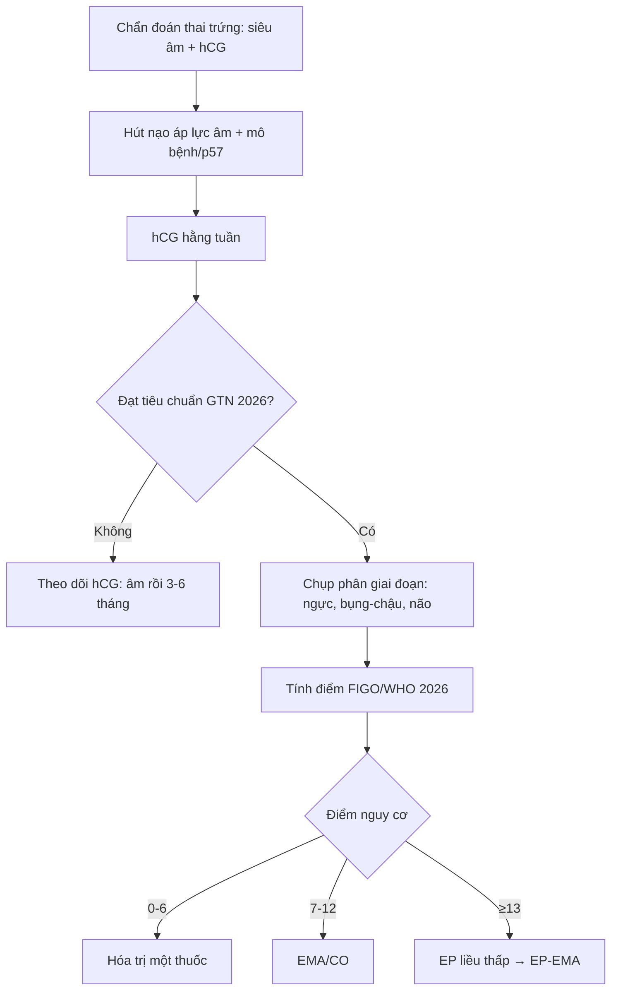

## 5. Biến thể bình thường và cạm bẫy

- **Thai trứng sớm (< 8 tuần):** có thể chỉ thấy khối hồi âm không đều, **ít ổ nang**, dễ nhầm thai lưu. Đừng đòi hỏi phải có "bão tuyết" mới chẩn đoán; kết hợp hCG, mô bệnh và p57.
- **Thai đôi thai + trứng toàn phần:** nếu chỉ thấy vùng bánh nhau dạng nang và kết luận CHM đơn thuần rồi hút nạo, sẽ **mất thai bình thường**. Phải tìm thai sống, làm karyotype và theo dõi chuyên khoa.
- **PMD giả thai trứng:** bánh nhau dày–nhiều nang nhưng **thai bình thường**, **không tăng sinh nguyên bào nuôi**, p57 bình thường; có thể kèm gan lách to, bất thường rốn.
- **Nang hoàng thể hóa (theca lutein cysts):** hai bên, nhiều ngăn, kích thước lớn (có ca **10,64 × 6,35 cm** với hCG **451.790 IU/L**), do hCG kích thích quá mức; **25–50%** ca thai trứng có nang, **vỡ chỉ 1–2%**. Đừng cắt buồng trứng oan; nang thường thoái triển khi hCG giảm.
- **"Khối máu tụ" ở gan/não/phổi:** ở phụ nữ tuổi sinh sản, xuất huyết đa ổ không rõ nguyên nhân phải **đo β-hCG**; choriocarcinoma có thể biểu hiện bằng xuất huyết trước khi có khối u rõ.
- **Sau mổ tử cung vẫn tăng hCG:** mô nguyên bào nuôi có thể đã di căn trước mổ; **hysterectomy không phải là điểm kết thúc theo dõi**.
- **AVM/giả phình sau nạo:** dòng chảy tốc độ cao, hCG âm; can thiệp nút mạch nếu chảy máu, không hóa trị.
- **MRI bình thường không loại trừ GTN vi thể:** chẩn đoán GTN dựa trên **hCG động học**; hình ảnh dùng để phân giai đoạn, không dùng để "loại trừ" khi hCG tăng.

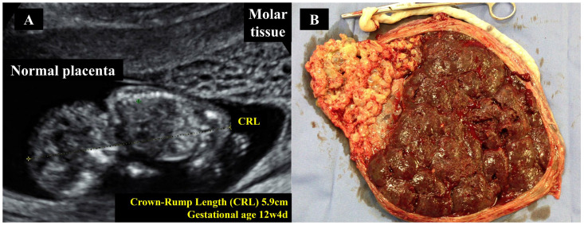
*Siêu âm 17 tuần: thai sống cạnh bánh nhau hỗn hợp có vùng nang; karyotype thai lưỡng bội, thai sinh đủ tháng 2.700 g. Nguồn: Braga A et al., Diagnostics 2025, PMC12386084, CC BY 4.0.*

## 6. Tự lượng giá — Blind Quiz

**Ca 1 — Bệnh nhân trễ kinh 8 tuần, ra máu âm đạo, tử cung to hơn tuổi thai, β-hCG tăng cao.**

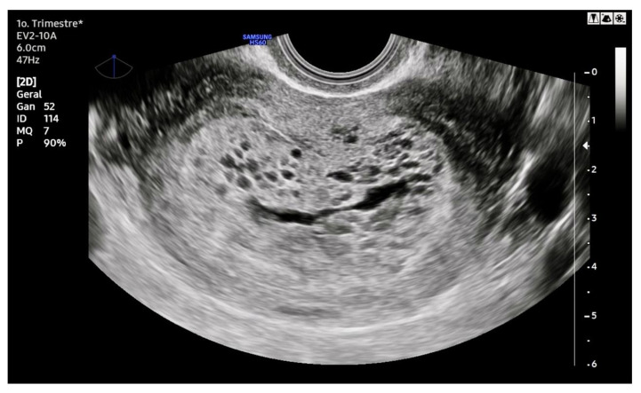

- Câu hỏi: Mô tả mẫu hình trong buồng tử cung. Có thấy phôi/thai không? Ba chẩn đoán phân biệt và dấu hiệu nào chốt?

<b>Bấm để hiện đáp án (findings + chẩn đoán)</b>

- **Dấu hiệu:** buồng tử cung chứa khối hồi âm dày với **vô số ổ trống âm nhỏ** ("bão tuyết"/"chùm nho"), **không thấy túi thai hay phôi**; tử cung to (12 cm ở tuổi thai 8 tuần trong ca nguồn).
- **Chẩn đoán:** **thai trứng toàn phần (CHM)** — gai nhau phù nề tạo nang dịch; không có thai vì toàn bộ vật liệu là từ bố.
- **Phân biệt:** thai lưu thoái hóa nước (ít nang hơn, hCG thấp), RPOC (có mạch nuôi, hCG giảm), PHM (phải có thai).
- **Chốt:** không có thai + khối nang toàn buồng tử cung + hCG rất cao; xác nhận bằng mô bệnh và **p57 âm**.
- **Mô đại thể:**

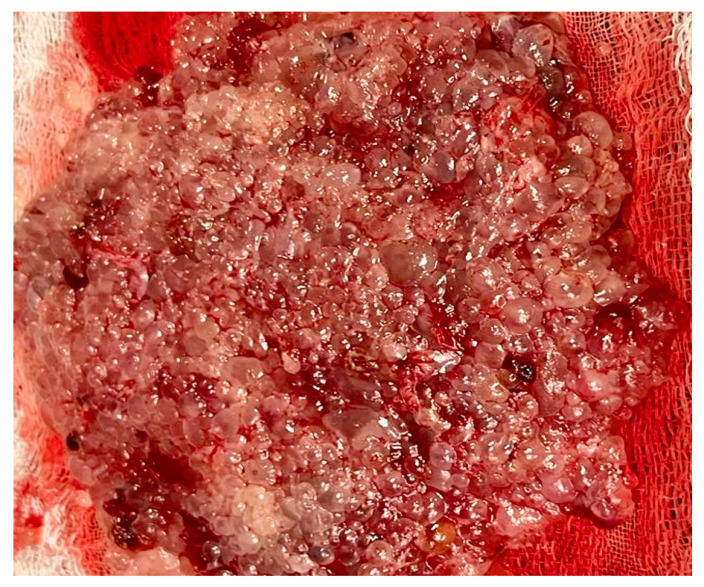

- Nguồn: Braga A et al., Diagnostics 2025, PMC12346673, CC BY 4.0.

**Ca 2 — Bệnh nhân ra máu, siêu âm thấy thai 14 tuần không tim thai; bánh nhau có vùng nang.**

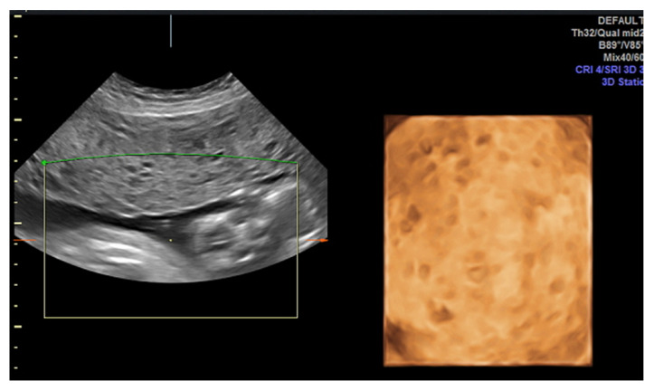

- Câu hỏi: Vì sao không thể gọi đây là thai trứng toàn phần? Cần xét nghiệm gì để phân biệt với thai lưu thoái hóa nước?

<b>Bấm để hiện đáp án (findings + chẩn đoán)</b>

- **Dấu hiệu:** có **thai không sống**; bánh nhau có **hai ổ trống âm lớn** (nang dịch) khu trú, phần còn lại của bánh nhau không đồng nhất.
- **Chẩn đoán:** **thai trứng bán phần (PHM)** — thể tam bội, có thành phần mẹ.
- **Chốt:** **p57 DƯƠNG** (khác CHM p57 âm); karyotype 69,XXX/XXY/XYY; mô bệnh có phù gai nhau + tăng sinh nguyên bào nuôi khu trú.
- **Không phải:** thai lưu thoái hóa nước đơn thuần — gai nhau còn mạch, không tăng sinh nguyên bào nuôi, hCG thấp hơn.
- **Mô đại thể:**

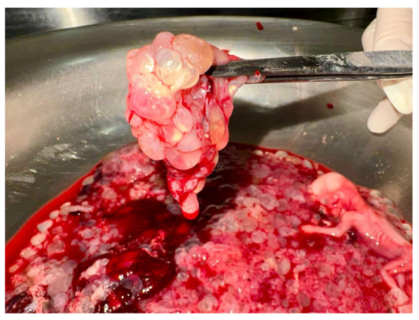

- Nguồn: Braga A et al., Diagnostics 2025, PMC12346673, CC BY 4.0.

**Ca 3 — Hai tiêu bản nhuộm p57 (A và B).**

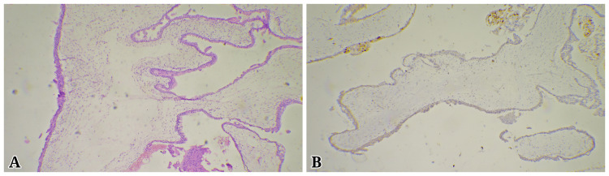

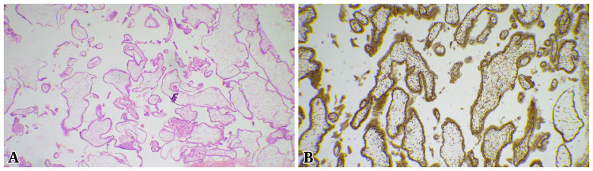

- Câu hỏi: Ảnh nào là thai trứng toàn phần, ảnh nào là bán phần? Giải thích cơ chế in dấu gen.

<b>Bấm để hiện đáp án (findings + chẩn đoán)</b>

- **A = thai trứng toàn phần:** p57 **ÂM** ở nguyên bào nuôi tế bào và mô đệm gai nhau (chỉ còn vài tế bào nhuộm nâu không đặc hiệu ở rìa).
- **B = thai trứng bán phần:** p57 **DƯƠNG** mạnh trong nhân nguyên bào nuôi và mô đệm.
- **Cơ chế:** *CDKN1C* là gen **in dấu mẹ** — chỉ alen mẹ biểu hiện. CHM không có DNA mẹ → không có p57; PHM có bộ nhiễm sắc thể mẹ → p57 dương.
- Nguồn: Nath A et al., Cureus 2026, PMC13353796, CC BY 4.0.

**Ca 4 — Bệnh nhân đã đủ con, lớn tuổi, hCG vẫn cao sau hút nạo; siêu âm nghi xâm lấn cơ; cắt tử cung.**

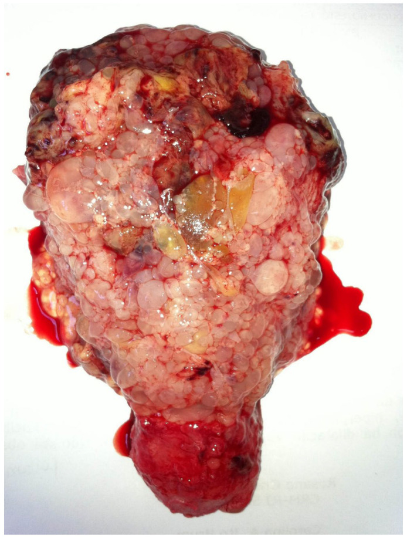

- Câu hỏi: Mô tả tổn thương trong cơ tử cung. Vì sao vẫn phải theo dõi hCG sau mổ?

<b>Bấm để hiện đáp án (findings + chẩn đoán)</b>

- **Dấu hiệu:** tử cung chứa **vô số nang trong suốt** xâm lấn sâu vào cơ tử cung, lan tới **mặt thanh mạc**; không còn ranh giới nội mạc–cơ rõ.
- **Chẩn đoán:** **thai trứng xâm lấn (invasive mole)** — mô nguyên bào nuôi xâm nhập cơ tử cung và mạch máu, nguy cơ thủng/chảy máu.
- **Vì sao vẫn theo dõi:** một số tế bào đã di căn trước mổ; ca nguồn vẫn **tăng hCG sau cắt tử cung** và phải hóa trị để đạt lui bệnh.
- Nguồn: Braga A et al., Diagnostics 2025, PMC12386084, CC BY 4.0.

**Ca 5 — 40 tuổi, nhìn mờ từng lúc + đau đầu; sau đó ngất, đồng tử phải giãn; β-hCG 29.122 → 36.201 mIU/mL; không có thai trong tử cung.**

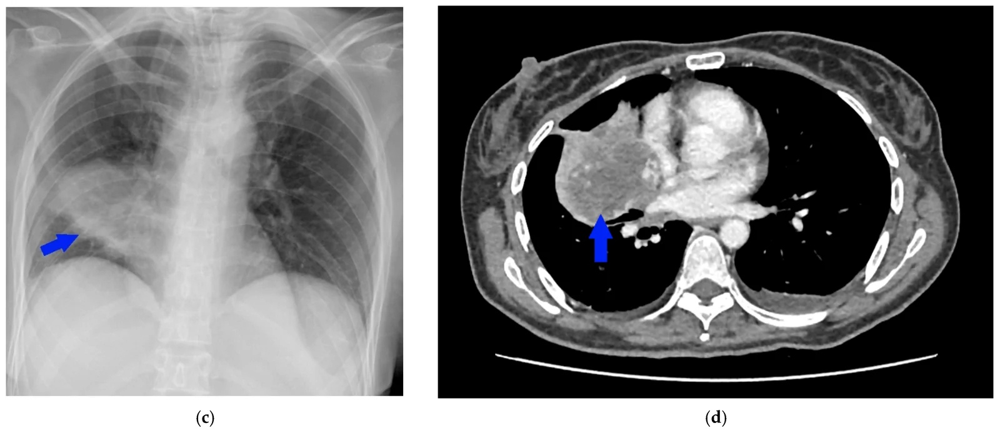

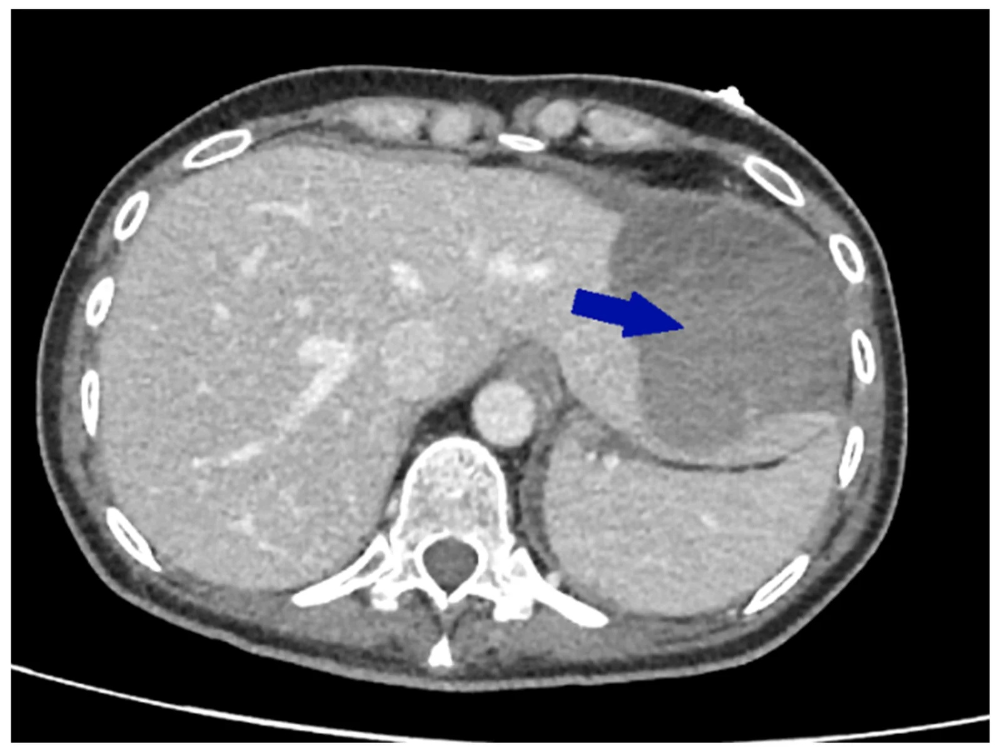

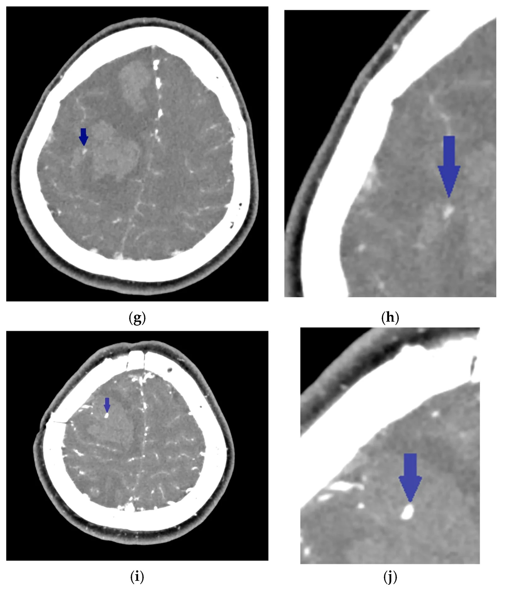

- Câu hỏi: Ba tầng tổn thương (phổi–gan–não) liên quan thế nào? Chẩn đoán và vì sao không thấy u nguyên phát?

<b>Bấm để hiện đáp án (findings + chẩn đoán)</b>

- **Dấu hiệu:** khối lớn **58 × 70 × 65 mm** thùy giữa phổi phải; **máu tụ dưới bao gan trái 99 × 77 × 126 mm** có vùng tăng đậm gợi ý chảy máu hoạt động; CTA đầu có **hai tổn thương tròn tăng ngấm, đường kính tới 2 mm** được hiểu là **phình mạch do tân sinh** (neoplastic aneurysm).
- **Chẩn đoán:** **choriocarcinoma di căn đa ổ** (phổi, gan, não) — mô bệnh từ gan xác nhận di căn choriocarcinoma; **điểm FIGO/WHO = 19 (nguy cơ rất cao)**.
- **Vì sao không thấy u nguyên phát:** khối nguyên phát ở tử cung có thể đã thoái triển; trường hợp này không xác định được nguồn gốc thai kỳ hay không do thiếu genotyping.
- **Điểm học:** xuất huyết đa ổ ở phụ nữ tuổi sinh sản → **đo β-hCG**; choriocarcinoma tăng sinh mạch, dễ vỡ nên biểu hiện bằng máu tụ.
- Nguồn: Szymaniuk D et al., Diagnostics 2026, PMC13511037, CC BY 4.0.

**Ca 6 — 13 tuần, hCG 451.790 IU/L, đau bụng cấp; siêu âm tử cung + hai buồng trứng.**

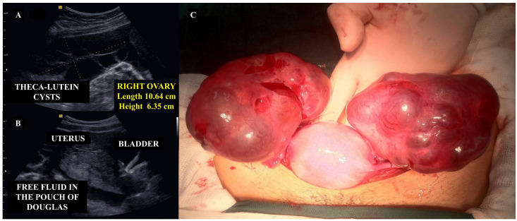

- Câu hỏi: Cấu trúc hai bên buồng trứng là gì? Biến chứng nào đã xảy ra và thái độ xử trí?

<b>Bấm để hiện đáp án (findings + chẩn đoán)</b>

- **Dấu hiệu:** buồng trứng phải có nang **nhiều ngăn, 10,64 × 6,35 cm**; tử cung chứa mô trứng; **dịch tự do túi cùng Douglas**; đại thể hai buồng trứng căng, có chỗ **vỡ và chảy máu hoạt động**.
- **Chẩn đoán:** **nang hoàng thể hóa (theca lutein cysts) hai bên** do hCG rất cao, biến chứng **vỡ nang gây máu bụng cấp**.
- **Xử trí:** hồi sức + cầm máu bằng khâu/đốt, **giữ buồng trứng** nếu có thể; nang thường thoái triển khi hCG âm. Vỡ nang chỉ **1–2%** nhưng có thể đe dọa tính mạng.
- Nguồn: Braga A et al., Diagnostics 2025, PMC12386084, CC BY 4.0.

## Bài liên quan chéo
- [550 – Thai sớm: sẩy thai & thai ngoài tử cung](../550-thai-som-say-thai-thai-ngoai-tu-cung/lesson.md)
- [560 – Nhau cài răng lược (PAS)](../560-nhau-cai-rang-luoc-PAS-cap-cuu-san/lesson.md)
- [565 – Sàng lọc hình thái thai & Doppler sản khoa](../565-sang-loc-hinh-thai-va-doppler-san-khoa/lesson.md)
- [566 – Song thai: chorionicity, TTTS & TAPS](../566-song-thai-chorionicity-TTTS-TAPS/lesson.md)
- [525 – Ung thư nội mạc tử cung: FIGO & MRI](../525-ung-thu-noi-mac-co-tu-cung-FIGO-MRI/lesson.md)
- [526 – Sarcoma tử cung vs u xơ](../526-sarcoma-tu-cung-vs-u-xo/lesson.md)

> Không dùng để chẩn đoán độc lập khi chưa có người hướng dẫn.
