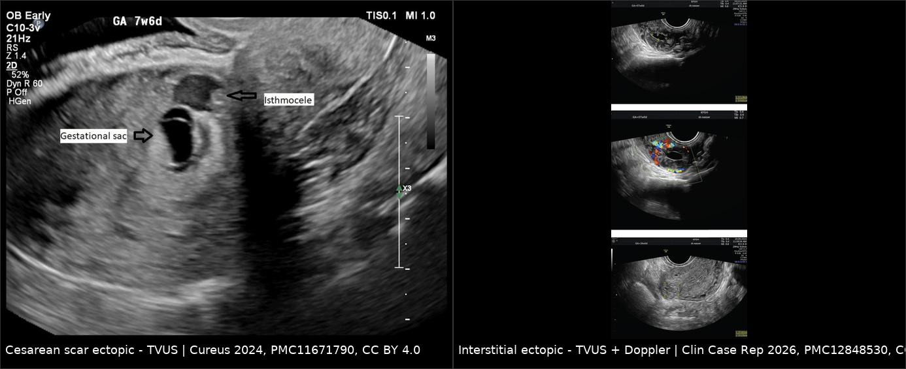
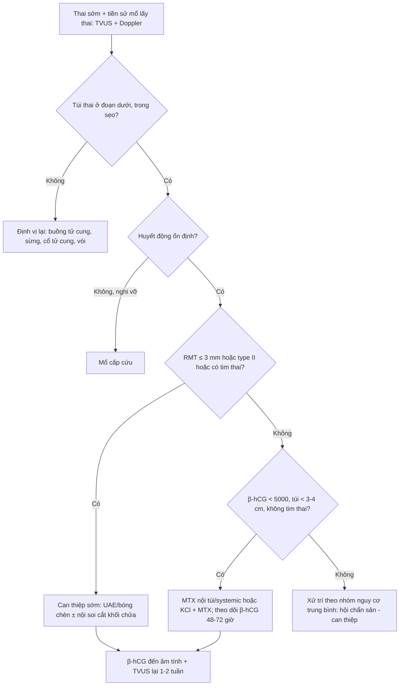
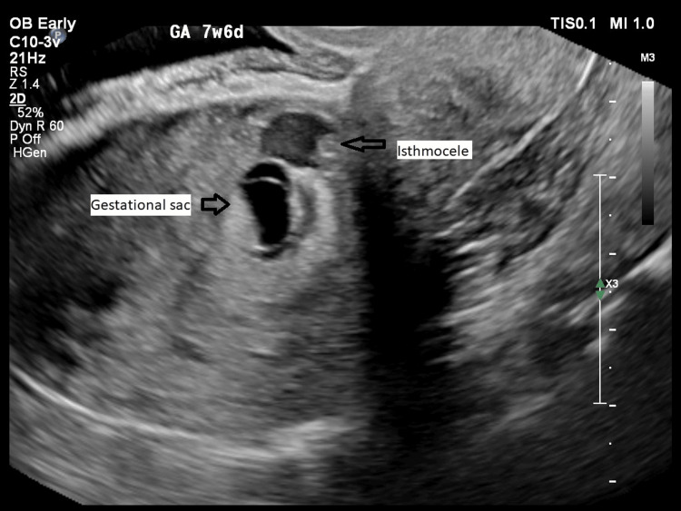
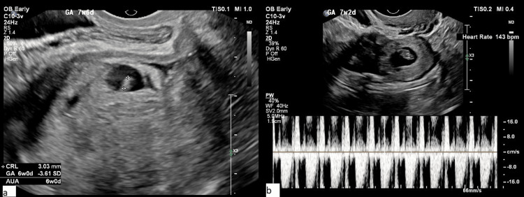
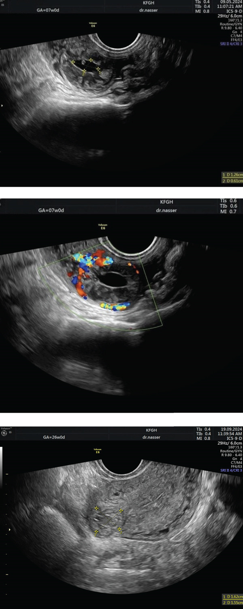

# 552 — Chửa ở sẹo mổ lấy thai & chửa góc: chẩn đoán sớm, nguy cơ vỡ, xử trí

**Tags:** `pattern:thai-som` `pattern:chua-ngoai-tu-cung` `vung:tu-cung-phan-phu` `protocol:TVUS-thai`
**Mức chắc chắn (certainty):** tổng hợp y văn (literature synthesis) — đối chiếu ca nguyên văn CC BY + tiêu chuẩn chẩn đoán siêu âm; số liệu dịch tễ lấy từ y văn, chỗ chưa thống nhất ghi rõ.

## 1. Tổng quan bệnh học – cơ chế hình ảnh

- **Chửa ở sẹo mổ lấy thai (cesarean scar ectopic pregnancy – CSEP):** túi thai làm tổ trong mô sẹo ở đoạn dưới tử cung trước, tại vị trí **isthmocele** (khuyết lõm của sẹo mổ cũ). Tần suất ước **1/1.800 – 1/2.500** thai, chiếm khoảng **6%** các chửa ngoài tử cung ở người có tiền sử mổ lấy thai; đang tăng song song với tỷ lệ mổ lấy thai.
- **TẠI SAO nguy hiểm:** sẹo mổ là mô xơ, mỏng, **không co rút**; gai nuôi (trophoblast) xâm nhập trực tiếp vào cơ tử cung và mạng mạch cung cấp máu dồi dào của đoạn dưới. Lớp cơ còn lại giữa túi thai và bàng quang chỉ vài mm → **vỡ sớm, chảy máu ồ ạt**, nguy cơ cắt tử cung và tử vong mẹ. CSEP cũng là bối cảnh của **nhau cài răng lược (PAS)** nếu thai tiến triển.
- **Phân loại Vial:** **type I (endogenic)** — túi thai phát triển vào buồng tử cung, lớp cơ còn dày hơn; **type II (exogenic)** — túi thai phát triển ra phía bàng quang, lớp cơ mỏng, **nguy cơ vỡ/chảy máu cao hơn**. Phân loại này định hướng xử trí.
- **Chửa góc (interstitial/cornual ectopic):** túi thai làm tổ ở **đoạn trong thành (interstitial) của vòi tử cung**, nằm trong cơ tử cung. Chiếm **2–4%** chửa ngoài tử cung; vỡ muộn hơn (thường **7–12 tuần**, có thể tới 16 tuần) nhưng khi vỡ thì mất máu rất nhanh vì mạch máu lớn, **tử vong mẹ 2–2,5%**.
- **TẠI SAO hình ảnh chẩn đoán được:** túi thai là cấu trúc echo trống (dịch) có viền echo dày (trophoblast); mô cơ tử cung đồng âm. Ba yếu tố quyết định: **(1) vị trí túi thai so với buồng tử cung và lỗ trong cổ tử cung; (2) độ dày cơ tử cung còn lại (residual myometrial thickness – RMT); (3) mạch nuôi quanh túi thai trên Doppler**. RMT càng mỏng, nguy cơ vỡ càng cao.
- **Ngưỡng định lượng hay dùng:** RMT **< 5 mm** (nhiều tác giả dùng **≤ 3 mm**) là dấu hiệu nguy cơ cao; chửa góc khi lớp cơ quanh túi **< 5 mm** và túi nằm lệch ra ngoài **> 1 cm** so với bờ buồng tử cung. β-hCG và kích thước túi thai dùng để chọn đường điều trị, không dùng để chẩn đoán vị trí.

## 2. Mẫu hình + chẩn đoán phân biệt theo vị trí (gamut)

Câu hỏi định vị theo thứ tự: **buồng tử cung có rỗng không? → ống cổ tử cung có rỗng không? → túi thai nằm ở đoạn dưới, sừng, hay cổ tử cung? → lớp cơ quanh túi dày bao nhiêu mm?**

Gamut theo vị trí:

- **Đoạn dưới tử cung, mặt trước, tại sẹo mổ:** CSEP type I/II; chửa làm tổ thấp trên sẹo (scar implantation); thai bám thấp đang di chuyển.
- **Sừng tử cung:** chửa góc/interstitial; **chửa góc (angular)** — túi thai nằm trong buồng tử cung ở góc, lớp cơ bao quanh đầy đủ; khối u sừng (u xơ).
- **Cổ tử cung:** chửa cổ tử cung (cervical ectopic); polyp/máu cục; nang Naboth.
- **Buồng tử cung nhưng bất thường:** thai đang sẩy di chuyển (miscarriage in transit), túi thai giả (pseudogestational sac) do thai ngoài tử cung.
- **Ngoài tử cung điển hình:** vòi tử cung, buồng trứng, ổ bụng — luôn loại trừ trước khi kết luận “chửa trong tử cung bất thường”.

## 3. Bảng so sánh phân biệt (ma trận đối chiếu)

| Thực thể (entity) | Hình ảnh điển hình | Chốt vào (rule-in) | Chốt loại (rule-out) | Gợi ý xác nhận |
|---|---|---|---|---|
| **CSEP (sẹo mổ lấy thai)** | Túi thai ở **đoạn dưới mặt trước**, trong khuyết sẹo; buồng tử cung và ống cổ tử cung **rỗng**; RMT mỏng | **Túi thai tại isthmocele + RMT ≤ 3 mm + Doppler mạch nuôi quanh túi + không trượt (negative sliding sign)** | Túi thai trượt theo đầu dò ấn vào = thai trong buồng/sẩy; túi thai dưới lỗ trong = cervical | TVUS + color Doppler; MRI nếu cần đánh giá xâm lấn |
| **Chửa góc (interstitial/cornual)** | Túi thai **lệch một bên, ngoài bờ buồng tử cung > 1 cm**, lớp cơ quanh **< 5 mm** | **Interstitial line sign** (đường echo từ buồng tử cung tới túi thai) + lớp cơ mỏng + lệch trục | Túi thai trong buồng, lớp cơ đều > 5 mm = thai bình thường/góc thật | TVUS + Doppler; MRI khi không rõ |
| **Chửa cổ tử cung** | Túi thai trong ống cổ tử cung, cổ tử cung phình, **eo tử cung rỗng** | **Túi thai dưới lỗ trong + eo rỗng**, mạch nuôi quanh túi | Túi thai ở đoạn dưới mặt trước = CSEP; thai trong buồng = bình thường | TVUS; tránh nạo vét mù |
| **Thai đang sẩy (miscarriage in transit)** | Túi thai biến dạng, **di động theo đầu dò**, cổ tử cung mở, máu cục | **Sliding sign dương tính**, túi thai di chuyển tự do trong ống cổ tử cung | Túi thai cố định trong cơ/sẹo → nghĩ CSEP/góc | TVUS lặp sau 24–48 giờ, β-hCG |
| **Túi thai giả (pseudogestational sac)** | Dịch trong buồng tử cung, hình bầu dục, **không có viền trophoblast dày**, không có yolk sac | **Không có yolk sac/phôi + β-hCG tăng chậm** | Có yolk sac → thai thật | TVUS + β-hCG serial |
| **Chửa ống cổ tử cung do u xơ/polyp** | Khối echo hỗn hợp trong ống cổ tử cung, không có túi thai | **Không có túi thai/yolk sac**, có cấu trúc mô đặc | Có túi thai + mạch nuôi → chửa cổ tử cung | Soi cổ tử cung/MRI |

*Trái: CSEP — túi thai nằm trong khuyết sẹo (isthmocele) ở đoạn dưới mặt trước, buồng tử cung rỗng. Phải: chửa góc — túi thai lệch ngoài bờ buồng tử cung, Doppler quanh túi. Nguồn: Cureus 2024 (PMC11671790) và Clin Case Rep 2026 (PMC12848530), CC BY 4.0; ảnh ghép letterbox.*

## 4. Protocol chụp + hệ phân độ/điểm chuẩn hóa

**Siêu âm là chuẩn vàng đầu tay**
- **TVUS + color Doppler**: đánh giá buồng tử cung, ống cổ tử cung, vị trí túi thai, **RMT tại điểm mỏng nhất**, đường kính túi thai, phôi/yolk sac, tim thai.
- Đo **khoảng cách túi thai tới bàng quang** và bề dày cơ trước; ghi rõ **mm**.
- **MRI** khi TVUS không rõ, nghi xâm lấn bàng quang/PAS, hoặc trước mổ nội soi.
- Không dùng **nạo vét buồng tử cung mù** để “chẩn đoán” — nguy cơ chảy máu và vỡ.

**Phân tầng xử trí CSEP (theo tình trạng huyết động + type + RMT + β-hCG)**

| Nhóm | Đặc điểm | Hướng xử trí |
|---|---|---|
| Cấp cứu | Vỡ, sốc, chảy máu ồ ạt | Mổ ngay (nội soi/ mở), cắt khối chửa hoặc cắt tử cung nếu không cầm máu |
| Nguy cơ cao | Type II/exogenic, RMT **≤ 3 mm**, thai có tim, β-hCG cao | Can thiệp sớm: nút mạch tử cung (UAE) ± bóng chèn, phẫu thuật nội soi cắt khối chửa |
| Nguy cơ trung bình | Type I/endogenic, RMT 3–5 mm, túi thai nhỏ | KCl nội túi + MTX nội túi/systemic; theo dõi β-hCG |
| Nguy cơ thấp, ổn định | Túi thai nhỏ, không tim thai, β-hCG **< 5.000 mIU/mL** | MTX đơn thuần hoặc theo dõi sát theo protocol (bằng chứng còn hạn chế) |

- **Ngưỡng MTX thường dùng** (từ kinh nghiệm chửa ngoài tử cung, không phải guideline riêng cho CSEP): β-hCG **< 5.000 mIU/mL**, không có tim thai, túi thai **< 3–4 cm**, huyết động ổn định.
- **Chửa góc:** không vỡ + kích thước **< 3,5–4 cm** + không tim thai + β-hCG **< 5.000 mIU/mL** → MTX; có tim thai, β-hCG cao, hoặc nghi vỡ → **nội soi cắt sừng (cornuotomy)/cắt đoạn sừng**.
- Theo dõi sau điều trị: β-hCG mỗi **48–72 giờ** đến khi âm tính; TVUS lại sau 1–2 tuần; dặn tái khám ngay nếu đau bụng dữ, chóng mặt, ra máu nhiều.

## 5. Biến thể bình thường và cạm bẫy

- **“Sliding sign”:** ấn đầu dò vào cổ tử cung — túi thai trong buồng/sẩy sẽ **trượt**, túi thai trong sẹo **cố định**. Đây là động tác rẻ tiền nhưng quyết định.
- **Thai bám thấp bình thường** ở đoạn dưới có thể trông giống CSEP khi cổ tử cung chưa mở; đừng chẩn đoán nếu **không thấy khuyết sẹo/isthmocele** và RMT đều.
- **Đo RMT sai vì mặt phẳng:** phải đo ở mặt phẳng **đứng dọc giữa (mid-sagittal)** qua túi thai, vuông góc với thành trước; đo ở mặt phẳng chếch làm cơ trông dày hơn.
- **Chửa góc vs thai góc thật (angular):** thai góc thật nằm **trong buồng tử cung**, lớp cơ bao quanh đầy đủ; chửa góc nằm **ngoài bờ**, lớp cơ mỏng — đừng nhầm để mổ oan.
- **β-hCG không định vị được túi thai:** khi β-hCG trên **3.500 mIU/mL** mà TVUS không thấy túi thai trong buồng, phải tìm chửa ngoài tử cung (kể cả CSEP/góc) trước khi kết luận “thai quá sớm”.
- **Bẫy hài lòng:** thấy túi thai “trong tử cung” rồi bỏ qua việc đo khoảng cách tới bàng quang — CSEP là nguyên nhân chảy máu chí mạng hay bị bỏ sót.
- **Sau điều trị bảo tồn:** khối chửa có thể còn thấy trên siêu âm nhiều tuần; theo dõi **β-hCG** chứ không chỉ hình ảnh, tránh can thiệp lặp không cần thiết.

## 6. Tự lượng giá — Blind Quiz

**Ca 1 — Thai 7 tuần 6 ngày, tiền sử mổ lấy thai, đau bụng nhẹ, không ra máu.**

- Câu hỏi: Túi thai nằm ở đâu? Cấu trúc mũi tên là gì? Đo gì để quyết định nguy cơ?

<b>Bấm để hiện đáp án (findings + chẩn đoán)</b>

- Dấu hiệu: túi thai (gestational sac) nằm ở **đoạn dưới mặt trước**, ngay trong khuyết sẹo (isthmocele); buồng tử cung phía trên rỗng.
- Chẩn đoán: **chửa ở sẹo mổ lấy thai (CSEP)**. Cần đo **RMT** (lớp cơ giữa túi thai và bàng quang) và tìm tim thai; RMT **≤ 3 mm** = nguy cơ vỡ cao.
- Xử trí: hội chẩn sản–can thiệp; tùy RMT/type/tim thai chọn MTX, KCl, UAE ± nội soi.
- Nguồn ảnh: Cureus 2024 (PMC11671790), CC BY 4.0.

**Ca 2 — Cùng bệnh nhân, siêu âm thấy phôi và tim thai.**

- Câu hỏi: Có tim thai thay đổi lựa chọn điều trị thế nào? Vì sao không nạo vét?

<b>Bấm để hiện đáp án (findings + chẩn đoán)</b>

- Dấu hiệu: phôi (CRL ~3 mm) trong túi thai; phổ Doppler tim thai **143 lần/phút**.
- Ý nghĩa: thai **còn sống** → MTX đơn thuần ít hiệu quả; thường cần **KCl nội tim/thai + MTX nội túi** hoặc phẫu thuật/nút mạch tùy RMT.
- Không nạo vét mù: sẹo mỏng + mạch nuôi lớn → **nguy cơ thủng/vỡ và chảy máu ồ ạt**.
- Nguồn ảnh: Cureus 2024 (PMC11671790), CC BY 4.0.

**Ca 3 — Thai 7 tuần, đau hố chậu phải, β-hCG tăng; buồng tử cung rỗng.**

- Câu hỏi: Túi thai nằm ở vị trí nào? Dấu hiệu nào phân biệt với thai trong buồng? Ngưỡng điều trị nội khoa?

<b>Bấm để hiện đáp án (findings + chẩn đoán)</b>

- Dấu hiệu: túi thai **lệch ra ngoài bờ buồng tử cung**, lớp cơ quanh túi mỏng; Doppler có mạch nuôi quanh túi (vòng tăng sinh).
- Chẩn đoán: **chửa góc (interstitial ectopic)** — 2–4% chửa ngoài tử cung; nguy cơ vỡ 7–12 tuần với mất máu nặng.
- Điều trị: nếu không vỡ, túi **< 3,5–4 cm**, không tim thai, β-hCG **< 5.000 mIU/mL** → MTX (systemic hoặc nội túi); nếu có tim thai/β-hCG cao/nghi vỡ → nội soi cắt sừng.
- Nguồn ảnh: Clin Case Rep 2026 (PMC12848530), CC BY 4.0.

## Bài liên quan chéo
- [550 – Thai sớm: SRU, ngoài tử cung & vòng lửa](../550-thai-som-say-thai-thai-ngoai-tu-cung/lesson.md)
- [560 – Nhau cài răng lược: lacunae, cơ < 1 mm & dải T2](../560-nhau-cai-rang-luoc-PAS-cap-cuu-san/lesson.md)
- [571 – Sẩy thai tái diễn: tiếp cận hình ảnh](../571-say-thai-tai-dien-tiep-can-hinh-anh/lesson.md)
- [563 – Bất thường rau–bánh nhau sớm](../563-bat-thuong-rau-banh-nhau-som/lesson.md)

> Không dùng để chẩn đoán độc lập khi chưa có người hướng dẫn.
