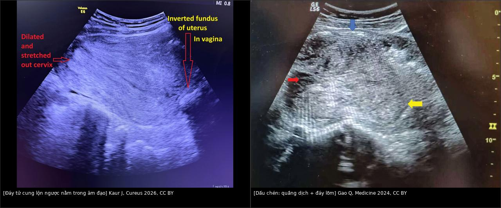
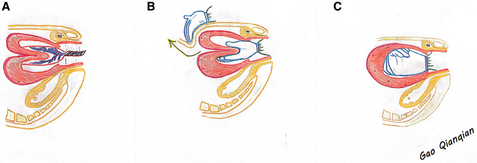
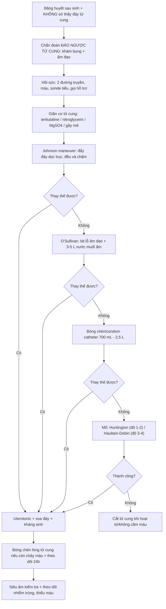
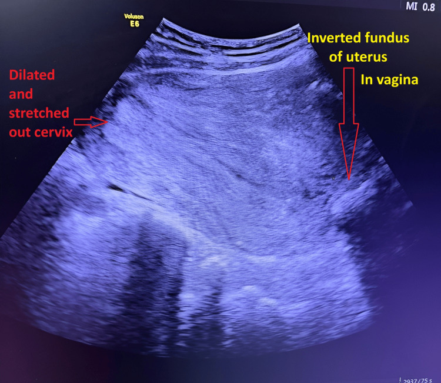
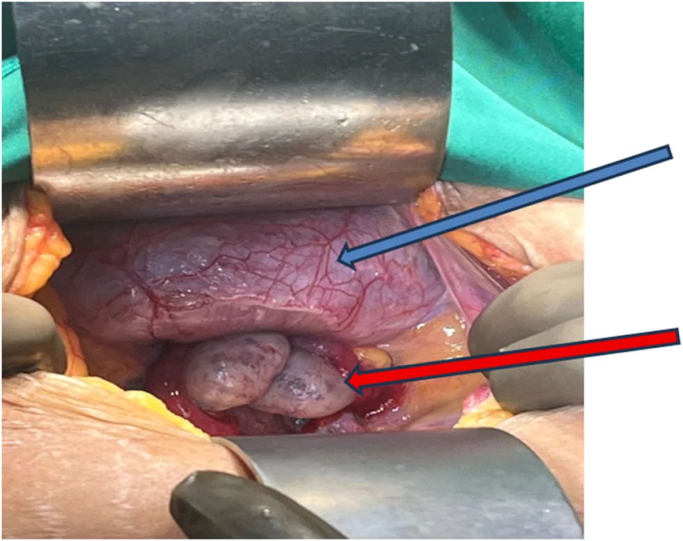
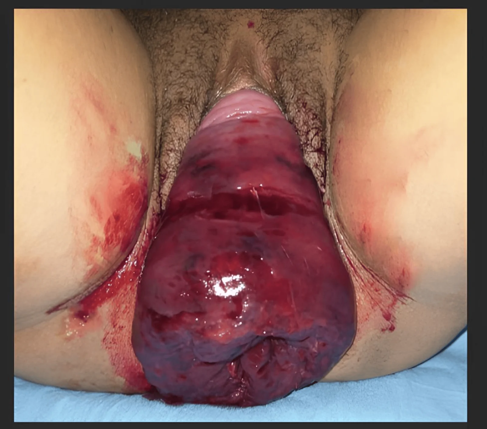

# 553 — Đảo ngược tử cung DO SINH (puerperal uterine inversion): cấp cứu sản khoa trong 30 phút đầu / Puerperal uterine inversion — the obstetric emergency of the third stage

**Tags:** `pattern:dao-nguoc-tu-cung` `pattern:khoi-sa-qua-am-dao` `vung:tu-cung` `vung:am-dao` `protocol:sieu-am-cap-cuu` `score:do-1-4`
**Mức chắc chắn (certainty):** tổng hợp y văn (literature synthesis) — số liệu quần thể từ nghiên cứu Nationwide Inpatient Sample 2004–2013 (AJOG 2017, PMID 28522320), kỹ thuật và tỉ lệ thành công từ ca nguyên văn/tổng quan có ảnh CC BY (PMC13224523, PMC13340646, PMC11049735, PMC13544666, PMC13571831, PMC11800658). Các ca dùng làm quiz đọc trực tiếp từ bài gốc.

## 1. Tổng quan bệnh học – cơ chế hình ảnh

- **Định nghĩa:** **đáy tử cung lộn vào trong** (về phía buồng tử cung) rồi **đi qua cổ tử cung**, có thể **lộ ra ngoài âm hộ**. Đây là **cấp cứu sản khoa của giai đoạn 3 chuyển dạ**, xảy ra **ngay sau sinh** — đa số **trong 30 phút đầu** (Sali 2026, PMC13571831).
- **Phân loại theo thời gian:** **cấp (acute) < 24 giờ**; **bán cấp (subacute) 24 giờ – 4 tuần**; **mạn (chronic) > 4 tuần** sau sinh (Marlina 2024, PMC11283650).
- **Phân độ theo mức lộn (4 độ — dùng thống nhất trong bài):**
  - **Độ 1:** đáy tử cung **lõm vào buồng nhưng chưa qua lỗ cổ trong** (incomplete).
  - **Độ 2:** đáy **đã qua vòng cổ tử cung nhưng chưa tới tầng sinh môn**.
  - **Độ 3:** đáy **tới tầng sinh môn**.
  - **Độ 4:** **cả âm đạo lộn ra ngoài** cùng tử cung (Marlina 2024; Gao 2024).
  - *Lưu ý:* y văn có cách đánh số khác (một số bài gọi "độ 1 = chưa qua cổ") — khi đọc nguồn phải **đối chiếu mô tả**, đừng chỉ tin con số. Bài 544 dùng cách đánh số của Herath cho thể không do sinh.
- **Dịch tễ (số liệu quần thể Mỹ, 8.294.279 ca sinh 2004–2013):** **2,9/10.000 ca sinh** (95% CI 2,8–3,0) — tức **~1/3.450**; y văn khác nêu **1/2.000 – 1/20.000** (Sali 2026) hoặc **0,5–4/10.000** (Zhang 2026, PMC13224523). Tỉ lệ **không đổi** trong 10 năm.
- **Kết cục (cùng nghiên cứu quần thể):** **băng huyết sau sinh 37,7%**; **truyền máu 22,4%**; **cần can thiệp phẫu thuật 6,0%**; **cắt tử cung 2,8%**; **tử vong mẹ 1 ca = 4,1/10.000 biến cố (~0,04%)**; nằm viện trung vị **3 ngày**. Các series khác ghi **PPH 37,7–86,7%**, **sốc 39–47%** (Zhang 2026).
- **Yếu tố nguy cơ:** **kéo dây rốn quá mức trước khi bánh nhau bong** (hay gặp nhất — 5/10 ca trong một series), **dây rốn ngắn**, **thai to**, **đa thai/đa ối (tử cung căng quá mức)**, **nhau bám đáy**, **nhau cài răng lược (PAS)**, **bóc nhau bằng tay**, **chuyển dạ nhanh (precipitous)**, **MgSO₄/giãn cơ tử cung**, **dị tật tử cung**, **tiền sử đảo ngược tử cung**, **con so** (Zhang 2026; Pelden 2026, PMC13544666).
- **Sinh lý bệnh:** (1) một vùng thành tử cung **mất trương lực/kéo xuống** → (2) **đáy lõm** rồi **lộn qua cổ** → (3) **vòng thắt (constriction ring)** hình thành ở cổ → **nghẹt** khối, **chảy máu và phù nề** tăng dần. Càng muộn, **vòng thắt càng cứng** → thay thế bằng tay càng khó.
- **TẠI SAO sốc "nặng hơn lượng máu mất":** ngoài **giảm thể tích**, còn **thành phần thần kinh (neurogenic)** do **kéo giãn thần kinh đối giao cảm vùng chậu** → **mạch chậm + tụt huyết áp**; vì vậy **sốc có thể không tương xứng với lượng máu nhìn thấy** (Kaur 2022, PMC11800658). **Đây là lý do không được chờ "đủ máu mất" mới chẩn đoán.**
- **TẠI SAO hình ảnh trông như vậy (vật lý siêu âm):**
  - **Mất đáy tử cung ở vị trí bình thường** → trên mặt cắt dọc, tử cung mất cấu trúc "quả lê"; thay vào đó là **khối đặc trong âm đạo/cổ tử cung**.
  - **Dấu chén (cupping)/"target sign":** **đáy lộn ngược** là một khối **giảm–trung âm ở trung tâm**, được bao bởi **quầng dịch (plasma layer)** và **thành tử cung dày** → tạo **hình chén/chữ U** (Gao 2024 mô tả: mũi tên xanh = lớp dịch thành trước, mũi tên đỏ = **cấu trúc chén** sau lộn ngược, mũi tên vàng = **mô đáy lộn vào buồng**).
  - **Vì sao có quầng dịch:** khoang giữa **thanh mạc lộn vào** và **thành âm đạo** chứa dịch/phù → **vô âm**, tạo viền tối trên siêu âm — chính là "khe" giải phẫu bị đảo.
  - **Không cần đo "mm" để chẩn đoán:** đây là **chẩn đoán lâm sàng**; siêu âm chỉ **xác nhận tại giường** và loại trừ nguyên nhân khác, **không được làm chậm thay thế tử cung**.
- **Ngưỡng định lượng cần nhớ:** **2,9/10.000**; **PPH 37,7%**; **truyền máu 22,4%**; **cắt tử cung 2,8%**; **thay thế bằng tay thành công 80–100%**; **O'Sullivan 3–5 L nước muối ấm, 3–5 phút**; **bóng chèn/condom thành công ~96,7%**; **PPH OR 16,89** khi có đảo ngược tử cung.

## 2. Mẫu hình + chẩn đoán phân biệt theo vị trí (gamut)

- **Ba câu hỏi lâm sàng chốt (đặt trước khi nhìn máy):**
  1. **Sờ bụng có thấy đáy tử cung không?** (đảo ngược: **KHÔNG sờ thấy đáy**, bụng dưới mềm/lõm).
  2. **Khám âm đạo có khối không? Có thấy cổ tử cung không?** (đảo ngược: **khối đỏ, mềm, không thấy cổ/lỗ cổ**; đảo ngược độ 1–2 có thể chỉ "cổ tử cung dày, lỗ cổ mở").
  3. **Máu mất có tương xứng với sốc không?** (sốc **không tương xứng**, **mạch chậm** → gợi ý thành phần thần kinh của đảo ngược).
- **Gamut "băng huyết sau sinh + KHÔNG sờ thấy đáy tử cung":**
  - **Đảo ngược tử cung (bài này)** — khối trong âm đạo, không thấy đáy.
  - **Đờ tử cung (atony)** — tử cung **to, mềm, đáy còn**, xoa thấy co.
  - **Sót nhau (RPOC)** — tử cung còn, lòng tử cung có khối; chảy máu sau sinh muộn.
  - **Rách đường sinh dục/âm đạo, tụ máu âm đạo–đáy chậu** — tử cung bình thường, khối máu ở thành âm đạo.
  - **Vỡ tử cung** — đau, bụng phản ứng, thai/máu ổ bụng, mất liên tục cơ.
  - **Rối loạn đông máu** — chảy máu rỉ rả, tử cung co tốt.
- **Gamut "khối sa qua âm đạo ngay sau sinh":**
  - **Đảo ngược tử cung (độ 3–4).**
  - **U xơ/polyp có cuống sa ra** — **thấy cổ tử cung**, có **cuống** (bài 544).
  - **Sa tử cung/âm đạo** — thấy cổ ở đỉnh, niêm mạc âm đạo.
  - **Khối ác tính hoại tử sa lộ** — bề mặt loét, mùi hôi.
  - **Máu tụ/khối máu âm đạo** — bề mặt niêm mạc, không có cấu trúc tử cung.
- **Chốt phân biệt:** **thấy lỗ vòi trứng ở đỉnh khối** = đảo ngược; **thấy cổ tử cung + cuống** = u xơ/polyp; **thấy cổ ở đỉnh khối** = sa sinh dục.

## 3. Bảng so sánh phân biệt (ma trận đối chiếu)

| Thực thể (entity) | Hình ảnh/lâm sàng điển hình | Chốt vào (rule-in) | Chốt loại (rule-out) | Gợi ý xác nhận |
|---|---|---|---|---|
| **Đảo ngược tử cung do sinh (bài này)** | **Không sờ thấy đáy tử cung**; khối đỏ trong âm đạo; US: **dấu chén**, khối trong âm đạo, **mất cấu trúc tử cung bình thường** | **Không thấy đáy + khối trong âm đạo + sốc/PPH ngay sau sinh** | Thấy đáy tử cung trên bụng → không phải đảo ngược | **Lâm sàng là chốt**; US tại giường ± MRI sau ổn định |
| **Đờ tử cung (atony)** | Tử cung **to, mềm**, đáy **còn**, xoa co lại; máu đỏ tươi ồ ạt | **Đáy tử cung còn + mềm + đáp ứng thuốc co** | Không sờ được đáy → nghi đảo ngược | Xoa đáy + oxytocin; US |
| **U xơ/polyp có cuống sa ra** | Khối có **cuống nối vào cổ**, **cổ tử cung vẫn thấy**, thường không sốc cấp | **Cổ tử cung hiện diện + cuống mạch** | Không thấy cổ, không có cuống → đảo ngược | Soi/cắt + mô bệnh; MRI nếu cần |
| **Sa tử cung–âm đạo** | Khối sa **có cổ tử cung ở đỉnh**, niêm mạc âm đạo; POP‑Q dương | **Cổ tử cung ở đỉnh + luồn được que** | Mất cổ, buồng chữ U → đảo ngược | Khám; MRI |
| **Sót nhau (RPOC)** | Chảy máu muộn, tử cung còn, lòng tử cung khối tăng âm, **Doppler có mạch** | **Tử cung còn + khối trong lòng + chảy máu muộn** | Không có khối trong lòng, đáy mất → đảo ngược | US; nạo hút |
| **Vỡ tử cung** | Đau dữ dội, **bụng phản ứng**, thai suy, **dịch ổ bụng**, mất liên tục cơ | **Mất liên tục cơ tử cung + dịch ổ bụng** | Cơ liên tục, đáy mất → đảo ngược | US cấp + CT/mổ |
| **Đảo ngược KHÔNG do sinh (bài 544)** | Khối sa mạn, **32% ác tính**, u xơ/sarcoma trong lòng | **Không liên quan thai kỳ + khối sa mạn + u trong buồng** | Bối cảnh ngay sau sinh → thể do sinh | MRI + mô bệnh |

*Trái: siêu âm bụng — **đáy tử cung lộn ngược nằm trong âm đạo**, cổ tử cung **giãn và căng**; phải: **dấu chén** với **quầng dịch thành trước** (mũi tên xanh), **cấu trúc chén** (mũi tên đỏ) và **mô đáy lộn vào buồng** (mũi tên vàng). Nguồn: Kaur J et al., Cureus 2026 (PMC13340646), CC BY 4.0 + Gao Q et al., Medicine 2024 (PMC11049735), CC BY 4.0. Ảnh ghép letterbox, giữ nguyên tỷ lệ.*

### Dấu hiệu đọc chuẩn xác
- **Siêu âm không phải "cửa chốt"**: chẩn đoán dựa vào **khám bụng + khám âm đạo**. Siêu âm giúp **xác nhận** và loại trừ (đờ tử cung, sót nhau, dịch ổ bụng) nhưng **không được trì hoãn thay thế** — ca nguyên văn cho thấy **bỏ qua hình ảnh để mổ ngay** khi sốc tiến triển là quyết định đúng (Kaur 2022).
- **Độ 2 trên siêu âm** có thể chỉ thấy **"tử cung ngắn, cổ dày"**, dễ bị đọc là **u xơ sa/polyp** — nếu **không thấy đáy tử cung trên bụng**, hãy nghĩ đảo ngược trước.
- **MRI** (khi bệnh nhân đã ổn định, chẩn đoán chưa rõ hoặc nghi nguyên nhân u): **buồng tử cung chữ U**, **đáy lộn ngược dày**, **"mắt bò"**, **vòi–dây chằng tròn chạy vào trung tâm** (bài 544 mô tả chi tiết).

## 4. Protocol cấp cứu + phân độ

- **Nguyên tắc vàng: chẩn đoán bằng tay, xử trí ngay, không chờ phim.** Thứ tự:
  1. **Gọi hỗ trợ** (sản khoa, gây mê, điều dưỡng, huyết học) + **2 đường truyền lớn**, máu/crystalloid, **cross-match**.
  2. **Đặt sonde tiểu** (làm rỗng bàng quang — bàng quang rỗng giúp thay thế dễ hơn và tránh chấn thương).
  3. **Giảm đau/giãn cơ tử cung:** **terbutaline 0,25 mg dưới da**, **nitroglycerin 50–100 µg TM** từng liều, hoặc **MgSO₄ 5 g TM** (ca Gao 2024 dùng 5 g); **gây mê toàn thân** nếu cần — vì **vòng thắt cổ tử cung** là trở ngại chính. *Cảnh báo:* giãn cơ có thể **làm nặng chảy máu** — phải **song song hồi sức** (Kaur 2022).
  4. **Johnson maneuver (đầu tay):** đặt **lòng bàn tay/lòng bàn tay nắm** vào **đáy lộn ngược**, **đẩy dọc trục âm đạo–tử cung**, **đều và chậm**; tay kia **ép trên bụng** để giữ tử cung. **Thành công 80–100%** (Zhang 2026). Thực hiện **càng sớm càng tốt** trước khi vòng thắt hình thành.
  5. **Nếu thất bại — O'Sullivan (thủy lực):** bịt **lỗ âm đạo** (Alice clamp/bóng), bơm **3–5 L nước muối ấm** vào âm đạo → **áp lực thủy tĩnh** đẩy tử cung về; **thành công trong 3–5 phút**, phù hợp khi **chưa có vòng thắt cứng** (Zhang 2026).
  6. **Bóng chèn/condom catheter:** bơm **700 mL – 2,5 L** tùy ca; trong series 8 ca, **6 ca thủy lực bằng condom catheter** thành công; tổng hợp y văn **~96,7%** (Lakshmy 2019 dẫn trong PMC9038538).
  7. **Phẫu thuật khi thất bại:** **Huntington** (mở bụng, kéo **dây chằng tròn/thành tử cung** bằng kẹp không sang chấn + đẩy từ âm đạo) — phù hợp **độ 1–2**; **Haultain** (rạch **thành sau** vòng thắt rồi thay thế) hoặc **Dobin** (rạch **thành trước**) — cho **độ 3–4 có vòng thắt cứng**; **cắt tử cung** khi hoại tử/không cầm máu (2,8% trong nghiên cứu quần thể).
  8. **Sau khi thay thế:** **oxytocin/uterotonic** để tử cung co, **xoa đáy nhẹ**, **bóng chèn lòng tử cung (Bakri 360 mL trong ca PMC11800658)** nếu chảy máu, **kháng sinh phổ rộng** (piperacillin–tazobactam 4,5 g q8h trong ca PMC11800658), **theo dõi hemoglobin, nước tiểu, dấu hiệu nhiễm trùng**.
- **Xử trí nhau:** nếu **nhau còn dính**, **thay thế tử cung trước rồi mới bóc nhau** (bóc nhau khi tử cung còn lộn làm tăng chảy máu và khó cầm); nếu **nhau đã bong và đang chảy máu nhiều**, **thay thế ngay** rồi kiểm soát lòng tử cung.
- **Phòng ngừa (giai đoạn 3 chuyển dạ):** **oxytocin sau khi vai trước ra** để tử cung co tốt; **kéo dây rốn có kiểm soát** đúng kỹ thuật, **không kéo mạnh khi tử cung chưa co**; **tránh kéo dây rốn khi nhau chưa bong**; nhận diện sớm **đáy tử cung mất** (Zhang 2026).
- **Theo dõi sau thay thế:** **siêu âm kiểm tra** (đáy về đúng vị trí, không tụ dịch), **theo dõi 24 giờ** vì nguy cơ **đảo ngược tái phát/đờ tử cung**; **bóng chèn** dự phòng khi cổ tử cung **mở rộng (patulous)** (Yang 2026, PMC12757945).

*(A) Tử cung đảo ngược + bánh nhau còn dính; (B) đáy và thân tử cung đã lộn vào lỗ cổ — **đặt đáy vào lòng bàn tay phải, đẩy đều và chậm dọc trục tiểu khung**, tay trái **ép trên bụng** để giữ tử cung, phần gần cổ tử cung **về trước**; (C) sau khi về đúng giải phẫu, **nắm tay giữ đáy + uterotonic**, rồi **rút tay chậm** theo cơn co. Nguồn: Gao Q et al., Medicine 2024 (PMC11049735), Fig. 2, CC BY 4.0.*

## 5. Biến thể bình thường và cạm bẫy

- **Cạm bẫy 1 — chờ siêu âm/MRI:** đảo ngược tử cung là **chẩn đoán lâm sàng**; mỗi phút chậm làm **vòng thắt cứng hơn**, **mất máu nhiều hơn**. Ca PMC11800658 **bỏ qua hình ảnh** để mổ khi sốc tiến triển là bài học đúng.
- **Cạm bẫy 2 — nhầm độ 1–2 với "u xơ sa/polyp":** đảo ngược **độ 1–2** không có khối lộ rõ, chỉ thấy **cổ tử cung dày, lỗ cổ mở, đáy không sờ thấy** → dễ bị **cắt "polyp"** hoặc **nạo** và làm thủng tử cung. **Không thấy đáy = nghĩ đảo ngược.**
- **Cạm bẫy 3 — sốc "không tương xứng":** **mạch chậm + tụt huyết áp** sau sinh có thể do **thành phần thần kinh**, không chỉ do mất máu; **không chờ hemoglobin tụt** mới xử trí. Ngược lại, **không được cho rằng sốc nhẹ thì không có đảo ngược**.
- **Cạm bẫy 4 — kéo dây rốn "để lấy nhau"** khi tử cung chưa co: đây là **nguyên nhân hàng đầu**; trong series 10 ca, **5 ca có kéo dây rốn trước khi nhau bong** (Zhang 2026).
- **Cạm bẫy 5 — xoa đáy tử cung trước khi thay thế:** xoa trên **đáy lộn ngược** làm **tăng đau và tăng chảy máu**, không giúp co; phải **thay thế trước**, rồi mới xoa/uterotonic.
- **Cạm bẫy 6 — bỏ sót biến chứng muộn:** ca **viêm tụy thiếu máu** sau đảo ngược + PPH + ngừng tim (14 đơn vị hồng cầu, 18 đơn vị huyết tương, 3 g fibrinogen) cho thấy **sốc kéo dài gây thiếu máu tạng** — theo dõi **amylase, chức năng tạng** ở ca nặng (Kodama 2025, PMC12357108).
- **Cạm bẫy 7 — "đảo ngược tái phát":** y văn ghi **tiền sử đảo ngược** là yếu tố nguy cơ, nhưng **tỉ lệ tái phát chính xác chưa rõ** trong các nguồn đã đọc → **không trích số**; thực hành là **theo dõi sát 24 giờ + bóng chèn khi cổ mở rộng**.
- **Biến thể bình thường dễ nhầm:** **cổ tử cung giãn rộng ngay sau sinh** trên siêu âm; **tử cung co cứng (contraction ring)**; **bàng quang căng** đẩy tử cung lên (đặt sonde tiểu trước khi kết luận); **máu tụ âm đạo** giả khối.
- **Satisfaction of search:** thấy "khối sa" rồi dừng → bỏ **đảo ngược độ 1–2**, **vỡ tử cung**, **sót nhau**. Luôn **sờ đáy tử cung bằng tay kia** trong khi khám âm đạo.

## 6. Tự lượng giá — Blind Quiz ngay trên trang tĩnh

**Ca 1 — Sản phụ ngay sau sinh, máu âm đạo nhiều, bụng không sờ được đáy tử cung. Nhìn siêu âm, mô tả trước.**

- Gợi ý lâm sàng: sinh đường âm đạo, chảy máu tăng nhanh, khám thấy khối đỏ trong âm đạo; không sờ thấy đáy tử cung trên bụng.
- Câu hỏi: (A) Cấu trúc lớn trong âm đạo là gì? (B) Cổ tử cung ra sao? (C) Bước xử trí đầu tiên?

<b>Bấm để hiện đáp án (findings + chẩn đoán)</b>

- Dấu hiệu: **đáy tử cung lộn ngược nằm trong âm đạo**; **cổ tử cung giãn và căng**; không thấy tử cung ở vị trí bình thường.
- Chẩn đoán: **đảo ngược tử cung do sinh cấp**. Xử trí: **hồi sức + giãn cơ + Johnson maneuver ngay**; không chờ thêm hình ảnh.
- Nguồn ảnh: Kaur J et al., Cureus 2026, PMC13340646, Fig. 1, CC BY 4.0.

**Ca 2 — Mổ bụng vì thay thế bằng tay thất bại. Nhìn ảnh trong mổ, mô tả trước.**

- Gợi ý lâm sàng: sau sinh, thay thế bằng tay **không thành công** dù đã giãn cơ; Hb 7,8 g/dL, đang truyền máu.
- Câu hỏi: (A) Cấu trúc nào bị kéo vào "miệng phễu"? (B) Vì sao thay thế bằng tay thất bại? (C) Thủ thuật tiếp theo là gì?

<b>Bấm để hiện đáp án (findings + chẩn đoán)</b>

- Dấu hiệu: **bàng quang (mũi tên xanh)** và **hai buồng trứng + vòi trứng (mũi tên đỏ)** bị kéo vào vùng đáy lộn ngược — hình "lọ hoa/miệng phễu"; tử cung đảo ngược nằm dưới.
- Chẩn đoán: **đảo ngược tử cung cấp**, thất bại thay thế bằng tay do **vòng thắt cổ tử cung** đã hình thành. Tiếp theo: **Huntington** (kéo dây chằng tròn/thành tử cung bằng kẹp không sang chấn + đẩy từ âm đạo) — ca này thành công.
- Nguồn ảnh: Pelden T et al., Int J Surg Case Rep 2026, PMC13544666, Fig. 1, CC BY 4.0.

**Ca 3 — Sản phụ 3 giờ sau sinh, khối đỏ lớn lộ ra ngoài âm hộ (ảnh đại thể trong đáp án).**

- Gợi ý lâm sàng: sinh thường tại nhà, 3 giờ sau nhập viện, huyết áp 90/60, mạch 115, Hb 9,6 g/dL; khối đỏ lớn lộ ra ngoài âm hộ, không thấy cổ tử cung.
- Câu hỏi: (A) Đây là độ mấy? (B) Bề mặt khối là niêm mạc gì? (C) Xử trí trong 10 phút tới?

<b>Bấm để hiện đáp án (ảnh đại thể + findings + chẩn đoán)</b>

- Dấu hiệu: **khối đỏ lớn lộ ra ngoài âm hộ**, bề mặt là **nội mạc tử cung**, **không nhận diện được cổ tử cung/lỗ cổ** — **độ 3–4** (đáy tới tầng sinh môn hoặc âm đạo cùng lộn ra).
- Xử trí: **hồi sức + giãn cơ (gây tê tủy sống/gây mê) + Johnson maneuver**; ca này thay thế thành công, máu mất ~500 mL, Hb sau 9,6 g/dL, dùng kháng sinh dự phòng.
- Bài học: **khối lộ ra ngoài không có nghĩa là "sa tử cung"** — bề mặt **nội mạc** và **mất cổ tử cung** là chốt.
- Nguồn ảnh: Sali M et al., Cureus 2026, PMC13571831, Fig. 1, CC BY 4.0.

**Ca 4 — Ảnh ghép hai ca: cùng dấu chén. Vì sao siêu âm không được làm chậm xử trí?**

- Gợi ý: một ca chẩn đoán trong 3 giờ đầu, một ca chẩn đoán muộn hơn; cả hai đều có PPH.
- Câu hỏi: Dấu hiệu chung là gì? Nếu siêu âm bình thường thì có loại trừ đảo ngược không?

<b>Bấm để hiện đáp án (findings + chẩn đoán)</b>

- Dấu hiệu chung: **mất đáy tử cung ở vị trí bình thường**, **khối trong âm đạo**, **dấu chén/quầng dịch** quanh đáy lộn ngược.
- Chốt: **không loại trừ** — đảo ngược **độ 1–2** có thể khó thấy; **chẩn đoán lâm sàng** (không sờ thấy đáy + khối âm đạo) **quan trọng hơn** hình ảnh; **không chờ siêu âm** khi huyết động không ổn.
- Nguồn: Kaur J et al., Cureus 2026 (PMC13340646) + Gao Q et al., Medicine 2024 (PMC11049735), CC BY 4.0.

## Bài liên quan chéo
- [500 – Tổng quan Hệ Vú & Sản Phụ khoa](../500-tong-quan-vu-san-phu-khoa/lesson.md)
- [532 – U xơ tử cung trong thai kỳ & thoái triển đỏ](../532-u-xo-trong-thai-ky-thoai-trien-do/lesson.md) (u xơ có cuống sa ra)
- [544 – Đảo ngược tử cung KHÔNG do sinh](../544-dao-nguoc-tu-cung-khong-do-sinh/lesson.md) (thể mạn, 32% ác tính)
- [550 – Thai sớm, sảy thai & thai ngoài tử cung](../550-thai-som-say-thai-thai-ngoai-tu-cung/lesson.md)
- [560 – Nhau cài răng lược (PAS) & cấp cứu sản](../560-nhau-cai-rang-luoc-PAS-cap-cuu-san/lesson.md) (yếu tố nguy cơ)
- [565 – Sàng lọc hình thái & Doppler sản khoa](../565-sang-loc-hinh-thai-va-doppler-san-khoa/lesson.md)

## Ảnh
- 5 ảnh gốc + 1 ảnh ghép. Nguồn, tác giả, giấy phép từng ảnh trong `images/CREDITS.md`.
- Ca 3 là ảnh đại thể nhạy cảm — đặt **trong khối đáp án ẩn** để người đọc chủ động mở.

> Không dùng để chẩn đoán độc lập khi chưa có người hướng dẫn.
