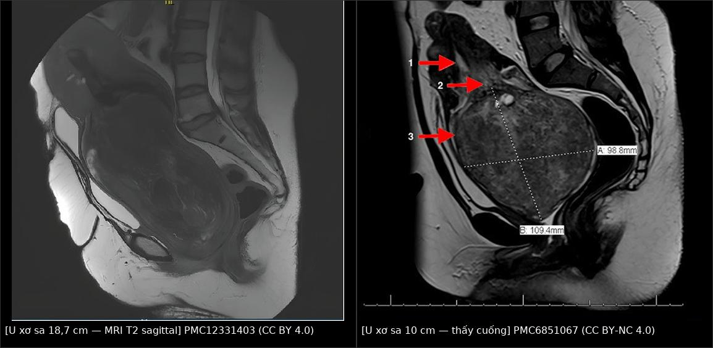
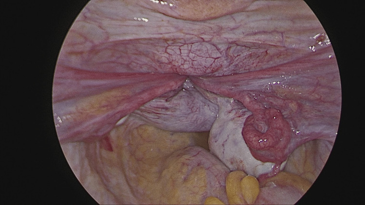
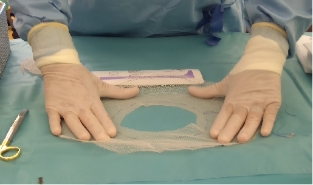
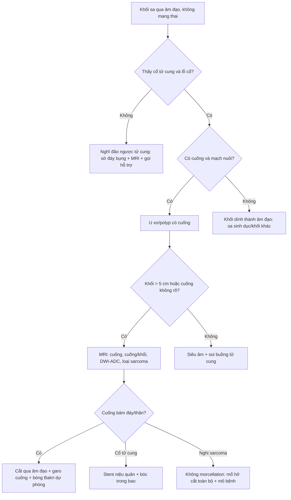
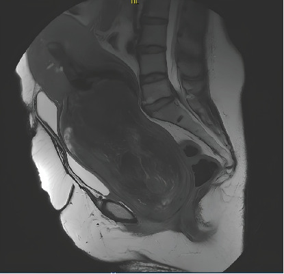
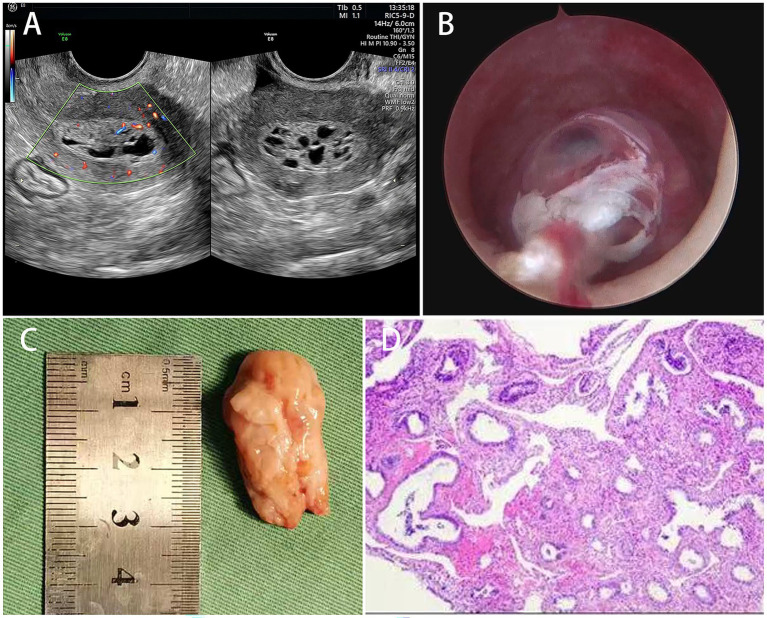

# 554 — Polyp nội mạc & u xơ có cuống sa qua cổ tử cung: khối "sa" nhưng KHÔNG phải sa sinh dục / Prolapsed endometrial polyp & pedunculated submucosal fibroid

**Tags:** `pattern:khoi-sa-qua-am-dao` `vung:tu-cung` `vung:co-tu-cung` `vung:am-dao` `protocol:sieu-am-dau-tay` `score:figo-0-2`
**Mức chắc chắn (certainty):** tổng hợp y văn (literature synthesis) — định nghĩa/tỉ lệ và kỹ thuật lấy từ ca nguyên văn + tổng quan có ảnh CC BY đọc trực tiếp (PMC12331403, PMC6851067, PMC13197632, PMC13136127, PMC12098814), nguy cơ ác tính từ nghiên cứu đoàn hệ 240 polyp hậu mãn kinh (PMC8232598). Các ca dùng làm quiz đọc nguyên văn từ bài gốc.

## 1. Tổng quan bệnh học – cơ chế hình ảnh

- **Định nghĩa:** một **u xơ dưới niêm mạc có cuống (submucosal leiomyoma, FIGO type 0)** hoặc một **polyp nội mạc** phát triển dài cuống, bị **nhu động tử cung + trọng lực** kéo xuống qua lỗ cổ tử cung, có thể **lộ ra ngoài âm hộ**. Đây là khối **"sa" giả (pseudo-prolapse)** — tử cung vẫn ở đúng vị trí, chỉ có khối u sa.
- **Dịch tễ (số liệu định lượng):**
  - U xơ gặp ở **~40% phụ nữ đến 35 tuổi**, đỉnh 35–40 tuổi; **8,8%** phụ nữ có triệu chứng (PMC12331403). **U xơ dưới niêm mạc chỉ ~5%** tổng số u xơ; trong nhóm dưới niêm mạc, **1,3–2,5%** có cuống và có khả năng sa (PMC6851067).
  - **Đa số u xơ sa nhỏ, đường kính 1–6 cm**; các ca **> 10 cm** chỉ có trong y văn ca lẻ (PMC12331403, PMC6851067). Ca lớn nhất trong đợt này: **18,7 × 11 × 9,5 cm, nặng 980 g** (PMC12331403).
  - **Polyp nội mạc** là nguyên nhân lành tính hàng đầu của chảy máu tử cung bất thường (AUB), chiếm **10–40%** ca AUB; **đa số < 2 cm**, gọi là **polyp "khổng lồ" (giant) khi > 4 cm** (PMC13136127).
  - **Nguy cơ ác tính trong polyp hậu mãn kinh:** **8%** (18/240) gồm **2%** tăng sản không atypia, **3%** tăng sản atypia, **4%** ung thư nội mạc (PMC8232598).
  - **Leiomyosarcoma** (điều lo ngại nhất khi morcellation): **0,4–0,64/100.000 phụ nữ/năm** — tức **cực hiếm**, nhưng là lý do phải đọc MRI trước khi cắt nghiền (PMC12331403).
- **TẠI SAO hình ảnh trông như vậy (vật lý MRI/US):**
  - **U xơ = cơ trơn + collagen xoắn ốc, ít nước** → trên **T2W GIẢM tín hiệu** so với cơ tử cung, bờ rõ, cấu trúc **"whorled"** (xoáy). Khi **thoái hóa** (hyaline, nhầy, đỏ, hoại tử do cuống bị xoắn) → vùng **T2 tăng tín hiệu không đồng nhất**, có thể có **nang/hang** — đây là lý do u xơ sa thường "trông giống u ác" hơn u xơ trong cơ.
  - **Đặc điểm quyết định của khối sa là CUỐNG, không phải khối:** cuống chứa **một nhánh động mạch** (phần lớn) đi từ cơ tử cung → nuôi khối. Trên **Doppler màu**, thấy **"pedicle vessel"/"feeding vessel" đơn độc** ở chân cuống; khi cuống bị xoắn thì **mất phổ Doppler** và khối **hoại tử** (đau, sốt, hôi).
  - **Polyp = tuyến + mô đệm + mạch, phù nề** → **T2 trung gian đến tăng tín hiệu**, đồng nhất hoặc có **khoang nang nhỏ ("honeycomb")**; **khoang nang trong polyp là dấu hiệu LÀNH** (36,9% polyp lành có nang vs **5,6%** polyp tiền ác/ác, p = 0,008 — PMC8232598).
  - **TẠI SAO phải chụp MRI (không chỉ siêu âm):** MRI trả lời **3 câu hỏi mà siêu âm không trả lời được** khi khối to lấp kín âm đạo: (1) **cuống bám ở đâu** (đáy/thân/eo/cổ tử cung) — quyết định đường mổ; (2) **đường kính cuống so với khối** (nguy cơ đứt cuống khi can thiệp); (3) **có dấu hiệu sarcoma** (T2 tăng tín hiệu lan tỏa, **hạn chế khuếch tán/DWI sáng, ADC thấp**, hoại tử - xuất huyết) hay không.
- **Hệ quả giải phẫu — cái dễ bị bỏ qua:** khối lớn chèn ép **cổ tử cung + niệu quản** → **ứ nước thận hai bên**, trào ngược bàng quang, **bí tiểu**; ca 18,7 cm có **giãn đài–bể thận hai bên kèm trào ngược bàng quang** (PMC12331403), ca 20 × 14 cm nhập viện vì **bí tiểu 3 ngày phải đặt sonde** (PMC13197632).

## 2. Mẫu hình + chẩn đoán phân biệt theo vị trí (gamut)

- **Mẫu hình chung:** **khối đặc sa qua âm đạo ở phụ nữ không mang thai**, kèm **chảy máu âm đạo kéo dài** và/hoặc **bí tiểu**, thường **không đau** trừ khi cuống xoắn/hoại tử.
- **Ba câu hỏi lâm sàng chốt (đặt trước khi nhìn máy):**
  1. **Sờ bụng có thấy đáy tử cung bình thường không?** → **có** = khối sa, không phải đảo ngược tử cung; **không** = nghĩ **đảo ngược tử cung** (bài 544/553).
  2. **Đặt mỏ vịt: có thấy CỔ TỬ CUNG và LỖ CỔ riêng biệt không?** → **thấy cổ + cuống chui qua lỗ cổ** = polyp/u xơ sa; **không thấy cổ, chỉ thấy vòng thắt (constriction ring)** = đảo ngược tử cung.
  3. **Khối có cuống (stalk) không?** → có cuống mạch rõ = u xơ/polyp; không cuống, dính liền thành âm đạo = sa sinh dục/khối khác.
- **Gamut theo vị trí cuống (quyết định đường mổ):**
  - **Cuống ở đáy/thân tử cung, FIGO 0** → đường **âm đạo** thuận lợi (cắt qua âm đạo) — phổ biến nhất.
  - **Cuống ở eo (supraisthmic)** → âm đạo vẫn làm được nhưng **nguy cơ chảy máu cao**, cần garo; ca 18,7 cm có cuống **trước trên eo** (PMC12331403).
  - **U xơ CỔ TỬ CUNG (intracervical)** → cổ tử cung phình, **niệu quản bị đẩy ra ngoài**, cần **đặt stent niệu quản (DJ) trước mổ** và bóc **trong bao (intracapsular, nguyên tắc Bonney)** (PMC12098814).
- **Gamut "khối sa qua âm đạo ở phụ nữ không mang thai":**
  - **U xơ dưới niêm mạc có cuống (bài này)** — khối chắc, bề mặt nhẵn, **thấy cổ tử cung**, cuống mạch.
  - **Polyp nội mạc khổng lồ (bài này)** — mềm, mọng nước, dễ chảy máu khi chạm.
  - **Đảo ngược tử cung không do sinh (bài 544)** — **không thấy cổ tử cung**, có **vòng thắt**, đáy không sờ thấy trên bụng.
  - **Sa tử cung/âm đạo (bài 547)** — thấy **cổ tử cung ở đỉnh khối**, niêm mạc âm đạo phủ, không có cuống u.
  - **Sarcoma tử cung (bài 526)** — to nhanh, hoại tử, **DWI sáng/ADC thấp**, bờ xâm lấn.
  - **Ung thư nội mạc/cổ tử cung sa lộ** — bề mặt loét, mùi hôi, chảy máu tự nhiên.
  - **Sót sản phẩm thụ thai (RPOC)/polyp nhau (placental polyp)** — bối cảnh sau sinh/sảy.

## 3. Bảng so sánh phân biệt (ma trận đối chiếu)

| Thực thể (entity) | Hình ảnh/lâm sàng điển hình | Chốt vào (rule-in) | Chốt loại (rule-out) | Gợi ý xác nhận |
|---|---|---|---|---|
| **U xơ dưới niêm mạc có cuống** | Khối chắc, nhẵn; MRI **T2 giảm tín hiệu dạng xoáy**, cuống bám cơ tử cung; Doppler **1 mạch cuống** | **Thấy cổ tử cung + cuống chui qua lỗ cổ** + T2 giảm tín hiệu | Cuống không xác định + T2 rất tăng + DWI sáng → nghĩ sarcoma | MRI có/không cản quang; mô bệnh sau cắt |
| **Polyp nội mạc (khổng lồ khi > 4 cm)** | Mềm, mọng; siêu âm **khối trong lòng, bờ đều**, **1 mạch nuôi hoặc không có mạch**, **khoang nang nhỏ** | **Một mạch nuôi đơn độc** + nang trong khối + bờ đều | Khối đặc, **không nang**, nhiều mạch, > 13 mm → nguy cơ tiền ác | Soi buồng tử cung + cắt polyp toàn bộ |
| **Đảo ngược tử cung không do sinh** | **Không sờ thấy đáy**; khối đỏ tím, **không thấy cổ tử cung**; MRI **lõm hình chữ V/U ở đáy** | **Vòng thắt + mất đáy tử cung + không thấy cổ** | Thấy cổ tử cung riêng + cuống → khối sa đơn thuần | Siêu âm/MRI; nội soi ổ bụng xác nhận |
| **Sa tử cung–âm đạo** | Cổ tử cung ở **đỉnh** khối, niêm mạc âm đạo phủ, tăng khi gắng sức | **Thấy lỗ cổ ở đỉnh khối** | Có cuống u + bề mặt khác niêm mạc âm đạo | Khám tư thế đứng, POP-Q |
| **Sarcoma tử cung** | To nhanh, hoại tử–xuất huyết; **T2 tăng không đồng nhất + DWI sáng + ADC thấp** | **Hạn chế khuếch tán trong phần đặc** + tăng kích thước nhanh | T2 giảm đều, không hạn chế khuếch tán → lành | MRI + mô bệnh; **tránh morcellation khi chưa loại trừ** |
| **Ung thư nội mạc/cổ tử cung** | Bề mặt loét, mủn, chảy máu; nội mạc dày bất thường | **Mô bệnh ác tính** trên mảnh cắt | Bờ đều, có cuống, nang trong khối | Sinh thiết/cắt toàn bộ tổn thương |

### Ba dấu hiệu định lượng đáng nhớ
- **Kích thước polyp:** bờ cắt **13 mm** phân tầng nguy cơ tiền ác/ác (đường kính trung vị **13,3 mm** ở nhóm ác vs **10,0 mm** ở nhóm lành, p < 0,001 — PMC8232598).
- **Mạch nuôi:** **một mạch nuôi đơn độc** là tiêu chuẩn IETA của polyp lành; **nhiều mạch trong khối** làm tăng lo ngại ác tính (66,7% polyp ác có mạch cuống so với 41,4% polyp lành, p = 0,048 — PMC8232598).
- **Cuống/khối:** khi **đường kính cuống < 50% đường kính ngang lớn nhất của khối**, nguy cơ **đứt cuống** khi can thiệp (đặc biệt nút mạch) tăng — đây là tiêu chí tương đối chống chỉ định UAE (PMC12331403).

## 4. Protocol chụp + hệ phân độ/điểm chuẩn hóa

- **Bước 1 — Siêu âm đầu tay (đường âm đạo + đường bụng):** đo **3 đường kính**, xác định **khối nằm trong buồng/cổ/âm đạo**, tìm **cuống**, bật **Doppler màu** tìm **mạch nuôi**; đo **độ dày nội mạc** ngoài khối; tìm **ứ nước thận hai bên**.
- **Bước 2 — MRI tiểu khung (T2 sagittal + axial, ± T1 + DWI/ADC, ± cản quang)** khi: khối **> 5 cm**, **không thấy cổ tử cung** khi khám, **không xác định được cuống**, nghi **đảo ngược tử cung**, **muốn bảo tồn tử cung** (cần biết cuống bám đâu), hoặc **nghi sarcoma** (to nhanh, hoại tử).
- **Bước 3 — Chuẩn bị mổ:** công thức máu + nhóm máu, **đặt sonde bàng quang nếu bí tiểu**, **stent niệu quản (DJ) hai bên** nếu u xơ cổ tử cung lớn (PMC12098814), kháng sinh khi có hoại tử/nhiễm.
- **Bước 4 — Kỹ thuật cắt qua âm đạo (nguyên tắc chung):**
  - **Kiểm soát cuống TRƯỚC khi cắt:** garo bằng **lưới Vicryl 30 × 26 cm** luồn quanh cuống (ca 18,7 cm) hoặc **Endoloop** nếu cuống nhỏ; garo làm **giảm máu mất còn 500 mL** trong ca 18,7 cm (PMC12331403).
  - **Cắt nghiền từng phần (morcellation)** nếu khối không vừa âm đạo; **cắt đến đâu cầm máu đến đó**.
  - **Cầm máu cổ tử cung:** đặt **bóng Bakri trong cổ tử cung, bơm 100 mL nước muối** (cổ giãn 5 cm), rút sau **12 giờ**; kèm **acid tranexamic + oxytocin 10 UI** (PMC12331403). Ca khác dùng **adrenaline 1:200.000** tiêm quanh bao (PMC12098814).
  - **Kiểm tra bệnh phẩm toàn bộ** — không sinh thiết bề mặt hoại tử (dễ âm giả).

- **Hệ phân độ dùng trong bài:**
  - **FIGO u xơ 0–2** (dưới niêm mạc): **0** = có cuống hoàn toàn trong buồng; **1** = < 50% trong cơ; **2** = ≥ 50% trong cơ → quyết định soi buồng tử cung hay mổ.
  - **IETA (International Endometrial Tumor Analysis)** cho polyp: bờ đều, **một mạch nuôi**, có/không nang; dùng để phân tầng trước soi buồng tử cung.
  - **Phân độ đảo ngược tử cung I–IV** (dùng ở bài 544/553) — tiêu chuẩn loại trừ bắt buộc.

## 5. Biến thể bình thường và cạm bẫy

- **Cạm bẫy 1 — nhầm khối sa với sa sinh dục:** sa tử cung có **cổ tử cung ở đỉnh khối** và niêm mạc âm đạo phủ; khối u sa có **bề mặt u** (nhẵn, trắng ngà hoặc loét hoại tử) và **cuống chui qua lỗ cổ**. Chỉ cần **đặt mỏ vịt + sờ cuống** là phân biệt được.
- **Cạm bẫy 2 — bỏ sót đảo ngược tử cung:** nếu **không sờ thấy đáy tử cung trên bụng** và khám thấy **vòng thắt**, phải dừng lại — **kéo/cắt khối trong đảo ngược tử cung có thể làm rách tử cung và chảy máu không cầm**. 70–80% đảo ngược không do sinh có u lành tính (u xơ/polyp) làm nguyên nhân (PMC13197632).
- **Cạm bẫy 3 — "nang trong khối = ác":** ngược lại, **khoang nang nhỏ trong polyp là dấu hiệu LÀNH** (36,9% vs 5,6%, p = 0,008); đừng overcall.
- **Cạm bẫy 4 — siêu âm đánh giá thấp kích thước:** khối lớn lấp kín âm đạo làm **mất mặt phẳng đo**, ca 18,7 cm ghi nhận **siêu âm không kết luận được** và phải chuyển MRI (PMC12331403). Đo trên MRI, ghi rõ 3 chiều.
- **Cạm bẫy 5 — nút mạch (UAE) ở u có cuống:** cuống **< 50%** đường kính khối → nguy cơ **đứt cuống**, khối rơi vào ổ bụng (u dưới thanh mạc) hoặc **sa ra ngoài** (u dưới niêm mạc); UAE còn có **biến chứng nặng 0,66%**, **nhập viện lại vì đau 2,1%**, **1,1% phải mổ trong 30 ngày** (PMC12331403).
- **Cạm bẫy 6 — bỏ sót biến chứng chèn ép:** luôn **siêu âm thận** tìm ứ nước hai bên và hỏi **bí tiểu**, vì khối lớn chèn niệu quản/cổ tử cung.
- **Biến thể bình thường dễ nhầm:** **polyp nhỏ < 10 mm không triệu chứng** ở hậu mãn kinh có thể theo dõi (22% ca trong đoàn hệ được theo dõi, không mổ — PMC8232598) — không phải mọi polyp đều cần cắt ngay; quyết định theo **triệu chứng + kích thước + yếu tố nguy cơ**.

## 6. Tự lượng giá — Blind Quiz

**Ca 1 — Nữ 57 tuổi, mãn kinh 5 năm, ra máu âm đạo 2 tháng, bụng có khối tới rốn.**

- Gợi ý: khám thấy khối ~20 × 10 cm chiếm toàn bộ âm đạo, **không sờ được cổ tử cung**, Hb 7,8 g/dL.
- Câu hỏi: khối bắt nguồn từ đâu? Cần đo gì trên MRI? Ba chẩn đoán phân biệt?

<b>Bấm để hiện đáp án (findings + chẩn đoán)</b>

- Hình ảnh: khối **18,7 × 11 × 9,5 cm** lấp kín âm đạo, cấu trúc **giảm–trung tín hiệu T2 dạng xoáy**, **không hạn chế khuếch tán**, cuống bám **trước trên eo tử cung**; kèm **giãn đài–bể thận hai bên**.
- Chẩn đoán: **u xơ dưới niêm mạc FIGO 0 có cuống sa qua cổ tử cung** (980 g, giải phẫu bệnh lành).
- Vì sao: cấu trúc cơ trơn + collagen → T2 giảm tín hiệu; **không hạn chế khuếch tán** giúp loại sarcoma.
- Nguồn ảnh: PMC12331403, Fig 1 — CC BY 4.0 (xem `images/CREDITS.md`).

**Ca 2 — Nữ 40 tuổi, chưa sinh, đau bụng dưới cấp, bí tiểu 3 ngày, khối 20 × 14 cm lòi ra ngoài âm hộ.**

- Câu hỏi: dấu hiệu nào trên ảnh chốt chẩn đoán? Vì sao **không được** cắt khối ngay qua đường âm đạo?

<b>Bấm để hiện đáp án (findings + chẩn đoán)</b>

- Hình ảnh: **đáy tử cung lõm vào trong**, hai **dây chằng tròn và vòi trứng bị kéo vào phễu**, **vòng thắt ở mức cổ tử cung**.
- Chẩn đoán: **đảo ngược tử cung không do sinh (non-puerperal uterine inversion)** do u xơ polyp sa — 70–80% ca đảo ngược không do sinh có u lành tính làm nguyên nhân.
- Vì sao không cắt ngay: khối đang **kéo đáy tử cung lộn ngược**; cắt/cuống trước khi giải phóng sẽ làm **rách tử cung, chảy máu không cầm**; phải **thay thế tử cung rồi mới cắt u** (bài 544).
- Nguồn ảnh: PMC13197632, Fig 3 — CC BY 4.0.

**Ca 3 — Nữ 68 tuổi, ra máu hậu mãn kinh 1 ngày, siêu âm đầu dò âm đạo.**

- Câu hỏi: khối **4,3 × 3,6 × 2,1 cm** trong buồng tử cung, nội mạc ngoài khối **2 mm**; mô tả mạch máu trên Doppler? Chẩn đoán và bước xử trí?

<b>Bấm để hiện đáp án (findings + chẩn đoán)</b>

- Hình ảnh: khối **bờ rõ**, cấu trúc **hỗn hợp với khoang nang nhỏ ("honeycomb")**, **một mạch nuôi** thấy trên Doppler màu (A); soi buồng tử cung: polyp **có cuống** bám thành sau–phải (B); đại thể (C) và vi thể **polyp nội mạc nang lành** (D).
- Chẩn đoán: **polyp nội mạc khổng lồ (> 4 cm) lành tính** — trong loạt 15 ca hậu mãn kinh, **11/15 lành tính có giãn nang**.
- Xử trí: **soi buồng tử cung cắt polyp toàn bộ + mô bệnh** (tiêu chuẩn vàng); tránh cắt tử cung "phòng ngừa" chỉ vì kích thước.
- Nguồn ảnh: PMC13136127, Fig 1 — CC BY 4.0.

## Bài liên quan chéo
- [544 – Đảo ngược tử cung không do sinh](../544-dao-nguoc-tu-cung-khong-do-sinh/lesson.md) (bảng phân biệt khối sa vs đảo ngược)
- [553 – Đảo ngược tử cung do sinh](../553-dao-nguoc-tu-cung-do-sinh/lesson.md) (cấp cứu sản khoa, phân độ I–IV)
- [542 – U xơ dưới niêm mạc & can thiệp bảo tồn](../542-u-xo-duoi-niem-mac-can-thiep-bao-ton/lesson.md) (FIGO 0–2, kỹ thuật)
- [541 – Adenofibroma tử cung & adenomyoma dạng polyp](../541-adenofibroma-tu-cung-polipoid-adenomyoma/lesson.md)
- [526 – Sarcoma tử cung vs leiomyoma trên MRI](../526-sarcoma-tu-cung-vs-u-xo/lesson.md)
- [547 – Sa tạng chậu nữ (POP-Q, lưới nâng)](../547-sa-tang-chau-nu-POP-Q-luoi-nang/lesson.md)

## Ảnh
- `554_u-xo-sa_MRI_PMC12331403-f1.jpg` — MRI T2 sagittal, u xơ sa 18,7 cm (PMC12331403, CC BY 4.0).
- `554_u-xo-sa_MRI-co-cuong_PMC6851067-f1.jpg` — MRI T2 sagittal có chú thích cuống (PMC6851067, CC BY-NC 4.0).
- `composite_u-xo-sa_MRI.jpg` — ảnh ghép letterbox hai ca MRI, giữ nguyên tỷ lệ (CC BY 4.0 + CC BY-NC 4.0).
- `554_dao-nguoc_Noi-soi-PMC13197632-f3.jpg` — nội soi ổ bụng đảo ngược tử cung (PMC13197632, CC BY 4.0).
- `554_polyp_Sieu-am-PMC13136127-f1.jpg` — 4 ô: siêu âm/Doppler, soi buồng tử cung, đại thể, vi thể (PMC13136127, CC BY 4.0).
- `554_garo-cuong_Anh-mo_PMC12331403-f3.jpg` — chuẩn bị lưới Vicryl làm garo cuống (PMC12331403, CC BY 4.0) — xem `images/CREDITS.md`.

> Không dùng để chẩn đoán độc lập khi chưa có người hướng dẫn.
