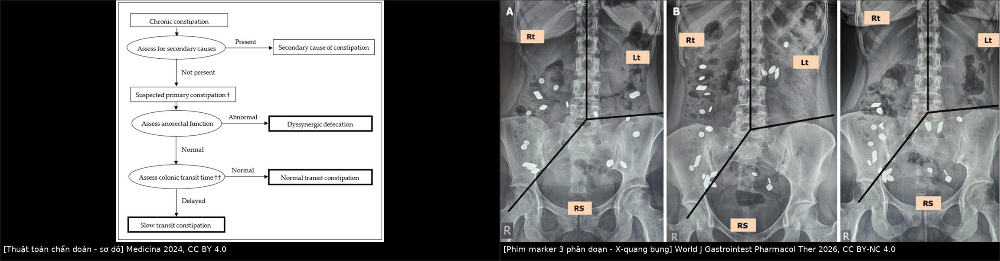
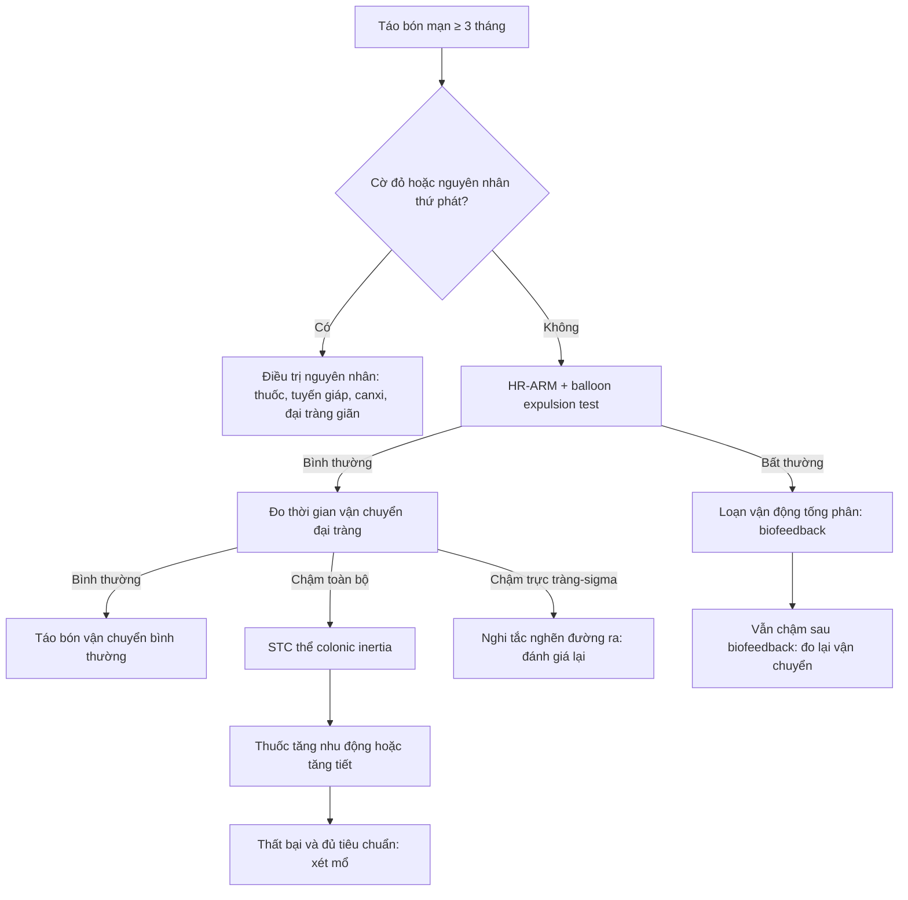
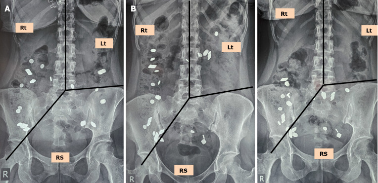
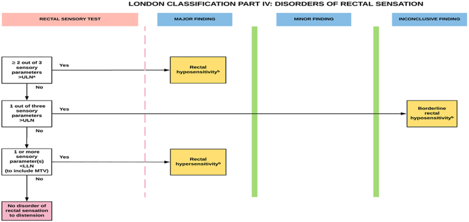
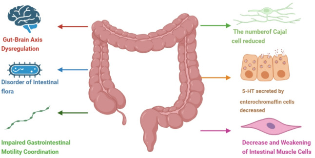

# 555 — Táo bón chậm vận chuyển & loạn cảm trực tràng: đọc phim marker và phân loại London

**Tags:** `pattern:cham-van-chuyen` `vung:dai-trang` `vung:truc-trang-hau-mon` `score:London` `protocol:colonic-transit` `protocol:manometry`
**Mức chắc chắn (certainty):** tổng hợp y văn (literature synthesis) — nhóm tự biên từ các bài tổng quan mở (Medicina 2024, World J Gastrointest Pharmacol Ther 2026, BMC Gastroenterol 2026, Gastro Hep Adv 2025); số liệu lấy trực tiếp từ bảng/Fig của bài gốc, chưa gắn một bệnh án riêng của nhóm.

## 1. Tổng quan — “đồng hồ đại tràng” chạy chậm: cơ chế và ngưỡng

- **Táo bón chậm vận chuyển (slow transit constipation, STC):** phân đi qua đại tràng chậm hơn bình thường **sau khi đã loại trừ tắc nghẽn đường ra** (loạn vận động tống phân) và nguyên nhân thứ phát. Đây là **rối loạn vận động**, không phải “phân cứng” đơn thuần — điều trị bằng thuốc tăng nhu động/chế tiết, chỉ mổ khi thật chọn lọc.
- **TẠI SAO đại tràng đẩy được phân:** (1) **tế bào kẽ Cajal (interstitial cells of Cajal, ICC)** tạo nhịp điện chậm; (2) **serotonin (5-HT)** từ tế bào ưa crôm (enterochromaffin) kích hoạt phản xạ tại chỗ; (3) các **co bóp lan truyền biên độ cao (high-amplitude propagating contractions, HAPC)** đẩy khối phân về trực tràng, tăng mạnh sau ăn (**phản xạ dạ–đại tràng**) và khi thức dậy. Trong STC, số lượng/chức năng ICC **giảm**, 5-HT **giảm**, HAPC thưa và yếu → thời gian lưu phân kéo dài, phân mất nước, trực tràng “nhận hàng” thưa thớt. Một phần bệnh nhân có chậm nhu động ngoài đại tràng: **chậm rỗng dạ dày 34%**, **chậm vận chuyển ruột non 10%**, **cả hai 8%** (Medicina 2024).
- **TẠI SAO đếm được vận chuyển bằng phim X-quang:** hạt **marker cản quang (radiopaque marker)** là hạt nhựa trơ, **không hấp thu, không tan**, tỷ trọng cao hơn mô mềm/khí nên hiện **đậm hơn bóng ruột** trên phim bụng. Số hạt còn lại tại một thời điểm cố định = **tích phân vận chuyển** từ lúc nuốt đến lúc chụp; **vị trí hạt** (khung đại tràng phải / trái / trực tràng–sigma) cho biết **đoạn nào chậm**. Đây là phép đo gián tiếp: không đo áp lực, không đo tốc độ tức thời.
- **Ngưỡng định lượng cốt lõi (ghi rõ phiên bản/nguồn):**
  - **Kỹ thuật 1 viên – 1 phim (phổ biến):** nuốt **20 marker**, chụp bụng **ngày thứ 5**; **còn ≥ 5 hạt (≥ 20%) = chậm vận chuyển**. Vì một số viên chứa số hạt khác nhau, quy tắc chung là **≥ 20% số hạt ban đầu** (Medicina 2024).
  - **Kỹ thuật Metcalf (3 viên – 1 phim):** 20 marker ở **0, 24, 48 giờ**, phim **72 giờ**; cho **thời gian từng đoạn**: đại tràng phải **11,3 ± 1,1 giờ**, trái **11,4 ± 1,4 giờ**, trực tràng–sigma **12,4 ± 1,1 giờ** (bảng tổng hợp của World J Gastrointest Pharmacol Ther 2026).
  - **Biến thể châu Á (Ghoshal):** 20 marker ở **0, 12, 24 giờ**, phim **36 và 60 giờ**; **≥ 30 hạt ở 36 giờ** và **≥ 14 hạt ở 60 giờ** có độ nhạy/độ đặc hiệu cao cho STC hoặc loạn vận động tống phân — vì người châu Á vận chuyển nhanh hơn, protocol phương Tây dễ “âm tính giả”.
  - **Xạ hình đại tràng (scintigraphy):** đo % hoạt độ còn lại theo đoạn tại **24 và 48 giờ**; ngưỡng bất thường = **trung bình + 2 SD** của người khỏe mạnh.
  - **Viên nang không dây (wireless motility capsule):** cho **tổng thời gian vận chuyển**, **không** cho thông tin từng đoạn đại tràng.
- **Loạn cảm trực tràng (rectal hyposensitivity):** ngưỡng cảm giác với bóng hơi **tăng** — bệnh nhân không cảm thấy phân đến trực tràng nên không rặn. Đo bằng **test cảm giác trực tràng (rectal sensory test)** trong lúc manometry: bơm **từng 10 mL** đến khi bệnh nhân cảm nhận lần đầu, sau đó **từng 20 mL** đến **thể tích dung nạp tối đa (maximum tolerated volume, MTV)**, tối đa **400 mL**; ghi 3 tham số: **cảm giác đầu tiên, cảm giác muốn đi ngoài, MTV**. Theo **phân loại London (London Classification)**: **≥ 2/3 tham số > giới hạn trên bình thường = loạn cảm (hyposensitivity)**; **1/3 = thể ranh giới (borderline)**; **≥ 2/3 thấp hơn = tăng cảm (hypersensitivity)**.
- **Vì sao phải đo cả hai:** STC và loạn cảm trực tràng có thể **cùng tồn tại**; nếu chỉ nhìn phim marker sẽ bỏ sót phần “ngõ ra”, và ngược lại. Marker **không tương quan với mức độ nặng/chất lượng sống** — đừng dùng số hạt để quyết định mổ.

## 2. Mẫu hình + chẩn đoán phân biệt theo vị trí (Gamut)

- **Theo phân đoạn trên phim marker:**
  - **Chậm toàn bộ (pan-colonic):** hạt rải khắp khung đại tràng, tồn tại nhiều ngày → **colonic inertia** (đại tràng “lười”), thường kèm chậm rỗng dạ dày.
  - **Chậm đại tràng phải:** ứ ở manh tràng/lên; gợi ý **vận chuyển đoạn gần**, đôi khi do **đại tràng dài/rườm (redundant colon)**.
  - **Chậm đại tràng trái:** ứ ở đại tràng xuống — hay gặp trong **STC thể hỗn hợp**.
  - **Chậm trực tràng–sigma (rectosigmoid):** hạt dồn ở khung chậu → nghĩ **tắc nghẽn đường ra** (loạn vận động tống phân, sa tạng, rectocele) **trước khi** gọi là STC.
- **Theo cơ chế (gamut thực hành):**
  - **Rối loạn chức năng:** STC, **táo bón vận chuyển bình thường (normal transit constipation, NTC)**, **loạn vận động tống phân (dyssynergic defecation, DD)**, **loạn cảm trực tràng**, hội chứng ruột kích thích thể táo bón (IBS-C).
  - **Thứ phát:** thuốc (**opioid, kháng cholinergic, chẹn kênh canxi, sắt, thuốc chống loạn thần**), **suy giáp**, **tăng canxi máu**, **đái tháo đường** (bệnh thần kinh nội tạng), **xơ cứng bì**, tổn thương tủy, **bệnh Hirschsprung** ở người lớn (hiếm), **giả tắc ruột mạn (CIPO)**, **đại tràng giãn/megacolon**.
  - **Tại chỗ:** hẹp do ung thư, viêm túi thừa, sa trực tràng, rectocele, nứt hậu môn đau (nhịn đi ngoài).
- **Gợi nhớ “SLOW”:** **S**econdary (thuốc/nội tiết/thần kinh) — **L**azy colon (colonic inertia) — **O**utlet (DD/sa/rectocele) — **W**eak sensation (loạn cảm trực tràng).

## 3. Bảng so sánh phân biệt (ma trận đối chiếu)

*Trái: thuật toán chẩn đoán (Medicina 2024, CC BY 4.0). Phải: phim marker chia 3 đoạn bằng 3 đường kẻ (World J Gastrointest Pharmacol Ther 2026, CC BY-NC 4.0). Ảnh ghép letterbox, không crop/kéo giãn.*

| Thực thể (entity) | Hình ảnh / phép đo điển hình | Chốt vào (rule-in) | Chốt loại (rule-out) | Gợi ý xác nhận |
|---|---|---|---|---|
| **STC (colonic inertia)** | ≥ 5/20 marker còn ở ngày 5 hoặc chậm toàn bộ theo Metcalf; đại tràng không giãn | **Chậm vận chuyển khách quan + anorectal function bình thường** | Anorectal manometry/bóng tống phân bất thường → DD là chính | Phim marker (+ xạ hình nếu cần) |
| **Táo bón vận chuyển bình thường (NTC)** | Marker thải hết đúng hạn; phân cứng, thưa | **Vận chuyển bình thường + tiêu chuẩn Rome IV** | Marker còn ≥ 20% → không phải NTC | Phim marker; đáp ứng chất xơ/làm mềm phân |
| **Loạn vận động tống phân (DD)** | Marker dồn ở trực tràng–sigma; manometry: áp lực đẩy thấp + cơ thắt không giãn; bóng không tống được | **Rặn không giãn cơ thắt + bóng tống phân thất bại** | Vận chuyển chậm đơn thuần, không có bất thường tống phân | HR-ARM + balloon expulsion (xem bài 546) |
| **Loạn cảm trực tràng** | ≥ 2/3 tham số cảm giác > giới hạn trên (London); marker có thể bình thường | **Ngưỡng cảm giác tăng, không đau, không tắc nghẽn** | Có tắc nghẽn cơ học/DD → loại cảm đơn thuần | Rectal sensory test; huấn luyện cảm giác |
| **Giả tắc ruột mạn (CIPO)** | Đại tràng/ruột non giãn, mức khí–dịch; vận chuyển rất chậm, có đoạn đứng hoàn toàn | **Giãn + chậm nặng nhiều tầng + triệu chứng tắc tái diễn** | Chỉ chậm đại tràng, không giãn → STC | Manometry ruột non, CT |
| **Hirschsprung người lớn / megacolon** | Đại tràng giãn rộng, vùng chuyển tiếp hẹp; marker ứ trước đoạn hẹp | **Vùng chuyển tiếp + giãn trước hẹp** | Đại tràng hiệu suất bình thường, không chuyển tiếp | CT đại tràng, sinh thiết trực tràng |

## 4. Protocol + phân độ và ngưỡng xử trí

### 4.1 Chuẩn bị và kỹ thuật
- **Trước chụp:** ngừng thuốc làm thay đổi vận chuyển nếu an toàn (opioid, kháng cholinergic, chẹn canxi) theo chỉ định lâm sàng; **không** dùng thuốc nhuận tràng trong thời gian đo; giữ chế độ ăn/thói quen bình thường.
- **Kỹ thuật 1 viên – 1 phim:** nuốt **20 marker**, chụp **X-quang bụng tư thế nằm ngửa (supine)** vào **ngày 5** (một số trung tâm chụp ngày 4 và 7). **Bắt buộc phim nằm ngửa** — xem cạm bẫy mục 5.
- **Kẻ 3 đường trên phim** (theo Fig. 2A của bài gốc): (1) đường dọc qua **giữa thân đốt L5**; (2) đường từ **L5 đến lỗ chậu phải**; (3) đường từ **L5 đến gai chậu trước trên bên trái**. Ba vùng = **đại tràng phải – đại tràng trái – trực tràng/sigma (RS)**.
- **Đếm và ghi:** tổng số hạt còn lại + số hạt từng vùng + thời điểm chụp. So với ngưỡng **≥ 5/20 (≥ 20%)** hoặc protocol địa phương (Metcalf/Ghoshal) — **ghi rõ protocol đã dùng** vì ngưỡng khác nhau.
- **Trước khi đo vận chuyển:** làm **HR-ARM + balloon expulsion test** để loại DD (bài 546). Nếu không có điều kiện làm anorectal function, có thể đo vận chuyển trước nhưng phải diễn giải thận trọng (thuật toán Fig. 1).
- **Khi nghi loạn cảm:** rectal sensory test trong lúc ARM, bơm 10 mL/lần đến cảm giác đầu tiên rồi 20 mL/lần đến MTV (tối đa 400 mL).

### 4.2 Phân loại và ngưỡng điều trị
- **NTC:** chất xơ, nước, làm mềm phân, thuốc kích thích ngắn hạn; **không mổ**.
- **DD:** **biofeedback + vật lý trị liệu sàn chậu là điều trị đầu tay**; thuốc tăng nhu động ít hiệu quả nếu chưa sửa động tác rặn.
- **STC:** **prucalopride 1–2 mg/ngày (tối đa 4 mg)**; **linaclotide 72–145 µg/ngày (tối đa 290 µg)**; **plecanatide 3 mg/ngày**; **lubiprostone 24 µg × 2/ngày**; **elobixibat 5–15 mg/ngày**. Bằng chứng đặc hiệu cho STC còn mỏng, phần lớn ngoại suy từ táo bón mạn.
- **Loạn cảm trực tràng:** **huấn luyện cảm giác bằng bóng hơi** (bơm thể tích nhỏ dần để bệnh nhân cảm nhận sớm hơn) + biofeedback; phối hợp với điều trị STC nếu có.
- **Mổ (subtotal colectomy ± ileorectal anastomosis):** chỉ khi **STC đã chứng minh**, **thất bại nội khoa**, **anorectal function bình thường**. Kết quả Knowles 2017: **hài lòng 86%** nhưng **biến chứng 24%**, **tử vong 0,4%**, **mổ lại 13%**, **tắc ruột non 15%**; về dài hạn **đau bụng 30–50%**, **chướng 10–40%**, **tái phát táo bón 10–30%**, **tiêu chảy 5–15%**. Nếu **DD + STC cùng tồn tại**: **điều trị DD trước**, và nếu vẫn phải mổ thì **ileostomy được ưu tiên hơn ileorectal anastomosis**.

## 5. Biến thể bình thường và cạm bẫy

- **Tư thế phim — cạm bẫy số 1:** trên phim **đứng (erect)**, đại tràng ngang sa theo trọng lực xuống khung chậu, hạt bị **đọc nhầm là ứ ở trực tràng–sigma** → chẩn đoán sai thành **tắc nghẽn đường ra**. Phim **nằm ngửa** cho thấy nhiều hạt thực ra thuộc đại tràng ngang/trái. Bài gốc mô tả đúng một ca như vậy: phim đứng gợi ý ứ RS, phim ngửa **xác nhận STC**. Vì thế: **luôn chụp nằm ngửa** và đối chiếu giải phẫu.
- **Đại tràng dài/rườm (dolichocolon, redundant colon):** bóng ruột gấp khúc trông như tắc; hạt có thể “đứng” ở quai rườm mà vận chuyển vẫn bình thường. Đừng chẩn đoán tắc chỉ vì hình dạng.
- **Manh tràng sa vào khung chậu:** hạt ở manh tràng sa thấp bị đếm nhầm vào RS — phải lần theo khung đại tràng, không chỉ nhìn vị trí trên mặt phẳng.
- **Số hạt không = mức nặng:** không tương quan với triệu chứng/chất lượng sống; đừng dùng để quyết định mổ.
- **Đo vận chuyển trước khi loại DD:** hạt ứ ở RS có thể do **DD** chứ không phải STC; nếu bỏ qua, bệnh nhân bị mổ đại tràng oan. Ngược lại, DD + STC cùng tồn tại khá thường gặp.
- **Loạn cảm trực tràng bị bỏ sót:** bệnh nhân “không buồn đi” với marker bình thường; nếu chỉ đo vận chuyển sẽ kết luận “không bệnh”. Cần rectal sensory test.
- **Thuốc và bệnh nền:** opioid, kháng cholinergic, chẹn canxi, sắt; suy giáp; tăng canxi; đái tháo đường; xơ cứng bì — luôn rà trước khi gọi “vô căn”.
- **Thai kỳ/trẻ em:** ngưỡng và protocol khác; bài này dành cho người lớn không mang thai.

## 6. Tự lượng giá — Blind Quiz

**Ca 1 — Nữ 34 tuổi, táo bón 6 năm, rặn nhiều, không đau hậu môn. Phim marker ngày 5: hai tư thế.**

- Câu hỏi: Ở phim **đứng**, hạt dồn ở vùng nào và dễ gợi ý chẩn đoán gì? Phim **nằm ngửa** thay đổi cách đọc ra sao? Kết luận hợp lý nhất?

<b>Bấm để hiện đáp án</b>

- Trên phim **đứng**, đại tràng ngang sa xuống khung chậu làm hạt trông như **ứ ở trực tràng–sigma** → dễ chẩn đoán nhầm **tắc nghẽn đường ra**.
- Phim **nằm ngửa** cho thấy nhiều hạt đó thực chất thuộc **đại tràng ngang/trái**, không phải RS.
- Kết luận: **chậm vận chuyển đại tràng (STC)**, không phải tắc nghẽn đường ra — đúng như mô tả trong bài gốc.
- Nguồn ảnh: Kalra S và cs., *World J Gastrointest Pharmacol Ther* 2026, PMC12968637 Fig. 2, CC BY-NC 4.0.

**Ca 2 — Nữ 41 tuổi, đi ngoài 1 lần/3 ngày, “không có cảm giác muốn đi”. Manometry cảm giác: cảm giác đầu tiên và cảm giác muốn đi ngoài đều trên giới hạn trên, MTV bình thường.**

- Câu hỏi: Với 2/3 tham số cảm giác tăng ngưỡng, phân loại là gì? Hướng điều trị nào khác với STC thuần?

<b>Bấm để hiện đáp án</b>

- **Loạn cảm trực tràng (rectal hyposensitivity)** — vì **≥ 2/3 tham số > giới hạn trên bình thường**; nếu chỉ 1/3 thì gọi **thể ranh giới**.
- Điều trị: **huấn luyện cảm giác bằng bóng hơi** (giảm dần thể tích để bệnh nhân cảm nhận sớm) + biofeedback; không chỉ dùng thuốc tăng nhu động.
- Nguồn ảnh: Belilos EA và cs., *Gastro Hep Adv* 2025, PMC11761937 Fig. 5, CC BY-NC-ND 4.0 (giữ nguyên bản, không chỉnh sửa).

**Ca 3 — Nam 52 tuổi, táo bón 8 năm, đã dùng 3 loại thuốc không đỡ. Phim marker: hạt rải khắp đại tràng, còn 14/20 hạt ngày 5; HR-ARM và bóng tống phân bình thường.**

- Câu hỏi: Phân loại thể bệnh? Vì sao không mổ ngay? Hai nhóm thuốc nên cân nhắc và ngưỡng liều?

<b>Bấm để hiện đáp án</b>

- **STC thể chậm toàn bộ (colonic inertia)**: còn **14/20 (70%)** hạt — vượt ngưỡng **≥ 20%**; anorectal function bình thường nên loại DD.
- Chưa mổ vì cần **thất bại nội khoa đầy đủ** và chọn bệnh nhân chặt; biến chứng mổ **24%**, tái phát táo bón **10–30%**.
- Thuốc: **prucalopride 1–2 mg/ngày (tối đa 4 mg)** hoặc **linaclotide 72–145 µg/ngày (tối đa 290 µg)**; có thể phối hợp huấn luyện cảm giác/nhu động.
- Nguồn ảnh: Yang F & Tao Q, *BMC Gastroenterol* 2026, PMC13312729 Fig. 1, CC BY-NC-ND 4.0 (giữ nguyên bản).

## Bài liên quan chéo
- [546 — Loạn vận động tống phân (anismus / dyssynergic defecation)](../546-loan-van-dong-tong-phan-anismus/lesson.md) — bước **bắt buộc** trước khi gọi STC.
- [545 — MR động học sàn chậu](../545-sa-san-chau-MR-defecography/lesson.md) — đánh giá sa tạng/rectocele khi nghi tắc nghẽn đường ra.
- [547 — Sa tạng chậu nữ: POP-Q & lưới nâng](../547-sa-tang-chau-nu-POP-Q-luoi-nang/lesson.md)
- [556 — Đau sàn chậu cơ–mạc & đau thần kinh thẹn](../556-dau-san-chau-co-mac-pudendal-neuralgia/lesson.md)

## Ảnh
- `images/555_co-che_STC_Flow_PMC13312729-Fig1.jpg` — sơ đồ cơ chế, CC BY-NC-ND 4.0 (giữ nguyên).
- `images/555_van-chuyen-marker_DR_PMC12968637-Fig2.jpg` — phim marker 3 phân đoạn, CC BY-NC 4.0.
- `images/555_so-do-chan-doan_Flow_PMC10819559-Fig1.jpg` — thuật toán chẩn đoán, CC BY 4.0.
- `images/555_loan-cam-truc-trang_Flow_PMC11761937-Fig5.jpg` — phân loại London phần IV, CC BY-NC-ND 4.0 (giữ nguyên).
- `images/composite_555_chan-doan-va-hinh-anh.jpg` — ảnh ghép letterbox (CC BY 4.0 + CC BY-NC 4.0).
- Chi tiết nguồn/giấy phép từng file: `images/CREDITS.md`; link gốc: `sources.md`.

> Không dùng để chẩn đoán độc lập khi chưa có người hướng dẫn.
