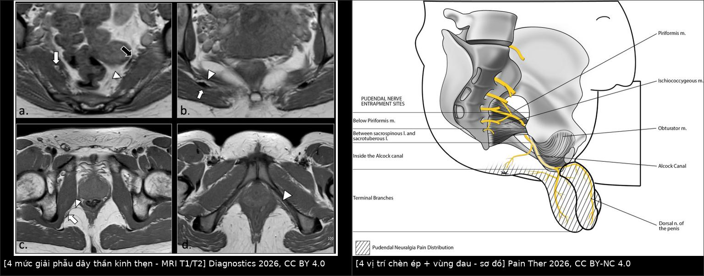
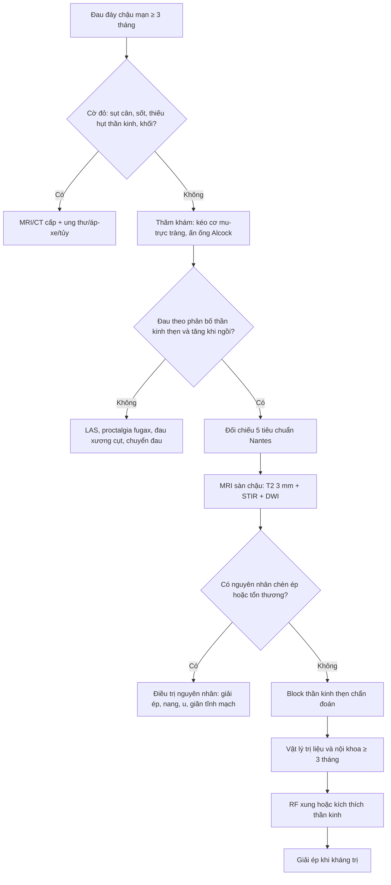
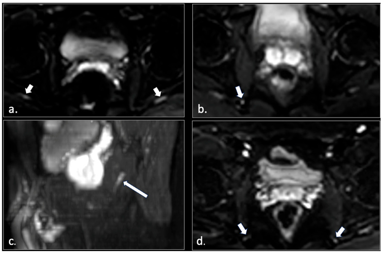
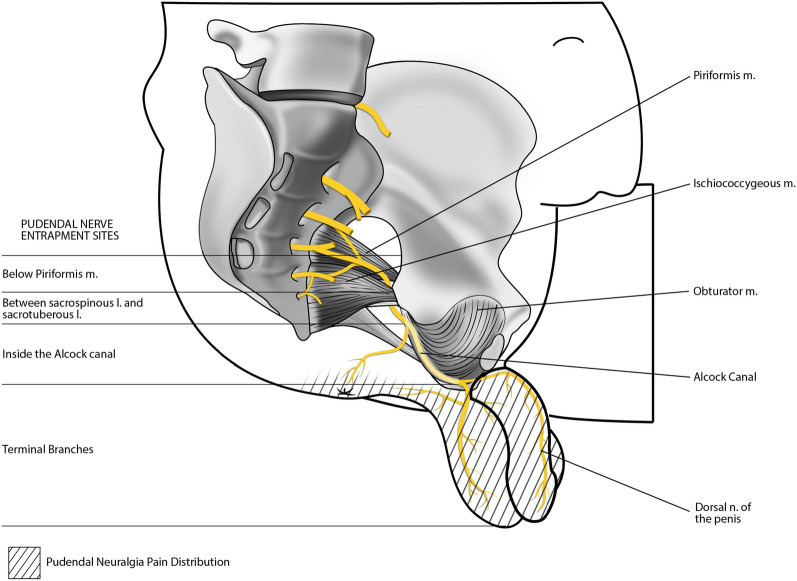
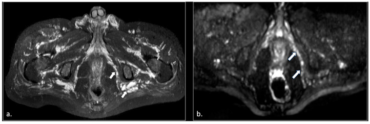

# 556 — Đau sàn chậu cơ–mạc & đau thần kinh thẹn: phân biệt bằng lâm sàng, MRI và block

**Tags:** `pattern:dau-san-chau` `vung:tieu-khung` `vung:truc-trang-hau-mon` `score:Nantes` `protocol:MRI-san-chau` `protocol:MR-neurography`
**Mức chắc chắn (certainty):** tổng hợp y văn (literature synthesis) — nhóm tự biên từ bài tổng quan và loạt ca mở (Diagnostics 2026, Pain Ther 2026, Cureus 2024, BMC Gastroenterol 2025); số liệu lấy từ Fig/bảng của bài gốc, chưa gắn một bệnh án riêng.

## 1. Tổng quan — hai bệnh cảnh “đau khi ngồi”, hai cơ chế khác nhau

- **Đau sàn chậu mạn (chronic pelvic floor pain)** là ô chẩn đoán dễ nhầm vì cùng biểu hiện **đau vùng hậu môn–sinh dục, tăng khi ngồi**. Cần tách ít nhất hai nhóm:
  1. **Đau cơ–mạc (myofascial):** **hội chứng cơ nâng hậu môn (levator ani syndrome, LAS)** — co thắt/điểm kích hoạt (trigger point) của cơ mu–trực tràng và cơ nâng; **đau do co cơ**, không có tổn thương thần kinh.
  2. **Đau thần kinh (neuropathic):** **đau thần kinh thẹn (pudendal neuralgia, PN)** — chèn ép/viêm dây thần kinh thẹn (S2–S4) dọc đường đi; đau theo **phân bố thần kinh**, có thể có dị cảm, đau bỏng rát.
- **Giải phẫu dây thần kinh thẹn — 4 mức phải thuộc:** (1) rễ **S2–S4** và đám rối cùng, bắt chéo **cơ hình lê (piriformis)**; (2) khe **giữa dây chằng cùng–gai và cùng–ủng (sacrospinous–sacrotuberous)** quanh **gai ngồi (ischial spine)**; (3) **ống Alcock** trong cân cơ bịt trong (obturator internus); (4) **các nhánh tận** (thần kinh trực tràng dưới, thần kinh đáy chậu, thần kinh lưng dương vật/âm vật). Mỗi mức là một **vị trí chèn ép** có biểu hiện và cách xử trí riêng.
- **TẠI SAO đau tăng khi ngồi:** ngồi tạo áp lực trực tiếp lên đáy chậu và **kéo căng dây thần kinh quanh gai ngồi/ống Alcock**; đứng hoặc nằm giải phóng lực này. Đây là đặc điểm **bắt buộc** trong tiêu chuẩn Nantes.
- **TẠI SAO MRI thấy được dây thần kinh:** dây thần kinh ngoại biên chứa nước **dị hướng (anisotropic)** dọc theo sợi trục; khi có **phù/viêm/myelin hư hại**, nước tự do tăng → **tăng tín hiệu trên DWI** và trên T2/STIR. Tuy nhiên **T2 fat-sat/STIR thường bị nhiễu do mạch máu cạnh thần kinh cũng sáng** — vì vậy bài gốc dùng **DWI EPI (b = 0, 100, 600)** để tách thần kinh khỏi mạch. Trong loạt 81 bệnh nhân: **42/81 (52%) có bất thường tín hiệu DWI** của dây thần kinh thẹn (**33 một bên, 9 hai bên**); **23/42** ca có thêm nguyên nhân ngoài thần kinh (phì đại cơ hình lê, tổn thương dây chằng cùng–ủng, rách cơ mu–cụt, xơ ống Alcock, nang Tarlov, u bao dây thần kinh, **giãn tĩnh mạch thẹn**).
- **Ngưỡng và tiêu chuẩn lâm sàng (bắt buộc thuộc):**
  - **Nantes 2008 — 5 tiêu chuẩn thiết yếu của PN:** (1) đau **trong phân bố thần kinh thẹn** (từ hậu môn đến dương vật/âm vật); (2) đau **chủ yếu khi ngồi**; (3) **không đánh thức ban đêm**; (4) **không mất cảm giác khách quan**; (5) **giảm đau sau block thần kinh thẹn chẩn đoán**. Tiêu chuẩn loại trừ: đau **khu trú ở xương cụt, mông, xương mu, hạ vị**; ngứa; đau **cơn kịch phát thuần túy**; có **bất thường hình ảnh giải thích được đau**.
  - **Rome IV — LAS:** đau/khó chịu trực tràng **tái diễn**, cơn **≥ 30 phút**, **đau khi kéo cơ mu–trực tràng** (thăm khám), loại trừ nguyên nhân khác; tiêu chuẩn kéo dài **3 tháng**, khởi phát **≥ 6 tháng** trước chẩn đoán.
  - **Proctalgia fugax:** đau **vài giây đến vài phút** (hiếm tới 30 phút), biến mất hoàn toàn — **không phải** LAS/PN.
- **Dịch tễ định lượng:** PN **~1%** dân số (một số nguồn ghi **1/100.000**, nữ > nam gấp đôi); khảo sát ở Mỹ: **đau trực tràng chức năng không đặc hiệu 11,6%**, **LAS 6,6%**, **proctalgia fugax 8%**. Đau sàn chậu mạn chiếm tỷ lệ đáng kể ở phụ nữ quanh mãn kinh.

## 2. Mẫu hình + chẩn đoán phân biệt theo vị trí (Gamut)

- **Theo vùng đau:**
  - **Hậu môn–trực tràng (đau trong, “như ngồi trên quả bóng”):** LAS, proctalgia fugax, nứt/áp-xe hậu môn, sa trực tràng, u trực tràng.
  - **Đáy chậu trước (âm hộ/dương vật):** PN nhánh tận, đau cơ đáy chậu, viêm tuyến Bartholin/Skene, đau xương cụt lan.
  - **Vùng mông/cùng cụt:** đau xương cụt (coccygodynia), hội chứng cơ hình lê, bệnh khớp cùng–chậu, **nang Tarlov**.
  - **Lan theo dây thần kinh:** PN do chèn ép ở **1 trong 4 mức**; xơ sau mổ/phẫu thuật vùng chậu; xạ trị; chấn thương đạp xe/ngã ngồi.
- **Theo cơ chế:**
  - **Cơ–mạc:** LAS, rối loạn trương lực cơ nâng, đau cơ bịt trong, sẹo đáy chậu.
  - **Thần kinh–chèn ép:** hội chứng ống Alcock, kẹp giữa dây chằng cùng–gai/cùng–ủng, phì đại cơ hình lê, sau tạo hình niệu đạo/âm đạo.
  - **Tổn thương chiếm chỗ:** **nang Tarlov**, **u bao dây thần kinh (schwannoma)**, **giãn tĩnh mạch thẹn**, **lạc nội mạc tử cung xâm nhập thần kinh**, di căn/ung thư.
  - **Chuyển đau (referred):** thoát vị đĩa đệm thắt lưng, hẹp ống sống, viêm khớp háng, rối loạn khớp cùng–chậu.
- **Gợi nhớ “PUDENDAL”:** **P**udendal territory pain — **U**nilateral thường gặp — **D**olor khi ngồi — **E**xam: đau khi kéo cơ mu–trực tràng/ấn ống Alcock — **N**ight: không thức giấc — **D**WI/T2 thấy tín hiệu bất thường — **A**nesthesia/block giảm đau — **L**oại trừ xương cụt/mông/hạ vị và tổn thương chiếm chỗ.

## 3. Bảng so sánh phân biệt (ma trận đối chiếu)

*Trái: 4 mức giải phẫu dây thần kinh thẹn trên MRI T1/T2 (Diagnostics 2026, CC BY 4.0). Phải: 4 vị trí chèn ép và vùng đau (Pain Ther 2026, CC BY-NC 4.0). Ảnh ghép letterbox, không crop/kéo giãn.*

| Thực thể (entity) | Hình ảnh / lâm sàng điển hình | Chốt vào (rule-in) | Chốt loại (rule-out) | Gợi ý xác nhận |
|---|---|---|---|---|
| **LAS (cơ–mạc)** | Đau trực tràng sâu, **≥ 30 phút**, đau khi **kéo cơ mu–trực tràng**; MRI thường bình thường hoặc **dày/phù cơ nâng** | **Đau khi kéo cơ mu–trực tràng + Rome IV + không có bất thường thần kinh** | Đau theo phân bố thần kinh, giảm sau block → PN | Thăm khám; MRI để loại trừ |
| **PN do chèn ép** | Đau từ hậu môn đến dương vật/âm vật, **tăng khi ngồi**, không thức đêm; **DWI tăng tín hiệu** dây thần kinh | **5 tiêu chuẩn Nantes + block giảm đau** | Đau khu trú xương cụt/mông/mu; có tổn thương chiếm chỗ giải thích được | MRI có DWI; block chẩn đoán |
| **Proctalgia fugax** | Đau **giây–phút**, tự hết, không liên quan đi ngoài | **Cơn ngắn < 30 phút, biến mất hoàn toàn** | Đau kéo dài ≥ 30 phút → LAS/PN | Lâm sàng |
| **Coccygodynia** | Đau xương cụt, tăng khi ngồi nghiêng/đứng dậy; X-quang/CT xương cụt | **Đau khu trú xương cụt, không theo dây thần kinh thẹn** | Đau lan đến dương vật/âm vật → nghĩ PN | Khám, CT xương cụt |
| **Giãn tĩnh mạch thẹn / sung huyết chậu** | STIR MIP: **giãn tĩnh mạch vùng chậu và ống Alcock**; đau tăng khi đứng lâu, cuối ngày | **Giãn tĩnh mạch thẹn trên STIR + đau kiểu sung huyết** | DWI thần kinh bình thường, không đau khi ngồi đơn thuần | MRI STIR; siêu âm/CT tĩnh mạch |
| **Nang Tarlov** | Nang dịch **quanh rễ cùng**, xóa lỗ rễ; đau vùng cùng cụt/perineal | **Nang quanh rễ + đau theo rễ** | Không thấy nang, DWI thần kinh bình thường | MRI cột sống cùng; myelography |
| **U bao dây thần kinh** | Khối dọc đường đi dây thần kinh, **T2 sáng, bắt thuốc**, có thể nhiều u | **Khối dọc dây thần kinh + đau/tê theo phân bố** | Dây thần kinh đều, không khối | MRI có/không cản quang; mô học |

## 4. Protocol + phân tầng điều trị

### 4.1 MRI sàn chậu–đáy chậu (protocol lấy từ loạt ca 81 bệnh nhân)
- **Từ trường:** 1,5 T hoặc 3 T (3 T cho phân giải tốt hơn); **không cần gadolinium** cho neurography.
- **Giải phẫu:** T2 FSE không bão hòa mỡ **axial, coronal, sagittal**, lát **3 mm**; T2 FSE **bão hòa mỡ (fat-sat/SPIR)** axial **3 mm**; T1 FSE axial **3 mm**.
- **Neurography:** **EPI-DWI** phủ toàn bộ đường đi từ xương cùng đến đáy chậu, **b = 0, 100, 600**, lát **4 mm**; đọc **tăng tín hiệu bất đối xứng** của dây thần kinh.
- **Bổ sung:** **SSTSE T2 myelography** coronal/sagittal để tìm **nang Tarlov**; **STIR MIP** để tìm **giãn tĩnh mạch thẹn**.
- **Thời gian:** khoảng **20 phút** cho protocol không cản quang.
- **Đọc có hệ thống:** (1) 4 mức giải phẫu; (2) đối xứng tín hiệu DWI; (3) cấu trúc chèn ép (cơ hình lê, dây chằng, ống Alcock, xơ); (4) tổn thương chiếm chỗ (Tarlov, schwannoma, giãn tĩnh mạch, lạc nội mạc); (5) cơ nâng (dày, phù, rách).

### 4.2 Phân tầng điều trị
- **Bước 1 — nội khoa/vật lý trị liệu (≥ 3 tháng):** giáo dục tư thế, tránh ngồi lâu/đạp xe; **vật lý trị liệu sàn chậu** (giải phóng điểm kích hoạt, kéo giãn, massage Thiele); **biofeedback** khi có loạn vận động tống phân. Phục hồi chức năng cải thiện **> 50%** bệnh nhân đau cơ–mạc.
- **Bước 2 — block thần kinh thẹn (chẩn đoán + điều trị):** tỷ lệ giảm đau **68–94%**; hướng dẫn bằng **siêu âm/CT**; block âm tính không loại trừ hoàn toàn nếu đặt sai vị trí.
- **Bước 3 — can thiệp ít xâm lấn:** **sóng cao tần xung (pulsed radiofrequency)** giảm đau tới **95%** ca kháng trị nhưng **chưa rõ độ bền**; **kích thích thần kinh** (TENS/điện cực cấy) là lựa chọn bổ sung.
- **Bước 4 — mổ giải ép (decompression):** chỉ khi thất bại các bước trên và có bằng chứng chèn ép; đường **transgluteal, nội soi ổ bụng, robot**; chọn bệnh nhân kỹ.
- **LAS:** ưu tiên **vật lý trị liệu + biofeedback**; **Botox A liều cao (tổng 200 đơn vị)** vào cơ nâng chỉ là **hỗ trợ**, bằng chứng yếu (RCT nhỏ âm tính); tránh mổ.

## 5. Biến thể bình thường và cạm bẫy

- **Mạch máu sáng trên STIR/T2 fat-sat:** tĩnh mạch cạnh dây thần kinh có thể **tăng tín hiệu giả** và che lấp dây thần kinh — đây là lý do bài gốc chuyển sang **DWI**. Đừng đọc “đường sáng” là tổn thương thần kinh nếu không đối chiếu DWI và giải phẫu.
- **MRI bình thường KHÔNG loại trừ PN:** chỉ **52% (42/81)** có bất thường DWI; chẩn đoán vẫn dựa trên **Nantes + block**. Ngược lại, đừng gọi PN khi **không có** phân bố thần kinh điển hình.
- **Đau khu trú sai vùng:** đau **chỉ ở xương cụt, mông, xương mu, hạ vị** là **tiêu chuẩn loại trừ** của PN — nghĩ coccygodynia, cơ hình lê, khớp háng, bệnh nội tạng.
- **Proctalgia fugax ≠ LAS:** cơn **vài giây–phút**; nếu kéo dài **≥ 30 phút** mới nghĩ LAS.
- **Bỏ sót tổn thương chiếm chỗ:** **nang Tarlov**, **schwannoma**, **giãn tĩnh mạch thẹn**, **lạc nội mạc xâm nhập thần kinh** đều có thể giả đau cơ năng. Phải đọc cả cột sống cùng và ống Alcock, không chỉ dây thần kinh.
- **Xơ sau mổ/xạ:** vùng chậu sau phẫu thuật hoặc xạ trị có thể gây **chèn ép/hẹp dây thần kinh**; hỏi tiền sử là bắt buộc.
- **Đau hai bên:** nghĩ nguyên nhân **toàn thân/hai tầng chèn ép** hoặc bệnh lý cột sống; đừng mặc định “một bên là do tư thế”.
- **Bẫy “ngồi trên quả bóng”:** cảm giác dị vật trực tràng gặp trong LAS **và** PN **và** sa trực tràng — hình ảnh chỉ có giá trị khi đặt trong bối cảnh khám.

## 6. Tự lượng giá — Blind Quiz

**Ca 1 — Nam 45 tuổi, đau vùng hậu môn–bìu 2 năm, tăng khi ngồi, không thức đêm, khám không mất cảm giác. MRI có DWI.**

- Câu hỏi: Bất thường chính trên DWI là gì? Có đủ để chẩn đoán không? Bước xác nhận nào bắt buộc?

<b>Bấm để hiện đáp án</b>

- **Tăng tín hiệu DWI bất đối xứng của dây thần kinh thẹn** một bên (mũi tên) — gợi ý **phù/viêm/thoái hóa myelin**.
- MRI **không đủ** chẩn đoán: chỉ khoảng **52%** ca PN có bất thường DWI; chẩn đoán dựa trên **5 tiêu chuẩn Nantes**.
- Bước xác nhận: **block thần kinh thẹn chẩn đoán** (giảm đau) + loại trừ nguyên nhân chiếm chỗ.
- Nguồn ảnh: Gaeta M và cs., *Diagnostics* 2026, PMC12840153 Fig. 10, CC BY 4.0.

**Ca 2 — Nữ 38 tuổi, đau âm hộ–trực tràng lan ra mông, đau khi ngồi và khi đạp xe; khám có điểm đau dọc ống Alcock.**

- Câu hỏi: Kể 4 vị trí chèn ép và vùng đau tương ứng. Vị trí nào phù hợp với đạp xe nhiều?

<b>Bấm để hiện đáp án</b>

- 4 vị trí: **dưới cơ hình lê**; **giữa dây chằng cùng–gai và cùng–ủng**; **trong ống Alcock**; **nhánh tận**.
- Đạp xe/ngồi yên xe tạo áp lực lên **ống Alcock và vùng gai ngồi** — phù hợp với đau khi đạp xe và điểm đau dọc ống Alcock.
- Nguồn ảnh: Ahmed M và cs., *Pain Ther* 2026, PMC12804544 Fig. 3, CC BY-NC 4.0.

**Ca 3 — Nam 71 tuổi, đau đáy chậu mạn, không đáp ứng vật lý trị liệu. STIR MIP khung chậu.**

- Câu hỏi: Ngoài dây thần kinh, còn cấu trúc nào bất thường? Chẩn đoán phân biệt ưu tiên và hướng xử trí?

<b>Bấm để hiện đáp án</b>

- **Giãn tĩnh mạch vùng chậu, gồm giãn tĩnh mạch thẹn trong ống Alcock** — nguyên nhân chèn ép/đau kiểu sung huyết chậu.
- Phân biệt: PN do chèn ép cơ/dây chằng, nang Tarlov, schwannoma, lạc nội mạc.
- Xử trí: điều trị **sung huyết chậu** (nội khoa/ can thiệp tĩnh mạch) trước; block thần kinh thẹn vừa chẩn đoán vừa điều trị; theo dõi đáp ứng.
- Nguồn ảnh: Gaeta M và cs., *Diagnostics* 2026, PMC12840153 Fig. 5, CC BY 4.0.

## Bài liên quan chéo
- [545 — MR động học sàn chậu](../545-sa-san-chau-MR-defecography/lesson.md) — đánh giá sa tạng/rectocele khi đau kèm rối loạn tống phân.
- [546 — Loạn vận động tống phân](../546-loan-van-dong-tong-phan-anismus/lesson.md) — biofeedback, manometry; LAS thường đi kèm loạn vận động.
- [547 — Sa tạng chậu nữ: POP-Q & lưới nâng](../547-sa-tang-chau-nu-POP-Q-luoi-nang/lesson.md)
- [555 — Táo bón chậm vận chuyển & loạn cảm trực tràng](../555-tao-bon-cham-van-chuyen-loan-cam-truc-trang/lesson.md)

## Ảnh
- `images/556_dien-giai-pudendal_MR_PMC12840153-Fig1.jpg` — 4 mức giải phẫu trên MRI, CC BY 4.0.
- `images/556_bon-vi-tri-chen-ep_Illu_PMC12804544-Fig3.jpg` — sơ đồ 4 vị trí chèn ép, CC BY-NC 4.0.
- `images/556_dwi-pudendal_MR_PMC12840153-Fig10.jpg` — DWI dây thần kinh thẹn, CC BY 4.0.
- `images/556_gian-tinh-mach-pudendal_MR_PMC12840153-Fig5.jpg` — STIR MIP giãn tĩnh mạch thẹn, CC BY 4.0.
- `images/composite_556_giai-phau-va-chen-ep.jpg` — ảnh ghép letterbox (CC BY 4.0 + CC BY-NC 4.0).
- Chi tiết nguồn/giấy phép từng file: `images/CREDITS.md`; link gốc: `sources.md`.

> Không dùng để chẩn đoán độc lập khi chưa có người hướng dẫn.
