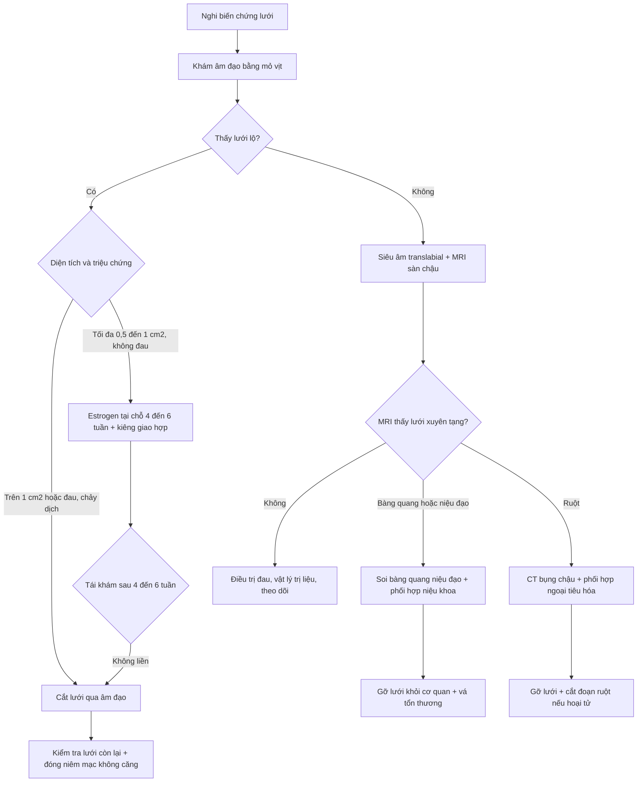
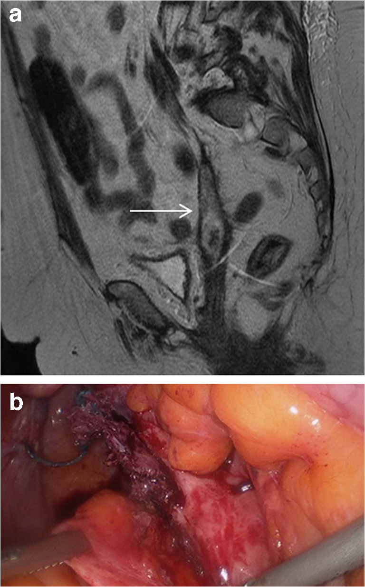
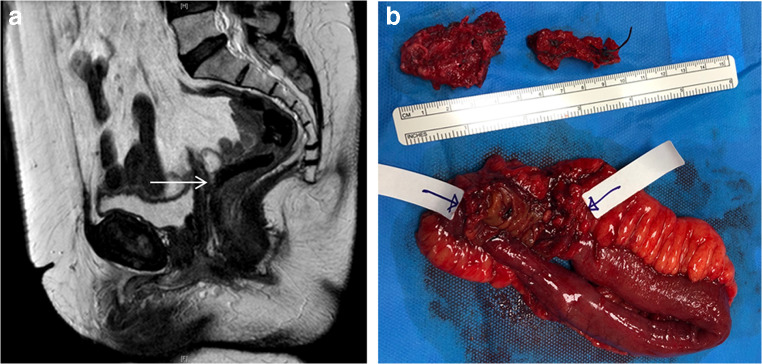
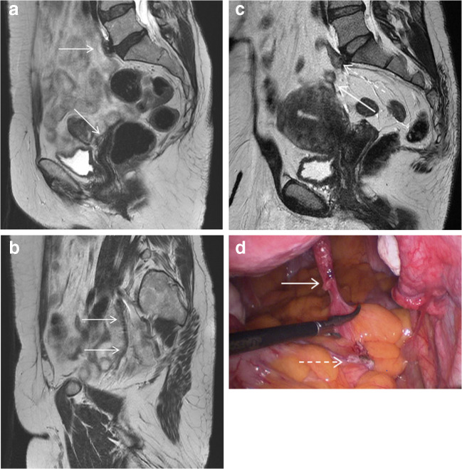

# 557 — Biến chứng lưới nâng sa: lộ/xói mòn, xuyên tạng & quy trình xử trí

**Tags:** `pattern:lo-luoi` `pattern:xoi-mon-luoi` `pattern:luoi-xam-lan` `vung:am-dao` `vung:tieu-khung` `score:IUGA-ICS` `protocol:MRI-san-chau` `protocol:sieu-am-san-chau` `protocol:soi-bang-quang` `incidentaloma:luoi-nang`
**Mức chắc chắn (certainty):** tổng hợp y văn (literature synthesis) — tự biên từ đoàn hệ MRI 87 bệnh nhân (Mahoney et al., *Int Urogynecol J* 2020, PMC7363669) và các tổng quan điều trị (Bueno Garcia Reyes & Hashim, *Ther Adv Urol* 2020, PMC7378717; Shah & Badlani, *Indian J Urol* 2012, PMC3424888), không gắn một bệnh án đơn lẻ.

## 1. Tổng quan bệnh học – cơ chế hình ảnh: lưới "không liền" với thành âm đạo

- **Lưới nâng (mesh)** là tấm polypropylene tổng hợp (thường type 1: macroporous, monofilament, lỗ > 75 µm) đặt dưới niêm mạc âm đạo hoặc qua bụng để treo đỉnh âm đạo/tử cung. Lưới **không tự tiêu**, tồn tại suốt đời; biến chứng có thể xuất hiện **nhiều năm sau mổ**.
- **Ba từ phải phân biệt (theo IUGA/ICS):**
  - **Lộ lưới (exposure):** lưới **nhìn thấy qua niêm mạc âm đạo đã tách** — lưới vẫn nằm trong mô, chỉ "lộ" ra.
  - **Xói mòn/xuất lưới (erosion/extrusion):** lưới **dần thoát ra khỏi cấu trúc** (ví dụ quai lưới nhô vào lòng âm đạo).
  - **Xuyên tạng (perforation):** lưới tạo **lỗ thông vào cơ quan rỗng** — bàng quang, niệu đạo, ruột.
- **TẠI SAO lưới lộ:** niêm mạc âm đạo mỏng, ít mô đệm, **căng khi khâu**, **lưới gấp/nếp**, nhiễm trùng vi khuẩn tạo màng sinh học, teo âm đạo do thiếu estrogen, hút thuốc, đái tháo đường, xạ trị vùng chậu, phẫu thuật âm đạo trước đó. Lưới càng **gần niêm mạc và càng căng** thì nguy cơ càng cao.
- **TẠI SAO hình ảnh học khó — vật lý:** polypropylene **không có proton di động** → trên MRI **giảm tín hiệu mạnh trên T2W** (đen), có thể bị nhầm với **khí, xơ, hoặc dây chằng**. Trên siêu âm, lưới **tăng hồi âm mạnh** (hyperechoic) và tạo **bóng lưng**; đầu dò translabial thấy lưới dạng **"cánh hải âu" (seagull)** hoặc **chữ U**. CT chỉ thấy lưới khi **vôi hóa** hoặc **dày đặc**, nên **không phải lựa chọn đầu tay**.
- **Ngưỡng định lượng:**
  - Tỷ lệ xói mòn/lộ lưới trung bình **10,3%** (phân tích gộp **110 bài, 11.785 bệnh nhân**, dẫn qua PMC3424888).
  - Lưới qua âm đạo để **sa tạng chậu**: **0–21%** trong RCT/nghiên cứu tiến cứu; **mid-urethral sling** cho tiểu không tự chủ: **0–7,3%**.
  - **Đau khi giao hợp (dyspareunia)** sau mổ sa bằng lưới: tới **24,4%**.
  - Trong đoàn hệ **87** phụ nữ chụp MRI vì nghi biến chứng lưới qua bụng: MRI phát hiện **hỏng lưới cơ học 42,1%**, **nhiễm trùng 12,6%**, **lộ lưới 12,6%**, **lưới xuyên ruột 2,3%**; đồng thuận MRI–phẫu thuật **gần hoàn hảo** với hỏng lưới (κ = 0,97), nhiễm trùng (κ = 0,94), nhưng **trung bình** với lộ lưới (κ = 0,58) và **kém** với viêm (κ = 0,24). → **MRI tốt để tìm đường đi/nhiễm/hỏng cơ học, không thay thế khám âm đạo**.
  - **Thời điểm:** theo IUGA/ICS, mã hóa **T1** (trong mổ đến **48 giờ**), **T2** (48 giờ đến **2 tháng**), **T3** (2–12 tháng), **T4** (> 12 tháng) — biến chứng lưới thường gặp ở **T3–T4**, nhiều ca **> 1 năm**.

## 2. Mẫu hình + chẩn đoán phân biệt theo vị trí (Gamut)

- **Tại thành âm đạo (hay gặp nhất):** lộ lưới đơn thuần, lộ + nhiễm trùng (tiết dịch hôi, đau), lộ + co kéo lưới (mesh contraction — lưới nhăn, đau khi giao hợp), lộ + sỏi quanh lưới (cặn canxi).
- **Đường tiểu dưới:** lưới xuyên **bàng quang** (đái máu, đau, nhiễm trùng tái diễn), xuyên **niệu đạo** (tiểu rắt, chảy máu, hẹp niệu đạo), xuyên **niệu quản** (hẹp/tắc → ứ nước thận, đau hông lưng).
- **Đường tiêu hóa:** lưới xuyên **trực tràng/đại tràng** (đau hậu môn, chảy máu, rò âm đạo–trực tràng), xuyên **ruột non** (đau bụng, tắc ruột, áp-xe).
- **Mạch máu/thần kinh:** lưới gần **động mạch chậu** (giả phình, chảy máu), tổn thương **thần kinh bịt/thẹn** (đau lan, dị cảm).
- **Hỏng cơ học không lộ lưới:** lưới **đứt/rời mỏm nhô xương cùng**, lưới **chùng** đi đường vòng qua thành chậu → **sa tái phát** mà không thấy lưới lộ.
- **Gamut "kẻ giả danh" khi khám/ảnh:** **hạt chỉ khâu (suture granuloma)** — nốt nhỏ, không có lưới; **nang âm đạo** (Gartner, nang bao); **áp-xe thành âm đạo**; **rò âm đạo–niệu đạo/trực tràng** không do lưới; **sa tái phát** không kèm biến chứng lưới; **ung thư âm đạo** (hiếm, mảng cứng/loét).
- **Mnemonic "MESH":** **M**igration (di trú/xuyên tạng), **E**xposure (lộ), **S**hrinkage (co kéo), **H**ardware failure (đứt/chùng) + **H**urt (đau thần kinh).

## 3. Bảng so sánh phân biệt (ma trận đối chiếu)

| Thực thể (entity) | Hình ảnh điển hình | Chốt vào (rule-in) | Chốt loại (rule-out) | Gợi ý xác nhận |
|---|---|---|---|---|
| **Lộ lưới âm đạo** | Khám: lưới trắng/xám qua niêm mạc; MRI: bó giảm tín hiệu T2 chạm thành âm đạo | **Nhìn thấy lưới qua niêm mạc khi đặt mỏ vịt** | Niêm mạc **liền, không thấy lưới** → không lộ | Khám âm đạo là chốt; MRI chỉ đo đường đi |
| **Nhiễm trùng đường lưới** | MRI T2: **đường lưới dày, giảm tín hiệu, viền tăng tín hiệu/ngấm thuốc**, dịch quanh; lâm sàng tiết dịch hôi, đau | **Lưới dày + dịch/viêm quanh + tiết dịch hôi** | Chỉ lộ lưới **khô, không dịch, không đau** → lộ đơn thuần | Cấy dịch; MRI; cắt lưới một phần |
| **Lưới xuyên bàng quang** | MRI: lưới **xuyên thành bàng quang**, có thể sỏi quanh lưới; CT/soi bàng quang xác nhận | **Soi bàng quang thấy lưới trong lòng bàng quang** | Lưới **dừng trước thành bàng quang** → không xuyên | Soi bàng quang + MRI |
| **Lưới xuyên niệu đạo** | MRI sagittal: lưới vào **thành sau niệu đạo**; niệu đạo hẹp, thành dày | **Lưới trong lòng/thành niệu đạo + hẹp niệu đạo** | Hẹp niệu đạo **không có lưới** → nguyên nhân khác | Soi niệu đạo; niệu đạo đồ |
| **Lưới xuyên ruột** | MRI: lưới dính **quai ruột non/đại tràng**, dày thành, có thể áp-xe; CT: lưới + túi khí ngoài lòng ruột | **Lưới xuyên thành ruột + dấu viêm/dính/áp-xe** | Chỉ **dính ruột quanh lưới, không xuyên** → theo dõi | CT bụng–chậu; mổ nội soi |
| **Hỏng lưới cơ học (đứt/chùng)** | MRI: lưới **không liên tục** từ mỏm nhô đến âm đạo; đầu tự do trong ổ bụng; lưới đi **đường vòng** | **Đứt/không nối liền hai đầu lưới + sa tái phát** | Lưới **liên tục, căng đúng đường** → không hỏng | MRI + nội soi ổ bụng |
| **Co kéo lưới (contraction)** | MRI: lưới **nhăn, dày, co**, đau khi giao hợp; khám sờ thấy lưới cứng | **Lưới co cứng + đau khu trú** | Lưới mềm, phẳng → không co | Khám + MRI |
| **Ung thư âm đạo (hiếm)** | Khối/mảng cứng, loét, ngấm thuốc; có thể **quanh lưới cũ** | **Mô bệnh ác tính** | Tổn thương **mềm, không loét, không ngấm** → lành | Sinh thiết |

## 4. Protocol chụp + hệ phân độ & quy trình xử trí

- **Khám lâm sàng là bước 1 (không thay thế):** đặt mỏ vịt, xác định **vị trí, diện tích, số điểm lộ**, lưới có **co kéo**, có **dịch mủ**, có **sỏi/cặn**, và tìm **trigger point** đau. Khám dưới gây mê nếu quá đau.
- **Siêu âm translabial/transvaginal:** đầu dò **5–9 MHz**, quét **mặt phẳng trục và sagittal**; lưới **tăng hồi âm**, dạng **"cánh hải âu"** (TOT) hoặc **chữ U** (TVT); đánh giá lưới quanh niệu đạo, bàng quang, khoang sau âm đạo; không tia X, làm tại giường.
- **MRI sàn chậu (khi nghi xuyên tạng/hỏng cơ học/đau phức tạp):** **1,5 hoặc 3 T**, **T2W axial + coronal + sagittal độ phân giải cao**, **T1W axial**, **T2 fat-sat axial**, lát **3 mm**, FOV **26–30 cm**, matrix **256 × 192**; có thể dùng **gel âm đạo** để tách thành âm đạo. Đọc: **đường đi của lưới từ mỏm nhô xương cùng → thành âm đạo**, độ **liên tục**, độ **dày**, **dịch/ngấm thuốc quanh lưới**, quan hệ với **bàng quang, niệu đạo, trực tràng, ruột non, mạch chậu**.
- **CT bụng–chậu có cản quang:** khi nghi **xuyên ruột, áp-xe, hẹp niệu quản** hoặc cần đánh giá ổ bụng cấp; **không dùng để "tìm lưới"** vì lưới thường không cản tia.
- **Soi bàng quang/niệu đạo:** bắt buộc khi **có triệu chứng tiểu dưới, đái máu, nhiễm trùng tái diễn**, hoặc trước khi cắt lưới âm đạo để loại xuyên bàng quang.
- **Phân độ IUGA/ICS (Category–Time–Site):** **nhóm 1** không triệu chứng/không lộ; **2** có triệu chứng/không lộ; **3** **lộ lưới**; **4** **đường tiểu** (bàng quang/niệu đạo/niệu quản); **5** **ruột**; **6** **mạch máu**; **7** **thần kinh**; kèm **T1–T4** (48 giờ; 2 tháng; 12 tháng; sau 12 tháng) và **vị trí**. Hệ này đầy đủ nhưng **độ đồng thuận giữa người đọc chỉ trung bình** — dùng như ngôn ngữ chung, không thay thế mô tả lâm sàng.

- **Điều trị theo mức (định lượng):**
  - **Lộ nhỏ 0,5–1 cm², không triệu chứng:** **estrogen tại chỗ 4–6 tuần** + kiêng giao hợp ± kháng sinh; nhưng tới **59,3%** trường hợp điều trị bảo tồn cuối cùng vẫn phải mổ.
  - **Lộ > 1 cm², có triệu chứng, hoặc thất bại bảo tồn:** **cắt lưới qua âm đạo** (cắt phần lộ hoặc toàn bộ), đóng niêm mạc **không căng**, có thể dùng **vạt Martius** khi thiếu mô.
  - **Xuyên bàng quang/niệu đạo:** gỡ lưới + **vá bàng quang/niệu đạo**, có thể cần **cắt bàng quang một phần**; đặt **sonde niệu đạo** và theo dõi hẹp.
  - **Xuyên ruột:** **mổ nội soi/mở** gỡ lưới, cắt đoạn ruột nếu hoại tử; phối hợp ngoại tiêu hóa.
  - **Đau thần kinh/thẹn:** **block thần kinh chẩn đoán** (lidocaine ± corticoid), vật lý trị liệu, thuốc đau thần kinh; **không cắt lưới mù** nếu không xác định được nguồn đau.
  - **Phòng ngừa:** chọn **lưới nhẹ, lỗ lớn, type 1**; **bóc toàn bộ niêm mạc**, khâu **không căng**, tránh **gấp lưới**; điều trị **teo âm đạo bằng estrogen trước mổ**; ngừng thuốc lá; kiểm soát đường huyết; theo dõi **T3–T4** dài hạn.

## 5. Biến thể bình thường và cạm bẫy

- **Lưới bình thường cũng "đen" trên T2:** đừng gọi mọi bó giảm tín hiệu là lộ/xuyên; cần **đối chiếu đường đi giải phẫu** và **khám lâm sàng**. Mô xơ quanh lưới cũng giảm tín hiệu và có thể dày.
- **Không thấy lưới trên CT không loại trừ biến chứng:** polypropylene **không cản tia**; CT chỉ có ích khi có **vôi hóa, dịch, áp-xe, tắc ruột**.
- **MRI có thể bỏ sót lộ lưới nhỏ:** κ chỉ **0,58** cho lộ lưới trong đoàn hệ trên; **khám âm đạo** vẫn là chuẩn.
- **"Đau vùng chậu" không đồng nghĩa "lưới lỗi":** phân biệt **co kéo lưới**, **đau cơ sàn chậu/myofascial**, **đau thần kinh thẹn**, **sa tái phát**, **nhiễm trùng** — xem [556](../556-dau-san-chau-co-mac-pudendal-neuralgia/lesson.md).
- **Sỏi quanh lưới** có thể giả "khối canxi hóa" hoặc "dị vật"; hỏi tiền sử lưới và tìm **cánh lưới** hai cực.
- **Satisfaction of search:** thấy lộ lưới rồi bỏ sót **xuyên bàng quang/ruột** đi kèm — luôn trả lời "lưới đi tới đâu?" trước khi kết luận.
- **Sa tái phát sau cắt lưới:** cắt lưới nhiều làm mất điểm tựa; cần **kế hoạch treo lại** (native tissue hoặc lưới mới) trước khi mổ.

## 6. Tự lượng giá — Blind Quiz

**Ca 1 — Sau treo đỉnh bằng lưới qua bụng, đau vùng chậu và tiết dịch âm đạo. MRI sagittal T2W.**

- Gợi ý lâm sàng: tiền sử sacrocolpopexy, đau và dịch âm đạo kéo dài.
- Câu hỏi: (1) Bất thường nằm ở đâu? (2) Chẩn đoán? (3) Bước xử trí tiếp theo?

<b>Bấm để hiện đáp án (findings + chẩn đoán)</b>

- **Dấu hiệu:** bó **giảm tín hiệu T2 dày** chạy từ thành chậu tới **thành sau âm đạo**, kèm **viền tăng tín hiệu/dịch quanh lưới** và **xói mòn thành âm đạo** (mũi tên); ảnh nội soi (b) cho thấy **đường lưới dày, nhiễm trùng** đã cắt một phần.
- **Chẩn đoán:** **nhiễm trùng đường lưới + lộ/xói mòn thành âm đạo** (IUGA/ICS nhóm 3, kèm nhiễm trùng).
- **Xử trí:** cấy dịch, kháng sinh, **cắt lưới nhiễm** qua âm đạo/nội soi; kiểm tra bàng quang–niệu đạo trước mổ.
- **Nguồn ảnh:** Mahoney C et al., *Int Urogynecol J* 2020, PMC7363669 Fig. 2, CC BY 4.0.

**Ca 2 — Cùng bối cảnh, MRI sagittal T2W: lưới đi tới đâu?**

- Câu hỏi: (1) Mô tả quan hệ lưới–ruột? (2) Vì sao không thể chỉ cắt lưới qua âm đạo?

<b>Bấm để hiện đáp án (findings + chẩn đoán)</b>

- **Dấu hiệu:** lưới tới **phần âm đạo** kèm **dính quai ruột non quanh lưới**, **xuyên thành ruột** (mũi tên); ảnh mổ (b) cho thấy **đoạn ruột non đã cắt** và **hai mảnh lưới** nằm trong lòng ruột.
- **Chẩn đoán:** **lưới xuyên ruột non** (IUGA/ICS nhóm 5) — biến chứng nặng, nguy cơ tắc/rò/nhiễm trùng.
- **Vì sao không cắt qua âm đạo:** cần **mổ bụng/nội soi** để gỡ lưới khỏi ruột, **cắt đoạn ruột hoại tử** và vá; cắt qua âm đạo có thể làm **rách ruột** hoặc bỏ sót đoạn lưới trong ổ bụng.
- **Nguồn ảnh:** Mahoney C et al., *Int Urogynecol J* 2020, PMC7363669 Fig. 4, CC BY 4.0.

**Ca 3 — Sa tái phát sau sacrocolpopexy, không thấy lưới lộ khi khám.**

- Câu hỏi: (1) Vì sao khám không thấy lưới lộ mà vẫn nghi biến chứng? (2) Dấu hiệu MRI nào chốt hỏng lưới cơ học?

<b>Bấm để hiện đáp án (findings + chẩn đoán)</b>

- **Dấu hiệu:** (a, b) lưới đi **đường vòng qua thành chậu** thay vì đường thẳng từ xương cùng tới âm đạo → **lưới chùng**; (c) **đầu tự do của lưới trong ổ bụng** tách khỏi **mảnh lưới còn lại ở mỏm nhô** → **đứt/rời**; (d) nội soi xác nhận.
- **Chẩn đoán:** **hỏng lưới cơ học** (đứt/chùng) gây **sa tái phát**, không có lộ lưới.
- **Xử trí:** nội soi ổ bụng gỡ lưới cũ + **treo lại** (lưới mới hoặc native tissue) sau khi đánh giá mô và nguy cơ.
- **Nguồn ảnh:** Mahoney C et al., *Int Urogynecol J* 2020, PMC7363669 Fig. 1, CC BY 4.0.

## Bài liên quan chéo
- [547 – Sa tạng chậu nữ: POP-Q & lưới nâng](../547-sa-tang-chau-nu-POP-Q-luoi-nang/lesson.md) (chọn bệnh nhân, đặt lưới)
- [545 – MR động học sàn chậu](../545-sa-san-chau-MR-defecography/lesson.md) (đọc sa theo khoang)
- [556 – Đau sàn chậu cơ–mạc & đau thần kinh thẹn](../556-dau-san-chau-co-mac-pudendal-neuralgia/lesson.md) (đau không do lộ lưới)
- [548 – Nang/khối lành vùng âm hộ – âm đạo](../548-nang-lanh-am-ho-am-dao/lesson.md) (kẻ giả danh nang)
- [642 – Biến chứng muộn sau chấn thương đường tiết niệu dưới ở trẻ](../642-bien-chung-muon-chan-thuong-nieu-dao-nhi/lesson.md) (hẹp niệu đạo)
- [500 – Tổng quan Hệ Vú & Sản Phụ khoa](../500-tong-quan-vu-san-phu-khoa/lesson.md)

> Không dùng để chẩn đoán độc lập khi chưa có người hướng dẫn.
