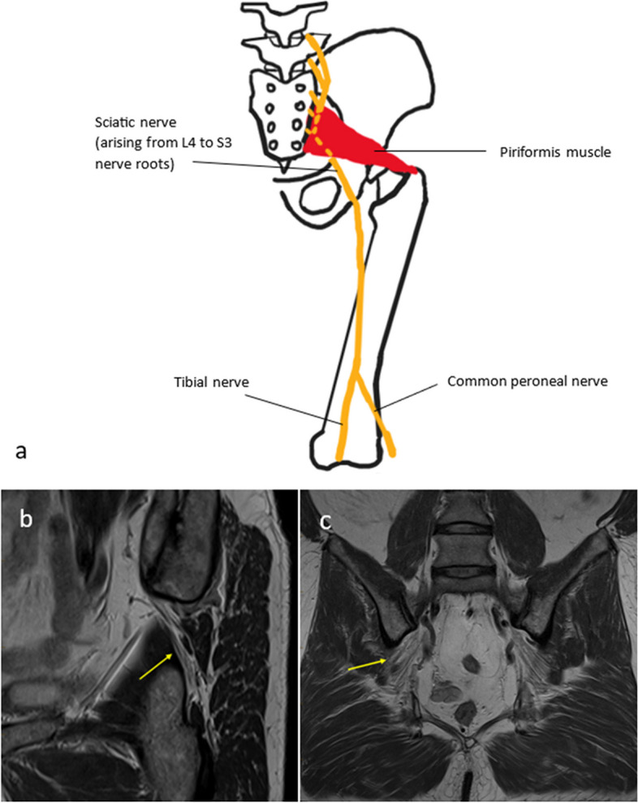
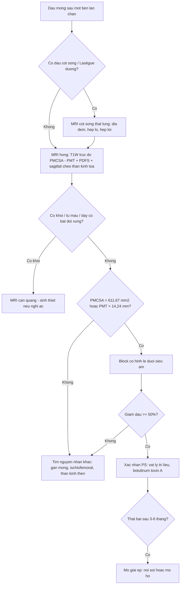
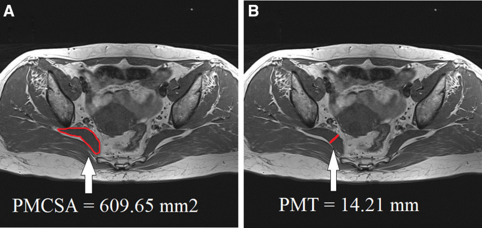
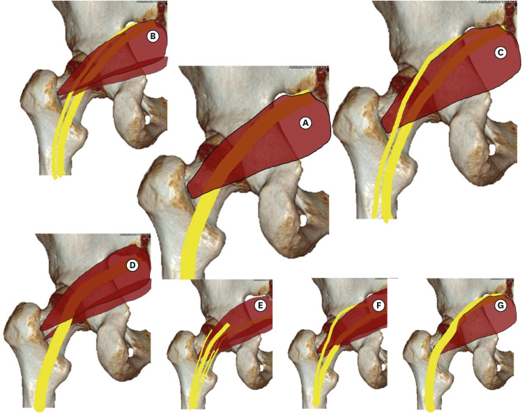
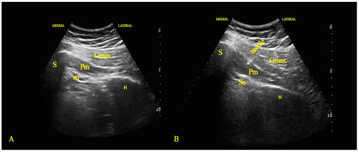

# 558 — Hội chứng cơ hình lê: chèn ép thần kinh tọa ngoài cột sống / Piriformis syndrome

**Tags:** `pattern:chen-ep-than-kinh` `vung:mong-sau` `vung:than-kinh-ngoai-bien` `protocol:MRI-hong` `protocol:sieu-am-than-kinh` `anatomy:mong-sau`
**Mức chắc chắn (certainty):** tổng hợp y văn (literature synthesis) — tổng hợp từ bài tổng quan hình ảnh, nghiên cứu cắt ngang có đối chứng và báo ca; số liệu đọc trực tiếp từ bài gốc, PMCID ghi trong `sources.md`.

> **Bài này nối tiếp 556 (đau sàn chậu – thần kinh thẹn) và 228 (thoát vị đĩa đệm – phân độ Pfirrmann).** 228 trả lời “đau lan chân có phải do đĩa đệm”; 556 trả lời “đau vùng đáy chậu do dây thần kinh nào”. Bài này trả lời câu hỏi hay bị bỏ qua nhất: **đau mông sâu lan chân nhưng MRI cột sống bình thường — có phải cơ hình lê chèn thần kinh tọa, và đo gì trên MRI để chốt?**

## 1. Tổng quan bệnh học – cơ chế hình ảnh

- **Giải phẫu:** cơ hình lê (piriformis) bám vào **mặt trước xương cùng S2–S4**, đi qua **lỗ ngồi lớn** ra sau, bám vào **mặt trên – trong mấu chuyển lớn**. Thần kinh tọa đi **dưới cơ** trong đa số người; khi cơ dày, co cứng hoặc có nhánh thần kinh xuyên qua cơ, dây thần kinh bị chèn tại **lỗ ngồi lớn**.
- **Phân loại Beaton–Anson (quan hệ thần kinh tọa – cơ hình lê):** **type A 80–90%** (thần kinh nguyên vẹn đi dưới cơ); **type B 10–15%** (một bó xuyên cơ, một bó dưới cơ); **type C 1–3%** (một bó trên, một bó dưới cơ); **type D–F < 1%** mỗi loại (Son 2022, PMC9634287). Biến thể giải phẫu có ở **~16%** dân số theo nghiên cứu xác – y văn, nhưng **biến thể đơn thuần không đủ gây bệnh** — phải có thêm yếu tố cơ học/viêm.
- **Cơ chế hai tầng:** (1) **chèn ép cơ học** — cơ hình lê phì đại, co thắt, xơ hóa sau chấn thương, ngồi lâu, chạy bộ leo dốc; (2) **kích thích viêm** — dây thần kinh bị cọ xát vào cơ/bờ xương, gây phù và tăng tín hiệu dây. Vì vậy **MRI không chỉ đo cơ mà còn phải đọc dây thần kinh** (tín hiệu, đường kính, đường đi).
- **Vì sao hình ảnh khó:** đây là chẩn đoán **loại trừ** — không có tiêu chuẩn vàng thống nhất (Kumar 2023, PMC10545616). Bệnh nhân thường được chẩn đoán nhầm đau thắt lưng/đau thần kinh tọa do đĩa đệm. Điểm quan trọng: **PS và thoát vị đĩa đệm có thể cùng tồn tại** — trong 39 bệnh nhân đau thần kinh tọa L4–S1 có điểm đau khu trú cơ hình lê, **84,6% được xác định có PS** bằng tiêm lidocaine dưới hướng dẫn siêu âm (giảm ≥ 50% đau) (Topçu 2026, PMC13618775).
- **Ngưỡng định lượng trên MRI (số chốt):**
  - **Diện tích mặt cắt cơ hình lê (PMCSA)** trên T1W trục: trung bình **564,36 ± 121,61 mm²** ở nhóm không bệnh so với **736,88 ± 168,87 mm²** ở nhóm PS (p ≤ 0,001). **Điểm cắt 611,67 mm²** cho **Se 75%, Sp 75%, AUC 0,81** (KTC 95%: 0,68–0,94).
  - **Độ dày cơ hình lê (PMT)** trên T1W trục: **13,83 ± 2,61 mm** (chứng) so với **15,99 ± 2,34 mm** (PS); **điểm cắt 14,24 mm** cho **Se 70%, Sp 70%, AUC 0,78** (KTC 95%: 0,63–0,93) (Lim 2025, PMC11857021).
  - **Hệ quả:** PMCSA **nhạy hơn** PMT; nhưng cả hai đều **Se/Sp chỉ 70–75%** — không dùng một mình để chẩn đoán, phải ghép lâm sàng + đáp ứng tiêm.
- **TẠI SAO T1W là chuỗi xung đo:** mỡ trong cơ và mỡ quanh cơ cho **tương phản cao** giữa bụng cơ và mô mỡ, nên đo diện tích/độ dày chính xác và so sánh hai bên. **T2W/PDFS/STIR** để tìm **phù cơ, phù dây thần kinh, khối/hoại tử** — tín hiệu tăng của dây thần kinh là dấu hiệu **gián tiếp** của chèn ép, có thể bình thường trong ca mạn tính.

## 2. Mẫu hình + chẩn đoán phân biệt theo vị trí (gamut)

- **Mẫu hình lâm sàng:** đau **mông sâu một bên**, lan mặt sau đùi – cẳng chân; **tăng khi ngồi lâu, lái xe, ngồi xổm**; đau khi **dạng – xoay trong – gấp háng (nghiệm pháp FAIR)**; điểm đau khi ấn vùng **mấu chuyển lớn/khuyết ngồi lớn**; **không đau cột sống thắt lưng** và nghiệm pháp Lasègue cột sống âm.
- **Gamut theo khoang mông sâu (deep gluteal space):**
  - **Trong khoang dưới cơ hình lê:** hội chứng cơ hình lê, **chèn ép thần kinh tọa do dải xơ (fibrovascular band)**, **ischiofemoral impingement** (cụp xương đùi – ụ ngồi), khối u dây thần kinh (schwannoma), tụ máu sau chấn thương.
  - **Ngoài khoang:** **bệnh gân cơ mông nhỡ/nhỏ**, **bệnh gân cơ nhị đầu đùi đoạn gần**, **viêm khớp cùng chậu**, **lạc nội mạc tử cung trong cơ/dây thần kinh**, **đau thần kinh thẹn** (bài 556).
  - **Nguồn từ cột sống:** thoát vị đĩa đệm L4–S1, hẹp ống sống, hẹp lỗ liên hợp — **luôn loại trừ trước** (Kumar 2023).
- **Mnemonic “PIRIFORMIS”:** **P**hì đại cơ, **I**schiofemoral impingement, **R**adiculopathy (đĩa đệm), **I**njection/hematoma, **F**ibrovascular band, **O**steophyte/khối u, **R**ed flags (khối, nhiễm, ung thư), **M**uscle imbalance, **I**nflammation (lạc nội mạc), **S**ciatic nerve signal.

## 3. Bảng so sánh phân biệt (ma trận đối chiếu)

| Thực thể (entity) | Hình ảnh điển hình (MRI 3T/1,5T) | Chốt vào (rule-in) | Chốt loại (rule-out) | Gợi ý xác nhận |
|---|---|---|---|---|
| **Hội chứng cơ hình lê** | Cơ hình lê **dày một bên** (PMCSA > 611,67 mm², PMT > 14,24 mm), có thể phù cơ; dây thần kinh tọa tín hiệu tăng, đường đi bất thường | **Dày cơ một bên + đau mông sâu tăng khi ngồi + giảm ≥ 50% sau tiêm cơ hình lê** | Cơ đối xứng bình thường + đau lan theo da liễu L5/S1 + hình ảnh đĩa đệm chèn rễ → nghĩ nguồn cột sống | MRI hông trục T1W + PDFS; tiêm lidocaine/corticoid dưới siêu âm |
| **Ischiofemoral impingement** | Hẹp khoảng giữa **mấu chuyển nhỏ** và **ụ ngồi** (ngưỡng thường dẫn < 15 mm — **chưa đối chiếu nguồn trong bài này**), phù cơ **thắt lưng chậu** và cơ bịt trong | **Hẹp khoang + phù cơ thắt lưng chậu**, đau khi dạng – duỗi háng | Khoang rộng, cơ bình thường → loại trừ | MRI trục qua ụ ngồi; đo khoảng cách xương |
| **Đau thần kinh tọa do đĩa đệm** | Thoát vị/đĩa đệm giảm tín hiệu T2 (Pfirrmann), chèn rễ; **không dày cơ hình lê** | **Hình ảnh chèn rễ tương ứng da liễu + nghiệm pháp Lasègue dương** | MRI cột sống bình thường + đau mông sâu khu trú → nghĩ PS | MRI cột sống thắt lưng; EMG/đo dẫn truyền |
| **Đau thần kinh thẹn** | Không có tổn thương cơ hình lê; đau vùng **ụ ngồi – âm hộ/dương vật – trực tràng**, tăng khi ngồi | **Đau theo phân nhánh thần kinh thẹn + block thần kinh thẹn dương** | Đau lan mặt sau đùi – cẳng chân → không phải thần kinh thẹn | MRI khung chậu; block dưới hướng dẫn |
| **Bệnh gân cơ mông nhỡ/nhỏ** | Dày gân, tăng tín hiệu quanh chỗ bám **mấu chuyển lớn**, teo mỡ cơ mông nhỏ | **Đau khu trú mấu chuyển lớn + dày gân trên MRI** | Đau sâu trong khung chậu, không đau khi ấn mấu chuyển → nghĩ PS | MRI hông; siêu âm gân |
| **Khối u/xơ dây thần kinh tọa** | Khối dọc dây thần kinh, **ngấm thuốc**, có thể tín hiệu mỡ (lipoma) hoặc xơ | **Khối khu trú trên MRI + dấu hiệu thần kinh tiến triển** | Không có khối, chỉ dày cơ đối xứng → loại trừ | MRI có cản quang; sinh thiết nếu nghi ác |

*(a) Quan hệ thường gặp: thần kinh tọa đi dưới cơ hình lê. (b, c) Nam 41 tuổi hội chứng cơ hình lê: chuỗi PD sagittal chếch và coronal hông phải cho thấy thần kinh tọa (mũi tên vàng) có **một nhánh xuyên qua cơ hình lê** — biến thể giải phẫu là yếu tố thuận lợi. Nguồn: Kumar S et al., Insights Imaging 2023 (PMC10545616, Fig. 1), CC BY 4.0.*

## 4. Protocol chụp + tiêu chuẩn hình ảnh

- **MRI hông – khung chậu, không cản quang (ưu tiên 3T):**
  - **Trục T1W** (hoặc T1W Dixon) qua **bụng cơ hình lê**: đo **PMCSA** (diện tích) và **PMT** (độ dày vuông góc với trục cơ), luôn **so sánh hai bên** ở **cùng một lát cắt giải phẫu**.
  - **Trục + coronal PDFS/STIR**: tìm **phù cơ, phù dây thần kinh**, khối, tụ dịch.
  - **Sagittal chếch theo trục thần kinh tọa** (theo đường đi từ khuyết ngồi lớn xuống): xác định **biến thể Beaton–Anson**, dải xơ, chỗ hẹp.
  - **Cản quang** chỉ khi nghi **khối/u** hoặc sau mổ.
- **Siêu âm cơ xương khớp:** đo độ dày cơ, so sánh hai bên, đánh giá động (dạng – xoay trong háng) và **hướng dẫn tiêm**; có thể thấy dây thần kinh **giảm hồi âm, mất cấu trúc bó** khi bị chèn.
- **Tiêu chuẩn chẩn đoán phối hợp (không có RADS):** (1) đau mông sâu một bên điển hình; (2) loại trừ nguyên nhân cột sống; (3) **PMCSA/PMT vượt ngưỡng hoặc bất đối xứng**; (4) **giảm ≥ 50% đau sau block cơ hình lê** — bước (4) là “chốt” thực hành.
- **Điều trị – bằng chứng định lượng:**
  - Tiêm **lidocaine/ozone** giảm đau **ngắn hạn** (1 tháng); **botulinum toxin A** giảm đau và cải thiện ODI **tốt hơn ở 6 tháng** trong RCT 84 bệnh nhân (Elsawy 2022, PMC9818865).
  - **Phẫu thuật** khi thất bại điều trị bảo tồn: phân tích gộp 6 nghiên cứu nội soi cho **VAS giảm −4,7 điểm** (KTC 95%: −5,2 đến −4,2) và **mHHS tăng +25,6** (KTC 95%: +16,0 đến +35,3); biến chứng **0–12%**, đa số nhẹ (Warman 2026, PMC13422639).
- **Thuật toán tiếp cận đau mông sâu lan chân:**

## 5. Biến thể bình thường và cạm bẫy

- **Cạm bẫy 1 — bất đối xứng do tư thế:** xoay đùi khác nhau giữa hai bên làm **PMCSA/PMT khác nhau giả tạo**. Luôn đo trên **cùng lát cắt, cùng mức giải phẫu** (ngang mức ụ ngồi/mấu chuyển nhỏ) và ghi rõ mức đo.
- **Cạm bẫy 2 — “MRI bình thường” không loại trừ PS:** chẩn đoán là **loại trừ**; tín hiệu dây thần kinh có thể bình thường ở ca mạn. Đừng bỏ chẩn đoán chỉ vì ảnh đẹp.
- **Cạm bẫy 3 — chỉ nhìn cột sống:** **84,6%** bệnh nhân đau thần kinh tọa L4–S1 có kèm PS; thấy thoát vị đĩa đệm **không có nghĩa là hết chẩn đoán** — nếu đau không tương xứng da liễu, phải khám mông sâu.
- **Cạm bẫy 4 — bỏ sót “red flag”:** khối trong cơ hình lê có thể là **schwannoma, lipoma, sarcoma, lạc nội mạc tử cung, tụ máu**. Mọi khối **không đối xứng, ngấm thuốc, phát triển theo thời gian** cần MRI cản quang và hội chẩn.
- **Cạm bẫy 5 — tiêm không đúng mặt phẳng:** kim có thể vào **dây thần kinh tọa** hoặc mạch mông trên; bắt buộc **hướng dẫn siêu âm**, kiểm tra hút ngược, tránh tiêm ở bệnh nhân rối loạn đông máu.
- **Biến thể bình thường:** **cơ hình lê có thể dày đối xứng ở người tập luyện** — chỉ có giá trị khi **bất đối xứng + lâm sàng tương ứng**.

## 6. Tự lượng giá — Blind Quiz

**Ca 1 — Nam 41 tuổi, đau mông phải lan mặt sau đùi, tăng khi ngồi. MRI hông:**

- Câu hỏi: thần kinh tọa đi qua cơ hình lê như thế nào? Đây là biến thể nào? Có phải nguyên nhân duy nhất gây đau không?

<b>Bấm để hiện đáp án (findings + chẩn đoán)</b>

- Dấu hiệu: trên PD sagittal chếch và coronal, **một nhánh thần kinh tọa xuyên qua cơ hình lê**, nhánh còn lại đi dưới cơ — **biến thể Beaton–Anson type B** (một bó xuyên cơ, một bó dưới cơ).
- Chẩn đoán: **hội chứng cơ hình lê**; biến thể chỉ là **yếu tố thuận lợi**, chẩn đoán cần lâm sàng + đáp ứng tiêm.
- Nguồn ảnh: Kumar S et al., Insights Imaging 2023 (PMC10545616, Fig. 1), CC BY 4.0.

**Ca 2 — Nữ 45 tuổi đau mông trái 6 tháng. Muốn “đo cơ hình lê”, bạn đo gì trên lát cắt nào?**

- Câu hỏi: hai phép đo trong ảnh là gì? Ngưỡng nào gợi ý bệnh? Vì sao phải so sánh hai bên?

<b>Bấm để hiện đáp án (findings + chẩn đoán)</b>

- (A) **PMCSA** — diện tích mặt cắt cơ hình lê; (B) **PMT** — độ dày cơ đo vuông góc trục cơ, trên **T1W trục hông**.
- Ngưỡng: **PMCSA > 611,67 mm²** (Se 75%, Sp 75%, AUC 0,81); **PMT > 14,24 mm** (Se 70%, Sp 70%, AUC 0,78).
- Vì sao so sánh hai bên: giảm ảnh hưởng của kích thước cơ thể và tư thế; bất đối xứng mới có ý nghĩa.
- Nguồn ảnh: Lim C et al., Medicine 2025 (PMC11857021, Fig. 1), CC BY-NC 4.0.

**Ca 3 — Bệnh nhân trẻ đau mông dữ dội, đã mổ cột sống nhưng không đỡ. Nhìn sơ đồ phân loại:**

- Câu hỏi: kiểu nào phổ biến nhất? Kiểu nào dễ gây chèn ép nhất? Vì sao “đã mổ cột sống mà vẫn đau” là gợi ý?

<b>Bấm để hiện đáp án (findings + chẩn đoán)</b>

- **Type A 80–90%** (thần kinh nguyên vẹn dưới cơ); **type B 10–15%** (một bó xuyên cơ); **type C 1–3%** (một bó trên – một bó dưới cơ); **type D–F < 1%**.
- Nhánh **xuyên cơ** dễ bị chèn khi cơ phì đại/co thắt → đau dai dẳng dù đĩa đệm đã xử lý.
- Bài học: **đau không tương xứng da liễu sau mổ cột sống** phải khám lại mông sâu và đọc MRI hông.
- Nguồn ảnh: Son BC & Lee C, Korean J Neurotrauma 2022 (PMC9634287, Fig. 1), CC BY-NC 4.0.

**Ca 4 — Sau khi xác định cơ hình lê dày, bước tiếp theo là gì?**

- Câu hỏi: mốc giải phẫu trong ảnh? Vì sao tiêm dưới hướng dẫn siêu âm? Chọn thuốc nào nếu muốn giảm đau kéo dài?

<b>Bấm để hiện đáp án (findings + chẩn đoán)</b>

- Mốc: **S** xương cùng, **H** xương hông, **Gmax** cơ mông lớn, **Pm** cơ hình lê, **Sn** thần kinh tọa; kim vào **bụng cơ hình lê** dưới hướng dẫn siêu âm.
- Vì sao siêu âm: tránh tiêm vào **thần kinh tọa/mạch**, xác nhận vị trí kim, giảm biến chứng.
- Chọn thuốc: **lidocaine/ozone** giảm đau ngắn hạn; **botulinum toxin A** cải thiện VAS/ODI tốt hơn ở **6 tháng** (RCT 84 bệnh nhân).
- Nguồn ảnh: Elsawy AGS et al., Healthcare 2022 (PMC9818865, Fig. 1), CC BY 4.0.

## Bài liên quan chéo
- [556 – Đau sàn chậu & đau thần kinh thẹn](../556-dau-san-chau-co-mac-pudendal-neuralgia/lesson.md)
- [228 – Thoát vị đĩa đệm thắt lưng & phân độ Pfirrmann](../228-thoat-vi-dia-dem-that-lung-pfirrmann-modic/lesson.md)
- [377 – U thần kinh dạng đám rối & MPNST/NF1](../377-u-than-kinh-dang-dam-roi-va-mpnst-nf1/lesson.md)

> Không dùng để chẩn đoán độc lập khi chưa có người hướng dẫn.
