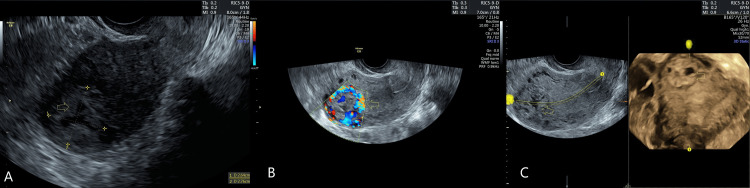
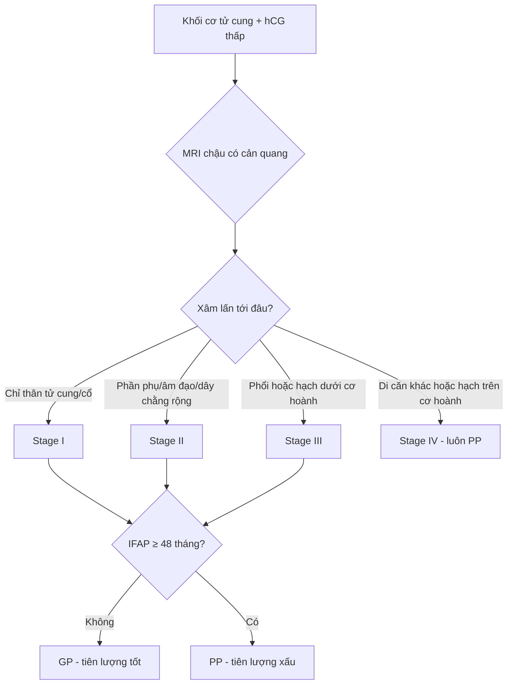
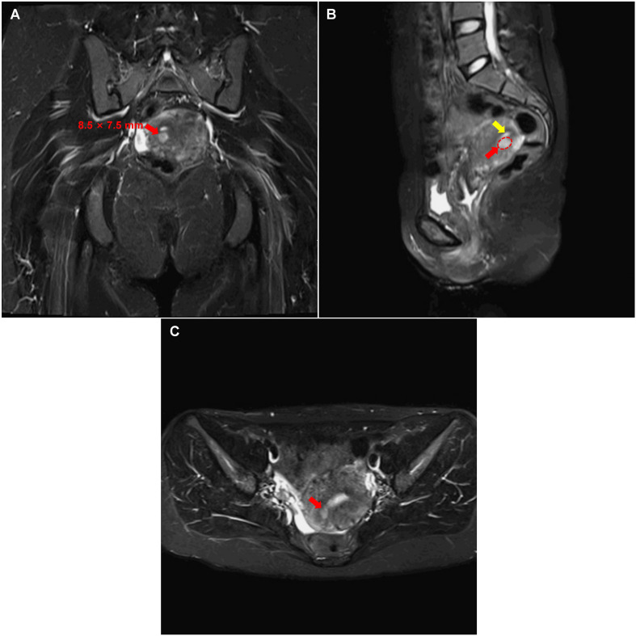
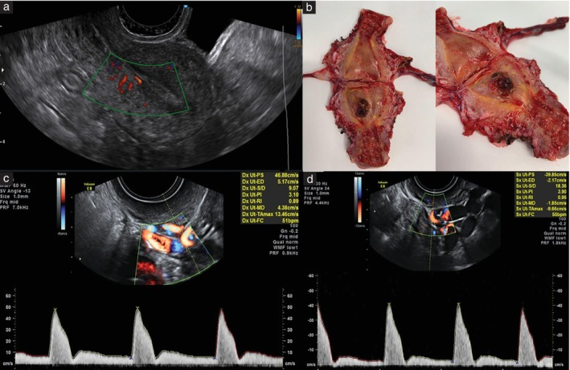
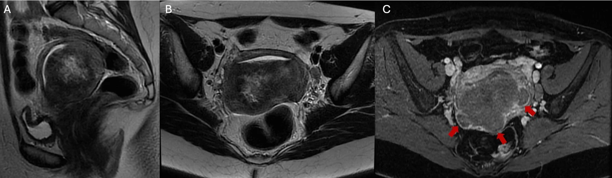

# 559 — U nguyên bào nuôi tại vị trí nhau (PSTT) & u nguyên bào nuôi dạng biểu mô (ETT): khối xâm lấn cơ tử cung, hCG thấp & phân giai đoạn FIGO 2026

**Tags:** `pattern:khoi-tu-cung` `pattern:xam-lan-co-tu-cung` `vung:tu-cung` `vung:co-tu-cung` `score:FIGO-2026` `protocol:MRI-chau` `protocol:CT-nguc`
**Mức chắc chắn (certainty):** tổng hợp y văn (literature synthesis) — tổng hợp từ hướng dẫn phân giai đoạn FIGO 2026 (Ngan 2026), đoàn hệ tiến cứu siêu âm Doppler (Cioffi 2025), đoàn hệ 236 u nguyên bào nuôi trung gian (Peking Union 2026), 2 bài review và 4 ca nguyên văn có ảnh mở; mọi số liệu đối chiếu trực tiếp với PMCID.

## 1. Tổng quan bệnh học – cơ chế hình ảnh

- **Vị trí trong phổ bệnh nguyên bào nuôi:** bệnh nguyên bào nuôi thai kỳ (gestational trophoblastic disease – GTD) gồm thai trứng, thai trứng xâm lấn, ung thư nguyên bào nuôi (choriocarcinoma) và **nhóm u nguyên bào nuôi trung gian (intermediate trophoblastic tumors – ITT)** = **PSTT** + **ETT**. PSTT/ETT chỉ chiếm **1–3% toàn bộ bệnh nguyên bào nuôi thai kỳ ác tính (GTN)**; riêng PSTT **0,2–3% GTN**, tần suất **1–5/100.000 thai kỳ**; ETT **1–2% bệnh nguyên bào nuôi**.
- **Nguồn gốc tế bào quyết định miễn dịch học:**
  - **PSTT** xuất phát từ **nguyên bào nuôi trung gian kiểu bám (implantation-site intermediate trophoblast)** — tế bào lớn, đa diện, bào tương ưa eosin; **hPL dương mạnh/diffuse**, **p63 âm hoặc dương ổ**, **hCG yếu**, Ki-67 thường **10–40%**.
  - **ETT** xuất phát từ **nguyên bào nuôi trung gian kiểu màng nuôi (chorionic-type intermediate trophoblast)** — tế bào đơn dạng, bào tương sáng, xếp thành nang/dải, **hoại tử địa lý (geographic necrosis)** và chất nền hyaline giống keratin; **p63 dương lan tỏa**, **hPL/hCG chỉ ổ hoặc âm**, Ki-67 **10–25%**.
  - Hệ quả thực hành: **p63 dương + hPL âm → ETT**; **hPL dương + p63 âm → PSTT**; Ki-67 chồng lấp nhiều nên **không dùng một mình** để phân biệt hai thể.
- **TẠI SAO hCG thấp mà khối vẫn lớn:** tế bào trung gian tiết hCG rất ít so với hợp bào nuôi. Trong đoàn hệ 236 ITT, **hCG trước điều trị trung vị chỉ 114 IU/L**; PSTT có hCG thấp hơn hẳn các GTN khác và **không có nang hoàng thể hóa (theca-lutein cyst)**. Vì vậy **hCG âm/thấp KHÔNG loại trừ** PSTT/ETT — đây là cạm bẫy chẩn đoán hàng đầu.
- **TẠI SAO hình ảnh trông như vậy (vật lý + mô bệnh):**
  - Khối **xâm lấn cơ tử cung** thay thế cơ lành: trên T2W, mô u giàu tế bào + chất nền hyaline **tín hiệu trung gian đến hơi cao**, bờ không rõ; vùng **hoại tử** giàu nước **T2 rất cao** và **không ngấm thuốc**; **xuất huyết trong u** (methemoglobin) **T1 cao**.
  - Sau gadolinium, phần u sống **ngấm mạnh** (giàu mạch), còn vùng hoại tử/hyaline **ngấm kém** → khối **ngấm không đồng nhất**.
  - **DWI:** mật độ tế bào cao làm **hạn chế khuếch tán (ADC thấp)** — giúp thấy bờ xâm lấn nhưng **không đặc hiệu** so với sarcoma/carcinoma.
  - **TẠI SAO Doppler tử cung khác choriocarcinoma:** choriocarcinoma tạo **shunt động–tĩnh mạch lớn, sức cản rất thấp**; PSTT tăng sinh chậm hơn, nhiều mô xơ/hoại tử nên **chỉ số đập động mạch tử cung (uterine artery pulsatility index – UtA-PI) cao hơn**. Đoàn hệ 73 GTN: **UtA-PI trung vị 2,2 (IQR 1,5–2,7) ở PSTT vs 1,5 (1,0–2,4) ở GTN khác, P = 0,014**; **ngưỡng > 1,7: Se 89%, Sp 61%, AUC 0,768**; **mạch nội mạc (endometrial vascularity) gặp 0% ở PSTT vs 50% ở GTN khác (P = 0,013)**.
- **Dịch tễ – tiên lượng định lượng:**
  - Khoảng cách từ thai kỳ trước (interval from antecedent pregnancy – IFAP) **trung vị 15 tháng**; **63% bệnh khu trú trong tử cung (stage I)** lúc chẩn đoán.
  - **IFAP ≥ 48 tháng** và **stage IV** là 2 yếu tố tiên lượng xấu độc lập trong FIGO 2026.
  - Tái phát **8,8–13,3%** ở bệnh giai đoạn sớm; sống dài hạn **42–65%** ở bệnh lan rộng.
  - ETT hay lan phổi hơn (**29% vs 3%** ở PSTT) và hay ở **đoạn dưới tử cung/cổ tử cung hơn (24% vs 6%)**.

## 2. Mẫu hình + chẩn đoán phân biệt theo vị trí (gamut)

- **Mẫu hình 1 — khối đặc trong cơ tử cung, bờ không rõ, ngấm thuốc mạnh:** nghĩ PSTT trước tiên ở phụ nữ **hCG thấp + chảy máu âm đạo kéo dài sau một thai kỳ** (đủ tháng, sẩy, chửa ngoài tử cung đều được). Gamut: PSTT, choriocarcinoma, thai trứng xâm lấn, sản phẩm thai lưu (retained products of conception), adenomyoma, sarcoma cơ tử cung.
- **Mẫu hình 2 — nốt/khối ở đoạn dưới tử cung hoặc cổ tử cung, có thành phần nang–hoại tử:** nghĩ **ETT**. Ở đoạn dưới, ETT hay **xuyên qua cơ ra dưới thanh mạc/phúc mạc sau phúc mạc** tạo **khối nang chứa máu cũ**, rất dễ nhầm với chửa ngoài tử cung, endometrioma hoặc áp-xe. Gamut: ETT, ung thư cổ tử cung, chửa ở sẹo mổ lấy thai (CSEP), dị dạng động–tĩnh mạch tử cung (AVM), polyp/u xơ sa có cuống.
- **Mẫu hình 3 — ổ nốt nhỏ trong cơ + hCG dao động nhẹ:** gamut gồm **nốt vị trí nhau (placental site nodule – PSN)**, **phản ứng vị trí nhau tăng sinh (exaggerated placental site reaction)**, **PSN không điển hình (atypical placental site nodule – APSN)** và PSTT sớm. **10–15% APSN có thể đồng tồn tại hoặc tiến triển thành PSTT/ETT** — cần theo dõi, không mặc định lành.
- **Mẫu hình 4 — di căn ngoài tử cung:** phổi (nốt tròn nhiều kích thước, có thể xuất huyết), âm đạo, buồng trứng, gan, não, hạch. Ở ETT, phổi có thể là biểu hiện **đầu tiên** dù tử cung chỉ có ổ nhỏ.
- **Gợi nhớ lâm sàng:** **LOW hCG + LATE interval + LOCAL invasion** = PSTT/ETT cho đến khi chứng minh ngược lại.

## 3. Bảng so sánh phân biệt (ma trận đối chiếu)

| Thực thể (entity) | Hình ảnh điển hình (US/CT/MRI) | Chốt vào (rule-in) | Chốt loại (rule-out) | Gợi ý xác nhận |
|---|---|---|---|---|
| **PSTT** | Khối đặc trong cơ, bờ không rõ, T2 trung gian–hơi cao, ngấm mạnh không đồng nhất, có thể xuất huyết; Doppler: UtA-PI cao, ít mạch nội mạc | **hCG thấp + IFAP dài + khối xâm lấn cơ + hPL dương/p63 âm** | hCG rất cao + nang hoàng thể hóa + shunt mạch rõ → nghĩ choriocarcinoma/thai trứng | MRI chậu có cản quang + sinh thiết/mô bệnh sau cắt tử cung; hPL, p63, Ki-67 |
| **ETT** | Nốt ở đoạn dưới/cổ tử cung, T2 hỗn hợp, hoại tử địa lý không ngấm, có thể nang chứa máu cũ T1/T2 cao, xuyên cơ ra dưới thanh mạc | **Khối đoạn dưới/cổ + nang–hoại tử + p63 dương lan tỏa/hPL âm** | Khối lòng tử cung đơn thuần + hCG cao → nghĩ GTN khác | MRI + nội soi buồng/ổ bụng; p63, hPL, Ki-67 |
| **Choriocarcinoma** | Khối giàu mạch, hoại tử–xuất huyết lớn, T2 rất không đồng nhất, ngấm mạnh; di căn phổi/gan/não thường xuất huyết | **hCG rất cao + di căn xuất huyết + mạch máu tăng sinh** | hCG thấp + u xơ hóa đơn độc → ít nghĩ | hCG, CT ngực, MRI não; mô bệnh nếu cắt tử cung |
| **Thai trứng xâm lấn (invasive mole)** | Khối trong cơ lan từ nội mạc, nhiều ổ nang nhỏ, tăng sinh mạch, có thể thủng cơ | **Tiền sử thai trứng + hCG tăng/plateau sau hút + khối xâm lấn** | Không có tiền sử thai trứng + hCG thấp → ít nghĩ | hCG động học, siêu âm Doppler, MRI |
| **PSN/APSN** | Nốt nhỏ, thường < 1 cm, hyaline hóa, T2 tối, ngấm kém, không xâm lấn rộng | **Nốt nhỏ + hCG âm/thấp + Ki-67 < 5%** | Khối lớn xâm lấn + Ki-67 cao → nghĩ PSTT/ETT | Mô bệnh; theo dõi hCG nếu APSN |
| **Sản phẩm thai lưu/AVM** | Khối trong buồng/cơ, mạch máu hỗn loạn, AVM có phổ tốc độ cao–sức cản thấp | **Tiền sử thủ thuật + hCG giảm dần + hình ảnh mạch máu** | hCG không giảm, khối đặc xâm lấn → nghĩ u | hCG lặp lại, siêu âm Doppler, MRI |

*ETT vùng sừng tử cung: khối giả "chửa góc" với mạch máu tăng sinh (A–C). Đây là lý do ETT hay bị chẩn đoán nhầm là chửa ngoài tử cung. Nguồn: Alharbi 2025, CC BY 4.0.*

## 4. Protocol chụp + hệ phân giai đoạn/điểm chuẩn hóa

- **Bước 1 — xét nghiệm:** β-hCG huyết thanh (định lượng) + công thức máu, chức năng gan/thận trước hóa trị. **hCG thấp không loại trừ**; với khối tử cung không rõ bản chất ở phụ nữ tuổi sinh sản, luôn đo hCG.
- **Bước 2 — siêu âm đầu dòng (transvaginal ultrasound + Doppler):** mô tả vị trí, kích thước, độ đặc, độ ngấm, **điểm mạch (color score)**, **UtA-PI hai bên** và **mạch nội mạc**. UtA-PI **> 1,7** gợi ý PSTT hơn GTN khác nhưng **không đủ để chẩn đoán**.
- **Bước 3 — MRI chậu có cản quang là BẮT BUỘC để phân giai đoạn PSTT/ETT** (FIGO 2026): **T2W sagittal + axial + coronal**, **T1W**, **DWI/ADC**, **T1 fat-sat sau gadolinium**. Siêu âm và CT **không đủ** đánh giá xâm lấn cơ/tham số (parametrium).
- **Bước 4 — tìm di căn:** **CT ngực** (đếm nốt phổi, phân biệt di căn với nốt lành); nếu có nốt phổi **≥ 1 cm** → **MRI não + CT/MRI bụng**. **PET-CT không thường quy**, chỉ cân nhắc trong bệnh nguy cơ cao.
- **Bước 5 — mô bệnh:** sinh thiết có thể **chảy máu nhiều và không đại diện** (hoại tử); nhiều ca chỉ chẩn đoán sau cắt tử cung. Hóa mô miễn dịch: **hPL, p63, hCG, Ki-67, CD146**.
- **Phân giai đoạn FIGO 2026 cho PSTT/ETT (bảng riêng, KHÔNG dùng bảng điểm WHO/FIGO của GTN thông thường):**

| Giai đoạn | Mô tả | Yếu tố tiên lượng |
|---|---|---|
| **I** | Giới hạn trong thân tử cung và cổ tử cung | **GP: IFAP < 48 tháng**; **PP: IFAP ≥ 48 tháng** |
| **II** | Lan tới phần phụ, âm đạo hoặc dây chằng rộng, còn trong cơ quan sinh dục | GP/PP theo IFAP như trên |
| **III** | Lan phổi ± đường sinh dục; hạch dưới cơ hoành | GP/PP theo IFAP như trên |
| **IV** | Mọi vị trí di căn khác, gồm hạch trên cơ hoành | **Luôn là PP** |

- **Quy ước hạch:** hạch **đường kính trục ngắn ≥ 10 mm** trên hình ảnh được tính là di căn; ghi thêm hậu tố **r** (imaging) hoặc **p** (pathology), ví dụ **III LN r**.

- **Điều trị (khung):**
  - **PSTT giai đoạn I:** **cắt tử cung toàn phần ± cắt phần phụ** là chuẩn. **Bảo tồn tử cung** (cắt ổ u qua nội soi/ngả bụng + hóa trị bổ trợ) chỉ cho ca chọn lọc, mong con, u khu trú, được đa chuyên khoa đồng thuận — đã có ca sinh sống sau mổ bảo tồn + EMA/CO.
  - **Hóa trị bổ trợ** khi có yếu tố nguy cơ: **IFAP dài, hCG nền cao, hCG không về bình thường sau mổ**, hoặc giai đoạn II–IV. Phác đồ chứa platinum (**EMA/EP**, **FAEV**); **củng cố 3–4 đợt sau khi hCG bình thường**. Nếu hCG vẫn bất thường sau hóa trị → cân nhắc cắt tử cung.
  - **ETT:** **phẫu thuật + hóa trị platinum**; đáp ứng hóa trị kém hơn choriocarcinoma. **Ức chế điểm kiểm soát miễn dịch (pembrolizumab)** có ca đáp ứng hoàn toàn ở bệnh tái phát/PD-L1 dương — còn là dữ liệu ca, không phải chuẩn.
- **Theo dõi:** hCG **2 tuần/lần đến khi bình thường**, sau đó **hàng tháng**; năm đầu **6–12 tuần/lần** sau khi đạt lui bệnh; chụp lại theo triệu chứng. **Tổn thương phổi tồn dư sau hóa trị gặp 19–30%** dù hCG bình thường và **không làm tăng tái phát** — không vội mổ.

## 5. Biến thể bình thường và cạm bẫy

- **hCG âm hoặc rất thấp:** bệnh nhân có thể **test nước tiểu âm** vì hCG dưới ngưỡng; đừng loại trừ PSTT/ETT chỉ vì hCG thấp.
- **Chẩn đoán nhầm hay gặp:** PSTT bị chẩn đoán là **chửa ngoài tử cung, thai lưu, u xơ thoái hóa**; ETT đoạn dưới bị chẩn đoán là **chửa ở sẹo mổ, áp-xe, endometrioma** vì khối nang chứa máu cũ T1 cao.
- **Nội soi buồng/ sinh thiết:** có thể **không lấy được mô đại diện** (hoại tử địa lý) và gây **chảy máu/perforation**; nhiều ca chẩn đoán xác định chỉ sau cắt tử cung. Cần chuẩn bị cầm máu và đặt vấn đề mổ triệt căn trước thủ thuật.
- **PSN vs PSTT:** PSN **nhỏ, hyaline, Ki-67 < 5%**, hCG âm; PSTT **xâm lấn, Ki-67 cao**. **APSN** có thể tiến triển thành PSTT/ETT (10–15%) → theo dõi hCG và hình ảnh, không sinh thiết lặp vô ích.
- **Áp sai bảng điểm:** **không dùng điểm FIGO/WHO 0–6/7–12/≥ 13 của GTN** cho PSTT/ETT; hai nhóm này có **bảng giai đoạn riêng** và **hóa trị kém đáp ứng**.
- **Di căn phổi đơn độc:** có thể là ETT không rõ ổ tử cung; đừng mặc định là ung thư phổi nguyên phát khi bệnh nhân tuổi sinh sản và hCG thấp.
- **Cạm bẫy mặt cắt:** khối ở **eo tử cung/cổ tử cung** dễ bị đọc là "u xơ cổ" trên siêu âm; MRI T2 + DWI + ngấm thuốc giúp phân biệt bờ xâm lấn và thành phần hoại tử.

## 6. Tự lượng giá — Blind Quiz ngay trên trang tĩnh

**Ca 1 — Nữ 32 tuổi, chảy máu âm đạo sau vô kinh, hCG dao động thấp, từng bị chẩn đoán chửa ngoài tử cung.**

- Gợi ý: khối nhỏ trong cơ, không có túi thai; hCG không tăng theo quy luật thai.
- Câu hỏi: Mô tả vị trí và tín hiệu khối? Ba chẩn đoán phân biệt? Dấu hiệu nào trên MRI giúp nghĩ PSTT hơn choriocarcinoma?

<b>Bấm để hiện đáp án (findings + chẩn đoán)</b>

- Dấu hiệu: ổ **7,5 × 8,5 mm** ở **cơ sau bên phải**, **T1 đồng tín hiệu, T2 hơi cao**, **ngấm thuốc mạnh tương đương nội mạc**, bờ rõ, **không xâm lấn thanh mạc**; không thấy túi thai.
- Chẩn đoán: **PSTT giai đoạn I** — tế bào trung gian xâm lấn cơ, hCG thấp, khối nhỏ nhưng ngấm mạnh.
- Phân biệt: choriocarcinoma (hCG rất cao, hoại tử–xuất huyết, shunt mạch), thai trứng xâm lấn (tiền sử thai trứng), sarcoma cơ (T2 hỗn hợp, DWI rất thấp, không có hCG).
- Nguồn: Yang J et al., *Front Oncol* 2026, PMC13469268, CC BY 4.0.

**Ca 2 — Nữ 42 tuổi, ra máu âm đạo kéo dài sau sinh đủ tháng 24 tháng, hCG 53 IU/L.**

- Gợi ý: khối trong cơ, ít mạch nội mạc; chú ý phổ Doppler động mạch tử cung.
- Câu hỏi: Dấu hiệu nào giúp phân biệt PSTT với GTN khác trên siêu âm? Ngưỡng UtA-PI và độ chính xác?

<b>Bấm để hiện đáp án (findings + chẩn đoán)</b>

- Dấu hiệu: **nốt trong cơ tử cung thành sau**, **mạch trong u**, **không có mạch nội mạc**, **không nang hoàng thể hóa**; **UtA-PI cao (trung vị 2,2)** so với 1,5 ở GTN khác.
- Chẩn đoán: **PSTT** — tăng sinh chậm, ít shunt động–tĩnh mạch nên sức cản cao; hCG thấp tương xứng.
- Ngưỡng: **UtA-PI > 1,7: Se 89%, Sp 61%, AUC 0,768**; phối hợp với **mất mạch nội mạc** nâng AUC lên **0,819**.
- Nguồn: Cioffi R et al., *Ultrasound Obstet Gynecol* 2025, PMC12209685, **CC BY-NC-ND 4.0** (giữ nguyên ảnh, không crop/ghép).

**Ca 3 — Nữ 34 tuổi, rong kinh, hCG 176 IU/L, khối thân tử cung xâm lấn cơ ngoài và hạch cạnh động mạch chủ.**

- Gợi ý: khối lớn, tín hiệu hỗn hợp, có vùng không ngấm thuốc.
- Câu hỏi: Vì sao nghĩ ETT hơn PSTT? Vùng không ngấm thuốc là gì? Hạch nằm ở đâu và ảnh hưởng giai đoạn thế nào?

<b>Bấm để hiện đáp án (findings + chẩn đoán)</b>

- Dấu hiệu: khối **60 × 49 × 52 mm** giữa thân tử cung sau, **T2 không đồng nhất**, **giảm tín hiệu so với cơ sau gadolinium**, **xâm lấn cơ ngoài 3 điểm** nhưng chưa phá thanh mạc; **hạch cạnh động mạch chủ và chậu ngoài trái**; có **máu trong u và ứ máu buồng tử cung**.
- Chẩn đoán: **ETT** — hoại tử địa lý (vùng không ngấm), p63 dương, hPL âm; Ki-67 10–25%.
- Giai đoạn: hạch **dưới cơ hoành** → **stage III LN r**; nếu hạch trên cơ hoành → **stage IV**.
- Nguồn: Carvalho D et al., *Cureus* 2026, PMC13616432, CC BY 4.0.

## Bài liên quan chéo
- [551 – Bệnh nguyên bào nuôi thai kỳ: thai trứng & choriocarcinoma](../551-benh-nguyen-bao-nuoi-thai-ky/lesson.md)
- [550 – Thai sớm: sảy thai, thai ngoài tử cung & chửa ở sẹo mổ](../550-thai-som-say-thai-thai-ngoai-tu-cung/lesson.md)
- [525 – Ung thư nội mạc tử cung: FIGO & MRI](../525-ung-thu-noi-mac-co-tu-cung-FIGO-MRI/lesson.md)
- [560 – Nhau cài răng lược (PAS): cấp cứu sản khoa](../560-nhau-cai-rang-luoc-PAS-cap-cuu-san/lesson.md)

## Ảnh
- `images/559_u-nguyen-bao-nuoi-PSTT_MRI_PMC13469268.jpg` — MRI PSTT, Yang 2026, CC BY 4.0.
- `images/559_u-nguyen-bao-nuoi-PSTT_US-Doppler_PMC12209685.jpg` — siêu âm + Doppler PSTT, Cioffi 2025, CC BY-NC-ND 4.0.
- `images/559_u-nguyen-bao-nuoi-ETT_MRI_PMC13616432.jpg` — MRI ETT, Carvalho 2026, CC BY 4.0.
- `images/559_u-nguyen-bao-nuoi-ETT-cornual_US_PMC11954432.jpg` — siêu âm ETT vùng sừng tử cung, Alharbi 2025, CC BY 4.0.

> Không dùng để chẩn đoán độc lập khi chưa có người hướng dẫn.
