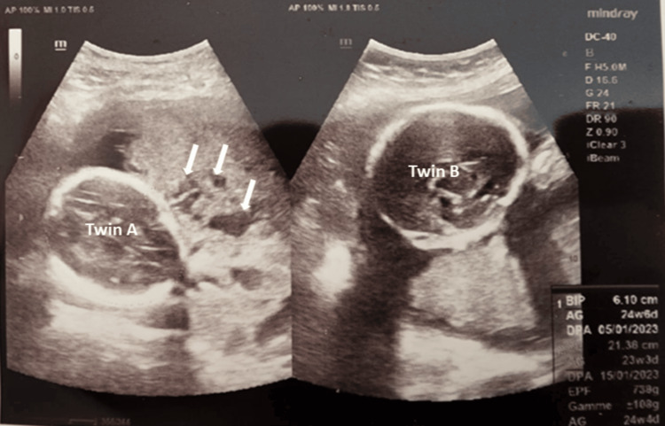
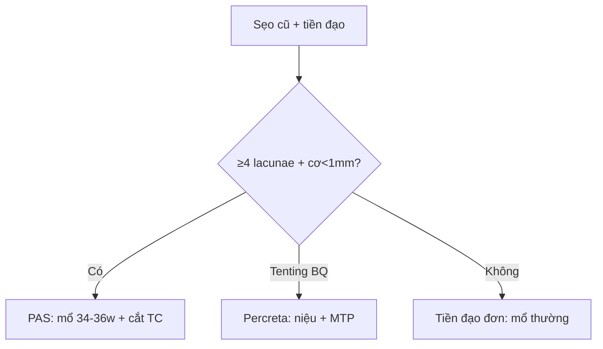

# 560 — Nhau cài răng lược: lacunae, cơ < 1 mm & dải T2 / PAS

**Tags:** `pattern:bat-thuong-nhau` `vung:tu-cung` `score:PAS` `protocol:MRI-nhau`
**Mức chắc chắn (certainty):** tổng hợp y văn (literature synthesis) — nhóm tự biên từ y văn mở, chưa gắn ca nguyên văn đơn lẻ.

## 1. Tổng quan — sẹo mổ cũ + nhau tiền đạo = gai nhau ăn qua cơ

- PAS (accreta/increta/percreta): gai nhau bám/xuyên cơ qua sẹo mổ cũ thiếu màng rụng — TẠI SAO mổ đẻ cũ + nhau tiền đạo là combo chết người: sẹo không có decidua cản, gai ăn thẳng vào cơ/bàng quang.
- **Hồ máu (lacunae ≥ 4)** xoáy tốc nhanh = tân mạch bệnh lý — TẠI SAO hình sâu bọ/phô mai Thụy Sĩ: máu mẹ ứ trong hồ xơ.
- MRI T2W (HASTE, KHÔNG gadolinium thai kỳ): **dải tối > 6 mm** (fibrin) + phình lồi (bulge) + mất viền cơ + tenting bàng quang.

## 2. Gamut chảy máu 3 tháng cuối (Gamut)

- **Nhau tiền đạo + ≥ 4 lacunae + cơ < 1 mm:** PAS — mổ chủ động 34–36 tuần + cắt tử cung + máu dự trữ.
- **Percreta + tenting bàng quang:** niệu + mạch máu + ICU (mất 3.500 mL + ngừng tim như ca dưới!).
- **Nhau bong non + sau nhau máu + tim thai xấu:** mổ cấp cứu (không phải PAS).
- **Tiền đạo không lacunae:** mổ đẻ thường quy (theo dõi).

## 3. Bảng so sánh phân biệt (ma trận đối chiếu)

| Thực thể (entity) | Hình ảnh điển hình | Chốt vào (rule-in) | Chốt loại (rule-out) | Gợi ý xác nhận |
|---|---|---|---|---|
| PAS accreta/increta | **Tiền đạo + ≥ 4 lacunae + cơ < 1 mm + mất clear zone** | **Sẹo cũ + lacunae + bridging** | Không sẹo + không hồ → tiền đạo đơn | Mổ 34–36 tuần + cắt tử cung |
| Percreta bàng quang | **Bulge + dải T2 > 6 mm + tenting + mất viền cơ** | **Xuyên thanh mạc + bàng quang** | Còn cơ → increta | Niệu + MTP 1:1:1 + ICU |
| Nhau bong non | **Máu sau nhau + nhau dày + tim xấu, không lacunae** | **Máu cấp + tiền sản giật** | Lacunae + sẹo → PAS | Mổ cấp cứu + chống DIC |
| Tiền đạo đơn thuần | **Mép nhau < 2 cm lỗ trong, không hồ/mạch bắc** | **Không lacunae + cơ còn** | Có hồ → PAS | Mổ đẻ + chuẩn bị thường |

*Tiền đạo + lacunae bất thường; mổ phát hiện percreta xâm lấn bàng quang + mất 3.500 mL + ngừng tim (cứu được). Nguồn: Chahboun et al., Cureus 2026 Fig. 1, CC BY 4.0.*

## 4. Protocol PAS (28–32 tuần)

- **Siêu âm Doppler (lacunae + cơ mm + bridging) + MRI T2W không thuốc** khi sẹo cũ + tiền đạo; mổ chủ động đa chuyên khoa + MTP sẵn.

## 5. Cạm bẫy

- **Siêu âm thường bỏ sót percreta** (ca trên: siêu âm 3 tuần trước bình thường!) — nghi ngờ là MRI + chuẩn bị tối đa.
- **Bóc nhau PAS** = chảy máu tử vong — cắt tử cung nguyên khối, đừng bóc.
- **Mổ PAS không máu/MTP/niệu** — mất 3.500 mL + ngừng tim trong phút (ca trên!).

## 6. Tự lượng giá — Blind Quiz

**Ca 1 — Song thai 25 tuần + 2 mổ cũ + chuyển dạ sớm. Đọc siêu âm.**

- Hỏi: dấu gì ở Twin A? Percreta có thấy hết trên siêu âm không? Chuẩn bị gì?

<b>Bấm để hiện đáp án</b>

- Dấu hiệu (findings): nhau tiền đạo + **hồ máu lacunae** bất thường (mũi tên).
- Chẩn đoán (diagnosis): **PAS (percreta xâm lấn bàng quang chỉ lộ khi mổ!)** — cắt tử cung + bàng quang một phần + MTP 1:1:1 + ICU (mất 3.500 mL + ngừng tim, cứu được).
- Nguồn: Chahboun et al., Fig. 1, CC BY 4.0.

**Ca 2 — Nhau tiền đạo + 6 lacunae + cơ 0,5 mm + bridging:** tiền đạo đơn hay PAS? Mổ khi nào? *(Bảng mục 3.)*

<b>Bấm để hiện đáp án</b>

- **PAS:** mổ chủ động 34–36 tuần + cắt tử cung (đừng bóc nhau!).

## Bài liên quan chéo
- [500 – Tổng quan Vú & SPK](../500-tong-quan-vu-san-phu-khoa/lesson.md)
- [550 – Thai sớm](../550-thai-som-say-thai-thai-ngoai-tu-cung/lesson.md) (thai vết mổ)
- [141 – Phúc mạc](../141-phuc-mac/lesson.md) (dịch ổ bụng)

> Không dùng để chẩn đoán độc lập khi chưa có người hướng dẫn.
