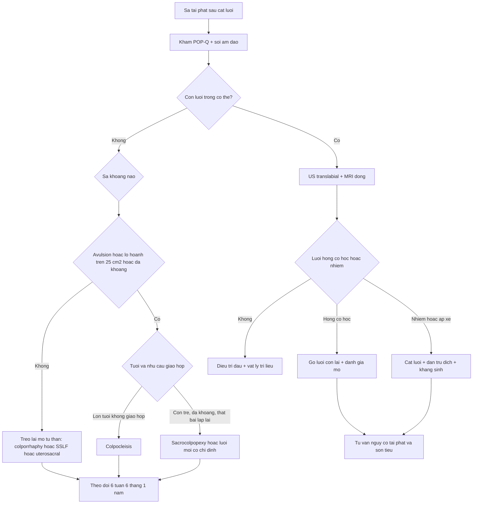
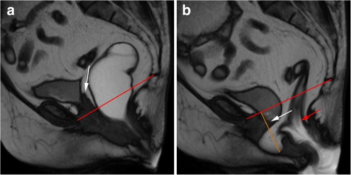
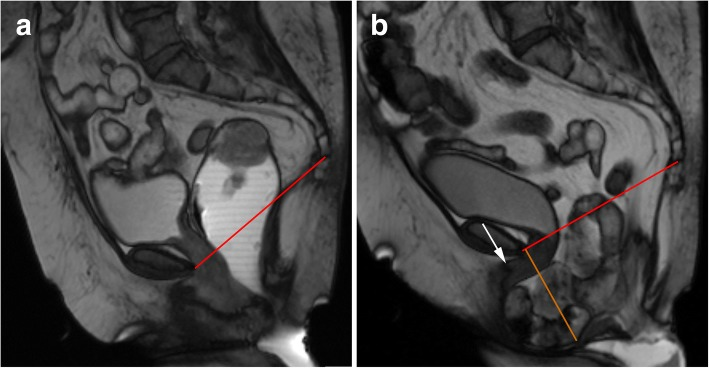
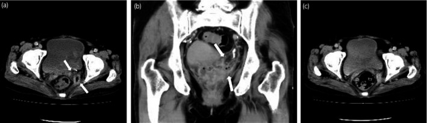

# 561 — Sa tạng chậu tái phát sau cắt lưới: treo lại mô tự thân hay lưới mới? / Recurrent prolapse after mesh removal

**Tags:** `pattern:sa-tang-tai-phat` `pattern:hong-luoi` `pattern:sa-dinh` `vung:am-dao` `vung:tieu-khung` `score:POP-Q` `score:IUGA-ICS` `protocol:MRI-san-chau` `protocol:sieu-am-translabial` `incidentaloma:luoi-con-lai`
**Mức chắc chắn (certainty):** tổng hợp y văn (literature synthesis) — tự biên từ RCT 7 năm so sánh lưới âm đạo với mô tự thân ở sa tái phát (Milani AL et al., *Int Urogynecol J* 2018, PMC5948295), đoàn hệ sa đỉnh toàn quốc Thụy Điển (Brunes M et al., *Acta Obstet Gynecol Scand* 2022, PMC9564691), đoàn hệ lưới tái phát (Curtiss N & Duckett J, *Gynecol Surg* 2018, PMC5762801) và dịch vụ biến chứng lưới tuyến 4 (Badri H et al., *BMC Womens Health* 2025, PMC12317572); không gắn một bệnh án đơn lẻ.

## 1. Tổng quan bệnh học – cơ chế hình ảnh: sa tái phát là "thoát vị qua lỗ hoành chậu", không phải "lưới hỏng" đơn thuần

- **Sa tạng chậu (pelvic organ prolapse — POP)** là **thoát vị** của bàng quang, tử cung/đỉnh âm đạo hoặc ruột qua **lỗ hoành chậu (levator hiatus)** — cổng thoát vị được giới hạn bởi xương mu phía trước và **cơ nâng hậu môn (levator ani)** hai bên–sau. Vì vậy phẫu thuật nào cũng chỉ "vá cổng", không chữa được chất lượng cơ–mạc.
- **Tỷ lệ tái phát chung sau mổ POP khoảng 30%** (Brunes 2022, PMC9564691). TẠI SAO: (1) **rách/bong cơ nâng (levator avulsion)** gặp **10–35%** sau sinh đường âm đạo lần đầu, làm **OR tái phát khoang trước 2,5–3,0**; (2) **giãn lỗ hoành (hiatal ballooning)** — diện tích lỗ hoành khi Valsalva **> 25 cm²** là giới hạn bình thường trên, mỗi **+1 cm²** cộng thêm **~7%** nguy cơ tái phát; (3) mô liên kết yếu (tuổi, di truyền, táo bón/mạn tính tăng áp lực ổ bụng).
- **Sau khi cắt lưới (mesh removal), nền mô còn xấu hơn:** sẹo xơ, thành âm đạo mỏng–ngắn, mất điểm treo đỉnh, có thể mất thêm cân bằng khoang; lưới còn sót tạo **điểm căng** và **đường hầm nhiễm trùng**. Vì vậy "sa tái phát sau cắt lưới" là bài toán **chọn lại điểm treo**, không phải "đặt lại lưới to hơn".
- **Ngưỡng định lượng của 4 nghiên cứu trụ cột:**

| Câu hỏi | Nghiên cứu | Số liệu chốt |
|---|---|---|
| Lưới có hơn mô tự thân ở **sa tái phát**? | RCT 7 năm, 190 ca mổ (Milani 2018) | Thành công tổng hợp **53% lưới vs 54% mô tự thân**; mổ lại vì POP **25% vs 16%** (chênh 9%; KTC 95% −5 đến 23); **lộ lưới 42%** |
| Vì sao mổ lại không giảm? | Milani 2018 | Ở nhóm lưới, tái phát xảy ra ở **khoang KHÔNG được đặt lưới**; ở nhóm mô tự thân, tái phát ở **khoang đã mổ** |
| Lưới cải thiện triệu chứng? | Đoàn hệ 48 lưới vs 25 colporrhaphy lặp (Curtiss 2018) | "Tốt hơn nhiều" **69% vs 40%** (p = 0,02); **xói mòn 11,6%**; mổ lại **33% vs 32%** |
| Sa đỉnh: có ghép hay không ghép? | Toàn quốc 1.812 ca (Brunes 2022) | SSLF **không ghép** có nguy cơ mổ lại cao hơn có ghép **aOR 2,2** (KTC 1,4–3,6); sa đỉnh bằng **sacrocolpopexy ít biến chứng hơn** SSLF (aOR 2,2–2,3) |
| Sau cắt lưới thì sao? | 288 ca được mổ trong 785 ca (Badri 2025) | **52% cắt toàn bộ** lưới; **són tiểu khi gắng sức tái phát 66%** (141/215); **POP tái phát 23%** (3/13); biến chứng phẫu thuật **18%**, nặng **0,7%** |
| Thời điểm cắt lưới | 345 ca (Elneil 2024) | Trung bình **7 năm** từ đặt đến cắt; đau là lý do hàng đầu |

- **TẠI SAO hình ảnh học khó — vật lý:** polypropylene **không có proton di động** → **giảm tín hiệu mạnh trên T2W** (đen), trùng với **sẹo xơ hậu phẫu** cũng đen; trên siêu âm lưới **tăng hồi âm** kèm bóng lưng. Vì vậy câu hỏi đúng không phải "có thấy lưới không" mà là **"lưới còn liên tục, còn treo đúng trục, có dịch/ngấm thuốc quanh không"**, và **"tạng nào đang sa, dưới mốc nào"**.

## 2. Mẫu hình + chẩn đoán phân biệt theo khoang và theo cơ chế (Gamut)

- **Theo khoang (định vị trước khi chọn kỹ thuật):**
  - **Khoang trước (anterior):** sa bàng quang (cystocele) — hay tái phát nhất sau colporrhaphy, đặc biệt khi có avulsion.
  - **Khoang giữa/đỉnh (apical):** sa đỉnh âm đạo sau cắt tử cung (vault prolapse), **sa ruột non (enterocele)**, sa tử cung.
  - **Khoang sau (posterior):** sa trực tràng (rectocele), sa ruột non vào vách âm đạo–trực tràng.
  - **Đa khoang:** thường là lý do cân nhắc lưới/sacrocolpopexy thay vì "vá từng khoang".
- **Theo cơ chế sau cắt lưới:**
  - **Hỏng lưới cơ học:** lưới bong khỏi mỏm nhô/mỏm ngồi–mu, lưới chùng đi đường vòng, đứt — sa tái phát **mà không thấy lưới lộ**.
  - **Lưới co kéo (mesh contraction/meshoma):** lưới nhăn, cứng, đau khu trú, giao hợp đau.
  - **Nhiễm trùng đường lưới/áp-xe:** dịch quanh lưới, đau, tiết dịch; có thể hoại tử thành âm đạo.
  - **Khoang chưa xử lý:** lưới chỉ che khoang trước nhưng đỉnh vẫn thiếu hỗ trợ → sa đỉnh "mới".
  - **Thất bại mô tự thân:** cân bằng bị rách lại, avulsion, lỗ hoành giãn.
- **Gamut "kẻ giả danh" khi khám/ảnh:** **sa niệu đạo–bàng quang không triệu chứng** (POP-Q độ 2, không cần mổ); **nang âm đạo/Gartner**; **áp-xe thành âm đạo**; **sa bàng quang giả do bàng quang căng**; **đau sàn chậu cơ–mạc** không kèm sa; **u âm đạo** (hiếm).
- **Bốn câu hỏi bắt buộc — mnemonic "APEX":** **A**nterior? **P**osterior? **E**nterocele/apex? **X**-mesh (lưới còn gì, có nhiễm/co kéo không) — trả lời sai một câu là chọn sai kỹ thuật.

## 3. Bảng so sánh phân biệt (ma trận đối chiếu)

| Thực thể (entity) | Hình ảnh điển hình | Chốt vào (rule-in) | Chốt loại (rule-out) | Gợi ý xác nhận |
|---|---|---|---|---|
| **Sa tái phát khoang trước sau mô tự thân** | MRI động: bàng quang xuống **> 3 cm dưới PCL** khi rặn; US: bóng bàng quang xuống dưới khớp mu | **Bàng quang xuống > 3 cm dưới PCL + triệu chứng** | Bàng quang **trên PCL**, không triệu chứng → không phải tái phát | POP-Q + MRI động |
| **Sa đỉnh/vault prolapse + enterocele** | MRI sagittal: đỉnh âm đạo **dưới PCL**, quai ruột non chui vào vách | **Đỉnh âm đạo dưới PCL + quai ruột trong vách** | Chỉ **kéo dài âm đạo** mà đỉnh trên PCL → không sa đỉnh | MRI động, khám thì đầu |
| **Hỏng lưới cơ học** | MRI: đường lưới **không liên tục**, đầu tự do, lưới đi vòng; sa tái phát | **Lưới đứt/bong + sa đúng khoang đã treo** | Lưới **liên tục, đúng trục** → tái phát do mô | MRI + nội soi |
| **Lưới co kéo/meshoma** | MRI: bó lưới **dày, nhăn, co**, viền xơ; đau khi khám | **Lưới cứng + đau khu trú** | Lưới mềm, không đau → không co kéo | Khám + MRI |
| **Nhiễm trùng/áp-xe quanh lưới** | CT: **dịch quanh lưới**, thành ngấm thuốc; MRI: dịch + viêm mô | **Dịch/áp-xe + sốt/tiết dịch** | Chỉ lưới đen, **không dịch** → không nhiễm | CT/MRI + cấy |
| **Sa do avulsion/lỗ hoành giãn** | US 4D: **mất bám cơ nâng**, diện tích lỗ hoành **> 25 cm²** | **Avulsion + lỗ hoành > 25 cm²** | Cơ nâng liền, lỗ hoành **< 25 cm²** → mô tự thân còn hợp lý | US translabial 4D |
| **Ứng viên colpocleisis** | Không cần ảnh đặc hiệu; khám: sa độ 3–4, teo âm đạo | **Lớn tuổi, không còn giao hợp, nhiều bệnh nền** | Còn nhu cầu giao hợp → **loại** | Khám + tư vấn |
| **U âm đạo/ung thư (hiếm)** | Khối/mảng cứng, loét, ngấm thuốc bất thường | **Mô bệnh ác tính** | Tổn thương mềm, đối xứng, không loét | Sinh thiết |

## 4. Protocol chụp + hệ phân độ & quy trình chọn kỹ thuật

- **Bước 1 — POP-Q (Pelvic Organ Prolapse Quantification):** đo 6 điểm (Aa, Ba, C, D, Bp, Ap) + **gh** (genital hiatus), **pb** (perineal body), **tvl** (total vaginal length). **Độ 1:** điểm xa nhất **< −1 cm** (còn hơn 1 cm **trên** màng trinh); **độ 2:** **−1 đến +1 cm**; **độ 3:** **> +1 cm** nhưng chưa lộn toàn bộ; **độ 4:** lộn toàn bộ. Tái phát có triệu chứng thường được định nghĩa **≥ độ 2**; đừng điều trị một **độ 2 không triệu chứng**.
- **Siêu âm translabial/4D (translabial ultrasound):** đầu dò **3,5–6 MHz** (4D cần góc mở **70–90°**), quét **mặt phẳng trung sagittal** khi nghỉ và **Valsalva tối đa**; đo **diện tích lỗ hoành** (bình thường **< 25 cm²**), tìm **avulsion** cơ nâng; lưới **tăng hồi âm** dạng "cánh hải âu"/chữ U. Không tia X, làm tại giường, lặp lại được.
- **MRI động sàn chậu (dynamic pelvic floor MRI):** **1,5 hoặc 3 T**; **sagittal T2 TSE** độ phân giải cao + **TrueFISP/balanced SSFP cine** khi nghỉ, gắng sức và **rặn phân**; lát **3 mm**, FOV **26–30 cm**; đặt **gel âm đạo/trực tràng**; **lặp ít nhất 3 lần rặn** vì tổn thương có thể chỉ lộ ở lần cuối. Đo theo **đường PCL (pubococcygeal line)** nối bờ dưới khớp mu với khớp cùng–cụt cuối: **sa khoang trước/giữa đáng kể khi > 3 cm dưới PCL**, **khoang sau > 4 cm** khi rặn.
- **MRI tĩnh T2/T1 + T1 fat-sat sau tiêm:** đánh giá **đường đi, độ liên tục, độ dày lưới**, dịch/áp-xe, rò; **DWI** khi nghi áp-xe/ung thư.
- **CT bụng–chậu có cản quang:** khi nghi **áp-xe, rò, tắc ruột, tổn thương niệu quản**; **không dùng để "tìm lưới"**.
- **Nội soi bàng quang/niệu đạo:** trước khi cắt lưới nếu có triệu chứng tiểu dưới, đái máu, nhiễm trùng tái diễn.
- **Phân độ biến chứng lưới IUGA/ICS (Category–Time–Site):** nhóm **3 = lộ lưới**, **4 = đường tiểu**, **5 = ruột**, **6 = mạch máu**, **7 = thần kinh**; thời điểm **T1 ≤ 48 giờ, T2 48 giờ–2 tháng, T3 2–12 tháng, T4 > 12 tháng** — dùng ngôn ngữ chung, không thay khám.

- **Chọn mô tự thân hay lưới mới — nguyên tắc định lượng:**
  - **Mô tự thân là mặc định** cho tái phát **một khoang**, thành âm đạo còn dày, **không avulsion**, lỗ hoành **< 25 cm²**; lựa chọn: **colporrhaphy trước/sau**, **treo đỉnh bằng dây chằng cùng–gai (SSLF)** hoặc **dây chằng tử cung–cùng (uterosacral suspension)**.
  - **SSLF nên kèm ghép (graft)** nếu đã tái phát: nguy cơ mổ lại **aOR 2,2** khi không ghép (Brunes 2022).
  - **Cân nhắc lưới khi nguy cơ tái phát rất cao:** avulsion + lỗ hoành giãn; RCT nhỏ ở 72 phụ nữ có avulsion cho thấy **tái phát 3% với lưới toàn bộ (Total Prolift) vs 65% với SSLF** (lâm sàng) và **2,8% vs 61,7%** trên siêu âm sau 12 tháng — nhưng đây là nhóm chọn lọc, không mở rộng cho mọi ca.
  - **Sacrocolpopexy** (lưới qua bụng/robot) là lựa chọn cho **sa đỉnh/đa khoang**, đặc biệt sau khi đã cắt lưới âm đạo; đoàn hệ toàn quốc cho thấy ít biến chứng 1 năm hơn SSLF (**aOR 2,2–2,3**), còn hiệu quả mổ lại tương đương SSLF có ghép trong dữ liệu quan sát.
  - **Colpocleisis** (khâu bịt âm đạo) ít được dùng nhưng hiệu quả cao ở người **lớn tuổi, không còn giao hợp, nhiều bệnh nền** — phải loại trừ ung thư cổ tử cung/âm đạo trước.
  - **Sau cắt lưới toàn bộ**, tư vấn rõ: trong 288 ca được mổ, **són tiểu gắng sức tái phát 66%** (141/215 ca được theo dõi) và **POP tái phát 23%** (3/13 ca được theo dõi POP) (Badri 2025); đặt kế hoạch treo lại **ngay trong cùng cuộc mổ** khi mô cho phép, hoặc hẹn đánh giá 3–6 tháng.
- **Theo dõi:** khám + POP-Q **6 tuần, 6 tháng, 1 năm**, sau đó **hàng năm**; soi âm đạo tìm **lộ lưới muộn T3–T4** nếu còn lưới; siêu âm translabial khi có triệu chứng mới; không chụp định kỳ "tầm soát" bằng CT.

## 5. Biến thể bình thường và cạm bẫy

- **Độ 2 không triệu chứng không phải thất bại:** nhiều phụ nữ sau mổ có điểm POP-Q **−1 cm** mà không có sa triệu chứng; điều trị theo **triệu chứng + độ**, không theo ảnh.
- **Sẹo hậu phẫu cũng đen trên T2:** đừng gọi mọi bó giảm tín hiệu là "lưới còn sót"; cần **tiền sử mổ, đường đi giải phẫu** và **khám**.
- **"Tái phát" ở khoang chưa mổ:** sau đặt lưới khoang trước, sa đỉnh có thể là **tiến triển tự nhiên của khoang chưa xử lý**, không phải lưới hỏng (Milani 2018) — đừng mổ lại khoang trước lần nữa.
- **Siêu âm phụ thuộc Valsalva:** rặn không đủ lực → đo thiếu độ sa; luôn kiểm tra **bàng quang đầy nửa**, **đầu dò đúng trục**, và lặp lại.
- **Bàng quang căng giả sa:** đặt sonde/đi tiểu rồi đo lại trước khi kết luận.
- **Sa đỉnh sau cắt tử cung dễ bị bỏ sót:** nhìn "thành trước sa" nhưng thực ra là **lộn đỉnh + enterocele**; luôn đặt mỏ vịt thấy **đỉnh âm đạo**.
- **Satisfaction of search:** thấy lưới lộ rồi bỏ sót **xuyên bàng quang/ruột** hoặc **sa khoang khác**; trả lời đủ 4 câu APEX trước khi kết luận.
- **Cắt lưới nhiều làm mất mô:** cắt "sạch" quá tay có thể làm **ngắn âm đạo, rò bàng quang–âm đạo**; cân bằng giữa lấy hết lưới nhiễm và bảo tồn thành âm đạo.

## 6. Tự lượng giá — Blind Quiz

**Ca 1 — Nữ 68 tuổi, cắt tử cung 10 năm trước, hiện sa đỉnh âm đạo tái phát sau mổ treo bằng lưới. MRI động sagittal TrueFISP lúc nghỉ (a) và khi rặn (b).**

- Gợi ý lâm sàng: khối sa ra ngoài âm hộ khi đứng lâu, đau lưng dưới.
- Câu hỏi: (1) Đỉnh âm đạo nằm ở đâu so với PCL? (2) Ngoài sa đỉnh còn tổn thương gì? (3) Vì sao phải đánh giá cả khoang sau?

<b>Bấm để hiện đáp án (findings + chẩn đoán)</b>

- **Dấu hiệu:** (a) lúc nghỉ đỉnh âm đạo còn trên PCL; (b) khi rặn, **đỉnh âm đạo xuống dưới PCL** (mũi tên trắng) — **sa đỉnh (vault prolapse)**; đồng thời có **peritoneocele** (mỡ phúc mạc lách vào vách âm đạo–trực tràng, đường cam) và **lồng ruột trực tràng** (mũi tên đỏ).
- **Chẩn đoán:** sa đỉnh âm đạo tái phát + peritoneocele + lồng niêm mạc trực tràng.
- **Vì sao đánh giá khoang sau:** peritoneocele/enterocele chỉ lộ khi rặn; nếu chỉ treo đỉnh mà bỏ qua túi thoát vị phía sau, sa sẽ tái phát.
- **Nguồn ảnh:** Salvador JC et al., *Insights Imaging* 2019, PMC6352388 Fig. 15, CC BY 4.0.

**Ca 2 — Nữ 74 tuổi, sa nặng "như quả bóng", tiểu khó. MRI động sagittal TrueFISP lúc nghỉ (a) và khi rặn (b).**

- Câu hỏi: (1) Tạng nào sa vào vách âm đạo? (2) Vì sao bàng quang căng và tiểu khó? (3) Kỹ thuật nào hợp lý nếu bệnh nhân không còn giao hợp?

<b>Bấm để hiện đáp án (findings + chẩn đoán)</b>

- **Dấu hiệu:** (b) **quai ruột non** chui vào vách âm đạo–trực tràng — **enterocele nặng** (đường cam); đỉnh âm đạo **dưới PCL** (sa đỉnh); khối thoát vị **đẩy âm đạo và niệu đạo ra trước**, làm **ngang hóa trục niệu đạo** (mũi tên trắng) và **chèn ép bàng quang** → bàng quang căng, tiểu khó.
- **Chẩn đoán:** enterocele nặng + sa đỉnh âm đạo + hẹp niệu đạo do chèn ép.
- **Xử trí:** bệnh nhân lớn tuổi, không còn giao hợp → **colpocleisis** (khâu bịt âm đạo) là lựa chọn hiệu quả, ít xâm lấn; nếu còn giao hợp → treo đỉnh (SSLF/sacrocolpopexy) + vá vách.
- **Nguồn ảnh:** Salvador JC et al., *Insights Imaging* 2019, PMC6352388 Fig. 16, CC BY 4.0.

**Ca 3 — Nữ 55 tuổi, đau vùng chậu và sốt sau sacrocolpopexy 2 năm. CT bụng–chậu có cản quang.**

- Gợi ý lâm sàng: sốt, đau sâu trong chậu, CRP tăng, không tiết dịch âm đạo.
- Câu hỏi: (1) Bất thường ở đâu? (2) Chẩn đoán? (3) Có phải cắt toàn bộ lưới không?

<b>Bấm để hiện đáp án (findings + chẩn đoán)</b>

- **Dấu hiệu:** (a) khối dịch **6,5 × 1,5 cm²** thành sau chậu, viền ngấm thuốc nhẹ (mũi tên); (b) mặt phẳng trán xác nhận ổ áp-xe; (c) sau **dẫn lưu + kháng sinh**, ổ dịch **hết hoàn toàn**.
- **Chẩn đoán:** **áp-xe quanh lưới** sau sacrocolpopexy — biến chứng nhiễm trùng đường lưới.
- **Cắt lưới bao nhiêu:** ổ khu trú + hết sau dẫn lưu có thể chỉ cần **cắt lưới khu trú**; nhưng nếu **nhiễm lan tỏa, lộ lưới lớn, xuyên tạng** → **cắt toàn bộ** (52% ca trong dịch vụ chuyên khoa chọn cắt toàn bộ). Tư vấn trước: **són tiểu tái phát 66%** (141/215) và **POP tái phát 23%** (3/13).
- **Nguồn ảnh:** Sato H et al., *IJU Case Rep* 2019, PMC7292078 Fig. 1, CC BY-NC 4.0 (giữ nguyên bản, không crop).

## Bài liên quan chéo
- [557 – Biến chứng lưới nâng sa: lộ, xói mòn, xuyên tạng](../557-bien-chung-luoi-nang-sa/lesson.md) (nhận diện lưới trên MRI/US, phân độ IUGA/ICS)
- [547 – Sa tạng chậu nữ: POP-Q & lưới nâng](../547-sa-tang-chau-nu-POP-Q-luoi-nang/lesson.md) (chọn bệnh nhân, đặt lưới lần đầu)
- [545 – MR động học sàn chậu](../545-sa-san-chau-MR-defecography/lesson.md) (đọc sa theo khoang, PCL, H/M line)
- [556 – Đau sàn chậu cơ–mạc & đau thần kinh thẹn](../556-dau-san-chau-co-mac-pudendal-neuralgia/lesson.md) (đau không do sa/lưới)
- [548 – Nang/khối lành vùng âm hộ – âm đạo](../548-nang-lanh-am-ho-am-dao/lesson.md) (kẻ giả danh khối sa)
- [500 – Tổng quan Hệ Vú & Sản Phụ khoa](../500-tong-quan-vu-san-phu-khoa/lesson.md)

> Không dùng để chẩn đoán độc lập khi chưa có người hướng dẫn.
