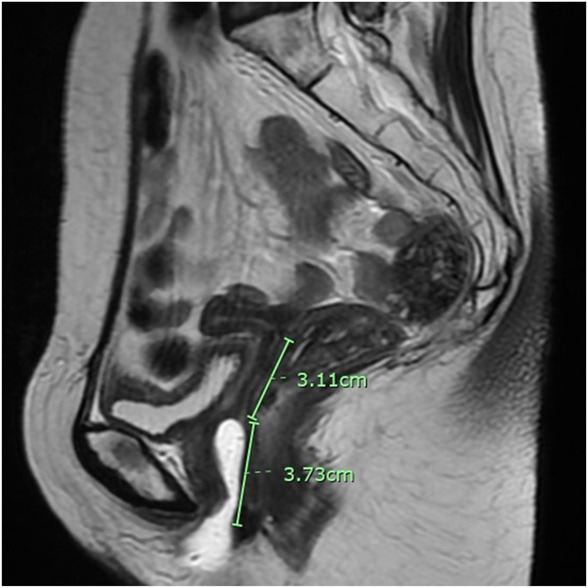
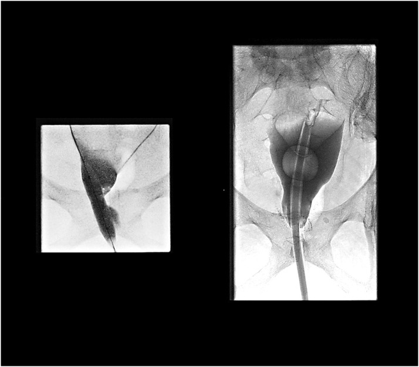

# 562 — Hẹp âm đạo sau xạ trị ung thư cổ tử cung: đo độ dài – phân độ CTCAE/LENT-SOMA, nong định kỳ, mold/stent và tạo hình

**Tags:** `pattern:hep-am-dao` `pattern:xo-hoa-sau-xa` `vung:am-dao` `vung:khung-chau` `score:CTCAE` `score:LENT-SOMA` `protocol:MRI-chau`
**Mức chắc chắn (certainty):** tổng hợp y văn (literature synthesis) — tổng hợp từ 1 phân tích gộp 24 nghiên cứu (Raj 2024), 1 tổng quan về hẹp âm đạo do xạ (Varytė 2021), 1 đồng thuận Delphi 32 chuyên gia (Matos 2019), 1 thử nghiệm ngẫu nhiên 142 bệnh nhân (Martins 2021), 1 nghiên cứu 67 bệnh nhân dùng dilator in 3D (Kongwattanakul 2026) và 2 ca nguyên văn có ảnh mở; mọi số liệu đối chiếu trực tiếp PMCID ghi trong `sources.md`.

## 1. Tổng quan bệnh học – cơ chế hình ảnh

- **Định nghĩa:** hẹp âm đạo do xạ (radiation-induced vaginal stenosis – VS) là tình trạng **hẹp chu vi và/hoặc ngắn ống âm đạo** do xơ hóa sau chiếu xạ vùng chậu, biểu hiện bằng giao hợp đau, không giao hợp được, khó đặt tampon và **không thể khám phụ khoa đầy đủ** (hệ quả nguy hiểm: che giấu tái phát tại vòm).
- **Cơ chế (pathogenesis):** xạ gây tổn thương biểu mô âm đạo, mô liên kết và vi mạch → viêm cấp, chết tế bào, **giảm tưới máu và thiếu oxy mô**, **mất elastin**, tăng tổng hợp collagen và **hyalin hóa**. Kết quả là thành âm đạo dày, mất đàn hồi, dính thành trước–sau, co kéo chu vi và rút ngắn ống âm đạo. Tổn thương thường **rõ nhất sau 6–12 tháng** và có thể tiến triển tới **bít hoàn toàn**.
- **Dịch tễ – tần suất (số liệu định lượng):**
  - Trong phân tích gộp 24 nghiên cứu (Raj 2024): **hẹp âm đạo là độc tính hay gặp nhất**, tần suất **trung vị 61,5% (khoảng 20–77,8%)**; gộp chung mọi độc tính âm đạo **39% (KTC 95%: 21–56%)**.
  - Độc tính **nặng (độ ≥ 3)** rất khác nhau theo thang đo: **12,74%** theo CTCAE v4.0, **0,98%** theo CTCAE v3.0, **10,41%** theo RTOG/EORTC và **0%** theo LENT-SOMA — cho thấy **không thể so sánh các nghiên cứu nếu khác thang phân độ**.
  - Ước tính trong 3 năm đầu sau xạ (Varytė 2021): **ung thư nội mạc 50%**, **ung thư cổ tử cung 60%**, **ung thư hậu môn–trực tràng 80%**.
- **Quan hệ liều – đáp ứng (dữ liệu mạnh nhất, EMBRACE – 630 bệnh nhân ung thư cổ tử cung):** nguy cơ hẹp **có triệu chứng** trong 24 tháng là **16% ở 55 Gy**, **20% ở 65 Gy**, **27% ở 75 Gy**, **34% ở 85 Gy** và **43% ở 95 Gy** tại **điểm tham chiếu trực tràng–âm đạo (rectovaginal reference point)**. Đây là ngưỡng để bàn với bác sĩ xạ trị khi lập kế hoạch, không phải ngưỡng chẩn đoán trên ảnh.
- **Yếu tố nguy cơ:** tuổi cao, **u xâm lấn thành âm đạo**, **độ dài âm đạo nằm trong trường chiếu**, phối hợp **xạ ngoài (EBRT) + xạ áp sát (brachytherapy – BT)**, liều tại các điểm âm đạo. Trong một nghiên cứu, hẹp độ 2 liên quan có ý nghĩa với **tuổi cao hơn, có xâm lấn âm đạo, chiều dài âm đạo ngắn hơn, dùng applicator buồng trứng–âm đạo (TO)** và **mọi điểm liều âm đạo**.
- **TẠI SAO hình ảnh trông như vậy (vật lý + mô bệnh):**
  - **Xơ hóa trưởng thành/hyalin** mất nước và ít proton tự do → **T2 giảm tín hiệu** thành dải hoặc vòng tối; mô xơ **ngấm thuốc chậm và ít** ở thì sớm, có thể ngấm ở thì muộn.
  - **Niêm mạc âm đạo bình thường** giàu nước và glycogen → **T2 tăng tín hiệu**; khi bị xạ, lớp này **mất tín hiệu sáng** và không còn nhìn thấy rõ — đây là dấu hiệu sớm trên MRI.
  - **Ứ dịch sau hẹp:** dịch ứ trong ống âm đạo tạo **khối dạng nang ở tiểu khung**. Nếu là **máu cũ (hematocolpos)**, hemoglobin thoái hóa thành **methemoglobin → T1 tăng tín hiệu**; nếu **mủ (pyocolpos)**, dịch **T2 tăng, có viền ngấm thuốc và hạn chế khuếch tán**, kèm sốt/đau.
  - **Trên CT:** mô xơ **đồng đậm độ cơ**, khó phân biệt; giá trị chính là thấy **khối dịch căng ống âm đạo**, khí trong ống sau dẫn lưu, và biến chứng (áp-xe, rò).
- **Điểm mấu chốt lâm sàng:** hẹp âm đạo **không chỉ là vấn đề chất lượng tình dục** — nó làm **mất khả năng theo dõi tái phát bằng khám phụ khoa**, nên phải đo và ghi nhận **như một dấu sinh tồn (vital sign) của theo dõi ung thư**.

## 2. Mẫu hình + chẩn đoán phân biệt theo vị trí (gamut)

- **Mẫu hình A — hẹp lan tỏa chu vi, 1/3 trên âm đạo (vòm):** hay gặp nhất sau **BT áp sát liều cao** cho ung thư cổ tử cung; vòm dính, ống âm đạo ngắn < 5 cm, thành dày đối xứng. Gamut: hẹp do xạ, tái phát u tại vòm, xơ hóa sau mổ + xạ.
- **Mẫu hình B — dính ngang (transverse band) hoặc hẹp lỗ âm đạo:** dải xơ ngang chia ống âm đạo thành 2 khoang; gặp sau xạ âm hộ/âm đạo hoặc **lichen planus** thể ăn mòn. Gamut: dính sau xạ, vách ngang bẩm sinh, lichen planus, hẹp sau chấn thương/sinh.
- **Mẫu hình C — ứ dịch âm đạo (fluid-filled vagina):** khối dịch căng, đau bụng dưới/đau vùng chậu, có thể sốt. Gamut: **hematocolpos** (máu cũ T1 cao), **pyocolpos** (mủ, viền ngấm, hạn chế khuếch tán), **hydrometra/hydrocolpos** do tắc, nang Gartner, nang Bartholin lớn.
- **Mẫu hình D — khối đặc ở vòm âm đạo:** gamut: **tái phát ung thư cổ tử cung**, xơ hóa dày khu trú, sa vòm, polyp, sarcoma sau xạ (hiếm). **Không được sinh thiết mù** vào vùng xơ sau xạ nếu chưa loại trừ tái phát bằng MRI/PET.
- **Mẫu hình E — hẹp sau tạo hình âm đạo (neovagina):** hẹp vòng nối, co thắt vòng miệng nối, hoặc hẹp toàn bộ ống tân tạo; thường do **không dùng dilator/mold đều** sau mổ. Gamut: hẹp sau tạo hình, hẹp do xạ trên nền tân âm đạo, nhiễm trùng miệng nối.
- **Gợi nhớ lâm sàng – hình ảnh:** **S**hortening + **S**car + **S**tasis (ứ dịch) = 3S của hẹp âm đạo sau xạ. Hỏi thêm 3 câu: giao hợp có đau/không thể không? còn kinh nguyệt không (ứ máu)? khám phụ khoa có đặt được mỏ vịt không?

## 3. Bảng so sánh phân biệt (ma trận đối chiếu)

| Thực thể (entity) | Hình ảnh điển hình (MRI/CT/US) | Chốt vào (rule-in) | Chốt loại (rule-out) | Gợi ý xác nhận |
|---|---|---|---|---|
| **Hẹp âm đạo do xạ** | Thành âm đạo dày, **dải/vòng T2 tối**, mất lớp niêm mạc T2 sáng, ống ngắn, vòm dính; không khối đặc | **Tiền sử xạ vùng chậu + hẹp lan tỏa đối xứng + không có khối ngấm bất thường** | Có khối đặc ngấm mạnh/hạn chế khuếch tán → nghĩ tái phát | Đo chiều dài/đường kính bằng dilator; MRI chậu T2; đối chiếu liều xạ |
| **Tái phát tại vòm/âm đạo** | Khối đặc ở vòm, **T2 trung gian**, **DWI hạn chế khuếch tán**, ngấm mạnh, có thể xâm lấn trực tràng/bàng quang | **Khối đặc mới + DWI sáng + ngấm mạnh + FDG tăng** | Xơ hóa dải mỏng, không khối, DWI không sáng → nghĩ xơ | MRI có cản quang + PET/CT; sinh thiết có hướng dẫn |
| **Vách ngang bẩm sinh** | Màng/dải ngang **đơn độc**, thành âm đạo trên và dưới bình thường, không xơ lan tỏa | **Không tiền sử xạ + màng ngang rõ + tử cung bình thường** | Thành âm đạo dày, xơ lan tỏa, có tiền sử xạ → nghĩ hẹp do xạ | MRI; khám dưới mê; siêu âm |
| **Lichen planus âm đạo** | Mảng trắng, trợt, dính **lỗ âm đạo** và môi bé, hẹp dần theo thời gian | **Tổn thương da–niêm mạc trắng/trợt + ngứa/đau + không tiền sử xạ** | Chỉ hẹp ống, không tổn thương da → ít nghĩ | Khám da liễu, sinh thiết niêm mạc |
| **Hẹp sau tạo hình neovagina** | Vòng xơ tại miệng nối hoặc hẹp toàn bộ ống, có thể ứ dịch | **Tiền sử tạo hình + không dùng mold/dilator đều** | Tân âm đạo rộng, niêm mạc hồng → không hẹp | Đo bằng mold; MRI khi nghi ứ dịch/áp-xe |
| **Hematocolpos / pyocolpos** | Khối dịch căng ống âm đạo; **máu cũ T1 cao**; mủ **T2 cao + viền ngấm + DWI sáng** | **Đau bụng dưới + khối dịch + hẹp lỗ âm đạo**; sốt/CRP cao → nghĩ mủ | Không có dịch ứ, ống thông thoáng → loại | MRI chậu; CT; dẫn lưu để chẩn đoán và điều trị |
| **GVHD âm đạo sau ghép tế bào gốc** | Dính, hẹp, loét niêm mạc; kèm tổn thương da/miệng/gan | **Tiền sử ghép + tổn thương đa cơ quan GVHD** | Chỉ hẹp đơn độc, không tiền sử ghép → ít nghĩ | Đánh giá GVHD toàn thân; sinh thiết |

*MRI T2 sagittal sau xạ trị: chiều dài âm đạo **3,73 cm**, phần vòm bịt kín **3,11 cm** — hẹp mức độ nặng. Đo bằng thước trên phần mềm; đây là cách ghi nhận khách quan để theo dõi. Nguồn: Bodily 2025, CC BY 4.0.*

## 4. Protocol chụp + hệ phân độ/điểm chuẩn hóa

**Bước 1 — đo lâm sàng (bắt buộc, làm trước hình ảnh):**
- Đo **chiều dài âm đạo** bằng thước chia mm hoặc **dilator đã biết đường kính**, ghi cm; đo **đường kính ống** (số ngón tay tương ứng hoặc dụng cụ).
- Đánh giá niêm mạc: hồng – teo – trợt – dính; ghi **vị trí hẹp** (1/3 trên/giữa/dưới), **tính chất** (vòng, dải ngang, lan tỏa).
- Khám **nhẹ nhàng, không banh cưỡng bức**; nếu đau nhiều, khám dưới gây mê để tránh rách và để đo chính xác.

**Bước 2 — hình ảnh:**
- **MRI chậu** là phương thức chuẩn: **T2 sagittal + axial** (lát cắt vuông góc trục âm đạo), **T1** (tìm máu cũ), **DWI/ADC** (loại trừ tái phát/áp-xe), **T1 fat-sat sau gadolinium** khi nghi khối hoặc áp-xe. Đo chiều dài, đường kính, độ dày thành, khoảng cách tới trực tràng/bàng quang.
- **Siêu âm** đầu dò âm đạo/trực tràng hoặc **siêu âm qua đáy chậu** khi không đưa được đầu dò vào; giá trị chính là phát hiện **ứ dịch** và hướng dẫn thủ thuật.
- **CT** khi cần can thiệp/dẫn lưu hoặc khi MRI chống chỉ định; **PET/CT** khi nghi tái phát hoặc di căn.
- **Không dùng CT làm phương tiện đo hẹp thường quy** vì mô xơ đồng đậm độ và bức xạ thêm.

**Bước 3 — phân độ (ghi rõ thang đo trong hồ sơ):**
- **CTCAE v5.0 — vaginal stricture:** độ 1 **không triệu chứng, ngắn/hẹp nhẹ**; độ 2 **hẹp/ngắn nhưng không cản trở khám thực thể**; độ 3 **cản trở dùng tampon, hoạt động tình dục hoặc khám thực thể**; độ 4 không định nghĩa trong bảng này; độ 5 tử vong.
- **LENT-SOMA (RTOG/EORTC):** đánh giá 4 trục **S**ubjective – **O**bjective – **M**anagement – **A**nalytic. Với hẹp, trục **Management** tăng dần: **nong không thường xuyên → nong liên tục → nong dai dẳng → phẫu thuật tạo hình**. Đây là thang mô tả **mức can thiệp**, không phải thang đo chiều dài.
- **Khuyến cáo:** dùng **cùng một thang** ở mọi lần tái khám để so sánh; ghi **số đo cm** bên cạnh độ.

**Bước 4 — dự phòng (bắt đầu trước khi hẹp hình thành):**
- **Thời điểm:** bắt đầu nong **2–4 tuần sau kết thúc xạ** hoặc khi niêm mạc đã hồi phục (khoảng 4 tuần) — theo đồng thuận Delphi (Matos 2019).
- **Liều nong:** **5–10 phút, 2–3 lần/tuần, kéo dài vô thời hạn** (đồng thuận); một số trung tâm dùng **3 lần/tuần × 20 phút**. Bắt đầu bằng đường kính nhỏ rồi **tăng dần**; dùng **chất bôi trơn**.
- **Giao hợp:** có thể trở lại **2–4 tuần sau xạ** khi niêm mạc hồi phục và người bệnh sẵn sàng.
- **Tuân thủ thực tế thấp:** trong 519 bệnh nhân sau BT, chỉ **49,1%** dùng dilator đều; **24,5%** không giao hợp và cũng không dùng dilator — đây là nhóm nguy cơ cao nhất.
- **Vai trò thuốc tại chỗ:** thử nghiệm ngẫu nhiên 142 bệnh nhân (4 nhóm: dilator, estrogen tại chỗ, testosterone tại chỗ, đối chứng) cho thấy **thể tích âm đạo giảm trung bình 25,47%**, **không khác biệt giữa các nhóm**; tuy nhiên **nhóm dùng dilator là nhóm duy nhất không xấu đi theo thời gian (p = 0,37)** — tức **dilator là can thiệp có bằng chứng nhất**, hormone tại chỗ không thay thế được.

**Bước 5 — điều trị khi đã hẹp:**
- **Nong/dilator tích cực** ± **mold in 3D** giữ liên tục (kể cả ban đêm) sau khi giải phóng dính; mold cá nhân hóa giúp duy trì chu vi mà ít phụ thuộc tuân thủ.
- **Nong bóng dưới hướng dẫn huỳnh quang/CT** cho hẹp hoàn toàn không có đường vào: tạo đường hầm, nong bóng **12 mm** rồi tăng dần, đặt catheter/Foley **26 Fr** giữ đường — chỉ định ở trung tâm có kinh nghiệm.
- **Phẫu thuật:** cắt dải xơ/giải phóng dính, **ghép da mỏng** hoặc **vạt cân–cơ** khi thiếu niêm mạc; tạo hình âm đạo khi bít hoàn toàn. Sau mổ **bắt buộc dùng mold/dilator** để chống dính lại.
- **Hỗ trợ:** chất bôi trơn, estrogen tại chỗ (khi không chống chỉ định), vật lý trị liệu sàn chậu, tư vấn tình dục – tâm lý.

```mermaid
flowchart TD
  A[Bệnh nhân sau xạ vùng chậu] --> B[Đo chiều dài và đường kính âm đạo bằng dilator]
  B --> C{CTCAE độ mấy?}
  C -->|Độ 1| D[Tư vấn nong 2-3 lần mỗi tuần, 5-10 phút, kéo dài]
  C -->|Độ 2| E[Nong tích cực + kiểm tra lại 3 tháng]
  C -->|Độ 3| F[MRI chậu T2 + DWI để loại trừ tái phát]
  C -->|Độ 4| G[Khám dưới mê + MRI + cân nhắc can thiệp]
  F --> H{Có khối đặc hoặc DWI sáng?}
  H -->|Có| I[Sinh thiết có hướng dẫn + PET/CT]
  H -->|Không| J[Nong bóng hoặc mold 3D]
  G --> K[Nong bóng dưới huỳnh quang hoặc phẫu thuật tạo hình]
  J --> L[Đánh giá lại 1-3 tháng, ghi số đo]
  K --> L
  L --> M{Tái hẹp?}
  M -->|Có| K
  M -->|Không| N[Duy trì dilator và theo dõi dài hạn]
```

## 5. Biến thể bình thường và cạm bẫy

- **Teo âm đạo do thiếu estrogen sau xạ** (niêm mạc mỏng, khô, mất nếp gấp) **không đồng nghĩa hẹp xơ** — phân biệt bằng độ đàn hồi và khả năng đặt mỏ vịt; teo đáp ứng estrogen tại chỗ, hẹp xơ thì không.
- **Đánh giá quá sớm (< 3 tháng)** dễ **overcall** vì còn viêm–phù cấp; chờ niêm mạc ổn định rồi đo lại.
- **Đo bằng mỏ vịt có kéo** làm ống âm đạo "dài giả"; đo bằng dilator/thước, tay nhẹ, không kéo.
- **Sai lầm nguy hiểm nhất: gán mọi hẹp cho xạ** rồi bỏ qua tái phát. Nếu hẹp **bất đối xứng, có khối, đau tăng dần, chảy máu** → MRI + PET trước, **không sinh thiết mù**.
- **Bỏ sót ứ dịch:** bệnh nhân còn tử cung sau xạ có thể bị **hematocolpos** gây đau bụng cấp; siêu âm/MRI thấy khối dịch căng ống âm đạo, T1 cao nếu máu cũ.
- **Nong quá sớm/quá mạnh** gây đau, chảy máu, rách niêm mạc → bỏ trị liệu; tuân thủ là yếu tố quyết định thành công.
- **Không hỏi về tình dục** vì "ngại" → bỏ lỡ cả hẹp và nhu cầu điều trị; đồng thuận khuyến cáo **hỏi và tư vấn cho mọi bệnh nhân**, kể cả người không có bạn tình.
- **Nhầm với lichen planus/sclerosus:** tổn thương **da–niêm mạc trắng, trợt, ngứa** và hẹp lỗ âm đạo; cần khám da liễu và sinh thiết.
- **Không ghi nhận độ dài trước xạ:** không có mốc so sánh → không đánh giá được mức mất; nên đo và ghi **trước – ngay sau – 3, 6, 12 tháng**.

## 6. Tự lượng giá — Blind Quiz

**Ca 1 — Nữ 54 tuổi, xạ trị ung thư cổ tử cung 14 tháng trước, giao hợp đau và không thể khám phụ khoa. Nhìn MRI, mô tả trước.**

- Gợi ý lâm sàng: không sốt, không chảy máu; khám thấy lỗ âm đạo hẹp, không đặt được mỏ vịt.
- Câu hỏi: (1) Đo chiều dài âm đạo và phần bịt kín trên ảnh. (2) Phân độ CTCAE. (3) Hai chẩn đoán phân biệt cần loại trừ và cách loại trừ?

<b>Bấm để hiện đáp án (findings + chẩn đoán)</b>

- Dấu hiệu: ống âm đạo **dài 3,73 cm**, **phần vòm bịt kín 3,11 cm**; thành âm đạo dày, mất lớp niêm mạc T2 sáng.
- Chẩn đoán: **hẹp âm đạo do xạ mức độ nặng**; theo CTCAE v5 là **độ 3** (cản trở khám thực thể/hoạt động tình dục).
- Loại trừ: **tái phát tại vòm** (MRI có cản quang + DWI; PET/CT nếu nghi) và **ứ mủ/máu âm đạo** (T1 cao = máu cũ; viền ngấm + DWI sáng + sốt = mủ).
- Xử trí: nong bóng/mold 3D hoặc phẫu thuật giải phóng + mold; theo dõi số đo mỗi 1–3 tháng.
- Nguồn: Bodily 2025, **CC BY 4.0**, PMCID PMC12421974.

**Ca 2 — Bệnh nhân bít hoàn toàn âm đạo sau xạ, không tìm được đường vào. Ảnh huỳnh quang dưới đây làm gì?**

- Gợi ý lâm sàng: đau vùng chậu, không giao hợp được, đã thất bại nong tại nhà.
- Câu hỏi: (1) Kỹ thuật trong ảnh? (2) Chỉ định và chống chỉ định? (3) Theo dõi sau thủ thuật?

<b>Bấm để hiện đáp án (findings + chẩn đoán)</b>

- Kỹ thuật: **tạo đường hầm và nong bóng (balloon dilatation) dưới hướng dẫn huỳnh quang/CT**, bắt đầu bóng **12 mm**, sau đó tăng dần và đặt catheter/Foley **26 Fr** giữ đường.
- Chỉ định: **hẹp/bít hoàn toàn không có đường vào**, thất bại nong thường quy, có triệu chứng (đau, ứ dịch) và đã loại trừ tái phát.
- Chống chỉ định: nghi tái phát/áp-xe chưa xử lý, rò hoạt động, nhiễm trùng cấp, rối loạn đông máu nặng.
- Theo dõi: đau, chảy máu, nhiễm trùng; **dùng mold/dilator sớm** để giữ đường; MRI/khám lại 1–3 tháng.
- Nguồn: Mushtaq 2023, **CC BY-NC-ND 4.0**, PMCID PMC10493260 — ảnh **giữ nguyên, không crop/ghép**. Ca gốc là bít tân âm đạo sau tạo hình bằng vạt cho ung thư trực tràng, **không phải** xạ trị cổ tử cung; dùng để minh họa kỹ thuật, không dùng để suy ra tỷ lệ thành công.

**Câu 3 (không ảnh) — Bệnh nhân hỏi "có cần nong mãi không?".** Trả lời dựa trên bằng chứng nào?

<b>Bấm để hiện đáp án</b>

- Đồng thuận khuyến cáo nong **2–3 lần/tuần, 5–10 phút, kéo dài vô thời hạn** (có thể giảm tần suất nếu giao hợp đều); bắt đầu **2–4 tuần sau xạ**.
- Bằng chứng mạnh nhất: thử nghiệm ngẫu nhiên 142 bệnh nhân — thể tích âm đạo giảm **25,47%** ở toàn nhóm, **chỉ nhóm dùng dilator không xấu đi** (p = 0,37); hormone tại chỗ không thay thế dilator.
- Cần tư vấn cả **tình dục, tâm lý và lịch khám**; tuân thủ chỉ **49,1%** nên phải có kế hoạch nhắc và hỗ trợ.
- Nguồn: Matos 2019 (PMC6688793, CC BY 4.0); Martins 2021 (PMC8191143, CC BY 4.0); Martins da Rosa 2024 (PMC11807004, CC BY 4.0).

## Bài liên quan chéo
- [582 — Biến chứng tiêu hóa–niệu sau xạ trị phụ khoa: viêm trực tràng xạ, rò trực tràng–âm đạo](../582-bien-chung-tieu-hoa-nieu-sau-xa-tri-phu-khoa/lesson.md)
- [577 — Theo dõi & phát hiện tái phát ung thư phụ khoa: RECIST, CA-125, CT/MRI/PET-CT](../577-theo-doi-tai-phat-ung-thu-phu-khoa/lesson.md)
- [590 — Tạo hình âm đạo MRKH: so sánh kỹ thuật & biến chứng muộn](../590-tao-hinh-am-dao-mrkh-ky-thuat-bien-chung/lesson.md)
- [574 — Ung thư âm hộ & âm đạo: FIGO + hạch bẹn–đùi & SLN](../574-ung-thu-am-ho-am-dao-FIGO-hach-ben/lesson.md)

> Không dùng để chẩn đoán độc lập khi chưa có người hướng dẫn.
