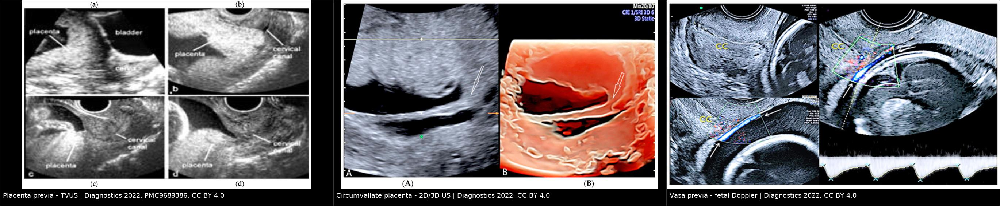
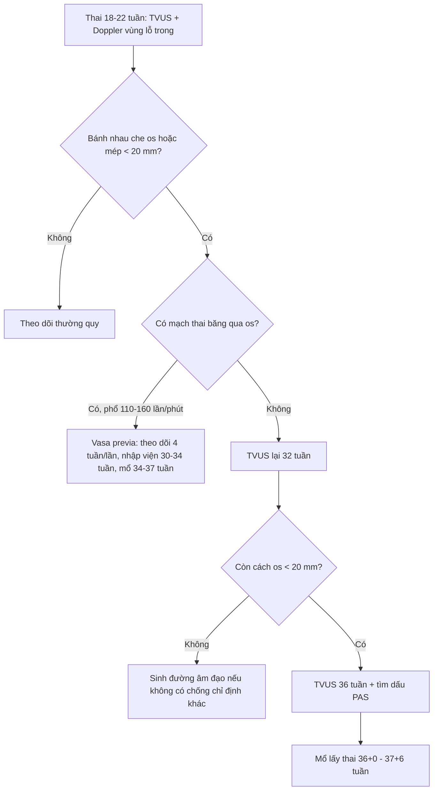
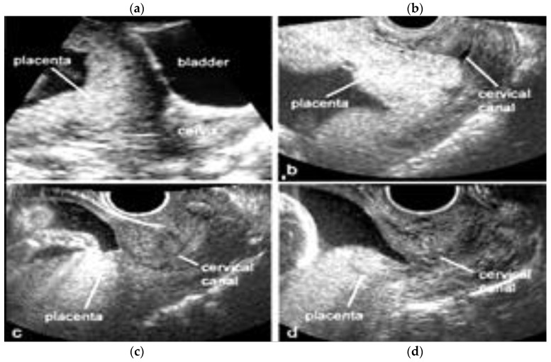
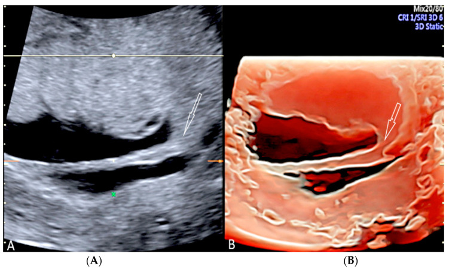
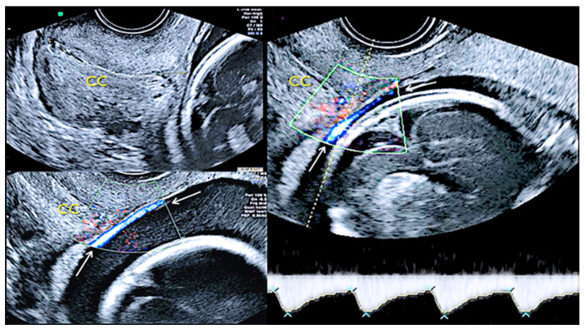

# 563 — Bất thường rau–bánh nhau sớm: rau tiền đạo, vasa previa & rau màng bọc quanh thai

**Tags:** `pattern:bat-thuong-nhau` `pattern:chay-mau-san-khoa` `vung:tu-cung` `protocol:TVUS-thai`
**Mức chắc chắn (certainty):** tổng hợp y văn (literature synthesis) — số liệu lấy từ guideline sản khoa và các bài tổng quan/ca có giấy phép mở; ảnh minh họa từ bài CC BY đã đối chiếu PMCID.

## 1. Tổng quan bệnh học – cơ chế hình ảnh

- **Rau tiền đạo (placenta previa):** bánh nhau bám ở đoạn dưới tử cung, che lấp hoặc sát lỗ trong cổ tử cung (internal os). Tần suất khoảng **0,5%** thai đơn (1/200), tăng theo số lần mổ lấy thai, tuổi mẹ, đa thai, hỗ trợ sinh sản và hút thuốc.
- **Ngưỡng định lượng quan trọng nhất:** mép bánh nhau cách lỗ trong cổ tử cung **< 20 mm** được gọi là rau bám thấp (low-lying placenta); **che hoàn toàn lỗ trong** là rau tiền đạo. Đo bằng siêu âm đầu dò âm đạo (transvaginal ultrasound – TVUS), không dùng siêu âm đường bụng để kết luận vì bàng quang căng tạo dương tính giả.
- **TẠI SAO “rau di chuyển” (placental migration):** không phải nhau bò đi, mà đoạn dưới tử cung dài ra và cơ tử cung co rút quanh bánh nhau trong tam cá nguyệt 3; khoảng **90%** rau bám thấp phát hiện ở tuần 20 sẽ “lên cao” khi đủ tháng. Vì vậy không mổ sớm chỉ vì tuần 20 thấy nhau thấp — phải chụp lại ở **32 và 36 tuần**.
- **Cơ chế chảy máu:** khi đoạn dưới căng/co, mép bánh nhau bong khỏi thành tử cung → chảy máu **từ tuần hoàn mẹ**, đỏ tươi, thường **không đau** (khác bong rau: đau + tử cung cứng). Máu mẹ mất nhiều nhưng thai có thể vẫn ổn — đây là lý do phải phân biệt nguồn chảy máu.
- **Vasa previa:** mạch máu **của thai** chạy trong màng ối–đệm, băng qua hoặc sát lỗ trong cổ tử cung, **không có bánh nhau và không có Wharton’s jelly** bảo vệ. Khi vỡ ối, mạch vỡ → thai mất máu cấp (thể tích máu thai chỉ ~80–100 mL/kg). **Chưa chẩn đoán trước sinh, tử vong chu sinh > 50%**; chẩn đoán trước và mổ chủ động đưa tử vong xuống rất thấp. Phân loại: **type I** do bám dây rốn màng (velamentous insertion), **type II** do bánh nhau hai thùy/thùy phụ (bilobed/succenturiate), **type III** mạch từ mép bánh nhau chạy tự do qua màng — không có bám màng điển hình.
- **Rau màng bọc quanh thai (circumvallate placenta):** đĩa màng nuôi (chorionic plate) nhỏ hơn đĩa đáy (basal plate); màng ối–đệm gấp ngược ra ngoài tạo **gờ/vành (shelf/ring)** quanh bánh nhau. Tổng hợp 48 nghiên cứu: tỷ lệ gộp **1,2%**; tăng **mổ lấy thai cấp cứu, sinh non và bong rau** so với thai không có bất thường này (PMC10295197).
- **TẠI SAO hình ảnh phản ánh bệnh học:** mô nhau đồng âm–giàu echo dạng hạt; máu trong màng/âm đạo là dịch echo thấp; mạch thai trên Doppler có **tần số 110–160 lần/phút** (thai), phân biệt với tĩnh mạch mẹ **60–100 lần/phút**. Đây là chìa khóa để không nhầm “vasa previa” với giãn tĩnh mạch cổ tử cung.

## 2. Mẫu hình + chẩn đoán phân biệt theo vị trí (gamut)

Ba câu hỏi bắt buộc khi thấy bất thường vùng eo–cổ tử cung trên siêu âm:
1. **Bánh nhau ở đâu so với lỗ trong cổ tử cung?** (che, cách bao nhiêu mm)
2. **Có mạch máu thai băng qua lỗ trong không?** (Doppler + tần số)
3. **Hình thái bánh nhau/màng có bất thường?** (gờ circumvallate, thùy phụ, bám màng)

Gamut theo vị trí:

- **Bánh nhau che/sát lỗ trong:** rau tiền đạo hoàn toàn, rau tiền đạo bán phần, rau bám thấp (< 20 mm).
- **Mạch máu trên lỗ trong:** vasa previa type I/II/III; phân biệt **sa dây rốn (cord presentation)**, **giãn tĩnh mạch cổ tử cung**, **màng ối dày có mạch**.
- **Bất thường hình thái bánh nhau:** circumvallate placenta (gờ màng), **thùy phụ (succenturiate lobe)** — nguy cơ sót thùy sau sinh, **placenta membranacea** (rất hiếm), bánh nhau hai thùy.
- **Khối vùng cổ tử cung không phải nhau:** polyp nội mạc sa, u xơ dưới niêm mạc sa, **chửa cổ tử cung** (cervical ectopic), nang Naboth lớn.

Gợi nhớ **PLACENTA**: **P**revia, **L**ow-lying, **A**ccreta spectrum (luôn đi kèm nhau tiền đạo + sẹo mổ), **C**ircumvallate, **E**ctopic cervical, **N**eoplasm/polyp, **T**hrombus/varix, **A**ccessory lobe.

## 3. Bảng so sánh phân biệt (ma trận đối chiếu)

| Thực thể (entity) | Hình ảnh điển hình | Chốt vào (rule-in) | Chốt loại (rule-out) | Gợi ý xác nhận |
|---|---|---|---|---|
| **Rau tiền đạo (placenta previa)** | Khối nhau đồng âm che lỗ trong; TVUS đo khoảng cách mép–os | **Mép nhau cách os < 20 mm hoặc che hoàn toàn**, đo trên TVUS ở 32–36 tuần | Khoảng cách > 20 mm trên TVUS → không phải previa; đừng chẩn đoán bằng đường bụng | TVUS đầu dò âm đạo, bàng quang rỗng; mổ chủ động 36+0–37+6 tuần |
| **Rau bám thấp (low-lying)** | Mép nhau sát os nhưng không che | **Khoảng cách 1–20 mm** ở tam cá nguyệt 3 | Che hoàn toàn os → previa; > 20 mm → bình thường | Chụp lại 32–36 tuần; ~90% ở tuần 20 tự lên cao |
| **Vasa previa** | Cấu trúc ống echo trống băng qua màng trên os; Doppler có phổ **mạch thai** | **Phổ Doppler 110–160 lần/phút + mạch đi trên os**, type I/II/III | Phổ 60–100 lần/phút = tĩnh mạch mẹ/cổ tử cung; có dây rốn cuộn = cord presentation | TVUS + color Doppler; mổ chủ động 34+0–37+0 tuần, tránh bấm ối/khám âm đạo |
| **Rau màng bọc quanh thai (circumvallate)** | Bờ bánh nhau **dày, gấp nếp như gờ/shelf**, màng bám vào mặt trên bánh nhau chứ không ở mép | **Gờ màng nhô vào buồng ối, thấy rõ ở 2D và 3D**, bánh nhau “hai tầng” | Mép bánh nhau mỏng, đều, màng bám đúng mép → bình thường; dải màng mỏng cố định → amniotic band | 2D + 3D HD-live; theo dõi sinh non/FGR/bong rau |
| **Thùy phụ (succenturiate lobe)** | Bánh nhau chính + một thùy mô nhau tách biệt, nối bằng mạch trong màng | **Mạch máu nối giữa hai thùy** trên color Doppler; khoảng trống ở mép bánh nhau | Không thấy mạch nối + không có mô nhau ngoài bánh nhau | Kiểm tra màng sau sinh; nguy cơ sót thùy → chảy máu/nhiễm trùng |
| **Chửa cổ tử cung (cervical ectopic)** | Túi thai trong ống cổ tử cung, **eo tử cung rỗng**, cổ tử cung phình | **Túi thai dưới lỗ trong + eo rỗng**, Doppler mạch nuôi quanh túi | Túi thai trong buồng tử cung, eo căng → không phải cervical | TVUS + β-hCG; tránh nạo vét mù |

*Trái: rau tiền đạo — bánh nhau che lỗ trong, thấy rõ trên đầu dò âm đạo. Giữa: rau màng bọc quanh thai — gờ màng (mũi tên) trên 2D và dựng hình 3D. Phải: vasa previa type III — mạch thai chạy trên màng gần lỗ trong, phổ Doppler động mạch thai. Nguồn: Diagnostics 2022 (PMC9689386), CC BY 4.0; ảnh ghép letterbox giữ nguyên tỷ lệ.*

## 4. Protocol chụp + hệ phân độ/điểm chuẩn hóa

**Siêu âm sàng lọc (18–22 tuần)**
- Đo **độ dài cổ tử cung** và mô tả **vị trí bánh nhau** trên TVUS. Nếu mép nhau **< 20 mm** hoặc che os → hẹn chụp lại.
- **Color Doppler vùng lỗ trong** ở thai có yếu tố nguy cơ vasa previa: rau bám thấp/bánh nhau hai thùy/thùy phụ, bám dây rốn màng, thụ tinh ống nghiệm, đa thai, tiền sử vasa previa.
- Khi nghi **nhau cài răng lược (PAS)** — nhau tiền đạo + sẹo mổ lấy thai: tìm lacunae, mất mặt phẳng giữa nhau–cơ, mạch xuyên (xem bài 560).

**Theo dõi**
- Rau bám thấp ở tuần 20 → TVUS lại **32 tuần**; nếu còn < 20 mm → TVUS **36 tuần** để quyết định đường sinh.
- Vasa previa: TVUS + Doppler mỗi **4 tuần** từ lúc chẩn đoán đến 32 tuần; cân nhắc nhập viện theo dõi từ **30–34 tuần** (nguy cơ vỡ ối/chảy máu đột ngột), corticosteroid nếu dự kiến sinh < 34 tuần.
- Circumvallate: không có “điểm” riêng; theo dõi **tăng trưởng thai, cổ tử cung, dấu hiệu bong rau**.

**Thời điểm sinh (ngưỡng thực hành)**
- Rau tiền đạo không biến chứng: mổ lấy thai chủ động **36+0 – 37+6 tuần** (trước chuyển dạ để tránh chảy máu cấp).
- Vasa previa: mổ lấy thai chủ động **34+0 – 37+0 tuần** tùy ca; **tuyệt đối tránh bấm ối và khám âm đạo** khi chưa loại trừ.

## 5. Biến thể bình thường và cạm bẫy

- **Bàng quang căng khi siêu âm đường bụng** đẩy đoạn dưới tử cung ra sau, làm nhau “trông” che os → luôn xác nhận bằng TVUS với bàng quang rỗng.
- **Cơn co tử cung khu trú** có thể tạo khối giả ở đoạn dưới; xem lại sau 20–30 phút hoặc dùng Doppler.
- **Giãn tĩnh mạch cổ tử cung** cho hình ảnh ống echo trống giống vasa previa nhưng **phổ tĩnh mạch mẹ 60–100 lần/phút**, không có phổ động mạch thai.
- **Sa dây rốn (cord presentation)** khác vasa previa: dây rốn cuộn nhiều vòng, có Wharton’s jelly, di động; vasa previa là mạch đơn độc chạy trong màng, cố định.
- **“Migration” không hoàn toàn:** rau tiền đạo **che hoàn toàn** ở tuần 20 ít khi lên cao hơn rau bám thấp; đừng hứa với thai phụ là “chắc chắn lên”.
- **Bỏ sót thùy phụ:** sau sinh, luôn đối chiếu màng và bánh nhau; thùy phụ sót lại gây chảy máu muộn/nhiễm trùng tử cung.
- **Bẫy hài lòng (satisfaction of search):** thấy nhau tiền đạo rồi dừng — phải chủ động tìm **dấu hiệu PAS** (lacunae, mạch xuyên, mất mặt phẳng) vì nhau tiền đạo + sẹo mổ là bối cảnh nguy cơ cao nhất.
- **Circumvallate vs amniotic band:** gờ circumvallate dày, liên tục quanh bánh nhau và **không cắt ngang thai**; dải ối mỏng, tự do, có thể dính vào thai.

## 6. Tự lượng giá — Blind Quiz

**Ca 1 — Thai 32 tuần, ra máu âm đạo đỏ tươi, không đau, tử cung mềm.**

- Gợi ý lâm sàng: chảy máu không đau ở tam cá nguyệt 3, không có cơn co.
- Câu hỏi: Bánh nhau nằm ở đâu so với lỗ trong? Đo khoảng cách nào? Hai chẩn đoán phân biệt và dấu hiệu nào loại trừ bong rau?

<b>Bấm để hiện đáp án (findings + chẩn đoán)</b>

- Dấu hiệu: bánh nhau phủ lên vùng lỗ trong cổ tử cung (panel a: đường bụng; panel b: đầu dò âm đạo thấy nhau che cổ tử cung; panel c–d: rau bám thấp mức độ nhẹ hơn). Không có khối máu sau bánh nhau, tử cung mềm.
- Chẩn đoán: **rau tiền đạo** — chảy máu từ mép bánh nhau khi đoạn dưới căng, máu mẹ, không đau. Bong rau (abruption) loại trừ vì **không đau + tử cung mềm + không có khối máu sau nhau**.
- Xử trí: TVUS đo khoảng cách mép–os, theo dõi 32/36 tuần; nếu còn che os → mổ chủ động 36+0–37+6 tuần.
- Nguồn ảnh: Diagnostics 2022 (PMC9689386), CC BY 4.0.

**Ca 2 — Thai 20 tuần, bánh nhau mặt trước; siêu âm hình thái thấy bờ bánh nhau “dày bất thường”.**

- Câu hỏi: Cấu trúc mũi tên là gì? Nó khác mép bánh nhau bình thường ở điểm nào? Hệ quả sản khoa cần tư vấn?

<b>Bấm để hiện đáp án (findings + chẩn đoán)</b>

- Dấu hiệu: bờ bánh nhau dày, gấp nếp tạo **gờ/shelf** nhô vào buồng ối; 3D cho thấy rõ vành màng bao quanh bánh nhau.
- Chẩn đoán: **rau màng bọc quanh thai (circumvallate placenta)** — màng gấp ngược ra ngoài vì đĩa màng nuôi nhỏ hơn đĩa đáy. Tỷ lệ gộp 1,2%; tăng nguy cơ **sinh non, mổ cấp cứu, bong rau** (PMC10295197).
- Tư vấn: theo dõi tăng trưởng thai + cổ tử cung + dấu hiệu bong rau; không có chỉ định mổ chỉ vì hình thái này.
- Nguồn ảnh: Diagnostics 2022 (PMC9689386), CC BY 4.0.

**Ca 3 — Thai 24 tuần, thụ tinh ống nghiệm, siêu âm thấy cấu trúc ống mảnh băng qua lỗ trong.**

- Câu hỏi: Cấu trúc là mạch mẹ hay mạch thai? Dựa vào đâu? Nếu bỏ sót, biến chứng nặng nhất là gì?

<b>Bấm để hiện đáp án (findings + chẩn đoán)</b>

- Dấu hiệu: mạch chạy trong màng, băng qua lỗ trong; **phổ Doppler có tần số thai 110–160 lần/phút**, dạng động mạch — chứng minh đây là mạch thai.
- Chẩn đoán: **vasa previa type III** (mạch từ mép bánh nhau chạy tự do qua màng, không có bám dây rốn màng điển hình). Nguy cơ: vỡ mạch khi vỡ ối → thai mất máu cấp, tử vong chu sinh **> 50% nếu chưa chẩn đoán**.
- Xử trí: theo dõi 4 tuần/lần, nhập viện 30–34 tuần, corticosteroid khi dự kiến sinh non, mổ chủ động 34–37 tuần; **không bấm ối, không khám âm đạo**.
- Nguồn ảnh: Diagnostics 2022 (PMC9689386), CC BY 4.0.

## Bài liên quan chéo
- [560 – Nhau cài răng lược: lacunae, cơ < 1 mm & dải T2](../560-nhau-cai-rang-luoc-PAS-cap-cuu-san/lesson.md)
- [565 – Sàng lọc hình thái thai nhi & Doppler sản khoa](../565-sang-loc-hinh-thai-va-doppler-san-khoa/lesson.md)
- [550 – Thai sớm: SRU, ngoài tử cung & vòng lửa](../550-thai-som-say-thai-thai-ngoai-tu-cung/lesson.md)
- [566 – Song thai: chorionicity, TTTS & TAPS](../566-song-thai-chorionicity-TTTS-TAPS/lesson.md)

> Không dùng để chẩn đoán độc lập khi chưa có người hướng dẫn.
