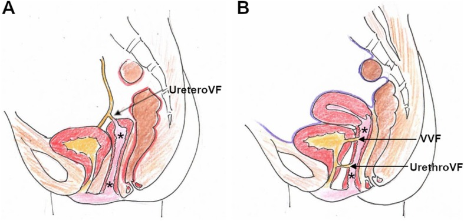
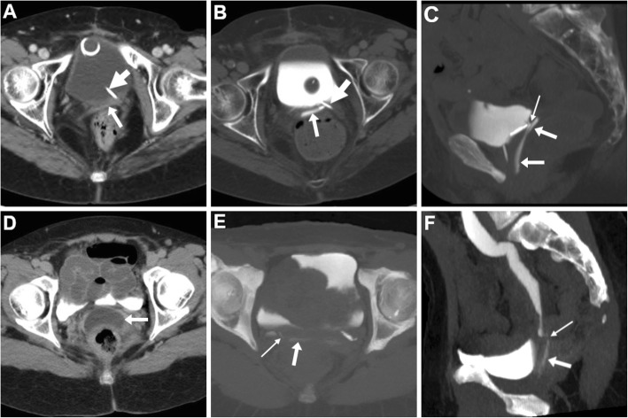
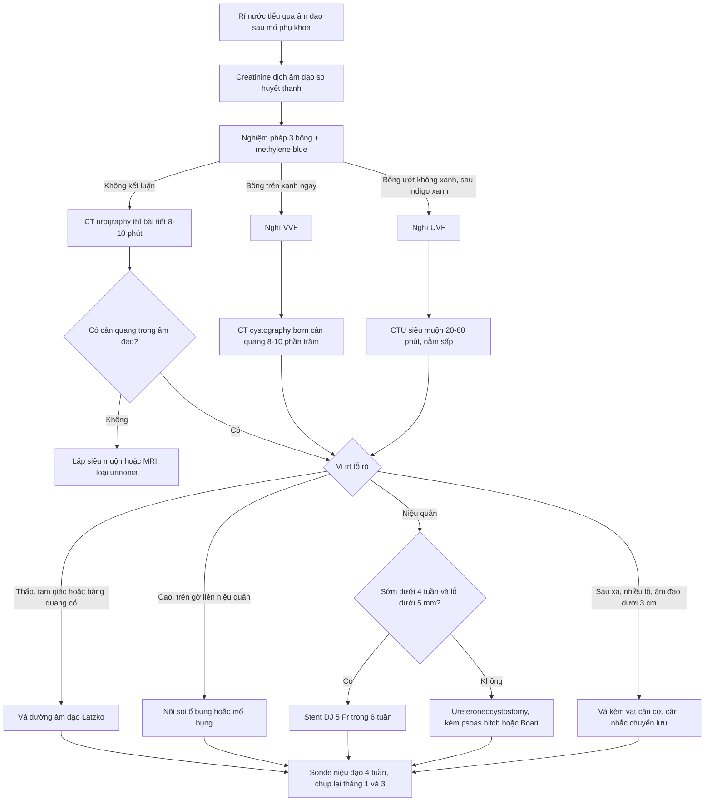
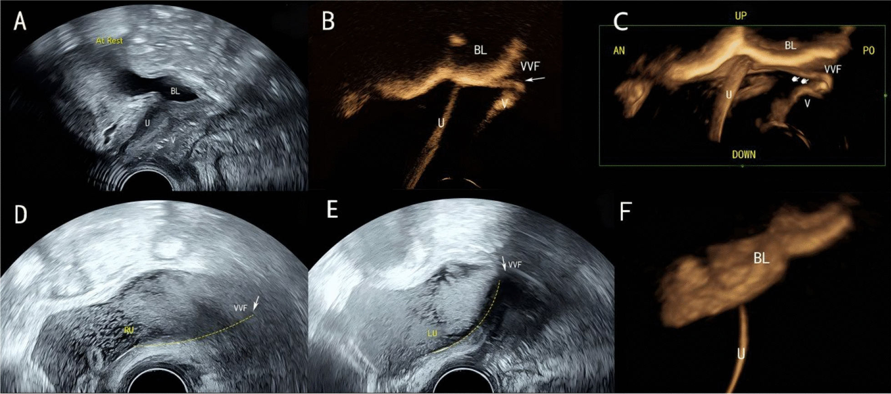
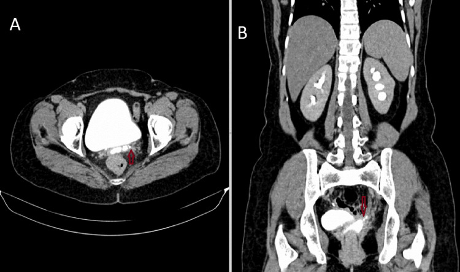
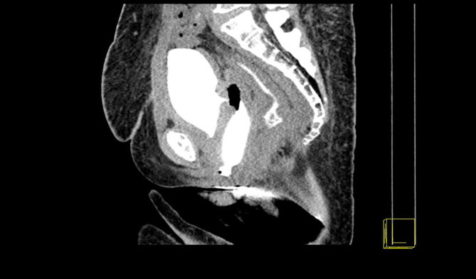

# 564 — Rò bàng quang–âm đạo & rò niệu quản–âm đạo sau mổ phụ khoa: phân biệt bằng 3 bông – creatinine – CT urography thì muộn, và chọn đường mổ

**Tags:** `pattern:ro-nieu-sinh-duc` `pattern:ro-bang-quang-am-dao` `pattern:ro-nieu-quan-am-dao` `vung:am-dao` `vung:bang-quang` `vung:khung-chau` `score:Goh` `protocol:CT-urography` `protocol:CT-cystography` `protocol:IC-CEUS` `protocol:nghiem-phap-3-bong`
**Mức chắc chắn (certainty):** tổng hợp y văn (literature synthesis) — tổng hợp từ 1 bài tổng quan có ảnh mở về kỹ thuật CT/MRI rò âm đạo (Tonolini 2019), 1 tổng quan về tổn thương niệu trong mổ phụ khoa (Arcieri 2025), 1 phân tích 23.404 ca cắt tử cung tận gốc (Liang 2023), 2 loạt ca lớn về rò bàng quang–âm đạo (Ni 2026) và rò niệu quản–âm đạo (Kajabwangu 2024), 1 nghiên cứu về đặt stent DJ (Kumar 2025), 1 nghiên cứu kỹ thuật siêu âm cản quang trong ổ (Lou 2026) và 2 ca nguyên văn có ảnh CT mở; mọi số liệu đối chiếu trực tiếp PMCID ghi trong `sources.md`.

## 1. Tổng quan bệnh học – cơ chế hình ảnh

- **Định nghĩa:** rò niệu–sinh dục (urinary–genital fistula) là đường thông bất thường giữa đường tiết niệu dưới và âm đạo. Ba thể phải phân biệt trong một bài: **rò bàng quang–âm đạo (vesicovaginal fistula – VVF)**, **rò niệu quản–âm đạo (ureterovaginal fistula – UVF)** và **rò niệu đạo–âm đạo (urethrovaginal fistula)**. Triệu chứng chung là **rỉ nước tiểu liên tục qua âm đạo**, nhưng *cơ chế, hình ảnh và đường mổ khác nhau hoàn toàn*.
- **Dịch tễ (số liệu định lượng):**
  - Mổ phụ khoa chiếm **> 50%** tổng số tổn thương niệu do thủ thuật; niệu khoa ~30%, tiêu hóa 5–15%.
  - Thương tổn **bàng quang**: **0,24%** ở mổ lành tính và **0,4–3,7%** ở mổ ung thư. Thương tổn **niệu quản**: **0,08%** (lành tính) và **0,39–1,1%** (ung thư).
  - Sau cắt tử cung: **VVF ~0,8%**, **UVF ~0,16%**.
  - Sau **cắt tử cung tận gốc vì ung thư cổ tử cung** (23.404 ca): rò niệu–sinh dục **1,04%**, trong đó **UVF 0,64%** và **VVF 0,34%** — nghĩa là **UVF chiếm 61,8%**, ngược với cảm giác "VVF là chính" ở mổ lành tính.
- **Thời điểm xuất hiện — mấu chốt để không bỏ sót:** triệu chứng khởi phát trung vị **11 ngày (IQR 7–17) với UVF** và **17 ngày (IQR 10,3–30,8) với VVF** sau cắt tử cung tận gốc. Tổn thương do **nhiệt** (thermal injury) được chẩn đoán muộn trung bình **12 ngày**. Chỉ **8,6%** tổn thương niệu quản được nhận ra ngay trong mổ, so với **85%** tổn thương bàng quang — vì vậy **niệu quản là "kẻ giấu mặt"**.
- **Cơ chế (vì sao rò hình thành):**
  - **Thiếu máu – hoại tử vách:** chỉ khâu giữa vòm âm đạo và mặt sau bàng quang, hoặc **đốt điện lan nhiệt** (thành bàng quang chỉ **2–3 mm**, niệu quản **6–10 mm**, bao niệu quản **2,5 mm**) → hoại tử chậm, thủng sau 5–14 ngày.
  - **Sau xạ trị:** giảm tưới máu, xơ hóa, mô giòn → rò xuất hiện muộn hơn, khó vá hơn, **tái phát cao**.
  - **Sau cắt tử cung tận gốc:** bóc tách quanh niệu quản + cắt dây chằng ngang cổ tử cung → UVF; bóc tách bàng quang → VVF.
- **TẠI SAO hình ảnh trông như vậy (vật lý + mô bệnh):**
  - **Nước tiểu trên CT không cản quang gần như nước (0–20 HU)** → đường rò **vô hình**. Khi có **iod cản quang được thải qua thận**, nước tiểu trong lòng rò **tăng đậm độ rất mạnh**, nên **chỉ thì bài tiết (excretory phase) mới thấy rò**. Đây là lý do **một lát cắt 3 phút có thể âm tính giả** trong khi lát **15 phút** đã thấy rõ (ca nguyên văn PMC9692200): **thời điểm chụp quan trọng hơn số lát cắt**.
  - **Trên MRI:** nước tiểu **T2 tăng tín hiệu** và **T1 giảm**; mô xơ thành rò **T2 giảm** và **ngấm thuốc thì muộn**. Nếu ứ mủ (pyocolpos) → **hạn chế khuếch tán (DWI sáng, ADC thấp)** và viền ngấm.
  - **Trên siêu âm:** khí trong bàng quang và microbubble cản quang làm **tăng tương phản** giữa lòng bàng quang và đường rò; dòng cản quang xuất hiện **5–15 giây** sau bơm vào bàng quang là dấu hiệu trực tiếp.
  - **Sinh hóa:** **creatinine dịch âm đạo cao hơn creatinine huyết thanh** xác nhận dịch là nước tiểu (không cần chờ hình ảnh).

## 2. Mẫu hình + chẩn đoán phân biệt theo vị trí (gamut)

- **Mẫu hình A — rỉ nước tiểu liên tục nhưng vẫn "đi tiểu" được bình thường:** nghĩ **UVF** (niệu quản còn dẫn nước tiểu xuống bàng quang, nhưng một phần chảy vào âm đạo). Đây là **câu hỏi phân loại đầu tiên và quan trọng nhất**.
- **Mẫu hình B — rỉ liên tục, không giữ được nước tiểu, bàng quang luôn rỗng:** nghĩ **VVF**; nếu lỗ rò ở **tam giác/bàng quang cổ** (thấp) → đường **âm đạo (Latzko)**; nếu **trên gờ liên niệu quản** (cao) → đường **bụng/nội soi ổ bụng**.
- **Mẫu hình C — rỉ nước tiểu + đau hông lưng + giãn đài bể thận một bên:** nghĩ **UVF có tắc/ hẹp niệu quản kèm theo**; phải đánh giá chức năng thận **trước** khi bàn vá rò.
- **Mẫu hình D — rỉ nước tiểu ngay sau sinh/mổ lấy thai, kèm rách âm đạo:** nghĩ **rò niệu đạo–âm đạo** hoặc tổn thương niệu đạo; khác hoàn toàn về đường mổ.
- **Mẫu hình E — rò phức tạp sau xạ trị:** nhiều lỗ, mô xơ, có thể kèm **rò trực tràng–âm đạo** (25% ca rò sau xạ trong loạt Ni 2026); thành âm đạo hẹp < 3 cm là tiêu chí **không thể vá qua đường âm đạo**.
- **Mẫu hình F — "khối dịch tiểu khung" sau mổ:** **urinoma** (nước tiểu tụ ngoài đường niệu) — chưa phải rò, nhưng là tiền thân; cần phân biệt với **lymphocele** (không có creatinine cao) và **áp-xe** (sốt, khí, viền ngấm).
- **Gợi nhớ lâm sàng 4 câu hỏi:** (1) **rỉ liên tục hay từng cơn?** (2) **vẫn tiểu tự nhiên được không?** (3) **đau hông lưng / sốt?** (4) **đã xạ trị chưa?** — bốn câu này định hình cả gamut và đường mổ.

*Hình (A): **rò niệu quản–âm đạo** — đường rò đi từ niệu quản đoạn xa vào vòm âm đạo (mũi tên), tử cung đã mất. Hình (B): **rò bàng quang–âm đạo** và **rò niệu đạo–âm đạo**. Dấu * = lòng âm đạo; vàng = nước tiểu. Vị trí lỗ rò quyết định đường mổ: thấp → âm đạo, cao → bụng. Nguồn: Tonolini M, *Insights Imaging* 2019, CC BY 4.0.*

## 3. Bảng so sánh phân biệt (ma trận đối chiếu)

| Thực thể (entity) | Hình ảnh điển hình | Chốt vào (rule-in) | Chốt loại (rule-out) | Gợi ý xác nhận |
|---|---|---|---|---|
| **VVF (rò bàng quang–âm đạo)** | CT cystography/CTU: **nước tiểu cản quang trong âm đạo**, đường rò từ mặt sau bàng quang tới vòm âm đạo; bông/gạc âm đạo ngấm cản quang | **Bàng quang rỗng + rỉ liên tục + bông âm đạo xanh khi bơm methylene blue vào bàng quang** | Niệu quản giãn + vẫn tiểu tự nhiên → nghĩ UVF, không phải VVF | Soi bàng quang thấy lỗ rò; CT cystography bơm cản quang 8–10% |
| **UVF (rò niệu quản–âm đạo)** | CTU **thì bài tiết muộn 15–30 phút**: cản quang từ niệu quản chảy vào vòm âm đạo; đài bể thận bên tổn thương giãn | **Vẫn tiểu tự nhiên + nghiệm pháp 3 bông: bông trên cùng ướt nhưng KHÔNG xanh; sau đó xanh khi tiêm indigo carmine tĩnh mạch** | Bông xanh ngay khi bơm vào bàng quang → VVF, không phải UVF | CTU 15 phút + đặt **tư thế nằm sấp**; chụp bàng quang ngược dòng âm tính |
| **Rò niệu đạo–âm đạo** | Cản quang trong niệu đạo → âm đạo; thường kèm hẹp niệu đạo hoặc rách sau sinh | **Rỉ nước tiểu + tiểu yếu/tia nhỏ + tiền sử rách niệu đạo** | Cản quang từ bàng quang (không phải niệu đạo) → VVF | VCUG thì đi tiểu; soi niệu đạo |
| **Rò bàng quang–tử cung (vesicouterine)** | Tam chứng **Youssef**: **vô kinh + đái máu theo chu kỳ (menouria) + KHÔNG rỉ nước tiểu liên tục**; cản quang bàng quang → buồng tử cung | **Vô kinh + menouria theo chu kỳ + còn kiểm soát tiểu** | Rỉ nước tiểu liên tục, có kinh bình thường → không phải | MRI T2; CTU |
| **Rò phức tạp sau xạ** | Nhiều đường rò, thành âm đạo dày xơ, hẹp < 3 cm, có thể kèm rò trực tràng–âm đạo | **Tiền sử xạ vùng chậu + nhiều lỗ + mô xơ** | Một lỗ nhỏ, mô mềm mại, không xạ → rò đơn thuần | MRI chậu T2/DWI; nội soi; sinh thiết nếu nghi tái phát |
| **Urinoma (chưa rò)** | Khối dịch tiểu khung, **không thông với âm đạo**, creatinine dịch cao | **Khối dịch + creatinine cao + không rỉ qua âm đạo** | Có cản quang trong âm đạo → đã rò | CTU; dẫn lưu chẩn đoán |
| **Viêm âm đạo sau mổ ("swollen vagina")** | Thành âm đạo dày, phù, ngấm mạnh sau cắt tử cung qua âm đạo — **bình thường** | **Không rỉ nước tiểu, không cản quang trong âm đạo** | Có nước tiểu trong âm đạo → rò | So phim cũ; theo dõi 4–6 tuần |

*Hàng trên (A–C): **VVF** sau mổ ung thư nội mạc tái phát — có stent niệu quản (mũi tên dày), âm đạo co kéo và ngấm cản quang qua đường rò ngắn (mũi tên mảnh). Hàng dưới (D–F): **UVF** sau cắt tử cung tận gốc — âm đạo ứ dịch căng (D); ở **thì siêu muộn 30 phút** (E, F) mới thấy nước tiểu cản quang chảy vào âm đạo. Bài học: **thì 8–10 phút có thể chưa đủ** — cần 20–60 phút và tư thế nằm sấp. Nguồn: Tonolini M, *Insights Imaging* 2019, CC BY 4.0.*

## 4. Protocol chụp + hệ phân độ/điểm chuẩn hóa

**Bước 1 — lâm sàng (làm trước mọi hình ảnh, rẻ và quyết định):**
- **Nghiệm pháp 3 bông (three-swab test):** đặt 3 bông/gạc vào âm đạo (trên → dưới); bơm **methylene blue** vào bàng quang qua sonde.
  - **Bông trên cùng xanh** → **VVF**.
  - **Bông ướt nhưng không xanh**, bàng quang sạch → nghĩ **UVF**; tiêm **indigo carmine tĩnh mạch**, bông trên cùng xanh sau 10–20 phút → xác nhận **UVF**.
- **Creatinine dịch âm đạo** so với huyết thanh: cao hơn → dịch là nước tiểu.
- **Soi bàng quang** tìm lỗ rò, vị trí so với **lỗ niệu quản** và **bàng quang cổ** — đây là dữ liệu mà hình ảnh phải tái hiện.

**Bước 2 — CT urography (chuẩn vàng cho rò do thủ thuật):**
- **Thì:** vỏ–tủy **30 giây**, thì thận **90–100 giây**, thì bài tiết **8–10 phút**; nếu nghi ngờ hoặc cần loại trừ → **siêu muộn 20–60 phút** và **đổi tư thế nằm sấp**. Có thể dùng **split-bolus** để giảm liều.
- **Kỹ thuật bổ trợ tại chỗ:** đặt **bông/gạc âm đạo** trước chụp — trên phim không cản quang bông là **tổn thương giảm đậm độ** giúp định vị âm đạo; sau khi nước tiểu cản quang thấm vào, bông **tăng đậm độ** = dấu hiệu rò. Hoặc bơm **gel siêu âm 100–180 mL** vào âm đạo trước CT cystography.
- **CT cystography:** bơm **cản quang pha loãng 8–10%** qua sonde Foley tới khi bàng quang căng đủ; đây là cách **tạo áp lực mở đường rò** mà CTU thường không làm được.
- **Đọc phim:** dựng lại **FOV nhỏ, mặt phẳng đứng dọc và chếch** theo trục âm đạo; xem ở **cửa sổ mạch máu (WW 600–900 HU, WL 150–300 HU)** + **MIP** để không bỏ sót đường rò mảnh.

**Bước 3 — siêu âm (khi cần không bức xạ, hoặc để đo khoảng cách tới lỗ niệu quản):**
- **Quy trình 4 bước IC-CEUS (intracavitary contrast-enhanced ultrasound):** (A) siêu âm sàn chậu đường đáy chậu 2D + quét hình quạt; (B) bơm **SonoVue pha loãng 1:50** vào bàng quang, quan sát động dòng cản quang; (C) dựng **3D Render**; (D) **3D TUI** đo khoảng cách từ lỗ rò tới **hai lỗ niệu quản** và **bàng quang cổ**.
- Hiệu quả trong loạt 17 ca: **IC-CEUS phát hiện 100%** so với **53% (9/17)** của siêu âm 2D thường; cản quang xuất hiện qua rò trong **5–15 giây**.
- Giá trị thực hành: **phân loại thấp/cao** ngay trước mổ — rò **thấp (bàng quang cổ/tam giác)** vá đường **đáy chậu (Latzko)**, rò **cao (trên gờ liên niệu quản)** mổ **nội soi ổ bụng**.

**Bước 4 — MRI (chỉ định chọn lọc):**
- Khi cần đánh giá **mô xơ sau xạ**, **áp-xe**, **tái phát u**, hoặc rò **niệu đạo/âm đạo** khó thấy trên CT.
- Protocol tối thiểu: **T2 nhiều mặt phẳng FOV nhỏ**, **T2 fat-sat**, **DWI**, **T1 fat-sat sau gadolinium**. Đường rò hoạt động: **T2 sáng + viền ngấm**; đường rò mạn: **T2 tối, không ngấm**.

**Bước 5 — phân độ Goh (ghi trong hồ sơ trước mổ):**

| Trục | Phân độ | Ngưỡng |
|---|---|---|
| Độ dài (length) | 1 / 2 / 3 / 4 | bờ dưới lỗ rò cách lỗ niệu đạo ngoài **> 3,5 cm** / **2,5–3,5 cm** / **1,5–< 2,5 cm** / **< 1,5 cm** |
| Kích thước (size) | a / b / c | đường kính lớn nhất **< 1,5 cm** / **1,5–3 cm** / **> 3 cm** |
| Sẹo âm đạo (scarring) | i / ii / iii | không hoặc nhẹ, âm đạo **> 6 cm** / xơ vừa–nặng, âm đạo ngắn / đặc biệt (vòng chu vi, liên quan lỗ niệu quản) |

- **Cẩn thận hai hệ cùng tồn tại:** phân loại cổ điển chia **nhỏ < 0,5 cm / vừa 0,6–2,4 cm / lớn > 2,5 cm**, còn **Goh** dùng mốc **1,5 và 3 cm**. Ghi rõ hệ nào đang dùng, nếu không sẽ "đọc chéo" sai độ phức tạp.

**Bước 6 — theo dõi sau mổ:**
- **Sonde niệu đạo 4 tuần** sau vá VVF (loạt Ni 2026); **stent DJ + Foley 2 tuần** sau ureteroneocystostomy (loạt Kajabwangu 2024).
- **Chụp bàng quang ngược dòng + soi bàng quang ở tháng 1 và tháng 3**, sau đó mỗi năm — định nghĩa thành công là **hết rỉ nước tiểu và không tái phát ở tháng 3**.
- **Kết quả tham chiếu:** vá VVF đường âm đạo **93,82%** thành công (tổng quan hệ thống); **ureteroneocystostomy 95,7%** (47 ca); **stent DJ 77,4%** (31 ca) — nhưng **92,9%** nếu chẩn đoán **< 4 tuần** và **89,5%** nếu lỗ **< 5 mm**, giảm còn **64,7%** và **58,3%** ở nhóm muộn/lỗ lớn.
- **Rò sau xạ tái phát cao:** vá đường âm đạo **18,5%** (so với **6,25%** ở nhóm không xạ); đường bụng **50%** (so với **0%**).

*(A) siêu âm 2D đường đáy chậu; (B) cản quang động sau bơm SonoVue vào bàng quang, thấy dòng thoát qua lỗ rò (mũi tên); (C) dựng 3D; (D–E) đo khoảng cách từ lỗ rò tới lỗ niệu quản phải/trái; (F) kiểm tra sau mổ: không còn thoát cản quang = vá kín. Nguồn: Lou Y et al., *Eur J Med Res* 2026, **CC BY-NC-ND 4.0** — ảnh giữ nguyên, không crop/ghép.*

## 5. Biến thể bình thường và cạm bẫy

- **Âm tính giả vì chụp quá sớm:** lát 3 phút chỉ thấy đài bể thận, chưa thấy rò; phải chụp **15 phút và/hoặc 20–60 phút**, thêm **tư thế nằm sấp** để nước tiểu chảy về vòm âm đạo.
- **Bàng quang căng nhưng rò không mở:** CTU thụ động không tạo đủ áp lực → **CT cystography bơm 8–10%** mới thấy VVF nhỏ.
- **Nhầm UVF thành VVF:** bệnh nhân **vẫn tiểu tự nhiên** là cờ đỏ của UVF; nếu vá bàng quang ở bệnh nhân UVF, **rò còn nguyên và thận tiếp tục giãn**.
- **Bỏ sót niệu quản vì chỉ 8,6% thấy trong mổ:** sau mổ, **đau hông lưng + sốt + creatinine tăng** phải chụp CTU, không chờ "theo dõi".
- **Sau cắt tử cung qua âm đạo, thành âm đạo dày và ngấm mạnh là bình thường** trong vài tuần — đừng gọi là viêm/áp-xe nếu không có nước tiểu trong âm đạo.
- **Không loại trừ ung thư/tái phát:** rò ở bệnh nhân ung thư phụ khoa có thể do **u xâm lấn**, không chỉ do mổ; cần MRI + sinh thiết trước khi vá.
- **Rò sau xạ không phải rò đơn thuần:** mô xơ, âm đạo < 3 cm, nhiều lỗ → vá đường âm đạo dễ thất bại; cần **vạt cân cơ (gracilis, Martius)** và có thể phải **chuyển lưu nước tiểu**.
- **Quên stent DJ** gây rò mạn/tái phát: trong loạt 31 ca, **3,2%** phải mổ lại vì quên stent.
- **Nhiễm trùng tiểu/đái dầm sau mổ không đồng nghĩa rò:** phải có bằng chứng nước tiểu trong âm đạo (creatinine dịch, 3 bông, cản quang) trước khi chỉ định mổ.

## 6. Tự lượng giá — Blind Quiz

**Ca 1 — Nữ 46 tuổi, cắt tử cung toàn phần qua ngả bụng 3 tuần trước, rỉ nước tiểu liên tục nhưng vẫn đi tiểu được. Nhìn CT, mô tả trước.**

- Gợi ý lâm sàng: không sốt, đau hông lưng trái nhẹ; siêu âm thấy giãn đài bể thận trái.
- Câu hỏi: (1) Cản quang đi từ đâu tới đâu? (2) Chẩn đoán và bên tổn thương? (3) Vì sao lát 3 phút trước đó âm tính?

<b>Bấm để hiện đáp án (findings + chẩn đoán)</b>

- Dấu hiệu: trên mặt phẳng ngang (A) và đứng dọc (B) thì **15 phút**, có **đường cản quang nối niệu quản trái với vòm âm đạo** (mũi tên đỏ); vòm âm đạo ứ dịch; đài bể thận trái giãn nhẹ.
- Chẩn đoán: **rò niệu quản–âm đạo (UVF) bên trái** sau cắt tử cung.
- Vì sao 3 phút âm tính: lúc đó cản quang **chưa xuống tới niệu quản đoạn xa** — cần **thì bài tiết 15 phút** (và siêu muộn 20–60 phút nếu còn nghi).
- Xử trí: đặt **stent DJ 5 Fr trong 6 tuần** nếu lỗ nhỏ và chẩn đoán sớm; nếu thất bại → **ureteroneocystostomy** (kèm psoas hitch/Boari khi thiếu chiều dài).
- Nguồn: Reddy SG et al., *Cureus* 2022, **CC BY 4.0**, PMCID PMC9692200.

**Ca 2 — Nữ 52 tuổi, 10 ngày sau cắt tử cung, rỉ nước tiểu liên tục, không giữ được nước tiểu. Ảnh lát đứng dọc có bông âm đạo.**

- Gợi ý lâm sàng: bàng quang luôn rỗng, không đau hông lưng.
- Câu hỏi: (1) Cấu trúc tăng đậm độ trong âm đạo là gì? (2) Chẩn đoán? (3) Hai chẩn đoán phân biệt cần loại trừ?

<b>Bấm để hiện đáp án (findings + chẩn đoán)</b>

- Dấu hiệu: **bông/gạc âm đạo ngấm cản quang** (tăng đậm độ) và **đường rò từ mặt sau bàng quang vào âm đạo**; bàng quang căng, không thấy cản quang trong niệu quản bị cắt cụt.
- Chẩn đoán: **rò bàng quang–âm đạo (VVF)**. Bông đặt trước chụp vừa là **mốc định vị** (giảm đậm độ trên phim thường), vừa là **bằng chứng rò** khi ngấm cản quang.
- Loại trừ: **UVF** (nếu vẫn tiểu tự nhiên, nghiệm pháp 3 bông âm với methylene blue) và **urinoma/áp-xe vòm âm đạo** (không thông với lòng âm đạo, không có cản quang trong âm đạo).
- Xử trí: **vá đường âm đạo (Latzko)** nếu lỗ thấp; sonde 4 tuần; chụp lại tháng 1 và 3.
- Nguồn: Kamanda MI, *BJR Case Rep* 2016, **CC BY 4.0**, PMCID PMC6180886.

**Câu 3 (không ảnh) — Cùng là UVF, ai nên đặt stent trước, ai nên mổ ngay?**

<b>Bấm để hiện đáp án</b>

- **Nên thử stent DJ trước** khi: chẩn đoán **< 4 tuần**, lỗ rò **< 5 mm**, không đái tháo đường, creatinine **≤ 1,2 mg/dL** — tỷ lệ thành công **92,9%** và **89,5%** ở hai nhóm này (so với **64,7%** và **58,3%** khi muộn/lỗ lớn).
- **Nên mổ (ureteroneocystostomy)** khi: chẩn đoán muộn, lỗ lớn, đái tháo đường, suy thận, hoặc stent thất bại — tỷ lệ thành công **95,7%** trong loạt 47 ca.
- **Đừng quên:** stent phải hẹn rút (6 tuần); quên stent tạo rò mạn và phải mổ lại (3,2% trong loạt 31 ca).
- Nguồn: Kumar S et al., *Cureus* 2025 (PMC12244284, CC BY 4.0); Kajabwangu R et al., *Cureus* 2024 (PMC11747545, CC BY 4.0).

## Bài liên quan chéo
- [582 — Biến chứng tiêu hóa–niệu sau xạ trị phụ khoa: viêm trực tràng xạ, rò trực tràng–âm đạo](../582-bien-chung-tieu-hoa-nieu-sau-xa-tri-phu-khoa/lesson.md)
- [562 — Hẹp âm đạo sau xạ trị cổ tử cung](../562-hep-am-dao-sau-xa-tri/lesson.md)
- [525 — Ung thư nội mạc/cổ tử cung: FIGO & MRI](../525-ung-thu-noi-mac-co-tu-cung-FIGO-MRI/lesson.md)
- [590 — Tạo hình âm đạo MRKH: kỹ thuật & biến chứng muộn](../590-tao-hinh-am-dao-mrkh-ky-thuat-bien-chung/lesson.md)

## Ảnh
- Nguồn + giấy phép từng ảnh: `images/CREDITS.md`. Tên file theo mẫu `NNN_slug_Modality_SourceID.jpg`.
- Cả 5 ảnh đều từ **Europe PMC full-text** đã kiểm tra giấy phép; ảnh **CC BY-NC-ND** (IC-CEUS) giữ **nguyên bản, không crop/ghép**.

> Không dùng để chẩn đoán độc lập khi chưa có người hướng dẫn.
