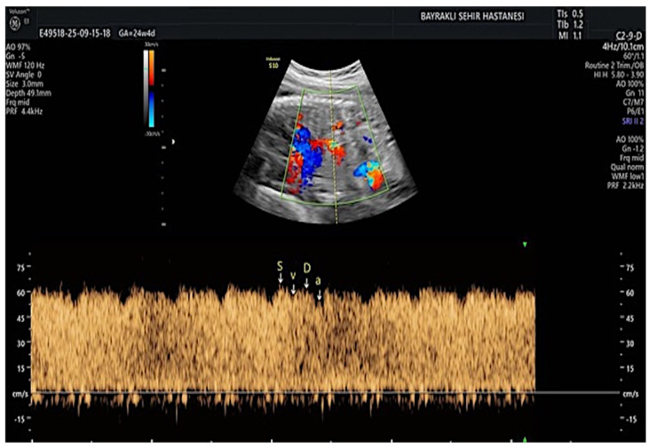
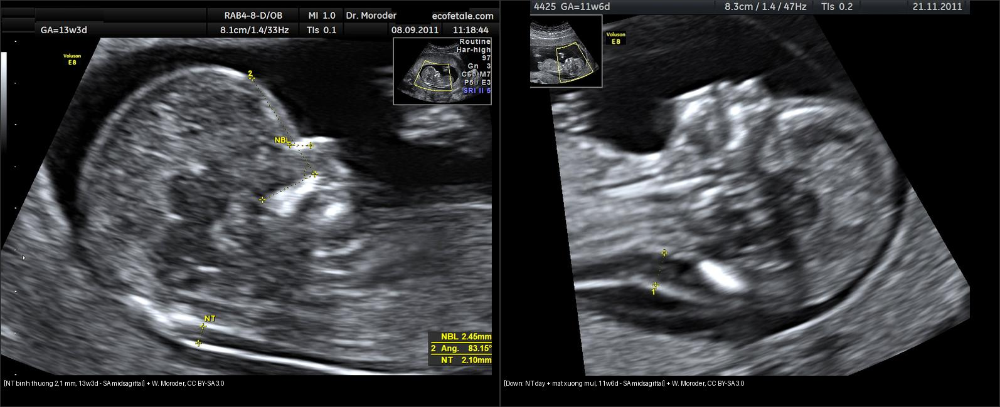
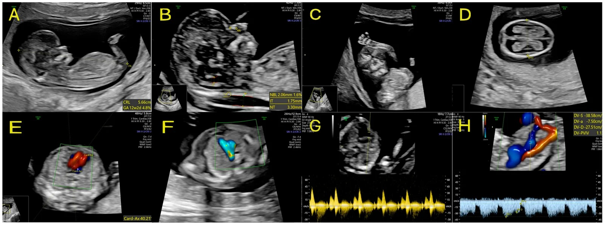
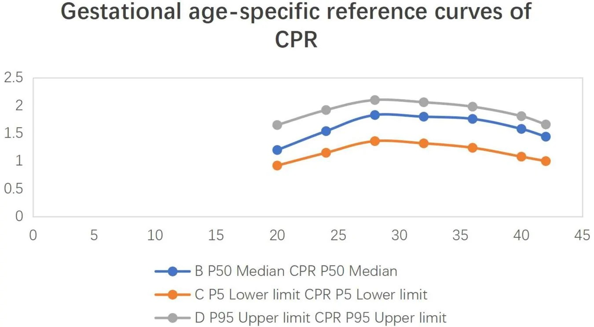
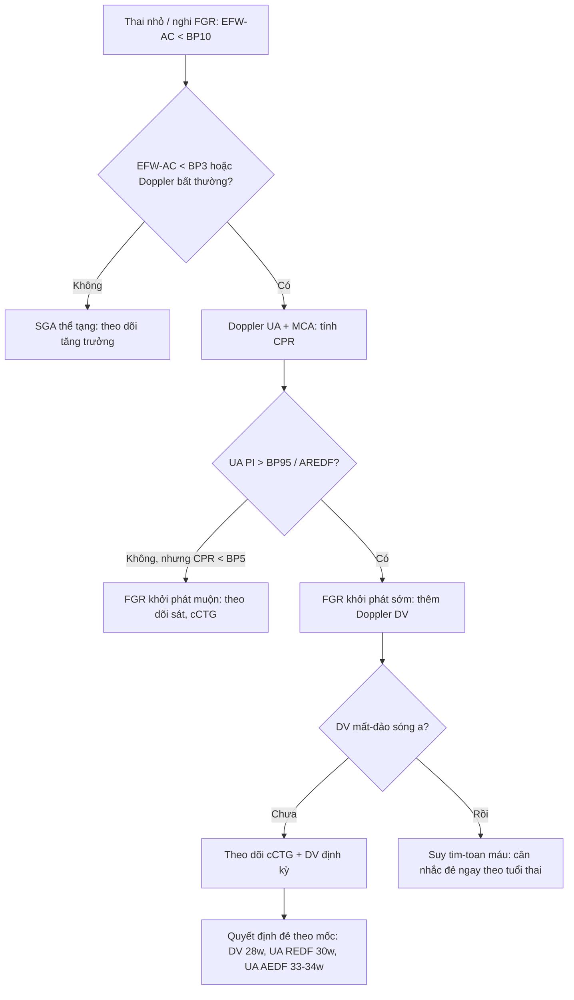
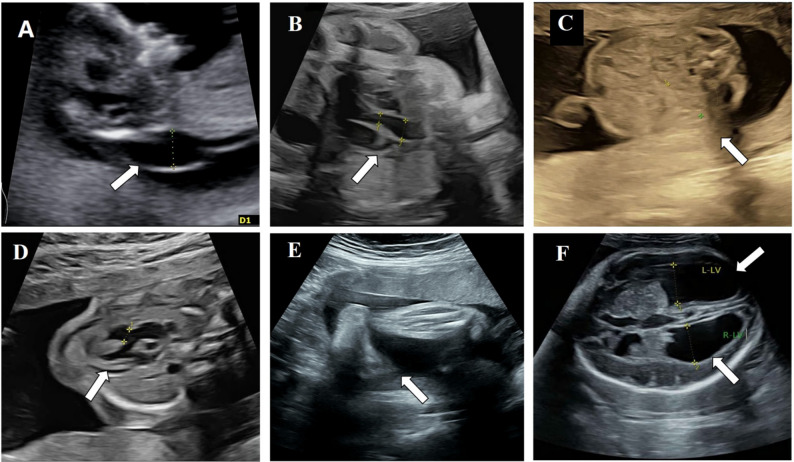
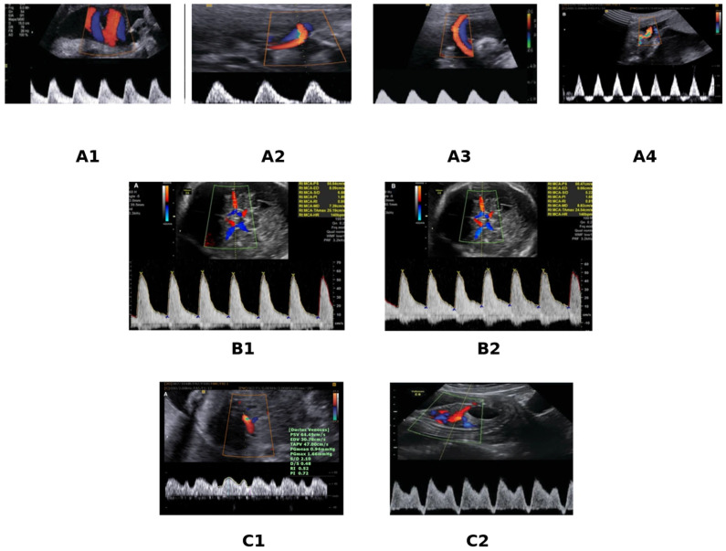
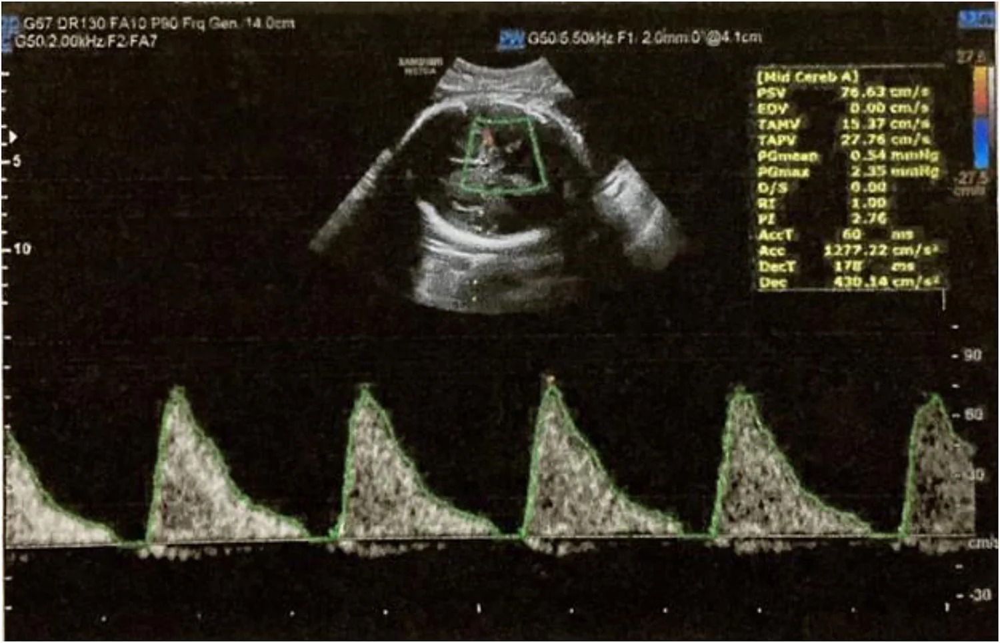

# 565 — Sàng lọc hình thái thai nhi quý I–II & Doppler sản khoa / Fetal morphology screening & obstetric Doppler

**Tags:** `pattern:hinh-thai` `pattern:doppler-san-khoa` `vung:thai-nhi` `score:Delphi-FGR` `protocol:SA-hinh-thai` `protocol:Doppler-san-khoa`
**Mức chắc chắn (certainty):** tổng hợp y văn (literature synthesis) — nhóm tự biên từ các bài tổng quan/ca nguyên văn mở (CC BY) đã kiểm chứng; không phải ca nguyên văn đơn lẻ của nhóm.

## 1. Tổng quan — vật lý Doppler & cơ chế tích tụ dịch sau gáy (giải thích TẠI SAO)

### 1a. Vì sao sóng Doppler "nói" được tình trạng tuần hoàn thai
- Siêu âm Doppler đo **độ lệch tần số (Doppler shift)** do hồng cầu chuyển động; vận tốc đo được **tỷ lệ với cos θ** nên **góc insonation lý tưởng < 30°** (góc > 60° làm sai số vận tốc > 50%). Vì vậy mọi phép đo phải chỉnh cửa sổ/góc, không đọc vận tốc tuyệt đối khi góc xấu.
- **Chỉ số không phụ thuộc góc** mới dùng để so sánh: **PI = (PSV − EDV)/TAMV** (pulsatility index), **RI = (PSV − EDV)/PSV** (resistance index), **S/D**. PI/RI **tăng** khi trở kháng ngoại vi tăng (mất dần dòng cuối tâm trương); **mất dòng cuối tâm trương (AEDF, absent end-diastolic flow)** rồi **đảo dòng (REDF, reversed end-diastolic flow)** là bậc thang nặng dần.
- **Động mạch rốn (UA, umbilical artery):** phản ánh **trở kháng bánh nhau**. Bánh nhau xơ hóa (suy bánh nhau) → tăng trở kháng → UA PI tăng → AEDF → REDF. Đây là **bậc thang tổn thương bánh nhau**, không phải bệnh riêng của dây rốn.
- **Động mạch não giữa (MCA, middle cerebral artery):** khi thiếu oxy, thai **giãn mạch não để bảo vệ não (brain-sparing / dấu hiệu trung tâm hóa tuần hoàn)** → **MCA PI GIẢM** trong khi UA PI tăng. Vì MCA-PI và UA-PI biến đổi **ngược chiều**, tỉ số **CPR = MCA-PI/UA-PI** nhạy hơn từng chỉ số đơn lẻ.
- **Ống tĩnh mạch (DV, ductus venosus):** dòng **3 pha tâm thu (S), tâm trương (D) và pha nhĩ (a)** — pha **a** phản ánh dòng khi **nhĩ phải co**. Suy tim thai → tăng áp lực cuối tâm trương nhĩ phải → **mất / đảo sóng a** = dấu hiệu **toan máu/tim suy**, xuất hiện **sau** khi đã có bất thường động mạch.

*Phổ Doppler ống tĩnh mạch bình thường: 3 đỉnh tâm thu (S), tâm trương (D) và pha nhĩ (a) — mất/đảo sóng a là dấu hiệu suy tim thai/toan máu. Nguồn: Diagnostics, CC BY 4.0 (PMC13205511).*
- **MCA-PSV (peak systolic velocity):** thiếu máu làm **giảm độ nhớt máu + giãn mạch não** → **vận tốc đỉnh TĂNG**. Ngưỡng kinh điển (Mari): **MCA-PSV > 1,5 MoM (multiples of median)** = thiếu máu **trung bình–nặng** → chỉ định chọc ối/truyền máu trong tử cung.
- **Vì sao tăng khoảng sáng sau gáy (NT, nuchal translucency):** NT là **lớp dịch dưới da vùng cổ**, tích tụ do **rối loạn dẫn lưu bạch mạch vùng cổ** và/hoặc **suy tim thai** và/hoặc **thay đổi chất nền ngoại bào (extracellular matrix)**. Vì cùng một cơ chế "ứ dịch" có thể do **thể nhiễm sắc thể, tim bẩm sinh, hội chứng đơn gen, nhiễm trùng bào thai, loạn sản xương** — nên NT dày là dấu hiệu **không đặc hiệu** đòi hỏi sàng lọc tiếp, không phải chẩn đoán.

### 1b. Ngưỡng định lượng bắt buộc (số + phiên bản)
- **Cửa sổ đo NT:** thai **11+0 đến 13+6 tuần**, CRL **45–84 mm** (mặt cắt dọc giữa trung tính). "NT tăng" thường định nghĩa **> bách phân vị 95** hoặc **≥ 3,5 mm**. Với NT **3,0–3,4 mm**, gộp 17 nghiên cứu (7.007 thai): bất thường nhiễm sắc thể **13,1%** (T21 **8,0%**, T18 **1,0%**, T13 **0,52%**); **NT ≥ 5,5 mm** → kết cục bất lợi **83,7%**.
- **Hội chứng Down (T21) trên pha 3 tháng đầu:** kết hợp **NT + free β-hCG + PAPP-A** (combined test, 11–13+6 tuần). Tăng NT (euploid) làm tăng nguy cơ bất thường hệ thần kinh trung ương: gộp **1,16%**, **OR 3,22**.
- **FGR (đồng thuận Delphi 2016):** chẩn đoán khi **EFW hoặc AC < bách phân vị 3**, HOẶC **< bách phân vị 10 kèm Doppler bất thường** (thường UA PI **> bách phân vị 95**). **Khởi phát sớm < 32 tuần** gắn suy bánh nhau/tiền sản giật; **khởi phát muộn ≥ 32 tuần** ít liên quan tiền sản giật, thường bộc lộ qua **CPR**.
- **CPR:** bất thường khi **< bách phân vị 5** (Delphi 2017) hoặc dùng ngưỡng cố định **< 1,0 / < 1,08**. CPR thấp cho **độ nhạy 78,5%, độ đặc hiệu 82,1%** dự đoán suy thai trong chuyển dạ, **OR điều chỉnh 6,82** cho biến cố chu sinh. Giá trị tham chiếu 40 tuần: UA-PI **0,87**, MCA-PI **1,32**, CPR **1,58** (MCA-PI đỉnh lúc **28–32 tuần**).
- **Nguy cơ tử vong thai theo Doppler (gộp):** UA mất dòng **OR 3,59**; UA đảo dòng **OR 7,27**; **DV mất/đảo sóng a OR 11,6**. Với DV bất thường, nguy cơ tử vong thai vượt nguy cơ non tháng **từ 28 tuần**; với UA REDF, **từ 30 tuần**; với UA AEDF, **từ 33–34 tuần**.
- **MCA-PSV:** **> 1,5 MoM** = thiếu máu trung bình–nặng (Mari). Ca minh họa: MCA-PSV **76,6 cm/s ≈ 1,69 MoM**.

## 2. Mẫu hình + chẩn đoán phân biệt theo vị trí (gamut)

### 2a. Quý I (11–13+6 tuần): NT tăng / hình thái sớm
- **Bất thường nhiễm sắc thể:** T21 (NT dày + **mất xương mũi** + dòng chảy ống tĩnh mạch/van ba lá bất thường), T18/T13 (NT rất dày + tim/tay + thoát vị rốn), Turner **45,X** (NT dày ± **nang bạch huyết vùng cổ — cystic hygroma** + hẹp eo động mạch chủ + thận móng ngựa).
- **Tim bẩm sinh** (kể cả khi NST bình thường): NT dày có thể là biểu hiện sớm duy nhất.
- **Hội chứng đơn gen / loạn sản xương / rối loạn chuyển hóa**: NT tăng đơn độc, NST bình thường.
- **Nhiễm trùng bào thai** (parvovirus B19, CMV) — thường kèm phù thai, tràn dịch.
- Sàng lọc quý I mở rộng còn phát hiện **dị tật hình thái chính** ngay từ quý I (~**3,4%** trong một dân số không chọn lọc, theo ISUOG/FMF).

### 2b. Quý II (18–22 tuần): khảo sát hình thái hệ cơ quan
- Bất thường não/hộp sọ, mặt - cổ, ngực - tim, bụng - thành bụng, cột sống, chi, sinh dục - tiết niệu; đo sinh trắc **BPD, HC, AC, FL** để so bách phân vị.
- Đây là thời điểm **chốt** phần lớn dị tật cấu trúc mà quý I bỏ sót.

### 2c. Doppler — gamut theo chỉ số bất thường
- **UA PI tăng / AEDF / REDF** → suy bánh nhau (FGR, tiền sản giật, đái tháo đường nặng, thai già), bánh nhau bám lệch, bệnh lý mẹ nặng.
- **MCA PI giảm (brain-sparing)** → thiếu oxy mạn (FGR), đái tháo đường mẹ, thiếu máu nhẹ; **CPR thấp** = mất cân bằng tuần hoàn, báo động muộn hơn.
- **MCA-PSV tăng > 1,5 MoM** → thiếu máu thai: **đồng miễn dịch Rh**, **parvovirus B19**, **xuất huyết thai-nhi (FMH)**, song thai truyền máu (TAPS).
- **DV mất/đảo sóng a** → suy tim thai/toan máu (thường trong FGR khởi phát sớm), chỉ điểm **đẻ ngay**.
- **Động mạch tử cung (UtA) PI tăng + móc (notching)** → sàng lọc tiền sản giật/FGR phía mẹ (khác hoàn toàn UA/MCA phía thai).

## 3. Bảng so sánh phân biệt (ma trận đối chiếu)

| Thực thể (entity) | Hình ảnh điển hình | Chốt vào (rule-in) | Chốt loại (rule-out) | Gợi ý xác nhận |
|---|---|---|---|---|
| NT tăng do thể nhiễm sắc thể (T21/T18/T13/45,X) | NT ≥ 3,5 mm (hoặc > BP95) ở 11–13+6 tuần; T21: mất xương mũi; 45,X: nang bạch huyết cổ | **NT dày + mất xương mũi + van ba lá/ống tĩnh mạch bất thường** | NT dày đơn độc, xương mũi rõ, NST bình thường → nghĩ nguyên nhân khác | NIPT/cfDNA → sinh thiết gai nhau/karyotype; đo lại NT chuẩn |
| NT tăng do tim bẩm sinh / hội chứng đơn gen (euploid) | NT dày trơ (thường ≥ 3,5 mm) với karyotype bình thường | **NST bình thường + NT ≥ 3,5 mm** → soi tim sớm + microarray/exome | Tìm thấy lệch bội → xếp nhóm NST | Siêu âm tim thai 13–16 tuần; microarray |
| FGR khởi phát sớm (< 32 tuần, suy bánh nhau) | EFW/AC < BP3; **UA PI > BP95 → AEDF → REDF**; sau đó DV bất thường | **UA AREDF + DV PI > BP95 / mất sóng a** + ối ít | UA bình thường + chỉ EFW nhỏ + aneuploidy marker → "SGA" thể tạng, không phải FGR thật | Doppler UA/DV, cCTG (TRUFFLE); cân nhắc corticosteroid |
| FGR khởi phát muộn (≥ 32 tuần) | EFW/AC < BP10; **CPR < BP5 (hoặc < 1,0–1,08)**; UA có thể gần bình thường | **CPR thấp hơn UA/MCA đơn lẻ** + nghiệm pháp dung nạp | Cân nặng mẹ thấp/đa thai thể tạng → "nhỏ sinh lý" | Doppler MCA/UA, theo dõi tăng trưởng |
| Trung tâm hóa tuần hoàn (brain-sparing) | **MCA PI giảm** + **UA PI tăng** (biến đổi ngược chiều) | **CPR = MCA-PI/UA-PI thấp** (mất cân bằng) | Chỉ MCA thấp hoặc chỉ UA cao đơn lẻ — chưa đủ chốt | Đo cặp MCA+UA cùng lúc, tính CPR |
| Thiếu máu thai (đồng miễn dịch Rh, parvovirus, FMH) | **MCA-PSV > 1,5 MoM** (dạng sóng biên độ cao); có thể phù thai, dịch ổ bụng/màng phổi/màng tim | **MCA-PSV > 1,5 MoM** + tiền sử mẹ Rh-âm/kháng thể | MCA-PSV tăng do nhịp nhanh thai hoặc cường giáp mẹ (không phải thiếu máu) | MCA-PSV lặp lại + hiệu giá kháng thể; truyền máu thai nếu nặng |
| Suy tim thai trong FGR | **DV mất/đảo sóng a** (xuất hiện sau bất thường động mạch); phù thai | **DV mất/đảo sóng a** = giai đoạn suy tim/toan máu | Sóng a bình thường → chưa suy tim, theo dõi | Doppler DV + cCTG, cân nhắc đẻ |

*Trái: NT bình thường 2,1 mm (13 tuần 3 ngày). Phải: hội chứng Down (CVS xác nhận T21), 11 tuần 6 ngày — NT dày kèm mất xương mũi. Nguồn: W. Moroder, CC BY-SA 3.0 (Wikimedia Commons). Ảnh ghép letterbox, giữ tỷ lệ.*

## 4. Protocol chụp + hệ phân độ/điểm chuẩn hóa

### 4a. Protocol siêu âm hình thái
- **Quý I (11+0–13+6 tuần, CRL 45–84 mm):** đo **CRL + NT** (mặt cắt dọc giữa trung tính, đầu cổ thẳng), **xương mũi**, **ống tĩnh mạch (DV)** (mặt cắt ngang dưới gan, góc < 30°), **dòng van ba lá (TR)**, khảo sát hình thái sớm theo ISUOG/FMF. Kèm combined test (free β-hCG, PAPP-A) → phân tầng nguy cơ → NIPT/ sinh thiết gai nhau.
- **Quý II (18–22 tuần):** khảo sát hình thái hệ cơ quan đầy đủ + sinh trắc (BPD, HC, AC, FL) so bách phân vị + kênh vú.
- **Đo Doppler đúng kỹ thuật:** **UA** ở **đoạn dây rốn tự do (free loop)** (không đo sát thành bụng/bánh nhau vì PI giả tăng); **MCA** ở **đoạn gần, ~1–2 mm sau nguyên ủy từ động mạch cảnh trong**, góc gần 0°; **DV** mặt cắt ngang dưới gan sau tĩnh mạch rốn; **UtA** qua đường bụng/âm đạo, ghi cả **notching**. Ghi **PI + bách phân vị theo tuần thai**, không dùng ngưỡng tuyệt đối.

*Protocol hình thái quý I (11+0–13+6 tuần): (A) đo CRL, (B) đo NT (1,75 mm) + xương mũi, (C) xương mũi, (D) mặt cắt ngang đầu (đồi thị), (E–F) van ba lá/ống tĩnh mạch, (G–H) phổ Doppler. Nguồn: J Clin Med, CC BY 4.0 (PMC13565941).*

### 4b. Hệ phân độ (grading) & ngưỡng xử trí
- **FGR theo đồng thuận Delphi 2016** (định nghĩa) + **giám sát TRUFFLE** (thời điểm đẻ): các mốc "đẻ ngay" là **bất thường DV (PI > BP95 / mất sóng a)**, **short-term variation cCTG bất thường**, hoặc **nhịp giảm lặp lại**.
- **Nguy cơ tử vong thai theo bậc Doppler** (mục 1b) quyết định ngưỡng tuần: DV mất/đảo sóng a → cân nhắc đẻ từ **28 tuần**; UA REDF → từ **30 tuần**; UA AEDF → **33–34 tuần**.
- **Thiếu máu thai:** dùng **MCA-PSV theo bảng Mari (MoM theo tuần)**, ngưỡng **1,5 MoM**; ≥ 1,5 MoM lặp lại → truyền máu trong tử cung.

*Đường cong tham chiếu CPR theo tuổi thai (P5/P50/P95) — CPR = MCA-PI/UA-PI; bất thường khi < BP5 (hoặc < 1,0–1,08). Nguồn: Front Med, CC BY 4.0 (PMC13559757).*

## 5. Biến thể bình thường và cạm bẫy

- **NT luôn đọc theo bách phân vị tuổi thai, không theo một con số tuyệt đối** — thai nhỏ (CRL < 45 mm) làm NT "trông" khác và các mô hình nguy cơ chuẩn chưa được kiểm định (NT ≥ 2,5 mm ở CRL < 45 mm vẫn có ý nghĩa: bất thường NST ~32% trong một chuỗi).
- **Đo UA sai vị trí:** đo ở **gần bánh nhau/thành bụng** làm PI tăng giả → tưởng FGR nặng; phải đo **đoạn dây tự do**.
- **Đo MCA sai góc:** góc insonation lớn hoặc đo đoạn xa → PSV/PI sai; MCA-PSV phải đo **đoạn gần sau nguyên ủy**, góc gần 0°.
- **Cạm bẫy "sóng a bình thường nhưng vẫn suy"**: bất thường DV xuất hiện **sau** bất thường động mạch — theo dõi tuần tự UA → MCA/CPR → DV, không bỏ qua mốc sớm.
- **CPR dùng ngưỡng cố định vs bách phân vị:** ngưỡng cố định (< 1,0–1,08) nhạy hơn nhưng kém đặc hiệu; **bách phân vị 5 theo tuần** đặc hiệu hơn — ghi rõ đang dùng hệ nào.
- **Tăng MCA-PSV không đồng nghĩa thiếu máu:** nhịp nhanh thai, cường giáp mẹ, hoặc dây rốn quấn cổ thoáng qua đều làm PSV tăng — luôn lặp lại + đặt trong bối cảnh kháng thể mẹ.
- **Nang bạch huyết cổ (cystic hygroma) khác NT dày:** vách ngăn, tiên lượng nặng hơn — đọc kỹ hình thái.

*Turner mosaic (45,X/46,XX): (A) NT dày 3,2 mm, (B) hẹp eo động mạch chủ, kèm bất thường thận — minh họa "NT dày không chỉ do lệch bội đơn thuần". Nguồn: BMC Pregnancy Childbirth, CC BY 4.0 (PMC13483155).*
- **Satisfaction of search:** NT dày dễ khiến bỏ qua **khảo sát hình thái tim/thận/chi** và bỏ sót **hội chứng đơn gen** khi NST bình thường.

## 6. Tự lượng giá — Blind Quiz ngay trên trang tĩnh

**Ca 1 — Thai 11–13 tuần, hai mặt cắt dọc giữa vùng cổ. Nhìn trước, mô tả trước khi mở đáp án.**

- Gợi ý lâm sàng: sàng lọc quý I, đo NT theo chuẩn.
- Câu hỏi: Khác biệt chính giữa hai ảnh? Dấu hiệu phụ nào củng cố chẩn đoán bên phải? Bước tiếp theo?

<b>Bấm để hiện đáp án (findings + chẩn đoán)</b>

- Dấu hiệu: bên trái **NT mỏng bình thường (2,1 mm)**; bên phải **NT dày** kèm **mất xương mũi (NB)**.
- Chẩn đoán: **NT dày nghi hội chứng Down (T21)** — bên phải được xác nhận bằng CVS. Vì mất xương mũi + NT dày là cặp dấu hiệu sàng lọc mạnh cho T21 (NT 3,0–3,4 mm: bất thường NST 13,1%, T21 8,0%).
- Bước tiếp theo: combined test/NIPT → sinh thiết gai nhau + siêu âm tim thai sớm (loại tim bẩm sinh).
- Nguồn ảnh: W. Moroder, CC BY-SA 3.0 (Wikimedia Commons).

**Ca 2 — Doppler tuần hoàn thai ở thai chậm tăng trưởng. Nhìn các panel, mô tả trước.**

- Gợi ý lâm sàng: FGR, theo dõi tuần tự.
- Câu hỏi: Panel A1→A4 minh họa gì? B1/B2 và C1/C2 là mạch nào? Khi nào cần "đẻ ngay"?

<b>Bấm để hiện đáp án (findings + chẩn đoán)</b>

- Dấu hiệu: **A1→A4 = bậc thang động mạch rốn**: dòng cuối tâm trương bình thường → giảm → **mất (AEDF) → đảo (REDF)**. **B1/B2 = động mạch não giữa (MCA, brain-sparing)**, **C1/C2 = ống tĩnh mạch (DV)** với pha a.
- Chẩn đoán: **FGR do suy bánh nhau, tiến triển theo trục UA → MCA/CPR → DV** — bất thường DV (mất/đảo sóng a) là tín hiệu **suy tim/toan máu**, chỉ điểm đẻ ngay (nguy cơ tử vong thai OR 11,6).
- Ghi nhớ mốc: DV bất thường ~28 tuần, UA REDF ~30 tuần, UA AEDF ~33–34 tuần.
- Nguồn ảnh: Open access, CC BY (Diagnostics, PMC12984162).

**Ca 3 — Doppler MCA ở thai có tiền sử mẹ Rh-âm. Nhìn phổ, mô tả trước.**

- Gợi ý lâm sàng: mẹ Rh-âm có kháng thể, theo dõi thiếu máu thai.
- Câu hỏi: Dạng sóng/ biên độ bất thường ở đâu? Ngưỡng quyết định can thiệp?

<b>Bấm để hiện đáp án (findings + chẩn đoán)</b>

- Dấu hiệu: **MCA-PSV tăng cao = 76,6 cm/s ≈ 1,69 MoM**, dạng sóng biên độ cao; các chỉ số hiển thị (RI 1,0; PI 2,76) phù hợp **giãn mạch não + thiếu máu**.
- Chẩn đoán: **thiếu máu thai trung bình–nặng** (ngưỡng **> 1,5 MoM**, Mari) → chỉ định truyền máu trong tử cung; đối chiếu hiệu giá kháng thể Rh.
- Nguồn ảnh: Open access, CC BY (Qatar Med J, PMC13613763).

## Bài liên quan chéo
- [500 – Tổng quan Hệ Vú & Sản Phụ khoa](../500-tong-quan-vu-san-phu-khoa/lesson.md)
- [550 – Thai sớm, sẩy thai & thai ngoài tử cung](../550-thai-som-say-thai-thai-ngoai-tu-cung/lesson.md)
- [560 – Nhau cài răng lược & nhau bong non (PAS)](../560-nhau-cai-rang-luoc-PAS-cap-cuu-san/lesson.md)
- [540 – Lạc nội mạc tử cung sau & viêm vùng chậu (DIE/TOA)](../540-lac-noi-mac-tu-cung-sau-DIE-MRI/lesson.md)
- [655 – HIE sơ sinh & dị tật bẩm sinh hệ thần kinh](../655-hie-so-sinh-va-di-dang-bam-sinh-than-kinh/lesson.md)

## Ảnh
- `images/565_hinh-thai-thai_SA_NT-binh-thuong_Wikimedia-Moroder.jpg` — NT bình thường, W. Moroder, CC BY-SA 3.0.
- `images/565_hinh-thai-thai_SA_NT-day-Down_Wikimedia-Moroder.jpg` — NT dày (T21), W. Moroder, CC BY-SA 3.0.
- `images/565_hinh-thai-thai_SA_quy1-protocol_PMC13565941.jpg` — protocol hình thái quý I, CC BY (JCM PMC13565941).
- `images/565_doppler_SA_UA-MCA-DV-FGR_PMC12984162.jpg` — Doppler tiến triển FGR, CC BY (Diagnostics PMC12984162).
- `images/565_doppler_SA_DV-song_PMC13205511.jpg` — dạng sóng ống tĩnh mạch, CC BY (Diagnostics PMC13205511).
- `images/565_doppler_SA_MCA-PSV-thieu-mau_PMC13613763.jpg` — MCA-PSV thiếu máu, CC BY (Qatar Med J PMC13613763).
- `images/565_doppler_SA_CPR_PMC13559757.jpg` — đường cong CPR, CC BY (Front Med PMC13559757).
- `images/565_hinh-thai-thai_SA_NT-Turner_PMC13483155.jpg` — Turner mosaic (NT dày + dị tật), CC BY (BMC PMC13483155).
- `images/composite_NT-binh-thuong-vs-day.jpg` — ảnh ghép NT bình thường vs dày.
- Nguồn + giấy phép đầy đủ: `images/CREDITS.md`; link gốc: `sources.md`.

> Không dùng để chẩn đoán độc lập khi chưa có người hướng dẫn.
