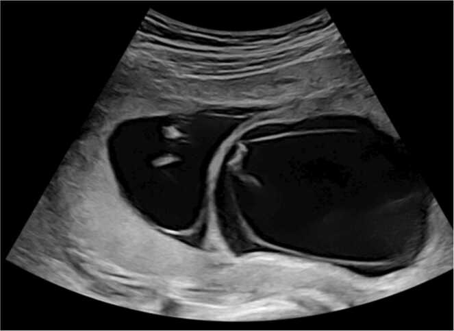
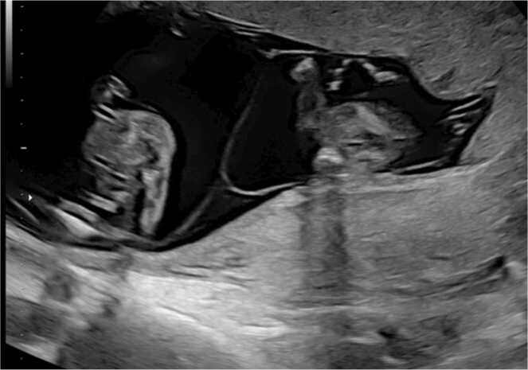
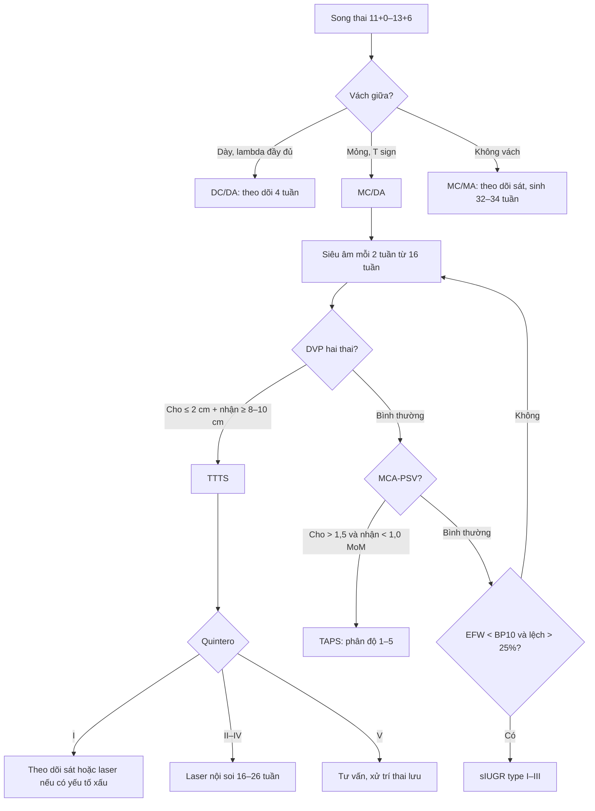
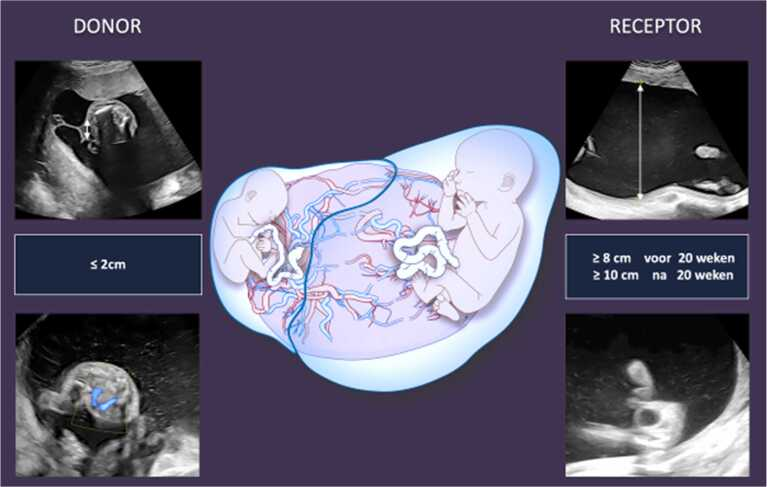
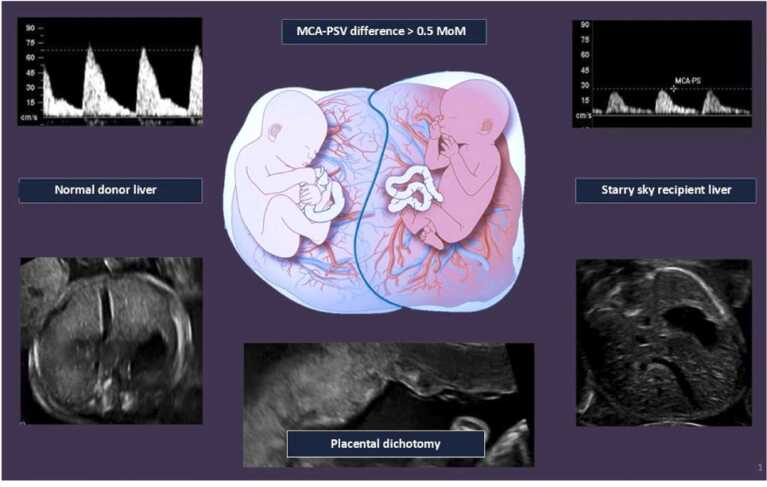
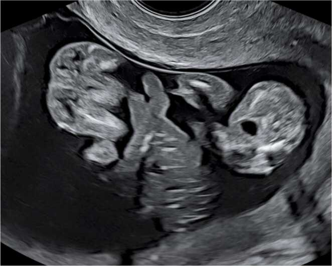
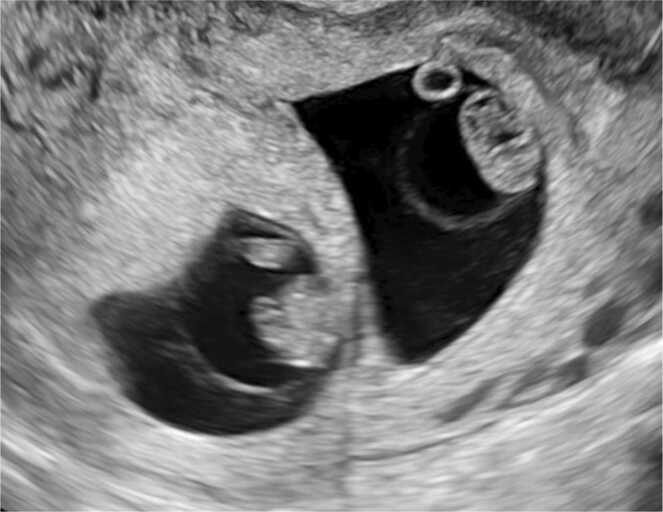

# 566 — Song thai: xác định màng đệm–màng ối & hội chứng truyền máu (TTTS/TAPS)

**Tags:** `pattern:song-thai` `vung:thai-nhi` `vung:banh-nhau` `score:Quintero` `score:TAPS` `protocol:SA-thai` `protocol:Doppler-MCA`
**Mức chắc chắn (certainty):** tổng hợp y văn (literature synthesis) — số liệu lấy từ hướng dẫn VVOG 2025, tiêu chuẩn Quintero và phân độ TAPS; ảnh là hình minh họa từ bài tổng quan có bản quyền mở, không phải ca nguyên văn của nhóm.

## 1. Tổng quan bệnh học – cơ chế hình ảnh

### 1.1. Hai câu hỏi phải trả lời trước mọi thứ khác

1. **Màng đệm (chorionicity):** một bánh nhau (monochorionic, MC) hay hai bánh nhau (dichorionic, DC)?
2. **Màng ối (amnionicity):** hai buồng ối (diamniotic, DA) hay một buồng ối (monoamniotic, MA)?

Hai câu này **không** đồng nghĩa với hợp tử (zygosity):

- **Mọi thai MC đều là một hợp tử (monozygotic)** — vì tách rất muộn, sau khi màng đệm đã hình thành.
- Thai **DC** có thể là hai hợp tử (dizygotic, khoảng 2/3 các ca song thai) **hoặc** một hợp tử tách sớm (khoảng 25–30% cặp sinh đôi một hợp tử là DC).
- Vì vậy **không được suy chorionicity từ giới tính**: hai thai khác giới chắc chắn DC, nhưng hai thai cùng giới có thể DC hoặc MC.

Quy luật phát triển:

- DC **luôn luôn** DA (hai màng đệm, hai màng ối).
- MC có thể DA (MCDA, thường gặp) hoặc MA (MCMA, hiếm, khoảng 1% thai MC).

### 1.2. TẠI SAO màng giữa trông khác nhau trên siêu âm

- **Thai DC:** giữa hai buồng ối có **bốn lớp**: màng ối thai 1 – màng đệm – màng ối thai 2. Màng đệm là mô nuôi (trophoblast) dày, nhiều mạch, nên **hồi âm dày và sáng**. Chỗ màng này cắm vào bánh nhau tạo hình chữ **lambda đầy đủ (full lambda sign / twin peak sign)**.
- **Thai MCDA:** chỉ có **hai lớp màng ối** áp vào nhau, không có màng đệm ở giữa. Màng rất mỏng, cắm vào bánh nhau tạo hình **chữ T (T sign)** — còn gọi là **lambda rỗng (empty lambda sign)**.
- **Thai MCMA:** không có vách giữa; hai thai nằm chung một buồng ối.

Vì sao phải làm **trước 13 tuần 6 ngày**: ở tuổi thai này màng ối và màng đệm còn tách biệt, nhìn được rõ thành phần. Sau 13+6 tuần, hai màng áp sát và mỏng dần; ở cặp cùng giới, phân biệt DC với MC **thường không thể chắc chắn**. Trước 11 tuần, cách đọc lại dựa vào **số túi thai và khoang màng đệm (exocoelomic cavity)**: DC có hai túi riêng, mỗi thai và túi noãn hoàng trong một khoang; MC có một túi chung.

**Cạm bẫy vật lý:** số **bánh nhau** không đáng tin (bánh nhau MC có thể hai thùy — bilobed), số **túi noãn hoàng** cũng không đáng tin cho amnionicity. Chỉ có **toàn bộ vách giữa** mới là tiêu chuẩn.

### 1.3. Vì sao MC nguy hiểm: nối mạch máu bánh nhau

Thai MC dùng chung một bánh nhau và có các **nối mạch (anastomoses)**:

- **Động mạch–động mạch (A-A)** và **tĩnh mạch–tĩnh mạch (V-V)**: thường cân bằng.
- **Động mạch–tĩnh mạch (A-V)**: máu từ động mạch của thai cho chảy qua bánh nhau sang tĩnh mạch của thai nhận — **không cân bằng**.

Hệ quả:

- **TTTS (twin-to-twin transfusion syndrome):** truyền máu **thể tích** qua các nối A-V lớn, không cân bằng → thai cho (donor) thiểu thể tích, thiểu ối, bàng quang xẹp; thai nhận (recipient) quá tải thể tích, đa ối, bàng quang căng, suy tim, phù.
- **TAPS (twin anemia-polycythemia sequence):** chỉ có các nối **rất nhỏ**, truyền **hồng cầu chậm** → thai cho thiếu máu, thai nhận đa hồng cầu, **lượng ối có thể bình thường**. Vì vậy TAPS **không loại trừ được bằng ối bình thường**.
- **sIUGR (selective fetal growth restriction):** chia sẻ bánh nhau không đều → một thai < bách phân vị 10, chênh cân nặng > 25%.

### 1.4. Cơ chế vật lý của các dấu hiệu Doppler

- **MCA-PSV (peak systolic velocity động mạch não giữa):** khi thiếu máu, độ quánh máu giảm và cung lượng tim bù trừ tăng → **tốc độ đỉnh tăng**. Khi đa hồng cầu, độ quánh tăng → **tốc độ đỉnh giảm**. Đây là lý do MCA-PSV dùng để chẩn đoán TAPS mà không cần lấy máu thai.
- **Bánh nhau hai màu (placental dichotomy):** phần bánh của thai cho thiếu máu nên **sáng hơn**; phần của thai nhận ứ máu nên **tối hơn**.
- **Gan "trời sao" (starry sky liver) ở thai nhận:** gan ứ máu, nhu mô gan tối, các tiểu tĩnh mạch còn sáng lấm tấm.

### 1.5. Ngưỡng định lượng phải nhớ

- **Tỷ lệ MC:** ~**20%** tổng số song thai — nhóm nguy cơ cao.
- **TTTS:** **1/10** thai MC, thường **16–26 tuần** — cấp cứu sản khoa.
- **TAPS:** **~1/20** thai MC, thường **sau 26 tuần** — dễ bỏ sót vì ối bình thường.
- **Thai chết một bên trong MC:** **50%** thai còn lại chết, **35%** tổn thương não.
- **Sinh đủ tháng:** DC **37+0–37+6**; MC **36+0–36+6**.
- **Cổ tử cung:** **≤ 25 mm** trước 24 tuần là ngưỡng nguy cơ sinh non.

## 2. Mẫu hình + chẩn đoán phân biệt theo vị trí (gamut)

### 2.1. Mẫu hình theo tuổi thai

- **< 8 tuần:** đếm túi thai và khoang màng đệm. Hai túi riêng → DC. Một túi chung → MC (nhưng **chưa xác định được amnionicity** vì màng ối chưa hiện rõ trước 8 tuần).
- **8–10 tuần:** màng ối bắt đầu thấy; đếm túi noãn hoàng **chỉ để tham khảo**, không dùng để chốt amnionicity.
- **11+0–13+6 tuần:** thời điểm chuẩn — nhìn **toàn bộ vách giữa** từ bánh nhau đến thành tử cung:
  - **Lambda đầy đủ** → DC/DA.
  - **T sign** → MC/DA.
  - **Không có vách** → MC/MA.
- **> 14 tuần:** dùng giới tính, hình thái, nhưng ở cặp cùng giới **không được đoán DC/MC**; chuyển trung tâm chuyên sâu.

### 2.2. Gamut "một ối nhiều, một ối ít" ở song thai

1. **TTTS** — bắt buộc có chuỗi thiểu ối/đa ối, bàng quang hai thai lệch nhau.
2. **sIUGR** — thường ối bình thường hoặc thai nhỏ thiểu ối nhẹ, **không có chuỗi đa ối ở thai lớn**.
3. **TAPS** — ối bình thường; chìa khóa là **MCA-PSV lệch**.
4. **Đa ối đơn thuần (isolated polyhydramnios)** — bàng quang hai thai đều thấy, không thiểu ối bên kia.
5. **Vỡ ối non (PPROM)** — bệnh sử rỉ ối, màng ối tách khỏi thành tử cung, có thể thấy "màng treo".
6. **Dị tật cấu trúc** — teo thực quản, không sọ, thoát vị hoành gây đa ối một bên.
7. **Đái tháo đường mẹ** — đa ối hai bên, không lệch bàng quang.

### 2.3. Gamut "chênh cân nặng" ở song thai

- **sIUGR** (MC hoặc DC): EFW < bách phân vị 10 + chênh > 25%.
- **TTTS:** chênh cân nặng thường có nhưng **không bắt buộc**; chẩn đoán dựa vào ối.
- **TAPS:** cân nặng có thể gần bằng nhau.
- **Bất thường nhiễm sắc thể ở một thai:** chênh cân nặng + dị tật/dấu hiệu mềm.
- **Nhiễm trùng bào thai (CMV, toxoplasma):** chênh cân nặng + canxi hóa não, gan lách to.
- **Bánh nhau bám thấp/thiểu sản một phần:** chênh cân nặng đơn thuần.

### 2.4. Gamut "một thai chết trong tử cung"

- **MC:** thai còn lại có thể **mất máu cấp vào tuần hoàn thai chết** → chết (50%) hoặc tổn thương não (35%). Cần đánh giá MCA-PSV ngay và MRI não sau 2–3 tuần.
- **DC:** nguy cơ cho thai còn lại chủ yếu do sinh non/tiền sản giật, không do truyền máu cấp.
- **TRAP (twin reversed arterial perfusion):** thai không có tim (acardiac) được nuôi ngược dòng bởi thai bình thường; Doppler thấy dòng **đảo chiều** trong động mạch rốn của khối acardiac.

## 3. Bảng so sánh phân biệt (ma trận đối chiếu)

| Thực thể (entity) | Hình ảnh điển hình (US) | Chốt vào (rule-in) | Chốt loại (rule-out) | Gợi ý xác nhận |
|---|---|---|---|---|
| **Song thai DC/DA** | Vách dày 4 lớp, **lambda đầy đủ**, hai bánh nhau (không bắt buộc) | **Lambda đầy đủ + vách dày, thấy màng đệm giữa hai màng ối** | Vách chỉ 2 lá mỏng, T sign → MC | Quét toàn bộ vách 11+0–13+6; transvaginal nếu khó |
| **Song thai MC/DA** | Vách mỏng 2 lá, **T sign**, một bánh nhau | **T sign + một bánh nhau + cùng giới** | Vách dày có màng đệm → DC | Theo dõi 2 tuần/lần từ 16 tuần |
| **Song thai MC/MA** | **Không vách**, hai thai một buồng ối, dây rốn quấn nhau | **Không thấy vách giữa trên mọi mặt cắt** | Có vách mảnh → MCDA | Transvaginal xác nhận; theo dõi như MA |
| **TTTS** | Thai cho: DVP **≤ 2 cm**, bàng quang xẹp; thai nhận: DVP **≥ 8 cm** (< 20 tuần) hoặc **≥ 10 cm** (≥ 20 tuần), bàng quang căng, có thể phù | **Chuỗi thiểu ối + đa ối + bàng quang lệch** | Hai ối bình thường, bàng quang đều thấy → không TTTS | Quintero; Doppler UA, DV, MCA |
| **TAPS** | Ối bình thường; **bánh nhau hai màu**, gan thai nhận "trời sao" | **MCA-PSV cho > 1,5 MoM và nhận < 1,0 MoM** (hoặc chênh > 1,0 MoM) | MCA-PSV hai thai bình thường → loại TAPS | Doppler MCA-PSV; xét nghiệm máu rốn sau sinh |
| **sIUGR** | Một thai nhỏ, ối thường bình thường; Doppler UA thay đổi theo type | **EFW < bách phân vị 10 + chênh > 25%** | Hai thai tăng trưởng đều, Doppler bình thường | Phân type I–III theo UA |
| **MCMA** | Không vách, dây rốn quấn, nguy cơ chèn ép dây rốn | **Không vách + dây rốn quấn** | Có vách → MCDA | Theo dõi sát, sinh 32–34 tuần |

### 3.1. Ảnh minh họa vách giữa

*Lambda đầy đủ (full lambda sign) ở thai DC khoảng 12 tuần: vách dày, có lớp màng đệm sáng ở giữa. Nguồn: Heijden SV et al., Eur J Obstet Gynecol Reprod Biol X 2025 (PMC12304725), CC BY-NC-ND 4.0 — nguyên bản, không cắt/ghép.*

*T sign (lambda rỗng) ở thai MCDA 13 tuần: vách chỉ gồm hai lá màng ối mỏng, cắm vuông góc vào bánh nhau. Nguồn: Heijden SV et al., PMC12304725, CC BY-NC-ND 4.0 — nguyên bản.*

### 3.2. Dấu hiệu chốt trong 3 giây

- **Vách dày + chữ lambda = DC.** **Vách mỏng + chữ T = MC.**
- **Không vách = MA.**
- **Thiểu ối/đa ối = TTTS.** **MCA-PSV lệch = TAPS.** **EFW lệch = sIUGR.**

## 4. Protocol chụp + hệ phân độ/điểm chuẩn hóa

### 4.1. Protocol

- **Lần 1 (11+0–13+6 tuần):** xác định chorionicity/amnionicity, đánh dấu thai A/B theo vị trí, đo CRL thai lớn nhất (thai tự nhiên), NT, xương mũi, ống tĩnh mạch, hồi lưu van ba lá, hình thái sớm.
- **Thai DC không biến chứng:** siêu âm **12, 16, 20, 24, 28, 32, 34, 36 tuần**.
- **Thai MC không biến chứng:** siêu âm **mỗi 2 tuần từ 16 tuần**; mỗi lần đo DVP, bàng quang, Doppler động mạch rốn, MCA-PSV, ống tĩnh mạch, EFW, cổ tử cung.
- **Đo cổ tử cung transvaginal 18–24 tuần**, ngưỡng **≤ 25 mm**.
- **Khi nghi TTTS/TAPS:** chuyển trung tâm có khả năng laser; đánh giá nhau, dây rốn, tim thai, phù, cổ tử cung.

### 4.2. Phân độ Quintero (TTTS)

| Giai đoạn | Tiêu chuẩn |
|---|---|
| **I** | DVP **≤ 2 cm** ở thai cho và **≥ 8 cm** (< 20 tuần) hoặc **≥ 10 cm** (≥ 20 tuần) ở thai nhận; **bàng quang thai cho còn thấy** |
| **II** | **Bàng quang thai cho không thấy** |
| **III** | Doppler bất thường: **UA mất/đảo cuối tâm trương**, **DV đảo sóng a**, **tĩnh mạch rốn đập** |
| **IV** | **Phù thai** |
| **V** | **Một hoặc hai thai tử vong** |

### 4.3. Phân độ TAPS (Slaghekke)

| Giai đoạn | Tiêu chuẩn |
|---|---|
| **1** | MCA-PSV thai cho **> 1,5 MoM** và thai nhận **< 1,0 MoM** (hoặc chênh **> 1,0 MoM**), không dấu hiệu khác |
| **2** | MCA-PSV thai cho **> 1,7 MoM** |
| **3** | MCA-PSV thai cho **> 2,0 MoM** |
| **4** | **Phù thai** |
| **5** | **Tử vong** |

- Hướng dẫn VVOG 2025 dùng thêm tiêu chuẩn **chênh MCA-PSV ≥ 0,5 MoM** kèm **bánh nhau hai màu** và/hoặc **gan "trời sao"** ở thai nhận.
- TAPS có thể xuất hiện **sau laser TTTS** (khoảng 13–16%), nên vẫn phải theo dõi MCA-PSV sau điều trị.

### 4.4. Phân type sIUGR (Gratacós)

- **Type I:** Doppler động mạch rốn bình thường.
- **Type II:** UA **mất cuối tâm trương (AEDF)** liên tục.
- **Type III:** UA **mất/đảo cuối tâm trương từng lúc (iAREDF)** — nguy cơ thai lưu đột ngột, cần theo dõi sát.

### 4.5. Điều trị và thời điểm sinh

- **TTTS Quintero II–IV:** **laser đốt nối mạch** là điều trị chuẩn, tốt nhất **16–26 tuần**. Sống cả hai thai **~65%**, sống ít nhất một thai **~85%**.
- **TTTS Quintero I:** theo dõi sát; cân nhắc laser nếu cổ tử cung **≤ 25 mm**, đa ối gây khó thở, phù, Doppler bất thường.
- **TAPS:** giai đoạn 1 theo dõi; giai đoạn 2–4 cân nhắc **truyền máu trong tử cung (IUT)**, laser hoặc sinh tùy tuổi thai.
- **MCMA:** theo dõi sát, **sinh 32–34 tuần** sau corticosteroid.
- **Thai MC không biến chứng:** sinh **36+0–36+6**; **DC:** **37+0–37+6**.
- **Một thai chết trong MC:** đánh giá cấp cứu thai còn lại (MCA-PSV, tim, não); MRI não sau 2–3 tuần.

## 5. Biến thể bình thường và cạm bẫy

- **Đếm bánh nhau:** bánh nhau MC có thể **hai thùy**, trông như hai bánh → đừng chẩn đoán DC chỉ vì "hai bánh".
- **Đếm túi noãn hoàng:** MCDA thường có **hai túi noãn hoàng**; thấy hai túi **không** loại trừ MC.
- **T sign giả:** nếu vách DC rất mỏng hoặc cắt không vuông góc, màng đệm có thể bị che → luôn quét **toàn bộ vách**, dùng đầu dò tần số cao/transvaginal khi nghi ngờ.
- **Lambda giả:** túi ối phụ hoặc màng ối tách rời có thể tạo hình chữ lambda không thật.
- **Sau 13+6 tuần ở cặp cùng giới:** không được chốt DC/MC bằng mắt thường; chuyển chuyên gia.
- **TTTS vs sIUGR:** sIUGR **không có** chuỗi đa ối/thiểu ối điển hình; ngược lại TTTS có thể kèm sIUGR (thể phối hợp) — đừng bỏ qua Doppler UA.
- **TAPS với ối bình thường:** đây là cạm bẫy lớn nhất; phải đo **MCA-PSV** mỗi lần theo dõi MC, kể cả khi ối bình thường.
- **PPROM giả thiểu ối:** hỏi bệnh sử rỉ ối, tìm màng ối tách khỏi thành tử cung; đừng chẩn đoán TTTS khi chỉ có một bên thiểu ối.
- **Đa ối đơn thuần:** bàng quang hai thai đều thấy, không có chuỗi thiểu ối → không phải TTTS.
- **MCMA:** dây rốn quấn nhau là **bình thường**, không đồng nghĩa suy thai; theo dõi bằng Doppler và tim thai.
- **Thai chết một bên:** đừng chỉ khám thai còn lại bằng tim thai; phải đo MCA-PSV và đánh giá não.

## 6. Tự lượng giá — Blind Quiz

**Ca 1 — Thai 12 tuần, hai thai cùng giới, ảnh mặt cắt qua vách giữa:**

- Gợi ý: không có bất thường ối, không có chênh cân nặng.
- Hỏi: Vách giữa gồm mấy lớp? Chẩn đoán chorionicity? Kế hoạch theo dõi?

<b>Bấm để hiện đáp án (findings + chẩn đoán)</b>

- **Findings:** vách giữa **dày**, thấy lớp màng đệm sáng ở giữa, cắm vào bánh nhau tạo **lambda đầy đủ**.
- **Chẩn đoán:** song thai **DC/DA** (hai bánh nhau, hai buồng ối).
- **Vì sao:** vách 4 lớp (amnion–chorion–amnion) → màng đệm còn giữa hai màng ối; đây là dấu hiệu chốt của DC ở 11+0–13+6 tuần.
- **Theo dõi:** DC không biến chứng — siêu âm 12, 16, 20, 24, 28, 32, 34, 36 tuần; sinh 37+0–37+6.
- Nguồn ảnh: Heijden SV et al., Eur J Obstet Gynecol Reprod Biol X 2025 (PMC12304725), CC BY-NC-ND 4.0.

**Ca 2 — Thai 13 tuần, hai thai cùng giới, vách giữa rất mỏng:**

- Gợi ý: một bánh nhau, không thấy màng đệm giữa hai màng ối.
- Hỏi: Chẩn đoán? Nguy cơ chính? Lịch theo dõi?

<b>Bấm để hiện đáp án (findings + chẩn đoán)</b>

- **Findings:** vách chỉ gồm **hai lá màng ối mỏng**, cắm vuông góc vào bánh nhau (**T sign**); một bánh nhau.
- **Chẩn đoán:** song thai **MC/DA**.
- **Nguy cơ:** TTTS (~1/10), TAPS (~1/20), sIUGR, dị tật, thai lưu một bên (nguy cơ cho thai còn lại 50% chết, 35% tổn thương não).
- **Theo dõi:** siêu âm **mỗi 2 tuần từ 16 tuần**, đo DVP, bàng quang, UA, MCA-PSV, DV, EFW; sinh 36+0–36+6.
- Nguồn ảnh: Heijden SV et al., PMC12304725, CC BY-NC-ND 4.0.

**Ca 3 — Thai 22 tuần, MC, một thai thiểu ối nặng, thai kia đa ối:**

- Gợi ý: bàng quang thai cho không thấy; Doppler UA bình thường.
- Hỏi: Chẩn đoán? Phân độ? Điều trị?

<b>Bấm để hiện đáp án (findings + chẩn đoán)</b>

- **Findings:** thai cho (donor) DVP **≤ 2 cm**, bàng quang **không thấy**; thai nhận (recipient) DVP **≥ 10 cm** (sau 20 tuần), bàng quang căng.
- **Chẩn đoán:** **TTTS Quintero II** (có chuỗi ối + bàng quang cho không thấy, chưa có Doppler bất thường).
- **Điều trị:** **laser đốt nối mạch** (16–26 tuần) là lựa chọn chuẩn cho giai đoạn II–IV; chuyển trung tâm chuyên sâu.
- **Vì sao:** nối A-V không cân bằng → giảm thể tích tuần hoàn thai cho (thiểu ối, bàng quang xẹp), tăng thể tích thai nhận (đa ối).
- Nguồn ảnh: Heijden SV et al., PMC12304725, CC BY-NC-ND 4.0.

**Ca 4 — Thai 30 tuần, MC, ối bình thường, Doppler MCA:**

- Gợi ý: không thiểu ối, không đa ối; một thai nhợt, một thai đỏ.
- Hỏi: Dấu hiệu chốt? Chẩn đoán? Vì sao ối bình thường không loại trừ?

<b>Bấm để hiện đáp án (findings + chẩn đoán)</b>

- **Findings:** MCA-PSV thai cho **> 1,5 MoM**, thai nhận **< 1,0 MoM** (chênh > 1,0 MoM); **bánh nhau hai màu** (phần cho sáng, phần nhận tối); gan thai nhận **"trời sao"**.
- **Chẩn đoán:** **TAPS** (twin anemia-polycythemia sequence).
- **Vì sao ối bình thường:** nối mạch trong TAPS rất nhỏ, chỉ truyền hồng cầu từ từ — không gây lệch thể tích/ối như TTTS.
- **Xử trí:** phân độ 1–5; giai đoạn 1 theo dõi, giai đoạn 2–4 cân nhắc IUT/laser/sinh tùy tuổi thai.
- Nguồn ảnh: Heijden SV et al., PMC12304725, CC BY-NC-ND 4.0.

**Ca 5 — Thai 13 tuần, không thấy vách giữa, hai dây rốn quấn nhau:**

- Gợi ý: một bánh nhau, một buồng ối.
- Hỏi: Chẩn đoán? Nguy cơ? Thời điểm sinh?

<b>Bấm để hiện đáp án (findings + chẩn đoán)</b>

- **Findings:** **không có vách giữa** trên mọi mặt cắt; hai thai trong một buồng ối; dây rốn quấn nhau.
- **Chẩn đoán:** song thai **MC/MA**.
- **Nguy cơ:** chèn ép dây rốn, thai lưu đột ngột, sinh non; dây rốn quấn là bình thường nhưng cần theo dõi sát.
- **Xử trí:** theo dõi chuyên sâu, corticosteroid, **sinh 32–34 tuần**.
- Nguồn ảnh: Heijden SV et al., PMC12304725, CC BY-NC-ND 4.0.

**Ca 6 — Thai 9 tuần, hai túi thai riêng:**

<b>Bấm để hiện đáp án</b>

- **Findings:** hai túi thai riêng, mỗi thai và túi noãn hoàng trong một khoang màng đệm riêng.
- **Chẩn đoán:** **DC/DA** — nhưng vẫn phải xác nhận lại bằng vách giữa ở 11+0–13+6 tuần.
- Nguồn ảnh: Heijden SV et al., PMC12304725, CC BY-NC-ND 4.0.

## Bài liên quan chéo
- [500 – Tổng quan Hệ Vú & Sản Phụ khoa](../500-tong-quan-vu-san-phu-khoa/lesson.md)
- [550 – Thai sớm, sẩy thai & thai ngoài tử cung](../550-thai-som-say-thai-thai-ngoai-tu-cung/lesson.md)
- [560 – Nhau cài răng lược & nhau bong non](../560-nhau-cai-rang-luoc-PAS-cap-cuu-san/lesson.md)
- [565 – Sàng lọc hình thái thai & Doppler sản khoa](../565-sang-loc-hinh-thai-va-doppler-san-khoa/lesson.md)
- [567 – Sàng lọc lệch bội: NIPT & dấu hiệu mềm](../567-sang-loc-lech-boi-NIPT-dau-hieu-mem/lesson.md)

> Không dùng để chẩn đoán độc lập khi chưa có người hướng dẫn.
