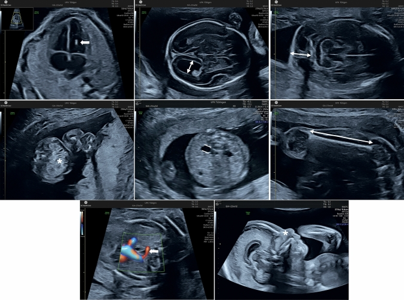
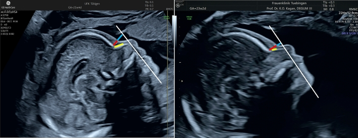
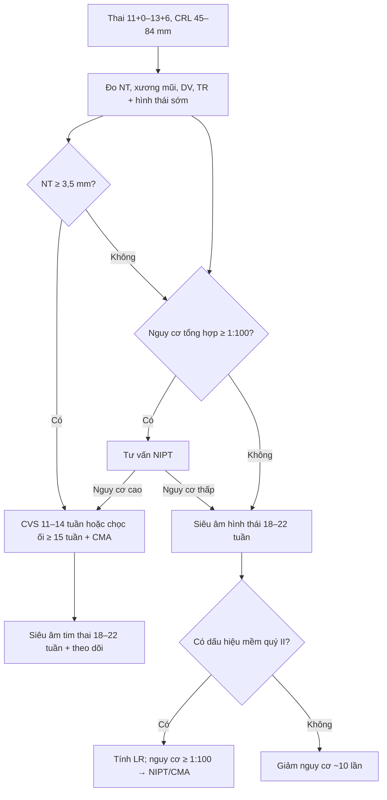
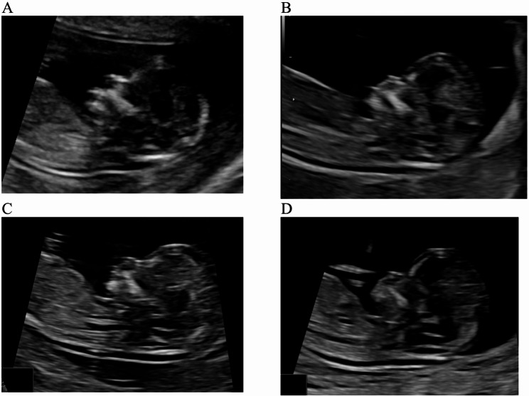

# 567 — Sàng lọc lệch bội: NIPT vs xét nghiệm phối hợp quý I & dấu hiệu mềm quý II

**Tags:** `pattern:lech-boi` `vung:thai-nhi` `score:LR-dau-hieu-mem` `protocol:NIPT` `protocol:SA-hinh-thai`
**Mức chắc chắn (certainty):** tổng hợp y văn (literature synthesis) — bảng likelihood ratio lấy từ tổng quan Kagan 2025 (Arch Gynecol Obstet), số liệu NT lấy từ phân tích gộp Carta 2026; không phải ca nguyên văn.

## 1. Tổng quan bệnh học – cơ chế hình ảnh

### 1.1. Ba tầng sàng lọc, một nguyên tắc

- **Sàng lọc (screening)** chỉ trả lời "nguy cơ cao hay thấp"; **chẩn đoán (diagnostic)** mới khẳng định — chỉ có **CVS (sinh thiết gai nhau)** hoặc **chọc ối (amniocentesis)** kèm nhiễm sắc thể đồ/CMA.
- Ba tầng: **xét nghiệm phối hợp quý I (combined first-trimester screening, cFTS)**, **cfDNA/NIPT**, và **siêu âm dấu hiệu mềm quý II (second-trimester soft markers)**.
- Nguyên tắc: **không có xét nghiệm nào thay thế được siêu âm hình thái**. NIPT âm tính không loại trừ dị tật cấu trúc, bất thường gen đơn, hay bất thường vi mất đoạn/vi lặp đoạn (copy-number variant, CNV) — những thứ NIPT thường không phát hiện.

### 1.2. TẠI SAO NIPT hoạt động: sinh học của cfDNA

- Trong thai kỳ, tế bào nuôi (trophoblast) chết theo chương trình và giải phóng **DNA tự do (cell-free DNA, cfDNA)** vào máu mẹ. Phần DNA có nguồn gốc thai gọi là **phân đoạn thai (fetal fraction)**.
- Phân đoạn thai thường **≥ 4%** mới đủ tin cậy; **< 4%** gây **no-call** (không có kết quả) — hay gặp ở mẹ béo phì, thai nhỏ, lấy máu quá sớm.
- cfDNA có **thời gian bán hủy rất ngắn (vài phút)**, nên sau sinh hoặc sau thai lưu sẽ biến mất nhanh — nhưng **thai biến mất (vanishing twin)** có thể để lại tín hiệu gây **dương tính giả**.
- Vì cfDNA chủ yếu đến từ **bánh nhau**, hiện tượng **khảm bánh nhau (confined placental mosaicism)** có thể gây bất đồng giữa NIPT và thai nhi.

### 1.3. TẠI SAO các dấu hiệu mềm xuất hiện

- **NT dày (increased nuchal translucency):** tích tụ dịch dưới da vùng gáy do **suy tim sớm/loạn sản mạch bạch huyết** — gặp trong lệch bội, dị tật tim, loạn sản xương, hội chứng gen (Noonan), nhiễm trùng, hoặc thai bình thường.
- **Mất xương mũi (absent/hypoplastic nasal bone):** quá trình **cốt hóa xương mũi chậm** ở thai T21 (liên quan con đường tín hiệu xương); đây là lý do xương mũi chỉ là **dấu hiệu mềm**, không phải chẩn đoán.
- **Nếp gáy dày (thickened nuchal fold):** phù dưới da vùng chẩm-gáy ở quý II; ngưỡng **≥ 6 mm**.
- **Ruột tăng hồi âm (echogenic bowel):** hồi âm ruột **≥ xương lân cận**; gặp trong T21, xơ nang (CF), nhiễm trùng bào thai, chảy máu trong ối, chậm tăng trưởng.
- **Giãn bể thận nhẹ (mild pyelectasis):** ứ nước nhẹ, không đặc hiệu cho lệch bội; ngưỡng quý II **4–7 mm**.
- **Động mạch dưới đòn phải lạc chỗ (aberrant right subclavian artery, ARSA):** mạch máu xuất phát cuối cung ĐMC và đi sau thực quản; thấy rõ trên mặt cắt **3 mạch máu–khí quản (3VT)** có Doppler màu.

### 1.4. Ngưỡng định lượng phải nhớ

- **cFTS:** làm ở **11+0–13+6 tuần**, CRL **45–84 mm**; gồm tuổi mẹ + NT + **free β-hCG** + **PAPP-A**. Phát hiện T21 khoảng **85–90%** ở tỷ lệ dương tính giả **5%** (NICE/ACOG).
- **NIPT:** làm từ **10 tuần**; phát hiện T21 khoảng **98–99%**, dương tính giả **< 0,1%** (Kagan 2025: DR ~98%, FPR < 0,1%; các phân tích gộp lớn hơn báo cáo T21 ~99,7%).
- **Quadruple test quý II:** AFP, hCG, uE3, inhibin A; phát hiện khoảng **80%** ở FPR 5%.
- **NT:** **≥ 3,5 mm** là ngưỡng mời **chẩn đoán xâm lấn** (CVS/chọc ối + CMA) và **siêu âm tim thai 18–22 tuần** dù NIPT âm tính.
- **NT 3,0–3,4 mm:** vẫn có **13,1%** bất thường nhiễm sắc thể, **2,5%** CNV gây bệnh, **5,7%** bệnh gen đơn (Carta 2026, 17 nghiên cứu, 7.007 thai) — **không được xem là "bình thường"**.
- **Một dấu hiệu mềm** có mặt ở **69,1%** thai T21 và **11,9%** thai euploid (Agathokleous).
- **Ngưỡng nguy cơ cao:** **1:100**; nếu không có dấu hiệu mềm nào, nguy cơ giảm khoảng **10 lần** (tích các âm LR ≈ 0,096).

## 2. Mẫu hình + chẩn đoán phân biệt theo vị trí (gamut)

### 2.1. Mẫu hình theo tầng sàng lọc

- **Quý I (11+0–13+6):** NT dày, mất/ngắn xương mũi, ống tĩnh mạch đảo sóng a, hồi lưu van ba lá — gợi ý T21/T18/T13, Turner, Noonan.
- **Quý II (18–22 tuần):** nếp gáy ≥ 6 mm, giãn não thất ≥ 10 mm, mất xương mũi, ARSA, ruột tăng hồi âm, giãn bể thận, xương đùi/xương cánh tay ngắn, ổ tăng hồi âm trong tim.
- **NIPT:** không thấy hình ảnh — chỉ trả kết quả nguy cơ; **luôn đặt trong bối cảnh siêu âm**.

### 2.2. Gamut "NT dày"

1. **Lệch bội** — T21, T18, T13, Turner (45,X), tam bội.
2. **Dị tật tim bẩm sinh** — hẹp eo ĐMC, hẹp van ĐMC, tứ chứng Fallot.
3. **Loạn sản xương** — loạn sản sụn, loạn sản xương gây chết.
4. **Hội chứng gen** — Noonan, Smith-Lemli-Opitz, các bệnh gen đơn.
5. **Nhiễm trùng bào thai** — parvovirus B19, CMV.
6. **Song thai** — NT có thể cao sinh lý ở một thai.
7. **Biến thể bình thường** — NT 3,0–3,4 mm ở thai euploid vẫn có thể bình thường nhưng cần theo dõi.

### 2.3. Gamut "dấu hiệu mềm quý II"

- **Đầu–mặt:** nếp gáy dày, mất/ngắn xương mũi, đầu dẹt (brachycephaly), tăng độ dày trước mũi (pre nasal thickness).
- **Não:** giãn não thất nhẹ ≥ 10 mm, giảm sản thể chai.
- **Tim:** ổ tăng hồi âm trong thất, tràn dịch màng tim, hở van.
- **Bụng:** ruột tăng hồi âm, giãn bể thận, nang rốn.
- **Xương:** đùi/cánh tay ngắn, ngón út cong (clinodactyly), khe hở giữa ngón 1–2 (sandal gap).
- **Mạch:** ARSA, giãn tĩnh mạch rốn.

### 2.4. Gamut "dấu hiệu mềm + bất thường cấu trúc"

- **Nhiễm sắc thể:** T21, T18, T13, Turner, tam bội.
- **CNV gây bệnh (pCNV):** vi mất đoạn/vi lặp đoạn — NIPT thường bỏ sót, cần **CMA**.
- **Bệnh gen đơn:** Noonan, xơ nang, loạn sản xương.
- **Nhiễm trùng:** CMV, parvovirus B19, toxoplasma.
- **Nguyên nhân ngoài di truyền:** chảy máu trong ối, nhau bám bất thường, chậm tăng trưởng.

## 3. Bảng so sánh phân biệt (ma trận đối chiếu)

### 3.1. So sánh các chiến lược sàng lọc

| Chiến lược | Thời điểm / cách làm | Chốt vào (rule-in) | Chốt loại (rule-out) | Gợi ý xác nhận |
|---|---|---|---|---|
| **cFTS** | 11+0–13+6 tuần; NT + free β-hCG + PAPP-A + tuổi mẹ | Nguy cơ **≥ 1:100** → mời NIPT/chẩn đoán | Nguy cơ thấp **< 1:1000** và siêu âm bình thường | NIPT hoặc CVS/chọc ối nếu nguy cơ cao |
| **NIPT (cfDNA)** | Từ **10 tuần**, sau siêu âm quý I bình thường | Nguy cơ cao với T21/T18/T13 | Kết quả thấp **không** loại trừ CNV, bệnh gen đơn, dị tật cấu trúc | Chẩn đoán xâm lấn khi dương tính; theo dõi nếu âm tính |
| **Quadruple test** | 15–20 tuần; AFP, hCG, uE3, inhibin A | Nguy cơ **≥ 1:100** | Nguy cơ thấp | NIPT/CMA nếu nguy cơ cao |
| **Siêu âm dấu hiệu mềm** | 18–22 tuần (nếp gáy 15–22 tuần) | **≥ 1 dấu hiệu có LR dương đáng kể** (nếp gáy, giãn não thất, ARSA, mất xương mũi) | Không có dấu hiệu nào → giảm nguy cơ ~10 lần | Tính LR; NIPT/CMA nếu nguy cơ sau test ≥ 1:100 |
| **Chẩn đoán xâm lấn** | CVS **11–14 tuần**; chọc ối **≥ 15 tuần** | Karyotype/CMA khẳng định | Karyotype/CMA bình thường loại trừ lệch bội lớn | CMA khi có dị tật cấu trúc/NT ≥ 3,5 mm |

### 3.2. Ma trận dấu hiệu mềm quý II (theo Agathokleous, qua Kagan 2025)

| Dấu hiệu (marker) | Ngưỡng / cách đo | T21 (%) | Euploid (%) | LR dương | Chốt vào (rule-in) | Chốt loại (rule-out) |
|---|---|---|---|---|---|---|
| **Ổ tăng hồi âm trong tim (ICEF)** | Hồi âm **≥ xương**, thường thất trái | 24,4 | 3,9 | 5,83 | **LR đơn độc 0,94** → gần như không đổi nguy cơ | Không có ICEF không loại trừ T21 |
| **Giãn não thất (ventriculomegaly)** | **≥ 10 mm** (đo sừng sau) | 7,5 | 0,2 | 27,52 | **LR đơn độc 3,81** + cần MRI/CMA | Não thất bình thường giảm nhẹ nguy cơ |
| **Nếp gáy dày (thickened nuchal fold)** | **≥ 6 mm**, mặt cắt ngang có CSP, đồi thị, tiểu não | 26,0 | 1,0 | 23,30 | **LR đơn độc 3,79** | Nếp gáy < 6 mm loại trừ marker này |
| **Ruột tăng hồi âm (echogenic bowel)** | Hồi âm **≥ xương**, giảm gain | 16,7 | 1,1 | 11,44 | **LR đơn độc 1,65** — kèm CF/nhiễm trùng/chảy máu | Ruột hồi âm bình thường |
| **Giãn bể thận nhẹ (pyelectasis)** | **4–7 mm** quý II | 13,9 | 1,7 | 7,63 | **LR đơn độc 1,08** — không đủ mạnh một mình | Bể thận < 4 mm |
| **Xương cánh tay ngắn (short humerus)** | **≤ 0,89–0,92 MoM** | 30,3 | 4,6 | 4,81 | **LR đơn độc 0,78** | Chiều dài bình thường |
| **Xương đùi ngắn (short femur)** | **≤ 0,88–0,93 MoM** hoặc < BP5 | 27,7 | 6,4 | 3,72 | **LR đơn độc 0,61** | Chiều dài bình thường |
| **ARSA** | Mặt cắt **3VT** + Doppler màu, nhánh cuối cung ĐMC | 30,7 | 1,5 | 21,48 | **LR đơn độc 3,94** | Không thấy ARSA trên 3VT |
| **Mất/giảm sản xương mũi** | Mặt cắt giữa dọc; ngưỡng **2,5 mm** quý II | 59,8 | 2,8 | 23,27 | **LR đơn độc 6,58** — mạnh nhất trong nhóm | Xương mũi bình thường |

- **Đọc đúng:** LR dương **1,5–5** = tăng nguy cơ nhẹ; **5–10** = trung bình; **≥ 10** = mạnh. Nhưng **LR đơn độc** (khi các marker khác đều âm) mới là con số dùng để quyết định — và chỉ **giãn não thất, nếp gáy, ARSA, mất xương mũi** làm thay đổi nguy cơ đáng kể.
- **Nếu không có marker nào:** nhân các âm LR (0,80 × 0,94 × 0,80 × 0,90 × 0,92 × 0,74 × 0,80 × 0,71 × 0,46 ≈ **0,096**) → nguy cơ còn khoảng **1/10** nguy cơ trước test.

### 3.3. Ảnh minh họa

*Các dấu hiệu mềm: hàng trên — ổ tăng hồi âm thất trái (mũi tên), giãn não thất nhẹ (mũi tên đôi), nếp gáy dày (mũi tên đôi); hàng giữa — ruột tăng hồi âm (dấu *), giãn bể thận nhẹ (hai đường), xương đùi/cánh tay ngắn (mũi tên đôi); hàng dưới — ARSA (mũi tên), mất xương mũi (dấu *). Nguồn: Kagan KO, Hoopmann M, Sonek J, Arch Gynecol Obstet 2025 (PMC12033118), CC BY-NC-ND 4.0 — nguyên bản, không cắt/ghép.*

*Đo độ dày trước mũi (PT, đường đỏ) và chiều dài xương mũi (NBL, đường vàng); thai T21 có PT tăng, NBL ngắn, tỷ lệ PT/NBL tăng. Nguồn: Kagan KO et al., PMC12033118, CC BY-NC-ND 4.0 — nguyên bản.*

## 4. Protocol chụp + hệ phân độ/điểm chuẩn hóa

### 4.1. Protocol siêu âm quý I (11+0–13+6 tuần, CRL 45–84 mm)

- **Mặt cắt giữa dọc (mid-sagittal):** đo **NT** ở điểm rộng nhất, caliper đặt **mép trong–mép trong**, cổ trung gian, đầu trung lập; tách màng ối khỏi da gáy.
- **Xương mũi:** mặt cắt giữa dọc, góc ~45°, phóng to đủ; ghi **có/không có**, chiều dài nếu đo.
- **Ống tĩnh mạch (ductus venosus):** sóng a **đảo/mất** là bất thường.
- **Hồi lưu van ba lá:** TR ≥ 60 cm/s là bất thường.
- **Hình thái sớm:** sọ, mặt, cột sống, tim, thành bụng, chi, bánh nhau, ối.

### 4.2. Protocol quý II (18–22 tuần)

- **Nếp gáy:** mặt cắt ngang đầu qua **CSP, đồi thị, tiểu não**; đo từ xương chẩm đến da, ngưỡng **≥ 6 mm**.
- **Não thất bên:** đo **sừng sau (atrium)**; **≥ 10 mm** = giãn.
- **Bể thận:** mặt cắt ngang qua thận; **4–7 mm** quý II.
- **Ruột:** đánh giá khi **giảm gain**; so với xương.
- **Tim:** 4 buồng, đường ra, **3VT** tìm ARSA.
- **Xương:** đo đùi, cánh tay, so với tuổi thai (MoM).

### 4.3. Tính nguy cơ và ngưỡng xử trí

- Nguy cơ sau test = **nguy cơ trước test × LR** của từng marker (dương nếu có, âm nếu không có).
- **Ngưỡng 1:100** thường dùng để định nghĩa nguy cơ cao và mời chẩn đoán.
- **Ví dụ:** thai 20 tuần, nguy cơ trước test 1:1000, chỉ có **ICEF** (LR 5,83) nhưng các marker khác âm → tích LR ≈ **0,95** → nguy cơ gần như **không đổi (1:1000)**. Ngược lại, chỉ có **nếp gáy dày** (LR đơn độc 3,79) → nguy cơ tăng lên khoảng **1:264**; nếu kèm ARSA hoặc mất xương mũi, nguy cơ tăng mạnh hơn.

### 4.4. Khi nào chọn NIPT, khi nào đi thẳng chẩn đoán?

- **NIPT trước:** thai bình thường trên siêu âm, không có chỉ định chẩn đoán ngay; **ở song thai, NIPT là sàng lọc chính xác nhất cho T21** và được ưu tiên sau siêu âm quý I bình thường (VVOG 2025).
- **Đi thẳng CVS/chọc ối + CMA:** NT **≥ 3,5 mm**, dị tật cấu trúc, tiền sử con bất thường nhiễm sắc thể, bố/mẹ mang chuyển đoạn, hoặc NIPT dương tính.
- **CMA thay karyotype** khi có dị tật cấu trúc hoặc NT dày, vì CMA phát hiện thêm **CNV** mà karyotype bỏ sót.
- **Không dùng NIPT để tầm soát vi mất đoạn/vi lặp đoạn thường quy** — độ chính xác thấp, nhiều dương tính giả.

## 5. Biến thể bình thường và cạm bẫy

- **ICEF đơn độc:** LR đơn độc **0,94** — **không** chỉ định chọc ối, không siêu âm tim thai, không theo dõi thêm. Đây là biến thể bình thường, đặc biệt ở thai Á (tới 30%).
- **Giãn bể thận nhẹ đơn độc:** LR **1,08** — không đổi xử trí về lệch bội, nhưng vẫn cần siêu âm lại quý III vì nguy cơ bệnh thận sau sinh (11,9% với mức nhẹ).
- **Xương đùi/cánh tay ngắn đơn độc:** LR **0,61/0,78** — thường do thể tạng/di truyền, không phải lệch bội; nhưng nếu ngắn < BP5 kèm chậm tăng trưởng, nghĩ loạn sản xương.
- **Mất xương mũi:** có thể gặp ở **1–3% thai euploid**, khác biệt theo dân tộc; đo sai mặt cắt (không giữa dọc, đầu ngửa/ gập) là nguyên nhân dương tính giả hàng đầu.
- **NT dày:** đo sai vị trí (caliper ngoài–ngoài), để màng ối dính vào da, đầu không trung gian, CRL ngoài 45–84 mm → sai số lớn.
- **Nếp gáy quý II ≠ NT quý I:** hai ngưỡng khác nhau (6 mm vs 3,5 mm), hai thời điểm khác nhau; không dùng lẫn.
- **NIPT âm tính không loại trừ:** CNV, bệnh gen đơn, dị tật cấu trúc, lệch bội thai ở song thai (phân đoạn thai thấp hơn), khảm bánh nhau.
- **NIPT dương tính giả:** thai biến mất, truyền máu mẹ–thai, ung thư mẹ, khảm bánh nhau; luôn xác nhận bằng chẩn đoán xâm lấn.
- **No-call:** phân đoạn thai **< 4%**; hẹn lấy lại sau 1–2 tuần, không kết luận nguy cơ thấp.
- **Sau NIPT bình thường vẫn phải làm siêu âm hình thái** — đây là điểm hay bị bỏ qua trong tư vấn.
- **Song thai:** NIPT có thể không phân biệt được thai nào bị ảnh hưởng; kết quả dương tính cần chẩn đoán xâm lấn và xác định thai.

## 6. Tự lượng giá — Blind Quiz

**Ca 1 — Thai 20 tuần, siêu âm hình thái có nhiều dấu hiệu:**

- Gợi ý: ảnh là bảng tổng hợp, không phải một thai.
- Hỏi: Kể tên 4 dấu hiệu mềm trong ảnh. Dấu hiệu nào **đơn độc** làm tăng nguy cơ T21 đáng kể, dấu hiệu nào **không**?

<b>Bấm để hiện đáp án (findings + chẩn đoán)</b>

- **Các dấu hiệu:** ổ tăng hồi âm trong thất trái; giãn não thất nhẹ; nếp gáy dày; ruột tăng hồi âm; giãn bể thận nhẹ; xương đùi/cánh tay ngắn; ARSA; mất xương mũi.
- **Làm tăng nguy cơ khi đơn độc:** giãn não thất (LR 3,81), nếp gáy dày (3,79), ARSA (3,94), mất xương mũi (6,58).
- **Không đổi nguy cơ khi đơn độc:** ICEF (0,94), giãn bể thận (1,08), xương đùi ngắn (0,61), xương cánh tay ngắn (0,78); ruột tăng hồi âm chỉ 1,65.
- **Vì sao:** khi các marker khác đều âm, tích các âm LR gần 1,0 sẽ "hủy" LR dương của marker yếu.
- Nguồn ảnh: Kagan KO et al., Arch Gynecol Obstet 2025 (PMC12033118), CC BY-NC-ND 4.0.

**Ca 2 — Thai 12 tuần 5 ngày, đánh giá xương mũi:**

*Bốn mức hồi âm xương mũi: A > da, B = da, C < da, D không thấy. Nguồn: Song WL et al., BMC Pregnancy Childbirth 2025 (PMC12777233), CC BY-NC-ND 4.0 — nguyên bản.*

- Hỏi: Hình nào là **mất xương mũi**? Có phải chẩn đoán T21 không? Bước tiếp theo?

<b>Bấm để hiện đáp án (findings + chẩn đoán)</b>

- **Findings:** **D** — không thấy hồi âm xương mũi; A là bình thường (hồi âm xương mũi cao hơn da), B/C là trung gian.
- **Chẩn đoán:** **mất xương mũi** — dấu hiệu mềm, không phải chẩn đoán T21.
- **Bước tiếp theo:** tính nguy cơ tổng hợp (kết hợp NT, tuổi mẹ, sinh hóa); nếu nguy cơ **≥ 1:100** → NIPT hoặc CVS/chọc ối + CMA. Nếu NIPT đã âm tính trước đó, mất xương mũi đơn độc vẫn có thể xem xét CMA sau tư vấn.
- Nguồn ảnh: Song WL et al., BMC Pregnancy Childbirth 2025 (PMC12777233), CC BY-NC-ND 4.0.

**Ca 3 — Hai thai 22 tuần, so sánh mặt nghiêng:**

- Hỏi: Bên nào là T21? Dấu hiệu nào giúp phân biệt? Tỷ lệ nào có giá trị nhất?

<b>Bấm để hiện đáp án (findings + chẩn đoán)</b>

- **Findings:** bên **phải** là T21: **độ dày trước mũi (PT) tăng**, **xương mũi ngắn**, **tỷ lệ PT/NBL tăng**, khoảng trước trán (prefrontal space) hẹp.
- **Dấu hiệu:** đường đỏ = PT, đường vàng = NBL; tỷ lệ **PT/NBL** có độ phát hiện cao nhất (~**86,2%** ở FPR 5%, theo Vos), so với NBL đơn thuần (~61,9%) và PT (~63,4%).
- **Lưu ý:** đây là dấu hiệu hỗ trợ, không thay thế xét nghiệm di truyền.
- Nguồn ảnh: Kagan KO et al., PMC12033118, CC BY-NC-ND 4.0.

**Ca 4 — Thai 12 tuần 3 ngày, NT 3,2 mm, NIPT âm tính. Mẹ hỏi "vậy là an toàn chưa?"**

<b>Bấm để hiện đáp án (findings + chẩn đoán)</b>

- **Findings:** NT **3,0–3,4 mm** nằm trong vùng **không bình thường** dù dưới ngưỡng 3,5 mm.
- **Chẩn đoán:** cần tư vấn nguy cơ **13,1%** bất thường nhiễm sắc thể, **2,5%** CNV gây bệnh, **5,7%** bệnh gen đơn trong nhóm NT 3,0–3,4 mm (Carta 2026); NIPT âm tính **không loại trừ** các bất thường này.
- **Xử trí:** siêu âm hình thái sớm + **siêu âm tim thai 18–22 tuần**; tư vấn **CMA** (CVS 11–14 tuần hoặc chọc ối ≥ 15 tuần); theo dõi tăng trưởng.
- **Vì sao:** NIPT chủ yếu phát hiện lệch bội toàn thể; CNV và bệnh gen đơn cần CMA/panel gen.

## Bài liên quan chéo
- [500 – Tổng quan Hệ Vú & Sản Phụ khoa](../500-tong-quan-vu-san-phu-khoa/lesson.md)
- [550 – Thai sớm, sẩy thai & thai ngoài tử cung](../550-thai-som-say-thai-thai-ngoai-tu-cung/lesson.md)
- [565 – Sàng lọc hình thái thai & Doppler sản khoa](../565-sang-loc-hinh-thai-va-doppler-san-khoa/lesson.md)
- [566 – Song thai: chorionicity, TTTS & TAPS](../566-song-thai-chorionicity-TTTS-TAPS/lesson.md)

> Không dùng để chẩn đoán độc lập khi chưa có người hướng dẫn.
