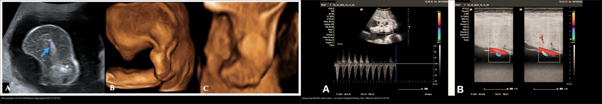
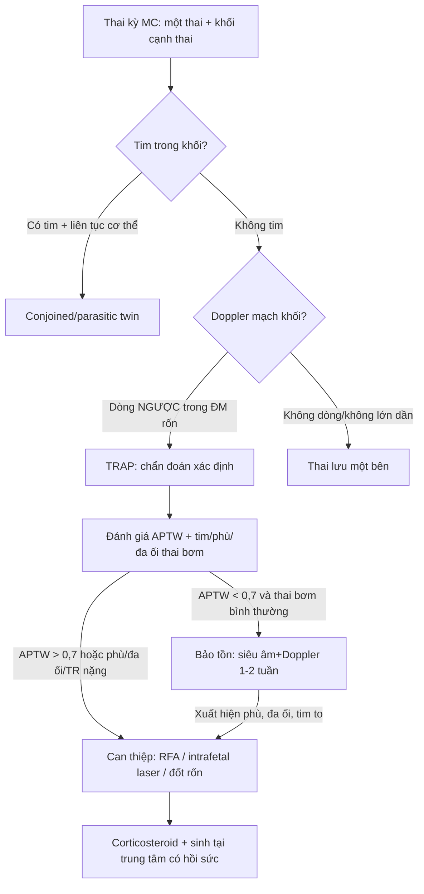
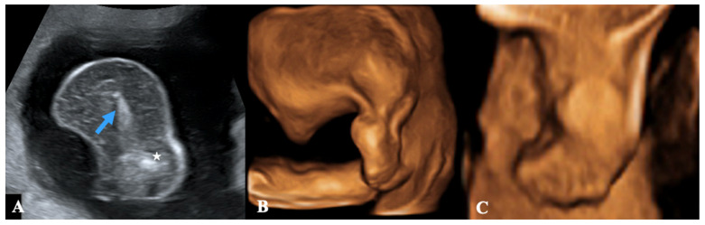
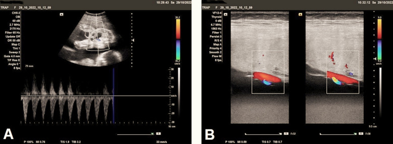
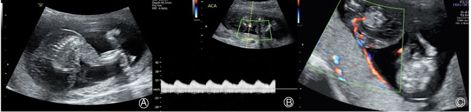
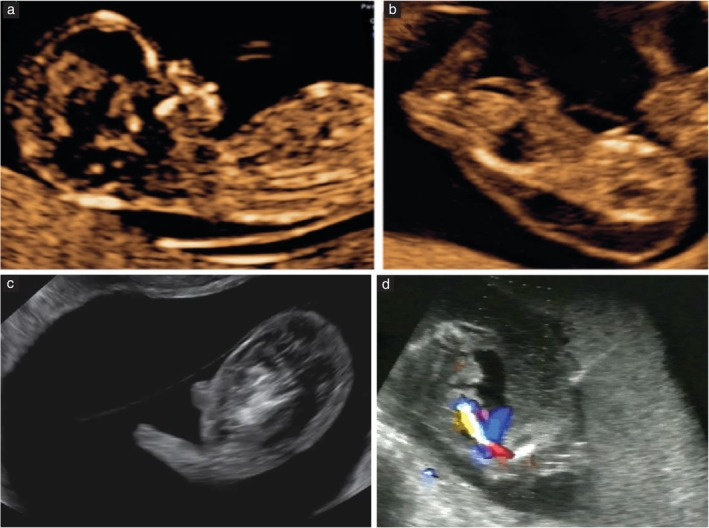
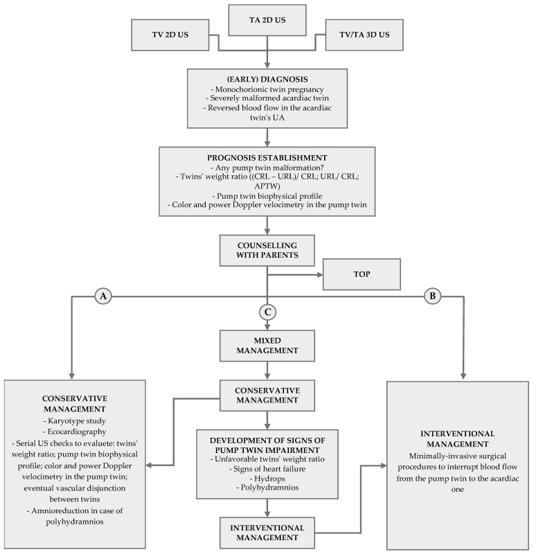

# 568 — TRAP: song thai đảo ngược tưới máu động mạch & thai acardiac / Twin Reversed Arterial Perfusion

**Tags:** `pattern:song-thai` `pattern:acardiac` `pattern:dong-chay-nguoc` `vung:thai-nhi` `vung:banh-nhau` `score:APTW` `protocol:Doppler-ron` `protocol:RFA-thai`
**Mức chắc chắn (certainty):** tổng hợp y văn (literature synthesis) — số liệu lấy từ hướng dẫn ISUOG 2025 (PMC11788470), tổng quan Int J Womens Health 2020 (PMC7266514), ca nguyên văn Diagnostics 2023 (PMC10572342) và các ca báo cáo CC BY/BY-NC-ND; **ca nguyên văn (verbatim case) dùng cho quiz** ghi rõ Fig/PMCID.

## 1. Tổng quan bệnh học – cơ chế hình ảnh

### 1.1. TRAP là gì: một "cái bơm" nuôi một "vật ký sinh"

- **TRAP (twin reversed arterial perfusion sequence) — còn gọi thai acardiac (acardiac twin / acardius):** trong một thai kỳ **một bánh nhau (monochorionic, MC)**, một thai **không có tim hoạt động** (khối acardiac) sống nhờ thai kia (**thai bơm — pump twin**) tưới máu **ngược dòng**.
- Nối mạch là chìa khóa: trên mặt bánh nhau có các nối **động mạch–động mạch (arterio-arterial, A-A)** — và có khi thêm **tĩnh mạch–tĩnh mạch (veno-venous, V-V)** — thường qua một **chỗ bám rốn chung** (ISUOG 2025).
- **TẠI SAO gọi là "đảo ngược" (reversed):** máu từ **động mạch rốn** của thai bơm, qua nối A-A, chảy **ngược vào động mạch rốn của khối acardiac**, đi nuôi khối này rồi quay về thai bơm qua nối V-V. Vì máu đến khối acardiac đã **mất oxy** (máu từ động mạch "đã dùng"), khối phát triển **từ dưới lên**: phần **dưới (chậu, chi dưới) hình thành trước và tốt**, phần **trên (đầu, ngực, tim) thiếu/hỏng** — đó là cơ sở phân loại thể acardiac.
- **TẠI SAO thai bơm suy:** thai bơm phải gánh **cả hai vòng tuần hoàn** → **tăng cung lượng (hyperdynamic) → suy tim cung lượng cao** → phù thai (hydrops), đa ối, chuyển dạ/sinh non, thai lưu. Đồng thời khối acardiac thường **to hơn thai bơm** gây **căng quá mức tử cung** → dọa sinh non, vỡ ối non.

### 1.2. Ngưỡng định lượng phải nhớ (theo Argon, cửa 1)

- **Tần suất:** TRAP chiếm **~2,5% song thai một bánh nhau (MC)** và **~1/15.000 thai kỳ nói chung** (ISUOG 2025). Các tổng quan gần đây ghi **~2,6% song thai một hợp tử** và **1/9.500–11.000 thai kỳ** (PMC7266514, van Gemert) — con số đang **tăng nhẹ** do chẩn đoán siêu âm tốt hơn và hỗ trợ sinh sản.
- **Tiên lượng:** thai acardiac tử vong **~100%**; thai bơm tử vong chu sinh **~50–55%** nếu **không** can thiệp (PMC7266514); quản lý bảo tồn, nguy cơ thai bơm tử vong **tới ~30% trước 18 tuần** (ISUOG 2025).
- **Tỷ lệ cân nặng acardiac/thai bơm (APTW — acardiac-to-pump twin weight ratio), theo Moore:**
  - **APTW > 0,7:** sinh non **90%**, đa ối **40%**, suy tim **30%**.
  - **APTW < 0,7:** sinh non **75%**, đa ối **30%**, suy tim **10%** (PMC10572342).
- **Sinh non < 32 tuần** trong TRAP ~**10%** (ISUOG 2025).
- **Sau can thiệp RFA** (radiofrequency ablation — đốt sóng cao tần): sống sơ sinh **~85% (75/88 thai kỳ)**; biến chứng hay gặp nhất là **vỡ ối non (pPROM) ~22% (19/85)** (PMC7266514).
- **Phát triển thần kinh sau RFA:** trung vị thương số phát triển **DQ 111 (80–150)**, tỷ lệ chậm phát triển thần kinh **NDD 0% (0/27 trẻ)** (PMC9291518, Ozawa).

## 2. Mẫu hình + chẩn đoán phân biệt theo vị trí (gamut)

### 2.1. Mẫu hình cốt lõi: "một thai bình thường + một khối cạnh thai trong một buồng ối"

- **Dấu hiệu chốt trên siêu âm:** một thai có tim đập bình thường; cạnh đó là **khối mô dị dạng** không có tim, **không có đầu/ngực** rõ hoặc chỉ có chi dưới; **Doppler màu thấy dòng chảy** trong khối, và **spectral Doppler chứng minh dòng NGƯỢC** trong động mạch rốn/động mạch chậu của khối.
- **Bối cảnh bắt buộc:** thai kỳ **MC** (phải xác định màng đệm–màng ối trước — xem [bài 566](../566-song-thai-chorionicity-TTTS-TAPS/lesson.md)); TRAP gặp cả MA (monoamniotic) lẫn DA (diamniotic).
- **Thể giải phẫu của khối acardiac (4 thể, PMC10572342):**
  - **Acardius acephalus** — **thường gặp nhất**: chậu và chi dưới phát triển, **thiếu đầu và cơ quan ngực**, chi trên có thể có/không.
  - **Acardius anceps** — **phát triển nhất**: có cả chi trên + chi dưới, có đầu/mặt nhưng **dị dạng**.
  - **Acardius amorphus** — **thể ít phát triển nhất**: khối vô định hình, **không phân biệt được cơ quan/chi**.
  - **Acardius acormus** — **hiếm nhất**: **chỉ có đầu** là cơ quan nhận diện được.

### 2.2. Gamut "khối/mô bất thường nằm cạnh một thai bình thường"

1. **TRAP (acardiac)** — luôn có **dòng chảy ngược** trong mạch khối.
2. **Thai lưu một bên (single intrauterine demise)** — khối có hình dạng thai nhưng **tim ngừng**, thường **co nhỏ/mummified**, **không thấy dòng ngược**; theo dõi thấy thai không lớn.
3. **Teratoma bánh nhau / nang bánh nhau** — tổn thương nằm **trong bánh nhau**, không có trục thân/chi có cấu trúc thai.
4. **Quái thai khác (fetus acardiac trong conjoined/parasitic twin)** — khối dính vào thai chính, có tim chung/gắn liền cơ thể, bối cảnh song thai dính.
5. **Bánh nhau hai thùy (placenta bipartita)** — "khối" thực chất là **một thùy bánh nhau phụ**; không có dòng ngược, không có trục thân (ca thật PMC12605224).
6. **Vật lạ/nếp gấp màng ối, dây rốn bất thường** — không có mô đặc có cấu trúc.

## 3. Bảng so sánh phân biệt (ma trận đối chiếu)

| Thực thể (entity) | Hình ảnh điển hình (siêu âm/Doppler) | Chốt vào (rule-in) | Chốt loại (rule-out) | Gợi ý xác nhận |
|---|---|---|---|---|
| **TRAP / acardiac** | Khối dị dạng cạnh thai bình thường: **thiếu tim**, thiếu đầu/ngực, Doppler có **dòng NGƯỢC** trong ĐM rốn | **Doppler ngược dòng trong khối + thai kỳ MC** | Có dòng xuôi bình thường, có tim trong khối → không phải acardiac | Color + spectral Doppler rốn; khám chuyên khoa y học thai |
| **Thai lưu một bên (demise)** | Khối giống thai nhưng **tim ngừng**, co nhỏ dần, không tăng kích thước | **Tim ngừng + không dòng ngược + không lớn theo thời gian** | Dòng ngược + khối lớn dần → TRAP | So chuỗi siêu âm 1–2 tuần |
| **Teratoma/nang bánh nhau** | Tổn thương **trong** bánh nhau, hỗn hợp âm/vôi hóa, không trục thân | **Không có cấu trúc chi/trục thân thai + không dòng ngược** | Có chi/khung chậu + dòng ngược → acardiac | MRI thai khi phân vân |
| **Bánh nhau hai thùy** | Khối mô giống bánh nhau thứ hai, cấu trúc bánh nhau, mạch nối bánh nhau | **Cấu trúc bánh nhau (mạch xoang) + không có mô thai** | Có khung chậu/chi + dòng ngược → TRAP | Đối chiếu cả 2 tư thế, MRI |
| **Conjoined / parasitic twin** | Khối **dính liền** vào thai chính (có tim chung), không có cổ/ngực tách biệt | **Liên tục cơ thể hai thai + có tim** | Dòng ngược riêng biệt → TRAP | MRI thai; hội chẩn sản–nhi |

*Trái: khối acardiac (mũi tên: di tích cột sống; sao: phần chậu/chi) ở ca 22 tuần — Nicolì P et al., Diagnostics 2023 (PMC10572342), CC BY 4.0. Phải: (A) phổ Doppler dòng chảy và (B) Doppler màu cho thấy **dòng chảy NGƯỢC trong mạch chậu của khối** + **mạch nối nông trên mặt bánh nhau** — Amer SAA et al., Pak J Med Sci 2024 (PMC10772415), CC BY 4.0. Ảnh ghép letterbox, giữ nguyên tỷ lệ.*

### 3.1. Dấu hiệu chốt trong 3 giây

- **MC + một thai thiếu tim + Doppler ngược dòng trong khối = TRAP.** Không có dòng ngược = nghĩ thai lưu/teratoma.
- Khối **thiếu đầu/ngực, có chậu-chi dưới** → acardius acephalus (thể hay gặp).
- **Đa ối + tim thai bơm to + TR (hở van ba lá)** = thai bơm đang suy → cân nhắc can thiệp.

## 4. Protocol chụp + hệ phân độ/điểm chuẩn hóa

### 4.1. Protocol siêu âm

- **Xác định màng đệm–màng ối** trước (11+0–13+6 tuần) — TRAP chỉ xảy ra ở thai MC.
- **2D + 3D (+4D)** đánh giá hình thái khối acardiac; **color Doppler + spectral Doppler động mạch rốn** của **cả hai** thai: tìm **dòng ngược** (chốt chẩn đoán) và **động mạch rốn một nhánh** (single umbilical artery) của khối (ca PMC10772415).
- **Đánh giá thai bơm:** kích thước, **tim (cardiothoracic ratio, TR)**, Doppler (UA, DV), có **phù (hydrops)** không, **DVP đa ối**.
- **Tính tỷ lệ cân nặng acardiac/thai bơm (APTW)** — ước lượng cân nặng bằng công thức theo chiều dài khối; theo dõi **chuỗi** để phát hiện khối lớn dần.
- **Theo dõi tại trung tâm y học thai:** siêu âm + Doppler **mỗi 1–2 tuần**; lưu ý **theo dõi sát vẫn không ngăn được thai lưu đột ngột** (ISUOG 2025).
- **MRI thai** khi phân vân với teratoma/conjoined hoặc cần đánh giá mô mềm khối.

### 4.2. Tiêu chuẩn tiên lượng thai bơm xấu (chỉ định can thiệp)

- Phù thai (hydrops) hoặc **đa ối** tiến triển → tim thai bơm **to**, TR nặng.
- **APTW > 0,7** (khối acardiac lớn).
- Sinh non trước 32 tuần (tiền sử/nguy cơ), bất thường Doppler tim.

### 4.3. Điều trị (khi khối lớn/dấu hiệu suy thai bơm)

- **RFA (radiofrequency ablation)** — kỹ thuật phổ biến nhất hiện nay, đốt mạch trong bụng khối; sống ~85% (PMC7266514).
- **Intrafetal laser** / **bipolar cord coagulation** / **đốt dây rốn** / **tiêm cồn (alcohol)** — lựa chọn theo tuổi thai và trung tâm. **Intrafetal laser khả thi ở quý I/đầu quý II (< 16 tuần)**.
- **Thời điểm:** có **lợi ích khi can thiệp trước 16 tuần**; nhưng cũng có bằng chứng can thiệp **sớm 12–14 tuần** có thể cải thiện sống (dữ liệu quan sát) — đang có **RCT TRAPIST** so **sớm (12–14 tuần) vs muộn (16–18 tuần)** (NCT02621645).
- **Bảo tồn (conservative)** + theo dõi khi khối nhỏ, thai bơm không suy: có thể **giảm ối (amnioreduction)** khi đa ối quá mức.
- Sinh tại trung tâm có hồi sức sơ sinh; **corticosteroid** trước sinh khi nguy cơ sinh non.

> Ghi chú: TRAP **không có hệ RADS** riêng; flowchart trên là thuật toán quản lý tổng hợp từ ISUOG 2025 (PMC11788470) và tổng quan PMC7266514.

## 5. Biến thể bình thường và cạm bẫy

- **Thai lưu một bên giả TRAP** — khối "trông như thai" nhưng **tim đã ngừng**; chỉ có **dòng ngược + khối lớn dần** mới chốt TRAP. Bỏ sót điều này dẫn chẩn đoán sai và can thiệp oan.
- **Bánh nhau hai thùy (placenta bipartita)** có thể bị đọc thành "khối acardiac" khi không thấy mô thai/dòng ngược (ca PMC12605224).
- **Trộn với TTTS:** đa ối đơn thuần ở thai bơm **không** phải TTTS nếu **không có chuỗi thiểu ối–đa ối và lệch bàng quang** giữa hai thai (xem [bài 566](../566-song-thai-chorionicity-TTTS-TAPS/lesson.md)).
- **Động mạch rốn một nhánh** ở khối — đôi khi được xem là "dấu hiệu bảo vệ tim thai bơm" (ca PMC12855369); đây là quan sát nhỏ, **không đủ để bỏ can thiệp**.
- **Sai lầm khi đọc Doppler:** đặt cửa sổ Doppler lên **mạch nối trên bánh nhau** (dòng có thể bình thường) thay vì **mạch trong khối/ĐM rốn khối** → dễ bỏ sót dòng ngược. Luôn lấy phổ **trong khối**.
- **Chỉ khám một thai** (đo CRL/tim thai "chính") mà không quét toàn bộ buồng ối → bỏ sót khối acardiac ở 9 tuần.
- **Tăng sinh mạch kiểu "khối u" khác:** phân biệt với teratoma bánh nhau — mấu chốt là **có khung chậu/chi và dòng ngược**.

## 6. Tự lượng giá — Blind Quiz

**Ca 1 — Thai 22 tuần, MC, cạnh thai bình thường có khối 33 × 25 mm không rõ hình thái. Đọc ảnh trước.**

- Gợi ý lâm sàng: thai bơm có tim đập 145 bpm, ối bình thường lúc đầu, khối **lớn dần** qua các lần khám.
- Câu hỏi: (1) khối là gì? (2) dấu hiệu nào trên Doppler chốt chẩn đoán? (3) 3 chẩn đoán phân biệt? (4) theo dõi/can thiệp?

<b>Bấm để hiện đáp án (findings + chẩn đoán)</b>

- **Dấu hiệu (findings):** khối **vô định hình** kèm di tích cột sống (mũi tên) và phần chậu/chi (sao) — hình thái **acardius** (thể amorphus/acephalus); thai bên cạnh bình thường.
- **Chẩn đoán (diagnosis):** **TRAP — thai acardiac** trong song thai MC. Chốt bằng **Doppler: dòng chảy NGƯỢC trong động mạch rốn/mạch chậu của khối** (cơ chế: máu từ thai bơm qua nối A-A chảy ngược vào khối).
- **Phân biệt (DDx):** thai lưu một bên (tim ngừng, không lớn dần), teratoma/nang bánh nhau (không trục thân), bánh nhau hai thùy.
- **Xử trí:** theo dõi Doppler 1–2 tuần; tính **APTW**; nếu **APTW > 0,7** hoặc phù/đa ối → cân nhắc **RFA/intrafetal laser**.
- **Phản biện (fidelity):** đây là ca thật ở 22 tuần với **đa ối DVP tới 13 cm** — chứng tỏ TRAP có thể tiến triển dù ban đầu ối bình thường; **không được chủ quan** khi khối nhỏ lúc đầu.
- Nguồn ảnh: Nicolì P et al., *Diagnostics* 2023 (PMC10572342), CC BY 4.0.

**Ca 2 — Thai 27 tuần, khối cạnh thai có động mạch rốn HAI nhánh và dòng chảy bất thường.**

- Gợi ý: thai bơm đo được ~983 g, bình thường về hình thái.
- Câu hỏi: phổ Doppler bất thường ở đâu? Tại sao gọi là "đảo ngược"?

<b>Bấm để hiện đáp án</b>

- **Findings:** (A) phổ Doppler **dòng chảy ngược** trong mạch chậu của khối; (B) Doppler màu cho thấy **mạch nối nông trên mặt bánh nhau** nối tuần hoàn dây rốn ngắn của khối với tuần hoàn thai bơm.
- **Chẩn đoán:** **TRAP** — máu **đi ngược chiều sinh lý** (từ động mạch của thai bơm vào động mạch rốn khối) qua nối **A-A**.
- **Vì sao chốt:** dòng **ngược** phân biệt với mọi khối/teratoma (không có tuần hoàn riêng đảo chiều).
- Nguồn ảnh: Amer SAA et al., *Pak J Med Sci* 2024 (PMC10772415), CC BY 4.0.

**Ca 3 — Thai 16 tuần, MC: đọc chuỗi ảnh thai bơm + khối + Doppler ngược (bản nguyên gốc).**

- Câu hỏi: (A) khối thuộc thể acardiac nào? (B–C) dấu hiệu chốt là gì?

<b>Bấm để hiện đáp án</b>

- **Findings:** (A) khối **acardius acephalus** (thiếu đầu/ngực); (B) Doppler xung thấy **máu chảy trong khối**; (C) Doppler màu xác nhận **tưới máu ngược**.
- **Chẩn đoán:** **TRAP** giai đoạn sớm quý II.
- **Ý nghĩa:** chẩn đoán sớm (quý I–đầu quý II) mở cửa sổ **can thiệp trước 16 tuần** (intrafetal laser/RFA).
- Nguồn ảnh: Ye X et al., *Matern Fetal Med* 2022 (PMC12087880), **CC BY-NC-ND 4.0 — ảnh nguyên bản, không cắt/ghép**.

**Ca 4 — Thai bơm + khối TRAP + thao tác can thiệp (ISUOG).**

- Câu hỏi: (a–c) mô tả gì? (d) kim can thiệp được đặt ở đâu và nhắm vào gì?

<b>Bấm để hiện đáp án</b>

- **Findings:** (a) ảnh trung bình dọc **thai bơm** bình thường; (b,c) **khối TRAP**; (d) **kim laser nội thai** được đặt dưới hướng dẫn siêu âm **vào khối, trong vùng chậu gần chỗ bám rốn**, để **ngăn dòng máu từ thai bơm sang khối**.
- **Chẩn đoán:** TRAP — chỉ định **can thiệp nội thai**.
- **Ghi nhớ:** mục tiêu can thiệp là **cắt nguồn tưới máu của khối**, không phải "lấy khối" — khối sẽ **xẹp/thoái triển** dần.
- Nguồn ảnh: Khalil A et al. (ISUOG Practice Guidelines 2025), *Ultrasound Obstet Gynecol* 2025 (PMC11788470), CC BY 4.0.

**Ca 5 — Bảng quản lý tổng hợp: ghép thuật toán.**

- Câu hỏi: theo lưu đồ, khi nào **bảo tồn** và khi nào **can thiệp**? Yếu tố nào đẩy từ bảo tồn sang can thiệp?

<b>Bấm để hiện đáp án</b>

- **Findings/chốt:** sau **chẩn đoán sớm** (MC + khối dị dạng nặng + **dòng ngược trong ĐM rốn khối**) và **đánh giá tiên lượng** (dị dạng thai bơm, **tỷ lệ cân nặng hai thai**, sinh trắc học thai bơm, Doppler), hội chẩn phụ huynh, ba hướng: **(A) Bảo tồn** — theo dõi chuỗi (tỷ lệ cân nặng, tim, Doppler, phù), **giảm ối khi đa ối**; **(B) Can thiệp** — thủ thuật xâm lấn tối thiểu **ngăn dòng máu từ thai bơm sang khối**; **(C) Phối hợp** — bắt đầu bảo tồn, **chuyển can thiệp khi thai bơm suy** (tỷ lệ cân nặng xấu, dấu hiệu suy tim, phù, đa ối).
- **Điểm chốt:** "yếu tố đẩy" = **suy tim/phù/đa ối của thai bơm** và **tỷ lệ khối/thai bơm thuận lợi cho khối (APTW > 0,7)**.
- Nguồn ảnh: Nicolì P et al., *Diagnostics* 2023 (PMC10572342), CC BY 4.0.

## Bài liên quan chéo
- [500 – Tổng quan Hệ Vú & Sản Phụ khoa](../500-tong-quan-vu-san-phu-khoa/lesson.md)
- [566 – Song thai: chorionicity, TTTS & TAPS](../566-song-thai-chorionicity-TTTS-TAPS/lesson.md) (nền tảng xác định MC/MA)
- [565 – Sàng lọc hình thái thai & Doppler sản khoa](../565-sang-loc-hinh-thai-va-doppler-san-khoa/lesson.md) (Doppler rốn/MCA/DV)
- [560 – Nhau cài răng lược & nhau bong non](../560-nhau-cai-rang-luoc-PAS-cap-cuu-san/lesson.md)
- [550 – Thai sớm, sẩy thai & thai ngoài tử cung](../550-thai-som-say-thai-thai-ngoai-tu-cung/lesson.md)

> Không dùng để chẩn đoán độc lập khi chưa có người hướng dẫn.
