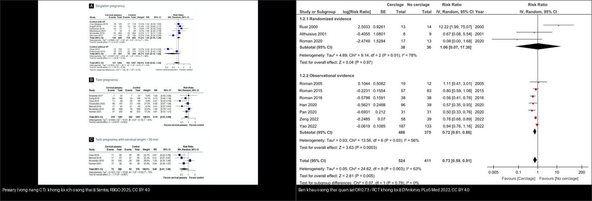
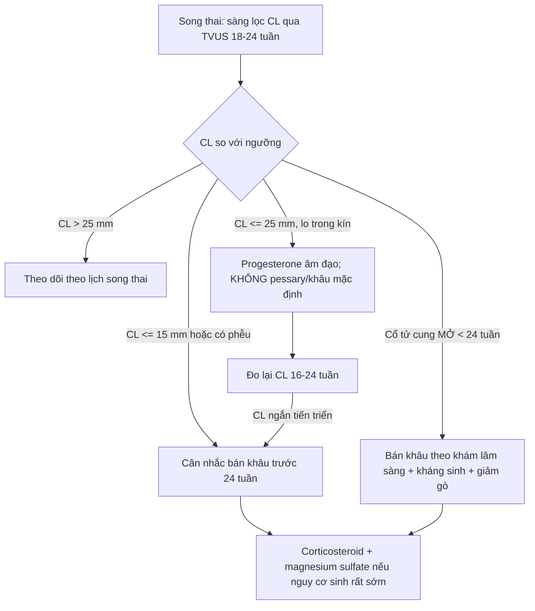
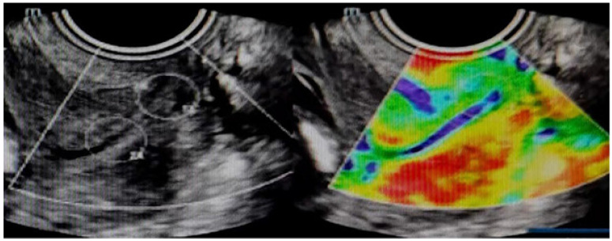
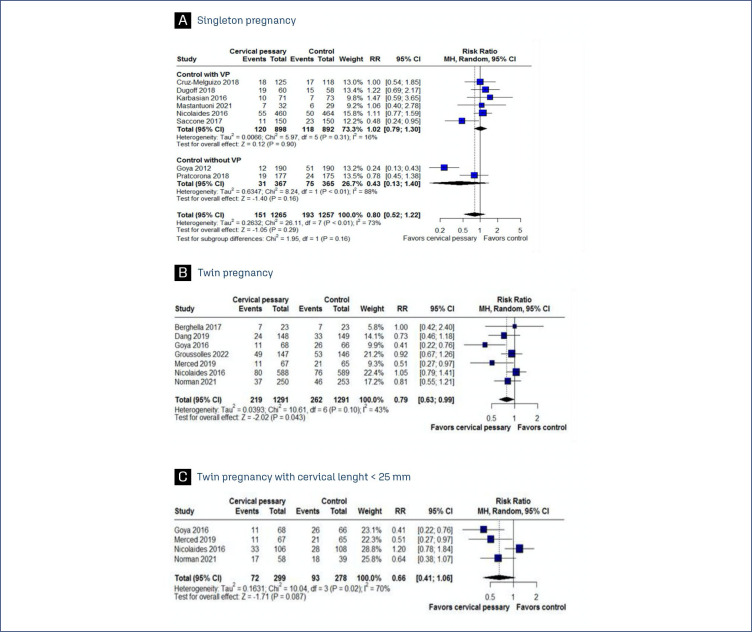
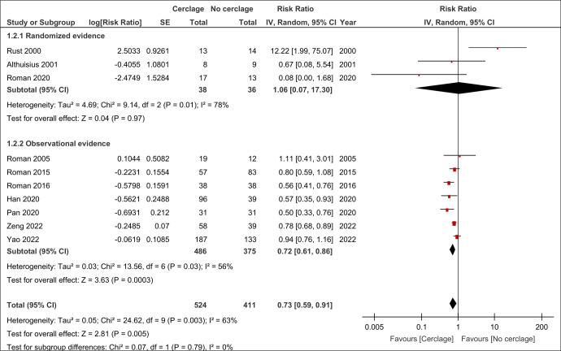
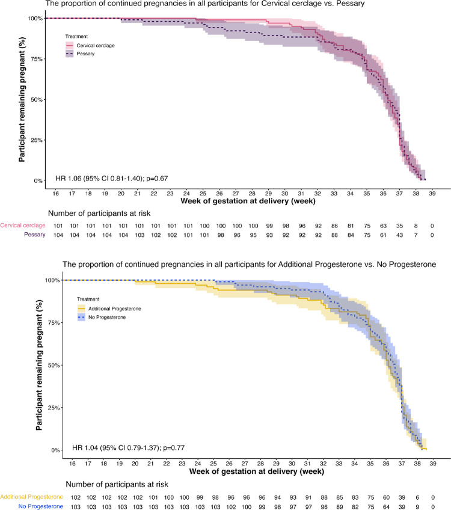
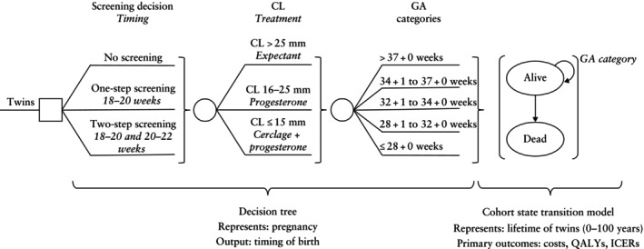

# 569 — Sinh non ở song thai: sàng lọc cổ tử cung & dự phòng (progesterone, bán khâu, vòng nang) / Preterm birth prevention in twin pregnancy

**Tags:** `pattern:sinh-non-song-thai` `pattern:co-tu-cung-ngan` `vung:co-tu-cung` `vung:thai-nhi` `score:CL-25mm` `protocol:TVUS-co-tu-cung` `protocol:cerclage-pessary`
**Mức chắc chắn (certainty):** tổng hợp y văn (literature synthesis) — số liệu lấy từ hướng dẫn ISUOG 2025 (PMC11788470), đồng thuận Delphi quốc tế 2025 (PMC12127722), phân tích gộp PLoS Med 2023 (PMC10456178), thử nghiệm PCP PLoS Med 2025 (PMC11844863), meta vòng nang RBGO 2025 (PMC12204114) và phân tích chi phí–hiệu quả UOG 2025 (PMC12401501); ảnh là hình minh họa từ bài có bản quyền mở, không phải ca nguyên văn của nhóm.

## 1. Tổng quan bệnh học – cơ chế hình ảnh

### 1.1. Vì sao song thai sinh non nhiều (và khác đơn thai)

- **Gánh nặng:** **hơn một nửa** thai kỳ song thai sinh trước **37 tuần**, và **~20%** sinh trước **34 tuần** (PMC11844863). Đây là lý do sàng lọc sinh non ở song thai là bắt buộc, không phải "làm thêm".
- **TẠI SAO khác đơn thai:** ở đơn thai, sinh non thường gắn với **suy cổ tử cung / nhiễm trùng ối** — progesterone và bán khâu có tác dụng rõ. Ở song thai, cơ chế chính là **căng quá mức tử cung (uterine overdistension)** + nhiều cơ chế khởi phát chuyển dạ song song → **progesterone dự phòng, vòng nang cổ tử cung (Arabin pessary), bán khâu, nghỉ ngơi, thuốc giảm gò đều KHÔNG giảm sinh non ở song thai KHÔNG chọn lọc** (ISUOG 2025).
- **Hệ quả thực hành:** phải **chọn đúng bệnh nhân** (chỉ nhóm cổ tử cung ngắn/mở) thay vì áp đại trà cho mọi song thai.

### 1.2. TẠI SAO siêu âm cổ tử cung là xương sống (cửa 1 — ngưỡng định lượng)

- **Cổ tử cung ngắn (short cervix) là yếu tố dự báo sinh non độc lập** ở song thai (PMC11844863).
- **Ngưỡng chuẩn:** đo cổ tử cung **qua ngả âm đạo (transvaginal ultrasound, TVUS)** là phương pháp sàng lọc **ưu tiên**; **25 mm là ngưỡng thực dụng (pragmatic cut-off) ở 18–24 tuần** (ISUOG 2025, mức khuyến cáo **B**). Đo tại **lần siêu âm hình thái**, và nếu có thêm yếu tố nguy cơ thì **đo lại trước 24 tuần** (mức **C**).
- **Progesterone âm đạo** có thể **cân nhắc** khi **CL ≤ 25 mm** (mức **C**); bán khâu có thể **cân nhắc** khi **CL ≤ 15 mm trước 24 tuần** (mức **C**).
- **Phác đồ chi phí–hiệu quả** (mô hình Canada, PMC12401501): **sàng lọc 2 bước** (18–20 **và** 20–22 tuần) làm **tăng QALY (0,62; 95% CrI −0,16 đến 1,41)** và **giảm chi phí (−2.460 CAD)** so với không sàng lọc; mô hình giả định **progesterone khi CL ≤ 25 mm** và **bán khâu + progesterone khi CL ≤ 15 mm**.
- **Song thai vẫn phải đánh giá màng đệm/màng ối** (DC vs MC) — lịch theo dõi và nguy cơ khác nhau (xem [bài 566](../566-song-thai-chorionicity-TTTS-TAPS/lesson.md)).

### 1.3. Đồng thuận chuyên gia (Delphi 2025, PMC12127722)

- **117 chuyên gia**, 94/117 (80,3%) hoàn thành cả 3 vòng; ngưỡng đồng thuận **≥ 70%**.
- **> 70%** làm sàng lọc CL **qua TVUS ở 18–23 tuần**, dùng **CL ≤ 25 mm** để định nghĩa cổ tử cung ngắn ở song thai (bất kể tiền sử sinh non).
- **Cổ tử cung ngắn KHÔNG mở:** đa số chọn **progesterone âm đạo** thay vì vòng nang hay bán khâu.
- **Cổ tử cung mở KHÔNG triệu chứng:** đồng thuận **88,3%** đặt **bán khâu**, làm **tới 24 tuần** (67,5% — **chưa đạt đồng thuận về thời hạn**).
- **96,1%** đồng ý **đo CL nối tiếp 16–24 tuần** ở phụ nữ có cổ tử cung ngắn.

## 2. Mẫu hình + chẩn đoán phân biệt theo vị trí (gamut)

### 2.1. Phân nhóm theo hình thái cổ tử cung trên TVUS (quyết định xử trí)

1. **Cổ tử cung dài bình thường (CL > 25 mm):** nguy cơ nền; theo dõi theo lịch song thai, không can thiệp.
2. **Cổ tử cung ngắn KHÔNG mở (CL ≤ 25 mm, lỗ trong kín, không phễu):** nhóm "progesterone âm đạo" — cân nhắc; bán khâu thường **không** có lợi ở song thai không chọn lọc.
3. **Cổ tử cung ngắn nặng (CL ≤ 15 mm) hoặc có phễu hóa (funneling):** nguy cơ rất cao; cân nhắc **bán khâu** (mức C) và theo dõi sát; **bán khâu "theo lịch sử" không có lợi ở song thai**.
4. **Cổ tử cung mở (dilatation) không triệu chứng < 24 tuần:** **bán khâu theo khám lâm sàng (physical-exam-indicated cerclage)** + kháng sinh + giảm gò có thể cân nhắc (mức C); đồng thuận chuyên gia cao.
5. **Sau laser TTTS:** nhóm nguy cơ sinh non đặc biệt; cần chiến lược riêng (xem [bài 568](../568-trap-song-thai-acardiac/lesson.md) và [566](../566-song-thai-chorionicity-TTTS-TAPS/lesson.md)).
6. **Song thai một ối (MA):** theo dõi sát, sinh 32–34 tuần (xem [bài 566](../566-song-thai-chorionicity-TTTS-TAPS/lesson.md)).

### 2.2. Gamut "cổ tử cung ngắn trên siêu âm" song thai

- **Cổ tử cung ngắn thật (do cấu trúc):** CL giảm thật, có thể kèm phễu/màng ối sa → nguy cơ sinh non cao.
- **Co cơ cổ tử cung giả (giả ngắn):** đo khi có cơn co → đo lại sau 30 phút/khi hết co; đừng can thiệp dựa trên một lần đo.
- **Funneling (phễu hóa):** lỗ trong mở hình chữ Y/V, màng ối lồi vào ống cổ tử cung → dấu hiệu nguy cơ cao.
- **Màng ối sa (prolapsed membranes)/cổ mở:** khác biệt về xử trí — **bán khâu theo khám lâm sàng**, chọc ối loại trừ nhiễm trùng khi mở > 2–3 cm (xem [bài 573](../573-ho-co-tu-cung-ban-khau/lesson.md)).
- **Sau đặt vòng nang (pessary):** vòng nang có thể **gây tăng tiết dịch/viêm âm đạo**, cần phân biệt với vỡ ối non.

## 3. Bảng so sánh phân biệt (ma trận đối chiếu)

> Bảng dưới đây so sánh **chiến lược dự phòng** (không phải bệnh lý) theo từng tình huống cổ tử cung ở song thai — cột "Chốt vào/Chốt loại" là **chỉ định và phản chỉ định**.

| Tình huống (scenario) | Hình ảnh / dấu hiệu (TVUS) | Chốt vào (rule-in) | Chốt loại (rule-out) | Gợi ý xác nhận |
|---|---|---|---|---|
| **Song thai KHÔNG chọn lọc** | CL bình thường, không yếu tố nguy cơ | **Sàng lọc CL tại siêu âm hình thái (18–24 tuần)** | Không đặt progesterone/pessary/bán khâu dự phòng đại trà | TVUS theo lịch song thai |
| **Cổ tử cung ngắn KHÔNG mở (CL ≤ 25 mm)** | CL ngắn, lỗ trong kín, không phễu | **CL ≤ 25 mm → cân nhắc progesterone âm đạo** | Không mở + không tiền sử → **không** bán khâu thường quy | TVUS nối tiếp 16–24 tuần |
| **Cổ tử cung ngắn nặng (CL ≤ 15 mm) / có phễu** | Phễu hóa, màng ối lồi, CL rất ngắn | **CL ≤ 15 mm → cân nhắc bán khâu** (mức C) | Sàng lọc 1 lần, đo lúc co cơ → **đo lại** trước khi quyết | TVUS nối tiếp, đánh giá nhiễm trùng |
| **Cổ tử cung MỞ < 24 tuần (không triệu chứng)** | Lỗ trong/ngoài mở, màng ối sa | **Bán khâu theo khám lâm sàng + kháng sinh + giảm gò** (mức C) | Mở > 2–3 cm/nhiễm trùng ối → **không** khâu | Chọc ối, CRP/bạch cầu, cấy |
| **Song thai có chỉ định bán khâu lịch sử** | CL có thể bình thường | — | **Bán khâu "theo lịch sử" KHÔNG giảm sinh non ở song thai** | Không đặt chỉ vì tiền sử |
| **Vòng nang cổ tử cung (pessary)** | CL ≤ 25 mm | — | **Không giảm sinh non ở song thai** (đơn thai có thể khác) | Chỉ nghiên cứu |

*Trái: biểu đồ rừng — **vòng nang không giảm sinh non ở song thai** (mục B: < 37 tuần RR 0,79 [0,63–0,99]; mục C: song thai CL < 25 mm RR 0,68 [0,41–1,14]) — Santos ACFF et al., RBGO 2025 (PMC12204114), CC BY 4.0. Phải: **bán khâu ở song thai** — gộp chung OR 0,73 (0,59–0,91) nhưng **chỉ ở nghiên cứu quan sát**; riêng **RCT OR 1,06 (0,07–17,30)** (rất không chắc chắn) — D'Antonio F et al., PLoS Med 2023 (PMC10456178), CC BY 4.0. Ảnh ghép letterbox, giữ nguyên tỷ lệ.*

### 3.1. Dấu hiệu chốt trong 3 giây

- **Song thai = sàng lọc CL qua TVUS 18–24 tuần**; **CL ≤ 25 mm** là ngưỡng hành động.
- **Cổ tử cung ngắn không mở → progesterone** (không pessary/bán khâu mặc định).
- **Cổ tử cung mở < 24 tuần → bán khâu theo khám lâm sàng.**
- **Không đặt bán khâu "theo lịch sử" ở song thai.**

## 4. Protocol chụp + hệ phân độ/điểm chuẩn hóa

### 4.1. Protocol sàng lọc & theo dõi

- **TVUS cổ tử cung ở siêu âm hình thái (18–24 tuần)** cho **mọi** song thai; **đo lại nếu có yếu tố nguy cơ** (mức C).
- **Buồng ối/bàng quang:** đo với bàng quang trống; đo **lỗ trong → lỗ ngoài**; lấy **3 số đo**, ghi ngắn nhất; quan sát **funneling**.
- **Đo nối tiếp 16–24 tuần** ở phụ nữ đã có cổ tử cung ngắn (đồng thuận 96,1%, PMC12127722).
- **Khi phát hiện cổ tử cung ngắn:** đánh giá nhiễm trùng (cấy âm đạo/cổ tử cung, CRP) trước khi can thiệp; **elastography cổ tử cung** có thể hỗ trợ dự báo (nghiên cứu, PMC11610336).
- **Song thai MC:** theo dõi thêm Doppler/ối theo lịch MC.

### 4.2. Ngưỡng xử trí (tổng hợp ISUOG 2025, Delphi 2025, mô hình chi phí–hiệu quả)

| Ngưỡng | Xử trí | Nguồn |
|---|---|---|
| CL > 25 mm | Theo dõi theo lịch, không can thiệp | ISUOG 2025 (mức B cho ngưỡng 25 mm) |
| CL ≤ 25 mm, không mở | **Progesterone âm đạo** (cân nhắc) | ISUOG 2025 (mức C); Delphi 2025 |
| CL ≤ 15 mm trước 24 tuần | **Cân nhắc bán khâu** | ISUOG 2025 (mức C) |
| Cổ tử cung mở < 24 tuần | **Bán khâu theo khám lâm sàng + kháng sinh + giảm gò** | ISUOG 2025 (mức C); Delphi 2025 (88,3%) |
| Song thai bất kỳ | **KHÔNG** progesterone/pessary/nghỉ ngơi/giảm gò dự phòng đại trà | ISUOG 2025 (mức A cho progesterone) |

> **Bằng chứng can thiệp còn yếu:** phân tích gộp cho thấy bán khâu "có thể" giảm sinh non ở song thai chủ yếu dựa trên **nghiên cứu quan sát** (OR 0,73 [0,59–0,91]) — còn **RCT không xác nhận** (OR 1,06 [0,07–17,30]) (PMC10456178). Do đó **quyết định phải cá thể hóa**.

### 4.3. Điều trị hỗ trợ chung

- **Corticosteroid trước sinh** khi nguy cơ sinh non (không phụ thuộc đơn/song thai) để trưởng thành phổi.
- **Magnesium sulfate** để bảo vệ thần kinh khi nguy cơ sinh rất sớm (< 32 tuần).
- **Transfer in utero** sang trung tâm có hồi sức sơ sinh phù hợp.

> Ghi chú: bài này **không có hệ RADS riêng**; ngưỡng/flowchart tổng hợp từ ISUOG 2025 và đồng thuận Delphi quốc tế 2025.

## 5. Biến thể bình thường và cạm bẫy

- **Co cơ cổ tử cung giả ngắn:** đo lúc có cơn co → đo lại sau 30 phút; **đừng can thiệp** dựa trên một lần đo.
- **Đo không đúng kỹ thuật:** bàng quang căng, đầu dò ấn mạnh làm cổ tử cung giả dài; **luôn đo bàng quang trống, 3 lần, lấy ngắn nhất**.
- **Áp phác đồ ĐƠN thai sang song thai:** progesterone/bán khâu dự phòng đại trà **không** có lợi và **bán khâu có thể tăng nguy cơ** ở song thai không chọn lọc.
- **Nhầm nhóm bệnh nhân:** "song thai + tiền sử sinh non" ≠ chỉ định bán khâu lịch sử (khác đơn thai).
- **Bỏ sót song thai MC** khi chỉ sàng lọc lịch DC → lịch theo dõi sai, bỏ qua TTTS/TAPS/TRAP.
- **Vòng nang (pessary):** biến chứng **tăng tiết dịch/viêm âm đạo** dễ nhầm vỡ ối non; đánh giá cẩn thận.
- **Sau can thiệp bán khâu:** vẫn phải theo dõi CL/màng ối — bán khâu **không "khóa"** được chuyển dạ ở song thai (xem [bài 573](../573-ho-co-tu-cung-ban-khau/lesson.md)).

## 6. Tự lượng giá — Blind Quiz

**Ca 1 — Song thai 22 tuần, cổ tử cung ngắn KHÔNG mở. Đọc ảnh cổ tử cung (elastography).**

- Gợi ý lâm sàng: không co, không rỉ ối; thai kỳ song thai định kỳ.
- Câu hỏi: (1) ngưỡng → xử trí? (2) cân nhắc gì THÊM ngoài đo CL? (3) có đặt bán khâu ngay không?

<b>Bấm để hiện đáp án (findings + chẩn đoán)</b>

- **Findings:** ảnh TVUS cổ tử cung kèm **elastography** (bản đồ màu độ cứng mô) — điểm elastography giúp **bổ sung** đánh giá cổ tử cung, nhưng còn ở mức **nghiên cứu**.
- **Chẩn đoán:** **song thai + cổ tử cung ngắn không mở** → nhóm **progesterone âm đạo** (cân nhắc) theo ISUOG 2025 (mức C) và đồng thuận Delphi 2025.
- **Không** đặt bán khâu ngay: cổ tử cung **không mở** → bán khâu không có lợi ở song thai không chọn lọc.
- Nguồn ảnh: Huang Y et al., *Int J Med Sci* 2024 (PMC11610336), CC BY 4.0.

**Ca 2 — Bằng chứng vòng nang (pessary) ở song thai: đọc biểu đồ rừng.**

- Câu hỏi: (B) song thai < 37 tuần và (C) song thai có CL < 25 mm cho kết quả gì? Kết luận thực hành?

<b>Bấm để hiện đáp án</b>

- **Findings:** (B) gộp song thai < 37 tuần **RR 0,79 (0,63–0,99)**, nhưng **độ không đồng nhất cao**; (C) song thai **CL < 25 mm RR 0,68 (0,41–1,14)** — **không đạt ý nghĩa thống kê**.
- **Kết luận:** **vòng nang cổ tử cung không giảm sinh non ở song thai**; không dùng thường quy (ISUOG 2025: vòng nang không hiệu quả ở song thai).
- **Phản biện (fidelity):** ở đơn thai, vòng nang có thể có lợi (mục A) — **không suy rộng** sang song thai.
- Nguồn ảnh: Santos ACFF et al., *Rev Bras Ginecol Obstet* 2025 (PMC12204114), CC BY 4.0.

**Ca 3 — Bằng chứng bán khâu (cerclage) ở song thai: đọc biểu đồ rừng.**

- Câu hỏi: vì sao gộp chung OR 0,73 mà **RCT lại OR 1,06**? Rút ra bài học gì?

<b>Bấm để hiện đáp án</b>

- **Findings:** gộp **quan sát + RCT** OR 0,73 (0,59–0,91) ủng hộ bán khâu; nhưng **riêng nhánh RCT OR 1,06 (0,07–17,30)** (khoảng tin cậy cực rộng) — **không chứng minh lợi ích**.
- **Chẩn đoán/kết luận:** lợi ích bán khâu ở song thai chủ yếu từ **nghiên cứu quan sát (nguy cơ sai lệch chọn lựa)**; **chất lượng bằng chứng thấp** → cá thể hóa.
- **Ngoại lệ:** **cổ tử cung MỞ (bán khâu theo khám lâm sàng)** được đồng thuận cao (88,3%) và có bằng chứng riêng tốt hơn.
- Nguồn ảnh: D'Antonio F et al., *PLoS Med* 2023 (PMC10456178), CC BY 4.0.

**Ca 4 — Thử nghiệm PCP: bán khâu vs vòng nang (đường cong sống còn).**

- Câu hỏi: (A) hai đường có khác nhau không? (B) thêm progesterone có giúp? Thử nghiệm kết thúc sớm vì lý do gì?

<b>Bấm để hiện đáp án</b>

- **Findings:** (A) **bán khâu vs vòng nang: HR 1,06 (0,81–1,40), p = 0,67** — **không khác biệt** về sinh non < 34 tuần (chính 19,8% vs 19%, RR 1,04 [0,60–1,8]); (B) **thêm progesterone: HR 1,04 (0,79–1,37), p = 0,77** — không lợi ích (sinh < 34 tuần RR 0,90 [0,52–1,6]).
- **Điểm đặc biệt:** thử nghiệm **dừng sớm** vì nhóm **bán khâu** có **sinh < 28 tuần** thấp hơn (**1% vs 8,6%**; RR 0,12 [0,01–0,52]) và **tử vong chu sinh** thấp hơn (**1% vs 5,8%**; RR 0,17 [0,05–0,62]).
- **Kết luận cân bằng:** bán khâu và vòng nang **tương đương** về mục tiêu chính; tín hiệu **bán khâu tốt hơn ở mốc cực sớm** nhưng dữ liệu **dừng sớm, cỡ mẫu nhỏ** → cần RCT lớn.
- Nguồn ảnh: He YTN et al., *PLoS Med* 2025 (PMC11844863), CC BY 4.0.

**Ca 5 — Mô hình sàng lọc CL: đọc sơ đồ quyết định.**

- Câu hỏi: mô hình giả định xử trí ở ngưỡng CL nào? Chiến lược nào hiệu quả–kinh tế nhất?

<b>Bấm để hiện đáp án</b>

- **Findings:** mô hình giả định **progesterone khi CL ≤ 25 mm** và **bán khâu + progesterone khi CL ≤ 15 mm**; so sánh **không sàng lọc / 1 bước (18–20 tuần) / 2 bước (18–20 và 20–22 tuần)**.
- **Kết luận:** **sàng lọc 2 bước** tăng **QALY 0,62 (95% CrI −0,16 đến 1,41)** và **giảm chi phí (−2.460 CAD)** → **ưu thế chi phí–hiệu quả**; sàng lọc 1 bước tốt hơn không sàng lọc nhưng kém 2 bước.
- **Hàm ý:** **sàng lọc CL nên là chuẩn** ở song thai, không phải "tùy chọn".
- Nguồn ảnh: Khaikin Y et al., *Ultrasound Obstet Gynecol* 2025 (PMC12401501), CC BY 4.0.

## Bài liên quan chéo
- [500 – Tổng quan Hệ Vú & Sản Phụ khoa](../500-tong-quan-vu-san-phu-khoa/lesson.md)
- [566 – Song thai: chorionicity, TTTS & TAPS](../566-song-thai-chorionicity-TTTS-TAPS/lesson.md) (nền tảng MC/DC và nguy cơ)
- [568 – TRAP & thai acardiac](../568-trap-song-thai-acardiac/lesson.md) (song thai nguy cơ cao khác)
- [573 – Hở cổ tử cung & bán khâu](../573-ho-co-tu-cung-ban-khau/lesson.md) (kỹ thuật, ngưỡng 25/20/15 mm, funnelling)
- [565 – Sàng lọc hình thái thai & Doppler sản khoa](../565-sang-loc-hinh-thai-va-doppler-san-khoa/lesson.md)
- [571 – Sẩy thai tái diễn: tiếp cận hình ảnh tử cung](../571-say-thai-tai-dien-tiep-can-hinh-anh/lesson.md)

> Không dùng để chẩn đoán độc lập khi chưa có người hướng dẫn.
