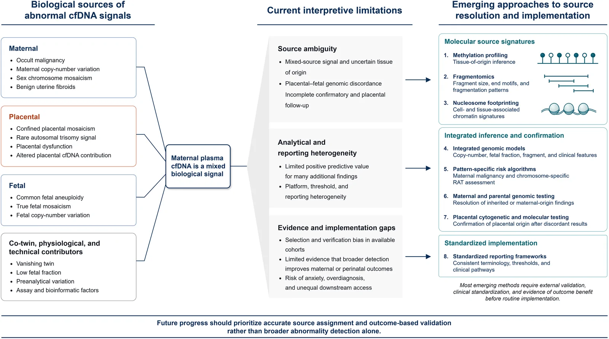
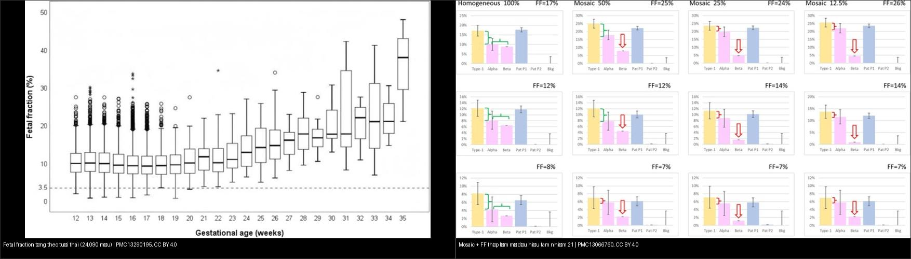
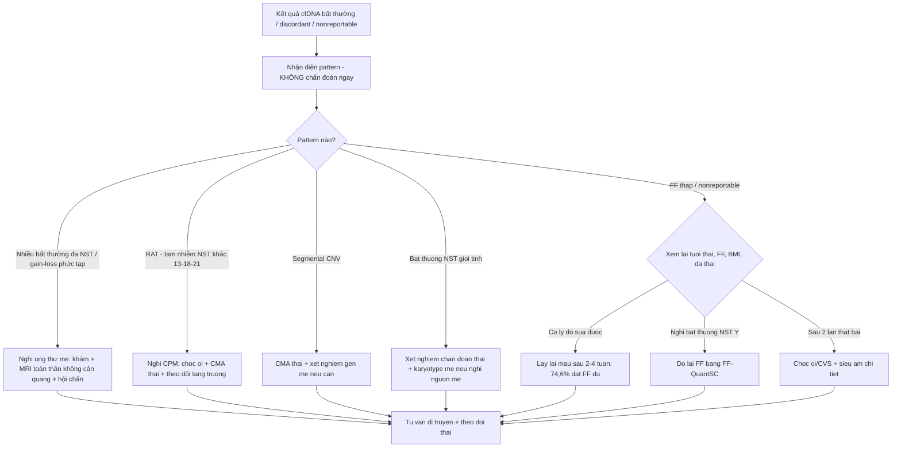
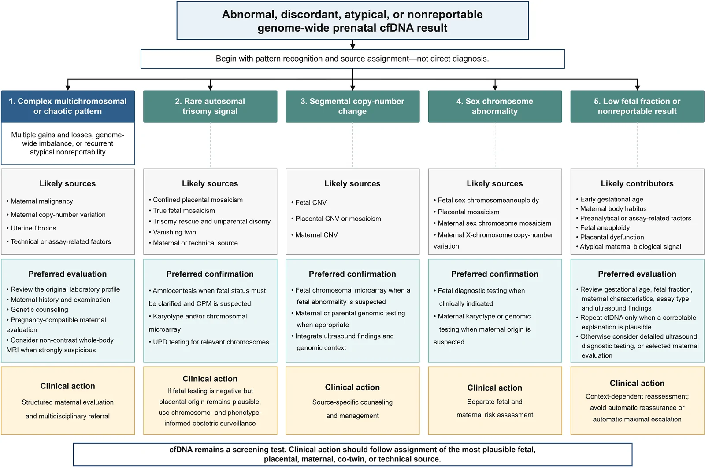
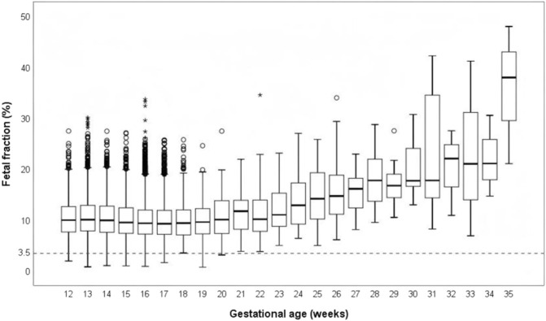
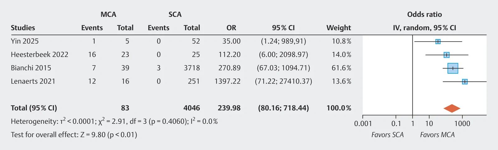
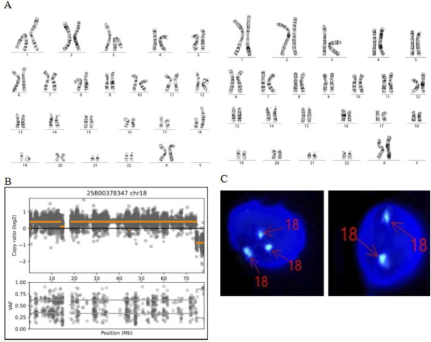

# 570 — Tư vấn NIPT không xác định (no-call) & dương tính giả: thai biến mất, khảm bánh nhau, ung thư mẹ / NIPT no-call & false-positive counselling

**Tags:** `pattern:nipt-khong-xac-dinh` `pattern:duong-tinh-gia` `vung:thai-nhi` `protocol:NIPT` `protocol:MRI-toan-than` `protocol:choc-oi-sinh-thiet-gai-nhau`
**Mức chắc chắn (certainty):** tổng hợp y văn (literature synthesis) — tổng hợp từ bài tổng quan "obstetric incidentalome" (Xu M et al., Int J Womens Health 2026, PMC13502226), nghiên cứu FF/SCA (Hu S et al., Front Genet 2026, PMC13290195), TRIDENT-2 thai biến mất (van Eekhout JCA et al., Ultrasound Obstet Gynecol 2025, PMC12671934), chữ ký FF (Blouin JL et al., Clin Genet 2026, PMC13066760), meta ung thư mẹ (Teixeira E et al., Geburtshilfe Frauenheilkd 2026, PMC13581417) và khảm theo mô (Huang N et al., Front Genet 2026, PMC13395340).

## 1. Tổng quan — vì sao một xét nghiệm "của thai" lại phản ánh mẹ, nhau và thai cùng lúc

- **NIPT (non-invasive prenatal testing) đọc cfDNA tự do trong huyết tương mẹ.** Điểm cốt tử: **~phần lớn cfDNA "thai" thực ra đến từ tế bào nuôi của BÁNH NHAU (trophoblast)**, không phải trực tiếp từ thai nhi. Do đó **bộ gen bánh nhau và bộ gen thai nhi có thể KHÁC nhau** → sinh ra cả **dương tính giả** (nhau bất thường, thai bình thường) lẫn **âm tính giả**. Đây là mô hình **"obstetric incidentalome"** — kết quả bất thường/discordant/nonreportable có thể đến từ **thai, bánh nhau, mẹ, thai đã mất (co-twin) hoặc lỗi kỹ thuật** (Xu M et al., Int J Womens Health 2026, PMC13502226).
- **Fetal fraction (FF) là chỉ số quyết định "có trả được kết quả hay không".** FF = tỉ lệ cfDNA có nguồn gốc thai/nhau. **Ngưỡng tối thiểu hay dùng 3,5–4%** (lab BGI dùng **3,5%**). FF **tăng theo tuổi thai** (tương quan dương, rõ sau 20 tuần). **~1% mẫu NIPT ban đầu thất bại → "no-call", nguyên nhân hay gặp nhất là FF thấp** (Hu S et al., Front Genet 2026, PMC13290195).
- **FF thấp KHÔNG chỉ là chuyện kỹ thuật — nó là tín hiệu sinh học.** Trong 24.101 thai: nhóm **FF < 3,5% (n = 70)** có **tần suất bất thường nhiễm sắc thể giới tính (SCA) 11,43%** so với **0,21%** ở nhóm FF đủ — **nguy cơ tăng ~78 lần (OR 78,2; P < 0,001)**, và **cả 8 ca SCA trong nhóm FF thấp đều liên quan NST Y**. Nhóm FF thấp cũng có **BMI mẹ cao hơn (24,25 vs 21,09 kg/m²)**, **IVF 30,0% vs 11,68%**, **đa thai 11,43% vs 2,92%** (Hu S et al., PMC13290195).
- **Xử trí no-call có chuẩn:** lấy lại máu sau **2–4 tuần** — trong loạt 193 ca lấy lại, **74,6% đạt FF đủ**; sau **2 lần thất bại** mới báo "thất bại" và chuyển **chẩn đoán xâm lấn** (Hu S et al., PMC13290195). Vì **FF thấp có thể là "false-low" do bất thường NST Y** khi dùng phương pháp đếm theo NST Y, cần **đối chiếu lại bằng thuật toán khác (FF-QuantSC) + phân bố đọc NST Y** trước khi kết luận thất bại.
- **Dương tính giả — 5 nguồn chính:** (i) **khảm bánh nhau giới hạn (confined placental mosaicism — CPM)**; (ii) **thai biến mất (vanishing twin)** để lại cfDNA của thai đã mất; (iii) **bất thường NST/copy-number của MẸ** hoặc **thể khảm NST giới tính mẹ**; (iv) **khối lành tính của mẹ (u xơ tử cung)**; (v) **ung thư mẹ tiềm ẩn**; cộng **artifact kỹ thuật**.
- **Ung thư mẹ là "cờ đỏ" đặc trưng nhất:** **nhiều bất thường nhiễm sắc thể (multiple chromosomal aberrations — MCA)** và **mô hình gain–loss phức tạp** rất mạnh với ung thư — **OR 239,98 (95% CI 80,16–718,44)** cho MCA và **OR 188,64 (95% CI 34,17–1041,51)** cho gain–loss phức tạp (Teixeira E et al., Geburtshilfe Frauenheilkd 2026, PMC13581417). Trong một loạt tiến cứu gồm các thai phụ được giới thiệu vì kết quả cfDNA bất thường/nonreportable, **ung thư được chẩn đoán ở 52/107 người** và **MRI toàn thân không cản quang có độ nhạy 98,0%, độ đặc hiệu 88,5%** (Xu M et al., PMC13502226).
- **Âm tính giả thì hiếm nhưng có thật:** ước tính **~0,65%** cho lệch bội thường gặp; nguyên nhân gồm **khảm theo mô** và **tái cấu trúc phức tạp** — ví dụ ca ring NST 21, dicentric NST 18 với **khảm 42% máu ngoại vi / 65% theo WES nhưng chỉ 8% trên tế bào niêm mạc miệng** (Huang N et al., Front Genet 2026, PMC13395340).

*Một mẫu huyết tương mẹ là **hỗn hợp tín hiệu** nhiều nguồn: thai dị bội, khảm bánh nhau, bất thường biến thể số lượng bản sao của mẹ (CNV), u xơ, thai biến mất, ung thư mẹ tiềm ẩn, artifact kỹ thuật. Xu M et al., Int J Womens Health 2026 (PMC13502226, Fig. 1), **CC BY-NC 4.0 — nguyên bản**.*

## 2. Mẫu hình + chẩn đoán phân biệt THEO PATTERN kết quả (Gamut)

Phân loại kết quả bất thường/discordant/nonreportable thành **5 pattern** rồi mới truy nguồn (Xu M et al., PMC13502226):

- **Pattern 1 — nhiều bất thường đa NST/chaotic (complex multichromosomal):** *nghĩ ngay ung thư mẹ* + CNV mẹ + u xơ + artifact. Hướng: **đánh giá mẹ có cấu trúc** (tiền sử, khám, tư vấn di truyền, **MRI toàn thân** khi nghi cao).
- **Pattern 2 — RAT (rare autosomal trisomy = tam nhiễm NST khác 13/18/21):** CPM, thể khảm thật của thai, **trisomy rescue ± dị hợp tử đơn phụ huynh (UPD)**, thai biến mất, khảm mẹ, artifact. Hướng: **xác nhận thai bằng chọc ối** (chọc ối tốt hơn sinh thiết gai nhau khi nghi CPM).
- **Pattern 3 — thay đổi copy-number từng đoạn (segmental CNV):** CNV thai, CNV/khảm bánh nhau, CNV mẹ. Hướng: **CMA/microarray thai** + xét nghiệm gen mẹ nếu cần.
- **Pattern 4 — bất thường NST giới tính:** SCA thai, khảm bánh nhau, **khảm NST giới tính mẹ**, CNV NST X mẹ. Hướng: **xét nghiệm chẩn đoán thai khi có chỉ định** + karyotype/genomic mẹ khi nghi nguồn mẹ.
- **Pattern 5 — FF thấp/nonreportable:** tuổi thai sớm, BMI mẹ, yếu tố tiền phân tích/kỹ thuật, **bất thường thai**, rối loạn chức năng bánh nhau, tín hiệu sinh học mẹ bất thường. Hướng: **xem lại tuổi thai/FF/loại assay + siêu âm**; **lấy lại cfDNA chỉ khi có lý do có thể sửa được**; nếu không → **siêu âm chi tiết / chẩn đoán xâm lấn / đánh giá mẹ chọn lọc**.
- **Gợi nhớ "5 nhóm nguồn": Th – Nh – M – A – K** = **Th**ai · **Nh**au (CPM) · **M**ẹ (CNV/mosaicism/khối lành) · **A**c (ung thư mẹ) · **K**ỹ thuật (FF thấp/artifact). Nhận đúng nguồn trước khi kết luận.
- **Vanishing twin (thai biến mất):** phân **type I** (chỉ còn túi thai rỗng) vs **type II** (còn phôi không sống) trên siêu âm quý I. **Type II có nguy cơ nhận kết quả NIPT bất thường CAO HƠN HẲN: 12,6% vs 1,7% (P < 0,001)**; **sau 15 tuần không còn kết quả discordant-positive** (van Eekhout JCA et al., Ultrasound Obstet Gynecol 2025, PMC12671934).

## 3. Bảng so sánh phân biệt (ma trận đối chiếu)

| Thực thể (entity) | Kết quả NIPT điển hình | Chốt vào (rule-in) | Chốt loại (rule-out) | Gợi ý xác nhận |
|---|---|---|---|---|
| **FF thấp / no-call (kỹ thuật + sinh học)** | Nonreportable, FF **< 3,5–4%**; tăng theo tuổi thai | **FF < 3,5% + BMI mẹ cao/IVF/đa thai/tuổi thai sớm**; lấy lại sau 2–4 tuần **74,6% đạt FF đủ** | **FF đủ (≥ 4%) kèm pattern bình thường → loại no-call** | Lấy lại máu sau 2–4 tuần; nếu **nghi NST Y** → đo lại bằng FF-QuantSC; sau 2 lần thất bại → xâm lấn |
| **CPM (khảm bánh nhau giới hạn)** | RAT/pattern 2 hoặc bất thường bất kỳ, **khảm ≤ 10–50%** | **RAT + thai CMA bình thường → nguồn bánh nhau**; RAT gắn **thai chậm tăng trưởng** | **Chọc ối lặp lại đúng bất thường mức toàn thể → khảm thật của thai** | **Chọc ối ưu thế hơn CVS** (CVS lấy bánh nhau → lặp CPM); CMA thai + siêu âm theo dõi tăng trưởng |
| **Vanishing twin** | Bất thường không khớp thai còn sống; dương tính giả T18/T13 nhiều | **Tiền sử đa thai + siêu âm túi rỗng (type I) hoặc phôi không sống (type II) + NIPT trước 15 tuần** | **NIPT sau ≥ 15 tuần không còn ca discordant-positive (0/12)** | Siêu âm quý I xác định type; tư vấn PPV thấp; xác nhận bằng chẩn đoán thai |
| **Ung thư mẹ tiềm ẩn** | **Nhiều bất thường đa NST (MCA) / gain–loss phức tạp**, nonreportable | **MCA (OR 239,98) hoặc gain–loss phức tạp (OR 188,64) + không giải thích được bằng thai/bánh nhau** | **Một bất thường đơn độc, hợp với bệnh cảnh thai → ít nghĩ ung thư** | Khám mẹ + xét nghiệm + **MRI toàn thân không cản quang (Se 98,0%/Sp 88,5%)**; hội chẩn đa chuyên khoa |
| **Bất thường NST/biến thể mẹ (CNV, khảm giới tính)** | Pattern 3/4; bất thường "không khớp" thai | **Bất thường giống mẹ trên array/karyotype mẹ** | **Bất thường chỉ ở thai, mẹ bình thường** | Karyotype/array **mẹ** (máu ngoại vi); tư vấn di truyền |
| **Dị bội thai THẬT (T21/T18/T13)** | Nguy cơ cao T21/T18/T13; **DR ~98%/FPR < 1%** (đơn thai) | **Nguy cơ cao + xác nhận trên chọc ối/CVS** | **Khảm theo mô/bánh nhau → NIPT dương tính nhưng thai bình thường** | Chọc ối (karyotype/CMA); siêu âm hình thái + dấu hiệu mềm (`567`) |

*Trái — **FF tăng theo tuổi thai** (24.090 mẫu): FF thấp tập trung ở tuổi thai sớm, góp phần no-call. Phải — **mô phỏng khảm + FF thấp** làm mờ dần "chữ ký" bất thường: khảm 50:50 đã khó nhận, FF giảm làm signal-to-noise xấu đi. Ảnh ghép letterbox giữ tỷ lệ, chỉ ghép ảnh CC BY. Hu S et al. (PMC13290195) + Blouin JL et al. (PMC13066760), CC BY 4.0.*

## 4. Protocol chụp/xét nghiệm + thuật toán xử trí

- **Trước xét nghiệm (pretest counselling):** NIPT là **sàng lọc, không phải chẩn đoán**; giải thích **PPV thấp với bệnh hiếm** và khả năng **no-call/discordant**. Làm **siêu âm xác định tuổi thai + số thai + tình trạng thai** trước xét nghiệm (quan trọng để phát hiện thai biến mất).
- **Thời điểm:** NIPT từ **≥ 10 tuần**; ở thai biến mất, **làm lại sau ≥ 15 tuần giúp tránh discordant-positive** (0/12 ca) (van Eekhout JCA et al., PMC12671934).
- **Khi no-call:** (1) xem lại **tuổi thai, FF, loại assay, BMI, tình trạng IVF/đa thai**; (2) **lấy lại máu sau 2–4 tuần**; (3) nếu **nghi bất thường NST Y** → **đo lại FF bằng FF-QuantSC** + phân tích phân bố đọc NST Y; (4) sau **2 lần thất bại** → báo thất bại + **chọc ối/CVS + siêu âm chi tiết**.
- **Khi bất thường/discordant:** **nhận diện pattern → gán nguồn → xác nhận**. **Khảm/CPM nghi ngờ → chọc ối ưu thế hơn sinh thiết gai nhau**. Nghi **ung thư mẹ (MCA/gain–loss phức tạp)** → **MRI toàn thân không cản quang** (tránh tia X cho thai) + hội chẩn sản khoa–di truyền–ung thư. Nghi nguồn mẹ khác → **karyotype/array máu mẹ**.
- **Nguyên tắc vàng:** **"cfDNA vẫn là xét nghiệm sàng lọc; hành động y khoa phải theo nguồn (thai/nhau/mẹ/co-twin/kỹ thuật) hợp lý nhất"** — tránh cả **trấn an tự động** lẫn **leo thang tối đa tự động** (Xu M et al., PMC13502226).

*Từ kết quả bất thường/discordant/nonreportable → gán **1 trong 5 pattern** (đa NST/chaotic · RAT · CNV từng đoạn · NST giới tính · FF thấp) → **nguồn khả dĩ** → **xác nhận ưu tiên** → **hành động lâm sàng**. Đây là "bản đồ" chuẩn cho buổi tư vấn. Xu M et al., Int J Womens Health 2026 (PMC13502226, Fig. 2), **CC BY-NC 4.0 — nguyên bản**.*

## 5. Biến thể bình thường và cạm bẫy

- **NIPT dương tính ≠ thai bị bệnh:** với **tam nhiễm NST hiếm/T18/T13 trong thai biến mất**, PPV rất thấp — trong TRIDENT-2, **không ca T18 (n = 4), T13 (n = 8) hay "additional finding" (n = 29) nào được xác nhận ở thai còn lại**, trong khi **T21 xác nhận 7/17 (PPV 41,2%)** (van Eekhout JCA et al., PMC12671934).
- **CVS có thể "lặp lại" CPM:** vì **CVS lấy mô bánh nhau** — chính là nguồn gây bất thường cfDNA. Khi nghi CPM, **chọc ối phản ánh thai nhi tốt hơn**. Đây là cạm bẫy hay gặp ("xác nhận bằng CVS" → vẫn dương tính → tưởng khảm thật).
- **Không được "trấn an tự động" hay "leo thang tự động":** kết quả nonreportable/không điển hình cần **đánh giá lại theo bối cảnh**; đồng thời **không MCA nào đồng nghĩa chắc chắn ung thư** (u xơ, CNV mẹ cũng gây tương tự).
- **FF thấp có thể là "false-low" do bất thường NST Y** khi đo bằng phương pháp đếm NST Y → **đừng vội kết luận thất bại**, đo lại bằng thuật toán độc lập (FF-QuantSC).
- **Khảm phụ thuộc MÔ:** cùng một thai, **máu ngoại vi khảm 42% và 65% nhưng niêm mạc miệng chỉ 8%** — **mức khảm khác nhau theo mô** khiến NIPT có thể **đồng thời dương tính giả và âm tính giả** (Huang N et al., PMC13395340).
- **RAT không phải lúc nào cũng vô hại:** RAT/CPM gắn với **thai chậm tăng trưởng và biến chứng do bánh nhau** → cần **theo dõi siêu âm tăng trưởng** dù thai nhi bình thường về NST (Xu M et al., PMC13502226).
- **Giới hạn của MRI toàn thân:** Se cao **98,0%** nhưng Sp **88,5%** trong nhóm chọn lọc — **không áp dụng để sàng lọc ung thư cho toàn bộ thai phụ**; chỉ dùng theo đường dẫn tư vấn chọn lọc.

## 6. Tự lượng giá — Blind Quiz (ảnh trơn ngoài, đáp án trong)

**Ca 1 — Thai 12 tuần, BMI mẹ 31, thụ tinh trong ống nghiệm. NIPT trả "no-call". Nhìn biểu đồ FF theo tuổi thai:**

- Gợi ý lâm sàng (clinical context): thai đơn, IVF, BMI cao, tuổi thai 12 tuần.
- Câu hỏi: Vì sao FF thấp ở giai đoạn này? Bước xử trí tiếp theo là gì? Vì sao KHÔNG kết luận thất bại ngay?

<b>Bấm để hiện đáp án (findings + chẩn đoán)</b>

- Dấu hiệu (findings): FF **tăng theo tuổi thai**, thấp nhất ở tuổi thai sớm; **BMI mẹ cao (24,25 vs 21,09 kg/m²), IVF, đa thai** đều làm FF thấp. **~1% mẫu NIPT no-call, hay gặp nhất do FF thấp**; ngưỡng FF **3,5–4%**.
- Chẩn đoán/xử trí (diagnosis & management): **no-call do FF thấp, chưa phải bệnh lý** → **lấy lại máu sau 2–4 tuần** (**74,6% đạt FF đủ**); nếu **nghi NST Y** đo lại bằng **FF-QuantSC**; sau 2 lần thất bại → **chọc ối/CVS + siêu âm chi tiết**.
- Nguồn ảnh: Hu S et al., Front Genet 2026 (PMC13290195, Fig. 2), CC BY 4.0.

**Ca 2 — NIPT genome-wide trả "nhiều bất thường đa nhiễm sắc thể". Nhìn forest plot:**

- Gợi ý lâm sàng: thai phụ không triệu chứng, kết quả bất thường "không khớp" với thai.
- Câu hỏi: Pattern này gợi ý nguồn nào? Vì sao đây là bài toán "cờ đỏ"? Xác nhận bằng gì?

<b>Bấm để hiện đáp án (findings + chẩn đoán)</b>

- Dấu hiệu (findings): **MCA/gain–loss phức tạp** liên quan mạnh ung thư mẹ — **OR 239,98 (80,16–718,44)** cho MCA, **OR 188,64 (34,17–1041,51)** cho gain–loss phức tạp; **52/107** người được giới thiệu vì kết quả bất thường/nonreportable có ung thư.
- Chẩn đoán/xử trí (diagnosis & management): **nghi ung thư mẹ tiềm ẩn** → khám + xét nghiệm chọn lọc + **MRI toàn thân không cản quang** (Se **98,0%**/Sp **88,5%**) + hội chẩn đa chuyên khoa; **không** tự động leo thang tối đa cũng **không** trấn an tự động.
- Nguồn ảnh: Teixeira E et al., Geburtshilfe Frauenheilkd 2026 (PMC13581417, Fig. 3), **CC BY-NC-ND 4.0 — nguyên bản**.

**Ca 3 — NIPT dương tính một tam nhiễm hiếm, chọc ối bình thường nhưng thai chậm tăng trưởng. Nhìn hình kết quả di truyền theo mô:**

- Gợi ý lâm sàng: bất thường NIPT không khớp thai; siêu âm thấy chậm tăng trưởng.
- Câu hỏi: Vì sao NIPT bất thường mà thai bình thường? Nguồn là gì? Theo dõi gì thêm?

<b>Bấm để hiện đáp án (findings + chẩn đoán)</b>

- Dấu hiệu (findings): **khảm thay đổi theo mô** — ví dụ **42% máu ngoại vi / 65% WES nhưng chỉ 8% tế bào miệng**; bảng bệnh phẩm cho thấy mức khảm khác nhau giữa nhau thai và thai.
- Chẩn đoán (diagnosis): **khảm bánh nhau giới hạn (CPM)/khảm theo mô** — nguồn tín hiệu cfDNA. RAT/CPM liên quan **thai chậm tăng trưởng**; **theo dõi tăng trưởng bằng siêu âm** dù CMA thai bình thường.
- Nguồn ảnh: Huang N et al., Front Genet 2026 (PMC13395340, Fig. 2), CC BY 4.0.

**Ca 4 — Thai phụ có tiền sử đa thai, siêu âm còn một phôi không sống (type II). NIPT trước 15 tuần dương tính T18:**

- Gợi ý lâm sàng: đa thai quý I, một phôi đã mất, tuổi thai < 15 tuần.
- Câu hỏi: Vì sao có thể dương tính giả? PPV của T18 trong bệnh cảnh này? Có nên chờ ≥ 15 tuần?

<b>Bấm để hiện đáp án (findings + chẩn đoán)</b>

- Dấu hiệu (findings): **type II (phôi không sống) có nguy cơ bất thường NIPT 12,6% vs 1,7%** so với type I; **T21 xác nhận 7/17 (PPV 41,2%)** nhưng **T18/T13/additional finding không ca nào xác nhận**; **sau ≥ 15 tuần không còn discordant-positive (0/12)**.
- Chẩn đoán/xử trí (diagnosis & management): **vanishing twin gây dương tính giả** (cfDNA thai đã mất còn lưu). Tư vấn **PPV thấp cho T18/T13**; **làm lại sau ≥ 15 tuần**; xác nhận bằng chẩn đoán thai trước quyết định.
- Nguồn ảnh: van Eekhout JCA et al., Ultrasound Obstet Gynecol 2025 (PMC12671934) — dữ liệu; ảnh ghép từ PMC13290195 + PMC13066760 (CC BY).

**Ca 5 — Hỏi kiến thức "nguồn gốc": kể tên 5 nguồn có thể làm cfDNA bất thường/discordant.**

- Câu hỏi: Vì sao NIPT là xét nghiệm "đa nguồn" hơn là xét nghiệm "của thai"?

<b>Bấm để hiện đáp án (findings + chẩn đoán)</b>

- Trả lời: **5 nhóm nguồn Th–Nh–M–A–K** = **Th**ai (dị bội/khảm thật) · **Nh**au (CPM, RAT) · **M**ẹ (CNV, khảm NST giới tính, u xơ) · **A**c (ung thư mẹ tiềm ẩn) · **K**ỹ thuật (FF thấp, artifact). Vì cfDNA "thai" chủ yếu đến từ **tế bào nuôi của bánh nhau**, không trực tiếp từ thai → nhau và thai có thể khác nhau.
- Hệ quả lâm sàng: **luôn gán nguồn trước khi hành động**; **chọc ối ưu thế hơn CVS khi nghi CPM**; nghi ung thư mẹ → **MRI toàn thân không cản quang**.
- Nguồn: Xu M et al., Int J Womens Health 2026 (PMC13502226), CC BY-NC.

## Bài liên quan chéo
- [500 – Tổng quan Vú & Sản Phụ khoa](../500-tong-quan-vu-san-phu-khoa/lesson.md) (bảng DDx)
- [567 – Sàng lọc lệch bội: NIPT & dấu hiệu mềm](../567-sang-loc-lech-boi-NIPT-dau-hieu-mem/lesson.md) (nền tảng sàng lọc lệch bội)
- [566 – Song thai: chorionicity, TTTS & TAPS](../566-song-thai-chorionicity-TTTS-TAPS/lesson.md) (đa thai, màng đệm/màng ối)
- [565 – Sàng lọc hình thái thai & Doppler sản khoa](../565-sang-loc-hinh-thai-va-doppler-san-khoa/lesson.md) (NT, hình thái, Doppler)
- [550 – Thai sớm, sẩy thai & thai ngoài tử cung](../550-thai-som-say-thai-thai-ngoai-tu-cung/lesson.md) (thai biến mất, sẩy thai sớm)
- [568 – TRAP & thai acardiac](../568-trap-song-thai-acardiac/lesson.md) (một thai suy/mất trong đa thai)

## Ảnh
- `images/570_nen-tang-cfDNA_Schema_PMC13502226-Fig1-CCBYNC.webp` — nguồn cfDNA trong "obstetric incidentalome" (CC BY-NC 4.0, nguyên bản).
- `images/570_thuat-toan-triage_Schema_PMC13502226-Fig2-CCBYNC.webp` — thuật toán 5 pattern (CC BY-NC 4.0, nguyên bản).
- `images/570_fetal-fraction-theo-tuoi-thai_PMC13290195-Fig2-CCBY.jpg` — FF theo tuổi thai (CC BY 4.0).
- `images/570_mosaic-va-fetal-fraction_PMC13066760-Fig3-CCBY.jpg` — khảm + FF thấp làm mờ dấu hiệu (CC BY 4.0).
- `images/570_forest-ung-thu-me_PMC13581417-Fig3-CCBYNCND.webp` — forest plot ung thư mẹ (CC BY-NC-ND 4.0, nguyên bản).
- `images/570_mosaic-theo-mo_PMC13395340-Fig2-CCBY.jpg` — khảm khác nhau theo mô (CC BY 4.0).
- `images/composite_570_fetal-fraction-va-mosaic.jpg` — ảnh ghép FF vs khảm (chỉ ghép ảnh CC BY).
- Nguồn + giấy phép đầy đủ: `images/CREDITS.md`; link gốc: `sources.md`.

> Không dùng để chẩn đoán độc lập khi chưa có người hướng dẫn.
