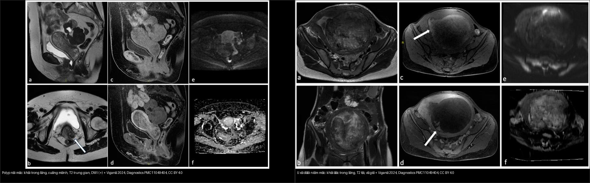
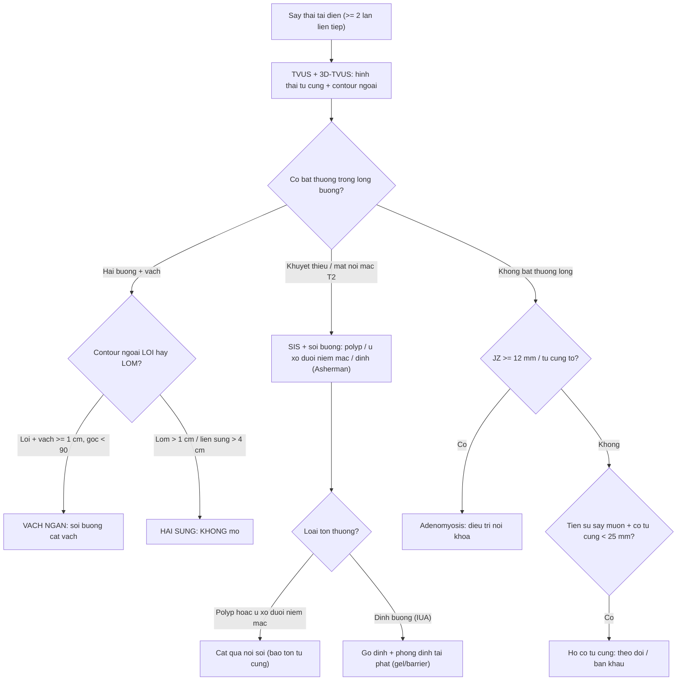
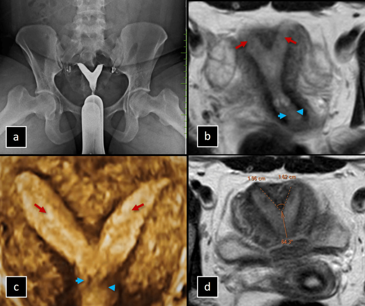
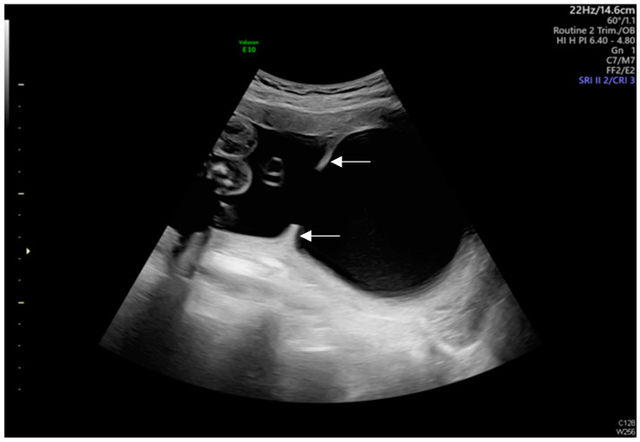
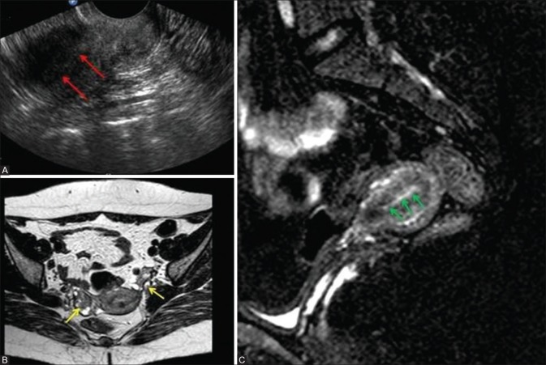
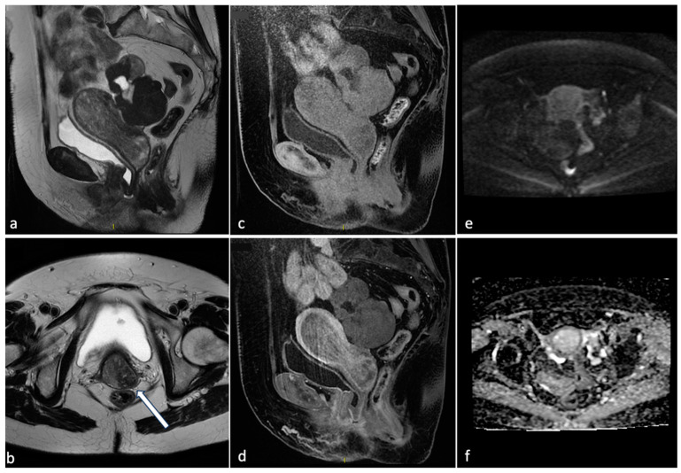
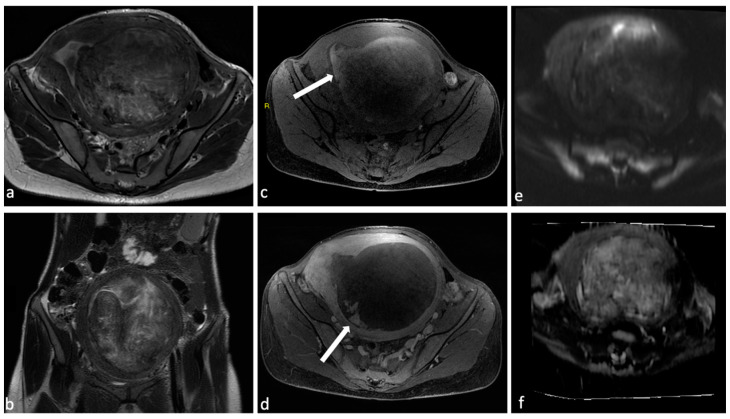

# 571 — Sẩy thai tái diễn: tiếp cận hình ảnh tử cung / Recurrent pregnancy loss: uterine imaging work-up

**Tags:** `pattern:say-thai-tai-dien` `vung:tu-cung` `score:ESHRE-ESGE` `score:ASRM` `protocol:sonohysterography` `protocol:MRI-tu-cung`
**Mức chắc chắn (certainty):** tổng hợp y văn (literature synthesis) — nhóm tự biên từ y văn mở (Insights into Imaging 2025, Indian J Radiol Imaging 2020, Diagnostics 2024, Human Reproduction Update 2025), số liệu định lượng lấy nguyên văn từ bài gốc.

## 1. Tổng quan — vì sao phải "soi" tử cung, và vì sao MRI/SIS thấy được bất thường

- **Sẩy thai tái diễn (recurrent pregnancy loss, RPL):** **≥ 2 lần sẩy thai liên tiếp** (ESHRE 2023 & ASRM 2020; ngưỡng cũ ≥ 3). Nguyên nhân gồm di truyền, nội tiết, miễn dịch/đông máu, **yếu tố tử cung (uterine factor) và cổ tử cung**.
- **TẦM QUAN TRỌNG của yếu tố tử cung:** phần lớn là **nguyên nhân SỬA ĐƯỢC bằng mổ nội soi** (cắt vách, cắt polyp, cắt u xơ dưới niêm mạc, gỡ dính) → hình ảnh quyết định ai được mổ. Dị dạng ống Müller (MDA) **chiếm 13,3–24,5%** người sẩy thai tái diễn (so với **5,5%** dân số và **~8%** người vô sinh — Dixit 2025).
- **TẠI SAO bất thường buồng tử cung gây sẩy:** (a) **vách ngăn** là mô **xơ–sợi ít mạch (poorly vascularized)** — niêm mạc trên vách teo, phôi làm tổ thiếu nuôi dưỡng → sẩy/thai lưu sớm; (b) **dính buồng tử cung (IUA/Asherman)** làm mất niêm mạc chức năng → buồng teo, thể tích giảm; (c) **u xơ dưới niêm mạc / polyp** là "dị vật" trong lòng → cản trở làm tổ (kể cả polyp **dưới 1 cm** vẫn có thể ảnh hưởng — Grover 2020); (d) **adenomyosis** phá vỡ vùng chuyển tiếp và cửa sổ làm tổ.
- **TẠI SAO MRI phân biệt được (vật lý tín hiệu):**
  - **Vách xơ** cho **T2 tín hiệu thấp đều** chen giữa hai buồng nội mạc sáng; **quyết định mổ hay không là ĐƯỜNG VIỀN NGOÀI đáy tử cung** (contour lồi = vách ngăn → mổ; lõm > 1 cm = hai sừng → **không mổ**).
  - **Asherman:** **mất dải tín hiệu T2 cao của nội mạc bình thường** kèm **tắc/nghẽn lòng** — dải xơ tín hiệu thấp co kéo; dịch ứ một ổ tạo hình "giả nang" trong buồng.
  - **U xơ:** khối đặc **T2 rất tối**, bờ rõ, **vỏ giả (pseudocapsule)**; **polyp:** khối trong lòng **T2 trung gian**, thường **DWI hạn chế nhẹ + ngấm thuốc**, cuống mảnh.
  - **Adenomyosis:** **vùng chuyển tiếp (junctional zone, JZ) dày** + nang nhỏ T2 sáng trong cơ.
- **Ngưỡng định lượng (bắt buộc nhớ):**
  - **Vách ngăn vs hai sừng (ASRM):** lõm ngoài/đáy **> 1 cm** hoặc **khoảng cách liên sừng > 4 cm** → **hai sừng (KHÔNG mổ)**; contour ngoài **lồi + vách trong ≥ 1 cm + góc < 90°** → **vách ngăn (mổ cắt vách)** (Grover 2020; xem thêm [528](../528-di-dang-tu-cung-bam-sinh-ESHRE-ESGE/lesson.md)).
  - **Adenomyosis:** **JZ ≥ 12 mm** (mốc dùng trong chẩn đoán MRI, xem [520](../520-tu-cung-u-xo-FIGO-adenomyosis-noi-mac/lesson.md)).
  - **Tần suất dính buồng tử cung (IUA) sau can thiệp** (Munro 2025, tổng quan hệ thống + meta): sau **hút thai/sản phẩm thụ thai ở sẩy sớm ~17%** (95% CI 11–25%); sau **cắt u xơ qua nội soi ~16%** (6–28%); sau **cắt vách ngăn qua nội soi ~28%** (13–46%). → **chính thủ thuật điều trị cũng gây dính**, cần phòng bằng gel/barrier.
  - **Cổ tử cung ngắn:** **TVUS cut-off 25 mm** thường dùng định nghĩa cổ ngắn; ở **19 tuần** mốc này ứng với **bách phân vị thứ nhất** và **tỉ số khả năng (likelihood ratio) ~4,3** cho sinh non (Beaver 2024).

## 2. Mẫu hình + chẩn đoán phân biệt theo cơ chế & vị trí (Gamut)

- **Nhóm bẩm sinh (MDA):** **vách ngăn (thường gặp nhất, liên quan sẩy nhiều nhất)**; hai sừng/đôi; một sừng; **dị dạng cổ/âm đạo kèm theo (C/V)** — xem [528](../528-di-dang-tu-cung-bam-sinh-ESHRE-ESGE/lesson.md)/[529](../529-co-tu-cung-am-dao-bam-sinh-tac-nghen/lesson.md).
- **Nhóm mắc phải — trong lòng buồng:** **dính buồng tử cung (IUA/Asherman)**, **polyp nội mạc**, **u xơ dưới niêm mạc (FIGO 0–2)**.
- **Nhóm mắc phải — thành cơ:** **adenomyosis**.
- **Nhóm cổ tử cung:** **hở cổ tử cung (cervical insufficiency)** — sẩy muộn quý II.
- **Gợi nhớ theo bước chẩn đoán:** **Buồng tử cung có gì bất thường?** (vách / dính / polyp / u xơ) → **thành cơ?** (adenomyosis) → **cổ tử cung?** (ngắn/hở). "Trong lòng = mổ nội soi được; thành cơ/cổ = hướng điều trị khác".

## 3. Bảng so sánh phân biệt (ma trận đối chiếu)

| Thực thể (entity) | Hình ảnh điển hình | Chốt vào (rule-in) | Chốt loại (rule-out) | Gợi ý xác nhận |
|---|---|---|---|---|
| Vách ngăn tử cung (septate) | Hai buồng nội mạc, **vách T2 tối đều**, **contour ngoài LỒI** | **Contour ngoài lồi + vách ≥ 1 cm + góc < 90°** | Lõm ngoài > 1 cm / liên sừng > 4 cm → hai sừng (không mổ) | Soi buồng cắt vách (metroplasty) |
| Dính buồng tử cung (IUA/Asherman) | **Mất dải T2 cao của nội mạc** + dải xơ co kéo + ổ dịch khu trú | **Mất nội mạc T2 + tắc/nghẽn lòng + tiền sử nạo/hút** | Nội mạc T2 liên tục bình thường → loại | **Soi buồng là tiêu chuẩn vàng**; SIS/HSG sàng lọc |
| Polyp nội mạc | Khối trong lòng, **T2 trung gian**, cuống mảnh, ngấm thuốc | **Khối trong lòng có cuống + DWI (+) nhẹ** | Khối T2 rất tối bờ rõ → u xơ | Soi buồng cắt polyp |
| U xơ dưới niêm mạc (FIGO 0–2) | Khối đặc **T2 tối, bờ rõ, vỏ giả**, đè đẩy nội mạc | **Khối T2 tối bờ rõ + vỏ giả + đẩy lệch nội mạc** | Khối T2 trung gian cuống mảnh → polyp | Soi buồng cắt u xơ |
| Adenomyosis | **JZ dày ≥ 12 mm** + nang nhỏ T2 sáng trong cơ, tử cung to đối xứng | **JZ ≥ 12 mm + nang cơ + bờ nhập nhằng** | Khối bờ rõ có vỏ giả → u xơ | MRI (T2W); điều trị nội khoa |
| Hở cổ tử cung (cervical insufficiency) | **Cổ tử cung ngắn < 25 mm** / phễu hóa trước 24 tuần | **< 25 mm + tiền sử sẩy muộn quý II** | Cổ bình thường → loại | TVUS nối tiếp; bán khâu/vòng nâng |

*Trái: **polyp nội mạc** — khối trong lòng, T2 trung gian, cuống mảnh, DWI dương nhẹ. Phải: **u xơ dưới niêm mạc** — khối đặc T2 tối, bờ rõ, vỏ giả, đẩy lệch nội mạc. Nguồn: Viganò et al., Diagnostics 2024 Fig. 1 + Fig. 3 (PMC11049404), CC BY 4.0, ghép bằng `tools/make_composite.py` (letterbox, giữ aspect).*

### Vì sao cùng "khối trong lòng" mà điều trị khác nhau
- **Polyp / u xơ dưới niêm mạc:** cắt qua ngả soi buồng (**hysteroscopic resection**) — bảo tồn tử cung, cải thiện tỉ lệ làm tổ.
- **Vách ngăn:** cắt vách qua ngả soi buồng (**metroplasty**); **hai sừng: KHÔNG mổ** (tiên lượng sinh sản gần bình thường).
- **Dính (Asherman):** gỡ dính nội soi + **phòng dính tái phát** (gel hyaluronic/barrier, vòng đỡ); dính nặng tiên lượng xấu hơn.

## 4. Protocol chụp + hệ phân độ/điểm chuẩn hóa

- **Đầu tay:** **siêu âm đầu dò âm đạo (TVUS) + siêu âm 3D tái tạo vành (3D-TVUS)** — đánh giá hình thái tử cung và contour ngoài.
- **Nghi tổn thương TRONG lòng (polyp/u xơ/dính):** **siêu âm bơm nước buồng tử cung (saline infusion sonohysterography, SIS)** — hiển thị khuyết thiếu trong lòng tốt hơn TVUS thường quy; HSG cho hình khuyết thiếu nhưng không đánh giá được thành cơ.
- **MRI tiểu khung** khi: siêu âm không kết luận, MDA phức tạp, chuẩn bị mổ, hoặc nghi adenomyosis. Protocol **T2W axial + coronal + sagittal (vuông góc trục thân tử cung để lộ contour ngoài)** + **T1W fat-sat** khi nghi ứ máu; MRI cũng giúp **phân biệt vách ngăn vs hai sừng** và **loại trừ nguyên nhân khác**.
- **Tiêu chuẩn vàng:** **soi buồng tử cung (hysteroscopy)** cho tổn thương trong lòng và dính; vừa chẩn đoán vừa điều trị.
- **Hệ phân độ:** **ESHRE/ESGE 2013** (U0–U6 + C/V) cho MDA; **ASRM 2021** cho vách ngăn/hai sừng; **phân loại AFS (American Fertility Society)** cho dính buồng tử cung (mức độ nhẹ–trung bình–nặng theo tỉ lệ buồng bị dính).

*Nữ 26 tuổi sẩy thai tái diễn: (a) HSG hai buồng; (b) MRI T2 vành hai buồng nội mạc (mũi tên đỏ) + cổ (xanh); (c) 3D-US; (d) đo **góc vách 64,3°**, lõm trong **1,96/1,62 cm** → vách ngăn (ASRM không xác định nếu lõm ≥ 1 cm nhưng góc ≥ 90°). Nguồn: Ramakrishnan et al., Cureus 2024 Fig. 3 (PMC11526810), CC BY 4.0.*

*Dính buồng tử cung tạo **vách/dải xơ** bám vào thành trước và thành sau lòng tử cung (mũi tên trắng) — hình ảnh gợi ý Asherman khi kèm tiền sử nạo hút. Nguồn: Huang et al., Diagnostics 2024 Fig. 3 (PMC11674699), CC BY 4.0.*

## 5. Biến thể bình thường và cạm bẫy

- **Sóng co cơ tử cung trên T2** tạo **dải tín hiệu thấp thoáng qua** giả "vách ngăn"/giả dính → chụp lại sau vài phút; đừng vội chốt.
- **Tử cung hình cung (arcuate)** lõm trong **< 1 cm** = biến thể → **không mổ** (đừng gọi vách ngăn).
- **Vách ngăn vs hai sừng = mổ hay không mổ:** chỉ contour ngoài trên **mặt cắt vành** mới chốt; HSG/axial đơn thuần không loại trừ được hai sừng → nguy cơ **mổ oan**.
- **Polyp nhỏ/cuống mảnh** dễ lẫn với **dính hoặc nếp niêm mạc** trên TVUS → cần **SIS** hoặc soi buồng; **polyp < 1 cm** vẫn có thể cản trở làm tổ.
- **Bỏ sót IUA sau hút thai:** bệnh nhân sẩy lặp lại + nạo/hút nhiều lần → luôn nghĩ **Asherman** (mất nội mạc T2), tránh chỉ loạn nội tiết.
- **Đừng quên nguyên nhân ngoài tử cung:** nếu buồng tử cung bình thường, phải sàng lọc tiếp **yếu tố miễn dịch/đông máu, nội tiết, nhiễm sắc thể** — hình ảnh tử cung chỉ loại trừ MỘT nhóm nguyên nhân.

## 6. Tự lượng giá — Blind Quiz

**Ca 1 — Nữ 26 tuổi sẩy 3 lần liên tiếp, HSG hai buồng. Đọc ảnh trước.**

- Gợi ý lâm sàng (clinical context): sẩy thai tái diễn, HSG cho hai buồng, chưa rõ vách ngăn hay hai sừng.
- Câu hỏi: Contour ngoài đáy tử cung **lồi hay lõm**? Xử trí **mổ** hay **không mổ**? Vì sao?

<b>Bấm để hiện đáp án (findings + chẩn đoán)</b>

- Dấu hiệu (findings): MRI T2 vành + 3D-US cho **hai buồng nội mạc** với vách trong; đo **góc vách 64,3°**, lõm trong **1,96/1,62 cm**, **contour ngoài lồi**.
- Chẩn đoán (diagnosis): **vách ngăn tử cung** — vì contour ngoài lồi + lõm trong ≥ 1 cm; xử trí **soi buồng cắt vách** (khác hai sừng: không mổ).
- Nguồn ảnh: Ramakrishnan et al., Cureus 2024 Fig. 3 (PMC11526810), CC BY 4.0.

**Ca 2 — Nữ 32 tuổi sẩy 2 lần; tiền sử nạo hút 2 lần, kinh ít. Đọc ảnh trước.**

- Gợi ý lâm sàng: sẩy tái diễn, nạo/hút nhiều lần, kinh nguyệt rất ít.
- Câu hỏi: Nội mạc T2 còn dải sáng liên tục không? Chẩn đoán? Tiêu chuẩn vàng để xác nhận?

<b>Bấm để hiện đáp án (findings + chẩn đoán)</b>

- Dấu hiệu: (A) siêu âm **mất echo nội mạc** (mũi tên đỏ); (B,C) MRI — nội mạc mỏng/không đều, dải xơ co kéo (mũi tên vàng/xanh) → **mất niêm mạc chức năng + buồng biến dạng**.
- Chẩn đoán: **dính buồng tử cung (Asherman)** — nghĩ do tổn thương nội mạc sau nạo hút. Tiêu chuẩn vàng: **soi buồng**; xử trí gỡ dính + phòng dính tái phát.
- Nguồn ảnh: Grover et al., Indian J Radiol Imaging 2020 Fig. 15 (PMC7240899), CC BY-NC-SA 4.0 (nguyên bản, không ghép).

**Ca 3 — Nữ 35 tuổi rong kinh + sẩy 2 lần; MRI thấy khối trong lòng tử cung. Đọc ảnh trước.** *(ca nguyên văn: bệnh nhân 76 tuổi — xem phản biện)*

- Gợi ý lâm sàng (nguyên văn): bệnh nhân **76 tuổi, chảy máu sau mãn kinh**; MRI có khối lớn trong lòng tử cung.
- Câu hỏi: Khối **đặc hay nang**? Tín hiệu T2? DWI/ADC ra sao? 3 phân biệt + ý nghĩa lâm sàng?

<b>Bấm để hiện đáp án (findings + chẩn đoán)</b>

- Dấu hiệu: (a,b) T2 — khối **tín hiệu trung gian** lấp buồng tử cung, bờ tương đối rõ; (c) CUBE; (d) sau tiêm ngấm thuốc; (e,f) DWI/ADC hạn chế nhẹ → **polyp nội mạc lớn**.
- Chẩn đoán: **polyp nội mạc** — vì khối trong lòng, T2 trung gian, cuống/ngấm thuốc; **phản biện:** ca gốc ở phụ nữ **sau mãn kinh** (chảy máu sau mãn kinh) — polyp **có nguy cơ ác tính tăng theo tuổi mãn kinh và AUB** → phải **sinh thiết/loại trừ ung thư**, khác bối cảnh sẩy thai ở người trẻ. *Không sửa nguồn, chỉ chú thích phản biện.*
- Nguồn ảnh: Viganò et al., Diagnostics 2024 Fig. 1 (PMC11049404), CC BY 4.0.

**Ca 4 — Nữ 34 tuổi sẩy 3 lần; MRI thấy khối đặc trong lòng đè lệch nội mạc. Đọc ảnh trước.**

- Gợi ý lâm sàng: sẩy tái diễn + rong kinh; MRI khối đặc trong/áp thành tử cung.
- Câu hỏi: Đây là polyp hay u xơ? Dấu hiệu nào chốt? Xử trí?

<b>Bấm để hiện đáp án (findings + chẩn đoán)</b>

- Dấu hiệu: (a,b) T2 vành/axial khối **đặc, T2 tối, bờ rõ, vỏ giả**, đẩy lệch nội mạc; (e,f) DWI/ADC không hạn chế kiểu polyp nhỏ.
- Chẩn đoán: **u xơ dưới niêm mạc (leiomyoma, FIGO 0–2)** — vì khối T2 tối bờ rõ vỏ giả (khác polyp T2 trung gian). Xử trí **cắt qua ngả soi buồng** (bảo tồn tử cung).
- Nguồn ảnh: Viganò et al., Diagnostics 2024 Fig. 3 (PMC11049404), CC BY 4.0.

**Ca 5 — Phân tích ảnh ghép dưới đây: hai "khối trong lòng" khác nhau ở đâu?** *(Bảng mục 3.)*

<b>Bấm để hiện đáp án</b>

- Trái: **polyp** — T2 trung gian, cuống mảnh, DWI (+) nhẹ.
- Phải: **u xơ dưới niêm mạc** — T2 tối, bờ rõ, vỏ giả; cả hai đều cắt qua ngả soi buồng để bảo tồn tử cung.
- Nguồn: PMC11049404 Fig. 1 + Fig. 3, CC BY 4.0 (ảnh ghép letterbox).

## Bài liên quan chéo
- [500 – Tổng quan Vú & Sản Phụ khoa](../500-tong-quan-vu-san-phu-khoa/lesson.md)
- [520 – Tử cung: xơ FIGO, adenomyosis, dày nội mạc](../520-tu-cung-u-xo-FIGO-adenomyosis-noi-mac/lesson.md)
- [528 – Dị dạng tử cung bẩm sinh: vách ngăn vs hai sừng](../528-di-dang-tu-cung-bam-sinh-ESHRE-ESGE/lesson.md)
- [529 – Cổ tử cung & âm đạo bẩm sinh: dị dạng tắc nghẽn](../529-co-tu-cung-am-dao-bam-sinh-tac-nghen/lesson.md)
- [550 – Thai sớm & thai ngoài tử cung](../550-thai-som-say-thai-thai-ngoai-tu-cung/lesson.md)
- [565 – Sàng lọc hình thái thai & Doppler sản khoa](../565-sang-loc-hinh-thai-va-doppler-san-khoa/lesson.md)

## Ảnh
- Tên file: `571_slug_Modality_SourceID.jpg`. Nguồn + giấy phép từng ảnh trong `images/CREDITS.md`.
- AuntMinnie (https://www.auntminnie.com): paywall — **chỉ dẫn link, không tải**.

> Không dùng để chẩn đoán độc lập khi chưa có người hướng dẫn.
