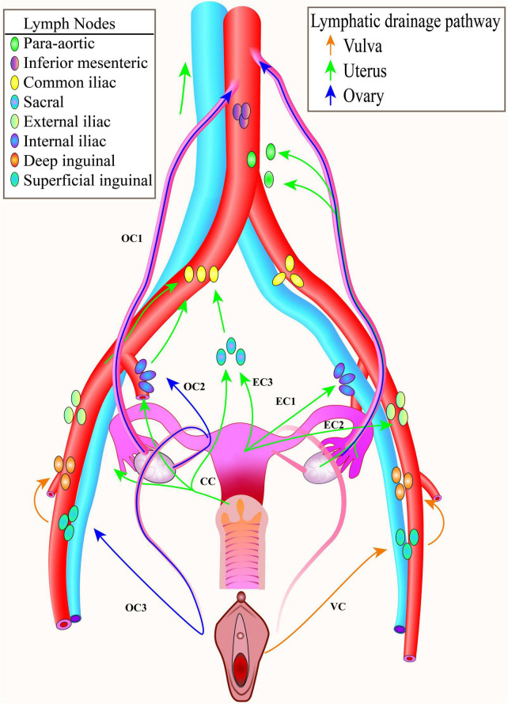
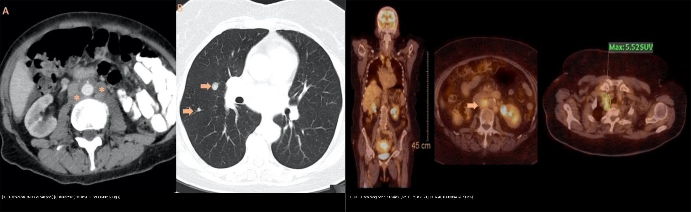
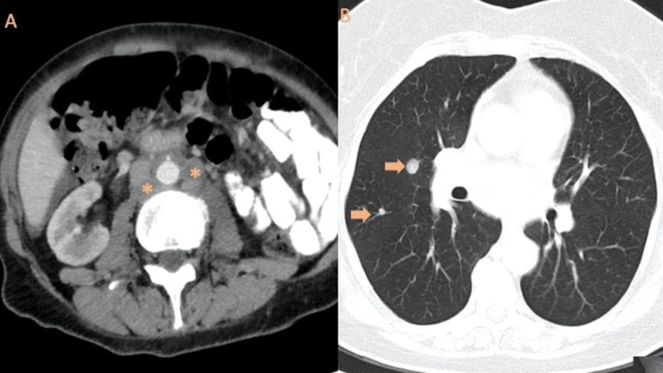
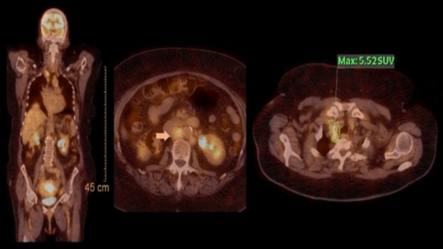
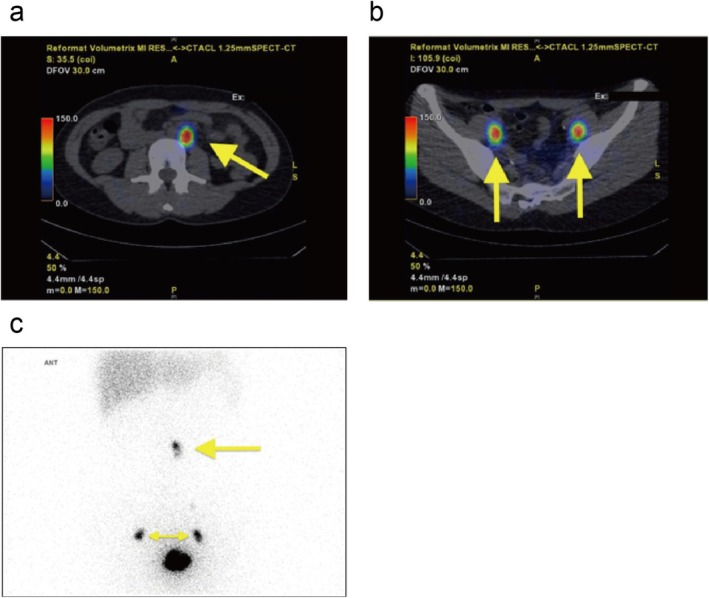
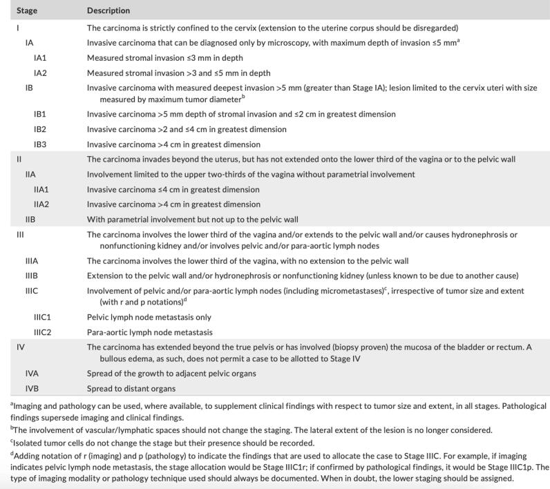
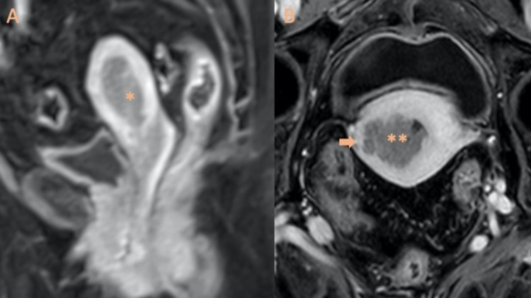

# 572 — Hạch trong ung thư phụ khoa: hạch gác (SLN), hạch chậu–cạnh ĐMC & PET-CT / Nodal staging in gynecologic cancer

**Tags:** `pattern:hach-di-can` `vung:hach-chau` `vung:hach-canh-dmc` `score:FIGO` `protocol:PET-CT` `protocol:SLN-ICG`
**Mức chắc chắn (certainty):** tổng hợp y văn (literature synthesis) — nhóm tự biên từ y văn mở (sơ đồ dẫn lưu bạch mạch, ca SLN cạnh ĐMC, ca PET/CT, phân tích gộp SLN-ICG), chưa gắn một ca nguyên văn đơn lẻ.

## 1. Tổng quan bệnh học – cơ chế hình ảnh

- **Vì sao hạch là “trạm gác” quyết định điều trị:** tình trạng hạch chậu/cạnh động mạch chủ (para-aortic) **đổi giai đoạn FIGO** (thành **IIIC1 / IIIC2**), quyết định **trường xạ trị**, có/không **nạo hạch** và có/không **hóa trị**. Bỏ sót hạch dương = **xạ thiếu trường → tái phát** (ca quiz Ca 3).
- **TẠI SAO mỗi cơ quan dẫn lưu tới một nhóm hạch khác nhau (nền tảng định vị):**
  - **Buồng trứng:** theo **mạch trứng (gonadal vessels)** → **cạnh ĐMC** trước tiên (hiếm khi hạch chậu) → vì thế u buồng trứng di căn **cạnh ĐMC**.
  - **Thân tử cung:** theo **dây chằng tròn + mạch buồng trứng** → **cả hạch chậu và cạnh ĐMC** (hai đường).
  - **Cổ tử cung:** theo **dây chằng rộng/chu cung** → **hạch thông (obturator), chậu trong/ngoài, trước xương cùng**, phần trên theo mạch buồng trứng → **cạnh ĐMC**.
  - **Âm hộ:** → **hạch bẹn–đùi (inguinofemoral)**.
  - Vì thế **một tổn thương nhỏ ở cổ tử cung hoàn toàn có thể có hạch gác CẠNH ĐMC** (không chỉ hạch chậu) — xem Ca 3.
- **TẠI SAO tiêu chuẩn “kích thước hạch” không đủ:** hạch **kích thước bình thường vẫn có thể chứa vi di căn (micrometastasis)**; hạch **to lại có thể do viêm/phản ứng**. Trên CT, hạch được coi “nghi” khi **trục ngắn > 10 mm** (hạch chậu/chủ), nhưng **độ nhạy chỉ ~30–57%**, độ đặc hiệu ~92–98%.
- **TẠI SAO FDG-PET/CT có vai trò nhưng bị hạn chế:** tế bào u tăng đường phân → **¹⁸F-FDG** tập trung (SUVmax). **Nhưng độ nhạy thấp với hạch nhỏ/vi di căn:** trong nghiên cứu SENTIREC-endo (n = 227, 23% có di căn hạch), **PET/CT Se 56% (95% CI 42–68), Sp 91% (86–94), PPV 64%, NPV 87%**; **riêng cạnh ĐMC Sp 97% nhưng Se vẫn 56%**; kích thước hạch và **SUVmax chỉ có giá trị trung bình (AUC-ROC ~ 0,7)**. Phân tích gộp khác báo Se/Sp **~72% / ~94%**. **SUVmax cao (≥ 12,7) gắn tiên lượng xấu hơn**.
- **TẠI SAO hạch gác (sentinel lymph node — SLN) hiệu quả:** tracer tiêm quanh u/cổ tử cung đi **theo đúng đường bạch mạch của tế bào u** tới **hạch chặng một (first-echelon)**; **siêu phân đoạn mô bệnh (ultrastaging — cắt lát 2 mm)** tìm được **vi di căn** mà cắt ngang thường bỏ sót. **Số liệu SLN-ICG ở ung thư nội mạc nguy cơ thấp–trung bình (gộp 14 nghiên cứu, 2.117 BN):** **tỷ lệ phát hiện SLN 95,6% (92,4–97,9), hai bên 76,5% (68,1–84,0)**; **tỷ lệ hạch dương 9,6% (G1–2) – 11,8% (G1–3)**; **NPV 100% (G1–2) và 99,2% (kể cả G3)**.
- **Định nghĩa gánh nặng hạch (để chốt giai đoạn):** **ITC (chỉ tế bào đơn lẻ) ≤ 0,2 mm / < 200 tế bào**; **vi di căn > 0,2–2,0 mm / 200–2.000 tế bào**; **đại di căn (macrometastasis) > 2,0 mm**. SLN dương **đại thể** → nạo hạch chậu ± xạ; **vi di căn** → xử trí tùy thể (thường hạ giai đoạn + cân nhắc xạ bổ trợ).
- **TẠI SAO ung thư cổ tử cung giai đoạn sớm vẫn phải tìm hạch:** ở **FIGO 2009 IA–IIA, di căn hạch gặp 14,8%** — nghĩa là **~1/7 ca “sớm” đã có hạch** → SNNS được đưa vào để **giảm biến chứng (phù bạch mạch, lymphocele)** mà **không bỏ sót hạch**.

## 2. Mẫu hình + chẩn đoán phân biệt theo đường dẫn lưu (Gamut)

- **Theo cơ quan gốc:** buồng trứng → **cạnh ĐMC** → nách/thượng đòn; tử cung → **chậu + cạnh ĐMC**; cổ tử cung → **chu cung/thông/chậu trong + cạnh ĐMC**; âm hộ → **bẹn–đùi**.
- **Theo tầng hạch trên hình ảnh:** **chậu** (bịt/thông, chậu ngoài, chậu trong, trước xương cùng) vs **cạnh ĐMC** (dưới/R2, quanh động mạch chủ) vs **trung thất/thượng đòn** (lan xa).
- **Theo tính chất:** hạch **hoại tử/hình cầu mất rốn mỡ** (nghi hơn) vs hạch **vỏ dày, giữ rốn mỡ** (có thể viêm) vs **hạch nhỏ bình thường nhưng chứa vi di căn** (chỉ SLN/ultrastaging phát hiện).
- **Gợi nhớ tiếp cận:** **“hạch nhìn thấy phải đặt đúng dòng bạch mạch của cơ quan gốc”** — một hạch to **không đúng đường dẫn lưu** thường là **lành tính (phản ứng)**; một hạch **nhỏ đúng đường dẫn lưu** vẫn phải coi **nghi**.


*Đường dẫn lưu: **buồng trứng (mũi tên xanh dương) → cạnh ĐMC**; **tử cung (xanh lá) → chậu + cạnh ĐMC**; **cổ tử cung (CC) → thông/chậu trong + cạnh ĐMC**; **âm hộ (cam) → bẹn–đùi**. Nguồn: Front Med 2022 (PMC9276931), CC BY 4.0.*

## 3. Bảng so sánh phân biệt (ma trận đối chiếu)

| Thực thể / phương thức (entity) | Hình ảnh điển hình | Chốt vào (rule-in) | Chốt loại (rule-out) | Gợi ý xác nhận |
|---|---|---|---|---|
| MRI tiểu khung (T2W + DWI/ADC) | Hạch hình cầu, mất rốn mỡ, **DWI sáng/ADC thấp**, > 10 mm trục ngắn | **DWI sáng + mất rốn mỡ + tương ứng dòng dẫn lưu** | Hạch giữ rốn mỡ, đồng tín hiệu → nghĩ lành | Đối chiếu chuỗi DWI + CT/PET |
| CT bụng–chậu cản quang | Hạch **> 10 mm trục ngắn**, bờ viền/hoại tử; đánh giá phổi–gan cùng lúc | **Hạch to đúng dòng + hoại tử trung tâm** | **Se chỉ 30–57%** → CT âm tính KHÔNG loại trừ | CT ngực tìm trung thất/thượng đòn |
| **¹⁸F-FDG PET/CT** | Hạch tăng **SUVmax**; toàn thân một lần | **SUVmax cao + hạch đúng dòng (Sp cạnh ĐMC 97%)** | **Se 56% ở hạch nhỏ/vi di căn → âm tính KHÔNG loại trừ** | Định hướng nạo/xạ hạch dương; đối chiếu mô bệnh |
| **SLN (ICG / ⁹⁹ᵐTc)** | Hạch gác phát quang (ICG) hoặc bắt phóng xạ (SPECT-CT/gamma probe) | **Hạch gác bắt tracer + siêu phân đoạn (cắt 2 mm)** | Đã có hạch dương đại thể trên hình ảnh → SLN ít giá trị | **NPV 99,2–100%**, phát hiện hai bên 76,5% |
| Hạch phản ứng/viêm (mimic) | Hạch **vỏ dày đều, giữ rốn mỡ**, cùng bên ổ viêm | **Giữ rốn mỡ + bối cảnh nhiễm trùng** | Mất rốn mỡ + hoại tử → nghi ác | Kháng sinh/theo dõi; tránh “nạo hạch oan” |
| Lao/hạch viêm u hạt (mimic) | Hạch **vôi hóa, hoại tử bã đậu**, hai bên | **Vôi hóa + bối cảnh lao** | Hạch ác thường không vôi hóa dạng này | ADA/sinh thiết nếu cần phân biệt |


*Trái: **CT bụng cản quang** — nhiều hạch cạnh ĐMC hoại tử (*) = **FIGO IIIC2**, kèm di căn phổi (mũi tên, hình B). Phải: **PET/CT** — hạch cạnh ĐMC + thượng đòn phải tăng chuyển hóa (**SUVmax 5,52**) trong bối cảnh nghi tái phát. Nguồn: Cureus 2021 (PMC8648287), CC BY 4.0. Ảnh ghép letterbox.*

## 4. Protocol chụp + phân giai đoạn FIGO hạch

- **MRI tiểu khung có DWI/ADC (b = 800–1000)** là chuẩn đánh giá tại chỗ nội mạc/cổ tử cung; **bổ sung CT bụng–chậu ± ngực cản quang** để đánh giá hạch + di căn xa; **PET/CT** khi nguy cơ cao/hạch to trên CT/tái phát.
- **Kỹ thuật SLN (ung thư nội mạc & cổ tử cung):** tiêm **ICG (hoặc ⁹⁹ᵐTc-phytate)** quanh cổ tử cung (ca quiz tiêm **99mTc-phytate tại vị trí 2, 4, 8, 10 giờ**); nội mạc: ICG tiêm quanh cổ tử cung (cervical injection) là chuẩn; đọc **SPECT-CT** ( ⁹⁹ᵐTc) hoặc **camera huỳnh quang (near-infrared)**. **Nguyên tắc:** lấy **mọi hạch gác** + **hạch nghi ngờ**; nếu một bên không có SLN → **nạo hạch bên đó**; **siêu phân đoạn cắt lát 2 mm** + hóa mô miễn dịch (AE1/AE3).
- **Tracer (định lượng):** **dị ứng thuốc nhuộm xanh (blue dye) ~2%**, còn **ICG chỉ ~0,05%** — ICG là lựa chọn an toàn, phát hiện hạch chậu tốt hơn xanh.
- **FIGO hạch (điểm chốt báo cáo):**
  - **Ung thư cổ tử cung (FIGO 2018):** **IIIC1** = hạch chậu dương; **IIIC2** = hạch **cạnh ĐMC** dương (r = hình ảnh, p = mô bệnh; **kích thước u không còn đổi nhóm khi có hạch**).
  - **Ung thư nội mạc (FIGO 2023):** **IIIC1** = hạch **chậu**; **IIIC2** = hạch **cạnh ĐMC**.
  - **Ghi rõ** — hạch **chậu** hay **cạnh ĐMC** và bên; **micrometastasis/ITC** có thể đổi giai đoạn ở một số hệ.
- **Giới hạn kỹ thuật cần nhớ:** lymphoscintigraphy **chỉ thấy hạch bắt tracer**, không thấy hạch bị u “bít” hoàn toàn (non-visualized) → luôn có **hạch nghi ngờ dự phòng**.

```mermaid
flowchart TD
  A[Ung thu phu khoa - danh gia hach] --> B{MRI + CT (DWI) nguy co cao?}
  B -->|Khong| C[SLN mapping (ICG/99mTc) trong mo]
  B -->|Co| D[Them FDG-PET/CT toan than]
  C --> E{Hach gac duong tinh?}
  D --> F{Hach to/SUV cao dung dong?}
  F -->|Co| G[Nao hach chu - xac dinh IIIC1/IIIC2]
  F -->|Khong| C
  E -->|Co| G
  E -->|Khong| H{NPV 99-100 - mot ben khong co SLN?}
  H -->|Co| I[Nao hach ben do bo sung]
  H -->|Khong| J[BSLT theo FIGO - theo doi]
```

## 5. Biến thể bình thường và cạm bẫy

- **PET âm tính KHÔNG loại trừ hạch:** Se chỉ ~56% ở hạch nhỏ/vi di căn — **đừng “an tâm” vì PET âm**.
- **Hạch to do viêm/phản ứng** (PID, sau mổ, lao) dễ bị đọc “di căn” → dựa **vỏ dày đều + giữ rốn mỡ + bối cảnh**.
- **“Thỏa mãn tìm kiếm” (satisfaction of search):** tìm được hạch chậu rồi dừng → **bỏ sót hạch cạnh ĐMC** (nhất là cổ tử cung — dẫn lưu tới cạnh ĐMC qua mạch buồng trứng). Ca quiz Ca 3 là ví dụ kinh điển: hạch cạnh ĐMC **bị bỏ sót** → xạ thiếu trường.
- **SLN “không thấy bên nào”** → phải **nạo hạch bên đó**, đừng bỏ trống vì “không có hạch gác”.
- **Hạch non-visualized do bị u bít** không xuất hiện trên lymphoscintigraphy → luôn lấy thêm hạch nghi ngờ.
- **Kích thước không đáng tin:** hạch **< 10 mm vẫn di căn**, hạch **> 10 mm có thể lành** — cần **DWI/ADC + mô bệnh**.
- **Di căn ngoài hạch (thượng đòn/trung thất)** đổi giai đoạn **IVB** ở nhiều hệ — **đọc ngực trên CT/PET**.
- **SUVmax trên hạch có thể bị ảnh hưởng bởi viêm/huy động tủy** — không chốt một mình SUVmax.

## 6. Tự lượng giá — Blind Quiz

**Ca 1 — Nữ 54 tuổi, K nội mạc. Trên CT bụng–chậu có gì? Vì sao quan trọng?**



- Gợi ý lâm sàng (clinical context): carcinoma nội mạc, đau lưng nhẹ.
- Câu hỏi: Mô tả tổn thương ở (A) và (B)? Giai đoạn FIGO nào? Ảnh B thuộc giai đoạn nào?

<details><summary><b>Bấm để hiện đáp án (findings + chẩn đoán)</b></summary>

- Dấu hiệu (findings): (A) **nhiều hạch cạnh động mạch chủ hoại tử/hình cầu** (*) — trục ngắn > 10 mm; (B) CT ngực: **nốt phổi hai bên** (mũi tên) = di căn.
- Chẩn đoán (diagnosis): (A) **hạch cạnh ĐMC dương = FIGO IIIC2**; (B) **di căn phổi = giai đoạn IVB** — vì vậy **phải quét ngực**, không chỉ chậu.
- Nguồn ảnh: Cureus 2021 (PMC8648287) Fig. 4, CC BY 4.0.
</details>

**Ca 2 — PET/CT toàn thân: hạch nào tăng chuyển hóa, SUVmax bao nhiêu? Ý nghĩa?**



- Hỏi: Vì sao PET/CT được dùng ở đây? SUVmax 5,52 nói lên điều gì?

<details><summary><b>Bấm để hiện đáp án (findings + chẩn đoán)</b></summary>

- Dấu hiệu (findings): **hạch cạnh ĐMC tăng chuyển hóa** (mũi tên, axial) và **hạch thượng đòn phải** với **SUVmax 5,52** (ảnh phải).
- Chẩn đoán (diagnosis): **tái phát bệnh (recurrence)** sau hóa-xạ trị — PET/CT toàn thân phát hiện **ổ ngoài khung chậu** mà CT thường bỏ sót; SUVmax cao gắn tiên lượng xấu hơn.
- Nguồn ảnh: Cureus 2021 (PMC8648287) Fig. 5, CC BY 4.0.
</details>

**Ca 3 — Nữ 34 tuổi, K cổ tử cung T1a2 (FIGO 2018) muốn giữ sinh sản. SPECT-CT thấy hạch gác ở đâu? Vì sao quyết định đổi?** *(ca nguyên văn — phản biện)*



- Hỏi: Hạch gác nằm những đâu? Nếu chỉ lấy hạch chậu thì nguy cơ gì?

<details><summary><b>Bấm để hiện đáp án (findings + chẩn đoán)</b></summary>

- Dấu hiệu (findings): tiêm **99mTc-phytate** quanh cổ tử cung (2, 4, 8, 10 giờ); SPECT-CT: (a) **hạch gác cạnh ĐMC dưới trái** bắt phóng xạ; (b) **hai hạch bịt (obturator) hai bên**; (c) coronal. Gamma probe: bịt phải 22.410 cps, bịt trái 17.860 cps, **cạnh ĐMC trái 6.881 cps**. Cắt lát 2 mm: **đại di căn 2,5 mm ở hạch cạnh ĐMC**, **vi di căn 1,1 mm ở hạch bịt trái**.
- Chẩn đoán (diagnosis): **K cổ tử cung đã có hạch cạnh ĐMC (đại di căn) + hạch bịt (vi di căn)** → **chuyển từ cắt cổ tử cung giữ sinh sản sang cắt tử cung cải biên + nạo hạch chậu + hóa-xạ trị (gồm trường cạnh ĐMC)**. Nếu chỉ lấy hạch chậu → **bỏ sót hạch cạnh ĐMC → xạ thiếu trường → tái phát**.
- Phản biện: đây là **ca đơn lẻ, giai đoạn rất sớm (T1a2)** — nhưng chính vì thế nó cho thấy **SLN đổi hoàn toàn chiến lược điều trị**; cần thận trọng khi ngoại suy cho đại trà.
- Nguồn ảnh: J Obstet Gynaecol Res 2026 (PMC13281751) Fig. 2, CC BY 4.0.
</details>

**Ca 4 — Bảng phân giai đoạn cổ tử cung: hạch chậu và cạnh ĐMC đổi giai đoạn gì?**



- Hỏi: Hạch chậu dương → giai đoạn nào? Hạch cạnh ĐMC dương → giai đoạn nào?

<details><summary><b>Bấm để hiện đáp án (findings + chẩn đoán)</b></summary>

- Dấu hiệu (findings): bảng FIGO 2018 — nhóm **III**: *“involves pelvic and/or para-aortic lymph nodes”*; **IIIC1 = pelvic lymph node metastasis only**; **IIIC2 = para-aortic lymph node metastasis**.
- Chẩn đoán (diagnosis): hạch chậu dương = **IIIC1**; hạch cạnh ĐMC dương = **IIIC2**; chú thích nguồn: dùng **r (imaging)** hay **p (pathology)** để phân loại, và **kích thước u không còn đổi nhóm khi đã có hạch**.
- Nguồn ảnh: Gynecol Oncol Rep 2025 (PMC12399259) Fig. 5 (nguồn gốc: Bhatla 2021), CC BY-NC-ND 4.0 — giữ nguyên bản.
</details>

**Ca 5 — MRI nội mạc: u khu trú trong buồng tử cung. Đây là giai đoạn nào? Có hạch chưa?**



- Hỏi: Hai ảnh này minh họa điều gì về xâm lấn cơ và hạch?

<details><summary><b>Bấm để hiện đáp án (findings + chẩn đoán)</b></summary>

- Dấu hiệu (findings): (A) khối nội mạc (*) **khu trú trong buồng tử cung** (giai đoạn **IA**); (B) ảnh khác: u (dấu sao kép) **xâm lấn nửa ngoài cơ tử cung** (mũi tên) = **IB**.
- Chẩn đoán (diagnosis): **ung thư nội mạc giai đoạn I** (chưa hạch trên hình ảnh) — nhấn mạnh: **xâm lấn cơ quyết định IA/IB**, còn **hạch là trục riêng (IIIC)**; hình ảnh “chưa thấy hạch” không thay thế đánh giá hạch mô bệnh.
- Nguồn ảnh: Cureus 2021 (PMC8648287) Fig. 1, CC BY 4.0.
</details>

## Bài liên quan chéo
- [500 – Tổng quan Vú & Sản phụ khoa](../500-tong-quan-vu-san-phu-khoa/lesson.md)
- [525 – Ung thư nội mạc & cổ tử cung: FIGO trên MRI](../525-ung-thu-noi-mac-co-tu-cung-FIGO-MRI/lesson.md)
- [520 – U xơ cơ tử cung, adenomyosis & nội mạc](../520-tu-cung-u-xo-FIGO-adenomyosis-noi-mac/lesson.md)
- [530 – Khối phần phụ O-RADS, dermoid & xoắn](../530-buong-trung-ORADS-sieu-am-MRI/lesson.md)
- [535 – Ung thư buồng trứng, phúc mạc & u Krukenberg](../535-ung-thu-buong-trung-phuc-mac-krukenberg/lesson.md)
- [528 – Dị dạng tử cung bẩm sinh](../528-di-dang-tu-cung-bam-sinh-ESHRE-ESGE/lesson.md)

## Ảnh
- `572_linh-mach-chau_so-do_PMC9276931-Fig1.jpg`, `572_hach-canh-DMC_CT_PMC8648287-Fig4.jpg`, `572_hach-PET-CT_PMC8648287-Fig5.jpg`, `572_stage-I-MRI_PMC8648287-Fig1.jpg`, `572_SLN-SPECT-CT_PMC13281751-Fig2.jpg`, `572_FIGO-co-tu-cung_bang_PMC12399259-Fig5.jpg`, `composite_hach-CT-vs-PET.jpg`. Nguồn + giấy phép từng ảnh trong `images/CREDITS.md`.

> Không dùng để chẩn đoán độc lập khi chưa có người hướng dẫn.
