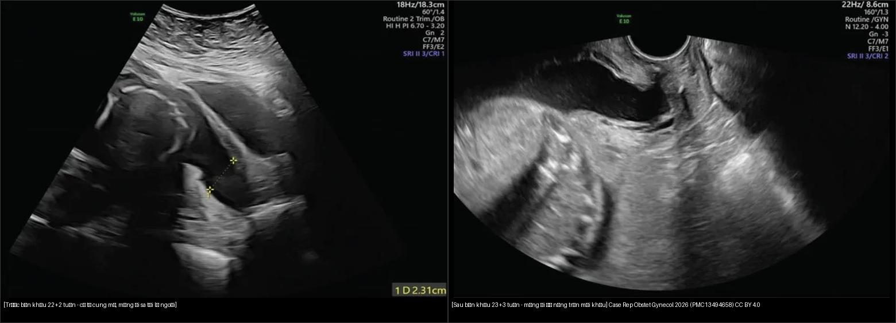
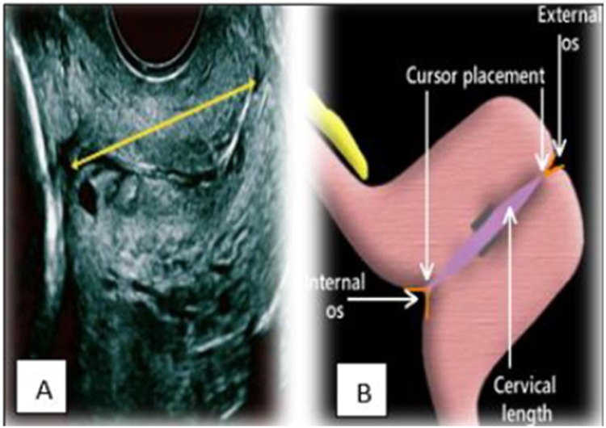
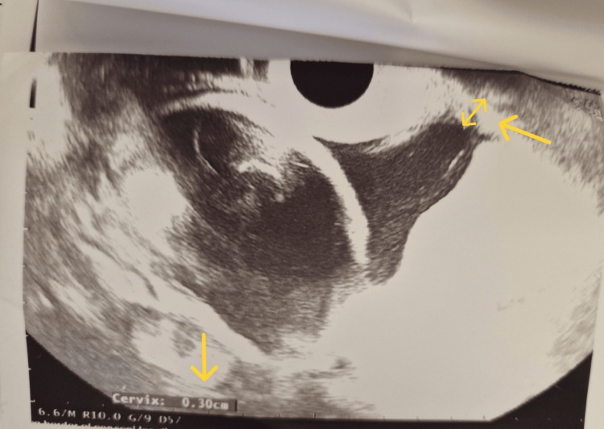
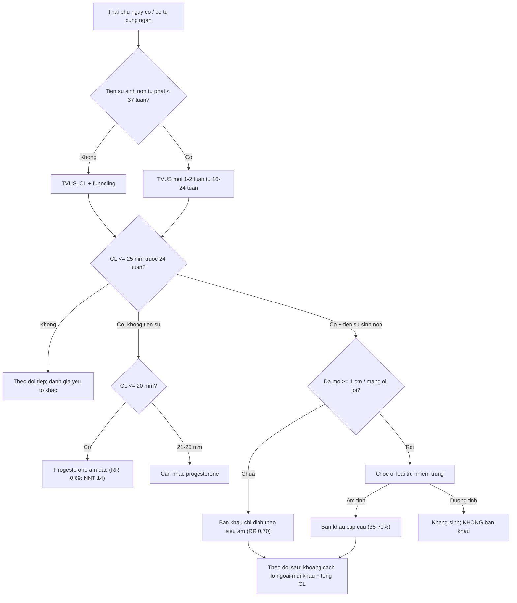
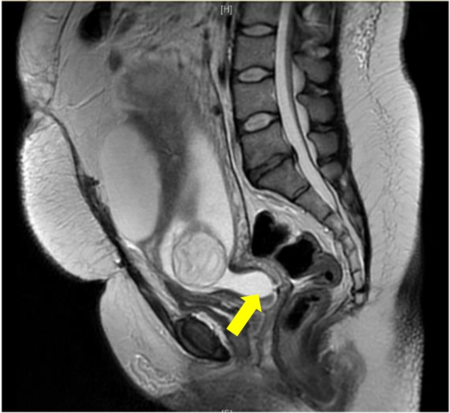
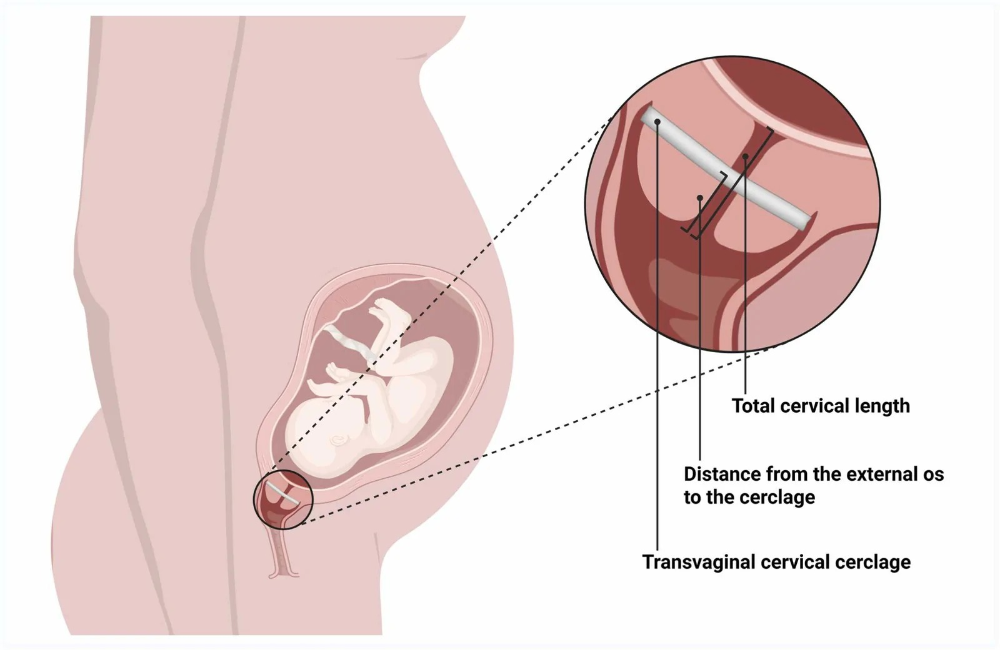

# 573 — Hở cổ tử cung & bán khâu: theo dõi siêu âm cổ tử cung / Cervical insufficiency & cerclage: sonographic surveillance

**Tags:** `pattern:ho-co-tu-cung` `pattern:co-tu-cung-ngan` `vung:co-tu-cung` `score:CL-25mm` `protocol:TVUS-co-tu-cung` `protocol:cerclage`
**Mức chắc chắn (certainty):** tổng hợp y văn (literature synthesis) — nhóm tự biên từ tổng quan mở *J Clin Med* 2025 (PMC12693418), nghiên cứu thuần tập bán khâu (PMC13586745), ca lâm sàng CC BY (PMC12893400, PMC13494658) và y văn sản khoa; số liệu định lượng lấy nguyên văn từ bài gốc.

## 1. Tổng quan bệnh học – cơ chế hình ảnh

- **Hở cổ tử cung (cervical insufficiency):** cổ tử cung **mở không đau** ở quý II (thường 14–27 tuần) khi **không có cơn co tử cung rõ** và **không do nguyên nhân khác** (nhiễm trùng lâm sàng, vỡ ối, dị dạng), dẫn tới sẩy thai muộn/sinh cực non tái diễn. Chiếm **1–2% thai kỳ** và **15–20% sẩy thai quý II tái diễn** (Baroutis D và cộng sự, *J Clin Med* 2025, PMC12693418).
- **Sinh lý bệnh:** cổ tử cung là "van cơ học" gồm **chất nền ngoại bào giàu collagen type I/III**; khi **thoái hóa collagen + viêm** (IL-1β, TNF-α, prostaglandin E2) + **tải cơ học của thai/thai nhiều** → cổ tử cung mềm, ngắn, mở. Vì vậy hình ảnh không phải "khối u" mà là **sự kiện theo thời gian (trajectory)** — đo một lần có thể bỏ qua giai đoạn thoái triển (Park MI & Park YJ, *J Pers Med* 2026, PMC13028481).
- **TẠI SAO siêu âm thấy được (vật lý):** dịch ối **trống âm (anechoic)** trên siêu âm; cổ tử cung là mô đặc **tăng hồi âm**, dải cơ–mô xơ. Vì thế màng ối **lồi vào ống cổ tử cung** tạo hình **phễu (funneling)** dễ nhận ra trên nền cổ tử cung sáng. **Siêu âm đầu dò âm đạo (TVUS)** là chìa khóa vì đo được toàn bộ ống cổ tử cung với bàng quang rỗng.
- **Ngưỡng định lượng bắt buộc nhớ:**
  - **Cổ tử cung ngắn (short cervix): CL ≤ 25 mm trước 24 tuần**. Kèm **tiền sử sinh non tự phát < 37 tuần** → **bán khâu chỉ định theo siêu âm (ultrasound-indicated cerclage)**: giảm sinh non < 35 tuần **28,4% (71/250) so với 41,3% (105/254)**, **RR 0,70 (KTC 95% 0,55–0,89)** (Berghella và cộng sự, trích trong PMC12693418).
  - **Progesterone ÂM ĐẠO** khi CL ≤ 20 mm (có tính **quyết định**) / 21–25 mm (**cân nhắc**): giảm sinh non < 33 tuần **31%**, **RR 0,69 (KTC 95% 0,55–0,88)**, **NNT = 14**; với **CL ≤ 15 mm** (thử nghiệm Fonseca) giảm **44%** sinh non < 34 tuần (200 mg progesterone vi hạt/ngày).
  - **Phối hợp bán khâu + progesterone** ở người có tiền sử sinh non + CL < 25 mm: **RR 0,64 (KTC 95% 0,42–0,97), NNT 6**, rõ nhất khi **CL < 15 mm**.
  - **Tỉ lệ thành công theo loại chỉ định** (PMC12693418): tiền sử (history-indicated, 12–16 tuần) **70–90%**; theo siêu âm **75–85%**; **cấp cứu/khi thăm khám (emergency/rescue, khi đã mở ≥ 1 cm + xóa ≥ 50% ở 14–27 tuần)** chỉ **35–70%**.
  - **Thai nhiều (song thai): KHÔNG có lợi ích** từ các can thiệp của đơn thai (RR 0,99–1,04); bán khâu theo tiền sử ở song thai **có thể hại**: sinh non < 35 tuần **RR 2,15 (KTC 95% 1,15–4,01), NNH 6**; progesterone âm đạo (PREDICT, n = 500) và 17-OHPC đều **không hiệu quả**.
  - **Thử nghiệm SuPPoRT (n = 386):** bán khâu, vòng nâng (pessary) và progesterone **không khác biệt có ý nghĩa** (p = 0,4) ở cổ tử cung ngắn — chọn theo từng ca, chưa có bằng chứng tương đương chính thức.
  - **Khi dọa sinh non do cổ tử cung đã mở > 2–3 cm:** **chọc ối (amniocentesis)** để loại trừ **nhiễm trùng trong ối** trước khi đặt bán khâu cấp cứu.
  - **Khám siêu âm động (dynamic):** ấn đáy tử cung nhẹ/cho ho → lộ **funneling** hoặc ngắn thêm khi nghỉ không thấy; sự hiện diện và **mức độ funnelling** có giá trị tiên lượng riêng, kể cả khi CL còn trong ngưỡng.

> Ghi chú nguồn: mọi số liệu trên đọc trực tiếp từ PMC12693418 (CC BY 4.0), PMC13586745 và PMC11881493; không suy diễn thêm.

## 2. Mẫu hình + chẩn đoán phân biệt theo bối cảnh (Gamut)

- **Mẫu hình chính trên TVUS:** (1) **cổ tử cung ngắn đơn thuần** (hình thái thẳng, không phễu); (2) **funneling** — màng ối chui vào lỗ trong tạo **chữ U / Y / V**, kèm "phần cổ còn lại" (residual CL); (3) **mở lỗ ngoài + màng ối lồi (bulging membranes)**; (4) **hình thái sau bán khâu** — mũi khâu ở trên lỗ ngoài, đo **khoảng cách lỗ ngoài–mũi khâu** và **chiều dài cổ tử cung tổng**.
- **Gamut theo bối cảnh lâm sàng (không chỉ theo hình ảnh):**
  - **Có tiền sử sẩy muộn/sinh cực non tái diễn** → **hở cổ tử cung** (chẩn đoán theo bệnh sử + CL).
  - **Đau co tử cung đều, đau lưng, ra dịch nhầy máu** → **chuyển dạ sinh non (preterm labor)** — không phải hở cổ tử cung; xử trí giảm co/tăng trưởng phổi.
  - **Sốt, ối đục, CRP tăng, dịch âm đạo hôi** → **viêm màng ối/ nhiễm trùng trong ối (intra-amniotic infection)**: chống chỉ định bán khâu; chọc ối chẩn đoán.
  - **Rỉ ối trước 37 tuần** → **vỡ ối non (PPROM)**; **màng ối không còn nguyên** là cạm bẫy của "cổ tử cung ngắn".
  - **Dị dạng tử cung (vách ngăn, một sừng, dính buồng)/u xơ dưới niêm mạc/polyp lớn cổ** → thay đổi cơ học (xem [571](../571-say-thai-tai-dien-tiep-can-hinh-anh/lesson.md), [528](../528-di-dang-tu-cung-bam-sinh-ESHRE-ESGE/lesson.md)).
  - **Tiền sử cắt côn (conization)/kéo dài dùng thuốc/cắt cổ tử cung bán phần, thai sau cắt bán phần cổ (radical trachelectomy)** → cổ tử cung bị rút ngắn sẵn, ngưỡng can thiệp khác.
  - **Song thai/đa thai** → phân biệt "cổ ngắn sinh lý do căng" với hở cổ tử cung thật; **không áp dụng phác đồ đơn thai**.
- **Gợi nhớ tiếp cận:** hỏi **cơn co?** → tìm **nhiễm trùng/PPROM?** → đo **CL + funnelling** → xét **tiền sử + số thai** → mới chọn **progesterone / bán khâu / theo dõi**.

## 3. Bảng so sánh phân biệt (ma trận đối chiếu)

| Thực thể (entity) | Hình ảnh điển hình | Chốt vào (rule-in) | Chốt loại (rule-out) | Gợi ý xác nhận |
|---|---|---|---|---|
| Cổ tử cung ngắn đơn thuần (asymptomatic short cervix) | TVUS: CL ngắn, hình thái thẳng, **không phễu**, không đau | CL **≤ 25 mm** trước 24 tuần (≤ 20 mm quyết định) | Màng ối lồi/lỗ ngoài mở → không còn "đơn thuần" | TVUS lặp; progesterone nếu CL ≤ 20 mm |
| Hở cổ tử cung theo tiền sử (history-indicated) | CL có thể bình thường ở đầu thai kỳ; mở tiến triển không đau | **Tiền sử ≥ 1–2 lần sẩy muộn/sinh cực non tự phát** + mở không đau | Sốt/co tử cung → nghĩ chuyển dạ/nhiễm trùng | Bán khâu 12–16 tuần (thành công 70–90%) |
| Bán khâu chỉ định theo siêu âm (ultrasound-indicated) | CL ≤ 25 mm + funneling, có tiền sử sinh non < 37 tuần | **CL ≤ 25 mm trước 24 tuần + tiền sử** | Không tiền sử → cân nhắc progesterone thay vì mổ | RR 0,70 cho sinh non < 35 tuần |
| Màng ối lồi, cổ tử cung đã mở (physical-exam/rescue) | Màng ối **lồi tới lỗ ngoài**, lỗ ngoài mở; funneling lớn/rất ngắn | **Mở ≥ 1 cm + xóa ≥ 50% ở 14–27 tuần, không co rõ** | Nhiễm trùng trong ối/đang chuyển dạ → **không bán khâu** | Chọc ối loại trừ nhiễm trùng; bán khâu cấp cứu (35–70%) |
| Nhiễm trùng trong ối (intra-amniotic infection) | Ối đục, màng ối dày/bất thường, funneling + sốt/tăng CRP | **Sốt + CRP tăng + dịch ối bất thường** | Không sốt/không hội chứng đáp ứng → khó loại trừ hoàn toàn | Chọc ối: cấy, glucose, IL-6; kháng sinh |
| Chuyển dạ sinh non (preterm labor) | Cổ tử cung mở theo cơn co, funneling xuất hiện **động** | **Cơn co đều + mở/xóa tiến triển** | Không co, chỉ ngắn thụ động → nghĩ hở cổ tử cung | Cơn co đồ (tocodynamometry), theo dõi động |
| Vỡ ối non (PPROM) | Bể ối nhỏ, màng ối không liên tục, dịch "vỡ" | **Bể ối + dịch ối chảy ra ngoài nhiều** | Không bể ối → không phải PPROM | Nghiệm pháp soi mỏ vịt, nitrazine/IGFBP-1 |
| Hình thái sau bán khâu | Mũi khâu ngang trên lỗ ngoài; đo khoảng cách lỗ ngoài–khâu | **Có mũi khâu + cổ tử cung giữ được chiều dài** | Ngắn dần dưới khâu → nguy cơ thất bại | Đo **khoảng cách lỗ ngoài–mũi khâu** + tổng CL (dự báo tốt nhất) |

*Trái: siêu âm **22+2 tuần** cổ tử cung mở, **màng ối lồi tới lỗ ngoài**. Phải: siêu âm **23+3 tuần** sau đặt **bán khâu McDonald**, màng ối đã nâng **trên mũi khâu**. Nguồn: Shir ZK và cộng sự, *Case Rep Obstet Gynecol* 2026 (PMC13494658), CC BY 4.0; ghép letterbox bằng `tools/make_composite.py`.*

### Đo cổ tử cung chuẩn — dấu hiệu nhìn trước khi đo
- **Ảnh A (kỹ thuật):** đặt cữ đo từ **lỗ trong (internal os)** tới **lỗ ngoài (external os)** dọc trục ống cổ tử cung; ống cổ tử cung là dải **tăng hồi âm** giữa hai đầu, dịch ối/ kênh cổ **trống âm** giúp nhận ranh giới.
- **Ảnh B (sơ đồ):** vị trí con trỏ tại lỗ trong và lỗ ngoài; đo **lần 3, lấy trị số ngắn nhất đáng tin**; luôn bắt đầu với **bàng quang rỗng** để tránh kéo dài giả.

*Nữ 26 tuần: (A) TVUS đo chiều dài cổ tử cung (đường vàng) từ lỗ trong tới lỗ ngoài; (B) sơ đồ vị trí con trỏ tại lỗ trong/lỗ ngoài. Nguồn: Mahale N và cộng sự, *AJOG Glob Rep* 2025 (PMC12452594), CC BY 4.0.*

*TVUS 23 tuần: **funneling** (màng ối chui vào ống cổ tử cung, mũi tên vàng) + cổ tử cung đo được **0,30 cm** (3 mm) — cổ tử cung cực ngắn. Nguồn: Christakopoulos D và cộng sự, *Cureus* 2026 (PMC12893400), CC BY 4.0.*

## 4. Protocol chụp + hệ phân độ/ngưỡng xử trí

- **Siêu âm đầu dò âm đạo (TVUS) — tiêu chuẩn:** **bàng quang rỗng**, tư thế sản khoa; đầu dò đặt ở **cùng đồ âm đạo trước**; tránh ép quá mạnh (làm dài giả cổ tử cung); đo **3 lần** lấy **trị số ngắn nhất**; đo từ lỗ trong → lỗ ngoài; ghi nhận **funneling (U/Y/V)**, **phần cổ còn lại**, và **cử động động** (ấn đáy/ho). Siêu âm **đường bụng (full bladder)** chỉ là bổ trợ.
- **Lịch sàng lọc:** tiền sử sinh non tự phát < 37 tuần → **TVUS mỗi 1–2 tuần từ 16–24 tuần**; tiền sử sẩy muộn lặp lại → cân nhắc **bán khâu theo tiền sử ở 12–16 tuần** thay vì chờ ngắn.
- **Phân tầng theo ngưỡng (tổng hợp PMC12693418):**
  - **CL ≤ 25 mm + tiền sử sinh non < 37 tuần (trước 24 tuần)** → **bán khâu chỉ định theo siêu âm ± progesterone** (Grade A).
  - **CL ≤ 20 mm không tiền sử** → **progesterone âm đạo** ± theo dõi (Grade A); **21–25 mm** → cân nhắc progesterone.
  - **Mở ≥ 1 cm + xóa ≥ 50% (14–27 tuần, không co rõ)** → **bán khâu cấp cứu sau khi loại trừ nhiễm trùng bằng chọc ối** (Grade C, thành công 35–70%).
  - **Đa thai** → **không** progesterone/bán khâu/vòng nâng thường quy (bán khâu có thể hại: RR 2,15).
- **Kỹ thuật bán khâu:** **McDonald** (mũi khâu ví quanh cổ tử cung ở mức lỗ trong, dễ làm/dễ tháo) vs **Shirodkar** (bóc tách bàng quang, đặt cao hơn); **TAC (transabdominal cerclage)** khi thất bại nhiều lần qua ngả âm đạo. **Sau đặt:** mạnh nhất để tiên lượng là **khoảng cách lỗ ngoài–mũi khâu** và **chiều dài cổ tử cung tổng còn lại** (Hulshoff CC và cộng sự, PMC13586745).
- **Biến chứng cần nhớ:** **vỡ ối non (PPROM)**, **viêm màng ối (chorioamnionitis)**, chảy máu, đau, kích ứng. Bán khâu **không "bảo hiểm" tuyệt đối** — theo dõi tiếp bằng TVUS.
- **MRI:** không thường quy; hữu ích khi siêu âm hạn chế/không rõ hoặc đánh giá thai nhi–phần phụ kèm (ca MRI phát hiện **cổ tử cung mất đo được do funneling tới lỗ ngoài**, sau đó bán khâu cấp cứu — Schmidt-Swartz J và cộng sự, PMC11881493).

## 5. Biến thể bình thường và cạm bẫy

- **Bàng quang đầy làm dài giả cổ tử cung** → luôn đo với **bàng quang rỗng**; đo lại nếu thấy số "đẹp" bất thường.
- **Ép đầu dò quá mạnh** làm cổ tử cung "dài ra" giả tạo; áp lực nhẹ, để cổ tử cung tự nhiên.
- **Nếp niêm mạc/kênh cổ tử cung có dịch nhầy** dễ đọc nhầm funnelling — phân biệt bằng **hình chữ U nối liền khoang ối** và cử động động.
- **"Một lần đo" không đủ:** cổ tử cung có thể ngắn tạm thời rồi hồi phục; khung khái niệm hiện đại nhấn **quỹ đạo theo thời gian (trajectory)** thay vì nhãn cố định (PMC13028481) — luôn đo lại và xem chuỗi.
- **Song thai: cổ tử cung ngắn thường hơn và tiên lượng khác** — **đừng áp ngưỡng đơn thai**; bán khâu có thể làm tăng sinh non (RR 2,15).
- **Đừng bỏ sót nguyên nhân thực thể:** dị dạng tử cung, u xơ dưới niêm mạc, polyp cổ, thai sau cắt bán phần cổ; hình ảnh cổ tử cung chỉ là một phần.
- **Bán khâu không loại trừ nhiễm trùng:** màng ối đã lồi + sốt/CRPhs tăng → **chọc ối trước**, tránh "bán khâu vào ổ nhiễm trùng".
- **Cạm bẫy từ chối can thiệp:** bệnh nhân có **tiền sử + CL ≤ 25 mm** mà chỉ theo dõi → mất **NNT 6–14**; ngược lại, người **không tiền sử, CL 21–25 mm** mà mổ ngay → can thiệp quá mức.

## 6. Tự lượng giá — Blind Quiz

**Ca 1 — Thai 22 tuần, đo chiều dài cổ tử cung. Đọc ảnh trước.**

- Gợi ý lâm sàng (clinical context): khám thai định kỳ, không đau, không ra dịch.
- Câu hỏi: Đo từ đâu tới đâu? Bàng quang nên rỗng hay đầy? Ngưỡng nào gọi là cổ tử cung ngắn?

<b>Bấm để hiện đáp án (findings + chẩn đoán)</b>

- Dấu hiệu (findings): cữ đo chạy dọc ống cổ tử cung từ **lỗ trong** (A) tới **lỗ ngoài**; sơ đồ (B) cho thấy vị trí con trỏ.
- Chẩn đoán (diagnosis): kỹ thuật đo chuẩn — **bàng quang rỗng**, đo ít nhất 3 lần, lấy trị số ngắn nhất; **CL ≤ 25 mm trước 24 tuần = cổ tử cung ngắn**. Ở người **không tiền sử**, **≤ 20 mm** là ngưỡng quyết định dùng progesterone; **21–25 mm** cân nhắc.
- Nguồn ảnh: Mahale N và cộng sự, *AJOG Glob Rep* 2025 (PMC12452594), CC BY 4.0.

**Ca 2 — Thai 23 tuần, có funneling. Đọc ảnh trước.**

- Gợi ý lâm sàng: theo dõi cổ tử cung ngắn; không sốt, không co tử cung rõ.
- Câu hỏi: Mô tả hình phễu? Đo được bao nhiêu? Xử trí nếu có tiền sử sinh non < 37 tuần?

<b>Bấm để hiện đáp án (findings + chẩn đoán)</b>

- Dấu hiệu (findings): **funneling** — màng ối chui vào ống cổ tử cung (mũi tên vàng) hình **chữ U**; cổ tử cung đo được **0,30 cm (3 mm)**.
- Chẩn đoán (diagnosis): **cổ tử cung cực ngắn kèm funnelling**. Nếu **có tiền sử sinh non tự phát < 37 tuần** → **bán khâu chỉ định theo siêu âm** (giảm sinh non < 35 tuần RR 0,70) **± progesterone**; nếu **không tiền sử** → **progesterone âm đạo** (CL ≤ 20 mm).
- Nguồn ảnh: Christakopoulos D và cộng sự, *Cureus* 2026 (PMC12893400), CC BY 4.0.

**Ca 3 — Thai 22 tuần màng ối lồi; xem trước rồi mở đáp án.**

- Gợi ý lâm sàng: mở cổ tử cung không đau, màng ối nhìn thấy ở lỗ ngoài.
- Câu hỏi: Hình trái là gì? Trước khi bán khâu cấp cứu cần làm gì? Hình phải xác nhận điều gì?

<b>Bấm để hiện đáp án (findings + chẩn đoán)</b>

- Dấu hiệu (findings): trái = TVUS **trước bán khâu (22+2 tuần)** cổ tử cung mở, **màng ối lồi tới lỗ ngoài**; phải = TVUS **sau bán khâu (23+3 tuần)** màng ối đã nâng **trên mũi khâu**.
- Chẩn đoán (diagnosis): **hở cổ tử cung thể màng ối sa ra ngoài** → **bán khâu cấp cứu (rescue cerclage)**; tỉ lệ thành công **35–70%**; **phải chọc ối loại trừ nhiễm trùng** trước (chống chỉ định: nhiễm trùng, chảy máu, chuyển dạ, thai chết/dị dạng nặng).
- Nguồn ảnh: Shir ZK và cộng sự, *Case Rep Obstet Gynecol* 2026 (PMC13494658), CC BY 4.0 (ảnh ghép letterbox).

**Ca 4 — MRI phát hiện bất thường "tình cờ". Đọc ảnh trước.** *(ca nguyên văn: MRI vì u nang phần phụ)*

- Gợi ý lâm sàng (nguyên văn): nữ 34 tuổi, **19 tuần**, MRI để đánh giá u nang phần phụ lớn; **không tiền sử cổ tử cung ngắn**.
- Câu hỏi: Tìm bất thường ngoài u nang? Nó có ý nghĩa gì? Bước tiếp theo?

<b>Bấm để hiện đáp án (findings + chẩn đoán)</b>

- Dấu hiệu (findings): MRI T2 xoay dọc cho thấy **màng ối chui qua cổ tử cung, cổ tử cung không đo được** (mũi tên) — funneling tới lỗ ngoài.
- Chẩn đoán (diagnosis): **cổ tử cung không đo được (unmeasurable cervix)** phát hiện tình cờ trên MRI; siêu âm xác nhận **cổ tử cung giãn, không đo được** → **bán khâu cấp cứu**. Ca gốc hoàn toàn không có tiền sử sẩy muộn → minh họa **"một lần đo/ca bất thường phải hành động ngay"**.
- Nguồn ảnh: Schmidt-Swartz J và cộng sự, *BMC Pregnancy Childbirth* 2025 (PMC11881493), CC BY-NC-ND 4.0 — **nguyên bản, không ghép**.

**Ca 5 — Đo gì sau khi đặt bán khâu? Đọc ảnh trước.**

- Gợi ý lâm sàng: bệnh nhân đã đặt bán khâu, cần theo dõi.
- Câu hỏi: Kể tên các số đo trong sơ đồ? Số nào tiên lượng mạnh nhất?

<b>Bấm để hiện đáp án (findings + chẩn đoán)</b>

- Dấu hiệu (findings): sơ đồ mũi khâu quanh cổ tử cung + **khoảng cách lỗ ngoài–mũi khâu** và **chiều dài cổ tử cung tổng**.
- Chẩn đoán (diagnosis): theo dõi sau bán khâu; **khoảng cách lỗ ngoài–mũi khâu và tổng chiều dài cổ tử cung còn lại là yếu tố tiên lượng mạnh nhất** cho sinh non (Hulshoff CC và cộng sự, PMC13586745). Mũi khâu đặt càng cao/đủ dài còn lại càng tốt.
- Nguồn ảnh: Hulshoff CC và cộng sự, *Eur J Obstet Gynecol Reprod Biol X* 2026 (PMC13586745), CC BY 4.0.

## Bài liên quan chéo
- [500 – Tổng quan Vú & Sản Phụ khoa](../500-tong-quan-vu-san-phu-khoa/lesson.md)
- [571 – Sẩy thai tái diễn: tiếp cận hình ảnh tử cung](../571-say-thai-tai-dien-tiep-can-hinh-anh/lesson.md)
- [550 – Thai sớm & thai ngoài tử cung](../550-thai-som-say-thai-thai-ngoai-tu-cung/lesson.md)
- [560 – Nhau cài răng lược (PAS) & cấp cứu sản khoa](../560-nhau-cai-rang-luoc-PAS-cap-cuu-san/lesson.md)
- [566 – Song thai: màng đệm/màng ối & TTTS/TAPS](../566-song-thai-chorionicity-TTTS-TAPS/lesson.md)
- [528 – Dị dạng tử cung bẩm sinh: ESHRE/ESGE](../528-di-dang-tu-cung-bam-sinh-ESHRE-ESGE/lesson.md)

## Ảnh
- Tên file: `573_ho-co-tu-cung_slug_Modality_SourceID.jpg`. Nguồn + giấy phép từng ảnh trong `images/CREDITS.md`.
- Ảnh **CC BY 4.0** cho phép tải/ghép (ghi nguồn); ảnh **CC BY-NC-ND 4.0** (PMC11881493) dùng **nguyên bản, không ghép**.
- AuntMinnie (https://www.auntminnie.com): paywall — **chỉ dẫn link, không tải**.

> Không dùng để chẩn đoán độc lập khi chưa có người hướng dẫn (Disclaimer y tế).
