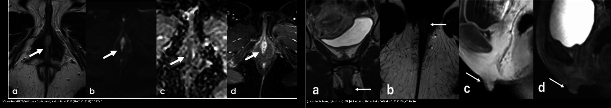
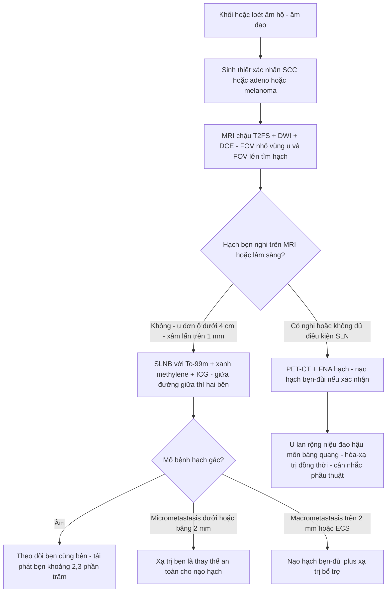
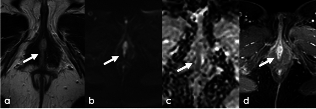
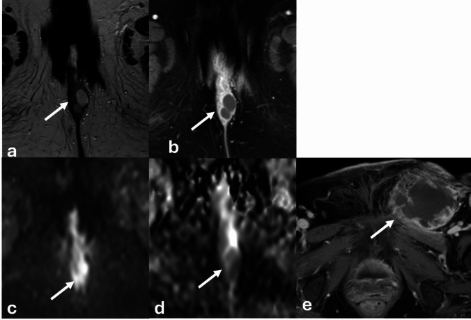
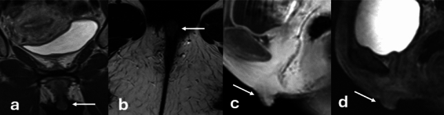
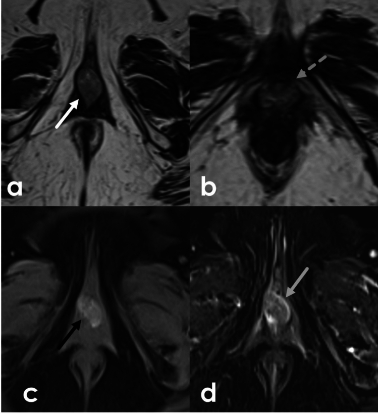
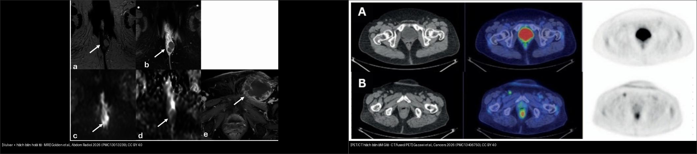
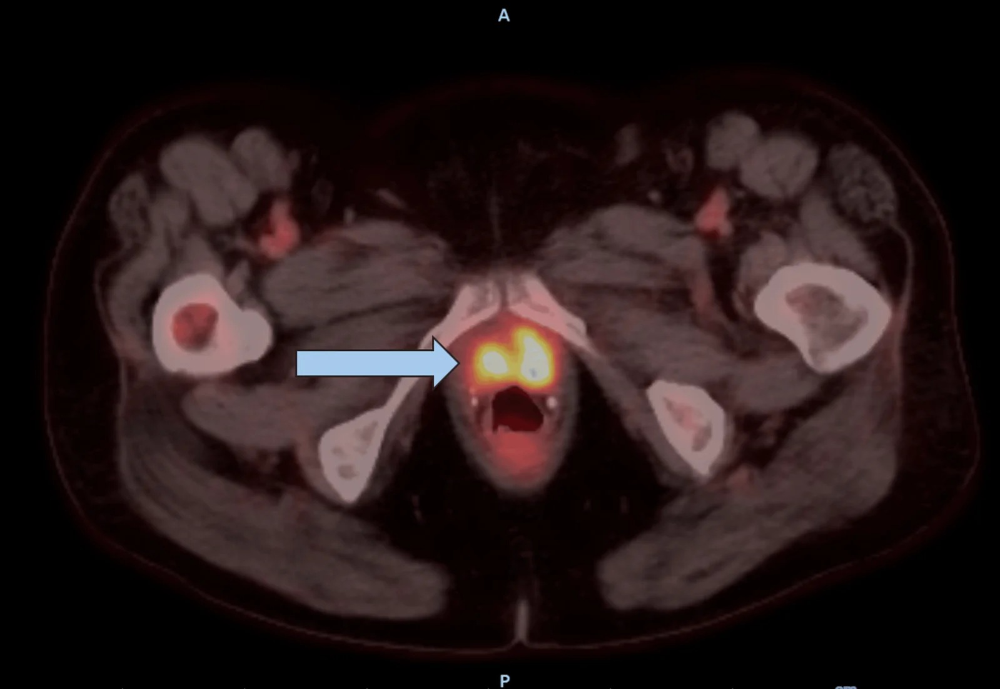

# 574 — Ung thư âm hộ & âm đạo: FIGO 2021 + hạch bẹn–đùi & SLN

**Tags:** `pattern:u-am-ho` `pattern:u-am-dao` `pattern:hach-ben-di-can` `vung:am-ho` `vung:am-dao` `score:FIGO-2021` `protocol:MRI-chau` `protocol:PET-CT` `protocol:SLN`
**Mức chắc chắn (certainty):** tổng hợp y văn (literature synthesis) — gom FIGO Cancer Report 2025, review MRI âm hộ (Abdom Radiol 2026), review PET (Cancers 2026) và các ca open-access; chưa gắn một ca nguyên văn duy nhất.

> Bài toán CĐHA của vùng này khác hẳn tử cung/buồng trứng: **u nằm ngoài da – niêm mạc, có thể chỉ là "vết loét nhỏ"**, nhưng **hạch bẹn–đùi quyết định giai đoạn và sống còn**. Điểm chốt: phân biệt u ác âm hộ với **âm vật bình thường** (giả tái phát), với **nang/áp-xe Bartholin**, và **đừng để PET âm tính ru ngủ** — PET bỏ sót hạch micrometastasis.

## 1. Tổng quan bệnh học – cơ chế hình ảnh

- **Dịch tễ:** ung thư âm hộ chiếm **~4% ung thư phụ khoa**, phần lớn ở phụ nữ sau mãn kinh; **ung thư biểu mô vảy (squamous cell carcinoma, SCC) ~90%**, **melanoma ~5%**, còn lại sarcoma, bệnh Paget âm hộ, adenocarcinoma tuyến Bartholin (Golden et al. 2026; Olawaiye et al., FIGO Cancer Report 2025). Triệu chứng hay gặp: **ngứa, đau, khối hoặc vết loét**; mọi tổn thương âm hộ nghi ngờ đều phải **sinh thiết** để loại xâm lấn.
- **Đường lan (quyết định cách đọc hạch):**
  - Lan trực tiếp → âm đạo, niệu đạo, hậu môn (tùy vị trí).
  - Theo bạch mạch → **hạch bẹn nông là nơi gặp đầu tiên**, rồi bẹn sâu và chậu ngoài (external iliac). Tổn thương **bên (lateral) thường lan cùng bên (ipsilateral)**; tổn thương **đường giữa (midline)** lan **một hoặc cả hai bên** do mạng nối bạch mạch dày đặc; **hạch chậu được coi là di căn (không còn là hạch vùng)** (Golden et al. 2026).
  - Đây là lý do vì sao "**hạch bẹn bên nào?**" là câu hỏi hình ảnh bắt buộc: nó quyết định nạo bẹn một bên hay hai bên.
- **TẠI SAO thấy trên từng chuỗi xung (vật lý + mô bệnh):**
  - SCC âm hộ: **tế bào đặc, ít nước ngoài tế bào → T2W tín hiệu trung gian (intermediate)**, ngấm thuốc biến thiên, và **khuếch tán hạn chế (restricted diffusion) trên DWI/ADC** (mật độ tế bào cao cản trở chuyển động nước) — minh họa Fig. 13.
  - Melanoma âm hộ/âm đạo: **sắc tố melanin có tín hiệu T1 cao tự nhiên** (giống melanoma ở nơi khác) — đây là "bẫy" vì mặc định ai cũng nghĩ u âm đạo T1 thấp; Fig. 15 cho thấy tín hiệu T1 nội tại trong u (Golden et al. 2026).
  - Sau xạ trị: **xơ hóa do phóng xạ T2 tối, ngấm thuốc MUỘN**; **u còn sống/tái phát T2 trung gian, ngấm sớm** trên DCE → phân biệt sẹo xạ với tái phát là câu hỏi lâm sàng hay gặp nhất.
  - Hạch: di căn làm **mất mỡ rốn hạch, tăng kích thước, bờ không đều, hoại tử, ngấm mạnh/khuếch tán hạn chế**; nhưng **kích thước hạch trên hình ảnh không thay được mô bệnh** (xem mục 4).
- **Ngưỡng định lượng nổi bật (để nhớ):**
  - **FIGO 2021 — hạch quyết định giai đoạn:** giai đoạn III của ung thư âm hộ chia theo **kích thước di căn hạch trên mô bệnh**: **IIIA = hạch ≤ 5 mm**; **IIIB = hạch > 5 mm**; **IIIC = có xâm lấn vỏ hạch (extracapsular spread, ECS)** (Golden et al.; Olawaiye et al.).
  - **Sinh thiết hạch gác (sentinel lymph node biopsy, SLNB):** chỉ định khi **u đơn ổ, khu trú âm hộ, < 4 cm, xâm lấn mô đệm > 1 mm, hạch bẹn âm trên lâm sàng và hình ảnh** (GROINSS-V). Trong 403 bệnh nhân GROINSS-V: **tái phát bẹn 2,3%** (theo dõi trung vị 35 tháng), **sống đặc hiệu bệnh 97% sau 3 năm** (Olawaiye et al. 2025).
  - **Ngưỡng xử trí hạch gác:** di căn **≤ 2 mm (micrometastasis)** → xạ trị bẹn là thay thế an toàn cho nạo hạch; **> 2 mm (macrometastasis)** → nạo hạch bẹn–đùi (số liệu từ cập nhật GROINSS-V trong Olawaiye et al.).
  - **PET/CT toàn thân: Se 80%, Sp 90%, PPV 80%, NPV 90%**; **PET/MRI giai đoạn hạch Se 66,7% / Sp 97,2%**, phối hợp với SLN nâng Se lên **77,8%**; **CT bụng–chậu toàn thân Se 43–60%, Sp 75–96%** (Gazawi et al. 2026). Điểm mấu chốt: **PET có độ phân giải ~4–7 mm nên bỏ sót micrometastasis**; trong GOG-173, **đánh giá miễn dịch (IHC) trên hạch gác phát hiện di căn ở 23% ca vốn "âm" trên H&E thường quy**.

## 2. Mẫu hình + chẩn đoán phân biệt theo vị trí (gamut)

- **Theo giải phẫu** (Golden et al. 2026): âm vật/quy đầu âm vật, môi lớn, môi bé, tiền đình, lỗ niệu đạo, tuyến Bartholin (tiền đình lớn) và tuyến Skene (cạnh niệu đạo), âm đạo.
- **Âm hộ — gamut khối/loét:**
  - **SCC** (hay nhất, ~90%): loét, T2 trung gian, khuếch tán hạn chế, ngấm thuốc.
  - **Melanoma**: sắc tố, **T1 cao tự nhiên**, có thể đen trên ảnh; tiên lượng xấu hơn SCC.
  - **Adenocarcinoma tuyến Bartholin**: khối ở vị trí tuyến Bartholin, ở người > 40 tuổi; khác hẳn nang Bartholin lành.
  - **Bệnh Paget âm hộ**: mảng chàm/đỏ, có thể ung thư nội biểu mô.
  - **Sarcoma và u trung mô** (angiomyxoma hung hãn, angiomyofibroblastoma): T2 sáng, ngấm mạnh.
  - **Lành:** nang Bartholin/áp-xe, nang Skene, nang ống Gartner (âm đạo), xơ cứng lichen (lichen sclerosus), viêm nang lông, u mạch.
  - **Bình thường dễ nhầm:** **âm vật và trụ/đáy âm vật** — T2 trung gian/tối, ngấm thuốc, có thể trông "như khối" → bị đọc nhầm tái phát (Fig. 6).
- **Âm đạo — gamut khối:**
  - **SCC âm đạo** (chủ yếu, ~80%), **melanoma**, adenocarcinoma (khó), **di căn từ cổ tử cung/âm hộ/nội mạc vào âm đạo** (thực tế di căn vào âm đạo gặp hơn u nguyên phát) — luôn tìm ổ nguyên phát khác.
  - **Lành:** nang Gartner, nang ống Wolff, sa tạng, u xơ.
- **Vùng hạch bẹn — gamut hạch to:**
  - **Di căn** (SCC/âm hộ, melanoma, u chi dưới), **viêm/mô phản ứng** (nhiễm trùng bàn chân – móng), **lymphoma**, **hạch sau tiêm/vaccine**, **hạch hoạt động do bệnh hệ thống**.
  - **Đừng quên hạch điển hình của chuỗi bẹn–đùi (inguinofemoral)** gồm hạch bẹn nông, bẹn sâu và **hạch đùi (Cloquet)** — nạo hạch phải lấy cả hai tầng.

## 3. Bảng so sánh phân biệt (ma trận đối chiếu)

| Thực thể (entity) | Hình ảnh điển hình (theo chuỗi xung) | Chốt vào (rule-in) | Chốt loại (rule-out) | Gợi ý xác nhận |
|---|---|---|---|---|
| **SCC âm hộ** | Loét/khối ở môi – tiền đình; **T2 trung gian, DWI hạn chế, ngấm thuốc; có thể xâm lấn âm đạo/niệu đạo/hậu môn** | **Khối/loét T2 trung gian + DWI hạn chế ở phụ nữ lớn tuổi + kèm hạch bẹn** | Tổn thương T2 rất sáng, không hạn chế khuếch tán, có vỏ rõ, không ngấm → nghĩ nang lành | Sinh thiết (punch/incisional); MRI để đánh giá xâm lấn + hạch |
| **Melanoma âm hộ/âm đạo** | Khối có sắc tố; **T1W tự nhiên tăng tín hiệu (melanin)**, T2 hỗn hợp, ngấm mạnh | **Tín hiệu T1 cao tự nhiên trong u âm hộ/âm đạo + tăng ngấm** | U T1 thấp đồng nhất, không sắc tố → nghĩ SCC/biểu mô | Sinh thiết + hóa mô miễn dịch (S100, HMB-45, Melan-A); **không xếp giai đoạn theo FIGO âm hộ** |
| **Adenocarcinoma tuyến Bartholin** | Khối vùng Bartholin (sau–bên lỗ âm đạo), ngấm thuốc, có phần đặc; có thể dính da | **Khối đặc ở vị trí tuyến Bartholin, người > 40 tuổi, lớn nhanh/đau** | Nang đơn thuần, thành mỏng, dịch đồng nhất, không phần đặc → nang Bartholin lành | Sinh thiết; nếu "áp-xe" tái phát nhiều lần ở người lớn → nghi u |
| **Âm vật – trụ âm vật bình thường** | **T2 trung gian/tối, ngấm thuốc, nằm giữa, đối xứng; có "dải tối" quy chiếu** | **Kích thước/hình dạng không đổi so với phim cũ (≥ vài tháng–năm), không hạn chế khuếch tán rõ** | To lên theo thời gian, bờ không đều, hạn chế khuếch tán mạnh → nghĩ tái phát/u | **So sánh với phim cũ** + khám lâm sàng; đừng sinh thiết âm vật "bình thường" |
| **Sẹo xạ trị (fibrosis)** | Vùng T2 tối, ngấm thuốc muộn, bờ mờ | **T2 tối + ngấm MUỘN trên DCE + không hạn chế khuếch tán** | T2 trung gian + ngấm SỚM + hạn chế khuếch tán → nghĩ tái phát | DCE + DWI; theo dõi/sinh thiết nếu còn nghi ngờ |
| **Hạch bẹn di căn** | Hạch to, mất mỡ rốn, bờ không đều, ngấm mạnh, **hoại tử**; PET dương | **Hạch bẹn ngấm mạnh/hoại tử + DWI hạn chế + ổ nguyên phát âm hộ** | Hạch nhỏ < 5–10 mm, giữ mỡ rốn, ngấm nhẹ, có phản ứng quanh → chưa kết luận | **MRI cả vùng bẹn–chậu + PET/CT**; **chọc hút kim nhỏ (FNA)** nếu nghi; SLNB nếu hạch âm trên hình ảnh |
| **Hạch bẹn – "PET âm giả"** | PET/CT có thể **ÂM dù hạch đã di căn micrometastasis** (Fig. 3) | **Ổ nguyên phát lớn/hoại tử + hạch bẹn nghi trên MRI nhưng PET âm → vẫn phải mô bệnh** | PET dương thì hoàn toàn có thể dương giả do viêm | **SLNB + ultrastaging (IHC)** là chuẩn; PET không thay được SLN |
| **SCC âm đạo** | Khối thành âm đạo, T2 trung gian, DWI hạn chế, ngấm thuốc; **đánh giá niệu đạo/trực tràng/bàng quang** | **Khối âm đạo + lan ra mô cạnh âm đạo/pelvic wall + hạch** | Niêm mạc âm đạo lành, tổn thương nội mạc tử cung/cổ tử cung → tìm ổ nguyên phát khác | MRI chậu + PET/CT; **loại trừ u cổ tử cung/âm hộ di căn vào âm đạo** bằng sinh thiết |

*Trái: SCC âm hộ — khối T2 trung gian (a), hạn chế khuếch tán (b,c), ngấm thuốc (d) (Golden et al., Abdom Radiol 2026, PMC13013239, CC BY 4.0). Phải: **âm vật bình thường** ở bệnh nhân có tiền sử ung thư âm hộ, từng bị nghi tái phát — đối chiếu phim cũ 7 năm xác nhận không đổi (cùng nguồn). Ảnh ghép letterbox giữ tỷ lệ.*

## 4. Protocol chụp + hệ phân độ/điểm chuẩn hóa

- **MRI chậu là phương thức được chọn** cho u nguyên phát âm hộ/âm đạo. Protocol theo ESUR (Golden et al. 2026):
  - **T2W có xóa mỡ (fat-sat)**: giúp tách u khỏi mỡ tầng sinh môn; **DWI/ADC (b = 50 và 800)**; **DCE (T1 sau tiêm động học)**.
  - **Trường nhỏ (small FOV) axial** từ **vòm âm đạo đến môi lớn**, độ phân giải cao cho u/niệu đạo; **trường lớn (large FOV) chậu** để tìm hạch và di căn xương.
  - **Gel âm đạo** giúp thấy u nhỏ; nhiều nơi dùng **thuốc giảm nhu động** để giảm artifact trực tràng; bệnh nhân nhịn ăn vài giờ.
  - Với ổ **tiền sử tiêm/điều trị**, luôn lấy **T1W trước tiêm** (phát hiện melanin/máu) trước khi tiêm.
- **Phân giai đoạn FIGO 2021 (ung thư âm hộ, theo Golden et al. và Olawaiye et al.):**

| Giai đoạn | Định nghĩa |
|---|---|
| **I** | U khu trú ở âm hộ |
| **IA** | Xâm lấn mô đệm ≤ 1 mm **và** kích thước ≤ 2 cm |
| **IB** | Xâm lấn > 1 mm **và/hoặc** kích thước > 2 cm |
| **II** | U mọi kích thước lan **1/3 dưới** niệu đạo, âm đạo hoặc hậu môn, **hạch âm** |
| **III** | U mọi kích thước lan tới **1/3 trên** niệu đạo/âm đạo, niêm mạc bàng quang/trực tràng, **và/hoặc có hạch vùng** |
| **IIIA** | Hạch di căn **≤ 5 mm** (hoặc lan 1/3 trên) |
| **IIIB** | Hạch di căn **> 5 mm** |
| **IIIC** | Hạch có **xâm lấn vỏ (ECS)** |
| **IVA** | U cố định vào xương, **hoặc hạch cố định/loét** |
| **IVB** | Di căn xa |

- **Điểm cần nhấn:** kích thước hạch trong FIGO IIIA/IIIB là **kích thước di căn trên mô bệnh học**, **không** phải kích thước hạch trên CT/MRI → hình ảnh **không thể "chốt" IIIA vs IIIB**, chỉ giúp định hướng và chọn đường mổ/xạ.
- **FIGO âm đạo (ung thư âm đạo):** I = khu trú thành âm đạo; II = lan vào mô cạnh âm đạo nhưng chưa tới thành chậu; III = tới thành chậu **hoặc có hạch**; IVA = niêm mạc bàng quang/trực tràng, ra ngoài khung chậu thật; IVB = di căn xa. **FIGO 2021 chỉ áp dụng cho carcinoma (SCC/adeno), KHÔNG áp cho melanoma** (melanoma dùng hệ giai đoạn melanoma của nó).
- **Hạch: quy trình chọn lựa (không thể bỏ qua mô bệnh):**

- **Kỹ thuật lấy hạch gác:** **technetium-99m phóng xạ + thuốc nhuộm xanh** (từ GROINSS-V/GOG); **ICG + huỳnh quang hồng ngoại gần** là lựa chọn mới hơn; vị trí u **cách đường giữa < 2 cm hoặc vượt đường giữa** → đánh giá **hai bên**; u **bên, < 4 cm, cách đường giữa ≥ 2 cm, hạch cùng bên âm** → **chỉ cùng bên** (Olawaiye et al.). Tỉ lệ phát hiện hạch gác cao, nhưng **kỹ thuật chỉ an toàn khi phẫu thuật viên + giải phẫu bệnh tuân thủ protocol** và **siêu phân giai đoạn (ultrastaging) bằng cắt chuỗi mỏng + IHC**.
- **Theo dõi sau điều trị:** MRI/DCE để phân biệt **sẹo xạ (T2 tối, ngấm muộn)** với **tái phát (T2 trung gian, ngấm sớm, DWI hạn chế)**; PET/CT khi nghi tái phát/di căn; theo dõi lâu dài vì ung thư âm hộ hay tái phát tại chỗ và tại bẹn.

## 5. Biến thể bình thường và cạm bẫy

- **Cạm bẫy số 1 — âm vật bình thường giả tái phát (minh họa Fig. 6):** bệnh nhân có tiền sử ung thư âm hộ, khối T2 trung gian/tối ngấm thuốc ở đường giữa → **ban đầu tưởng tái phát**, nhưng đối chiếu phim cũ 7 năm thấy **kích thước/hình dạng không đổi** và khám lâm sàng bình thường → **không phải tái phát**. Quy tắc: **u đường giữa vùng âm vật luôn đối chiếu phim cũ trước khi gọi tái phát**.
- **Nang/áp-xe Bartholin ở người > 40 tuổi** có thể che adenocarcinoma tuyến Bartholin; nếu "áp-xe" **tái phát nhiều lần** hoặc có **phần đặc/thành dày** → phải sinh thiết, đừng đặt Word catheter rồi bỏ qua.
- **Melanoma có thể T1 cao tự nhiên** — đừng loại trừ vì "u T1 sáng là mỡ/máu"; melanoma âm hộ **không dùng FIGO âm hộ**; **SLNB ở melanoma âm hộ có tỉ lệ âm giả tới 15%** và **chưa là chuẩn ngoài thử nghiệm** (Olawaiye et al.).
- **PET âm không loại trừ hạch:** PET bỏ sót micrometastasis (độ phân giải ~4–7 mm; Fig. 3 cho thấy ca **PET âm nhưng hạch đã di căn**). **Hạch gác + ultrastaging IHC vẫn là chuẩn** cho hạch bẹn ở SCC âm hộ giai đoạn sớm.
- **Hạch chậu = di căn xa**: đừng gọi "hạch vùng"; điều này đổi giai đoạn và phác đồ.
- **Âm đạo: "u nguyên phát" luôn phải loại trừ di căn từ cổ tử cung, âm hộ, nội mạc tử cung** (bệnh sử cắt tử cung vì cổ tử cung là bối cảnh rất hay gặp); sinh thiết + hóa mô miễn dịch trước khi chốt.
- **Bỏ sót trên mặt cắt (cross-sectional pitfalls):** khối âm hộ có thể bị cắt mất nếu FOV nhỏ không phủ tới môi lớn — **luôn đặt FOV đủ thấp (đến môi lớn) và đủ rộng cho hạch**; gel âm đạo giúp thấy u nhỏ; đừng nhầm **nếp gấp da, mô mỡ tiền đình, cơ hành hang (bulbospongiosus)** với tổn thương; đừng nhầm **nang tuyến Skene (cạnh niệu đạo)** với túi thừa niệu đạo (thường đánh giá tốt hơn bằng FOV nhỏ + T2FS).

## 6. Tự lượng giá — Blind Quiz

**Ca 1 — Khối âm hộ loét ở người lớn tuổi**

- Gợi ý lâm sàng: nữ 64 tuổi, tổn thương âm hộ loét, trợt, nhìn thấy trên khám.
- Câu hỏi: Mô tả tín hiệu trên T2W, DWI/ADC và sau tiêm. Bốn dấu hiệu này cùng dẫn tới chẩn đoán gì? Vì sao "T2 trung gian + DWI hạn chế" quan trọng hơn kích thước?

<b>Bấm để hiện đáp án (findings + chẩn đoán)</b>

- Dấu hiệu: (a) khối âm hộ đường giữa **T2 trung gian**; (b,c) **hạn chế khuếch tán** trên DWI/ADC; (d) **ngấm thuốc** sau tiêm.
- Chẩn đoán: **ung thư biểu mô vảy (SCC) âm hộ** — sinh thiết xác nhận. Cơ chế: tế bào đặc → T2 trung gian + cản trở khuếch tán nước → ADC thấp.
- Nguồn ảnh: Golden E et al., *Abdom Radiol (NY)* 2026, Fig. 13 (PMC13013239), CC BY 4.0.

**Ca 2 — U âm hộ + khối bẹn cùng bên**

- Gợi ý lâm sàng: nữ 51 tuổi, có khối ở âm hộ **và** khối ở bẹn trái.
- Câu hỏi: Panel nào cho thấy khối nguyên phát, panel nào cho hạch? Dấu hiệu nào nói hạch **đã di căn** chứ không phải viêm? Điều này đặt bệnh nhân vào giai đoạn nào (theo FIGO 2021)?

<b>Bấm để hiện đáp án (findings + chẩn đoán)</b>

- Dấu hiệu: (a,b) khối âm hộ T2 tối, ngấm thuốc đều, có **thành phần nang trung tâm**, hạn chế khuếch tán (c,d); (e) **hạch bẹn trái to, hoại tử, bờ không đều (adenopathy hoại tử)**.
- Chẩn đoán: u âm hộ (ngấm, hạn chế khuếch tán) **kèm hạch bẹn hoại tử** → di căn hạch vùng. Theo FIGO 2021, **có hạch = giai đoạn III trở lên**; phân IIIA/IIIB/IIIC phụ thuộc **kích thước di căn và ECS trên mô bệnh** (không dựa vào kích thước trên MRI).
- Nguồn ảnh: Golden E et al., *Abdom Radiol (NY)* 2026, Fig. 14 (PMC13013239), CC BY 4.0.

**Ca 3 — "Khối" ở âm vật hay tái phát?**

- Gợi ý lâm sàng: nữ 48 tuổi, tiền sử **ung thư âm hộ** đang theo dõi; MRI thấy "khối" đường giữa âm hộ ngấm thuốc.
- Câu hỏi: Bạn nghĩ tái phát hay không? Cần làm gì trước khi kết luận? Panel nào giúp chốt?

<b>Bấm để hiện đáp án (findings + chẩn đoán)</b>

- Dấu hiệu: (a,b) tổn thương đường giữa T2 trung gian/tối; (c) ngấm thuốc trên T1 sau tiêm; (d) **so sánh phim cũ 7 năm: kích thước/hình dạng không đổi**.
- Chẩn đoán: **âm vật bình thường**, KHÔNG tái phát. Cơ chế: âm vật có mô cương (erectile) ngấm thuốc và T2 trung gian, dễ giả khối; chốt bằng **đối chiếu phim cũ + khám lâm sàng**, không sinh thiết mù.
- Nguồn ảnh: Golden E et al., *Abdom Radiol (NY)* 2026, Fig. 6 (PMC13013239), CC BY 4.0.

**Ca 4 — U âm đạo có tín hiệu "lạ"**

- Gợi ý lâm sàng: nữ 64 tuổi, u ở tiền đình âm đạo lan quanh niệu đạo.
- Câu hỏi: Tín hiệu trên T1W trước tiêm có gì đặc biệt? Chẩn đoán nào hay có tín hiệu T1 cao tự nhiên? Vì sao không dùng FIGO âm hộ cho u này?

<b>Bấm để hiện đáp án (findings + chẩn đoán)</b>

- Dấu hiệu: (a,b) khối T2 trung gian ở **tiền đình âm đạo**, bao quanh niệu đạo; (c) **tín hiệu T1 cao nội tại** (melanin) trên T1FS trước tiêm; (d) ngấm/thay đổi sau điều trị.
- Chẩn đoán: **melanoma âm đạo/âm hộ**. Melanin gây T1 cao tự nhiên; **melanoma không xếp giai đoạn theo FIGO carcinoma âm hộ**; SLNB ở melanoma âm hộ có âm giả ~15%, chưa là chuẩn.
- Nguồn ảnh: Golden E et al., *Abdom Radiol (NY)* 2026, Fig. 15 (PMC13013239), CC BY 4.0.

**Ca 5 — PET âm có an tâm không?**

- Gợi ý lâm sàng: bệnh nhân ung thư âm hộ, hạch bẹn nghi trên MRI; PET/CT được làm để phân giai đoạn.
- Câu hỏi: Bên phải (PET/CT) có thấy hạch bẹn không? Nếu PET âm, có được kết luận hạch âm không? Vì sao?

<b>Bấm để hiện đáp án (findings + chẩn đoán)</b>

- Dấu hiệu: trái = MRI khối âm hộ + **hạch bẹn trái hoại tử**; phải = PET/CT (panel A hàng trên) **không thấy ngấm bệnh lý ở hai bẹn** — hình **âm giả**; mô bệnh sau đó xác nhận **di căn một phần hạch bẹn trái**.
- Chẩn đoán/lý giải: **PET/CT bỏ sót micrometastasis** (độ phân giải ~4–7 mm) → PET âm **không** loại trừ hạch; chuẩn cho hạch bẹn giai đoạn sớm là **SLNB + siêu phân giai đoạn IHC** (GOG-173: IHC phát hiện thêm 23% ca "âm" trên H&E).
- Nguồn ảnh: Gazawi R et al., *Cancers (Basel)* 2026, Fig. 3 (PMC13406750) + Golden E et al., *Abdom Radiol (NY)* 2026, Fig. 14 (PMC13013239), CC BY 4.0.

**Ca 6 — Ung thư âm đạo: đích xạ trị nhìn thấy ở đâu?**

- Gợi ý lâm sàng: nữ 64 tuổi, tiền sử cắt tử cung, ngứa/bỏng/rỉ máu âm hộ 2 năm, được chẩn đoán **SCC âm đạo giai đoạn III (T2 N1 M0)**.
- Câu hỏi: PET trước điều trị dùng để làm gì trong bệnh cảnh này? Vì sao phải loại trừ ổ nguyên phát cổ tử cung/âm hộ trước khi gọi "SCC âm đạo nguyên phát"?

<b>Bấm để hiện đáp án (findings + chẩn đoán)</b>

- Dấu hiệu: PET/CT trước điều trị cho thấy **khối tăng chuyển hóa (gross tumor volume, GTV)** ở vùng âm đạo/cạnh bàng quang; dùng để **vẽ thể tích đích xạ trị**.
- Chẩn đoán/ý nghĩa: **SCC âm đạo nguyên phát** — u âm đạo hiếm nên bước đầu phải **loại trừ di căn từ cổ tử cung (bệnh nhân đã cắt tử cung vì vậy không còn cổ tử cung) và từ âm hộ**. Điều trị chuẩn: hóa–xạ trị đồng thời + brachytherapy; 5 năm sống theo giai đoạn trong nghiên cứu toàn quốc Nhật (n = 746): **I 87,6% · II 55,6% · III 59,9% · IV 15,3%**.
- Nguồn ảnh: Singh J & Eanelli T, *Cureus* 2026, Fig. 1 (PMC13653533), CC BY 4.0.

## Bài liên quan chéo
- [500 – Tổng quan Vú & Sản Phụ khoa](../500-tong-quan-vu-san-phu-khoa/lesson.md)
- [525 – K nội mạc/cổ tử cung FIGO MRI](../525-ung-thu-noi-mac-co-tu-cung-FIGO-MRI/lesson.md)
- [528 – Dị dạng tử cung bẩm sinh ESHRE/ESGE](../528-di-dang-tu-cung-bam-sinh-ESHRE-ESGE/lesson.md)
- [529 – Cổ tử cung & âm đạo bẩm sinh: dị dạng tắc nghẽn](../529-co-tu-cung-am-dao-bam-sinh-tac-nghen/lesson.md)
- [535 – Ung thư buồng trứng, phúc mạc & u Krukenberg](../535-ung-thu-buong-trung-phuc-mac-krukenberg/lesson.md)
- [572 – Hạch trong ung thư phụ khoa: SLN, hạch chậu–cạnh ĐMC & PET-CT](../572-hach-ung-thu-phu-khoa-SLN-PET/lesson.md)
- [517 – Sinh thiết định vị vú & quản lý clip/kẹp](../517-sinh-thiet-dinh-vi-vu-va-quan-ly-clip/lesson.md)

## Ảnh
- Nguồn + giấy phép từng ảnh: `images/CREDITS.md`. Ảnh CC BY 4.0 giữ nguyên bản; ảnh ghép letterbox không crop/kéo giãn. Ảnh CC BY-NC-ND (nếu dùng) giữ nguyên bản và không ghép.

> Không dùng để chẩn đoán độc lập khi chưa có người hướng dẫn.
