# 575 — Theo dõi dài hạn sau u trung mô tử cung: tái phát MUỘN ở phổi & xương

**Tags:** `pattern:tai-phat` `pattern:u-trung-mo` `vung:tu-cung` `vung:phoi` `vung:xuong` `score:FIGO` `protocol:CT-nguc` `protocol:MRI-chau`
**Mức chắc chắn (certainty):** tổng hợp y văn (literature synthesis) — cohort lớn + nhiều ca nguyên văn có mô bệnh; các con số tái phát dao động theo giai đoạn và mô học, đã ghi rõ nguồn từng số.

## 1. Tổng quan bệnh học – cơ chế hình ảnh

- **U trung mô tử cung (uterine mesenchymal tumors)** không phải một bệnh: **u cơ trơn ác (uterine leiomyosarcoma, uLMS)** ~38,5%, **sarcoma mô đệm nội mạc độ thấp (low-grade endometrial stromal sarcoma, LG-ESS)** ~29,7%, **HG-ESS**, **sarcoma không biệt hóa (UUS)**, **adenosarcoma**. Nguồn gốc và cách lan khác nhau → **lịch theo dõi khác nhau**.
- **uLMS** xuất phát từ cơ trơn, lan chủ yếu **đường máu → phổi (80% các ca di căn xa)**, sau đó gan (37%), xương, não. **LG-ESS** xâm nhập mô đệm, lan **bạch huyết/peritoneum** và nổi tiếng **tái phát muộn** (nhiều năm sau mổ), nhạy cảm hormone (ER/PR dương).
- **TẠI SAO nhìn thấy trên MRI:** uLMS giàu tế bào, hoại tử và xuất huyết → **T2 không đồng nhất, vùng hoại tử T2 sáng, xuất huyết T1 sáng**, **hạn chế khuếch tán** (ADC thấp, thường **≤ 0,9 × 10⁻³ mm²/s** ở vùng u còn sống). LG-ESS có các **dải T2 tối “giun”/“lông vũ”** do dải collagen và mạch nhỏ, ngấm thuốc mạnh; mô xơ sau mổ **T2 tối, không ngấm, ổn định** — đây là chốt phân biệt tái phát với sẹo.
- **TẠI SAO nhìn thấy trên CT:** di căn phổi là **nốt mô mềm 3–10 mm**, bờ rõ, đa số ở ngoại vi; có thể **miliary** (hàng trăm nốt nhỏ) khi lan nhanh. Di căn xương là **tiêu xương lytic**, bờ không rõ, phá vỏ; mô mềm quanh xương trên MRI.
- **Ngưỡng định lượng & số liệu nền:**
  - **Tái phát chung sau u trung mô tử cung: 50,5% trong 5 năm** (148 bệnh nhân); vị trí: **khung chậu 17,5%, phổi 15,3%, ổ bụng 12,0%, khác 5,4%** (Huang 2026).
  - **uLMS giai đoạn I: tái phát 81,3%, trung vị 12,4 tháng; LG-ESS giai đoạn I: 30%, trung vị 41,1 tháng**; PFS 5 năm **31,3% vs 75%**, OS 5 năm **68,5% vs 100%** (Nagao 2026, n = 55).
  - **Sống 5 năm:** LG-ESS **90,3%**, uLMS **61,8%**, UUS **50,0%** (Huang 2026).
  - **60% tái phát** trong loạt 50 uLMS (Paik 2019); **di căn xương: sống trung vị 15 tháng** sau chẩn đoán (Öztürk Başarır 2022).
  - **NCCN:** theo dõi **mỗi 3–6 tháng trong 3 năm đầu, sau đó mỗi 6–12 tháng**; **50–70% uLMS tái phát trong 2 năm đầu** (Lee 2026).
  - **LG-ESS có thể tái phát sau 8 năm** (Koh 2025: 3 nốt phổi 7–9 mm, PET FDG rất thấp, sống không bệnh 8 năm sau cắt phổi); **uLMS có ca sống không bệnh 16 năm** sau nhiều lần cắt di căn phổi (Kodama 2025).

## 2. Mẫu hình + chẩn đoán phân biệt theo vị trí (gamut)

- **Phổi (hay gặp nhất):** di căn uLMS (nốt đặc, đa ổ, ngoại vi), di căn LG-ESS (chậm, có thể **FDG âm/ngấm rất thấp**), di căn HG-ESS (nhanh, kèm hạch), **lao/nấm** ở người suy giảm miễn dịch, **nốt lành** (u hạt, hamartoma), **xơ phổi sau xạ**.
- **Xương:** tiêu xương lytic đơn độc hoặc nhiều ổ (cột sống, khung chậu, đầu dưới xương đùi); đau, gãy bệnh lý; cần MRI nếu X-quang âm.
- **Gan:** di căn uLMS (37%), thường đa ổ, ngấm viền; phân biệt nang/hemangioma.
- **Não:** hiếm nhưng là ổ di căn của uLMS; đau đầu, dấu thần kinh khu trú.
- **Khung chậu/âm đạo:** tái phát tại chỗ LG-ESS/HG-ESS, khối trong âm đạo, thâm nhiễm dây chằng rộng; **phân biệt sẹo xơ, hẹp niệu quản do xạ, u tái phát**.
- **Phúc mạc/mạc nối:** LG-ESS lan phúc mạc, **LPD sau morcellation**, carcinomatosis; báng ít gợi ý LPD.
- **Hạch:** LG-ESS/HG-ESS hay di căn hạch chậu/paradortic; uLMS ít gặp hơn.

## 3. Bảng so sánh phân biệt (ma trận đối chiếu)

| Thực thể (entity) | Hình ảnh điển hình | Chốt vào (rule-in) | Chốt loại (rule-out) | Gợi ý xác nhận |
|---|---|---|---|---|
| **uLMS tái phát** | Nốt phổi đặc, đa ổ, tăng nhanh; ổ bụng gan/xương; u tại chỗ T2 không đồng nhất, hoại tử | **Tiền sử uLMS + nốt mới/tăng kích thước + DWI sáng** | **Nốt canxi hóa, ổn định ≥ 2 năm** → nghĩ lành | CT ngực lát mỏng; sinh thiết nếu đơn độc/cắt được |
| **LG-ESS tái phát** | Khối tiểu khung/âm đạo, dải T2 tối, ngấm mạnh; di căn phổi chậm, có thể FDG thấp | **Tiền sử LG-ESS + khối ngấm + T2 tối dải + tái phát sau nhiều năm** | **Sẹo xơ T2 tối, KHÔNG ngấm, ổn định** → không phải tái phát | MRI chậu + CT ngực; ER/PR, CD10 |
| **HG-ESS tái phát** | Khối lớn, hoại tử, xâm lấn; di căn phổi + hạch nhanh | **U lớn, hoại tử, DWI sáng mạnh, hạch bệnh lý** | **Tổn thương nhỏ, không ngấm, không hạch** → theo dõi | Mô bệnh + YWHAE–NUTM2, BCOR |
| **UUS/adenosarcoma** | U không đồng nhất, xâm lấn; adenosarcoma dạng polyp trong buồng tử cung | **Thành phần biểu mô + mô đệm (adenosarcoma) / không biệt hóa** | **U cơ trơn lành (T2 tối đều, không hạn chế khuếch tán)** | Mô bệnh; adenosarcoma > 25% mô đệm |
| **Di căn phổi lành tính (u hạt/lao)** | Nốt nhỏ đều, có thể canxi hóa, phân bố thùy trên | **Canxi hóa + bối cảnh lao + ổn định** | **Nốt mới tăng nhanh, không canxi** → nghi di căn | So phim cũ; AFB/PCR nếu nghi lao |
| **Sẹo xơ/seroma sau mổ–xạ** | Vùng T2 tối, không ngấm, bờ đều; thay đổi theo thời gian rồi ổn định | **Không ngấm + ổn định ≥ 6 tháng** | **Ngấm thuốc mới + DWI sáng + to ra** → tái phát | MRI nhiều lần; PET/CT nếu còn nghi |

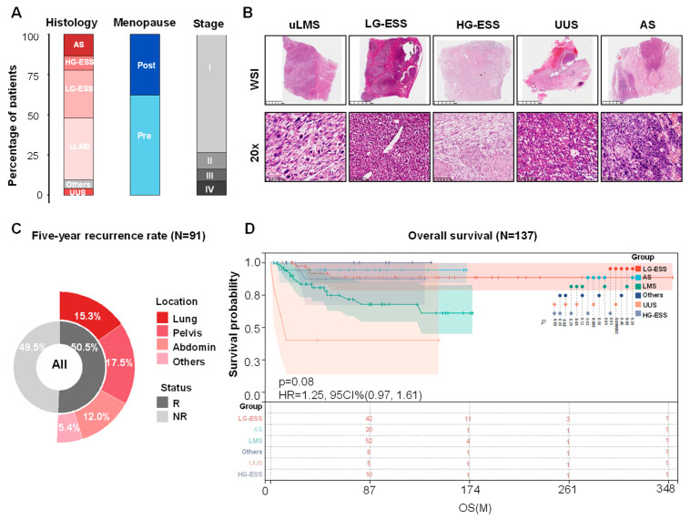
*C: tỷ lệ tái phát 5 năm 50,5% và vị trí (khung chậu 17,5%, phổi 15,3%, ổ bụng 12,0%). D: OS theo mô học — LG-ESS tốt nhất. Nguồn: Huang T et al., Cancers 2026, PMC13255855, CC BY 4.0.*

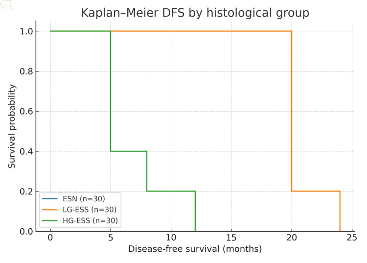
*Kaplan–Meier DFS: HG-ESS giảm nhanh (trung vị 5 tháng), LG-ESS 20 tháng, ESN không tái phát trong thời gian theo dõi. Nguồn: Barbakadze L et al., J Clin Med Res 2026, PMC12861515, CC BY 4.0.*

## 4. Protocol theo dõi + hệ phân độ & ngưỡng quyết định

- **Baseline sau điều trị:** CT ngực–bụng–chậu có cản quang **trong 3–6 tháng**; **MRI tiểu khung** cho ESS/adenosarcoma (đánh giá thành tử cung, dây chằng, âm đạo).
- **Lịch NCCN (u trung mô tử cung):**
  - **Năm 0–3: mỗi 3–6 tháng** (khám, CT ngực ± bụng–chậu).
  - **Năm 3–5: mỗi 6–12 tháng.**
  - **Sau 5 năm:** tiếp tục **hằng năm** ở LG-ESS (tái phát muộn); uLMS có thể giãn hơn nhưng **không dừng hoàn toàn trước 5 năm**.
- **Khi nào chụp gì:**
  - **CT ngực lát mỏng** là xét nghiệm chính cho di căn phổi; **X-quang ngực không đủ** (bỏ sót nốt < 1 cm).
  - **MRI chậu** khi nghi tái phát tại chỗ/âm đạo; **CT bụng–chậu** cho gan/phúc mạc/hạch.
  - **PET/CT** khi CT/MRI không kết luận hoặc tìm ổ tái phát ẩn; **LG-ESS có thể FDG rất thấp** → PET âm không loại trừ.
  - **MRI cột sống/xương** nếu đau xương, X-quang có tiêu xương; **MRI não** nếu triệu chứng thần kinh.
- **Ngưỡng nghi tái phát:** nốt phổi **mới hoặc tăng ≥ 2 mm** trên CT lát mỏng; khối chậu **ngấm thuốc mới + DWI sáng**; **ADC ≤ 0,9 × 10⁻³ mm²/s** ở vùng u còn sống gợi ý sarcoma; **tăng liên tục qua 2 lần chụp** quan trọng hơn một lần đo.
- **Nguyên tắc điều trị khi tái phát:** cắt di căn phổi nếu **ít ổ, còn mổ được, bệnh ngoài phổi kiểm soát**; LG-ESS dùng **hormone (MPA/letrozole)** sau cắt; uLMS hóa trị (doxorubicin/gemcitabine–docetaxel); HIFU/đốt sóng có thể dùng cho ổ tại chỗ không mổ được.

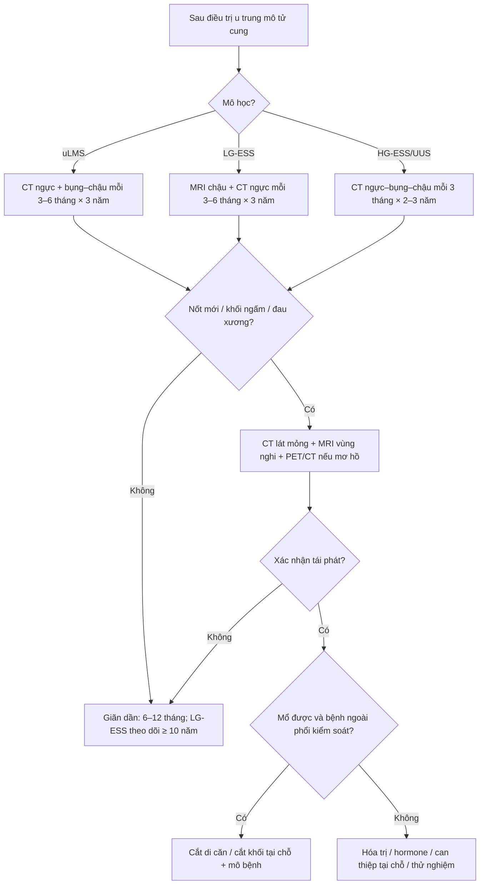

## 5. Biến thể bình thường và cạm bẫy

- **Sẹo xơ sau mổ/xạ** là “kẻ giả danh” số 1: **T2 tối, không ngấm, bờ đều, ổn định**. Chỉ gọi tái phát khi **ngấm thuốc mới, DWI sáng, hoặc to ra theo thời gian**.
- **Seroma/lymphocele** sau mổ: dịch đồng nhất, không ngấm, giảm dần; đừng chọc nếu không triệu chứng.
- **Nốt phổi lành** (u hạt, hamartoma, nốt canxi hóa) thường **< 5 mm, canxi hóa, ổn định**. So phim cũ là bắt buộc.
- **PET/CT dương tính giả** do viêm/phẫu thuật; **LG-ESS có thể FDG âm** — không dùng PET để loại trừ một mình.
- **Morcellation** làm tăng gieo rắc phúc mạc/LPD; theo dõi phúc mạc kỹ ở người từng morcellation.
- **Tái phát muộn sau 10 năm** vẫn xảy ra ở LG-ESS; **không discharge** bệnh nhân chỉ vì đã qua 5 năm.
- **Cạm bẫy mặt cắt:** nốt phổi sát màng phổi có thể giả “dày màng phổi”; khối chậu sau xạ dễ bị che bởi **xơ hậu xạ** — cần MRI đa chuỗi + DWI, không chỉ CT.

## 6. Tự lượng giá — Blind Quiz

**Ca 1 — Nữ 28 tuổi, tiền sử sarcoma mô đệm nội mạc độ thấp đã mổ; 3 năm sau tái phát khối tiểu khung, từ chối mổ.**

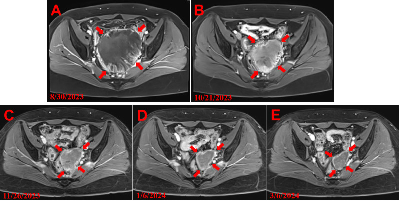

- Câu hỏi: Mô tả khối? Chuỗi ảnh A→E nói lên điều gì? Chẩn đoán?

<b>Bấm để hiện đáp án</b>

- Findings: khối lớn ở tiểu khung, **T2 không đồng nhất**, bờ không đều, xâm lấn mô xung quanh; các mốc thời gian 8/2023 → 3/2024 cho thấy **kích thước thay đổi sau điều trị**.
- Chẩn đoán: **tái phát LG-ESS** (tiền sử mô học + khối ngấm, T2 trung gian, hạn chế khuếch tán).
- Ý nghĩa: LG-ESS có thể tái phát sau nhiều năm và **khối tiểu khung là ổ tái phát tại chỗ**; cần MRI chậu + CT ngực, không chỉ CT.
- Nguồn: Chen H et al., Front Oncol 2025, PMC12683335, CC BY 4.0 (Fig 2).

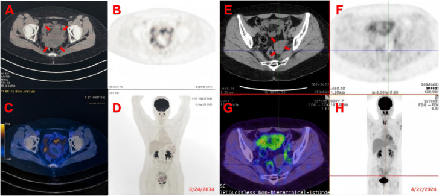

**Ca 2 — Nữ 87 tuổi, uLMS giai đoạn IB, mổ cắt tử cung; ngày 17 sau mổ khó thở.**

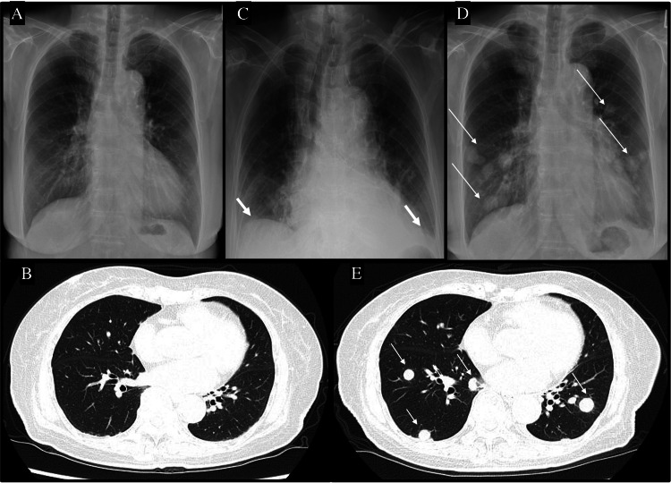

- Câu hỏi: So sánh A–B với D–E? Tốc độ lan gợi ý gì? Chẩn đoán?

<b>Bấm để hiện đáp án</b>

- Findings: trước mổ **X-quang và CT phổi bình thường** (A, B); ngày 4 có **tràn dịch màng phổi độ 2** (C); ngày 17 **nhiều nốt hai phổi + hạch rốn phổi/trung thất** (D, E).
- Chẩn đoán: **di căn phổi bùng phát sớm sau mổ uLMS** — lan theo đường máu, có thể nhanh bất thường ở người suy dinh dưỡng.
- Phản biện: đây là ca **cực đoan** (POD17); không dùng để kết luận mọi uLMS đều lan nhanh như vậy, nhưng chứng minh **CT ngực baseline và theo dõi sớm** là bắt buộc.
- Nguồn: Banno H et al., Cureus 2025, PMC12741992, CC BY 4.0 (Fig 2).

**Ca 3 — Nữ 45 tuổi, uLMS đã mổ 16 năm trước; nhiều đợt cắt di căn phổi, nay CT ngực kiểm tra.**

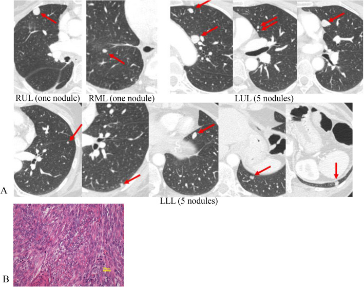

- Câu hỏi: Đếm/định vị các nốt? Vì sao bệnh nhân vẫn sống lâu? Khi nào cắt phổi?

<b>Bấm để hiện đáp án</b>

- Findings: **12 nốt** di căn hai phổi (RUL 1, RML 1, LUL 5, LLL 5), kích thước vài mm đến ~1 cm; không có di căn ngoài phổi.
- Chẩn đoán: **di căn phổi uLMS tái phát nhiều đợt**, mô bệnh xác nhận sarcoma.
- Vì sao sống lâu: **bệnh giới hạn ở phổi, cắt được nhiều lần, chức năng phổi đủ** — cắt di căn lặp lại có thể kéo dài sống còn (ca này sống không bệnh 5 năm 8 tháng sau lần cắt cuối, 16 năm sau mổ chính).
- Chỉ định cắt: **ít ổ, còn mổ được, bệnh ngoài phổi kiểm soát, chức năng phổi cho phép**; không cắt nếu di căn lan tỏa.
- Nguồn: Kodama K et al., Gen Thorac Cardiovasc Surg Cases 2025, PMC12607095, CC BY 4.0 (Fig 4).

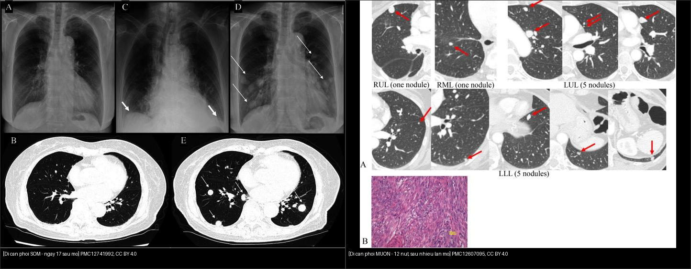

**Ca 4 — Nữ 69 tuổi, tiền sử uLMS, đau đùi phải; X-quang và MRI xương.**

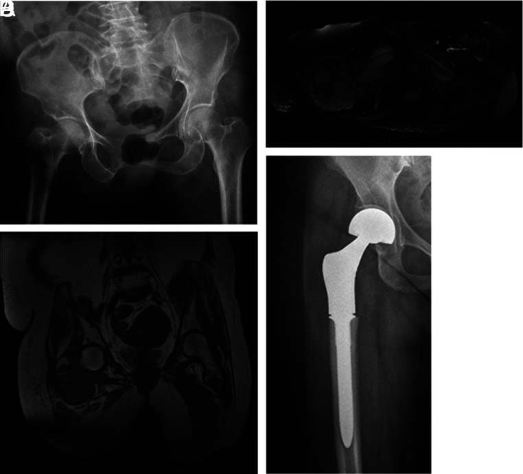

- Câu hỏi: Dấu hiệu trên X-quang? MRI bổ sung gì? Tiên lượng?

<b>Bấm để hiện đáp án</b>

- Findings: X-quang — **tiêu xương vùng liên mấu chuyển/đầu dưới xương đùi phải**, bờ không rõ; MRI T2 — ổ tăng tín hiệu, T1 — nhiều ổ giảm tín hiệu hai bên; sau đó thay khớp háng nhân tạo.
- Chẩn đoán: **di căn xương của uLMS** (đơn độc hoặc nhiều ổ).
- Tiên lượng: **sống trung vị 15 tháng** sau chẩn đoán di căn xương; cắt rộng ổ đơn độc giúp giảm đau và có thể kéo dài sống còn.
- Nguồn: Öztürk Başarır Z et al., Acta Orthop Traumatol Turc 2022, PMC9612665, CC BY-NC 4.0 (Fig 1).

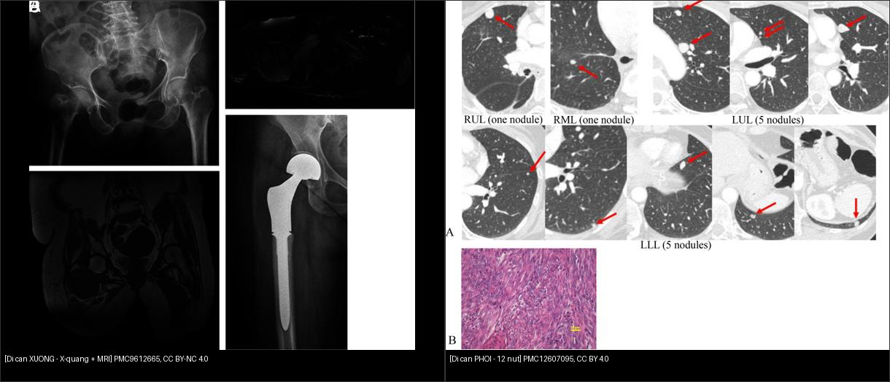

**Ca 5 — Nữ 51 tuổi, ra máu âm đạo, khối bụng lớn; CT thấy nốt phổi, hạch chậu.**

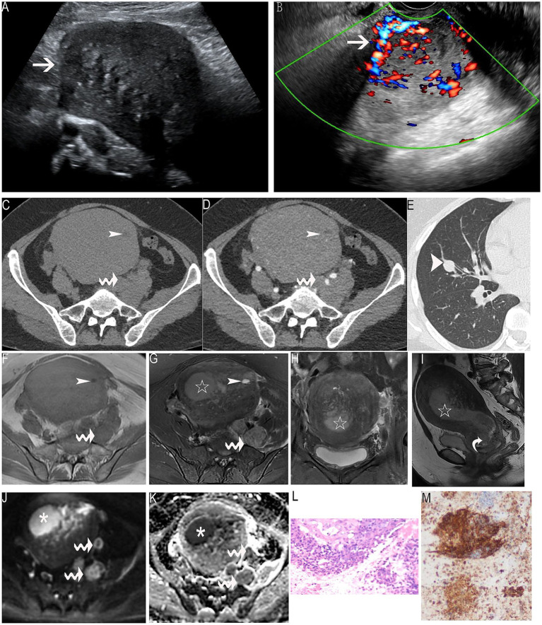

- Câu hỏi: Tìm khối nguyên phát và di căn trên các panel? Vì sao gọi giai đoạn IVB? Mô học nào?

<b>Bấm để hiện đáp án</b>

- Findings: (A–B) siêu âm khối **8 × 12 × 17 cm** không đồng nhất, tăng sinh mạch; (C–D) CT chậu — khối tử cung **47 HU**, hoại tử, hạch chậu trái; (E) **CT ngực — nốt phổi** (mũi tên dày); (F–I) MRI T1/T2 — khối xâm lấn cơ tử cung, dải tín hiệu thấp; (J–K) DWI/ADC hạn chế khuếch tán; (L–M) H&E/IHC.
- Chẩn đoán: **HG-ESS giai đoạn IVB (T3bN1M1)** — di căn phổi + hạch chậu.
- Vì sao: HG-ESS lan nhanh, di căn xa sớm; **MRI DWI/ADC** đánh giá độ tế bào và xâm lấn, **CT ngực** tìm di căn.
- Nguồn: Tan H, Zhang T. Front Med 2025, PMC12436435, CC BY 4.0 (Fig 1).

## Bài liên quan chéo
- [500 – Tổng quan Vú & Sản phụ khoa](../500-tong-quan-vu-san-phu-khoa/lesson.md)
- [526 – Sarcoma tử cung vs u xơ](../526-sarcoma-tu-cung-vs-u-xo/lesson.md)
- [527 – U mô đệm nội mạc tử cung](../527-u-mo-dem-noi-mac-tu-cung/lesson.md)
- [518 – Morcellation & LPD](../518-morcellation-LPD/lesson.md)
- [577 – Theo dõi & phát hiện tái phát ung thư phụ khoa](../577-theo-doi-tai-phat-ung-thu-phu-khoa/lesson.md)

> Không dùng để chẩn đoán độc lập khi chưa có người hướng dẫn.
