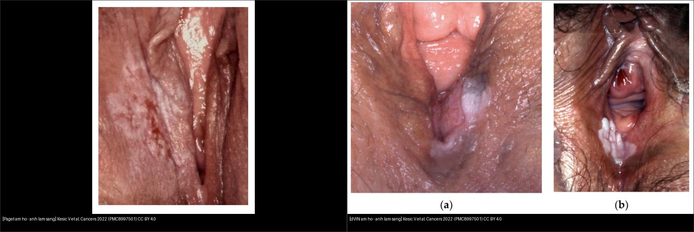
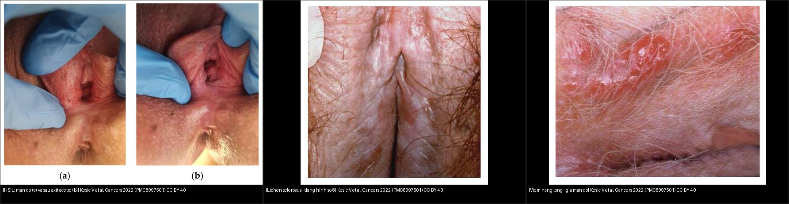
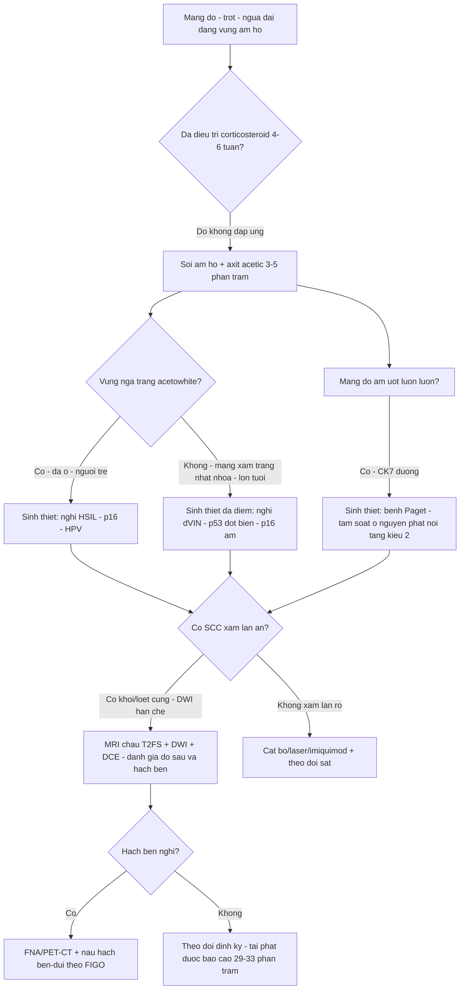
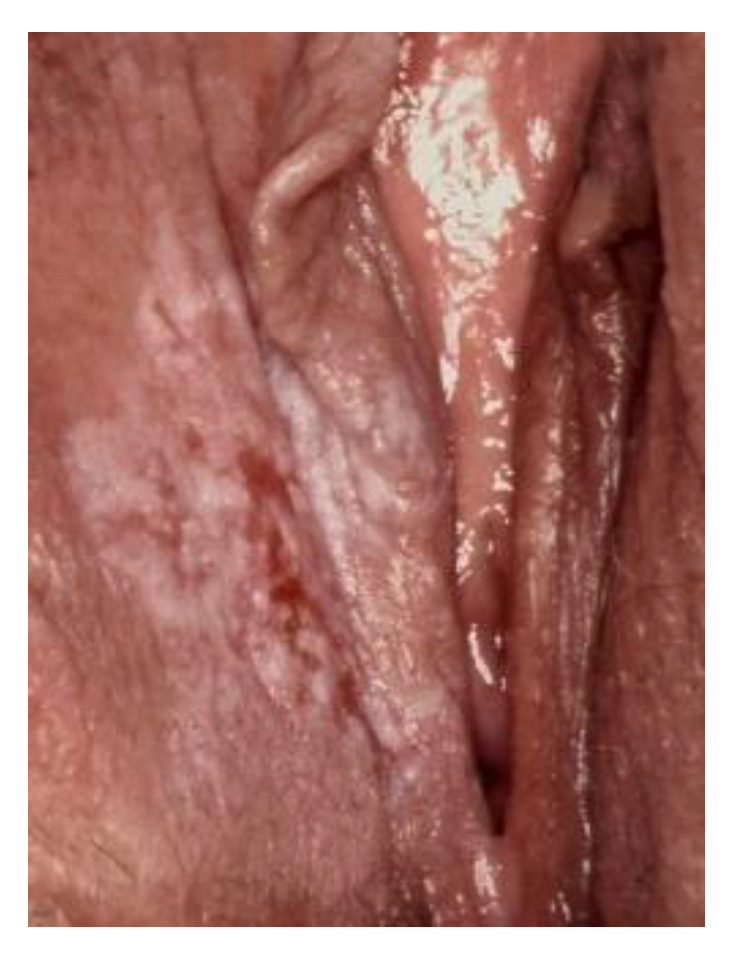
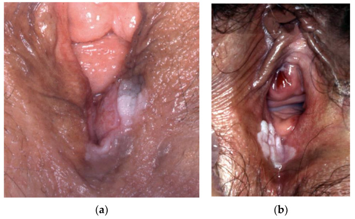
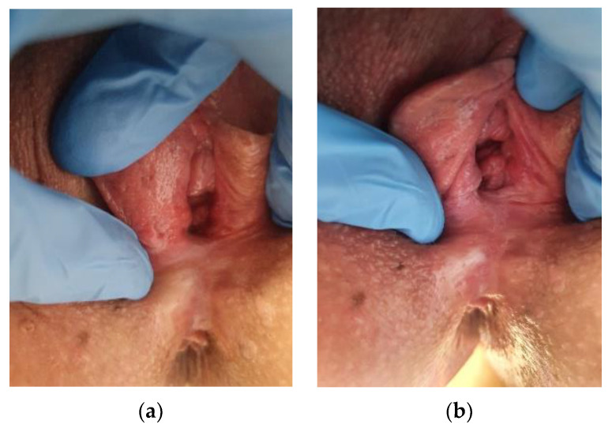
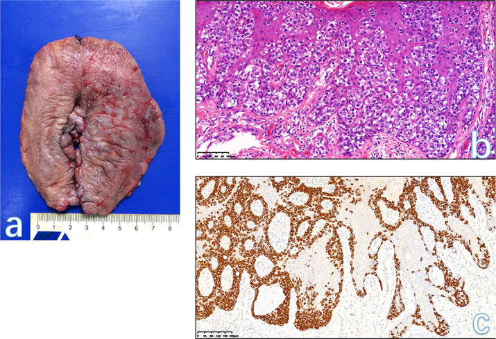
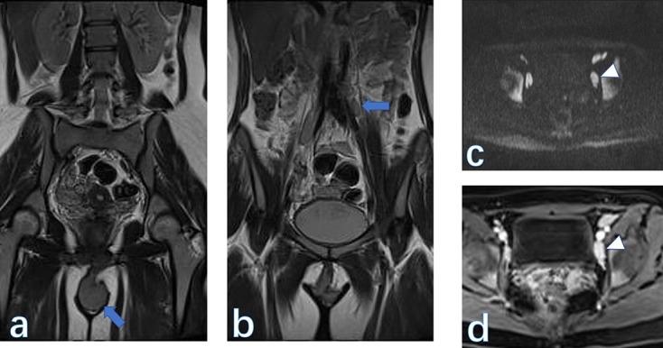
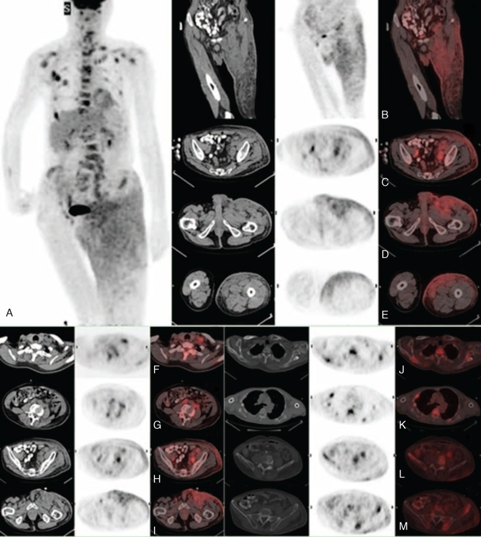

# 576 — Bệnh Paget âm hộ & ung thư nội biểu mô âm hộ (VIN): mảng đỏ–trợt & nguy cơ SCC xâm lấn

**Tags:** `pattern:man-do-am-ho` `pattern:man-trot` `pattern:u-am-ho` `pattern:hach-ben` `vung:am-ho` `score:WHO-2020-VIN` `protocol:vulvoscopy-sinh-thiet-mapping` `protocol:MRI-chau` `protocol:PET-CT`
**Mức chắc chắn (certainty):** tổng hợp y văn (literature synthesis) — gom review tổng quan (Cancers 2022), nghiên cứu đoàn hệ (Cancers 2021; Acta Obstet Gynecol Scand 2024; J Low Genit Tract Dis 2024), review MRI âm hộ (BJR Open 2023; Front Med 2026) và ca nguyên văn (Medicine 2015; Int J Surg Case Rep 2023; Dermatol Pract Concept 2023).

> Bài toán CĐHA của nhóm này **ngược** với u âm hộ đặc (bài 574): tổn thương có thể chỉ là **mảng đỏ, trợt, ngứa dai dẳng** — trông giống chàm/nhiễm nấm, nên **chẩn đoán thường bị trễ và sinh thiết bị trì hoãn**. Vai trò của hình ảnh là (1) **chọn chỗ sinh thiết** (soi âm hộ + axit acetic), (2) **loại trừ SCC xâm lấn ẩn dưới** (MRI/DWI khi cần), (3) **tìm hạch bẹn** và (4) với Paget, **tìm ổ ung thư ác nội tạng đồng thời** (kiểu 2).

## 1. Tổng quan bệnh học – cơ chế hình ảnh

- **Hai con đường sinh ung âm hộ (WHO 2020 — LAST/ISSVD):** (1) **liên quan HPV (HPV-associated)** — thể "thông thường" nay gọi **HSIL âm hộ (u nội biểu mô âm hộ bậc cao, high-grade squamous intraepithelial lesion)**, ưu thế **phụ nữ trẻ**, **đa ổ/đa trung tâm**, thường **HPV 16**; (2) **không liên quan HPV / thể biệt hóa (differentiated VIN, dVIN)** — **p53 đột biến**, nền **lichen sclerosus**, **phụ nữ lớn tuổi**, **đơn ổ**, xâm lấn nhanh (Kesić 2022; Voss 2021; Voss 2024).
- **Bệnh Paget ngoài vú (extramammary Paget disease, EMPD) — bệnh Paget âm hộ (Paget disease of the vulva, PDV):** **adenocarcinoma nội biểu mô nguyên phát ở da vùng chứa tuyến apocrine**, chiếm **1–2% u tân sinh âm hộ** (Pérez 2023). Chia **kiểu 1 (nguyên phát tại âm hộ/da)** và **kiểu 2 (thứ phát — đi kèm adenocarcinoma nội tạng không-da: trực tràng–hậu môn, niệu quản–bàng quang, cổ tử cung)** nên **bắt buộc tầm soát ổ nguyên phát** (Bencherifi 2023). Paget **dương tính CK7, CEA, mucin** — phân biệt với **melanoma (S100/HMB-45/Melan-A)** và **SCC** (Pérez 2023).
- **TẠI SAO thấy trên từng phương thức (vật lý + mô bệnh):**
  - **Soi âm hộ (vulvoscopy) + axit acetic:** **HSIL chuyển trắng (acetowhitening)** do nhân đặc/tăng tỷ lệ nhân–bào tương; **dVIN thường KHÔNG ngả trắng** (biểu mô sừng hóa, không tăng nhân tương xứng) → **đây là lý do dVIN bị bỏ sót** khi chỉ soi mà không sinh thiết (Kesić 2022).
  - **Dermoscopy (soi da):** **HSIL/VIN1** — nền hồng–đỏ đồng nhất + **mạch cầu thận đều (regular glomerular vessels)**; **VIN3** — **vùng trắng sữa đặc (compact milky-white areas)**; VIN2 — vùng trắng **không đặc** xen kẽ đỏ (De Giorgi 2023).
  - **MRI:** tổn thương **nội biểu mô thuần** (VIN, Paget không xâm lấn) chỉ làm **dày lớp biểu mô** → MRI có thể **bình thường hoặc dày nhẹ/ngấm nhẹ, KHÔNG đặc hiệu**. Khi có **SCC xâm lấn**, khối **T2W tín hiệu trung gian, khuếch tán hạn chế (ADC thấp)** và **ngấm thuốc**, kèm **hạch bẹn hoại tử** (Ning 2023).
  - **T2W của Paget:** trong ca PDV thấy **dày tiêu điểm lớp mô âm hộ trên T2W xóa mỡ (fat-sat)** + **ngấm thuốc nhẹ** (Ning 2023) — tương ứng mô bệnh tế bào Paget rải trong biểu mô.
  - **PET/CT ¹⁸F-FDG:** tổn thương **Paget xâm lấn/lan rộng** có **ngấm FDG nhẹ ở da–dưới da**, giúp bản đồ hóa vùng lan và **hạch vùng** (Li & Qin 2015).
- **Ngưỡng định lượng nổi bật (để nhớ):**
  - **dVIN → SCC âm hộ:** nguy cơ tuyệt đối phát triển VSCC **33–86%**, **trung vị 9–23 tháng**; nguy cơ tái phát VSCC ở bệnh nhân dVIN-VSCC **32–94%**, **trung vị 13–32 tháng** (tổng quan hệ thống, Voss 2021).
  - **dVIN đơn độc (solitary):** nguy cơ VSCC **43,2%** trong đoàn hệ 44 bệnh nhân (Gallio 2024).
  - **VIN không liên quan HPV:** tỷ lệ mới mắc **tăng từ 0,09 lên 0,69/100.000 nữ–năm** (1991–2010 → 2011–2019); **tái phát tích lũy 29% sau 8 năm**, **ung thư 46% sau 13 năm**; yếu tố nguy cơ tiến triển: **tuổi cao + p53 đột biến** (Voss 2024).
  - **PDV:** tuổi trung vị **69,3** (khoảng 38–84); **bệnh xâm lấn 4/24 (~17%)**, **di căn hạch bẹn 1/24**, **bờ phẫu thuật dương 11/24**, **tái phát 33,3%** (Loiacono 2019).
  - **PDV & HER2:** **30–40%** bệnh nhân **quá biểu hiện HER2** → có ý nghĩa điều trị (trastuzumab) ở bệnh lan rộng (Pérez 2023).

## 2. Mẫu hình + chẩn đoán phân biệt theo vị trí (gamut)

- **Mảng đỏ/trợt/ngứa dai dẳng ở âm hộ — gamut:**
  - **Tiền ung thư–ung thư:** **HSIL (VIN thông thường)**, **dVIN**, **bệnh Paget âm hộ**, **SCC xâm lấn** (có thể ẩn dưới VIN/Paget), **melanoma âm hộ** (sắc tố).
  - **Bệnh da lành hay nhầm:** **lichen sclerosus** (mảng trắng teo, dạng "số 8"), **lichen planus**, **chàm/vảy nến**, **viêm nang lông (folliculitis)**, **nhiễm HPV/sùi (condyloma)**, **viêm da tiếp xúc**, **nấm**.
  - **Paget "giả" các bệnh da** là cạm bẫy kinh điển: hình dạng giống chàm nhưng **không đáp ứng corticosteroid** → sinh thiết.
- **Theo vị trí:** môi lớn/môi bé (hay nhất), tiền đình, quanh hậu môn, **lan tới bẹn–đùi–quanh hậu môn** (Paget hay lan rộng, "skip lesions"); **hạch bẹn** là nơi di căn đầu tiên.
- **Hạch bẹn to — gamut:** di căn (SCC/melanoma/Paget xâm lấn), viêm/mô phản ứng (nhiễm trùng bàn chân), lymphoma, hạch sau tiêm.

## 3. Bảng so sánh phân biệt (ma trận đối chiếu)

| Thực thể (entity) | Hình ảnh điển hình | Chốt vào (rule-in) | Chốt loại (rule-out) | Gợi ý xác nhận |
|---|---|---|---|---|
| **HSIL âm hộ (VIN thông thường)** | Mảng đỏ, có thể sần/hơi sùi, **đa ổ**; **ngả trắng với axit acetic**; dermoscopy: **mạch cầu thận đều** | **Mảng đỏ + acetowhite (+) ở phụ nữ trẻ/đa ổ + HPV (+)** | Tổn thương trắng teo đối xứng quanh âm hộ–hậu môn, không ngả trắng → nghĩ lichen sclerosus | **Sinh thiết** chỗ acetowhite; p16 **dương khối (block-positive)**; HPV test |
| **dVIN** | Mảng **trắng–xám/xám–hồng**, ranh giới mờ, nền lichen sclerosus; **thường đơn ổ**; **KHÔNG ngả trắng rõ với axit acetic** | **Mảng xám–trắng "nhạt nhòa" + nền lichen sclerosus ở phụ nữ lớn tuổi** | Ngả trắng rõ/đa ổ, p16 dương → nghĩ HSIL | **Sinh thiết đa điểm**; **p53 đột biến (mutation pattern)**, **p16 âm**; CK17/SOX2 (+) |
| **Bệnh Paget âm hộ (PDV)** | **Mảng đỏ–hồng, bề mặt ẩm/trợt, có vảy hoặc trắng bạc, ranh giới rõ–uốn lượn**, có thể lan rộng; **ngứa** | **Mảng đỏ dai dẳng không đáp ứng corticosteroid + CK7 (+)** | Tổn thương sắc tố (melanoma), có mụn nước (herpes), có nấm soi thấy → loại trừ trước | **Sinh thiết**: **tế bào Paget (CK7+, CEA+, mucin+)**; tìm ổ nguyên phát nội tạng (kiểu 2) |
| **SCC xâm lấn (ẩn dưới VIN/Paget)** | **Nốt/loét cứng, đáy hoại tử**; MRI: khối **T2 trung gian, DWI hạn chế, ngấm thuốc**, ± hạch hoại tử | **Nốt/loét cứng + MRI T2 trung gian + DWI hạn chế + ngấm** | Tổn thương nông, mềm, T2 tăng, không hạn chế khuếch tán → nghĩ lành | **MRI chậu (T2FS + DWI + DCE)** + sinh thiết sâu; đánh giá hạch bẹn |
| **Lichen sclerosus** | Mảng **trắng ngà teo, dạng số 8 quanh âm hộ–hậu môn**; có thể nứt, dính | **Mảng trắng teo đối xứng + ngứa mạn** | Mảng đỏ sùi/ngả trắng → nghĩ VIN/SCC | **Sinh thiết** (loại trừ dVIN/SCC trên nền LS); theo dõi lâu dài |
| **Viêm nang lông / chàm / lichen planus** | Sẩn đỏ quanh nang lông, chàm rỉ dịch, lichen planus dạng mạng trắng (Wickham) | **Đáp ứng corticosteroid ± kháng sinh, triệu chứng theo mùa/dị ứng** | **Không đáp ứng steroid, lan rộng/tiến triển** → phải sinh thiết | **Sinh thiết nếu dai dẳng > 4–6 tuần** dù điều trị |
| **Hạch bẹn di căn** | Hạch to, **mất mỡ rốn**, bờ không đều, hoại tử, DWI hạn chế, PET dương | **Hạch bẹn hoại tử/ngấm mạnh + ổ nguyên phát âm hộ** | Hạch < 5–10 mm, giữ mỡ rốn, ngấm nhẹ → chưa kết luận | **FNA/chọc hút**; MRI + PET/CT; SLNB nếu hạch âm trên hình ảnh |

*Trái: **bệnh Paget âm hộ** — mảng đỏ–trắng bạc, bề mặt ẩm/trợt ở môi lớn. Phải: **dVIN** — mảng trắng–xám nhạt nhòa, ranh giới mờ. Cả hai ảnh: Kesić V et al., *Cancers (Basel)* 2022 (PMC8997501), CC BY 4.0. Ảnh ghép letterbox giữ tỷ lệ, không crop/kéo giãn.*

*Trái: **HSIL** (a) mảng đỏ, (b) sau axit acetic ngả trắng. Giữa: **lichen sclerosus** dạng số 8. Phải: **viêm nang lông** giả mảng đỏ. Cùng nguồn Kesić V et al., *Cancers (Basel)* 2022 (PMC8997501), CC BY 4.0.*

## 4. Protocol chụp + hệ phân độ/điểm chuẩn hóa

- **Đầu tay (không phải CT/MRI): soi âm hộ (vulvoscopy) + sinh thiết có bản đồ hóa.** Kem/lotion corticosteroid và kháng nấm làm mờ tổn thương → **ngừng vài tuần trước soi**. Dùng **axit acetic 3–5%** tìm vùng ngả trắng (HSIL) nhưng **luôn sinh thiết cả vùng xám–trắng nhạt nhòa** (dVIN) và mảng trợt dai dẳng (Paget) vì dVIN/Paget **không ngả trắng** (Kesić 2022; De Giorgi 2023).
- **Dermoscopy:** phân biệt HSIL (mạch cầu thận đều, vùng trắng sữa đặc ở bậc cao) với bệnh da lành; **không thay thế sinh thiết** (De Giorgi 2023).
- **MRI chậu** (khi nghi **xâm lấn** hoặc để đánh giá lan/hạch): **T2W fat-sat + DWI (b = 50–800) + DCE T1 sau tiêm**, FOV nhỏ vùng âm hộ + FOV lớn tìm hạch; **MRI KHÔNG loại trừ VIN nội biểu mô** (Ning 2023). Với Paget xâm lấn: MRI giúp xác định độ sâu/lan và hạch trước mổ.
- **PET/CT ¹⁸F-FDG:** vai trò cho **Paget lan rộng/xâm lấn** và **tìm ổ nguyên phát/di căn** (Li & Qin 2015); cũng dùng trong ung thư âm hộ giai đoạn cao (bài 574).
- **Phân loại WHO 2020 (âm hộ):** bỏ "VIN 1–3" cũ; dùng **HSIL âm hộ** (tương ứng VIN thông thường độ cao) và **dVIN**; **u nội biểu mô âm hộ bậc thấp (LSIL)** = condyloma/HPV.
- **Ngưỡng xử trí:**
  - **dVIN:** nguy cơ SCC rất cao → **cắt bỏ (excision) với bờ âm** + theo dõi sát; **bờ dương là yếu tố nguy cơ tái phát độc lập** (Voss 2024).
  - **HSIL:** **cắt bỏ/laser** hoặc **imiquimod 5%** (bệnh đa ổ), theo dõi; tái phát thường gặp.
  - **Paget:** **cắt rộng/Mohs**; **tái phát ~33%** do lan dưới lâm sàng (skip lesions) → **kiểm bờ kỹ, theo dõi lâu dài**; **tầm soát đồng thời adenocarcinoma trực tràng–niệu quản–cổ tử cung** (Pérez 2023; Loiacono 2019).

## 5. Biến thể bình thường và cạm bẫy

- **dVIN không ngả trắng với axit acetic** → soi âm hộ "sạch" vẫn có thể bỏ sót dVIN. Quy tắc: **mọi mảng xám–trắng dai dẳng trên nền lichen sclerosus phải sinh thiết**, kể cả khi không ngả trắng (Kesić 2022).
- **Paget "giả chàm":** khởi đầu chỉ ngứa, hình dạng eczematous → chẩn đoán muộn hàng năm. **Không đáp ứng corticosteroid ≥ 4–6 tuần = sinh thiết** (Bencherifi 2023).
- **"Skip lesions" của Paget:** tổn thương lan **gián đoạn** ngoài vùng thấy được → **bờ phẫu thuật dương cao (11/24 ca trong chuỗi 24 ca)** và **tái phát ~33%**; đừng kết luận "hết bệnh" chỉ dựa mắt thường (Loiacono 2019).
- **SCC xâm lấn ẩn dưới VIN/Paget:** mọi VIN/Paget **phải loại trừ SCC xâm lấn** trước khi điều trị bảo tồn — sinh thiết đủ sâu + MRI khi nghi (Kesić 2022; Ning 2023).
- **MRI bình thường KHÔNG loại trừ tổn thương nội biểu mô:** VIN và Paget không xâm lấn thường **không thấy trên MRI** — đừng vì "MRI âm" mà bỏ sinh thiết.
- **Cạm bẫy mặt cắt (cross-sectional pitfall):** khối/mảng âm hộ dễ bị cắt mất nếu FOV chậu không phủ tới môi lớn → **đặt FOV tới môi lớn**; phân biệt **mô cương âm vật bình thường** (ngấm thuốc, T2 trung gian) với u/tái phát bằng **đối chiếu phim cũ** (xem bài 574).
- **Nhầm với melanoma:** tổn thương sắc tố + tín hiệu T1 cao tự nhiên → **S100/HMB-45/Melan-A**, không phải CK7 (Pérez 2023).

## 6. Tự lượng giá — Blind Quiz

**Ca 1 — Mảng trợt đỏ dai dẳng ở môi lớn, ngứa nhiều**

- Gợi ý lâm sàng: nữ lớn tuổi, ngứa âm hộ kéo dài, đã dùng corticosteroid không đỡ.
- Câu hỏi: Mô tả tổn thương. Ba chẩn đoán phân biệt? Xét nghiệm nào để chốt, và chất chỉ điểm hóa mô miễn dịch đặc trưng?

<b>Bấm để hiện đáp án (findings + chẩn đoán)</b>

- Dấu hiệu: mảng **đỏ–hồng xen vùng trắng bạc, bề mặt ẩm/trợt, ranh giới uốn lượn** ở môi lớn.
- Chẩn đoán: **bệnh Paget âm hộ (PDV)** — sinh thiết xác nhận **tế bào Paget CK7(+), CEA(+), mucin(+)**. Vì giống chàm và **không đáp ứng steroid**, cần sinh thiết sớm; loại trừ ổ adenocarcinoma nội tạng (kiểu 2).
- Nguồn ảnh: Kesić V et al., *Cancers (Basel)* 2022, Fig. 6 (PMC8997501), CC BY 4.0.

**Ca 2 — Nữ lớn tuổi, mảng xám–trắng nhạt nhòa, soi axit acetic "không ngả trắng"**

- Gợi ý lâm sàng: nữ lớn tuổi, tiền sử lichen sclerosus, mảng xám–trắng không rõ bờ.
- Câu hỏi: Vì sao không ngả trắng với axit acetic lại nguy hiểm hơn? Chẩn đoán và nguy cơ tiến triển tới SCC là bao nhiêu?

<b>Bấm để hiện đáp án (findings + chẩn đoán)</b>

- Dấu hiệu: mảng **trắng–xám nhạt nhòa, ranh giới mờ**, trên nền lichen sclerosus; **không ngả trắng rõ** khi soi.
- Chẩn đoán: **dVIN (VIN thể biệt hóa)** — **p53 đột biến**, **p16 âm**. Nguy cơ tiến triển SCC âm hộ **33–86%, trung vị 9–23 tháng**; dVIN đơn độc **43,2%** → cắt bỏ với bờ âm + theo dõi sát.
- Nguồn ảnh: Kesić V et al., *Cancers (Basel)* 2022, Fig. 23 (PMC8997501), CC BY 4.0.

**Ca 3 — Mảng đỏ ở người trẻ, đa ổ; soi có vùng ngả trắng**

- Lâm sàng: nữ trẻ, nhiều mảng đỏ ở âm hộ.
- Câu hỏi: (a) trước và (b) sau axit acetic khác nhau thế nào? Chẩn đoán? Hóa mô miễn dịch chốt?

<b>Bấm để hiện đáp án (findings + chẩn đoán)</b>

- Dấu hiệu: (a) mảng đỏ; (b) **vùng ngả trắng (acetowhite)** sau axit acetic.
- Chẩn đoán: **HSIL âm hộ (VIN thông thường, liên quan HPV)** — **p16 dương khối**, thường HPV 16; điều trị cắt bỏ/laser/imiquimod và theo dõi.
- Nguồn ảnh: Kesić V et al., *Cancers (Basel)* 2022, Fig. 3 (PMC8997501), CC BY 4.0.

**Ca 4 — "Chàm" không đỡ, sinh thiết cho thấy tế bào Paget + dày lớp mô âm hộ trên MRI**

- Lâm sàng: bệnh nhân Paget âm hộ, tổn thương lan từ môi lớn sang môi bé, bờ mờ.
- Câu hỏi: (A) lâm sàng, (B) mô bệnh và (C) hóa mô miễn dịch cho thấy gì? Khi nào cần thêm MRI/PET?

<b>Bấm để hiện đáp án (findings + chẩn đoán)</b>

- Dấu hiệu: (A) tổn thương **lan rộng, bờ mờ** ở môi lớn–môi bé; (B) **tế bào Paget** (nhân lớn, bào tương sáng) trong biểu mô; (C) **CK7 dương mạnh** trong biểu mô.
- Chẩn đoán: **bệnh Paget âm hộ**. Trong bài gốc, nhánh MRI còn cho thấy **dày tiêu điểm lớp mô âm hộ trên T2 fat-sat + ngấm nhẹ**. Cần **MRI/PET/CT khi nghi xâm lấn hoặc để tìm ổ nội tạng đồng thời**, nhưng **MRI không loại trừ tổn thương nội biểu mô**.
- Nguồn ảnh: Ning Y et al., *BJR Open* 2023, Fig. 8 (PMC10302693), CC BY 4.0.

**Ca 5 — Sinh thiết "VIN" nhưng có khối cứng; MRI phát hiện gì?**

- Lâm sàng: khối âm hộ nghi xâm lấn, cần phân giai đoạn.
- Câu hỏi: MRI coronal T2W thấy gì? Hạch chậu trái hiển thị thế nào trên DWI và sau tiêm? Ý nghĩa phân giai đoạn?

<b>Bấm để hiện đáp án (findings + chẩn đoán)</b>

- Dấu hiệu: (A) **khối âm hộ** trên coronal T2W; (B) **hạch to cạnh động mạch chậu trái**; (C) **DWI hạn chế**; (D) **ngấm thuốc mạnh**. Mô bệnh sau cùng: **SCC âm hộ, FIGO IIIC**.
- Chẩn đoán/ý nghĩa: **SCC âm hộ xâm lấn + hạch chậu** → hạch chậu là di căn (không còn là hạch vùng) → phân giai đoạn và chỉ định điều trị thay đổi.
- Nguồn ảnh: Ning Y et al., *BJR Open* 2023, Fig. 7 (PMC10302693), CC BY 4.0.

**Ca 6 — Paget lan rộng toàn thân: PET/CT giúp gì?**

- Lâm sàng: bệnh nhân Paget xâm lấn lan rộng vùng bẹn–đùi–hông.
- Câu hỏi: (A) MIP toàn thân và các mặt cắt (B–M) cho thấy những vùng ngấm FDG nào? PET/CT thay đổi xử trí ra sao?

<b>Bấm để hiện đáp án (findings + chẩn đoán)</b>

- Dấu hiệu: (A) hình **MIP toàn thân** nhiều ổ ngấm FDG; (B–E) **xâm lấn dưới da**; (F–I) **hạch vùng**; (J–M) **di căn cơ/các ổ xa**.
- Chẩn đoán/ý nghĩa: **bệnh Paget ngoài vú xâm lấn lan rộng** — PET/CT **bản đồ hóa vùng lan và di căn** ngoài tầm phẫu thuật đơn thuần, định hướng điều trị toàn thân (gồm anti-HER2 nếu HER2+). PET bổ sung nhưng **không thay thế sinh thiết/mô bệnh**.
- Nguồn ảnh: Li ZG & Qin XJ, *Medicine (Baltimore)* 2015, Fig. 2 (PMC4602651), **CC BY-ND** — giữ nguyên bản, không crop/ghép.

## Bài liên quan chéo
- [500 – Tổng quan Vú & Sản Phụ khoa](../500-tong-quan-vu-san-phu-khoa/lesson.md)
- [574 – Ung thư âm hộ & âm đạo: FIGO 2021 + hạch bẹn–đùi & SLN](../574-ung-thu-am-ho-am-dao-FIGO-hach-ben/lesson.md)
- [548 – Khối/nang lành vùng âm hộ–âm đạo (Bartholin, Gartner, Nuck)](../548-nang-lanh-am-ho-am-dao/lesson.md)
- [528 – Dị dạng tử cung bẩm sinh ESHRE/ESGE](../528-di-dang-tu-cung-bam-sinh-ESHRE-ESGE/lesson.md)
- [571 – Sẩy thai tái diễn: tiếp cận hình ảnh tử cung](../571-say-thai-tai-dien-tiep-can-hinh-anh/lesson.md)

## Ảnh
- Nguồn + giấy phép từng ảnh: `images/CREDITS.md`. Ảnh CC BY 4.0/CC BY-NC dùng được (ghi nguồn); ảnh **CC BY-ND (PMC4602651) giữ nguyên bản, không crop/ghép**; ảnh ghép letterbox từ ảnh CC BY, không crop/kéo giãn.

> Không dùng để chẩn đoán độc lập khi chưa có người hướng dẫn.
