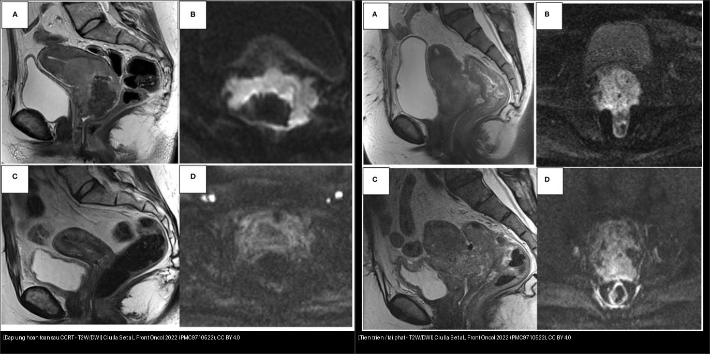
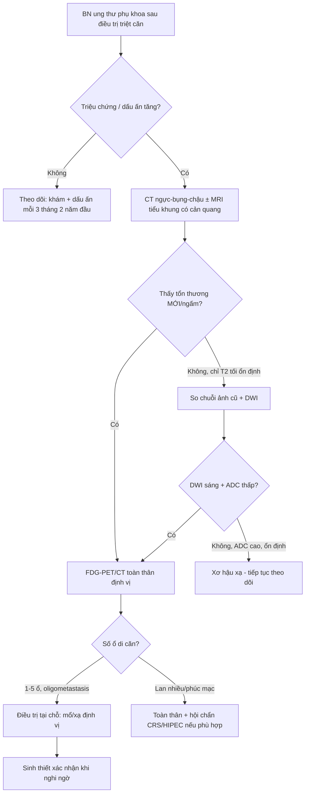
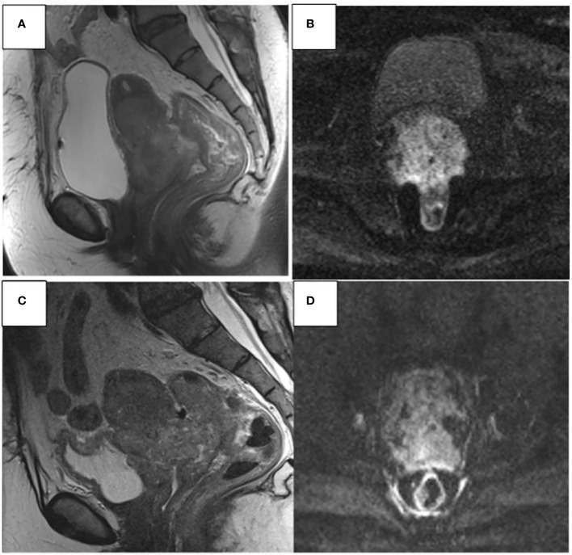
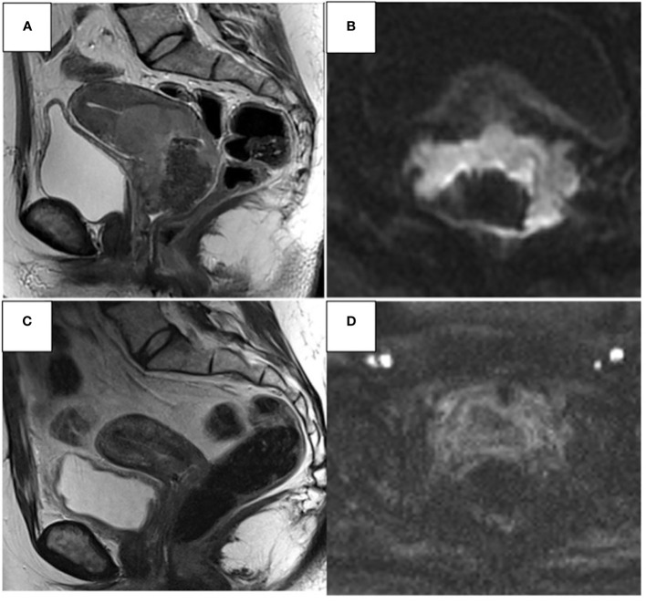
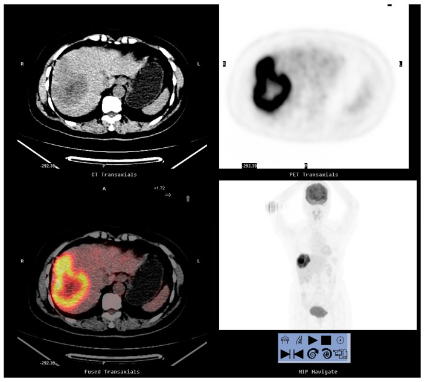
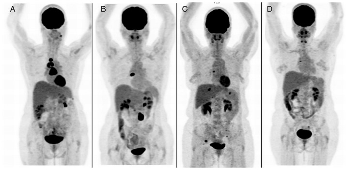
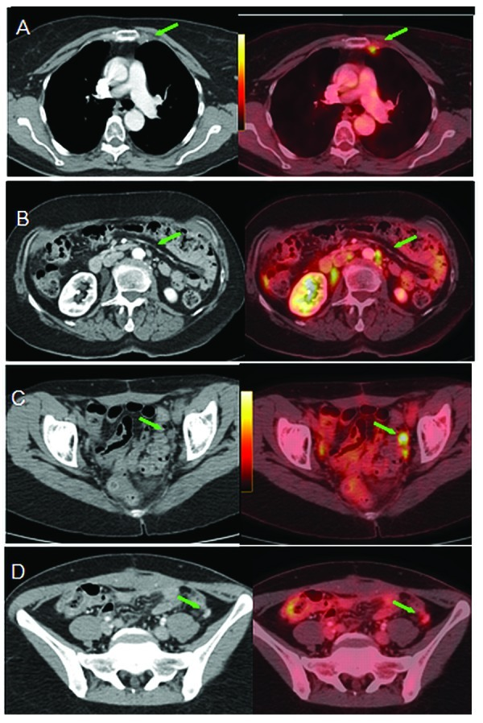
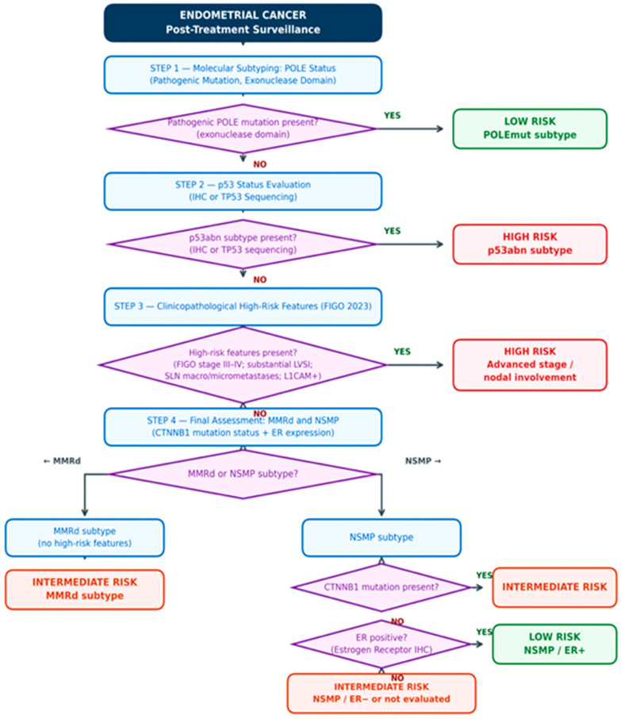

# 577 — Theo dõi & phát hiện tái phát ung thư phụ khoa: RECIST, CA-125, CT/MRI/PET-CT & tái phát muộn / Surveillance & recurrence detection in gynecologic cancer

**Tags:** `pattern:tai-phat` `vung:tieu-khung` `vung:phuc-mac` `score:RECIST` `score:FIGO` `protocol:CT-bung-chau` `protocol:PET-CT` `protocol:MRI-tieu-khung` `incidentaloma:tai-phat-sau-dieu-tri`
**Mức chắc chắn (certainty):** tổng hợp y văn (literature synthesis) — nhóm tự biên từ y văn mở (Front Oncol, Diagnostics, Oncology Letters, Cancers, Insights Imaging, Br J Cancer), có ca nguyên văn minh họa trong quiz.

> **Câu chốt của bài:** sau điều trị triệt căn, **mô xơ/hoại tử do xạ tồn tại tới 6 tháng** và có thể *giả u* trên T2W; thứ phân biệt **u sống vs xơ** là **DWI (tín hiệu cao ở b cao + ADC thấp = u sống; thấp/ADC cao = xơ)**. Đánh giá đáp ứng theo **RECIST 1.1** (không phải "to hơn = tái phát"), và **PET/CT có NPV rất cao (99,5%) khi theo dõi thường quy nhưng PPV chỉ 76%** — vì vậy **tái phát = bằng chứng MỚI (ngấm/DWI sáng/PET dương) xuất hiện sau một giai đoạn ổn định**, không phải thay đổi hậu xạ đơn thuần.

## 1. Tổng quan bệnh học – cơ chế hình ảnh

- **Vì sao "đọc tái phát" khó:** sau xạ trị/CCRT và phẫu thuật, vùng tiểu khung có **xơ (fibrosis), hoại tử, phù, huyết thanh tụ, lymphocyst** — tất cả đều làm thay đổi tín hiệu T2W và có thể **giả u (mimic)**. Ghi nhận: **hoại tử/xơ do hóa-xạ có thể tồn tại tới 6 tháng**, làm ống cổ tử cung giãn/không đối xứng (Ciulla 2022). **Tỷ lệ còn u (residual disease) sau CCRT ~40%** — nhóm này theo dõi sát.
- **TẠI SAO DWI là chìa khóa (cơ chế vật lý):** u sống **mật độ tế bào cao** → nước bị hạn chế khuếch tán → **tín hiệu cao ở b-value cao + ADC thấp**. Ngược lại **xơ/hoại tử** → nhiều nước tự do trong gian bào → **tín hiệu thấp ở b cao + ADC cao**. Vì vậy **DWI (kèm ADC map) là chuỗi trung tâm để phân biệt u còn sống vs xơ hậu xạ** (ESUR 2021).
- **TẠI SAO PET/CT hiệu quả:** tế bào u tăng chuyển hóa glucose → **¹⁸F-FDG tích tụ → SUVmax cao**; PET phát hiện được tổn thương **hạch không to (< 1 cm)** và **di căn ngoài tiểu khung** mà CT bỏ sót.
- **Vị trí tái phát hay gặp:** **buồng trứng** — **hạch và mảnh ghép phúc mạc (peritoneal implants)** hay nhất, rồi gan/lách/màng phổi/phổi/xương; **cổ tử cung** — tại chỗ (chu cung, âm đạo) + xa (phổi, hạch cạnh ĐMC, hạch thượng đòn); **nội mạc tử cung** — **vòm âm đạo (vaginal vault)**, hạch chậu, rồi di căn xa.
- **Dịch tễ/ngưỡng định lượng:** **PET/CT sau điều trị (n = 1712 lần chụp/654 BN): Se 94,4%, Sp 97,3%, PPV 76,0%, NPV 99,5%, độ chính xác 97,0%**; theo dõi thường quy **NPV 100%**, khi nghi tái phát **PPV 96,5%** (Kim 2026). **SCC-Ag ≥ 1,5 ng/mL = ngưỡng tăng**; **SCC-Ag Se 87,3%/Sp 57,6%** so với **FDG-PET/CT Se 98,2%/Sp 90,9%** (Peng 2020).

## 2. Mẫu hình + chẩn đoán phân biệt theo vị trí (gamut)

- **Hạch:** hạch chậu/cạnh ĐMC/thượng đòn **to ra hoặc mới xuất hiện**, mất rốn, bờ tròn không đều, ngấm mạnh/hoại tử; PET dương.
- **Phúc mạc:** **nốt phúc mạc, dày mạc nối ("bánh"), "khía" (scalloping) mặt gan–lách, dịch ổ bụng mới** = carcinomatosis tái phát.
- **Tại chỗ (cổ tử cung/nội mạc):** khối ở **chu cung/vòm âm đạo/ống cổ** ngấm + **DWI sáng/ADC thấp**; tái phát âm đạo sau cắt tử cung = "vault recurrence".
- **Di căn xa:** gan, phổi, màng phổi, xương, não, da/rốn.
- **Tái phát muộn (late recurrence):** một số thể rất trễ, cần theo dõi dài (xem bài 537 u giáp biên — 32% tái phát sau 5 năm; bài 533 u tế bào mầm — tái phát muộn).
- **Bắt chước (mimic) — luôn nằm trong gamut:** xơ sau xạ, hoại tử (tới 6 tháng), huyết thanh tụ, lymphocyst, giãn vòi trứng sau xạ, u mô mềm lành sau phẫu thuật.

## 3. Bảng so sánh phân biệt (ma trận đối chiếu)

| Thực thể (entity) | Hình ảnh điển hình | Chốt vào (rule-in) | Chốt loại (rule-out) | Gợi ý xác nhận |
|---|---|---|---|---|
| **Tái phát tại chỗ** (chu cung/vòm âm đạo/ống cổ) | Khối mô mềm **mới/ngấm mạnh**, **DWI sáng + ADC thấp**, bờ không đều | **Mô mới ngấm + DWI sáng/ADC thấp** xuất hiện sau giai đoạn ổn định | **Xơ: T2 tối nhưng DWI thấp + ADC cao** | Sinh thiết, PET/CT |
| **Xơ/hoại tử sau xạ (giả u)** | T2 tối/rỗ, có thể phì đại tới **6 tháng**, mờ dần theo thời gian | **Ổn định/cải thiện trên chuỗi ảnh + ADC cao + PET âm** | **Ngấm mới + DWI sáng + PET dương** → u | So chuỗi ảnh cũ, MRI DWI, PET |
| **Hạch di căn** | Hạch **≥ 10 mm trục ngắn** (nghi ≥ 10 mm; đích RECIST ≥ 15 mm), mất rốn, bờ tròn | **Hạch mới/to ra + ngấm đậm/PET dương**, tiền sử ung thư | Hạch phản ứng: **giữ rốn mỡ, bầu dục, PET âm/ngấm nhẹ** | PET/CT, sinh thiết (EBUS/US) |
| **Carcinomatosis phúc mạc tái phát** | Nốt/dày phúc mạc, **"khía" mặt gan–lách**, bánh mạc nối, dịch mới | **Nốt đặc ngấm + "khía" + dịch mới** | Báng tự do: **mặt tạng nhẵn, không nốt**; LPD lành: **nốt giống u xơ + báng ÍT** (bài 518) | CA-125, sinh thiết, CT/MRI |
| **Di căn đơn độc/ít ổ (oligometastasis)** | 1–5 ổ (hạch, gan, phổi) xuất hiện muộn, còn mổ/xạ được | **Số ổ ít + không lan phúc mạc/di căn rộng** → định hướng can thiệp tại chỗ | **Lan nhiều ổ/kèm dịch phúc mạc** → toàn thân | PET/CT toàn thân định vị |
| **Huyết khối tĩnh mạch vs hạch** | Khối dọc theo mạch (TM chậu/chủ dưới), ngấm theo mạch | **Nội lòng mạch, ngấm + phình mạch thấy được trên cả 2 thì** | **Hạch: nằm cạnh mạch, mất rốn, không trong lòng mạch** | CT 2 thì, MRI, siêu âm Doppler |

*Trái: **đáp ứng hoàn toàn** sau CCRT — chất T2 giảm mạnh, DWI hết sáng. Phải: **tiến triển (tái phát)** — u lan thân tử cung, 1/3 dưới âm đạo, mạc treo trực tràng, thành trực tràng–bàng quang, DWI sáng. Nguồn: Ciulla S et al., Front Oncol 2022 (PMC9710522), CC BY 4.0. Ảnh ghép letterbox.*

## 4. Protocol chụp + RECIST 1.1 + lịch theo dõi

- **RECIST 1.1 (đánh giá đáp ứng, không phải "chỉ tái phát"):** đo **tối đa 5 tổn thương đích / 2 cơ quan**; tổn thương đích **≥ 10 mm** (trục ngắn; **hạch: trục ngắn ≥ 15 mm**). **CR** = mất hết; **PR** = giảm **≥ 30%** tổng đường kính; **PD** = tăng **≥ 20%** và **≥ +5 mm** so với nadir (hoặc tổn thương mới); còn lại **SD**. **Độ biến thiên giữa người đọc (inter-observer) phụ thuộc cách đo, chọn tổn thương và chất lượng ảnh** (88 nghiên cứu; 68,2% chỉ dùng CT) → cần giao thức đo chuẩn hóa (Smesseim 2026).
- **CA-125 & dấu ấn:** **CA-125** cho ung thư biểu mô buồng trứng (tiêu chuẩn **GCIG**: tăng **≥ 2× ULN** hoặc **≥ 2× giá trị nadir**, xác nhận trên 2 lần); **SCC-Ag ≥ 1,5 ng/mL** cho SCC cổ tử cung; **β-hCG/AFP/LDH/inhibin B** theo thể (bài 533/536). **CEA, CA19-9** hỗ trợ ở u nhầy.
- **Lịch theo dõi (nguyên tắc):** khám + dấu ấn **mỗi 3 tháng trong 2 năm đầu**, rồi **6 tháng tới 5 năm**, sau đó hằng năm; **hình ảnh chỉ khi có triệu chứng/nghi ngờ** (chụp thường quy không cải thiện sống còn nhưng tốn kém — chi phí **13.454 USD/tái phát bằng hình ảnh vs 3.924 USD bằng CA-125**, tổng gần **2,4 triệu USD/16 năm**; Rettenmaier 2010). **PET/CT + MRI có cản quang 3–6 tháng sau CCRT** cho ung thư cổ tử cung tiến xa (Ciulla 2022).
- **Theo dõi cá thể hóa theo phân tử (nội mạc tử cung):** mô hình **3 tầng (thấp – trung – cao)** tích hợp **phân nhóm phân tử** (POLEmut, MMRd, NSMP, p53abn) + yếu tố lâm sàng–bệnh học + kiểu hình tái phát (Szatkowski 2026) → tầng nguy cơ cao theo dõi dày hơn.

## 5. Biến thể bình thường và cạm bẫy

- **Cạm bẫy thời gian:** thay đổi hậu xạ có thể **phì đại/giả u tới 6 tháng** → **đừng kết luận tái phát sớm**; chụp lại sau 3–6 tháng + DWI.
- **PET dương tính giả:** viêm/nhiễm trùng, hậu phẫu, mô hạt, ruột, mô mỡ nâu, tủy xương tăng hoạt (G-CSF) → **PPV chỉ ~76%**; luôn đối chiếu CT cấu trúc.
- **PET âm tính giả:** tổn thương **nhỏ (< 8–10 mm)**, u nhầy/hoại tử kém bắt FDG, hạch vi di căn → **PET âm KHÔNG loại trừ tái phát** (đã ghi nhận ở u nhầy, xem bài 537/539).
- **CA-125 bình thường mà vẫn tái phát:** cổ điển — trong 11 BN CA-125 bình thường, **8/11 vẫn có PET/CT dương** (Dragosavac 2013); ngược lại **CA-125 tăng đơn độc với hình ảnh thường quy âm** → PET phát hiện tổn thương (11 BN).
- **"Hai lần đo bất thường liên tiếp"**: một lần dấu ấn nhích nhẹ/không tương ứng thường không đủ — cần xác nhận.
- **Lymphocyst/huyết thanh tụ hậu phẫu** có thể giả nang tái phát — xuất hiện sớm, bờ mảnh, không ngấm, tự thoái triển.
- **Cạm bẫy mặt cắt:** hạch bên cạnh mạch chậu vs huyết khối trong lòng mạch — phải thấy **tổn thương TRONG lòng mạch** mới gọi là huyết khối.

## 6. Tự lượng giá — Blind Quiz (ảnh trơn ngoài, đáp án giấu trong thẻ bấm-mở)

**Ca 1 — Nữ 41 tuổi, ung thư cổ tử cung xâm lấn, MRI trước và sau CCRT:**

- Câu hỏi: So sánh trước (A, B) và sau điều trị (C, D). Đáp ứng hay tiến triển? Dấu hiệu chốt?

<b>Bấm để hiện đáp án (findings + chẩn đoán)</b>

- **Dấu hiệu:** sau CCRT, khối **lan rộng thêm** — xâm lấn **thân tử cung, 1/3 dưới âm đạo, mạc treo trực tràng, thành trước trực tràng và thành sau bàng quang**; **DWI vẫn sáng** ở vùng còn u.
- **Chẩn đoán:** **TIẾN TRIỂN/TÁI PHÁT (progression disease)** — DWI sáng + ADC thấp vùng u còn sống, kèm mở rộng giải phẫu.
- Nguồn: **Ciulla S et al.**, Front Oncol 2022 (PMC9710522), CC BY 4.0.

**Ca 2 — Nữ 37 tuổi, ung thư cổ tử cung trước và sau CCRT (đối chiếu Ca 1):**

- Câu hỏi: Đáp ứng loại nào theo RECIST? Dấu hiệu chốt trên DWI/ADC?

<b>Bấm để hiện đáp án</b>

- **Dấu hiệu:** tổn thương cổ tử cung **giảm mạnh (~90%)** sau CCRT; vùng còn lại **DWI mất sáng** và **ADC cao** (không còn u sống).
- **Chẩn đoán:** **đáp ứng hoàn toàn (complete response)** — tương ứng RECIST CR. **DWI/ADC phân biệt u sống vs xơ** là mấu chốt.
- Nguồn: **Ciulla S et al.**, Front Oncol 2022 (PMC9710522), CC BY 4.0.

**Ca 3 — Nữ 78 tuổi, ung thư cổ tử cung (SCC) 10 năm trước, SCC-Ag tăng 6,7 ng/mL:**

- Câu hỏi: Dấu ấn tăng nhưng BN không triệu chứng — làm gì? Ổ FDG bất thường nằm ở đâu?

<b>Bấm để hiện đáp án</b>

- **Dấu hiệu:** **nốt FDG-avid 3,0 cm vùng TRƯỚC XƯƠNG CÙNG (pre-sacral)**, **SUVmax 5,2**; cắt nốt → mô bệnh = **hạch di căn tái phát**.
- **Chẩn đoán:** **tái phát hạch tiểu khung** muộn (10 năm sau chẩn đoán) biểu hiện **chỉ bằng SCC-Ag tăng** (6,7 ng/mL ≥ 1,5 ng/mL). Bài học: **dấu ấn tăng đơn độc với CT thường quy âm → PET/CT**.
- Nguồn: **Peng NJ et al.**, Diagnostics 2020 (PMC7555056), CC BY 4.0.

**Ca 4 — Nữ 56 tuổi, ung thư cổ tử cung (SCC, FIGO IB1) 5 năm trước, SCC-Ag 1,8 ng/mL:**

- Câu hỏi: Ổ bất thường nằm đâu, kích thước/SUVmax? Điều trị đã được thực hiện?

<b>Bấm để hiện đáp án</b>

- **Dấu hiệu:** **nốt giảm đậm độ 11,0 cm thùy gan phải**, FDG-avid, **SUVmax 7,9**.
- **Chẩn đoán:** **di căn gan từ SCC cổ tử cung** (cắt thùy phải → mô bệnh: SCC biệt hóa vừa di căn). Ca minh họa: **tái phát xa đơn độc có thể mổ được**.
- Nguồn: **Peng NJ et al.**, Diagnostics 2020 (PMC7555056), CC BY 4.0.

**Ca 5 — Ung thư buồng trứng, CA-125 trong giới hạn bình thường (13,8–32,3 U/mL) nhưng PET/CT dương:**

- Câu hỏi: CA-125 bình thường có loại trừ tái phát? PET/CT thêm được gì?

<b>Bấm để hiện đáp án</b>

- **Dấu hiệu:** PET/CT dương với **hạch trên hoành (supradiaphragmatic) + di căn hạch chậu/ổ bụng**, dù **CA-125 chỉ 13,8–32,3 U/mL**.
- **Chẩn đoán:** **tái phát ung thư buồng trứng** — trong loạt này **8/11 BN CA-125 bình thường vẫn có PET/CT dương**. **PET phát hiện tổn thương không ngờ 44,4%**; **hạch là vị trí tái phát hay gặp nhất**.
- Nguồn: **Dragosavac S et al.**, Oncology Letters 2013 (PMC3573129), CC BY 4.0.

**Ca 6 — Ung thư buồng trứng, CA-125 tăng + hình ảnh thường quy bình thường:**

- Câu hỏi: Khi dấu ấn tăng mà CT/siêu âm âm, tổn thương có thể nằm ở đâu?

<b>Bấm để hiện đáp án</b>

- **Trả lời:** hạch **không to** vẫn có thể bắt FDG — PET/CT loạt này thấy **hạch vú trong trái 0,9 cm (SUVmax 3,6)**, **hạch cạnh ĐMC bụng kích thước bình thường (< 1,0 cm)**, **hạch chậu trái** và các ổ nhỏ khác mà CT "thấy bình thường".

- **Chốt:** **hạch < 1 cm vẫn có thể là di căn** → ngưỡng kích thước không loại trừ; cần PET/CT.
- Nguồn: **Dragosavac S et al.**, Oncology Letters 2013 (PMC3573129), CC BY 4.0.

**Ca 7 — BN ung thư nội mạc tử cung, thiết kế theo dõi cá thể hóa:**

- Câu hỏi: Điều gì quyết định cường độ theo dõi? Phân nhóm phân tử gồm những nhóm nào?

<b>Bấm để hiện đáp án</b>

- **Trả lời:** mô hình **3 tầng nguy cơ** tích hợp **phân nhóm phân tử** (POLEmut — rất thuận lợi; **MMRd** — đáp ứng miễn dịch; **NSMP** — dùng **CTNNB1** và **ER/L1CAM** điều chỉnh; **p53abn** — nguy cơ cao) + yếu tố lâm sàng–bệnh học + **kiểu hình tái phát dự kiến**. **Theo dõi đồng nhất cho mọi BN là không phù hợp** sinh học khối u.

- Nguồn: **Szatkowski W & Glanowska-Nawrat I**, Cancers 2026 (PMC13163091), CC BY 4.0.

## Bài liên quan chéo
- [500 – Tổng quan Vú & Sản Phụ khoa](../500-tong-quan-vu-san-phu-khoa/lesson.md)
- [572 – Hạch trong ung thư phụ khoa: SLN, PET-CT](../572-hach-ung-thu-phu-khoa-SLN-PET/lesson.md)
- [535 – Ung thư buồng trứng, phúc mạc & u Krukenberg](../535-ung-thu-buong-trung-phuc-mac-krukenberg/lesson.md)
- [525 – K nội mạc/cổ tử cung: FIGO MRI](../525-ung-thu-noi-mac-co-tu-cung-FIGO-MRI/lesson.md)
- [537 – U buồng trứng giáp biên (tái phát muộn)](../537-u-buong-trung-giap-bien/lesson.md)
- [533 – Theo dõi & bảo tồn sinh sản sau u tế bào mầm buồng trứng](../533-theo-doi-va-bao-ton-sinh-san-sau-u-buong-trung/lesson.md)
- [539 – Pseudomyxoma peritonei (carcinomatosis phúc mạc)](../539-pseudomyxoma-peritonei/lesson.md)
- [574 – Ung thư âm hộ & âm đạo: FIGO 2021](../574-ung-thu-am-ho-am-dao-FIGO-hach-ben/lesson.md)

## Ảnh
- `577_tien-trien_MRI_PMC9710522.jpg`, `577_dap-ung-hoan-toan_MRI_PMC9710522.jpg` — Ciulla S et al., Front Oncol 2022, CC BY 4.0.
- `577_PET-hach-truoc-xuong-cung_PMC7555056.jpg`, `577_PET-di-can-gan_PMC7555056.jpg` — Peng NJ et al., Diagnostics 2020, CC BY 4.0.
- `577_PET-CA125-binh-thuong_PMC3573129.jpg`, `577_PET-ton-thuong-an_PMC3573129.jpg` — Dragosavac S et al., Oncology Letters 2013, CC BY 4.0.
- `577_thuat-toan-theo-doi_PMC13163091.jpg` — Szatkowski W & Glanowska-Nawrat I, Cancers 2026, CC BY 4.0.
- `composite_dap-ung-vs-tien-trien.jpg` — ảnh ghép letterbox (CC BY 4.0, phái sinh từ PMC9710522).
- Nguồn + giấy phép từng ảnh: `images/CREDITS.md`.

> **Disclaimer y tế:** Không dùng để chẩn đoán độc lập khi chưa có người hướng dẫn.
