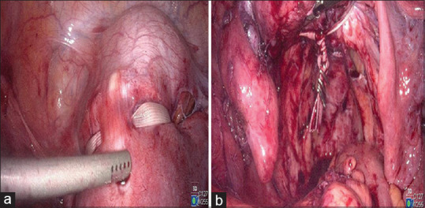
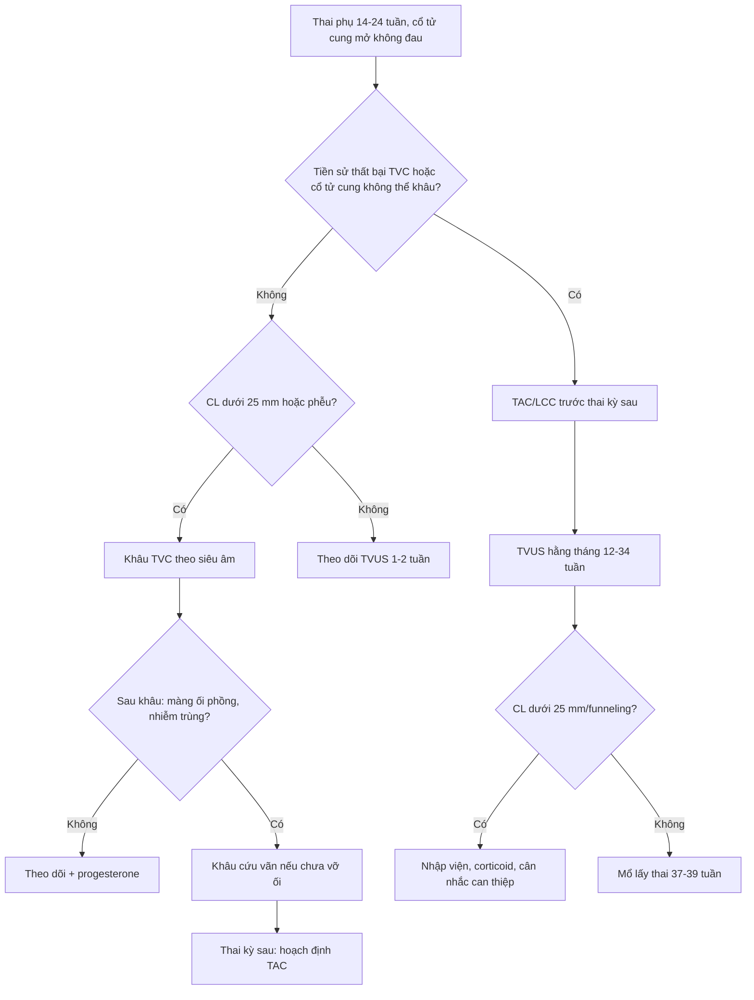
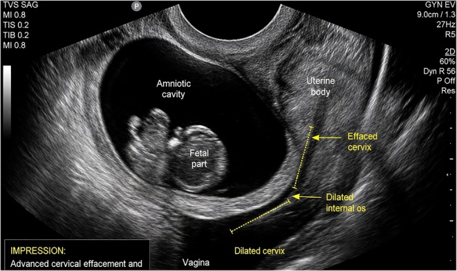
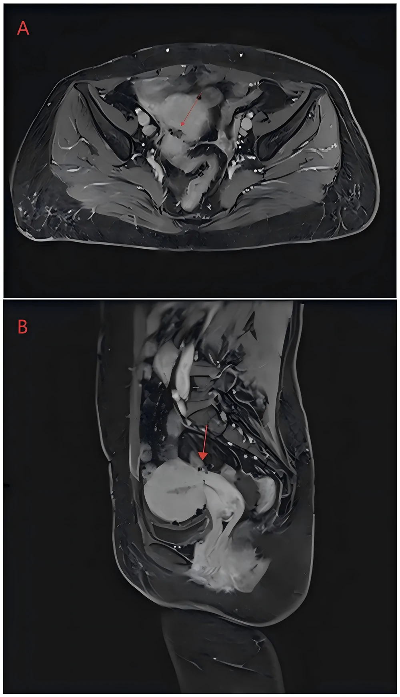
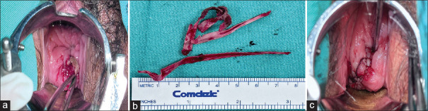
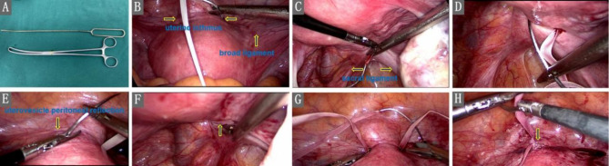

# 578 — Bán khâu qua ngả bụng (TAC) & xử trí thất bại bán khâu qua âm đạo / Transabdominal cerclage (TAC) and failed vaginal cerclage

**Tags:** `pattern:suy-co-tu-cung` `pattern:ban-khau` `pattern:sinh-non` `vung:co-tu-cung` `vung:tieu-khung` `protocol:MRI-tieu-khung` `protocol:sieu-am-dau-do`
**Mức chắc chắn (certainty):** tổng hợp y văn (literature synthesis) — tổng hợp từ nghiên cứu mở CC BY/CC BY-NC-ND (Abdallah *Future Sci OA* 2023; Kuang *BMC Pregnancy Childbirth* 2024; Hulshoff *AOGS* 2025; Fan *Front Reprod Health* 2026; van der Krogt *BJOG* 2026; Malik *Clin Case Rep* 2026; Hansen *AOGS* 2026; Paredes *Gynecol Minim Invasive Ther* 2024; Tang *Int J Womens Health* 2026), có **ca nguyên văn** minh họa (Malik 2026; Paredes 2024). Không có ca nguyên văn riêng của nhóm.

## 1. Tổng quan bệnh học – cơ chế hình ảnh

- **Suy cổ tử cung (cervical insufficiency):** cổ tử cung **mở không đau** ở tam cá nguyệt 2, không co tử cung, dẫn tới **thai lưu/sinh cực non 14–24 tuần**. Tần suất **0,1–2%** thai kỳ; **không có tiêu chuẩn vàng** — chẩn đoán dựa **tiền sử + siêu âm + khám**.
- **Vì sao TAC hiệu quả hơn TVC ở nhóm thất bại:** khâu qua âm đạo (McDonald/Shirodkar) đặt chỉ **quanh cổ tử cung tại/ngay trên lỗ trong**, nên bị giới hạn bởi **chiều dài cổ tử cung còn lại**. TAC đặt dải băng tại **eo tử cung – chỗ nối thân–cổ, 2–3 cm trên lỗ trong**, **phía trong động mạch tử cung**, **sau dây chằng rộng**, trên **dây chằng tử cung–cùng** → chặn trực tiếp lực mở của **eo tử cung**, không phụ thuộc cổ tử cung ngắn/đã cắt.
- **TẠI SAO hình ảnh cần thiết:**
  - **Siêu âm đầu dò âm đạo (TVUS)** là chuẩn đo **chiều dài cổ tử cung (cervical length – CL)**: bàng quang **rỗng/không quá căng**, đo **3 lần** lấy trị số ngắn nhất, từ **lỗ trong đến lỗ ngoài**; **CL < 25 mm trước 24 tuần** là ngưỡng "cổ tử cung ngắn"; **< 10 mm + funneling/sludge** là nguy cơ rất cao. Sau khâu, TVUS kiểm tra **vị trí dải băng** và **hình phễu**.
  - **MRI tiểu khung T2** phân biệt **dải băng (band) tín hiệu rất thấp** với mô xơ; phù/viêm quanh cổ tử cung **T2 sáng**; **đường rò (fistula)** là đường **T2 sáng có thành ngấm thuốc**; **áp-xe** có **DWI hạn chế**. MRI hữu ích khi **đau chậu mạn, chảy dịch âm đạo, nghi xói mòn/di trú dải băng** — những biến chứng có thể xuất hiện **nhiều năm** sau mổ.
  - **CT/HSG** ít dùng; **soi ổ bụng** là "chuẩn vàng" đánh giá vị trí dải băng khi có biến chứng.
- **Ngưỡng định lượng đáng nhớ:**
  - **CL < 25 mm trước 24 tuần** = chỉ định siêu âm; **< 10 mm** hoặc **phễu > 50%** = nguy cơ sinh non rất cao.
  - **TAC mở (87 thai):** thai sống **92%**, tuổi thai trung vị **37,3 tuần**, **92% ≥ 34 tuần** (Hulshoff 2025).
  - **LCC vs TVC sau dính buồng tử cung:** đẻ đủ tháng **89,4% vs 71,2%**; sinh non **< 34 tuần 9,1% vs 20,2%**; sống sơ sinh **98,5% vs 90,4%**; nhiễm trùng **3,0% vs 10,6%**; tuột chỉ **1,5% vs 9,6%**; rách cổ tử cung **1,5% vs 5,8%** (Fan 2026).
  - **125 thai sau TAC:** **6,4%** sinh **< 32 tuần**; **tiền sử cắt cổ tử cung (trachelectomy)** là yếu tố nguy cơ mạnh; CL tam cá nguyệt 1 **19,3 mm vs 33,8 mm** ở nhóm thất bại (van der Krogt 2026).
  - **Biến chứng muộn:** **3/203 (1,5%)** phải tháo dải băng vì đau/xói mòn; chất lượng sống tương đương nhóm không đặt (Hansen 2026).
- **Cơ chế biến chứng:** dải băng là **vật lạ không tan** → có thể **di trú/xói mòn** qua cổ tử cung vào **âm đạo, bàng quang, trực tràng**, gây **chảy máu, tiết dịch, rò, đau**; chẩn đoán muộn vì triệu chứng mơ hồ. **Rò trực tràng–tử cung** sau xói mòn dải băng là biến chứng nặng, cần MRI và mổ.

## 2. Mẫu hình + chẩn đoán phân biệt theo vị trí (gamut)

- **Mẫu hình cửa vào:** thai phụ **14–24 tuần**, **cổ tử cung mở không đau**, **phễu lỗ trong**, hoặc **tiền sử ≥ 1 thai lưu/sinh cực non tam cá nguyệt 2**; khám **không có cơn co**, **không nhiễm trùng**.
- **Gamut theo chỉ định khâu:**
  1. **Theo tiền sử (history-indicated):** ≥ 1 thai lưu/sinh non tam cá nguyệt 2 không rõ nguyên nhân; đặt **12–14 tuần** (TVC).
  2. **Theo siêu âm (ultrasound-indicated):** **CL < 25 mm trước 24 tuần** (đặc biệt có tiền sử sinh non).
  3. **Theo khám (exam-indicated/rescue):** cổ tử cung đã mở, **màng ối phồng** nhưng **chưa vỡ**, **chưa nhiễm trùng** → cân nhắc khâu cứu vãn.
  4. **TAC:** **thất bại TVC** (thai lưu/sinh non < 28 tuần dù đã khâu), **cổ tử cung ngắn/đã cắt** (cone, trachelectomy), **dị dạng Müller**, **rách cổ tử cung nặng**, hoặc **không thể đặt TVC** vì giải phẫu.
- **Gamut theo kỹ thuật:**
  - **TVC McDonald:** mũi khâu túi ví quanh cổ tử cung; **Shirodkar:** bóc niêm mạc, khâu cao hơn, có thể để lại qua ngả âm đạo.
  - **TAC mở (laparotomy):** đặt dải băng tại eo tử cung; kinh điển, hiệu quả cao, xâm lấn hơn.
  - **LCC (laparoscopic cervicoisthmic cerclage):** nội soi 4 trocar, đặt **dải Mersilene 5 mm** tại **eo tử cung**, **2–3 cm trên lỗ trong**, **trong động mạch tử cung**, sau dây chằng rộng; ít máu, hồi phục nhanh.
  - **Robot-assisted:** tương tự LCC, phù hợp ca dính/giải phẫu phức tạp.
  - **Trans-broad-ligament / needle-free:** đường xuyên dây chằng rộng hoặc không dùng kim xuyên cổ tử cung — ít tổn thương mạch máu hơn nhưng kỹ thuật khó.
- **Gamut theo biến chứng:**
  - **Sớm:** chảy máu (động mạch tử cung), tổn thương **bàng quang/niệu quản**, nhiễm trùng, đau.
  - **Muộn:** **xói mòn/di trú dải băng** (âm đạo, bàng quang, trực tràng), **rò**, **đau chậu mạn**, **vô sinh do dính**, **sinh non dù đã TAC** (6,4% < 32 tuần), **vỡ tử cung** (hiếm).
- **Gợi nhớ "SHORT":** **S**hort cervix (< 25 mm), **H**istory (thai lưu tam cá nguyệt 2), **O**peration (cone/trachelectomy), **R**efractory TVC, **T**rouble anatomy (dị dạng/rách).

## 3. Bảng so sánh phân biệt (ma trận đối chiếu)

| Thực thể (entity) | Hình ảnh điển hình (US/MRI) | Chốt vào (rule-in) | Chốt loại (rule-out) | Gợi ý xác nhận |
|---|---|---|---|---|
| TVC (McDonald/Shirodkar) | TVUS: chỉ **quanh cổ tử cung**, CL đo được; phễu lỗ trong; chỉ **không thấy** trên MRI | **Tiền sử đặt chỉ qua âm đạo + chỉ quanh cổ tử cung + CL còn đo được** | Cổ tử cung đã cắt/ngắn < 5 mm, không đặt được chỉ → không TVC | Khám âm đạo; TVUS |
| TAC/LCC | Dải băng **tín hiệu thấp** tại **eo tử cung, 2–3 cm trên lỗ trong**; không có chỉ ở cổ tử cung | **Vị trí eo tử cung + tiền sử mổ bụng/nội soi + không thấy chỉ âm đạo** | Dải băng quá thấp/quá xa lỗ trong → kỹ thuật sai, nguy cơ thất bại | Nội soi/CT; TVUS khó thấy |
| Khâu cứu vãn (rescue) | Cổ tử cung **mở 2–4 cm**, **màng ối phồng**, không vỡ; TVUS thấy phễu | **Màng ối còn nguyên + không nhiễm trùng + thai còn sống** | **Vỡ ối, viêm màng ối, thai lưu, dị tật nặng** → không khâu | Khám + TVUS + CRP/BCA |
| Không khâu/theo dõi | CL ngắn nhưng **không có tiền sử**, không phễu; thai ổn | **CL 25–30 mm, không phễu, không tiền sử** | CL < 25 mm + tiền sử sinh non → nên khâu | TVUS lặp 1–2 tuần |
| Xói mòn dải băng | **Dải băng xuyên qua cổ tử cung/âm đạo**, mô hạt quanh; MRI: đường hầm **T2 sáng** | **Nhìn thấy dải băng lộ + chảy máu/dịch âm đạo kéo dài** | Không thấy dải băng, chỉ viêm cổ tử cung → điều trị nội khoa | Khám + MRI; nội soi |
| Rò trực tràng–tử cung | MRI: **đường rò T2 sáng** từ trực tràng đến tử cung, thành ngấm thuốc | **Đường rò + khí/dịch trong tử cung + tiền sử xói mòn** | Chỉ dày thành trực tràng do viêm → không rò | MRI + soi trực tràng |
| Sinh non dù TAC | TVUS: CL ngắn dần, phễu, sludge; thai tụt thấp | **Tiền sử trachelectomy + CL tam cá nguyệt 1 < 20 mm** | CL ổn định > 35 mm, không phễu → nguy cơ thấp | TVUS hằng tháng |

*Nội soi: (a) dải băng Mersilene được đặt quanh eo tử cung; (b) kiểm tra sau khi cố định — dải băng nằm trên eo, trong động mạch tử cung. Nguồn: Paredes J et al., *Gynecol Minim Invasive Ther* 2024, PMC11192274 Fig. 2, CC BY-NC-SA 4.0 (nguyên bản).*

### Phân biệt "thất bại TVC" với "không đặt được TVC"
- **Thất bại TVC:** đã đặt chỉ nhưng vẫn **thai lưu/sinh non < 28 tuần**; nguyên nhân có thể do **nhiễm trùng, chỉ tuột, chỉ quá thấp, cổ tử cung tiếp tục ngắn**. Chỉ định TAC **ở thai kỳ sau**, không phải đặt lại TVC ngay.
- **Không đặt được TVC:** cổ tử cung **quá ngắn/đã cắt** (cone, trachelectomy), **rách nặng**, **dị dạng** — TAC là lựa chọn **thay thế**, không phải "thất bại".

## 4. Protocol chụp + kỹ thuật & theo dõi

- **Trước thủ thuật:**
  1. **TVUS đo CL** (bàng quang rỗng, 3 lần) + **khám** loại trừ **nhiễm trùng âm đạo/cổ tử cung**; **cấy dịch âm đạo** nếu có triệu chứng.
  2. **MRI tiểu khung** khi nghi **dị dạng tử cung**, **u xơ/cổ tử cung ngắn bẩm sinh**, hoặc **đau chậu mạn** sau mổ cũ.
  3. Tư vấn **mổ lấy thai** cho các thai kỳ sau (dải băng **không tháo** trước chuyển dạ); tư vấn nguy cơ **xói mòn, nhiễm trùng, sinh non dù đã TAC**.
- **Kỹ thuật TAC/LCC (các mốc số):**
  - **Dải Mersilene 5 mm**, kim thẳng/không kim tùy kỹ thuật.
  - Đặt tại **eo tử cung**, **2–3 cm trên lỗ trong**, **phía trong động mạch tử cung**, **sau dây chằng rộng**, **trên dây chằng tử cung–cùng**.
  - **Thắt nút phía trước**, để **2 đầu ~3 cm**; kiểm tra **không chèn niệu quản/bàng quang**.
  - LCC 4 trocar; thì mổ tham khảo **85 phút**, **mất máu 30 mL**, ra viện **ngày hôm sau** (Malik 2026).
- **Sau mổ:** nghỉ **6 tuần** (pelvic rest), giảm đau **5 ngày**; **hỗ trợ sinh sản khởi động lại sau 3 tháng**; hẹn **TVUS + khám** trước khi mang thai.
- **Theo dõi thai:** TVUS **hằng tháng 12–34 tuần** (CL, phễu, sludge); nếu **CL < 25 mm/funneling** dù đã TAC → **nhập viện, corticoid, progesterone, cân nhắc** can thiệp; **không tháo dải băng** trừ khi nhiễm trùng/xói mòn.
- **Sinh:** **mổ lấy thai 37–39 tuần** (hoặc theo chỉ định sản khoa); **giữ dải băng** cho thai sau nếu còn nhu cầu sinh sản; nếu không, có thể tháo khi mổ.
- **Xử trí thất bại TVC trong thai kỳ hiện tại:**
  - **Màng ối phồng nhưng chưa vỡ, chưa nhiễm trùng, thai 16–24 tuần** → **khâu cứu vãn** (đẩy màng ối lên, khâu McDonald/Shirodkar) ± kháng sinh, corticoid.
  - **Vỡ ối, viêm màng ối, thai lưu, dị tật nặng** → **không khâu**, tư vấn, kháng sinh/corticoid theo tuổi thai, chuyển dạ.
  - Sau một lần thất bại → **hoạch định TAC trước thai kỳ sau**, không lặp TVC vô hạn.
- **Xử trí xói mòn dải băng:** khám thấy dải băng lộ → **MRI** đánh giá độ xuyên (âm đạo/bàng quang/trực tràng); **tháo dải băng + khâu lại** nếu còn nhu cầu sinh sản; rò trực tràng–tử cung → **mổ sửa rò** ± tái đặt TAC.

## 5. Biến thể bình thường & cạm bẫy

- **Đo CL sai:** bàng quang căng, đầu dò ấn mạnh, đo một lần, hoặc đo khi có cơn co → **CL giả ngắn**. Đo **3 lần**, bàng quang rỗng, không ấn; ghi rõ **funneling/sludge**.
- **Khâu rồi vẫn sinh non:** TAC **không sửa được nhiễm trùng, đa thai, bất thường thai**; **6,4%** vẫn sinh < 32 tuần, nhất là **tiền sử trachelectomy** — không hứa "khâu là giữ được thai".
- **Dải băng quá thấp/quá xa lỗ trong** → mất tác dụng; **quá ra ngoài** → nguy cơ **tổn thương động mạch tử cung/niệu quản**. Kiểm tra **niệu quản** và **mạch đập** trước khi thắt.
- **Xói mòn có thể biểu hiện như "viêm âm đạo tái phát"** nhiều năm sau mổ: chảy dịch, ra máu sau giao hợp, đau — **khám tìm dải băng**, đừng chỉ đặt thuốc.
- **Rò trực tràng–tử cung/bàng quang** có thể là hậu quả **xói mòn dải băng**; MRI T2 + soi trực tràng/bàng quang để xác định.
- **Không cho sinh ngả âm đạo** khi còn TAC: nguy cơ **rách cổ tử cung/vỡ tử cung**; mổ lấy thai theo kế hoạch.
- **Khâu cứu vãn không phải cho mọi ca:** nếu **đã vỡ ối/viêm màng ối** thì khâu làm tăng nhiễm trùng, không cải thiện kết cục.
- **Đa thai:** TVC **không chứng minh có lợi**, có thể **có hại**; TAC/LCC chỉ nên **cá thể hóa** sau tư vấn đa chuyên khoa (Malik 2026).

## 6. Tự lượng giá — Blind Quiz

**Ca 1 — Thai phụ 29 tuổi, song thai IVF, tiền sử đặt McDonald 14 tuần với CL 36 mm nhưng mất cả hai thai ở 24 tuần. Siêu âm lúc nhập viện: đọc hình.**

- Hỏi: dấu hiệu chính? Chẩn đoán? Vì sao TVC thất bại dù CL ban đầu 36 mm? Bước tiếp theo?

<b>Bấm để hiện đáp án (findings + chẩn đoán)</b>

- Dấu hiệu: **cổ tử cung xóa gần hết, lỗ trong giãn rộng**, màng ối phồng vào ống cổ tử cung; **không còn chiều dài cổ tử cung bảo vệ**.
- Chẩn đoán: **suy cổ tử cung nặng** — TVC đã thất bại; **CL ban đầu bình thường không bảo đảm** vì đa thai tăng lực cơ học + có thể nhiễm trùng/nhiều yếu tố.
- Bước tiếp theo: nếu **chưa vỡ ối, chưa nhiễm trùng, thai còn sống** → hội chẩn **khâu cứu vãn** ± kháng sinh/corticoid; nếu **đã vỡ ối/viêm màng ối** → không khâu, xử trí sinh non. Thai kỳ sau: **hoạch định LCC/TAC trước thụ thai**.
- Nguồn: Malik S et al., *Clin Case Rep* 2026, PMC13240230 Fig. 1, CC BY-NC-ND 4.0 (nguyên bản).

**Ca 2 — Nữ 34 tuổi, TAC 3 năm trước, nay ra dịch âm đạo lẫn máu tái diễn. MRI tiểu khung: đọc hình, tìm biến chứng.**

- Hỏi: mũi tên đỏ chỉ gì? Chẩn đoán? Liên quan đến TAC thế nào? Hướng xử trí?

<b>Bấm để hiện đáp án (findings + chẩn đoán)</b>

- Dấu hiệu: (A) trục ngang và (B) dọc — **đường rò (fistula tract) T2 sáng, thành ngấm thuốc**, nối **trực tràng – tử cung** (mũi tên đỏ); có thể thấy **dải băng xuyên qua thành trực tràng**.

*Dải Mersilene xói mòn lộ ra, được tháo và kiểm tra lỗ trong cổ tử cung sau tháo. Nguồn: Paredes J et al., Gynecol Minim Invasive Ther 2024, PMC11192274 Fig. 1, CC BY-NC-SA 4.0 (nguyên bản).*

- Chẩn đoán: **xói mòn dải băng Mersilene vào trực tràng, biến chứng rò trực tràng–tử cung** — biến chứng muộn của TAC.
- Xử trí: **nội soi/tháo dải băng**, sửa rò (mổ hoặc nội soi), kháng sinh; nếu còn nhu cầu sinh sản → cân nhắc **đặt lại TAC ở vị trí khác** sau khi lành.
- Nguồn: Tang Z et al., *Int J Womens Health* 2026, PMC13525773 Fig. 2, CC BY-NC 4.0 (nguyên bản).

**Ca 3 — Nội soi đặt TAC: nhận diện dải băng và mốc giải phẫu. Vì sao phải nằm trong động mạch tử cung?**

- Hỏi: (a) và (b) là gì? Dải băng nằm ở đâu? Tai biến cần tránh?

<b>Bấm để hiện đáp án (findings + chẩn đoán)</b>

- (a) Đặt dải băng quanh **eo tử cung**; (b) kiểm tra sau cố định — dải băng **nằm trên eo, phía trong động mạch tử cung**, không chèn ép mạch.
- Vị trí đúng: **2–3 cm trên lỗ trong**, **sau dây chằng rộng**, **trên dây chằng tử cung–cùng**, nút **phía trước**.
- Tai biến: **chảy máu động mạch tử cung**, **tổn thương niệu quản/bàng quang**, **dải băng quá thấp** → thất bại; kiểm tra **mạch đập và niệu quản** trước khi thắt.
- Nguồn: Paredes J et al., *Gynecol Minim Invasive Ther* 2024, PMC11192274 Fig. 2, CC BY-NC-SA 4.0 (nguyên bản).

**Ca 4 — Các bước LCC "đơn giản hóa": đọc hình và gọi tên mốc.**

- Hỏi: (B) các mốc là gì? (C) mũi kim đi qua đâu? Vì sao dùng **dải không tan**?

<b>Bấm để hiện đáp án (findings + chẩn đoán)</b>

- (B) **nếp phúc mạc bàng quang–tử cung (uterovesical fold)** và **dây chằng rộng (broad ligament)**; (C) kim xuyên qua **eo tử cung**, **phía trong động mạch tử cung**, cách eo **2–3 mm** ở bờ bên.
- Dùng **dải Mersilene 5 mm không tan** vì cần **giữ lực lâu dài qua nhiều thai kỳ**; dải tan sẽ mất tác dụng trước khi thai đủ tháng.
- Lưu ý: **không mở khoang bàng quang–cổ tử cung** nếu không cần; tránh **kim quá xa** vào động mạch tử cung/niệu quản.
- Nguồn: Kuang L et al., *BMC Pregnancy Childbirth* 2024, PMC11607865 Fig. 1, CC BY-NC-ND 4.0 (nguyên bản).

## Bài liên quan chéo
- [573 – Hở cổ tử cung: bán khâu qua ngả âm đạo](../573-ho-co-tu-cung-ban-khau/lesson.md)
- [569 – Sinh non trong song thai](../569-sinh-non-song-thai/lesson.md)
- [566 – Song thai: chorionicity, TTTS & TAPS](../566-song-thai-chorionicity-TTTS-TAPS/lesson.md)
- [550 – Thai sớm: sẩy thai & thai ngoài tử cung](../550-thai-som-say-thai-thai-ngoai-tu-cung/lesson.md)
- [577 – Theo dõi tái phát ung thư phụ khoa](../577-theo-doi-tai-phat-ung-thu-phu-khoa/lesson.md) (biến chứng muộn sau điều trị)
- [500 – Tổng quan Vú & Sản Phụ khoa](../500-tong-quan-vu-san-phu-khoa/lesson.md)

## Ảnh
- Tên file: `578_ban-khau-bung_Modality_SourceID.jpg`; nguồn + giấy phép từng ảnh trong `images/CREDITS.md`.
- Ảnh **CC BY-NC-ND/BY-NC-SA** giữ **nguyên bản**, không crop/ghép.
- Không dùng ảnh từ nguồn cấm tải (AuntMinnie chỉ dẫn link).

> Không dùng để chẩn đoán độc lập khi chưa có người hướng dẫn.
