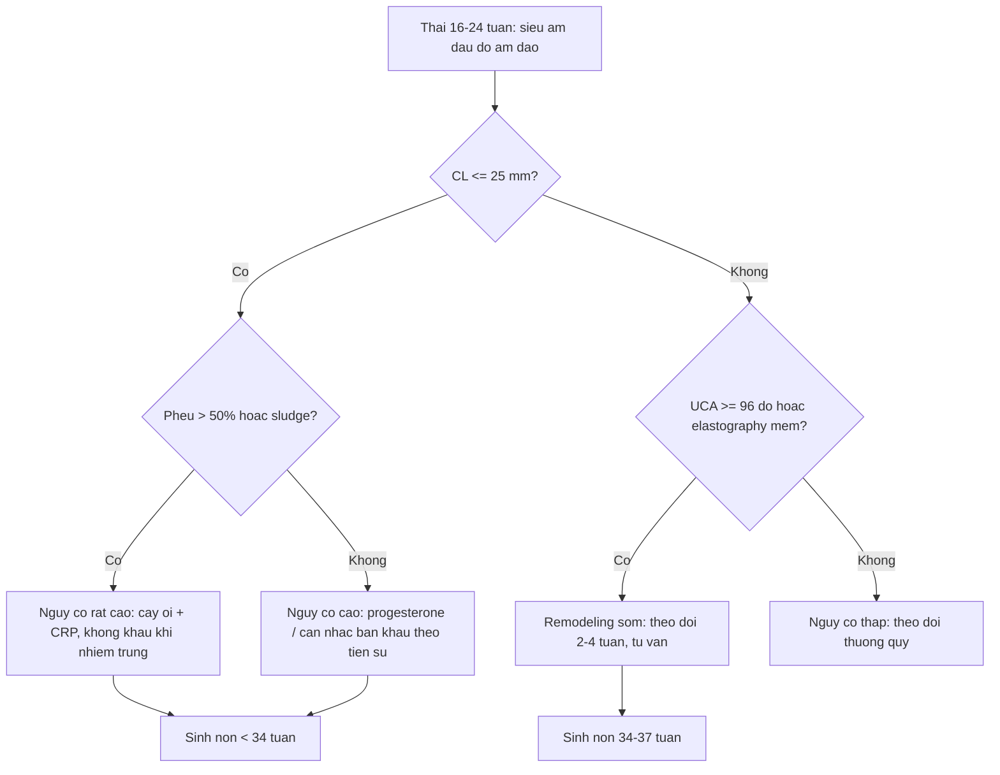
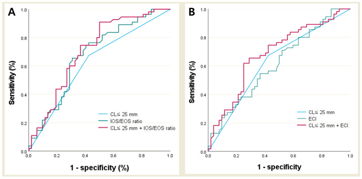
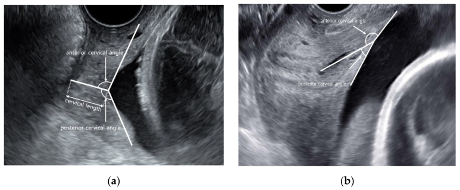
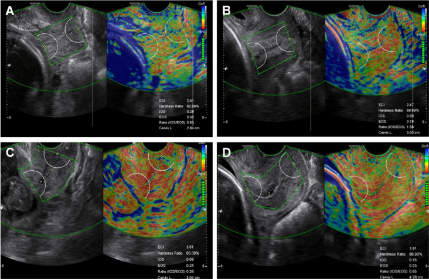
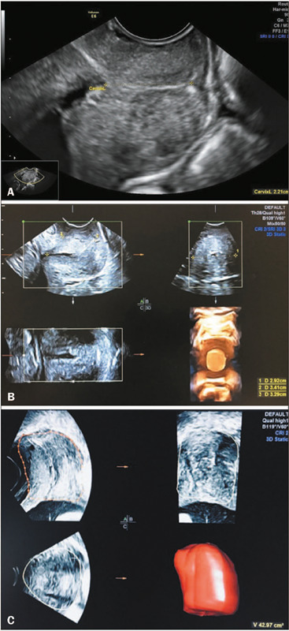

# 579 — Dự báo sinh non bằng cấu trúc cổ tử cung: góc tử cung–cổ tử cung, elastography & thể tích 3D / Structural prediction of preterm birth: uterocervical angle, cervical elastography and 3D volume

**Tags:** `pattern:co-tu-cung-ngan` `pattern:sinh-non` `pattern:remodeling-co-tu-cung` `vung:co-tu-cung` `score:CL-25mm` `score:UCA` `protocol:TVUS-co-tu-cung` `protocol:elastography-co-tu-cung` `protocol:3D-VOCAL`
**Mức chắc chắn (certainty):** tổng hợp y văn (literature synthesis) — tổng hợp từ 1 phân tích mạng (network meta-analysis) 2026, 2 phân tích gộp 2023–2025, các đoàn hệ tiến cứu về elastography và thể tích 3D; có **phản biện** vì kết quả giữa các nghiên cứu không đồng thuận. Không có ca nguyên văn riêng của nhóm.

## 1. Tổng quan bệnh học – cơ chế hình ảnh

- **Sinh non tự phát (spontaneous preterm birth — sPTB):** sinh trước **37 tuần 0 ngày**; là nguyên nhân hàng đầu gây tử vong trẻ dưới 5 tuổi. Cổ tử cung không phải "ống thụ động": nó **tái cấu trúc (remodeling)** liên tục — giảm tỷ lệ **collagen type I/III**, tăng **glycosaminoglycan (hyaluronan)** và **nước**, tăng **tế bào viêm**, giảm cơ trơn → **mềm dần (softening)** rồi mới **ngắn lại (shortening)** và **mở (dilation)**.
- **Vì sao hình ảnh học phải vượt khỏi "đo chiều dài":** chiều dài cổ tử cung (cervical length — CL) chỉ là **một chiều của một mô đã biến đổi muộn**.
  - **CL ≤ 25 mm** ở 16–24 tuần là ngưỡng kinh điển, nhưng **độ nhạy chỉ ~46%** cho sPTB (phân tích gộp 15 đoàn hệ, 6.218 thai) — đa số ca sinh non **không** có cổ tử cung ngắn.
  - Ngược lại, nhiều thai phụ cổ tử cung ngắn vẫn sinh đủ tháng → **giá trị tiên đoán dương thấp** khi dùng CL đơn thuần.
- **Ba trục thay thế/bổ sung — giải thích TẠI SAO:**

- **Trục 1 — Góc tử cung–cổ tử cung (uterocervical angle — UCA):** đo góc tại **lỗ trong**, giữa **trục ống cổ tử cung** và **thành trước đoạn dưới tử cung** (vẽ dài 3 cm). Góc càng **tù** → vector trọng lượng thai/ối **truyền gần vuông góc** lên lỗ trong thay vì dọc theo trục cổ → lỗ trong chịu lực cắt lớn hơn → **funneling** và mở sớm. Đây là cơ học "cột chống bị nghiêng", không phải viêm.
- **Trục 2 — Elastography (siêu âm đàn hồi):** **strain** đo biến dạng tương đối khi nén (không đơn vị); **shear-wave (SWE)** đo tốc độ lan truyền sóng cắt → **độ cứng tuyệt đối (kPa hoặc m/s)**. Mô mềm do **nước + collagen thoái hóa** biến dạng nhiều hơn (strain cao) và truyền sóng cắt chậm hơn (stiffness thấp) → bắt được **softening trước shortening**.
- **Trục 3 — Thể tích 3D (VOCAL):** thể tích cổ tử cung (cm³) = tích phân diện tích lát cắt dọc theo ống. Phân biệt **"ngắn nhưng dày"** (thể tích còn tốt) với **"ngắn và mỏng"** (mất chất đệm) — thông tin mà CL 2D bỏ qua.

- **Ngưỡng định lượng bắt buộc nhớ:**
  - **CL ≤ 25 mm** trước 24 tuần = "cổ tử cung ngắn"; **≤ 20 mm** = ngưỡng lợi ích progesterone âm đạo; **≤ 10 mm + funneling/sludge** = nguy cơ rất cao.
  - **UCA:** phân tích gộp 15 đoàn hệ (6.218 thai) — UCA ở nhóm sPTB **lớn hơn 13,76°** (95% CI 10,61–16,91); **Se 70% / Sp 67% / AUC 0,77** cho UCA so với **Se 46% / Sp 90% / AUC 0,82** cho CL → **UCA một mình KHÔNG vượt CL**.
  - Nghiên cứu 274 thai (Trung Quốc): ngưỡng **UCA 96°** cho sinh < 37 tuần và **106°** cho sinh < 34 tuần; **UCA > 105°** có tỷ lệ sinh < 34 tuần cao nhất; **95–105°** có tỷ lệ sinh 35–37 tuần cao nhất; kết hợp UCA + CL cho **Se 87,6% / Sp 80,6%** (< 37 tuần) và **Se 71,7% / Sp 86,4%** (< 34 tuần).
  - **Elastography:** phân tích gộp 13 nghiên cứu (4.087 thai phụ) — **Se 77,1% / Sp 73,3% / AUC 0,82 / DOR 11,05**.
  - Đoàn hệ strain 275 thai (sPTB 13,5%): **IOS** cho AUC **0,797**; mô hình **CL + IOS/EOS** cho **AUC 0,828, Se 73%, Sp 82%** — vượt CL đơn thuần có ý nghĩa (DeLong).
  - SWE 100 thai nguy cơ thấp: mô hình **CL + IOS + ECI** cho **AUC 0,889** so với **CL 0,709** (p = 0,01); **IOS** (aOR 1,10) và **ECI** (aOR 1,28) là yếu tố độc lập.
  - **Thể tích 3D:** 2D (công thức hình học) cho **27,71 ± 9,27 cm³**, 3D VOCAL cho **35,21 ± 8,85 cm³** ở 20–24 tuần — **hai phương pháp KHÔNG thay thế nhau**; 3D có **ICC liên quan sát viên tốt hơn** (thể tích cổ tử cung ICC 0,78; tỷ lệ thể tích sẹo/cổ tử cung ICC 0,94).
  - **Tầm soát CL toàn dân:** 2 RCT (1.634 thai) **không** giảm sinh non có ý nghĩa; 4 đoàn hệ (425.735 thai) có giảm — **chất lượng bằng chứng rất thấp** (GRADE), chưa đủ khuyến cáo toàn cầu.

## 2. Mẫu hình + chẩn đoán phân biệt theo vị trí (Gamut)

- **Năm mẫu hình cần phân biệt (vì xử trí khác nhau):**
  1. **Ngắn đơn thuần (short cervix):** CL ≤ 25 mm, không phễu, không triệu chứng.
  2. **Ngắn + phễu/sludge (funneling / amniotic sludge):** màng ối lồi vào ống cổ, **sludge** = đám echo dày quanh lỗ trong → nghĩ **nhiễm trùng trong ối** (cấy ối, không vội khâu).
  3. **Chiều dài bình thường nhưng MỀM (occult remodeling):** elastography bất thường — nhóm này lọt lưới nếu chỉ đo CL.
  4. **Chiều dài bình thường nhưng góc TÙ:** UCA > 95–105° — lực cơ học lên lỗ trong.
  5. **Ngắn nhưng thể tích còn tốt ("short-thick")** so với **ngắn + mỏng ("short-thin")** trên 3D.
- **Gamut theo nguyên nhân (vì sao cổ tử cung "yếu"):**
  - **Cấu trúc/mắc phải:** tiền sử **LEEP/cone/trachelectomy**, rách cổ tử cung khi sinh, dị dạng Müller (vách ngăn, tử cung đôi), **bán khâu cũ** thất bại.
  - **Nhiễm trùng/viêm:** viêm màng ối cận lâm sàng, vaginosis, sludge.
  - **Cơ học/quá tải:** **song thai**, đa thai, đa ối, tử cung quá căng.
  - **Nội tiết/mô liên kết:** hội chứng Ehlers–Danlos, bất thường collagen (hiếm).
- **Gợi nhớ "SOFT":** **S**hort (CL ≤ 25 mm) · **O**btuse angle (UCA > 95–105°) · **F**irmness loss (elastography mềm) · **T**hin volume (thể tích 3D thấp). Bốn chữ cái = bốn trục của bài này.

## 3. Bảng so sánh phân biệt (ma trận đối chiếu)

| Thực thể (entity) | Hình ảnh điển hình | Chốt vào (rule-in) | Chốt loại (rule-out) | Gợi ý xác nhận |
|---|---|---|---|---|
| **Cổ tử cung ngắn đơn thuần** | TVUS dọc: CL **≤ 25 mm**, ống cổ thẳng, không phễu, không sludge | **CL ≤ 25 mm đo 3 lần, lấy trị số ngắn nhất + bàng quang rỗng** | CL ≥ 30 mm, không phễu, không tiền sử → **không** đủ chỉ định can thiệp | TVUS lặp 1–2 tuần; không cần MRI |
| **UCA tù (obtuse UCA)** | Góc tại lỗ trong **> 95–105°**; ống cổ có thể còn dài | **UCA ≥ 96° (< 37 tuần) hoặc ≥ 106° (< 34 tuần)** theo nghiên cứu 274 thai | UCA < 90° + CL bình thường → nguy cơ thấp hơn | Đo trên ảnh dọc chuẩn, không ấn đầu dò |
| **Remodeling mềm (elastography)** | Vùng lỗ trong **mềm hơn** thân cổ; strain: IOS cao, IOS/EOS lệch; SWE: ECI cao, HR thấp | **Strain (E-cervix): IOS/EOS ≥ 1,0**; **SWE: IOS/ECI tăng, HR giảm** | Elastography bình thường + CL ≥ 25 mm → nguy cơ thấp | Cùng máy, cùng người đo; **chưa có ngưỡng liên hãng** |
| **Thể tích 3D thấp** | VOCAL: thể tích nhỏ, mặt cắt ngang hẹp; "short-thin" | **Thể tích thấp so với bách phân vị tuổi thai** (chưa có ngưỡng chuẩn cho sPTB) | Thể tích bình thường ở cổ ngắn ("short-thick") → tiên lượng tốt hơn | 3D VOCAL 30°, đo 2 lần |
| **Phễu lỗ trong (funneling)** | Màng ối hình chữ V/U lồi vào ống cổ; đo **chiều dài cổ còn lại** | **Phễu > 50% chiều dài** hoặc cổ còn lại < 10 mm | Ống cổ đóng hoàn toàn → không phễu | TVUS + đo áp lực; phân biệt với màng ối sa |
| **Sludge quanh lỗ trong** | Đám echo dày, không đều trong ống cổ/màng ối | **Sludge + CL ngắn + cơn co** = nghi nhiễm trùng trong ối | Dịch ối trong, không sludge → ít khả năng viêm màng ối | Chọc ối cấy + IL-6 nếu cân nhắc khâu cứu vãn |
| **Cổ tử cung sau LEEP/cone** | Cổ **ngắn, biến dạng**, eo cao; sẹo xơ | **Tiền sử LEEP/cone + CL ngắn không tương xứng tuổi thai** | Cổ dài ≥ 30 mm, không tiền sử can thiệp → loại trừ nguyên nhân cấu trúc | Hồ sơ mổ + TVUS; MRI nếu cần đo phần còn lại |
| **Sinh non do nhiễm trùng** | CL ngắn tiến triển nhanh, sludge, dịch ối nhiều echo, Doppler động mạch tử cung tăng | **Sốt/CRP tăng + sludge + cổ mở nhanh** | CRP bình thường, không sludge, cổ ổn định → ít khả năng nhiễm trùng | Cấy ối, CRP, bạch cầu; **không khâu khi có nhiễm trùng** |

- **Ba cặp dễ nhầm nhất:** (1) **UCA tù vs CL ngắn** — hai trục độc lập, đừng suy ra nhau; (2) **strain IOS vs SWE IOS** — cùng tên, **ngược nghĩa**; (3) **thể tích 3D thấp vs CL ngắn** — cổ ngắn nhưng dày có thể tích bình thường.

## 4. Protocol chụp + hệ phân độ/điểm chuẩn hóa

- **Siêu âm đầu dò âm đạo (TVUS) — chuẩn vàng:**
  - Bàng quang **rỗng**, tư thế sản khoa, đầu dò trong cùng đồ sau.
  - Mặt cắt **dọc giữa** thấy rõ **lỗ trong, lỗ ngoài, ống cổ**; đo CL **3 lần**, lấy **trị số ngắn nhất**; không ấn ép.
  - **UCA:** đường 1 = trục ống cổ (từ lỗ trong đến lỗ ngoài, **vẽ thẳng kể cả khi ống cong**); đường 2 = từ lỗ trong **dọc thành trước đoạn dưới tử cung 3 cm**; góc giữa hai đường = UCA. Khi có **phễu**: tia 1 theo **phần cổ còn lại**, tia 2 từ **điểm cổ còn đo được trong cùng** tới đoạn dưới tử cung.
  - **Góc sau (posterior cervical angle — PCA):** góc giữa thành **sau** tử cung và ống cổ; **PCA ≥ 96,5°** dự báo sinh đường âm đạo thành công ở tuổi thai đủ tháng — **khác mục đích với UCA**, không dùng lẫn ngưỡng.
- **Elastography:**
  - **Strain (E-cervix):** đặt ROI tại **lỗ trong và lỗ ngoài**, máy tính **ECI** (elasticity contrast index — độ không đồng nhất), **HR** (hardness ratio — tỷ lệ mô cứng), **IOS/EOS** (biến dạng lỗ trong/lỗ ngoài), **IOS/EOS ratio**.
  - **SWE:** ROI vuông 5–10 mm tại lỗ trong/thân cổ, ghi **kPa hoặc m/s**, lấy trung vị 3 lần đo; **không** so sánh trị số giữa hai hãng máy.
  - **Bắt buộc ghi rõ:** hãng máy, loại elastography, vị trí ROI, tuổi thai — vì **chưa có chuẩn hóa quốc tế**.
- **Thể tích 3D:** quét thể tích mặt cắt dọc, dùng **VOCAL** với góc xoay **30°**, vẽ đường viền cổ tử cung từng lát; báo **cm³**; đo 2 lần lấy trung bình. 3D **tái lập tốt hơn 2D**, đặc biệt giữa 2 người đo.
- **Đường tiếp cận thay thế:** **transperineal (TPUS)** khi bệnh nhân từ chối TVUS — tương quan UCA **r = 0,833** nhưng **13,2% ảnh không đạt**, **không thay thế tương đương** TVUS.

*Đường cong ROC của CL ≤ 25 mm, IOS/EOS ratio, ECI và mô hình phối hợp. Mô hình phối hợp **không thay thế** đánh giá lâm sàng nhưng cho thấy elastography thêm thông tin ngoài chiều dài. Nguồn: Kwon H et al., Diagnostics 2025 (PMC12346534), CC BY 4.0.*

## 5. Biến thể bình thường và cạm bẫy

- **Biến thể bình thường:**
  - Cổ tử cung **cong nhẹ**, **dài 30–40 mm**, có thể **ngắn giả** khi bàng quang căng hoặc có cơn co đoạn dưới.
  - **UCA thay đổi theo tuổi thai** (tăng dần từ sớm đến giữa thai kỳ) và theo **tư thế/độ căng tử cung** → luôn đo cùng điều kiện.
  - **Eo tử cung** có thể trông như "cổ ngắn" khi đầu dò đặt quá cao.
- **Cạm bẫy (pitfall):**
  1. **Ấn đầu dò** làm biến dạng cổ → CL ngắn giả, UCA sai, elastography "mềm giả". Đây là lỗi phổ biến nhất.
  2. **Lẫn UCA và PCA:** UCA = thành **trước**; PCA = thành **sau**. Ngưỡng 96° của PCA là để dự báo **sinh đường âm đạo**, không phải sinh non.
  3. **Lẫn IOS giữa hai kỹ thuật:** strain IOS = **biến dạng** (cao = mềm); SWE IOS = **độ cứng** (cao = cứng). Đọc bài mà không xem phương pháp sẽ kết luận ngược.
  4. **Elastography không có ngưỡng liên hãng:** cùng bệnh nhân, hai máy có thể cho ECI/HR khác nhau → **không dùng để quyết định ngừng can thiệp**.
  5. **CL bình thường không loại trừ sinh non:** ~50% sPTB có CL > 25 mm; ngược lại nhiều cổ ngắn sinh đủ tháng.
  6. **Song thai:** bán khâu **không có lợi**, có thể **hại** (RR 2,15) — khác hoàn toàn đơn thai.
  7. **Bằng chứng tầm soát toàn dân còn yếu:** RCT không giảm sinh non; đoàn hệ rất lớn có giảm nhưng **chất lượng rất thấp** → không hứa hẹn quá mức với bệnh nhân.
  8. **Một nghiên cứu tiến cứu về UCA vs CL đã bị rút (retraction)** — khi tra y văn phải kiểm tra trạng thái bài, đừng trích dẫn theo trí nhớ.

## 6. Tự lượng giá — Blind Quiz

**Ca 1 — Thai 22 tuần, đo cổ tử cung trên TVUS. Ảnh (a) ống cổ thẳng, (b) ống cổ cong.**

- Gợi ý: thai phụ không triệu chứng, CL 32 mm.
- Câu hỏi: Hai góc trong ảnh là góc gì? Vẽ từ mốc nào? Góc nào dùng để dự báo sinh non, góc nào dự báo sinh đường âm đạo?

<b>Bấm để hiện đáp án (findings + chẩn đoán)</b>

- Góc tại **lỗ trong**: **góc cổ tử cung trước (anterior cervical angle/UCA)** giữa **thành trước tử cung** và trục ống cổ; **góc cổ tử cung sau (posterior cervical angle)** giữa **thành sau tử cung** và trục ống cổ.
- (a) cổ thẳng, (b) cổ cong — **vẫn vẽ trục ống cổ thẳng từ lỗ trong đến lỗ ngoài** khi đo UCA.
- **UCA** dùng cho **dự báo sinh non** (ngưỡng tham khảo 96° cho < 37 tuần, 106° cho < 34 tuần); **PCA ≥ 96,5°** dùng cho **dự báo sinh đường âm đạo** ở đủ tháng.
- Nguồn: Kim EJ et al., *Diagnostics* 2021 (PMC8618642), CC BY 4.0.

**Ca 2 — Thai 21 tuần, CL 29 mm, elastography lỗ trong.**

- Gợi ý: ảnh A/B là nhóm có tiền sử LEEP, C/D là nhóm chứng; các vòng tròn là ROI lỗ trong và lỗ ngoài.
- Câu hỏi: Các tham số ECI, HR, IOS, EOS nghĩa là gì? Vì sao CL 29 mm vẫn có thể "nguy cơ"?

<b>Bấm để hiện đáp án (findings + chẩn đoán)</b>

- **ECI** = chỉ số tương phản đàn hồi (độ không đồng nhất của mô); **HR** = tỷ lệ mô cứng; **IOS/EOS** = biến dạng tại lỗ trong/lỗ ngoài (**strain**, không phải độ cứng); **IOS/EOS ratio** so sánh độ mềm hai đầu.
- CL 29 mm **không loại trừ** remodeling: softening có thể xảy ra **trước** shortening. Đây là nhóm "occult remodeling" mà elastography nhắm tới.
- Bằng chứng: đoàn hệ 275 thai — **CL + IOS/EOS cho AUC 0,828** (Se 73%, Sp 82%) so với CL đơn thuần; nhưng **chưa có ngưỡng liên hãng**, không dùng đơn độc để quyết định.
- Nguồn: Cha HH et al., *Scientific Reports* 2022 (PMC9163180), CC BY 4.0.

**Ca 3 — Thai 21 tuần, đo thể tích cổ tử cung bằng 2D và 3D.**

- Gợi ý: (A) đo CL; (B) đo 3 đường kính để tính thể tích bằng công thức; (C) dựng thể tích bằng VOCAL.
- Câu hỏi: Phương pháp nào tái lập tốt hơn giữa hai người đo? Vì sao thể tích 3D lớn hơn thể tích 2D?

<b>Bấm để hiện đáp án (findings + chẩn đoán)</b>

- **3D VOCAL** tái lập tốt hơn: ICC liên quan sát viên của thể tích cổ tử cung **0,78** (và **0,94** cho tỷ lệ thể tích sẹo/cổ tử cung); 2D có **ICC liên quan sát viên thấp**.
- Thể tích trung bình: **2D 27,71 ± 9,27 cm³** vs **3D 35,21 ± 8,85 cm³** — công thức 2D giả định cổ là hình trụ/ellipsoid nên **đánh giá thấp** thể tích thật.
- Ý nghĩa lâm sàng: thể tích giúp phân biệt **"ngắn nhưng dày"** với **"ngắn và mỏng"**, nhưng **chưa có ngưỡng chuẩn để dự báo sinh non** — hiện là công cụ nghiên cứu.
- Nguồn: Cardozo RF et al., *Radiol Bras* 2025 (PMC12435928), CC BY 4.0.

## Bài liên quan chéo
- [573 – Hở cổ tử cung & bán khâu: theo dõi siêu âm cổ tử cung](../573-ho-co-tu-cung-ban-khau/lesson.md) (ngưỡng CL, funneling, chỉ định khâu)
- [578 – Bán khâu qua ngả bụng (TAC/LCC) & thất bại bán khâu qua âm đạo](../578-ban-khau-bung-cervicoisthmic-TAC/lesson.md)
- [569 – Sinh non trong song thai: dự phòng & theo dõi](../569-sinh-non-song-thai/lesson.md)
- [571 – Sẩy thai tái diễn: tiếp cận hình ảnh tử cung](../571-say-thai-tai-dien-tiep-can-hinh-anh/lesson.md)
- [565 – Sàng lọc hình thai & Doppler sản khoa](../565-sang-loc-hinh-thai-va-doppler-san-khoa/lesson.md)

## Ảnh
- Tên file: `579_sinh-non_..._PMCxxxxxxx-FigN-CCBY.jpg`. Nguồn + giấy phép từng ảnh trong `images/CREDITS.md`.
- Ảnh ROC minh họa (`579_sinh-non_ROC-CL-elastography_PMC12346534-Fig2-CCBY.jpg`) dùng trong bài giảng, không đưa vào quiz.

> Không dùng để chẩn đoán độc lập khi chưa có người hướng dẫn.
