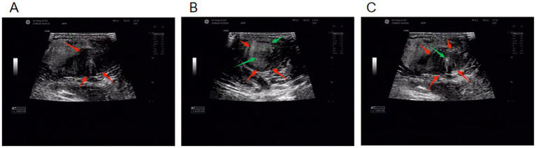
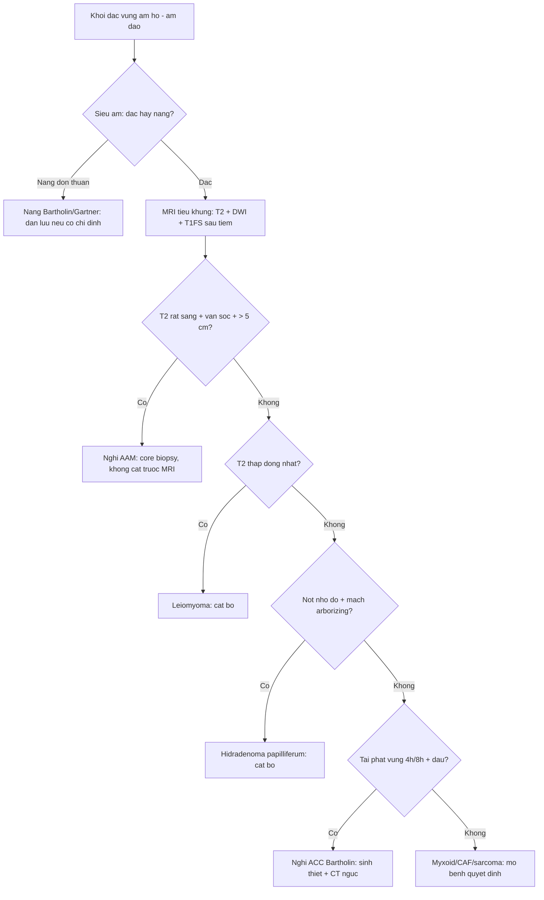
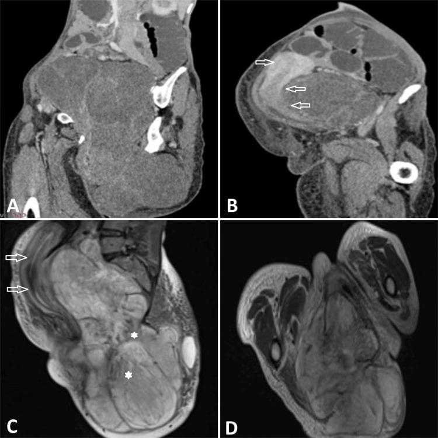
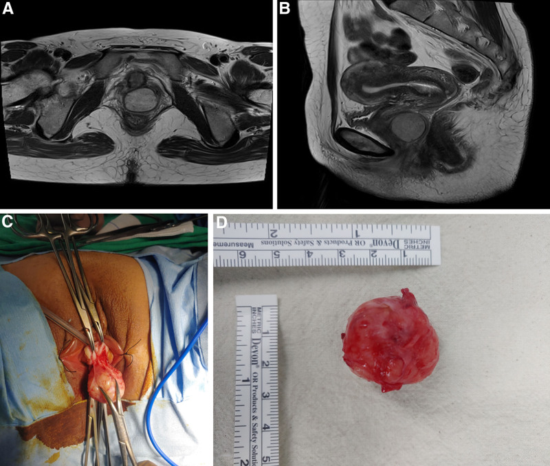
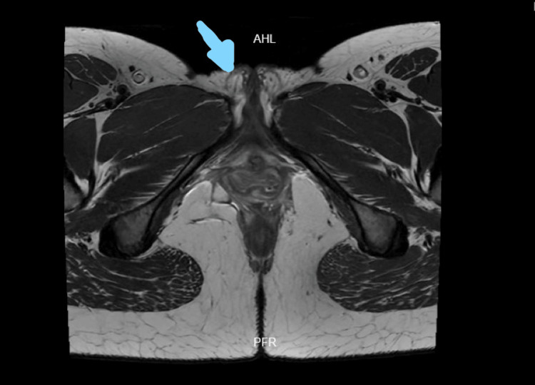
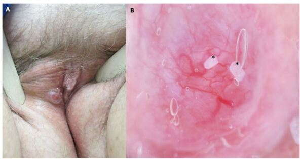

# 580 — U/giả u đặc hiếm gặp âm hộ – âm đạo: angiomyxoma, u cơ trơn, hidradenoma & ACC tuyến Bartholin / Rare solid vulvovaginal tumours: aggressive angiomyxoma, leiomyoma, hidradenoma papilliferum and adenoid cystic carcinoma

**Tags:** `pattern:khoi-dac-am-ho` `pattern:khoi-dac-am-dao` `pattern:u-mo-mem-myxoid` `pattern:u-tuyen-bartholin` `vung:am-ho` `vung:am-dao` `vung:sinh-mon` `protocol:MRI-chau` `protocol:US-translabial` `incidentaloma:khoi-am-ho`
**Mức chắc chắn (certainty):** tổng hợp y văn (literature synthesis) — tổng hợp từ các ca có bình duyệt và tổng quan mở 2023–2026, có **ca nguyên văn** minh họa (ảnh MRI/US lấy từ ca gốc). Số liệu định lượng giữ nguyên văn từ nguồn.

## 1. Tổng quan bệnh học – cơ chế hình ảnh

- **Giải phẫu cần nhớ trước khi đọc ảnh:**
  - **Âm hộ** gồm môi lớn, môi bé, âm vật, **tiền đình**; **tuyến Bartholin** đổ vào rãnh tiền đình ở **4 giờ và 8 giờ**, ống tuyến dài **2–2,5 cm**.
  - **Âm đạo** là ống cơ–niêm mạc, phía trước giáp bàng quang/niệu đạo, phía sau giáp trực tràng; **thành bên** liên quan **đám rối tĩnh mạch và thần kinh** và **hố ngồi–trực tràng (ischioanal fossa)**.
  - U "đặc" vùng này có thể xuất phát từ **mô mỡ dưới da, mô liên kết–cơ trơn, mạch máu, tuyến Bartholin/Skene, tuyến giống vú vùng sinh dục** — vì vậy **cùng một khối, nhiều dòng tế bào**.
- **Bốn nhóm mô học và cách chúng "hiện hình":**

- **Nhóm myxoid (chất nền nhầy)** — đại diện: **aggressive/deep angiomyxoma (AAM)**, myxoid leiomyoma, myxoid liposarcoma. Chất nền giàu **hyaluronan + nước** → **T2 rất sáng**, T1 thấp; **dải xơ (collagen)** cắt ngang chất nhầy → **vân sọc/lượn sóng (laminated–swirled)** giảm tín hiệu T2. Mật độ tế bào thấp → **không hạn chế khuếch tán** (ADC cao).
- **Nhóm cơ trơn** — đại diện: **leiomyoma âm hộ/âm đạo**. Bó cơ trơn đan xen → **T2 trung gian–thấp, đồng nhất**, kiểu "xoáy" như cơ tử cung; ngấm thuốc đều.
- **Nhóm trung mô mạch–xơ** — đại diện: **angiomyofibroblastoma (AMF), cellular angiofibroma (CAF)**. **Mạch thành mỏng** (AMF) hoặc **mạch thành dày hyalin hóa** (CAF) + tế bào hình thoi; **mỡ trong u** (CAF) → T1 sáng, **mất tín hiệu khi fat-sat**.
- **Nhóm biểu mô/tuyến** — đại diện: **hidradenoma papilliferum (HP)**, **ACC tuyến Bartholin**, SCC, melanoma. Tế bào biểu mô xếp thành nhú/ống → **T2 trung gian**, ngấm thuốc; **ACC xâm lấn quanh thần kinh** → đường ngấm thuốc dọc thần kinh; hạch/di căn.

- **Ngưỡng định lượng và con số phải nhớ:**
  - **AAM:** tái phát **tới ~40%** dù cắt rộng; tái phát thường **trong 3 năm** nhưng có thể **> 10 năm**; **ER/PR dương** → có thể điều trị nội tiết (GnRH agonist).
  - **Kích thước là một chốt mềm:** **AAM thường > 5 cm**, xâm lấn sâu, "cưỡi" cơ nâng hậu môn; **AMF thường < 5 cm**, nông, bờ rõ.
  - **Ung thư tuyến Bartholin:** chiếm **3–4% ung thư âm hộ** (y văn cũ 3–7%); trong đó **ACC < 5%**, **< 350 ca** đã báo cáo; di căn xa **phổi > xương > gan > não**, thời gian tái phát **6 tháng – > 15 năm**; **MYB/MYBL1** tái sắp xếp ở đa số.
  - **Hidradenoma papilliferum:** là **u phần phụ (adnexal) âm hộ hay gặp nhất**; loạt 45 ca có kích thước **0,3–2,0 cm**, màu hồng/đỏ; **HPV âm**; chuyển dạng ác tính rất hiếm.
  - **SCC âm hộ** vẫn là ung thư âm hộ phổ biến nhất (**~90%**), melanoma **~5%** — đừng để "u hiếm" che mất ung thư thường gặp.

## 2. Mẫu hình + chẩn đoán phân biệt theo vị trí (Gamut)

- **Theo vị trí — "vị trí gợi ý dòng tế bào":**
  - **Môi lớn/tiền đình 4h–8h:** nang/áp-xe **Bartholin**, **ACC tuyến Bartholin**, **leiomyoma**, **HP** (rãnh gian môi), nang biểu bì.
  - **Rãnh gian môi/niêm mạc môi bé:** **HP** (nốt đỏ nhỏ), melanoma không sắc tố, nang tuyến.
  - **Thành âm đạo:** **leiomyoma**, **AAM**, **CAF**, nang Gartner (dạng nang), di căn.
  - **Sinh môn/hố ngồi–trực tràng:** **AAM** (lan theo khoang), myxoid liposarcoma, u thần kinh, giả u viêm.
- **Theo thành phần trên MRI — "cấu trúc quyết định tên":**
  1. **T2 rất sáng + vân sọc + bờ không rõ + > 5 cm** → **AAM**.
  2. **T2 rất sáng, bờ rõ, < 5 cm, nông** → **AMF** (hoặc myxoid leiomyoma).
  3. **T2 thấp/trung gian đồng nhất, kiểu cơ tử cung** → **leiomyoma**.
  4. **T2 trung gian, mạch thành dày + mỡ trong u, người lớn tuổi** → **CAF**.
  5. **Nốt nhỏ < 2 cm, đỏ, ở rãnh gian môi** → **HP**.
  6. **Khối nhỏ vùng 4h/8h, đau/tái phát sau chọc, xâm lấn thần kinh** → **ACC tuyến Bartholin**.
- **Ba câu hỏi trước mọi khối đặc vùng này:** (1) **Nang hay đặc?** (có thành ngấm + dịch vs mô đặc ngấm); (2) **Nông hay sâu qua cơ nâng?** (quyết định mổ); (3) **Có dấu hiệu xâm lấn/di căn?** (bờ, thần kinh, hạch bẹn).

*Khối đặc âm hộ không đồng nhất trên siêu âm — hình thái **không đủ** để phân biệt AMF với AAM/leiomyoma; cần MRI + mô bệnh. Nguồn: Liu D et al., Front Med 2026 (PMC13424204), CC BY 4.0.*

## 3. Bảng so sánh phân biệt (ma trận đối chiếu)

| Thực thể (entity) | Hình ảnh điển hình | Chốt vào (rule-in) | Chốt loại (rule-out) | Gợi ý xác nhận |
|---|---|---|---|---|
| **Aggressive angiomyxoma (AAM)** | Khối **> 5 cm**, T2 **rất sáng** với **vân sọc/lượn sóng**, bờ không rõ, **"cưỡi" cơ nâng hậu môn**, đẩy tạng chứ không xâm lấn; ngấm thuốc không đều (có thể **giảm mạch**) | **T2 sáng + vân sọc + > 5 cm + lan sâu qua cơ nâng** | Bờ rõ, < 5 cm, nông, không vân sọc → nghĩ AMF/leiomyoma | MRI tiểu khung có DWI; **core biopsy** trước mổ; theo dõi MRI nhiều năm |
| **Angiomyofibroblastoma (AMF)** | Khối **< 5 cm**, nông, **bờ rõ**, T2 sáng–trung gian, ngấm đều; không xâm lấn cơ nâng | **Nông + bờ rõ + < 5 cm + người tuổi sinh sản** | Lan sâu, vân sọc, > 5 cm → AAM | Cắt bỏ + mô bệnh; tái phát ít |
| **Cellular angiofibroma (CAF)** | Khối bờ rõ, **mạch thành dày**, có **mỡ trong u**; ngấm thuốc; thường ở **phụ nữ lớn tuổi/đã mãn kinh** | **Mạch thành dày + mỡ trong u + tuổi lớn** | Không mỡ, vân sọc, xâm lấn → AAM/sarcoma | Mô bệnh + IHC |
| **Leiomyoma âm hộ/âm đạo** | Khối **T2 thấp–trung gian, đồng nhất**, kiểu cơ tử cung; bờ rõ; có thể cuống | **T2 thấp đồng nhất + giống cơ tử cung** | T2 rất sáng, vân sọc → myxoid/AAM | MRI + mô bệnh; **không chọc/dẫn lưu** |
| **Hidradenoma papilliferum (HP)** | Nốt **0,3–2 cm**, hồng/đỏ, ở rãnh gian môi; dermoscopy: **mạch phân nhánh rõ (arborizing)**, nền hồng–trắng | **Nốt nhỏ đỏ + mạch arborizing + vị trí rãnh gian môi** | Khối lớn, sâu, xâm lấn → không phải HP | Cắt bỏ + mô bệnh; dermoscopy |
| **ACC tuyến Bartholin** | Khối **nhỏ, có thể đau, tái phát** vùng 4h/8h; T2 trung gian, bờ không rõ, **xâm lấn quanh thần kinh**; hạch bẹn muộn | **Tái phát sau "chọc nang" + đau + xâm lấn thần kinh** | Nang đơn thuần: thành mỏng, không ngấm, xẹp sau dẫn lưu | **Sinh thiết + IHC (MYB)**, CT ngực; theo dõi > 10 năm |
| **Nang/áp-xe Bartholin** | Nang: dịch, thành mỏng; áp-xe: thành dày, ngấm, phù quanh, DWI hạn chế | **Vị trí 4h/8h + dịch + xẹp sau dẫn lưu** | Khối đặc, không xẹp, tái phát nhanh → **sinh thiết** | US + khám; MRI nếu tái phát |
| **SCC âm hộ** | Khối/loét bờ cứng, T2 trung gian–cao, xâm lấn, hạch bẹn | **Loét + bờ cứng + hạch bẹn** | Bờ rõ, T2 rất sáng, không loét → nghĩ u lành/myxoid | Sinh thiết + FIGO 2021 (bài 574) |

- **Ảnh ghép đối chiếu:** không tạo ảnh ghép cho bài này vì các ảnh thuộc **nhiều ca khác nhau, khác mặt cắt** — ghép sẽ gây hiểu nhầm "cùng một bệnh nhân".

### Dấu hiệu "đuôi" và "vân sọc" của AAM
- **Vân sọc/lượn sóng (laminated/swirled):** các dải xơ thấp tín hiệu xen giữa chất nhầy sáng T2 — dấu hiệu gợi ý mạnh nhất trên MRI.
- **Ngón tay/đuôi (finger-like projections):** u len theo **hố ngồi–trực tràng, khoang sinh môn, dây chằng** — giải thích vì sao **khó cắt sạch** và **tái phát tới 40%**.
- **Không hạn chế khuếch tán:** ADC cao do mật độ tế bào thấp; nếu **DWI sáng + ADC thấp** phải nghĩ **sarcoma/ung thư**, không phải AAM điển hình.

## 4. Protocol chụp + theo dõi

- **Siêu âm translabial/transperineal (đầu dò 7–12 MHz) — bước đầu:**
  - Đánh giá **đặc vs nang**, kích thước 3 chiều, **độ sâu so với cơ nâng hậu môn**, liên quan **niệu đạo/trực tràng**, tưới máu Doppler.
  - **Không chọc hút mù** khối đặc nghi AAM/ung thư (nguy cơ gieo rắc/khó cắt sạch); nang đơn thuần thì có thể dẫn lưu.
- **MRI tiểu khung — chuẩn đánh giá:**
  - **T2 xoay dọc + ngang + vành** (lát **3–4 mm**), **T1**, **T1 fat-sat**, **DWI (b = 0/800/1000) + ADC**, **T1 sau tiêm fat-sat** (động–tĩnh mạch–muộn).
  - Đo **3 chiều**, mô tả **bờ, vân sọc, mỡ trong u, xâm lấn cơ nâng/hố ngồi–trực tràng**, **thần kinh thẹn**, hạch bẹn.
  - Với **ACC**: đánh giá **lan theo thần kinh** (đường ngấm dọc dây thần kinh), **hạch bẹn**, và **CT ngực** tìm di căn phổi.
- **Sinh thiết:** **core needle 14–16 G** đường sinh môn dưới hướng siêu âm cho khối lớn/sâu; **tránh cắt bỏ trước khi có MRI** vì làm mất mặt phẳng mổ và tăng tái phát AAM.
- **Theo dõi sau điều trị:**
  - **AAM:** MRI **mỗi 6–12 tháng trong ≥ 5 năm** (nhiều tác giả khuyến cáo **≥ 10 năm** vì tái phát muộn); GnRH agonist có thể làm **teo u** và là lựa chọn khi tái phát/không mổ được.
  - **ACC:** theo dõi lâm sàng + **CT ngực định kỳ nhiều năm** (di căn có thể xuất hiện **sau > 15 năm**).
  - **HP/leiomyoma/AMF:** cắt bỏ là đủ; tái phát thấp, theo dõi lâm sàng.

## 5. Biến thể bình thường và cạm bẫy

- **Biến thể bình thường:**
  - **Tuyến Bartholin** có thể sờ thấy như hạt nhỏ ở 4h/8h; **môi lớn không đối xứng** nhẹ; **mô mỡ sinh môn** dày ở người béo — dễ đọc nhầm là khối.
  - **Nang Gartner nhỏ** ở thành bên âm đạo là tồn dư phôi thai, thường không triệu chứng.
- **Cạm bẫy (pitfall):**
  1. **"Nang Bartholin" tái phát nhiều lần:** phải **sinh thiết** — ACC, AAM, leiomyoma đều từng bị chẩn đoán nhầm là nang Bartholin.
  2. **AAM giảm mạch (hypovascular):** không loại trừ AAM; Doppler nghèo mạch không được trấn an.
  3. **AAM bị đọc là lipoma** trên siêu âm vì echo dày; **MRI là bắt buộc** trước mổ.
  4. **T2 rất sáng ≠ nang:** u myxoid đặc cũng rất sáng; phân biệt bằng **ngấm thuốc toàn khối** và **DWI/ADC**.
  5. **Myxoid liposarcoma** có thể giống AAM nhưng có **mỡ** (T1 sáng, mất tín hiệu fat-sat) và **không có vân sọc**.
  6. **ACC xâm lấn thần kinh** có thể chỉ là "dải ngấm mảnh" — dễ bỏ sót nếu chỉ nhìn khối chính; đau dai dẳng là cờ đỏ.
  7. **Hidradenoma papilliferum** trên dermoscopy giống **basal cell carcinoma** (mạch arborizing) — vị trí rãnh gian môi và tuổi giúp phân biệt; vẫn phải **cắt bỏ + mô bệnh**.
  8. **Bỏ sót ung thư thường gặp:** SCC và melanoma vẫn chiếm phần lớn ung thư âm hộ; đừng chỉ nghĩ "u hiếm".

## 6. Tự lượng giá — Blind Quiz

**Ca 1 — Nữ 36 tuổi, khối mông–sinh môn phải lớn dần 2 năm, không đau.**

- Gợi ý: (A–B) CT xoay dọc/ngang có cản quang; (C) T2 xoay dọc; (D) T1.
- Câu hỏi: Mô tả tín hiệu T2 và bờ khối. Ba chẩn đoán phân biệt? Dấu hiệu nào hướng tới AAM?

<b>Bấm để hiện đáp án (findings + chẩn đoán)</b>

- Khối **lớn**, **T2 rất sáng không đồng nhất** với **dải/vân giảm tín hiệu** bên trong, **bờ không rõ**, lan qua **sinh môn–mông**, **đẩy** tử cung/âm đạo/bàng quang ra trước; T1 **giảm–trung gian**; CT ngấm thuốc **không đều, nhẹ**.
- Chẩn đoán: **aggressive (deep) angiomyxoma** — xác nhận bằng mô bệnh (chất nhầy, tế bào hình sao, mạch giãn).
- Phân biệt: **AMF** (nông, < 5 cm, bờ rõ), **myxoid liposarcoma** (có mỡ), **leiomyoma myxoid** (T2 sáng nhưng bờ rõ hơn, không "cưỡi" cơ nâng).
- Nguồn: Patel T et al., *Cureus* 2025 (PMC11910712), CC BY 4.0.

**Ca 2 — Nữ 44 tuổi, khối thành âm đạo 2,5 cm, T2 xoay ngang và dọc.**

- Gợi ý: (A) T2 ngang, (B) T2 xoay dọc; (C) cắt qua đường âm đạo; (D) bệnh phẩm 3 × 3 cm.
- Câu hỏi: Khối nằm ở đâu? Tín hiệu T2 gợi ý gì? Vì sao vẫn phải cắt bỏ dù bờ rõ?

<b>Bấm để hiện đáp án (findings + chẩn đoán)</b>

- Khối **tròn, bờ rõ**, **T2 trung gian–sáng**, nằm ở **thành âm đạo**, tách khỏi lòng âm đạo; không xâm lấn rõ.
- Chẩn đoán: **aggressive angiomyxoma thể âm đạo** — nhỏ và bờ rõ hơn thể kinh điển nhưng vẫn là u **lan chân rết vi thể**, nên **cắt bỏ + theo dõi**.
- Bài học: **kích thước nhỏ không loại trừ AAM**; IHC **ER/PR dương, CD34/S100 âm** hỗ trợ chẩn đoán.
- Nguồn: Yu BR et al., *Medicine* 2025 (PMC11771726), CC BY 4.0.

**Ca 3 — Nữ 30 tuổi, khối đau vùng môi lớn phải nhiều tháng, từng được chẩn đoán "nang Bartholin".**

- Gợi ý: ảnh T2 ngang không cản quang; mũi tên chỉ tổn thương **2,3 cm** vùng thân sinh môn, lan về môi lớn phải.
- Câu hỏi: Vì sao "nang Bartholin" không xẹp sau điều trị là cờ đỏ? Cần làm gì tiếp theo?

<b>Bấm để hiện đáp án (findings + chẩn đoán)</b>

- Tổn thương **2,3 cm**, tín hiệu **hỗn hợp iso–hypo–hyper** trên T2, bờ không rõ, ở **thân sinh môn/môi lớn phải**.
- Chẩn đoán: **adenoid cystic carcinoma tuyến Bartholin** — mô bệnh: ổ tế bào đáy, kiểu vi nang, xâm lấn mô xơ, xen kẽ tuyến Bartholin.
- Cờ đỏ: khối **đau kéo dài**, **không xẹp sau chọc/dẫn lưu**, **tái phát nhanh**, **> 40 tuổi** → **sinh thiết**, không tiếp tục dẫn lưu.
- Điều trị: **cắt rộng ± xạ trị** (bờ dương/xâm lấn thần kinh); theo dõi **di căn phổi** nhiều năm.
- Nguồn: Bombon MF et al., *Cureus* 2026 (PMC13005941), CC BY 4.0.

**Ca 4 — Nữ 68 tuổi, nốt đỏ 25 × 10 mm ở rãnh gian môi phải, không đau.**

- Gợi ý: (A) lâm sàng; (B) dermoscopy.
- Câu hỏi: Dermoscopy thấy gì? Chẩn đoán và cách xử trí?

<b>Bấm để hiện đáp án (findings + chẩn đoán)</b>

- **Mạch máu phân nhánh rõ (arborizing vessels)** trên nền hồng–trắng, không loét.
- Chẩn đoán: **hidradenoma papilliferum** — u tuyến giống vú vùng sinh dục, lành tính, hay gặp nhất trong nhóm u phần phụ âm hộ.
- Xử trí: **cắt bỏ trọn** + mô bệnh (loại trừ chuyển dạng ác tính); tái phát thấp.
- Cảnh báo: dermoscopy có thể **giống basal cell carcinoma** — không chẩn đoán xác định nếu chưa có mô bệnh.
- Nguồn: Jovic A et al., *Dermatol Pract Concept* 2021 (PMC8648414), CC BY 4.0.

## Bài liên quan chéo
- [548 – Nang/khối lành vùng âm hộ – âm đạo: Bartholin, Gartner & ống Nuck](../548-nang-lanh-am-ho-am-dao/lesson.md) (nang vs đặc, vị trí là chốt)
- [574 – Ung thư âm hộ & âm đạo: FIGO 2021 + hạch bẹn–đùi](../574-ung-thu-am-ho-am-dao-FIGO-hach-ben/lesson.md) (SCC, melanoma, hạch bẹn)
- [576 – Bệnh Paget âm hộ & VIN](../576-paget-am-ho-va-VIN/lesson.md) (mảng đỏ–trợt, dVIN)
- [577 – Theo dõi & phát hiện tái phát ung thư phụ khoa](../577-theo-doi-tai-phat-ung-thu-phu-khoa/lesson.md) (theo dõi dài hạn, PET/CT)
- [572 – Hạch trong ung thư phụ khoa: SLN, hạch chậu–cạnh ĐMC & PET-CT](../572-hach-ung-thu-phu-khoa-SLN-PET/lesson.md)

## Ảnh
- Tên file: `580_..._PMCxxxxxxx-FigN-CCBY.jpg`. Nguồn + giấy phép từng ảnh trong `images/CREDITS.md`.
- Không tải ảnh từ bài **AuntMinnie/paywall**; chỉ dẫn link.

> Không dùng để chẩn đoán độc lập khi chưa có người hướng dẫn.
