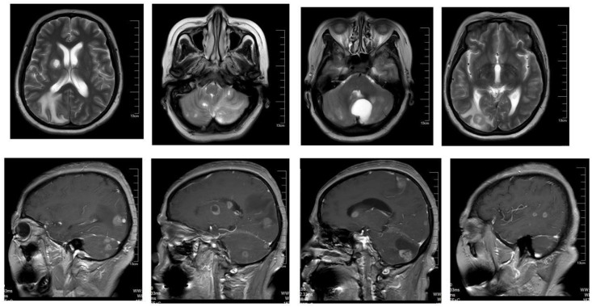
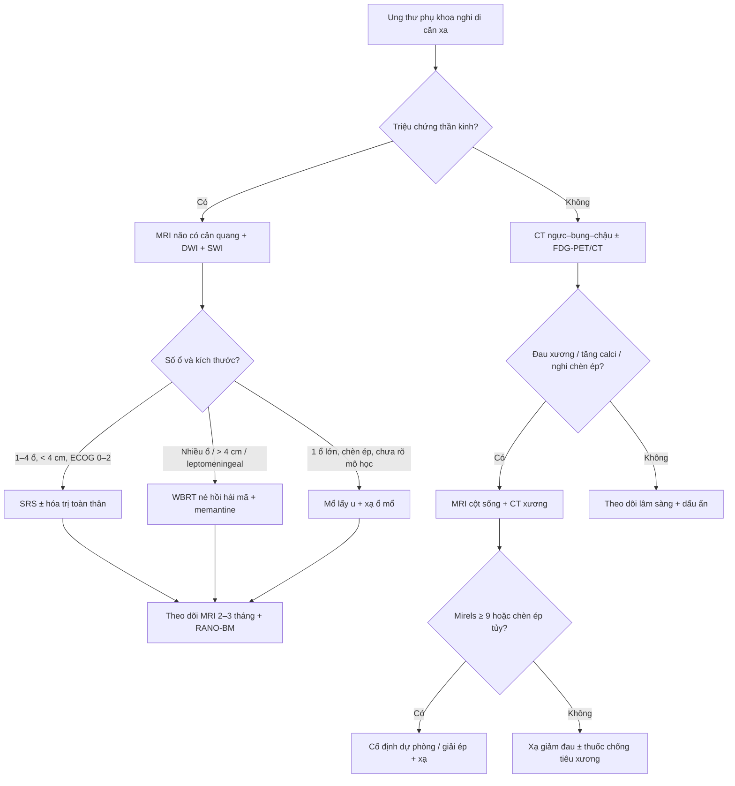
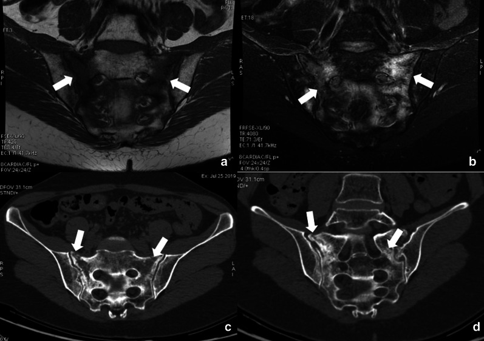
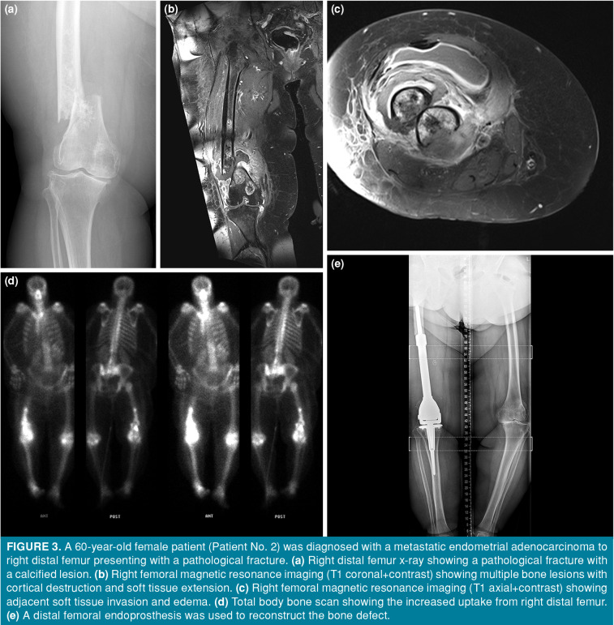

# 581 — Di căn não & xương trong ung thư phụ khoa: MRI não, SRS vs WBRT, PET xương/PSMA & theo dõi sau 577 / Brain and bone metastases in gynecologic cancer

**Tags:** `pattern:di-can-nao` `pattern:di-can-xuong` `vung:nao` `vung:xuong` `score:RANO-BM` `score:Mirels` `protocol:MRI-nao` `protocol:SRS` `protocol:CT-xuong` `incidentaloma:gay-xuong-suy-yeu`
**Mức chắc chắn (certainty):** tổng hợp y văn (literature synthesis) — nhóm tự biên từ y văn mở (BMC Cancer, Front Oncol, Cancers, Insights Imaging, Joint Dis Relat Surg), có ca nguyên văn minh họa trong quiz.

> **Câu chốt của bài:** di căn não và xương là **hai cửa di căn xa "dễ đọc sai"** của ung thư phụ khoa. Não: **MRI có cản quang + DWI là chuẩn** (CT bỏ sót tổn thương < 1 cm và tổn thương vỏ); **SRS cho 1–4 ổ, u < 4 cm, ECOG 0–2**; **WBRT không kéo dài sống, làm giảm nhận thức** → chỉ dùng khi nhiều ổ/leptomeningeal. Xương: **đau + tiêu xương trên CT + phù tủy trên MRI**; phân biệt với **gãy xương suy yếu sau xạ** (đối xứng, không có khối mô mềm); **Mirels ≥ 9 = cố định dự phòng**, **chèn ép tủy = MRI toàn bộ cột sống trong 24 giờ + dexamethasone**.

## 1. Tổng quan bệnh học – cơ chế hình ảnh

- **Dịch tễ (ngưỡng định lượng):** di căn não gặp ở **~2,5–6,0% ung thư buồng trứng**, sống còn 5 năm chỉ **29,2%**; trong loạt 129 ca OCBM, **thời gian trung vị từ chẩn đoán buồng trứng đến di căn não 25,74 tháng** (0–103,1), **sống còn trung vị sau di căn não 19,53 tháng**, **43,4% một ổ / 55,0% nhiều ổ**, đường kính lớn nhất trung vị **2,7 cm**, **63,6% được chẩn đoán bằng MRI** (Wang 2025, PMC12595899). Di căn não ở ung thư nội mạc rất hiếm; thể **POLE-mutated** có thể sống dài hơn trung vị y văn dù đã di căn não (Ebner 2025, PMC12433838).
- **Di căn xương:** tại thời điểm chẩn đoán ung thư cổ tử cung, **2,42% (469/19.363) đã có di căn xương** (SEER 2010–2015; Zhang 2018, PMC6146765). Ở ung thư nội mạc, di căn xương xuất hiện **trung vị 34,4 tháng** sau chẩn đoán; **36% có gãy xương bệnh lý** và **64% đau kháng trị** là chỉ định mổ trong loạt 14 ca được phẫu thuật (Ozturk Basarir 2023, PMC9903106). Đây là các con số của **nhóm đã mổ** — không đại diện toàn bộ quần thể.
- **TẠI SAO di căn não ngấm thuốc:** u di căn làm **phá vỡ hàng rào máu–não (BBB)** → gadolinium thoát vào khoảng kẽ → **T1W sau tiêm ngấm dạng nốt/viền**. Phù quanh u là **phù mạch (vasogenic)** → **T2/FLAIR sáng**, lan theo chất trắng, không theo ranh giới vỏ; phù **không ngấm thuốc** và **không hạn chế khuếch tán** (ADC không thấp như u đặc).
- **TẠI SAO cần DWI/ADC:** u đặc mật độ tế bào cao → **DWI sáng + ADC thấp**; phù/hoại tử → **ADC cao**. Sau SRS, **hoại tử xạ (radionecrosis)** cũng có thể ngấm thuốc và phù — DWI/ADC **không đủ phân biệt**, cần **tưới máu (DSC rCBV), MRS (choline/NAA), FET-PET** và **diễn tiến thời gian**.
- **TẠI SAO xương tiêu trên CT:** tế bào u hoạt hóa hủy cốt bào → **mất xương bè** → vùng **giảm đậm độ, bờ không rõ** trên CT cửa sổ xương; tái tạo xương (đặc/ly giải hỗn hợp) gặp ở một số thể. Trên MRI, u **thay thế tủy vàng** → **T1W tối hơn cơ/đĩa đệm**, **STIR/T2FS sáng**, ngấm thuốc; **phù tủy** lan rộng quanh ổ di căn.
- **Cơ chế di căn:** lan theo đường máu (đám rối Batson cho cột sống/khung chậu); ung thư buồng trứng lan phúc mạc trước rồi mới tới não; ung thư cổ tử cung/nội mạc lan hạch → máu.

## 2. Mẫu hình + chẩn đoán phân biệt theo vị trí (gamut)

- **Não — một ổ:** di căn đơn độc (vỏ–dưới vỏ, ngấm dạng nốt/viền, phù rộng **không tương xứng kích thước**), u nguyên phát (glioblastoma: hoại tử trung tâm, viền dày không đều), u lympho TKTW (đồng nhất, sát não thất, ADC rất thấp), áp-xe (viền mỏng đều + **DWI trung tâm sáng/ADC thấp**), u màng não (ngoài trục, **dấu đuôi màng cứng**), nhồi máu/viêm tủy.
- **Não — nhiều ổ:** di căn (thường **vỏ–dưới vỏ, nhiều kích thước, ngấm viền**), lao/áp-xe đa ổ, nấm, bệnh demyelinating (bờ mở về vỏ), **lan theo dịch não tủy (leptomeningeal)** = ngấm màng não–rễ thần kinh, **không phải khối**.
- **Não — biến chứng cần nhận ra:** **tụ máu trong u** (melanoma, choriocarcinoma, RCC) → **SWI/T2* "blooming"**, tăng tín hiệu T1 do methemoglobin; **thoát vị não** (đường giữa lệch, bể quanh thân nén); **động kinh do phù vỏ**.
- **Xương — trục (cột sống, khung chậu, xương cùng):** di căn (tiêu xương/đặc/hỗn hợp, **phá vỡ vỏ, khối mô mềm**), **gãy xương suy yếu sau xạ** (xương cùng, **đối xứng, đường gãy ngang, không khối mô mềm**, phù tủy lan), u tủy, hemangioma (**vân dọc "polka-dot/corduroy"**, T1 sáng do mỡ), Paget (xương to, bè dày).
- **Xương — chi:** di căn đầu xương (thường **đầu trên xương đùi/xương cánh tay**), gãy bệnh lý, u xương nguyên phát (hiếm ở tuổi > 40), **gãy do suy yếu** ở người già/loãng xương.

## 3. Bảng so sánh phân biệt (ma trận đối chiếu)

| Thực thể (entity) | Hình ảnh điển hình | Chốt vào (rule-in) | Chốt loại (rule-out) | Gợi ý xác nhận |
|---|---|---|---|---|
| **Di căn não** | Nốt/viền ngấm thuốc ở **vỏ–dưới vỏ**, phù mạch rộng, **nhiều ổ/kích thước khác nhau** | **Nhiều ổ + vị trí vỏ–dưới vỏ + phù không tương xứng + tiền sử ung thư** | **Một ổ đồng nhất sát não thất, không phù** → nghĩ u lympho/glioblastoma | MRI T1+C 1 mm + DWI + SWI; PET/CT toàn thân; sinh thiết nếu một ổ không rõ nguồn |
| **Hoại tử xạ (radionecrosis)** | Ổ ngấm thuốc **tại vị trí đã xạ**, xuất hiện **3–18 tháng** sau SRS, phù quanh tăng rồi giảm | **Xuất hiện đúng vị trí xạ + rCBV thấp + choline thấp + FET-PET âm** | **Ngấm mới lan ra ngoài vùng xạ, rCBV cao, FET dương** → tái phát | DSC-MRI, MRS, FET-PET; theo dõi 6–8 tuần |
| **Áp-xe não** | Viền mỏng đều, **trung tâm DWI sáng/ADC thấp**, phù mạnh, sốt/nguồn nhiễm | **DWI trung tâm sáng + ADC thấp + sốt/nguồn nhiễm** | **Trung tâm hoại tử DWI thấp/ADC cao** → u hoại tử | DWI/ADC, cấy máu/DNT |
| **U lympho TKTW** | Khối **đồng nhất, sát não thất**, ngấm mạnh, **ADC rất thấp**, có thể "tan" dưới corticoid | **Đồng nhất + sát não thất + ADC rất thấp + giảm nhanh sau corticoid** | **Nhiều ổ vỏ–dưới vỏ, hoại tử** → di căn | Sinh thiết (tránh corticoid trước sinh thiết nếu có thể), PET |
| **Di căn xương** | Tiêu xương **bờ không rõ**, phá vỡ vỏ, khối mô mềm, T1 tối/STIR sáng | **Phá vỡ vỏ + khối mô mềm + T1 tối thay tủy** | **Xương còn bè, T1 sáng do mỡ, không mô mềm** → lành | CT xương + MRI; sinh thiết khi một ổ đơn độc |
| **Gãy xương suy yếu sau xạ** | Xương cùng/thắt lưng, **đường gãy ngang, đối xứng**, phù tủy, **không khối mô mềm** | **Đối xứng + đường gãy + không phá vỡ vỏ + sau xạ khung chậu** | **Phá vỡ vỏ + khối mô mềm + T1 tối khu trú** → di căn | CT (đường gãy), MRI (phù), theo dõi 6–12 tuần |
| **Hemangioma xương** | **Vân dọc**, T1/T2 sáng do mỡ, bờ rõ, không phá vỡ vỏ | **T1 sáng + vân dọc điển hình + không mô mềm** | **T1 tối + phá vỡ vỏ** → di căn | CT (vân "polka-dot"), MRI |

*Nhiều ổ ngấm thuốc dạng viền ở bán cầu phải, phù mạch quanh u; trên T2 thấy phù lan theo chất trắng. Nguồn: Li Y et al., Front Oncol 2026 (PMC13253483), CC BY 4.0.*

## 4. Protocol chụp + phân độ/điểm chuẩn hóa

- **MRI não (chuẩn vàng):** **T1+C xoắn ốc 1 mm** (≥ 3 mặt phẳng), **T2/FLAIR**, **DWI + ADC**, **SWI/T2*** (máu trong u), **DSC tưới máu** khi cần phân biệt hoại tử xạ; chụp **trước và 2–3 tháng sau SRS**, sau đó mỗi **2–3 tháng**.
- **CT ngực–bụng–chậu có cản quang** tìm di căn ngoài não; **FDG-PET/CT** khi nghi di căn rộng/không rõ nguồn (PET có giá trị phát hiện tổn thương ngoài não, **không thay MRI não**).
- **Xương:** **CT xương cửa sổ xương** (đánh giá phá vỡ vỏ, Mirels) + **MRI có STIR/T1** (phù tủy, chèn ép tủy); **xạ hình xương** nhạy nhưng đặc hiệu thấp; **FDG-PET/CT** hữu ích cho ổ tiêu xương; **PSMA-PET** **không phải chuẩn** trong ung thư phụ khoa (PSMA biểu hiện ở mạch máu u — còn nghiên cứu, dễ dương tính giả ở hạch/tuyến nước bọt).
- **SRS (stereotactic radiosurgery):** chỉ định kinh điển **1–4 ổ, đường kính < 4 cm, ECOG 0–2/KPS ≥ 70**; liều **20–24 Gy × 1**, **27 Gy/3**, **30–35 Gy/5** tùy kích thước/vị trí. Ca nguyên văn: ung thư nội mạc, **3 ổ não ≤ 3 cm**, **fSRS 30 Gy/5**, giảm kích thước ở 3 và 6 tháng, **nghi hoại tử xạ ở tháng thứ 8** (Fukuda 2026, PMC13012780). U lớn **> 14 cm³** có thể dùng **GKRS 35,2 Gy/5** ở người không mổ được (Jeon 2026, PMC13163019). **WBRT 30 Gy/10** hoặc **20 Gy/5**: **không kéo dài sống**, làm giảm nhận thức; nếu buộc dùng → **né hồi hải mã (hippocampal avoidance) + memantine**.
- **RANO-BM (đánh giá đáp ứng não):** tổn thương đích **≥ 10 mm**, tối đa **5 tổn thương**; **CR** = mất hết tổn thương, không tổn thương mới, **ngừng corticoid**; **PD** = tăng **≥ 20%** tổng đường kính **và ≥ 5 mm** so nadir (hoặc tổn thương mới/leptomeningeal). **Không dùng thể tích đơn thuần để gọi đáp ứng.**
- **Xương — Mirels (12 điểm):** vị trí, đau, kiểu tổn thương, kích thước; **≥ 9 điểm = cố định dự phòng** trước xạ; **≤ 7** theo dõi. **Chèn ép tủy:** **MRI toàn bộ cột sống trong 24 giờ** + **dexamethasone 16 mg/ngày** + hội chẩn mổ/xạ khẩn.
- **Điều trị hỗ trợ xương:** **denosumab 120 mg SC/4 tuần** hoặc **acid zoledronic 4 mg/4 tuần** (chỉnh liều theo chức năng thận), **bổ sung calci + vitamin D**; **SBRT** cho ổ đau/oligometastasis; **phẫu thuật** khi bất thường cơ học/gãy bệnh lý.

## 5. Biến thể bình thường và cạm bẫy

- **Hoại tử xạ vs tái phát:** xuất hiện **3–18 tháng** sau SRS, đúng vị trí xạ; **rCBV thấp**, choline/NAA thấp, FET-PET âm. **Không sinh thiết ngay** nếu không đổi điều trị — theo dõi 6–8 tuần + tưới máu.
- **"Giả đáp ứng" sau SRS:** phù và ngấm thuốc có thể **tăng thoáng qua 4–8 tuần** (pseudoprogression) → đừng gọi PD nếu chưa đủ **≥ 20% + 5 mm** hoặc tổn thương mới.
- **CT não bỏ sót:** tổn thương **< 1 cm**, ở **vỏ/đồi thị/nền sọ**; **MRI là bắt buộc** khi có triệu chứng thần kinh.
- **Di căn màng não** không tạo khối: chỉ **ngấm màng não/rễ thần kinh**, có thể **âm trên MRI không cản quang** → cần **T1+C toàn bộ trục + dịch não tủy**.
- **Cạm bẫy xương số 1 — gãy suy yếu sau xạ:** xương cùng sau xạ khung chậu, **đau vùng cùng cụt/thắt lưng**, MRI có **phù tủy rộng** dễ gọi "di căn"; chốt loại bằng **đường gãy trên CT + không có khối mô mềm + đối xứng**. Đây là **biến chứng của chính điều trị**, không phải tiến triển u.
- **Cạm bẫy xương số 2 — một ổ đơn độc:** ở người **> 40 tuổi**, ổ tiêu xương đơn độc **không loại trừ myeloma/di căn** dù bờ hẹp; cần **CT + MRI + sinh thiết** nếu ảnh hưởng điều trị.
- **PSMA dương tính giả:** hạch giao cảm, tuyến nước bọt, ruột, u lành; **không dùng PSMA để thay mô bệnh học**.
- **Corticoid che lấp u lympho:** nếu nghi u lympho TKTW, **tránh corticoid trước sinh thiết** (có thể làm mất tế bào u).

## 6. Tự lượng giá — Blind Quiz (ảnh trơn ngoài, đáp án giấu trong thẻ bấm-mở)

**Ca 1 — Nữ 56 tuổi, ung thư buồng trứng giai đoạn IVB, nhiều ổ di căn não:**

- Câu hỏi: Mô tả tổn thương (số ổ, vị trí, kiểu ngấm, phù). Ba chẩn đoán phân biệt? Dấu hiệu nào chốt hướng di căn?

<b>Bấm để hiện đáp án (findings + chẩn đoán)</b>

- **Dấu hiệu:** **nhiều ổ ngấm thuốc dạng nốt/viền ở bán cầu phải**, kích thước khác nhau, **phù mạch rộng** lan theo chất trắng trên T2; tổn thương ở **vỏ–dưới vỏ**, không đồng nhất.
- **Chẩn đoán:** **di căn não** từ ung thư buồng trứng. Chốt hướng: **nhiều ổ + vị trí vỏ–dưới vỏ + phù không tương xứng + tiền sử ung thư**.
- **Phân biệt:** áp-xe (trung tâm DWI sáng/ADC thấp), u lympho (đồng nhất, sát não thất), glioblastoma (một ổ, hoại tử trung tâm).
- **Bước tiếp theo:** MRI có DWI/SWI + CT ngực–bụng–chậu/PET. Ca này **nhiều ổ** nên **không mổ/không SRS**, điều trị **hóa trị + PD-1 inhibitor**; nếu nhiều ổ có triệu chứng chèn ép → cân nhắc **WBRT né hồi hải mã + memantine**.
- Nguồn: Li Y et al., Front Oncol 2026 (PMC13253483), CC BY 4.0.

**Ca 2 — Nữ 54 tuổi, ung thư cổ tử cung xạ trị 14 tháng trước, đau vùng cùng cụt khi ngồi:**

- Câu hỏi: Phù tủy xương cùng đối xứng — di căn hay điều gì khác? Dấu hiệu nào trên CT giúp chốt?

<b>Bấm để hiện đáp án</b>

- **Dấu hiệu:** MRI **phù tủy đối xứng hai bên xương cùng** (T1 tối, T2FS/STIR sáng); CT có **đường gãy ngang qua xương cùng**, **không có khối mô mềm** hay phá vỡ vỏ.
- **Chẩn đoán:** **gãy xương suy yếu sau xạ (radiation-induced insufficiency fracture)** — biến chứng của xạ khung chậu, **không phải di căn**.
- **Chốt loại:** **đối xứng + đường gãy trên CT + không khối mô mềm**; di căn thường **một bên, phá vỡ vỏ, có khối mô mềm**.
- **Xử trí:** giảm đau, chỉnh loãng xương, theo dõi 6–12 tuần; tránh sinh thiết/sinh thiết mù.
- Nguồn: Albano D et al., Insights Imaging 2021 (PMC8192650), CC BY 4.0.

**Ca 3 — Nữ 60 tuổi, ung thư nội mạc tử cung, đau đùi phải, không ngã:**

- Câu hỏi: Tổn thương ở đâu, kiểu hủy xương? Vì sao phải mổ thay vì chỉ xạ? Ngưỡng nào quyết định cố định dự phòng?

<b>Bấm để hiện đáp án</b>

- **Dấu hiệu:** **ổ tiêu xương đầu dưới xương đùi phải** kèm **gãy xương bệnh lý**; MRI T1+C có **nhiều ổ, phá vỡ vỏ, xâm lấn mô mềm**; xạ hình xương tăng tập trung; sau mổ **thay đầu dưới xương đùi bằng endoprosthesis**.
- **Chẩn đoán:** **di căn xương từ ung thư nội mạc tử cung** (ca nguyên văn trong loạt 14 ca). **36%** bệnh nhân trong loạt có gãy bệnh lý; **64%** đau kháng trị là chỉ định mổ.
- **Ngưỡng:** **Mirels ≥ 9 điểm** → cố định dự phòng; gãy xương bệnh lý/bất thường cơ học → mổ tái tạo; ổ không nguy cơ → xạ giảm đau ± thuốc chống tiêu xương.
- **Lưu ý trung thực:** đây là **nhóm được phẫu thuật** (chọn lọc), sống còn trung vị **61 tháng** không đại diện mọi di căn xương.
- Nguồn: Ozturk Basarir Z et al., Joint Dis Relat Surg 2023 (PMC9903106), CC BY-NC 4.0.

## Bài liên quan chéo
- [500 – Tổng quan Vú & Sản Phụ khoa](../500-tong-quan-vu-san-phu-khoa/lesson.md)
- [577 – Theo dõi & phát hiện tái phát ung thư phụ khoa](../577-theo-doi-tai-phat-ung-thu-phu-khoa/lesson.md)
- [582 – Biến chứng tiêu hóa–niệu sau xạ trị phụ khoa](../582-bien-chung-tieu-hoa-nieu-sau-xa-tri-phu-khoa/lesson.md)
- [535 – Ung thư buồng trứng, phúc mạc & u Krukenberg](../535-ung-thu-buong-trung-phuc-mac-krukenberg/lesson.md)
- [525 – K nội mạc/cổ tử cung: FIGO MRI](../525-ung-thu-noi-mac-co-tu-cung-FIGO-MRI/lesson.md)
- [154 – RCC di căn & theo dõi sau cắt thận](../154-rcc-di-can-va-theo-doi-sau-cat-than/lesson.md)
- [228 – Thoát vị đĩa đệm & phân độ Pfirrmann/Modic](../228-thoat-vi-dia-dem-that-lung-pfirrmann-modic/lesson.md)
- [438 – Theo dõi dài hạn GCA & biến chứng mạch lớn](../438-theo-doi-dai-han-gca-bien-chung-mach-lon/lesson.md)

## Ảnh
- `581_di-can-nao_MRI_PMC13253483.jpg` — Li Y et al., Front Oncol 2026, CC BY 4.0.
- `581_gay-xuong-suy-yeu_MRI-PMC8192650.jpg` — Albano D et al., Insights Imaging 2021, CC BY 4.0.
- `581_di-can-xuong_XR-MRI-PMC9903106.jpg` — Ozturk Basarir Z et al., Joint Dis Relat Surg 2023, CC BY-NC 4.0.
- Nguồn + giấy phép từng ảnh: `images/CREDITS.md`.

> **Disclaimer y tế:** Không dùng để chẩn đoán độc lập khi chưa có người hướng dẫn.
