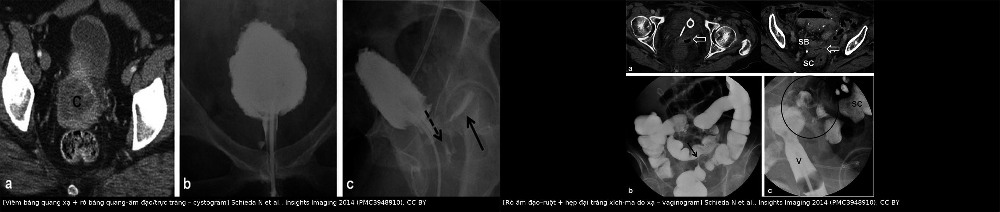
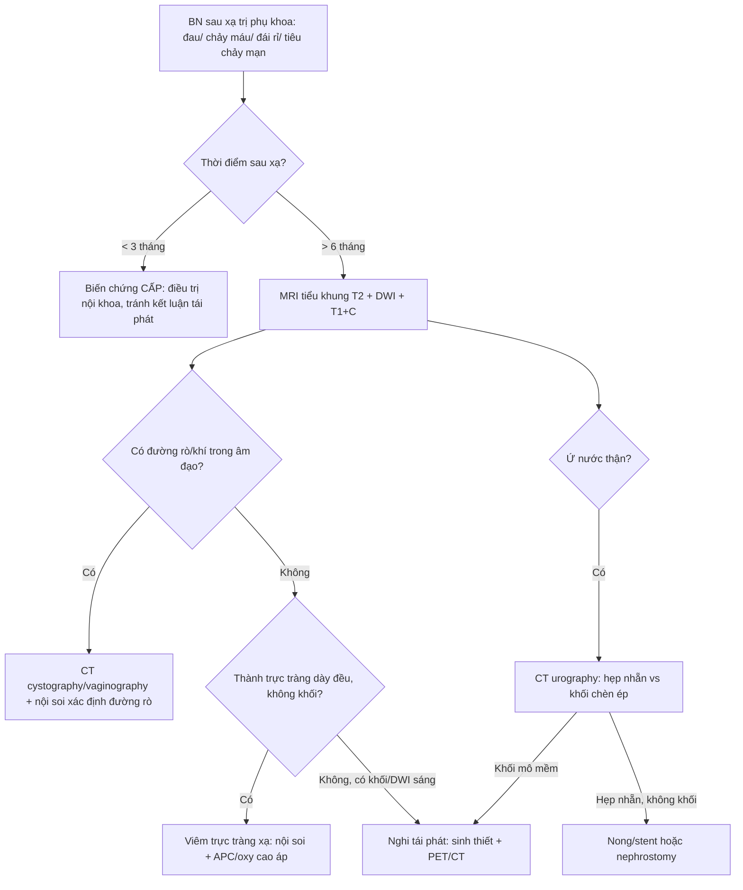
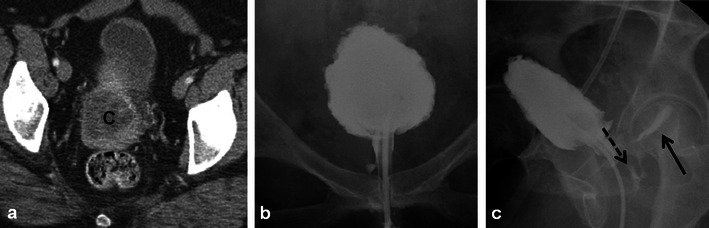
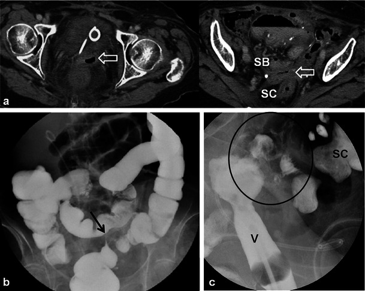
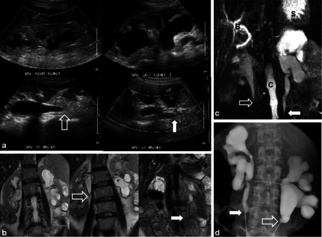
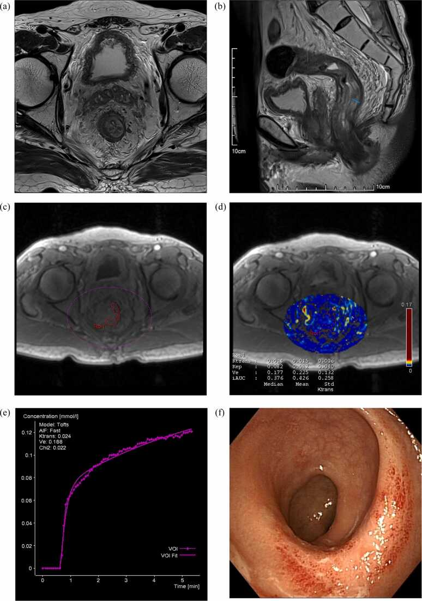

# 582 — Biến chứng tiêu hóa–niệu sau xạ trị phụ khoa: viêm trực tràng xạ, rò âm đạo, hẹp niệu quản & viêm bàng quang xạ / GI and urinary complications after pelvic radiotherapy

**Tags:** `pattern:viem-truc-trang-xa` `pattern:ro-am-dao` `pattern:viem-bang-quang-xa` `pattern:hep-nieu-quan` `vung:tieu-khung` `vung:truc-trang` `vung:bang-quang` `score:CTCAE` `score:Vienna` `protocol:MRI-chau` `protocol:CT-cystography` `protocol:CT-urography` `incidentaloma:gay-xuong-suy-yeu`
**Mức chắc chắn (certainty):** tổng hợp y văn (literature synthesis) — nhóm tự biên từ y văn mở (Insights Imaging, Front Oncol, RBGO, Eur J Radiol Open), có ca nguyên văn minh họa trong quiz.

> **Câu chốt của bài:** biến chứng xạ muộn **không phải "tái phát"** và cũng **không phải "viêm nhiễm thông thường"**. Chìa khóa là **thời gian + vị trí trong trường xạ + hình thái**: **thành trực tràng dày > 8 mm, phù dưới niêm mạc, ngấm thuốc đều, không có khối** = viêm trực tràng xạ; **đường rò T2 sáng nối âm đạo–trực tràng/bàng quang + bóng khí trong âm đạo** = rò do xạ; **hẹp niệu quản hình nón nhẵn, không có khối** = hẹp do xạ; **ngấm FDG/ngấm thuốc mạnh trong 6–12 tháng đầu KHÔNG đủ gọi tái phát**.

## 1. Tổng quan bệnh học – cơ chế hình ảnh

- **Cơ chế:** xạ gây **tổn thương tế bào nội mô → viêm tắc động mạch nhỏ (obliterative endarteritis) → thiếu máu cục bộ mạn → xơ hóa, teo niêm mạc, giãn mạch (telangiectasia), loét và rò**. Mô xơ **co kéo, kém đàn hồi, kém lành** → dễ rò và hẹp.
- **Thời gian (ngưỡng):** **cấp (< 3 tháng)**: phù, sung huyết, tiêu chảy, đau; **muộn (> 6 tháng, có thể tới 10 năm)**: xơ hóa, teo, giãn mạch, loét, hẹp, rò. Đây là **mốc phân biệt với tái phát** (tái phát thường trong 2 năm đầu, nhưng vẫn có thể muộn).
- **Trực tràng – viêm trực tràng xạ (radiation proctitis):** tỷ lệ mạn **2–20%**; trong loạt 226 bệnh nhân ung thư cổ tử cung, **38,5% có triệu chứng** (chảy máu trực tràng), **25,7% được xác nhận** bằng nội soi (Aragão 2025, PMC12176344). **85,4%** nhận **tổng liều > 8.500 cGy**.
- **Rò trực tràng–âm đạo (rectovaginal fistula, RVF):** **3–13%** ở phụ nữ điều trị ung thư cổ tử cung; **liều D2cm³ trực tràng ≥ 75 Gy EQD2** → **12,5% nguy cơ rò trong 3 năm** (so với 0–2,7% ở liều thấp hơn); **bevacizumab + xạ** → rò **15% vs 1%** (Lachowska 2026, PMC13591310).
- **Bàng quang – viêm bàng quang xạ (radiation cystitis):** **3–12%**, tùy liều và thể tích; **30 Gy/3–4 tuần** gây tổn thương nhẹ, **60–70 Gy** gây tổn thương nặng và biến chứng lâu dài; cấp **< 3–6 tháng** (phù, sung huyết), mạn **> 6 tháng** (xơ, teo niêm mạc, giãn mạch, **hiếm khi rò**) (Schieda 2014, PMC3948910).
- **Niệu quản – hẹp do xạ:** **1–3%** ở bệnh nhân xạ trị ung thư tiểu khung; có thể **cấp trong 6 tháng** nhưng thường **muộn, tới 10 năm**; hẹp **hai bên** gặp ở một tỷ lệ đáng kể → **ứ nước–thận, suy thận** (Schieda 2014).
- **Âm đạo:** hẹp âm đạo độ ≥ 2 sau 2 năm **21%** (EMBRACE, 630 bệnh nhân; Lachowska 2026); hẹp làm **ứ dịch, đau khi giao hợp, khó thăm khám theo dõi**.
- **TẠI SAO hình ảnh khó:** mô xạ **phù (T2 sáng) ở cấp** và **xơ (T2 tối) ở mạn**; **ngấm thuốc và FDG có thể tăng do viêm/tái tạo mô**, không đặc hiệu cho u. Vì vậy phải đọc **theo chuỗi thời gian, đối chiếu trường xạ và nội soi**, không dựa một lát cắt.

## 2. Mẫu hình + chẩn đoán phân biệt theo cơ quan (gamut)

- **Trực tràng:** viêm trực tràng xạ (thành dày đều, **phù dưới niêm mạc**, giãn mạch, loét nông), **hẹp trực tràng do xạ** (đoạn hẹp dài, nhẵn, không khối), **tái phát trực tràng** (khối lệch tâm, bờ không đều, **hạch**), viêm đại tràng nhiễm trùng/giả mạc, thiếu máu mạc treo.
- **Rò:** **rò trực tràng–âm đạo**, **rò bàng quang–âm đạo**, **rò niệu quản–âm đạo**, **rò ruột–âm đạo**; phân biệt với **rò sau mổ** (thời điểm sớm, có bệnh sử mổ), **rò Crohn** (bệnh lý ruột viêm, tổn thương nhảy cóc), **rò do u tái phát** (khối quanh lỗ rò).
- **Bàng quang:** viêm bàng quang xạ (thành dày, **dung tích giảm**, giãn mạch, **không khối**), **ung thư bàng quang thứ phát** (khối trong lòng, ngấm thuốc), viêm bàng quang xuất huyết do cyclophosphamide (tiền sử thuốc), nhiễm trùng.
- **Niệu quản:** **hẹp do xạ** (đoạn hẹp **nhẵn, hình nón**, thành dày đều, không khối), **chèn ép/tái phát** (khối mô mềm quanh niệu quản, bờ không đều), **sỏi** (tăng đậm độ trong lòng, dấu đuôi sao), **hẹp sau mổ** (vị trí miệng nối).
- **Ruột non:** viêm ruột xạ (thành dày, **dấu "mục tiêu"**, phù mạc treo), hẹp, rò; phân biệt tắc ruột do dính (không thành dày), tái phát phúc mạc.
- **Xương (biến chứng đi kèm):** **gãy xương suy yếu sau xạ** vùng xương cùng/khung chậu — xem bài 581.

## 3. Bảng so sánh phân biệt (ma trận đối chiếu)

| Thực thể (entity) | Hình ảnh điển hình | Chốt vào (rule-in) | Chốt loại (rule-out) | Gợi ý xác nhận |
|---|---|---|---|---|
| **Viêm trực tràng xạ** | Thành trực tràng **dày đều 8–10 mm**, **phù dưới niêm mạc T2 sáng**, ngấm thuốc đều, không khối; đoạn trong trường xạ | **Thời gian > 6 tháng sau xạ + thành dày đều + không khối + nội soi viêm/giãn mạch** | **Khối lệch tâm + hạch + ngấm không đều** → tái phát | MRI T2/DWI, nội soi + sinh thiết nếu nghi |
| **Tái phát trực tràng/tiểu khung** | Khối mô mềm **lệch tâm**, bờ không đều, **DWI sáng/ADC thấp**, hạch, xâm lấn mỡ quanh trực tràng | **Khối + DWI sáng/ADC thấp + hạch mới** | **Thành dày đều, ADC không thấp, ổn định qua 6–12 tháng** | Sinh thiết, PET/CT, so chuỗi ảnh |
| **Rò trực tràng–âm đạo do xạ** | **Đường rò T2 sáng** nối trực tràng–âm đạo, **khí trong âm đạo**, co kéo mô xơ | **Khí/dịch trong âm đạo + đường rò thấy trên MRI** | **Chỉ dày thành, không đường rò** → viêm đơn thuần | MRI T2/CE, CT cystography, nghiệm pháp xanh methylen |
| **Rò bàng quang–âm đạo do xạ** | **Rò từ bàng quang dung tích nhỏ** sang âm đạo; **tiểu không tự chủ liên tục**, không đau | **Rò trên cystogram/MRI + đái rỉ liên tục** | **Rò do mổ** (sớm sau mổ, vị trí miệng nối) hoặc **do u** (khối quanh lỗ rò) | CT cystography, MRI, nội soi bàng quang |
| **Viêm bàng quang xạ** | Thành bàng quang dày, **dung tích giảm**, giãn mạch, không khối; đái máu | **Tiền sử xạ + đái máu + thành dày đều + dung tích giảm** | **Khối trong lòng/ngấm thuốc khu trú** → ung thư bàng quang | Nội soi bàng quang + sinh thiết |
| **Hẹp niệu quản do xạ** | **Đoạn hẹp nhẵn, hình nón**, thành dày đều, **không khối**, ứ nước trên–dưới | **Hẹp nhẵn + không khối + đúng vùng xạ + ứ nước** | **Khối mô mềm quanh niệu quản, bờ không đều** → tái phát/chèn ép | CT urography, MRI, nội soi niệu quản |
| **Gãy xương suy yếu sau xạ** | Xương cùng/khung chậu: **phù tủy đối xứng**, **đường gãy ngang**, không khối mô mềm | **Đối xứng + đường gãy + không phá vỡ vỏ** | **Phá vỡ vỏ + khối mô mềm** → di căn | CT xương, MRI; xem bài 581 |

*Trái: cystogram — bàng quang dung tích nhỏ, thành dày, thuốc tràn vào **âm đạo (mũi tên đứt)** và **trực tràng (mũi tên liền)** = rò bàng quang–âm đạo + rò trực tràng–âm đạo. Phải: vaginogram — thuốc trong âm đạo (V) thông với quai ruột, kèm **hẹp đại tràng xích-ma** (vòng tròn). Nguồn: Schieda N et al., Insights Imaging 2014 (PMC3948910), CC BY. Ảnh ghép letterbox.*

## 4. Protocol chụp + phân độ chuẩn hóa

- **MRI tiểu khung (chìa khóa):** **T2W sagittal/axial mỏng 3 mm** (đánh giá thành trực tràng, đường rò), **T1W sau tiêm + fat-sat** (viêm/khối), **DWI/ADC** (phân biệt u sống với xơ/viêm — ADC thấp hơn ở u, nhưng **viêm cấp cũng có thể hạn chế khuếch tán**), **DCE** khi nghi u.
- **Đo ngưỡng:** thành trực tràng **bình thường ≤ 3–5 mm**; trong viêm xạ cấp, ca nguyên văn **8,58 mm** (có phù dưới niêm mạc) so với **5,13 mm** ở nhóm không viêm; **Ktrans ≥ 0,079 phút⁻¹** phân biệt viêm xạ cấp với không viêm: **Se 93%, Sp 67%, AUC 0,80** (Fan 2025, PMC12452545). **Phù dưới niêm mạc T2 gặp ở 71% cả hai nhóm → không phân biệt được**.
- **CT cystography / vaginography:** bơm thuốc cản quang vào bàng quang/âm đạo để **xác định đường rò** khi MRI không rõ; **CT urography** cho hẹp niệu quản/ứ nước.
- **Nội soi:** trực tràng (**Vienna rectoscopy score** đánh giá viêm xạ: 0–4 theo sung huyết, giãn mạch, loét), bàng quang (ung thư thứ phát), niệu quản (hẹp/nuôi cấy).
- **Phân độ độc tính:** **CTCAE 5.0** (tiêu chảy, đau trực tràng, đái máu, hẹp niệu quản, rò) + **LENT-SOMA** cho muộn; ghi **thời điểm so với kết thúc xạ**.
- **Thời điểm chụp:** **không đánh giá tái phát/ biến chứng muộn trước 3 tháng**; MRI **3–6 tháng** sau CCRT nếu cần; **PET/CT sau 3 tháng** (tốt nhất **6 tháng**) vì viêm xạ còn bắt FDG.
- **Điều trị (khung):** viêm trực tràng xạ → **APC (argon plasma coagulation)**, formalin, sucralfate, **oxy cao áp**; rò → **dẫn lưu/chuyển dòng tạm** rồi **vá bằng vạt (gracilis/Martius)**, tỷ lệ lành sơ cấp **91,4%** (rò tái phát **77,5%**), tái phát **12,0%**, biến chứng **29%**; hẹp niệu quản → **nong/stent** hoặc **nephrostomy**, mổ lại khi thất bại; hẹp âm đạo → **nong + estrogen tại chỗ**.

## 5. Biến thể bình thường và cạm bẫy

- **"Ngấm thuốc/FDG sau xạ" không phải tái phát:** viêm và tái tạo mô bắt FDG và ngấm thuốc trong **6–12 tháng**; **không chụp PET/CT quá sớm** và luôn so với **trường xạ**.
- **Thành trực tràng dày đơn thuần:** có thể do **phân ứ, viêm, thiếu máu**, không đặc hiệu; cần **nội soi** nếu dày không đều hoặc kèm hạch.
- **Phù dưới niêm mạc T2 gặp ở 71% cả nhóm viêm và không viêm** (Fan 2025) → **không dùng một dấu hiệu này** để chẩn đoán.
- **Rò bị bỏ sót trên CT:** đường rò nhỏ, co kéo, hoặc chỉ thấy **khí trong âm đạo**; **MRI T2 mỏng + cystography** nhạy hơn CT thường.
- **Hẹp niệu quản "nhẵn" vẫn có thể do u:** nếu **bờ không đều, thành dày > 5 mm, có khối quanh niệu quản** → tái phát; sinh thiết/nội soi khi nghi.
- **Co kéo sau xạ giả u:** mô xơ có thể tạo **khối giả** ở vòm âm đạo/chu cung; **DWI/ADC + so chuỗi ảnh** giúp phân biệt (xem bài 577).
- **Gãy xương suy yếu sau xạ** là **biến chứng của điều trị**, không phải di căn — xem bài 581; tránh sinh thiết mù.
- **Đừng quên biến chứng da/cơ quan lân cận:** hẹp âm đạo, loét mô mềm, **teo buồng trứng** (giảm nang) — bình thường sau xạ, không phải u.

## 6. Tự lượng giá — Blind Quiz (ảnh trơn ngoài, đáp án giấu trong thẻ bấm-mở)

**Ca 1 — Nữ 49 tuổi, ung thư cổ tử cung xạ trị 2 năm trước, đái rỉ liên tục + thoát khí/dịch qua âm đạo:**

- Câu hỏi: Bàng quang có đặc điểm gì? Có mấy đường rò, đi tới đâu? Dấu hiệu nào chốt?

<b>Bấm để hiện đáp án (findings + chẩn đoán)</b>

- **Dấu hiệu:** (a) CT trước đó có khối u cổ tử cung hoại tử; (b) cystogram: **bàng quang dung tích nhỏ, thành dày, co kéo, nâng khỏi sàn chậu**; (c) thuốc tràn vào **âm đạo (mũi tên đứt)** và **trực tràng (mũi tên liền)**.
- **Chẩn đoán:** **viêm bàng quang xạ + rò bàng quang–âm đạo và rò trực tràng–âm đạo** (rò phức hợp do xạ).
- **Chốt:** **thuốc cản quang trong âm đạo/trực tràng khi bơm bàng quang** = rò; bàng quang nhỏ, thành dày = xơ xạ.
- **Xử trí:** chuyển dòng tạm (nephrostomy/đặt sonde), đánh giá nội soi, vá bằng vạt; điều trị viêm bàng quang xạ.
- Nguồn: Schieda N et al., Insights Imaging 2014 (PMC3948910), CC BY.

**Ca 2 — Nữ 80 tuổi, ung thư nội mạc + buồng trứng đã mổ và xạ trị, thoát dịch/khí qua âm đạo:**

- Câu hỏi: Khí trong âm đạo gợi ý gì? Barium enema có loại trừ rò không? Vaginogram cho thấy gì?

<b>Bấm để hiện đáp án</b>

- **Dấu hiệu:** (a) CT: **khí trong âm đạo dày**, sát quai ruột non (SB) và đại tràng xích-ma (SC); (b) barium enema: **không thấy đường rò**, nhưng có **hẹp ngắn đại tràng xích-ma, bờ nhẵn** = hẹp do xạ; (c) vaginogram: thuốc trong âm đạo (V) **thông với ruột**, xác nhận **rò âm đạo–ruột**.
- **Chẩn đoán:** **rò âm đạo–ruột do xạ** + **hẹp đại tràng xích-ma do xạ**; barium enema âm không loại trừ rò (cần vaginogram/MRI).
- **Bài học:** chọn **đường bơm đúng phía** (âm đạo) khi nghi rò âm đạo; **hẹp nhẵn** là dấu hiệu xơ xạ, không phải u.
- Nguồn: Schieda N et al., Insights Imaging 2014 (PMC3948910), CC BY.

**Ca 3 — Nữ 52 tuổi, ung thư ruột thừa niêm nhầy đã mổ + hóa-xạ, đau lưng âm ỉ, siêu âm thấy ứ nước thận hai bên:**

- Câu hỏi: Mô tả vị trí và hình thái chỗ hẹp. Hẹp nhẵn gợi ý nguyên nhân gì? Cần phân biệt với gì?

<b>Bấm để hiện đáp án</b>

- **Dấu hiệu:** siêu âm + MRI (T2 ssFSE, MRCP) + X-quang niệu quản ngược dòng: **ứ nước–niệu quản hai bên**, **chỗ hẹp nhẵn, hình nón (smooth tapered)** ở **niệu quản gần**, không có khối mô mềm.
- **Chẩn đoán:** **hẹp niệu quản hai bên do xạ** — biến chứng muộn (1–3%), có thể xuất hiện tới **10 năm** sau xạ.
- **Phân biệt:** **tái phát/chèn ép** (khối quanh niệu quản, bờ không đều), **sỏi** (tăng đậm độ trong lòng), **hẹp sau mổ** (miệng nối).
- **Lưu ý trung thực:** ca minh họa có **ung thư ruột thừa niêm nhầy** (không phải ung thư phụ khoa) — dùng để minh họa **hình thái hẹp do xạ**, không đại diện quần thể bài này.
- **Xử trí:** nong/stent hoặc **nephrostomy**; theo dõi chức năng thận; sinh thiết/nội soi nếu nghi u.
- Nguồn: Schieda N et al., Insights Imaging 2014 (PMC3948910), CC BY.

**Ca 4 — Bệnh nhân xạ trị tiểu khung, MRI trực tràng 3 tháng sau điều trị:**

- Câu hỏi: Thành trực tràng dày bao nhiêu? Dấu hiệu nào **không** giúp phân biệt? Ngưỡng Ktrans có ý nghĩa gì?

<b>Bấm để hiện đáp án</b>

- **Dấu hiệu:** T2WI trục + sagittal: **thành trực tràng 8,58 mm**, **phù dưới niêm mạc**; DCE-MRI đo **Ktrans**; nội soi (f) có **giãn mạch/viêm**.
- **Ngưỡng:** **Ktrans ≥ 0,079 phút⁻¹** → **Se 93%, Sp 67%, AUC 0,80** cho viêm trực tràng xạ cấp; **phù dưới niêm mạc gặp 71% ở cả nhóm viêm và không viêm** → không phân biệt.
- **Lưu ý trung thực:** ca minh họa **ung thư trực tràng** (không phải phụ khoa) — dùng để minh họa **cơ chế và cách đo**, không đại diện quần thể bài này.
- Nguồn: Fan WJ et al., Eur J Radiol Open 2025 (PMC12452545), CC BY-NC-ND 4.0.

## Bài liên quan chéo
- [500 – Tổng quan Vú & Sản Phụ khoa](../500-tong-quan-vu-san-phu-khoa/lesson.md)
- [577 – Theo dõi & phát hiện tái phát ung thư phụ khoa](../577-theo-doi-tai-phat-ung-thu-phu-khoa/lesson.md)
- [581 – Di căn não & xương trong ung thư phụ khoa](../581-di-can-nao-xuong-ung-thu-phu-khoa/lesson.md)
- [525 – K nội mạc/cổ tử cung: FIGO MRI](../525-ung-thu-noi-mac-co-tu-cung-FIGO-MRI/lesson.md)
- [574 – Ung thư âm hộ & âm đạo: FIGO 2021](../574-ung-thu-am-ho-am-dao-FIGO-hach-ben/lesson.md)
- [523 – Sarcoma mạch do xạ ở vú & biến chứng muộn sau xạ](../523-sarcoma-mach-do-xa-vu/lesson.md)
- [549 – Nốt đặc phúc mạc không xác định](../549-not-phuc-mac-khong-xac-dinh/lesson.md)
- [546 – Loạn vận động tống phân & đau sàn chậu](../546-loan-van-dong-tong-phan-anismus/lesson.md)

## Ảnh
- `582_viem-bang-quang-ro_fluoro_PMC3948910.jpg`, `582_ro-am-dao-ruot_fluoro_PMC3948910.jpg`, `582_hep-nieu-quan_MRI_PMC3948910.jpg` — Schieda N et al., Insights Imaging 2014, CC BY.
- `582_viem-truc-trang_MRI_PMC12452545.jpg` — Fan WJ et al., Eur J Radiol Open 2025, CC BY-NC-ND 4.0 (giữ nguyên bản, không ghép/cắt).
- `composite_ro-bang-quang-vs-ro-am-dao.jpg` — ảnh ghép letterbox từ 2 ảnh CC BY của PMC3948910.
- Nguồn + giấy phép từng ảnh: `images/CREDITS.md`.

> **Disclaimer y tế:** Không dùng để chẩn đoán độc lập khi chưa có người hướng dẫn.
