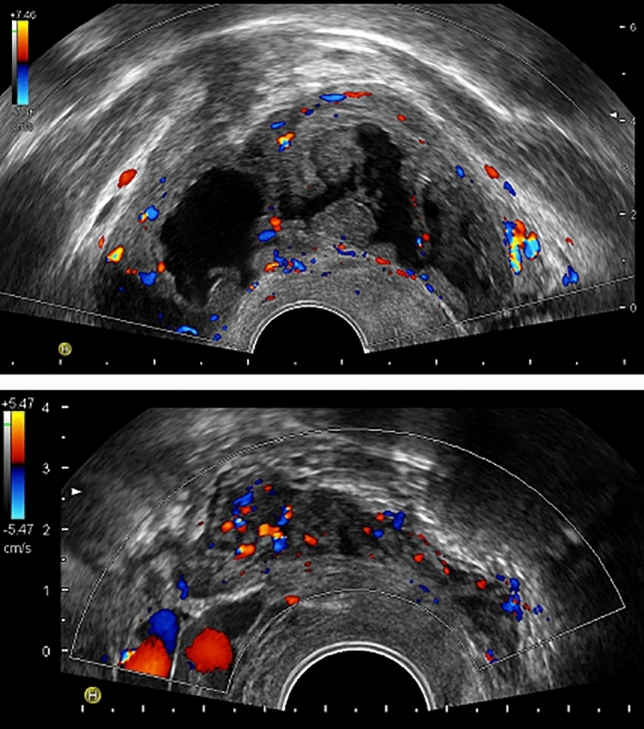
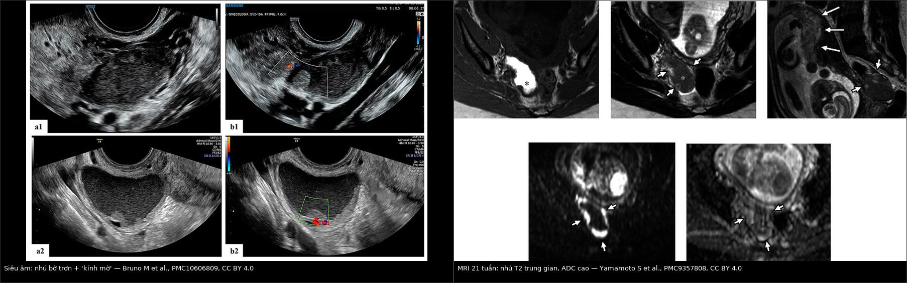
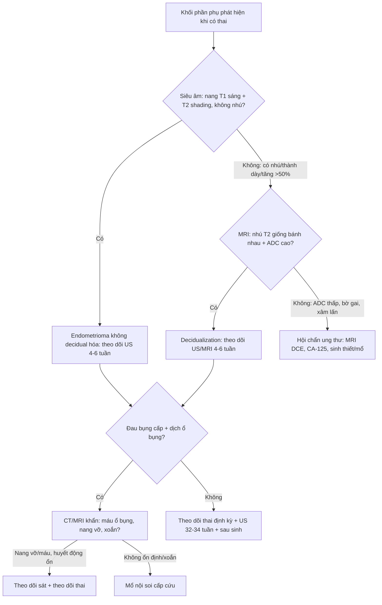
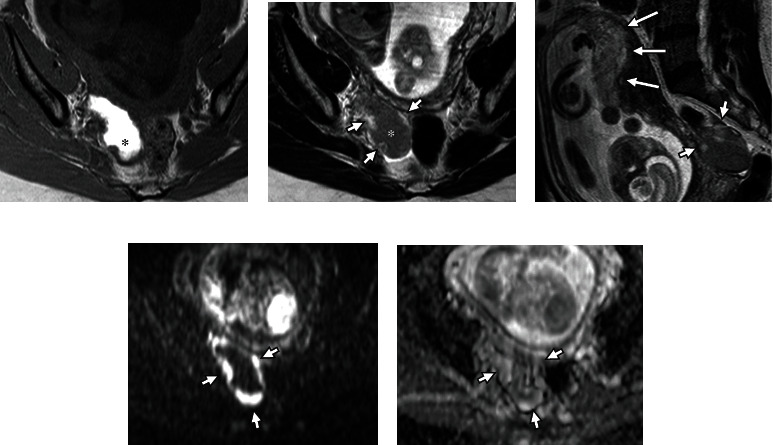
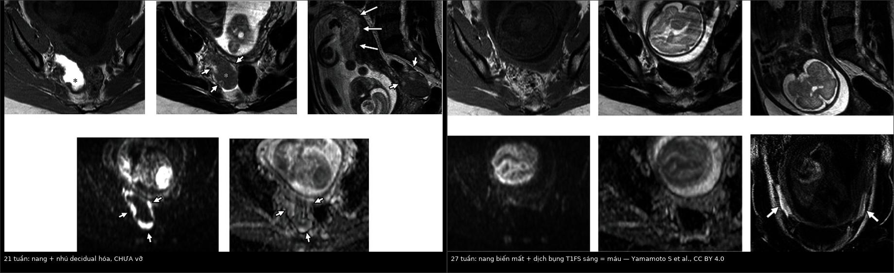

# 583 — Nang lạc nội mạc buồng trứng trong thai kỳ: decidualization giả ác, vỡ – xoắn & xử trí bảo tồn / Ovarian endometrioma in pregnancy

**Tags:** `pattern:nang-t1-sang` `pattern:decidualization` `vung:buong-trung` `vung:thai-ky` `protocol:MRI-chau` `protocol:TVUS-thai` `incidentaloma:nang-buong-trung`
**Mức chắc chắn (certainty):** tổng hợp y văn (literature synthesis) — tổng hợp từ đoàn hệ tiến cứu, ca nguyên văn có chuỗi MRI và các bài tổng quan mở; số liệu lấy trực tiếp từ nguồn ghi ở `sources.md`.

## 1. Tổng quan bệnh học – cơ chế hình ảnh

- **Bối cảnh dịch tễ (ngưỡng định lượng):**
  - Khối phần phụ gặp ở **0,04–1,3%** thai kỳ; siêu âm có thể thấy nang phần phụ ở **4,1–24,9%** thai phụ, phần lớn tự thoái triển.
  - Trong các nang phát hiện sớm, **nang lạc nội mạc chiếm ~4–5%**; đa số nang sau 16 tuần là **u quái trưởng thành**.
  - Ung thư buồng trứng (kể cả giáp biên) chỉ chiếm **1–8%** khối phần phụ trong thai; **xoắn phần phụ 0,2–3%**.
- **Decidualization là gì:** dưới nồng độ progesterone cao của thai kỳ, mô đệm lạc nội mạc chuyển thành **tế bào decidual** — phù nề, tăng sinh mạch, tạo **nhú/nốt thành dày**. Đây là **biến đổi sinh lý, tạm thời**, không phải ung thư.
- **Tần suất và thời điểm:** y văn cũ nêu **~12%** nang lạc nội mạc có phản ứng decidual; đoàn hệ tiến cứu 45 nang (thụ tinh ống nghiệm) ghi nhận **16% (95% CI 8–29%)** ở tuần **11–13**. **Không ca nào** có dấu hiệu decidualization ở tuần **6–7** → đây là hiện tượng của **tam cá nguyệt 2**, thoái triển cuối thai kỳ/sau sinh.
- **TẠI SAO hình ảnh giống ác (vật lý + mô bệnh):**
  - **T1W rất sáng, KHÔNG mất khi fat-sat:** dịch nang là **máu cũ cô đặc** (methemoglobin/hemosiderin + protein), không phải mỡ.
  - **T2W trung gian/shading:** nồng độ sắt–protein cao rút ngắn T2; nhú decidual có tín hiệu **trung gian đến cao trên T2**, tương tự **bánh nhau**.
  - **DWI sáng nhưng ADC CAO:** mô decidual phù nề, giàu nước → **T2 shine-through**, không phải hạn chế khuếch tán thật. Ca minh họa có **ADC 1,6 × 10⁻³ mm²/s**; ca giả u polypoid lành khác có **ADC 1,43 × 10⁻³ mm²/s**. Vì vậy **DWI sáng đơn thuần không được dùng để chẩn đoán ác** — bắt buộc đọc ADC.
  - **Ngấm thuốc:** nhú decidual thường **ngấm thuốc** (giống nội mạc), bờ **trơn/lồi**, không xâm lấn vỏ — khác nhú ung thư **bờ gai, xâm lấn, ADC thấp**.
- **Thai kỳ làm nang nhỏ lại:** ở nang không decidual hóa, đường kính trung vị giảm **23 → 17 mm** sau sinh; **36%** nang không còn thấy sau sinh. Ngược lại, nang **đã decidual hóa thường KHÔNG biến mất** (0/7 so với 13/29, p = 0,03) — cần theo dõi tiếp, không kết luận thất bại.
- **Biến chứng — các ngưỡng phải nhớ:**
  - **Vỡ nang:** hiếm; trong 20 ca được tổng quan, **78,5% nang ≥ 6 cm**, **50% xảy ra tam cá nguyệt 3**, **68,7% con so**, tuổi mẹ trung bình **33,4**; **dính quanh nang** là yếu tố nguy cơ **âm thầm** (khó thấy trên hình ảnh).
  - **Xuất huyết ổ bụng tự phát trong thai (SHiP):** **0,04/1000 ca sinh** (95% CI 0,03–0,06); **ART RR 6,60**, **đa thai RR 6,57**, **mẹ ≥ 35 tuổi RR 2,10**; đau bụng **89,6%**, tụt huyết áp **27,6%**, sốc **24,1%**; mất máu trung vị **1.900 mL**, **2/29 mẹ tử vong**, sinh non **72%**.
  - **Xoắn:** **0,2–3%** thai kỳ; Doppler bình thường **không loại trừ** xoắn từng lúc.

## 2. Mẫu hình + chẩn đoán phân biệt theo vị trí & thời điểm (Gamut)

- **Ba câu hỏi gỡ rối một nang T1 sáng có nhú trong thai:**
  1. **Có thai và đang ở tuần bao nhiêu?** Tuần 11–13 trở đi mới xuất hiện decidualization; **tuần 6–7 chưa thấy** trong đoàn hệ — nhú ở giai đoạn này cần **so ảnh cũ** để loại tổn thương có sẵn.
  2. **Nhú có tín hiệu giống bánh nhau + ADC cao + bờ trơn không?** Có → **decidualization**.
  3. **Có dấu hiệu xâm lấn/bờ gai/ADC thấp/dịch ổ bụng không?** Có → **nghi ác**, phải hội chẩn và mô bệnh.
- **Gamut theo tam cá nguyệt:**
  - **Tam cá nguyệt 1:** nang hoàng thể, nang cơ năng, thai ngoài tử cung (khối cạnh buồng trứng), u quái — ít khi decidualization.
  - **Tam cá nguyệt 2:** **decidualization** (hay gặp nhất trong nhóm nang T1 sáng có nhú), u giáp biên, EAOC, giả u polypoid.
  - **Tam cá nguyệt 3:** **vỡ/xoắn/SHiP**; nang lớn ≥ 6 cm là yếu tố nguy cơ vỡ.
  - **Sau sinh:** nang thoái triển (36%) hoặc tồn tại; nhú decidual **có thể còn** vài tuần.
- **Mnemonic DECIDUA:**
  - **D** — **D**ecidualization (sinh lý, giả ác).
  - **E** — **E**ndometrioid/clear cell carcinoma (EAOC).
  - **C** — **C**ystadenofibroma / u giáp biên.
  - **I** — **I**nfection/torsion (áp-xe, xoắn).
  - **D** — **D**ermoid (mỡ, mất tín hiệu T1 khi fat-sat).
  - **U** — **U**ncommon: giả u polypoid, di căn (Krukenberg).
  - **A** — **A**dhesions/rupture/SHiP (dính, vỡ, xuất huyết ổ bụng).

*Trên: nang lạc nội mạc ở tuần 12 — nhiều nhú mạch hóa, color score 2. Dưới: nốt lạc nội mạc sau cổ tử cung ở tuần 23 (không phải nang buồng trứng) — minh họa decidualization cũng xảy ra ở tổn thương ngoài buồng trứng. Nguồn: Filippi F et al., Sci Rep 2022 (PMC8795262), Fig. 1, CC BY 4.0.*

## 3. Bảng so sánh phân biệt (ma trận đối chiếu)

| Thực thể (entity) | Hình ảnh điển hình (US/MRI) | Chốt vào (rule-in) | Chốt loại (rule-out) | Gợi ý xác nhận |
|---|---|---|---|---|
| **Decidualized endometrioma** | Nang **T1 rất sáng, không mất khi fat-sat**; dịch **"kính mờ"**; **nhú thành nhiều ổ, bờ trơn, có mạch**; nhú **T2 trung gian–cao giống bánh nhau**, **ADC cao (~1,4–1,6 × 10⁻³ mm²/s)** | **Có thai tuần ≥ 11–13 + nhú bờ trơn + ADC cao + tín hiệu giống bánh nhau** | **ADC thấp + bờ gai + xâm lấn vỏ** → không phải decidualization; **mất tín hiệu T1 khi fat-sat** → u quái | Theo dõi US/MRI **4–6 tuần**; sinh thiết chỉ khi **không thoái triển** hoặc có cờ đỏ |
| **Endometrioma không decidual hóa** | Nang một ổ, **T1 sáng + T2 shading**, vỏ mỏng, **không nhú** | **T1 sáng không mất khi fat-sat + T2 shading** | **Nhú ngấm, thành dày > 5 mm, tăng > 50%** → nghi decidualization/ác | US 4–6 tuần/lần; MRI nếu nang ≥ 6 cm hoặc thay đổi |
| **EAOC (endometrioid/clear cell)** | Nang lớn, **nhú/thành dày bờ gai**, **ADC thấp**, **mất T2 shading**, có thể xâm lấn vỏ/dịch ổ bụng | **Nhú ác + ADC thấp + xâm lấn + tăng nhanh** | **Nhú bờ trơn, ADC cao, tín hiệu giống bánh nhau** → decidualization | MRI DCE/DWI + **CA-125**; **sinh thiết/mổ** trong tam cá nguyệt 2 |
| **U giáp biên (borderline)** | Nang nhiều ngăn/nhú **mạch hóa**, bờ có thể trơn; **không xâm lấn mô đệm** | **Nhú mạch hóa + nang lớn + ADC trung gian (không đặc hiệu)** | **Nhú bờ trơn, ADC cao, tín hiệu giống bánh nhau** → decidualization/giả u; **nhưng T1 sáng KHÔNG loại trừ u giáp biên trên nền endometrioma** | Mô bệnh sau mổ; MRI không chốt được |
| **Giả u polypoid của endometrioma** | Nhú lớn trong nang, **T2 trung gian**, **DWI sáng**, **ADC 1,43 × 10⁻³ mm²/s** (không thấp), không xâm lấn vỏ | **Nhú giống nội mạc + ADC không thấp + không xâm lấn** | **ADC thấp + bờ gai + xâm lấn** → ác | Sinh thiết; nhiều ca lành nhưng **dễ đọc nhầm ác** |
| **Nang xuất huyết cơ năng/hoàng thể** | **Mức dịch–dịch**, cục máu **bờ nhọn/lõm**, vỏ mỏng; **tự tan 6–12 tuần** | **Mức dịch–dịch + cục máu co rút + tự tan** | **T1 sáng không mất khi fat-sat + T2 shading + không tan** → endometrioma | US/MRI lặp **6–12 tuần** |
| **U quái trưởng thành (dermoid)** | **Mỡ + vôi hóa + nốt Rokitansky**, mức mỡ–dịch | **T1 sáng MẤT tín hiệu khi fat-sat (mỡ)** | **T1 vẫn sáng khi fat-sat** → máu/nhầy | CT: mỡ **−10 đến −100 HU**; MRI T1 FS |
| **Áp-xe/xoắn phần phụ** | Khối hỗn hợp, thành dày, **phù mỡ quanh**, **dấu xoáy (whirlpool)**; xoắn có thể **Doppler bình thường** | **Đau cấp + phù quanh + whirlpool** | **Nang T1 sáng đơn thuần, không phù** → không phải xoắn | Mổ nội soi cấp cứu nếu lâm sàng thuyết phục |

*Trái: siêu âm — nang dịch "kính mờ", nhú lồi bờ trơn, có mạch bên trong. Phải: MRI 21 tuần — nang T1 sáng (máu cũ), nhú T2 trung gian giống bánh nhau, DWI sáng nhưng ADC cao 1,6 × 10⁻³ mm²/s. Nguồn: Bruno M et al., Diagnostics 2023 (PMC10606809) và Yamamoto S et al., Case Rep Obstet Gynecol 2022 (PMC9357808), CC BY 4.0. Ảnh ghép letterbox, giữ nguyên tỷ lệ.*

### Dấu hiệu chốt then chốt
- **T1 sáng không mất khi fat-sat** = máu cũ, không phải mỡ — bước đầu tiên với mọi nang T1 sáng.
- **Nhú T2 trung gian–cao giống bánh nhau + ADC cao** = decidualization; **ADC thấp** mới là hạn chế khuếch tán thật.
- **Thai ≥ 11–13 tuần** mới xuất hiện decidualization; **tuần 6–7 không có** — mốc thời gian có giá trị loại trừ.
- **Nang ≥ 6 cm** là yếu tố nguy cơ vỡ; **đau cấp + dịch ổ bụng** phải nghĩ vỡ/SHiP, không chờ MRI thường quy.

## 4. Protocol chụp + hệ phân độ/điểm chuẩn hóa

- **Siêu âm đầu tay (TVUS, ± đầu dò bụng khi tử cung lớn):**
  - Đo **3 chiều nang**, độ dày thành, số nhú, bờ nhú, **mạch trong nhú** (color/power Doppler).
  - Mô tả dịch: **"kính mờ" (ground-glass)**, mức dịch–dịch, thành phần đặc.
  - **IOTA simple rules/ADNEX** dùng được để phân tầng, nhưng **chưa được validate riêng cho thai kỳ**.
- **MRI chậu khi siêu âm không kết luận (khuyến cáo thực hành: tuần 18–24):**
  - **T2W** axial/sagittal/coronal; **T1W fat-sat** (xác nhận máu); **DWI b = 1000 + ADC**; **DCE** chỉ khi nghi ác và sau khi hội chẩn.
  - **Gadolinium:** chỉ dùng khi thông tin thay đổi quyết định; hạn chế tối đa, đặc biệt tam cá nguyệt 1. **Không dùng gadolinium thường quy**.
  - Chuẩn bị: nhịn ăn 3–6 giờ, thuốc chống nhu động, bàng quang căng vừa.
- **Lịch theo dõi (tổng hợp từ các đoàn hệ; không có guideline riêng):**
  - Nang điển hình, không nhú: **US mỗi 4–6 tuần** trong tam cá nguyệt 2, sau đó **32–34 tuần** và **6–12 tuần sau sinh**.
  - Có nhú/decidualization: **US 4–6 tuần/lần**; **MRI lặp 6 tuần** nếu còn nghi ngờ (ca minh họa làm MRI 21 → 27 tuần).
  - Sau sinh: **US 6–12 tuần**; nếu nhú còn tồn tại → MRI và cân nhắc sinh thiết.
- **Chỉ định can thiệp trong thai:**
  - **Xoắn, vỡ có rối loạn huyết động, tắc nghẽn chuyển dạ, nghi ác** — không mổ vì "nang to" đơn thuần.
  - Thời điểm mổ: **tam cá nguyệt 2 (16–20 tuần)** nếu có chỉ định; ưu tiên **nội soi**; sau 32 tuần thường phải mổ lấy thai kèm xử trí nang.
- **O-RADS:** **không được thiết kế/không validate cho thai kỳ** — không dùng O-RADS để quyết định mổ ở thai phụ.
- **ESHRE 2022 (khuyến cáo 61, mức mạnh):** endometrioma **có thể đổi hình thái trong thai**; nếu gặp **endometrioma không điển hình trên siêu âm thai** → **chuyển trung tâm có chuyên môn** (không tự mổ/theo dõi đơn thuần tại tuyến không chuyên).

## 5. Biến thể bình thường và cạm bẫy

- **Decidualization là biến thể sinh lý, không phải ác:** gặp ở **16%** nang trong đoàn hệ tiến cứu; nhú có mạch, tăng > 50% kích thước vẫn có thể lành. **Không mổ vì nhú đơn thuần.**
- **DWI sáng ≠ hạn chế khuếch tán:** mô decidual phù nề cho **T2 shine-through** với **ADC cao**; chỉ khi **ADC thấp** mới nghi ác.
- **Nang decidual hóa có thể KHÔNG biến mất sau sinh:** 0/7 nang decidual hóa biến mất so với 13/29 nang không decidual hóa (p = 0,03). Đừng coi "còn nang sau sinh" là thất bại/theo dõi kém.
- **Vỡ nang có thể biểu hiện "nang biến mất":** ca minh họa 27 tuần đau đột ngột, MRI **không còn nang** + **dịch bụng T1FS sáng** = máu. Đây là bẫy nguy hiểm nếu chỉ so kích thước nang.
- **SHiP vs vỡ nang:** SHiP thường do **mạch trong tiểu khung** (23,5% thành sau tử cung, 35,2% hemipelvis trái), **nang có thể còn nguyên**; mất máu trung vị 1.900 mL và tử vong mẹ đã gặp → **đau + tụt huyết áp + dịch bụng** là cấp cứu, không chờ chẩn đoán hình ảnh đầy đủ.

*Siêu âm (A) và CT có cản quang (B, C): máu tụ sau tử cung (đường chấm/mũi tên) do vỡ nang lạc nội mạc trong thai. Nguồn: Miyazaki Y et al., Cureus 2026 (PMC12916156), Fig. 1, CC BY 4.0.*
- **Xoắn với Doppler bình thường:** xoắn từng lúc hoặc xoắn không hoàn toàn vẫn có thể có phổ; **lâm sàng + dấu whirlpool** quan trọng hơn Doppler âm.
- **CA-125 tăng sinh lý trong thai:** ca minh họa có **37 U/mL** (ngưỡng tham chiếu < 35) — **không dùng CA-125 đơn độc** để phân biệt lành/ác.
- **Cạm bẫy mặt cắt:** dịch ổ bụng T1 sáng phải xác nhận bằng **fat-sat** (máu) và phân biệt với **nước ối/dịch sinh lý**; nang T1 sáng cần so với **mỡ** (mất tín hiệu khi FS).
- **Ngưỡng mổ trước thai chưa có đồng thuận:** **≥ 6 cm** là yếu tố nguy cơ vỡ nhưng không phải chỉ định mổ tuyệt đối; quyết định theo triệu chứng, tiền sử, khả năng theo dõi.
- **Bẫy "nhú + DWI sáng" ở người KHÔNG mang thai:** giả u polypoid của endometrioma cũng có nhú lớn, DWI sáng, nhưng **ADC 1,43 × 10⁻³ mm²/s** và **không xâm lấn vỏ** — lành nhưng rất dễ bị đọc thành ác. Khi so với decidualization, **bối cảnh thai kỳ** là khác biệt cốt lõi.

*Ca không mang thai: nhú lớn T2 trung gian, DWI sáng nhưng ADC 1,43 × 10⁻³ mm²/s (không thấp), không xâm lấn vỏ — giả u polypoid lành, không phải decidualization. Nguồn: Parpex G et al., F S Rep 2026 (PMC13282533), Fig. 1, CC BY 4.0.*

## 6. Tự lượng giá — Blind Quiz

**Ca 1 — Thai 21 tuần, nang buồng trứng phải có nhú, T1 sáng. Nhìn ảnh, mô tả trước khi đọc đáp án.**

- Gợi ý: nang **68 × 45 × 35 mm**, thành có nhú; mẹ 39 tuổi, mang thai sau bơm tinh trùng.
- Câu hỏi: Nhú là ác hay sinh lý? Dấu hiệu nào trên MRI giúp chốt? Bước tiếp theo?

<b>Bấm để hiện đáp án (findings + chẩn đoán)</b>

- Dấu hiệu: nang **T1 rất sáng** (a, dấu \*), **T2 trung gian** (b), nhú **T2 trung gian–cao giống bánh nhau** (b, c; mũi tên ngắn), **DWI sáng** nhưng **ADC cao 1,6 × 10⁻³ mm²/s** (d, e).
- Chẩn đoán: **decidualized endometrioma** — biến đổi sinh lý do progesterone; nhú phù nề nên ADC cao, không phải hạn chế khuếch tán.
- Xử trí: **không mổ**; hẹn **MRI lặp 6 tuần** và theo dõi thai.
- Nguồn ảnh: Yamamoto S et al., Case Rep Obstet Gynecol 2022 (PMC9357808), Fig. 1, **CC BY 4.0**.

**Ca 2 — Cùng bệnh nhân, 27 tuần đau bụng đột ngột. So sánh hai thời điểm.**

- Gợi ý: đau xuất hiện nhanh, không sốt; huyết động ổn.
- Câu hỏi: Nang đã đi đâu? Dịch bụng là gì? Theo dõi hay mổ?

<b>Bấm để hiện đáp án (findings + chẩn đoán)</b>

- Dấu hiệu: **nang không còn thấy** trên T1/T2/DWI; **dịch quanh tử cung T1FS sáng** = **dịch máu** (mũi tên).
- Chẩn đoán: **vỡ nang lạc nội mạc đã decidual hóa** — nang "biến mất" + máu ổ bụng.
- Xử trí: bệnh nhân **ổn định** → **theo dõi bảo tồn**, giảm đau; mổ lấy thai chủ động ở 37 tuần + cắt nang cùng lúc. Nếu **không ổn định/huyết động xấu** → mổ cấp cứu.
- Bài học: **không so kích thước nang đơn thuần**; luôn tìm **dịch bụng T1FS** khi đau cấp.
- Nguồn ảnh: Yamamoto S et al., Case Rep Obstet Gynecol 2022 (PMC9357808), Fig. 1–2, **CC BY 4.0**; ảnh ghép letterbox.

**Ca 3 — Thai tam cá nguyệt 2, nang 6 cm có nhú lồi bờ trơn và mạch trong nhú. Có nên mổ ngay?**

- Gợi ý: nhú **bờ trơn**, **có mạch vừa**, dịch nang **"kính mờ"**; không dịch ổ bụng, không đau.
- Câu hỏi: 3 chẩn đoán phân biệt? Dấu hiệu nào nghiêng về sinh lý? Khi nào mới can thiệp?

<b>Bấm để hiện đáp án (findings + chẩn đoán)</b>

- Dấu hiệu: nang **dịch "kính mờ"** + **nhú lồi, bờ trơn, có mạch vừa** (a1/b1, a2/b2); không có nhú bờ gai, không dịch ổ bụng.
- Chẩn đoán: **decidualized endometrioma** — phân biệt với **u giáp biên** và **EAOC**.
- Chốt: **bờ nhú trơn + tín hiệu giống bánh nhau + ADC cao** nghiêng về sinh lý; **theo dõi 4–6 tuần** là bước tiếp theo, không mổ vì "có nhú".
- Xử trí: theo dõi US/MRI; **mổ** nếu nhú tăng nhanh, xâm lấn, dịch ổ bụng hoặc nghi ác.
- Nguồn ảnh: Bruno M et al., Diagnostics 2023 (PMC10606809), Fig. 4, **CC BY 4.0**.

## Bài liên quan chéo
- [500 – Tổng quan Vú & Sản Phụ khoa](../500-tong-quan-vu-san-phu-khoa/lesson.md)
- [543 – Nang lạc nội mạc buồng trứng: T1 sáng + T2 shading](../543-nang-lac-noi-mac-buong-trung/lesson.md) (chẩn đoán cơ bản, EAOC, giả u polypoid)
- [530 – Phần phụ O-RADS siêu âm/MRI](../530-buong-trung-ORADS-sieu-am-MRI/lesson.md) (O-RADS không validate cho thai kỳ)
- [550 – Thai sớm & ngoài tử cung](../550-thai-som-say-thai-thai-ngoai-tu-cung/lesson.md) (khối cạnh buồng trứng tam cá nguyệt 1)
- [560 – Nhau cài răng lược & cấp cứu sản khoa](../560-nhau-cai-rang-luoc-PAS-cap-cuu-san/lesson.md) (chảy máu ổ bụng cấp)
- [544 – Đảo ngược tử cung không do sinh](../544-dao-nguoc-tu-cung-khong-do-sinh/lesson.md) (khối sa qua cổ tử cung)

## Ảnh
- Tên file: `583_slug_Modality_SourceID.jpg`. Nguồn + giấy phép từng ảnh trong `images/CREDITS.md`.
- 6 ảnh gốc **CC BY 4.0** (PMC9357808 ×2, PMC8795262, PMC10606809, PMC12916156, PMC13282533) + 2 ảnh ghép CC BY 4.0 kế thừa.

> Không dùng để chẩn đoán độc lập khi chưa có người hướng dẫn (Disclaimer y tế).
