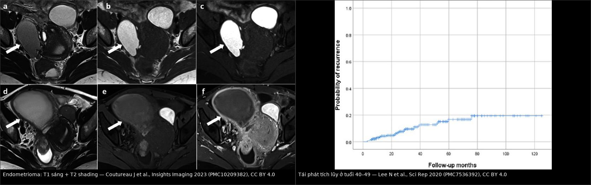
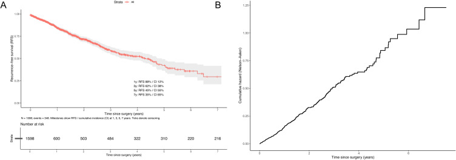
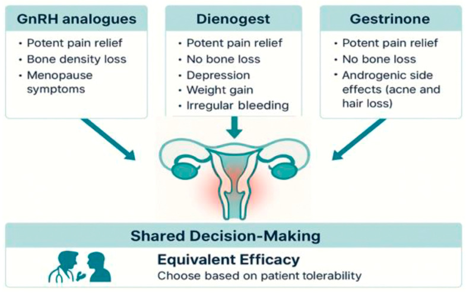
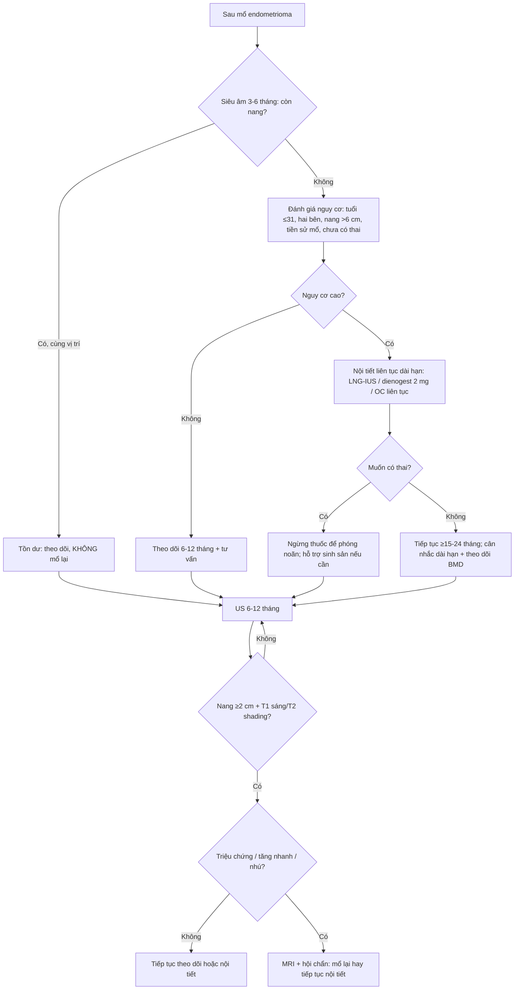
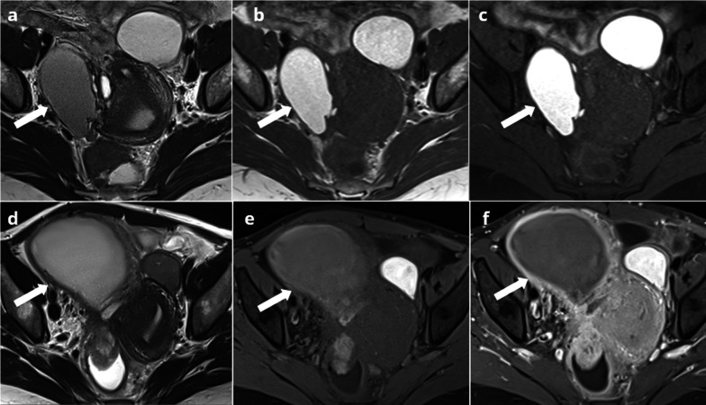
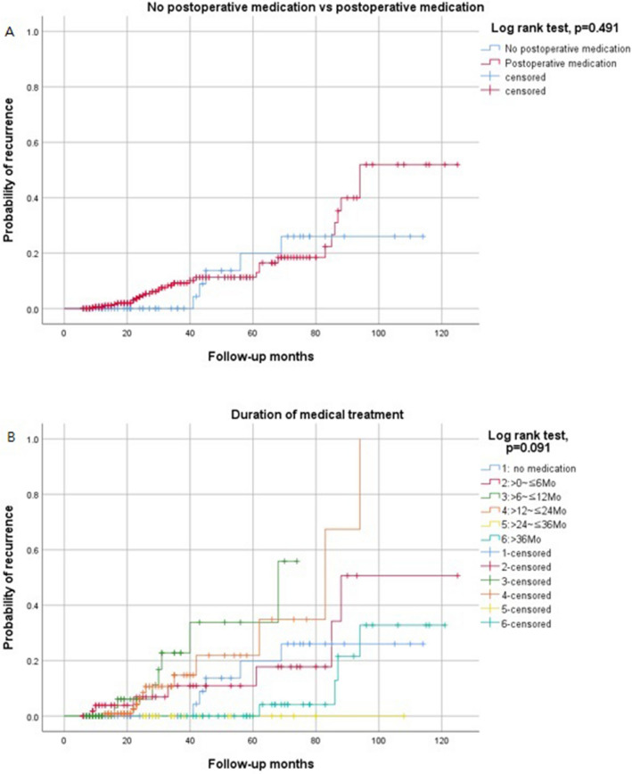
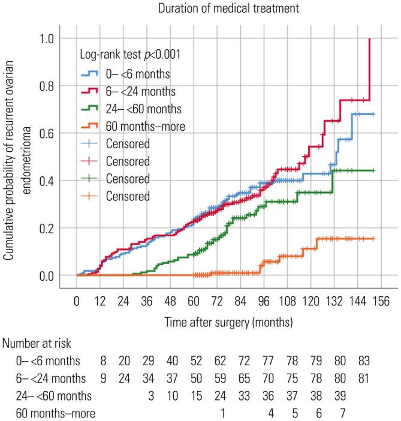

# 584 — Dự phòng & theo dõi tái phát sau mổ endometrioma: nội tiết dài hạn vs theo dõi / Preventing and monitoring recurrence after endometrioma surgery

**Tags:** `pattern:lac-noi-mac` `pattern:tai-phat` `vung:buong-trung` `protocol:TVUS` `protocol:MRI-chau` `incidentaloma:nang-buong-trung`
**Mức chắc chắn (certainty):** tổng hợp y văn (literature synthesis) — tổng hợp từ network meta-analysis, đoàn hệ dài hạn và RCT; số liệu lấy trực tiếp từ nguồn ghi ở `sources.md`.

## 1. Tổng quan bệnh học – cơ chế hình ảnh

- **Tái phát (recurrence) là gì:** nang lạc nội mạc xuất hiện lại sau mổ, do **mô lạc nội mạc còn sót** hoặc **tổn thương mới (de novo)**. Vì estrogen phụ thuộc, **ức chế phóng noãn** làm giảm tái phát.
- **Ngưỡng định nghĩa KHÔNG thống nhất — đây là điểm phải nêu khi đọc y văn:**
  - Lee 2020: **nang ≥ 2 cm** trên siêu âm.
  - Nie 2026: **nang ≥ 3 cm + đặc điểm siêu âm điển hình trên 2 chu kỳ liên tiếp**, bất kể triệu chứng.
  - Choi 2023: **loại trừ tổn thương tồn dư trên siêu âm đầu tiên 3–6 tháng sau mổ**, sau đó mới gọi tái phát.
  - Hệ quả: cùng một bệnh nhân có thể "tái phát" theo định nghĩa này nhưng không theo định nghĩa khác — **luôn ghi định nghĩa khi so sánh tỷ lệ**.
- **Tỷ lệ tái phát (các mốc định lượng):**
  - Gộp 23 nghiên cứu, **4.368 bệnh nhân**: **21,5% ở 2 năm** và **40–50% ở 5 năm**.
  - Mổ bảo tồn lần 2: **13,7% ở 2 năm**, **37,5% ở 5 năm**.
  - Đoàn hệ Hàn Quốc **756 bệnh nhân**, theo dõi trung vị **85,5 tháng**: tái phát **27,9%**, mổ lại **8,3%**; tích lũy **5,8% / 8,7% / 15,5% / 37,6%** tại **24 / 36 / 60 / 120 tháng**.
  - Đoàn hệ Trung Quốc **1.598 bệnh nhân**: tái phát **21,8%**; tích lũy **12% / 38% / 55% / 65%** tại **1 / 3 / 5 / 7 năm** — nguy cơ **tăng nhanh sau 72 tháng**.
  - Nhóm **40–49 tuổi** (408 bệnh nhân): tích lũy **3,7% / 6,7% / 11,1% / 16,7%** tại **12 / 24 / 36 / 60 tháng**.
- **TẠI SAO tái phát và tại sao nội tiết có tác dụng:**
  - Estrogen kích thích mô lạc nội mạc còn sót → **chảy máu theo chu kỳ**, viêm, xơ dính, nang tái hình thành.
  - Thuốc nội tiết gây **teo nội mạc lạc chỗ và ức chế phóng noãn** → giảm chảy máu/viêm, "làm phẳng" chu kỳ.
  - **Tác dụng phụ phụ thuộc cơ chế:** progestin gây **chảy máu bất thường/amenorrhea**, tăng cân, giảm ham muốn; GnRH gây **mất xương do giảm estrogen**; đây là lý do phải chọn theo **hồ sơ tác dụng phụ**, không chỉ hiệu lực.
- **Vì sao phải dự phòng:** mổ lặp làm **giảm dự trữ buồng trứng (AMH)**, tăng dính, tăng biến chứng — **giảm tái phát quan trọng hơn "mổ sạch" lần đầu**.
- **Hiệu quả nội tiết sau mổ (network meta-analysis, 6 RCT/675 BN + 16 đoàn hệ/3.089 BN):**
  - So với **theo dõi**, RR tái phát (nhóm đoàn hệ): **LNG-IUS 0,05 (0,00–0,98)**; **dienogest 0,14 (0,05–0,43)**; **OC liên tục 0,30 (0,11–0,77)**; **GnRHa + OC 0,33 (0,15–0,71)**; **OC chu kỳ 0,35 (0,20–0,60)**.
  - Xếp hạng (SUCRA): **LNG-IUS 87,3**, **dienogest 77,3**, **GnRHa + LNG-IUS 70,6**.
  - **Gộp RCT: không có khác biệt có ý nghĩa** — các RCT chưa đủ mạnh để chứng minh lợi ích; hiệu quả mạnh nhất đến từ **đoàn hệ** (nguy cơ thiên lệch cao hơn).
- **Ngưỡng thời gian — yếu tố quyết định:**
  - Dùng **≤ 15 tháng**: **HR 2,869 (2,088–3,941)** so với dùng dài hơn.
  - Dùng **3–12 tháng rồi ngừng**: **không giảm tái phát** so với theo dõi; một số phác đồ còn **kém hơn** theo dõi.
  - Nhóm dùng **< 6 tháng** có tái phát tích lũy **~65% ở 120 tháng**, so với **~15%** ở nhóm **≥ 60 tháng** (log-rank p < 0,001) — **"dùng ngắn = gần như không dùng"**.
- **Yếu tố nguy cơ định lượng khác:**
  - **Tuổi ≤ 31: HR 2,108 (1,522–2,921)**; **không có thai sau mổ: HR 1,851 (1,309–2,617)**.
  - **Hai bên: HR 1,36 (1,06–1,74)**; **nang > 5,5–6,2 cm**; **tiền sử mổ endometrioma**.
  - **40–49 tuổi:** nội tiết sau mổ **không giảm tái phát** trong đoàn hệ 408 ca — **cá thể hóa, không áp dụng máy móc cho người trẻ**.

## 2. Mẫu hình + chẩn đoán phân biệt theo vị trí & thời điểm (Gamut)

- **Câu hỏi đầu tiên: "tái phát" hay "tồn dư"?**
  - **≤ 6 tháng sau mổ** + nang còn ở vị trí cũ → **tồn dư/residual**, không phải tái phát thật; **không mổ lại ngay**.
  - **> 12 tháng** + nang mới → **tái phát thật**.
  - **> 5 năm** → tái phát muộn/de novo; tiếp tục theo dõi vì đường cong **vẫn tăng** (65% ở 7 năm).
- **Gamut theo hình thái:**
  - **Nang một ổ, dịch "kính mờ", T1 sáng + T2 shading** → endometrioma tái phát.
  - **Nhiều ổ/nhiều ngăn** → tái phát thể nhiều ổ, hoặc **u nhầy/giáp biên** (nếu có nhú).
  - **Nhú/thành dày/ngấm** → **giả u polypoid, decidualization (nếu có thai), EAOC, u giáp biên**.
  - **Nang đơn thuần, thành mỏng, dịch trong** → **nang cơ năng/hoàng thể**, không phải tái phát.
  - **Khối dạng ống, vách mỏng, "ngón tay"** → **ứ dịch vòi trứng (hydrosalpinx)** — bẫy sau mổ.
- **Gamut theo bối cảnh:**
  - **Sau mổ nội soi bóc nang** → tái phát endometrioma, dính, nang giả phúc mạc.
  - **Sau mổ có nhiễm trùng/áp-xe** → áp-xe phần phụ, dính.
  - **Sau mổ + mang thai** → decidualization (xem bài 583).
  - **Sau mổ + đau chậu mạn** → tái phát, DIE, đau thần kinh (bài 556).

## 3. Bảng so sánh phân biệt (ma trận đối chiếu)

| Thực thể (entity) | Hình ảnh điển hình (US/MRI) | Chốt vào (rule-in) | Chốt loại (rule-out) | Gợi ý xác nhận |
|---|---|---|---|---|
| **Endometrioma tồn dư (≤ 6 tháng)** | Nang tại vị trí mổ, **T1 sáng + T2 shading**, kích thước có thể giảm | **Xuất hiện ngay sau mổ + cùng vị trí + T1 sáng/T2 shading** | **Nang mới xuất hiện sau > 12 tháng** → tái phát thật | US 3–6 tháng; **không mổ lại** nếu không triệu chứng |
| **Endometrioma tái phát** | Nang một ổ, dịch "kính mờ", **T1 sáng không mất khi fat-sat + T2 shading** | **Nang ≥ 2 cm (hoặc ≥ 3 cm theo định nghĩa chặt) + đặc điểm điển hình** | **Mất tín hiệu T1 khi fat-sat** → u quái; **dịch trong, thành mỏng** → nang cơ năng | US 3–6 tháng/lần; MRI nếu không điển hình |
| **Nang cơ năng/hoàng thể** | Nang đơn thuần, thành mỏng, dịch trong; **tự tan 6–12 tuần** | **Tự tan khi lặp lại** | **T1 sáng + T2 shading + không tan** → endometrioma | US lặp 6–12 tuần; **không mổ vội** |
| **U quái trưởng thành** | **Mỡ + vôi hóa + nốt Rokitansky**, mức mỡ–dịch | **T1 sáng MẤT tín hiệu khi fat-sat** | **T1 vẫn sáng khi fat-sat** → máu/nhầy | CT: mỡ **−10 đến −100 HU** |
| **Hydrosalpinx** | Cấu trúc dạng ống, vách mỏng, dịch trong, **dấu "ngón tay"** | **Dạng ống + tách khỏi buồng trứng + không T1 sáng** | **Nang tròn, T1 sáng** → endometrioma | MRI T2 3D; US đầu dò bụng |
| **Áp-xe phần phụ** | Khối hỗn hợp, thành dày, **phù mỡ quanh**, ngấm mạnh | **Sốt + đau + phù quanh + hạn chế khuếch tán** | **Không sốt, không phù, T1 sáng/T2 shading** → endometrioma | Kháng sinh ± dẫn lưu; MRI |
| **U giáp biên/EAOC** | Nang lớn, **nhú mạch hóa**, **ADC thấp**, xâm lấn vỏ | **Nhú ngấm + ADC thấp + tăng nhanh + mất T2 shading** | **Nhú bờ trơn, ADC cao, không xâm lấn** → lành | MRI DCE/DWI; **sinh thiết/mổ** |
| **Nang giả phúc mạc (peritoneal inclusion cyst)** | Nang nhiều ngăn, **ôm lấy buồng trứng**, bờ mỏng, sau dính/mổ | **Buồng trứng nằm TRONG nang + tiền sử dính/mổ** | **Nang tách khỏi buồng trứng, T1 sáng** → endometrioma | MRI; theo dõi nếu không triệu chứng |

*Trái: endometrioma — T1 sáng, T2 shading, không mất tín hiệu khi fat-sat. Phải: tái phát tích lũy ở nhóm 40–49 tuổi (3,7%/6,7%/11,1%/16,7% tại 12/24/36/60 tháng) — thấp hơn nhiều so với nhóm trẻ, và không giảm khi dùng nội tiết trong đoàn hệ này. Nguồn: Coutureau J et al., Insights Imaging 2023 (PMC10209382) và Lee N et al., Sci Rep 2020 (PMC7536392), CC BY 4.0. Ảnh ghép letterbox.*

### Dấu hiệu chốt then chốt
- **T1 sáng không mất khi fat-sat + T2 shading** = máu cũ → endometrioma; đây là chốt hình ảnh của "tái phát".
- **Thời điểm xuất hiện** phân biệt **tồn dư (≤ 6 tháng)** với **tái phát thật (> 12 tháng)** — quan trọng hơn kích thước.
- **Định nghĩa ≥ 2 cm vs ≥ 3 cm** làm thay đổi tỷ lệ báo cáo; **luôn ghi rõ ngưỡng**.
- **Nội tiết chỉ có lợi khi dùng dài hạn/liên tục**; **3–12 tháng rồi ngừng = không khác theo dõi**.

## 4. Protocol chụp + hệ phân độ/điểm chuẩn hóa

- **Theo dõi sau mổ (thực hành từ đoàn hệ dài hạn):**
  - **Siêu âm đầu tiên 3–6 tháng** sau mổ — mục tiêu **loại trừ tồn dư**, lấy mốc kích thước.
  - Sau đó **mỗi 6–12 tháng** nếu không triệu chứng; **sớm hơn** nếu đau/tái phát triệu chứng.
  - Theo dõi **ít nhất 5 năm**, lý tưởng **7–10 năm** vì đường cong tái phát **tăng sau 72 tháng** (65% ở 7 năm).

*Tái phát tích lũy 12% / 38% / 55% / 65% tại 1 / 3 / 5 / 7 năm (n = 1.598); nguy cơ tăng rõ sau 72 tháng — lý do không dừng theo dõi sớm. Nguồn: Nie J et al., Int J Womens Health 2026 (PMC13105200), Fig. 2, CC BY-NC 4.0 (nguyên bản, không ghép).*
- **Siêu âm (TVUS ± đầu dò bụng):**
  - Đo 3 chiều, mô tả **dịch "kính mờ"**, vách, nhú, mạch trong nhú.
  - So sánh **ảnh cũ** — bắt buộc để phân biệt tồn dư/tái phát.
- **MRI chậu khi siêu âm không điển hình/nghi ác:**
  - **T2W** axial/sagittal/coronal; **T1W fat-sat**; **DWI + ADC**; **DCE** nếu có nhú.
  - Mục tiêu: xác nhận **máu cũ**, loại **mỡ**, đánh giá **nhú/ADC**, phân biệt **hydrosalpinx/nang giả phúc mạc**.
- **Định nghĩa tái phát dùng trong thực hành (đề xuất, không phải guideline):**
  - **Nang ≥ 2 cm** + **T1 sáng không mất khi fat-sat + T2 shading** trên **2 lần siêu âm cách ≥ 1 chu kỳ**, sau khi đã loại tồn dư ở mốc 3–6 tháng.
  - Nếu dùng ngưỡng **≥ 3 cm** (như Nie 2026) phải ghi rõ — tỷ lệ sẽ thấp hơn.
- **Chọn nội tiết sau mổ (theo nguy cơ):**
  - **Nguy cơ cao** (tuổi ≤ 31, hai bên, nang > 6 cm, tiền sử mổ, không có thai): **nội tiết liên tục dài hạn** — **LNG-IUS** hoặc **dienogest 2 mg/ngày** hoặc **OC liên tục**; **GnRHa 3–6 tháng + add-back** chỉ để khởi đầu, sau đó chuyển duy trì.
  - **Thời gian:** **≥ 15–24 tháng**, lý tưởng **đến khi có thai** hoặc **dài hạn** nếu không có nhu cầu sinh sản.
  - **40–49 tuổi:** cá thể hóa; đoàn hệ 408 ca **không thấy lợi ích rõ** — cân nhắc tác dụng phụ/chi phí.
  - **Muốn có thai:** **ngừng nội tiết để phóng noãn**; thai kỳ làm giảm tái phát; có thể chuyển sang hỗ trợ sinh sản.

*Ba nhóm đều giảm đau tương đương nhưng khác hồ sơ tác dụng phụ: GnRH gây mất xương/ triệu chứng mãn kinh; dienogest gây trầm cảm, tăng cân, chảy máu bất thường; gestrinone gây tác dụng phụ androgen. Chọn theo khả năng dung nạp của bệnh nhân (shared decision-making). Nguồn: Pinto da Costa Viana D et al., Biomedicines 2025 (PMC12467333), Fig. 1, CC BY 4.0.*

- **Theo dõi an toàn thuốc:**
  - **Dienogest:** chảy máu bất thường/amenorrhea, tăng cân, khí sắc, giảm ham muốn; **BMD giảm ~1,6–1,7%** ở 24–52 tuần (nhẹ, nhưng theo dõi nếu dùng lâu).
  - **GnRHa:** **mất xương cột sống 5–8% sau 3–6 tháng** → **bắt buộc add-back** nếu dùng > 6 tháng.
  - **LNG-IUS:** đặt sau mổ; hiệu quả cao nhất trong NMA đoàn hệ nhưng **bằng chứng RCT hạn chế**.
  - **BMD/DXA:** cân nhắc nếu dùng nội tiết **> 2 năm**, có yếu tố nguy cơ loãng xương; bổ sung **canxi + vitamin D**.
- **ESHRE 2022 (khuyến cáo mạnh):**
  - **LNG-IUS 52 mg hoặc combined hormonal contraceptive (CHC) sau mổ ít nhất 18–24 tháng** để dự phòng tái phát đau liên quan lạc nội mạc (khuyến cáo 65, mức mạnh).
  - **Phụ nữ chưa muốn có thai ngay:** **nội tiết dài hạn** (ví dụ CHC) để dự phòng tái phát endometrioma và triệu chứng (khuyến cáo 66, mức mạnh).
  - **Không dùng nội tiết nếu muốn có thai ngay**; **không có bằng chứng** nội tiết sau mổ cải thiện tỷ lệ sinh sống.
  - **Phẫu thuật:** **bóc nang (cystectomy)** thay vì dẫn lưu/đốt (khuyến cáo 64, mức mạnh), nhưng phải cân nhắc **giảm dự trữ buồng trứng**.

## 5. Biến thể bình thường và cạm bẫy

- **"Tái phát" trong 3–6 tháng đầu thường là TỒN DƯ:** đoàn hệ Choi loại trừ tồn dư trên siêu âm 3–6 tháng trước khi định nghĩa tái phát. **Mổ lại sớm = nguy cơ mất buồng trứng vô ích.**
- **Nang cơ năng giả tái phát:** nang đơn thuần, thành mỏng, dịch trong, **tự tan 6–12 tuần** — không phải endometrioma; **không mổ**.
- **Dùng nội tiết 3–6 tháng rồi ngừng không có lợi:** trong NMA, nhóm dùng ngắn **không giảm tái phát** so với theo dõi; đừng "cho thuốc cho có".
- **Chảy máu bất thường do dienogest không phải thất bại:** gặp ở **14,6%** (AUB) và **66,2%** amenorrhea trong đoàn hệ 514 ca; **giải thích trước** để tránh bỏ thuốc.
- **Tác dụng phụ dài hạn của dienogest:** ở nhóm **> 15 tháng**, đau đầu **24,7%**, tăng cân **24,7%**, giảm ham muốn **45%** — cao hơn rõ so với nhóm ngắn; **hỏi và xử lý chủ động**.
- **GnRHa không add-back:** mất xương **5–8%** sau 3–6 tháng — **không dùng đơn độc dài hạn**.
- **Người 40–49 tuổi:** nội tiết **không giảm tái phát** trong đoàn hệ 408 ca (p = 0,491 ở Hình 3A); **đừng áp dụng kết quả nhóm trẻ cho nhóm này**.
- **Bẫy hình ảnh sau mổ:** buồng trứng dính, lệch vị trí; **hydrosalpinx** và **nang giả phúc mạc** dễ bị gọi là tái phát. Luôn so ảnh cũ + xác nhận **T1 sáng/T2 shading**.
- **Chuyển dạng ác:** nhú mới, **mất T2 shading**, tăng nhanh, hậu mãn kinh, **ADC thấp** → MRI + sinh thiết, không theo dõi đơn thuần.
- **Cạm bẫy mặt cắt:** nang T1 sáng cạnh tử cung phải phân biệt với **máu tụ sau mổ** (T1 sáng, nhưng không có vỏ nang/T2 shading); dùng **T2 + theo dõi** để phân biệt.

## 6. Tự lượng giá — Blind Quiz

**Ca 1 — 30 tuổi, mổ bóc hai bên endometrioma 6 tháng trước, hiện 4 cm tái phát, đau nhẹ. Chọn gì?**

- Gợi ý: hai bên, tuổi ≤ 31, chưa có thai; siêu âm: nang **T1 sáng + T2 shading**, không nhú.
- Câu hỏi: Đây là tồn dư hay tái phát? Yếu tố nguy cơ nào? Chọn nội tiết gì và trong bao lâu?

<b>Bấm để hiện đáp án (findings + chẩn đoán)</b>

- Dấu hiệu: nang **T1 sáng, T2 shading**, không nhú, kích thước **4 cm**; xuất hiện sau **6 tháng** — nằm ở ranh giới, nhưng **nang mới/không giảm** sau mốc 3–6 tháng → **tái phát**.
- Nguy cơ: **tuổi ≤ 31 (HR 2,108)**, **hai bên (HR 1,36)**, **chưa có thai (HR 1,851)**, tiền sử mổ.
- Xử trí: **nội tiết liên tục dài hạn** — ưu tiên **LNG-IUS** hoặc **dienogest 2 mg/ngày** hoặc **OC liên tục**; thời gian **≥ 15–24 tháng**, lý tưởng đến khi có thai. **Không mổ lại** nếu chỉ 4 cm, đau nhẹ.
- Nguồn ảnh: Coutureau J et al., Insights Imaging 2023 (PMC10209382), Fig. 3, **CC BY 4.0**.

**Ca 2 — 45 tuổi, 3 tháng sau mổ, siêu âm còn nang 3 cm dịch "kính mờ". Có phải tái phát?**

- Gợi ý: không triệu chứng; mổ bóc nang 3 tháng trước; ảnh cũ có nang cùng vị trí.
- Câu hỏi: Tồn dư hay tái phát? Có nên mổ lại? Vai trò của nội tiết ở tuổi 45?

<b>Bấm để hiện đáp án (findings + chẩn đoán)</b>

- Dấu hiệu: nang **3 cm**, **cùng vị trí**, còn ngay sau mổ **3 tháng** → **tồn dư**, không phải tái phát thật.
- Xử trí: **theo dõi** (US 6–12 tháng), **không mổ lại** nếu không triệu chứng.
- Nội tiết ở 40–49 tuổi: đoàn hệ 408 ca cho thấy **không giảm tái phát** — nhóm không dùng thuốc vs có dùng thuốc **log-rank p = 0,491**; thời gian dùng thuốc **p = 0,091**; **cá thể hóa**, không mặc định kê dài hạn.
- Nguồn ảnh: Lee N et al., Sci Rep 2020 (PMC7536392), Fig. 3, **CC BY 4.0**.

**Ca 3 — Đọc đường cong: vì sao "dùng thuốc 6 tháng" không đủ?**

- Gợi ý: so nhóm **< 6 tháng** với **≥ 60 tháng**; trục tung là xác suất tái phát tích lũy.
- Câu hỏi: Nhóm nào tái phát cao nhất? Ngưỡng thời gian nào có ý nghĩa? Hệ quả thực hành?

<b>Bấm để hiện đáp án (findings + chẩn đoán)</b>

- Dấu hiệu: nhóm **< 6 tháng** có đường cong tăng nhanh, đạt **~65% ở 120 tháng**; nhóm **≥ 60 tháng** chỉ **~15%** (log-rank **p < 0,001**).
- Chốt: **thời gian dùng là yếu tố quyết định** — dùng ngắn **gần như không có lợi**; trong đoàn hệ khác, dùng **≤ 15 tháng** có **HR 2,869** so với dài hơn.
- Thực hành: nếu đã quyết định dự phòng, phải **dùng liên tục ≥ 15–24 tháng** (lý tưởng đến khi có thai); **không dùng 3–6 tháng rồi ngừng**.
- Nguồn ảnh: Choi SH et al., Yonsei Med J 2023 (PMC9971436), Fig. 4, **CC BY-NC 4.0 (nguyên bản, không ghép)**.

## Bài liên quan chéo
- [500 – Tổng quan Vú & Sản Phụ khoa](../500-tong-quan-vu-san-phu-khoa/lesson.md)
- [543 – Nang lạc nội mạc buồng trứng: chẩn đoán & nguy cơ chuyển dạng](../543-nang-lac-noi-mac-buong-trung/lesson.md)
- [583 – Nang lạc nội mạc trong thai kỳ: decidualization, vỡ – xoắn](../583-nang-lac-noi-mac-trong-thai-ky/lesson.md)
- [542 – U xơ dưới niêm mạc & can thiệp bảo tồn](../542-u-xo-duoi-niem-mac-can-thiep-bao-ton/lesson.md) (bảo tồn sinh sản)
- [533 – Theo dõi & bảo tồn sinh sản sau u buồng trứng](../533-theo-doi-va-bao-ton-sinh-san-sau-u-buong-trung/lesson.md) (nang lạc nội mạc giả tái phát)
- [556 – Đau sàn chậu cơ–mạc & đau thần kinh thẹn](../556-dau-san-chau-co-mac-pudendal-neuralgia/lesson.md) (đau chậu mạn sau mổ)

## Ảnh
- Tên file: `584_slug_Modality_SourceID.jpg`. Nguồn + giấy phép từng ảnh trong `images/CREDITS.md`.
- 3 ảnh **CC BY 4.0** (PMC10209382, PMC7536392 ×2) + 1 ảnh **CC BY-NC 4.0** (PMC9971436, giữ nguyên bản) + 1 ảnh **CC BY-NC 4.0** (PMC13105200, chỉ trích số, không ghép) + 1 ảnh ghép CC BY 4.0.

> Không dùng để chẩn đoán độc lập khi chưa có người hướng dẫn (Disclaimer y tế).
