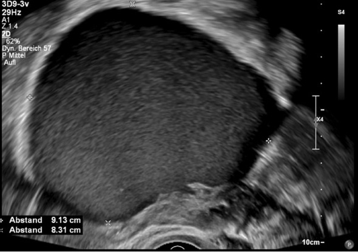
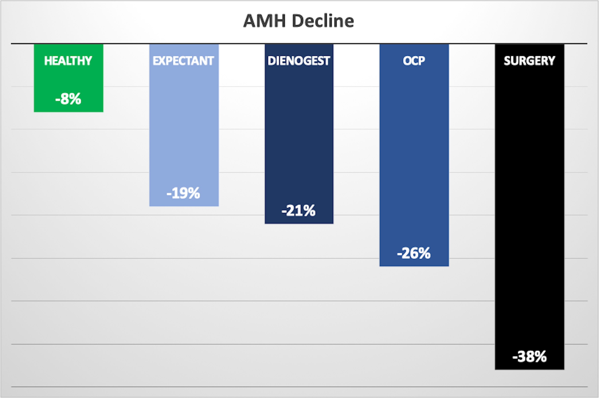
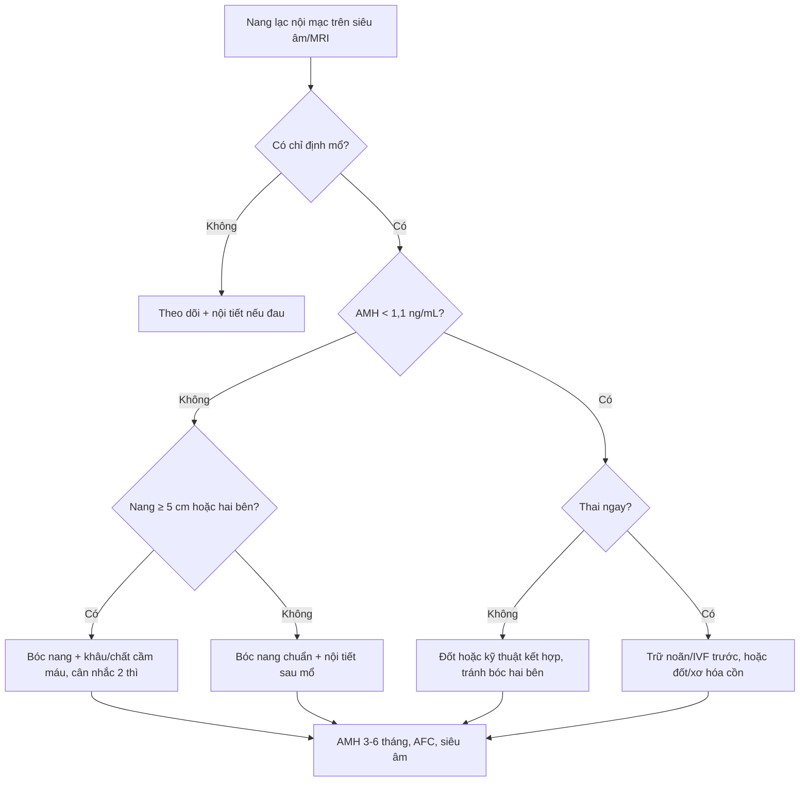
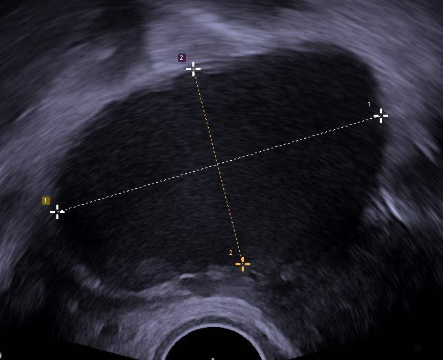
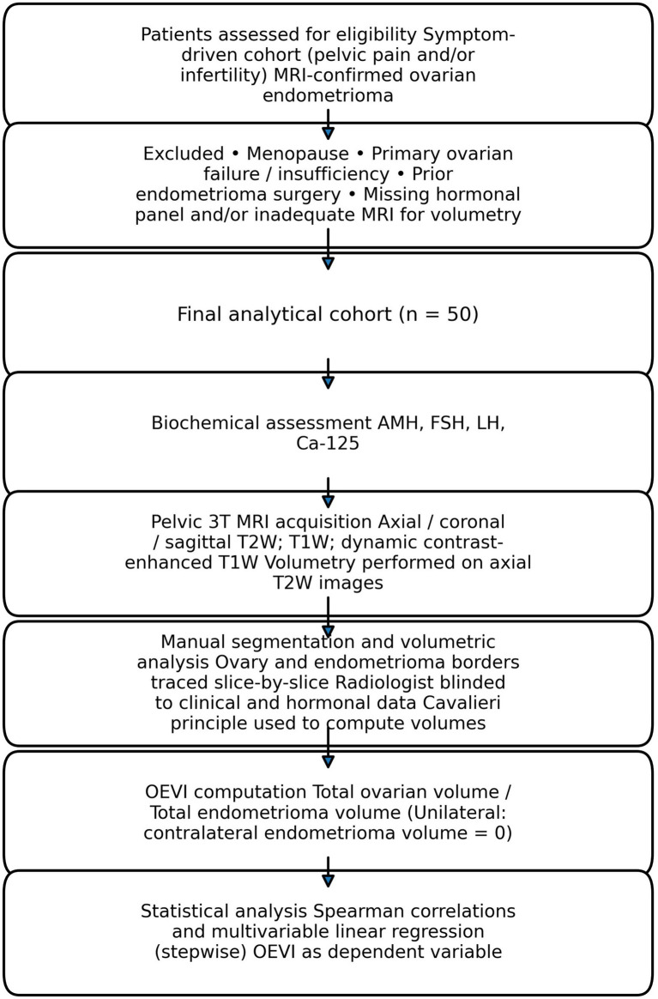

# 585 — Nang lạc nội mạc buồng trứng & dự trữ buồng trứng: AMH, bóc nang vs đốt vs theo dõi / Endometrioma and ovarian reserve — AMH-guided choice between cystectomy, ablation and observation

**Tags:** `pattern:nang-t1-sang` `pattern:lac-noi-mac` `vung:buong-trung` `score:O-RADS` `protocol:sieu-am-dau-do` `protocol:MRI-chau`
**Mức chắc chắn (certainty):** tổng hợp y văn (literature synthesis) — tổng hợp từ mạng lưới chứng cứ mở: NMA 21 RCT/1.519 người (Hum Reprod Open 2026, PMC13186601), SR/MA 16 nghiên cứu so sánh xơ hóa cồn với bóc nang (BMC Womens Health 2026, PMC13663109), đoàn hệ tiến cứu 80 bệnh nhân + 20 chứng (Front Endocrinol 2025, PMC12460422), tổng quan J Clin Med 2023 (PMC10455819) và các đoàn hệ IVF (PMC9587543, PMC10286444). Số liệu lấy từ bản full-text, không lấy từ abstract của bài thứ cấp.

## 1. Tổng quan bệnh học – cơ chế hình ảnh và cơ chế mất dự trữ

- **Dự trữ buồng trứng (ovarian reserve)** = số noãn nguyên thủy (primordial follicles) còn lại. **AMH (anti-Müllerian hormone)** do **tế bào hạt (granulosa cells)** của nang nguyên thủy đang hoạt động, nang tiền xoang (preantral) và nang xoang nhỏ tiết ra; nồng độ phản ánh **số nang đang phát triển**, không phản ánh chất lượng noãn. Vì AMH ít dao động theo chu kỳ, **có thể lấy máu bất kỳ ngày nào** — khác FSH (phải ngày 2–5). Đổi đơn vị: **1 ng/mL = 7,14 pmol/L**; ngưỡng **suy giảm dự trữ buồng trứng (DOR, diminished ovarian reserve) thường dùng AMH < 1,1 ng/mL** (Daniilidis 2023, PMC10455819).
- **Nang lạc nội mạc (endometrioma) tự nó đã làm giảm AMH** so với người không có nang: viêm mạn, stress oxy hóa và xơ hóa vỏ buồng trứng làm mất mô lành quanh nang; nang hai bên làm giảm AMH rõ hơn một bên. Trong đoàn hệ 154 phụ nữ có nang so với 305 người ghép cặp, nhóm có nang có **AMH và AFC thấp hơn có ý nghĩa**, nhưng **tỷ lệ sinh sống tích lũy (CLBR) tương đương 55,64% vs 54,34% (p = 0,806)** (Zeng 2022, PMC9587543) — dự trữ thấp **không đồng nghĩa** không có con.
- **Vì sao mổ bóc nang làm mất dự trữ — 4 cơ chế cộng dồn:**
  1. **Cắt bỏ mô buồng trứng lành** dính vào vỏ nang: nang lạc nội mạc không có "vỏ" riêng; mặt phẳng bóc tách nằm trong mô buồng trứng. **Nang noãn lạc trong mảnh cắt: 27,2%**; **nang nguyên thủy: 61,5%** ở một số nghiên cứu (tổng quan Daniilidis 2023).
  2. **Nhiệt do cầm máu**: đốt lưỡng cực (bipolar) trên giường nang gây tổn thương nhiệt thêm; **khâu buồng trứng (suturing) hoặc dùng chất cầm máu (hemostatic sealant) ít hại hơn đốt** (NMA, PMC13186601).
  3. **Rối loạn tưới máu** cuống buồng trứng sau bóc tách.
  4. **Viêm và phản ứng mô** sau mổ, giải thích vì sao AMH giảm cả khi mô học không thấy nang noãn bị lấy.
- **Ngưỡng định lượng cốt lõi (theo thời điểm 6 tháng):**
  - Giảm AMH sau 6 tháng trong đoàn hệ tiến cứu (n = 80, 4 nhóm 20 người + 20 chứng): **mổ 38%**, **OCP 26%**, **dienogest 21%**, **theo dõi 19%**, **chứng khỏe 8%** (Aslan 2025, PMC12460422) — nghĩa là **bản thân nang và cả thuốc nội tiết đều đi kèm giảm AMH**, mổ là mức giảm lớn nhất.
  - Bóc nang kinh điển: **giảm AMH ~38%**, **chênh lệch trung bình có trọng số −1,13 ng/mL (95% CI −1,88 đến −0,37)** (meta-analysis 8 đoàn hệ tiến cứu, dẫn trong PMC10455819).
  - **Hai bên nặng hơn một bên: giảm 44% vs 30%** (Raffi, dẫn trong PMC10455819); **nang ≥ 5 cm nặng hơn nang < 5 cm: 65,7% vs 41,3%**.
  - **Suy buồng trứng sớm sau bóc nang: 2,4%** — biến chứng hiếm nhưng phải tư vấn trước mổ.
  - **Tuổi > 38, nang hai bên, AMH nền thấp, giai đoạn rASRM cao** là yếu tố tiên lượng giảm AMH mạnh nhất.
  - **Hồi phục**: AMH có thể trở về nền sau **12 tháng** ở nang **≤ 7 cm, một bên, giai đoạn 3**; ở nang hai bên mức giảm thường **không hồi phục** (tổng quan PMC10455819).
  - **Tái phát**: **29% trong 24 tháng nếu không dùng nội tiết sau mổ**; mổ lần hai cho nang tái phát: **tái phát 20,8%, mổ lại 13,1%** — mỗi lần mổ là một lần mất thêm dự trữ.
- **TẠI SAO hình ảnh học quan trọng trong quyết định này:** siêu âm/MRI không đo được AMH, nhưng đo được **thể tích nang và thể tích mô buồng trứng lành còn lại**. Chỉ số nghiên cứu **OEVI (ovary-to-endometrioma volume index) = tổng thể tích buồng trứng / tổng thể tích nang**, tính trên MRI; OEVI tương quan thuận với AMH (**ρ = 0,332**, n = 50) và nghịch với LH (ρ = −0,422) (Önal 2026, PMC13121274). Đây là **công cụ bổ trợ đang nghiên cứu**, chưa có ngưỡng cắt lâm sàng.
- **Vật lý tín hiệu (nhắc lại từ bài 543):** máu cũ cô đặc giàu sắt/protein rút ngắn T1 và T2 → **T1 sáng, không mất tín hiệu khi fat-sat + T2 shading**; đây là cách chốt chẩn đoán trước khi bàn đến dự trữ.

## 2. Mẫu hình + chẩn đoán phân biệt theo bệnh cảnh (gamut)

- **Bốn câu hỏi trước mọi quyết định mổ nang lạc nội mạc:**
  1. **Có chỉ định mổ thật không?** (đau kháng trị, nang lớn/tăng nhanh, nghi ác, biến chứng cấp, hoặc vô sinh có chỉ định ngoại khoa) — không mổ chỉ vì "thấy nang".
  2. **AMH hiện tại bao nhiêu?** (< 1,1 ng/mL = DOR; càng thấp càng tránh kỹ thuật cắt bỏ nhiều mô).
  3. **Một bên hay hai bên, kích thước?** (hai bên và ≥ 5 cm = nguy cơ cao).
  4. **Bệnh nhân muốn có thai ngay hay chưa?** (ưu tiên IVF/trữ noãn trước, hay mổ trước để tăng khả năng thụ thai tự nhiên).
- **Gamut theo lựa chọn điều trị (từ ít xâm lấn đến nhiều):**
  - **Theo dõi (expectant):** nang nhỏ, không đau nhiều, không mong con ngay — AMH vẫn giảm 19%/6 tháng, nên phải **theo dõi định kỳ**, không phải "không can thiệp thì an toàn".
  - **Ức chế nội tiết (OCP, dienogest):** giảm đau và giảm tái phát sau mổ, **không bảo vệ dự trữ** (AMH giảm 21–26%/6 tháng).
  - **Bóc nang (cystectomy/stripping):** hiệu quả nhất về tái phát và thai tự nhiên, **hại dự trữ nhất**.
  - **Đốt/ablation (plasma energy, CO₂ laser, bipolar vaporization):** giữ mô nhiều hơn, ít giảm AMH hơn ở nang ≥ 5 cm, nhưng **khó kiểm tra mô học** và nguy cơ tái phát cao hơn.
  - **Xơ hóa bằng cồn (ethanol sclerotherapy):** AMH sau thủ thuật **cao hơn bóc nang**, ít biến chứng nặng, nhưng **không có mô bệnh** và tái phát tương đương trong phân tích gộp.
  - **Kỹ thuật kết hợp:** bóc 80–90% nang + đốt 10–20% sát rốn buồng trứng; **không giảm AFC/thể tích buồng trứng sau 6 tháng**, nang noãn trong mảnh cắt chỉ còn **2%** (PMC10455819).
  - **Ba thì (three-step):** chọc hút → GnRH agonist 12 tuần → đốt CO₂; AMH giữ tốt hơn bóc nang một thì.
- **Gamut chẩn đoán phân biệt khi "AMH thấp + nang buồng trứng":** nang lạc nội mạc; **nang cơ năng/xuất huyết** (không làm giảm dự trữ thật); **u quái** (mỡ); **u nhầy**; **EAOC** (nốt thành ngấm); **suy buồng trứng sớm/tiền mãn kinh**; **giảm dự trữ do tuổi/hóa trị** — xem bài [543](../543-nang-lac-noi-mac-buong-trung/lesson.md).

*Hình ảnh "kính mờ" (ground-glass) — dấu hiệu siêu âm kinh điển giúp nhận diện endometrioma trước khi bàn đến dự trữ. Nguồn: Keckstein et al., Wikimedia Commons, CC BY 4.0.*

## 3. Bảng so sánh phân biệt (ma trận đối chiếu)

| Chiến lược | AMH sau 3–6 tháng (số) | Tái phát | Thai tự nhiên / IVF | Chốt vào (rule-in) | Chốt loại (rule-out) | Gợi ý xác nhận |
|---|---|---|---|---|---|---|
| **Theo dõi** | Giảm **19%/6 tháng** so với chứng 8% (PMC12460422) | **29%/24 tháng** nếu không nội tiết (PMC10455819) | Không cải thiện so với mổ trước IVF (OR 0,90; 0,63–1,28) | Nang **< 4 cm**, không đau nhiều, chưa mong con | Nang tăng nhanh, nốt thành ngấm, đau kháng trị → phải can thiệp | Siêu âm + AMH mỗi 6–12 tháng |
| **OCP** | Giảm **26%/6 tháng** | Giảm tái phát sau mổ (RR 0,30 cho OC liên tục — bài 584) | Không có chỉ định tăng sinh | Đau chu kỳ, chưa mong con, không có chống chỉ định | **Không dùng để "bảo vệ" AMH** | Hỏi tiền sử huyết khối, đau nửa đầu |
| **Dienogest** | Giảm **21%/6 tháng** | Giảm tái phát (RR 0,14 — bài 584) | Không có chỉ định tăng sinh | Đau mạn, nang tái phát sau mổ | Không dung nạp/đau đầu, rối loạn chảy máu | Theo dõi BMD nếu dùng dài |
| **Bóc nang (cystectomy)** | **−38%**, WMD **−1,13 ng/mL** (−1,88 đến −0,37) | Thấp nhất trong các kỹ thuật | Tăng khả năng thụ thai tự nhiên | Nang **≥ 5 cm**, đau nhiều, nghi ác cần mô học, thất bại nội tiết | **AMH < 1,1 ng/mL + hai bên** → cân nhắc kỹ thuật khác | MRI trước mổ; đo AMH nền |
| **Bóc nang + khâu buồng trứng** | **+0,69 ng/mL** so với bóc nang đơn thuần (0,39–0,98; chắc chắn trung bình) | Tương đương bóc nang | Tương đương | Nang lớn cần cắt bỏ nhưng muốn giữ mô | Không có dụng cụ/kinh nghiệm khâu nội soi | NMA 21 RCT (PMC13186601) |
| **Đốt/ablation (plasma, CO₂ laser)** | Ít giảm hơn bóc nang khi **≥ 5 cm** (−14,8% vs −24,1%); AFC **+2,30** (0,20–4,40) | Cao hơn bóc nang | Tương đương hoặc tốt hơn ở nang nhỏ | Nang tái phát, AMH thấp, muốn giữ mô | **Nghi ác** (không có mô bệnh) | Chỉ đốt khi tổn thương điển hình trên MRI |
| **Xơ hóa cồn (ethanol)** | AMH sau thủ thuật **+0,75 ng/mL** (0,43–1,06) so với bóc nang; phân tích độ nhạy **+0,60** (0,22–0,97) | **Không khác** bóc nang (logOR 0,28; −0,57 đến 1,12; p = 0,523) | Noãn thu được **+3,23** (1,34–5,12); tỷ lệ sinh sống không khác | Nang tái phát, AMH thấp, không muốn mổ | **Nghi ác, nang nhiều vách phức tạp** | Chỉ định chặt; theo dõi áp-xe/hẹn |
| **Kỹ thuật kết hợp (80–90% bóc + 10–20% đốt rốn)** | Không giảm AFC/thể tích sau 6 tháng; nang noãn trong mảnh cắt **2%** | Thấp (bóc phần lớn nang) | Tốt (thai 41–50% trong các ca báo) | Nang lớn sát rốn, AMH trung bình/thấp | Nghi ác | Cần phẫu thuật viên kinh nghiệm |

*Mức giảm trung vị AMH sau 6 tháng theo nhóm: chứng khỏe −8%, theo dõi −19%, dienogest −21%, OCP −26%, mổ −38% (n = 80 bệnh nhân + 20 chứng). Nguồn: Aslan K et al., Front Endocrinol 2025 (PMC12460422), CC BY 4.0.*

## 4. Protocol chụp + hệ phân độ/điểm chuẩn hóa

- **Siêu âm đầu dò âm đạo (transvaginal ultrasound) là bước 1:** nang **"kính mờ" (ground-glass)**, không có mạch trong lòng, vỏ mỏng; đo **3 chiều** và ghi **thể tích**; phân loại **O-RADS US v2022** (nang điển hình 1 ổ, ≤ 3 vách, không thành phần đặc = **O-RADS 2, < 1% ác**; nang không điển hình hoặc **> 10 cm** = **O-RADS 3, 1–< 10%**).
- **MRI chậu khi siêu âm không kết luận hoặc nghi ác:** **T2W**, **T1W + fat-sat**, **DWI/ADC**, **DCE**; tiêu chuẩn: T1 sáng không mất khi fat-sat + T2 shading; **nốt thành ngấm** = dấu nhạy nhất của EAOC (97%); mất T2 shading gợi ý ác. Kèm **đo thể tích buồng trứng và nang** nếu muốn tính OEVI (nghiên cứu).
- **Xét nghiệm dự trữ:** **AMH** (bất kỳ ngày nào, cùng một hệ thống xét nghiệm khi theo dõi), **AFC** (đếm nang 2–10 mm, ngày 2–5), **FSH** (ngày 2–5). Không dùng một lần AMH để quyết định mổ; cần AMH + tuổi + AFC + mong con.
- **Ngưỡng tư vấn trước mổ:**
  - **AMH < 1,1 ng/mL** = DOR → **tránh bóc nang hai bên**, cân nhắc đốt/xơ hóa cồn/kỹ thuật kết hợp, hoặc **trữ noãn/IVF trước mổ**.
  - **AMH > 3,68 ng/mL** là ngưỡng dự báo có thai tự nhiên sau mổ tốt nhất (HR 2,383; 1,093–5,197 — PMC10455819).
  - **Nang ≥ 5 cm** và **hai bên** = nhóm giảm AMH mạnh nhất.
- **Quy trình quyết định (flowchart):**

- **Sau mổ:** đo **AMH tại 3–6 tháng** (đừng đo ngay 1 tháng vì còn phù/viêm), siêu âm kiểm tra; nội tiết dự phòng tái phát **≥ 18–24 tháng** (bài 584). Tái phát **≥ 2 cm** trên 2 lần siêu âm mới gọi là tái phát thật.

## 5. Biến thể bình thường và cạm bẫy

- **AMH thấp không bằng vô sinh:** trong đoàn hệ IVF, CLBR của người có nang **55,64%** so với chứng **54,34%** (p = 0,806); AMH thấp dự báo **số noãn thu được**, không dự báo chất lượng noãn hay tỷ lệ sinh sống.
- **Đo AMH quá sớm sau mổ:** giá trị 1 tháng sau mổ thấp hơn cả 6 và 12 tháng (phù, viêm, ức chế tạm thời); dùng giá trị 1 tháng để kết luận "mất dự trữ" là **overcall**.
- **Nhầm đơn vị:** **ng/mL vs pmol/L** (×7,14); lab khác nhau có thể lệch; luôn ghi đơn vị và so cùng lab.
- **Nang xuất huyết cơ năng** có thể trông giống endometrioma trên một lần siêu âm nhưng **tự tan 6–12 tuần**, không phải chỉ định mổ và không phản ánh dự trữ.
- **"Đốt sạch vỏ nang"** tưởng là giữ mô nhưng đốt quá tay vào rốn buồng trứng lại phá mạch nuôi — đốt chỉ nên ở phần vỏ xa rốn.
- **Xơ hóa cồn** không lấy được mô bệnh: nếu có **nốt thành ngấm, vách dày, tăng kích thước nhanh** thì **không được xơ hóa** — phải mổ lấy mô.
- **Tái phát sau mổ** không có nghĩa phải mổ lại ngay: mổ lần hai làm giảm AMH thêm và **13,1% phải mổ lại lần nữa**; ưu tiên nội tiết/IVF nếu còn noãn.
- **Cạm bẫy mặt cắt:** nang lạc nội mạc **hai bên** có thể bị đọc là "một nang lớn nhiều vách" khi siêu âm 2D — luôn xoay đầu dò và đối chiếu MRI khi có ≥ 2 nang.

## 6. Tự lượng giá — Blind Quiz

**Ca 1 — Nữ 32 tuổi, đau bụng dưới mạn, siêu âm đầu dò âm đạo thấy nang buồng trứng phải. Nhìn ảnh, mô tả trước khi mở đáp án.**

- Gợi ý lâm sàng: đau chậu mạn, chưa có thai, AMH 1,4 ng/mL.
- Câu hỏi: Nang có đặc điểm gì? Ba chẩn đoán phân biệt? Dấu hiệu nào chốt? Kích thước này thay đổi tư vấn mổ thế nào?

<b>Bấm để hiện đáp án (findings + chẩn đoán)</b>

- Dấu hiệu: nang **67 × 40 mm**, dịch **"kính mờ" (ground-glass)**, không có thành phần đặc, không mạch trong lòng — điển hình **nang lạc nội mạc (endometrioma)**. Đo 3 chiều trên ảnh (đường 1 và 2).
- Chẩn đoán: endometrioma **≥ 5 cm** — nhóm **giảm AMH mạnh hơn** (65,7% vs 41,3% với nang < 5 cm). Ba phân biệt: nang xuất huyết cơ năng (mức dịch–dịch, tự tan), u quái (mỡ, T1 mất tín hiệu khi fat-sat), u nhầy (nhiều ngăn).
- Chốt: **T1 sáng không mất khi fat-sat + T2 shading/dark spot**; nếu chỉ có siêu âm, **theo dõi 6–12 tuần** để loại nang cơ năng trước khi mổ.
- Tư vấn: kích thước ≥ 5 cm + đau → có chỉ định mổ; nhưng phải **đo AMH nền**, cân nhắc **khâu/chất cầm máu thay vì đốt lưỡng cực**, và cảnh báo **giảm AMH ~38%** (có thể hồi phục một phần sau 12 tháng nếu một bên).
- Nguồn ảnh: Mikael Häggström, Wikimedia Commons, **CC0**.

**Ca 2 — Nữ 29 tuổi, nang lạc nội mạc hai bên 6 cm và 4 cm, AMH 0,9 ng/mL, mong con trong 1 năm tới.**

- Câu hỏi: Nên mổ bóc hai bên ngay không? Vì sao? Nêu 2 lựa chọn thay thế và ngưỡng AMH cần nhớ.

<b>Bấm để hiện đáp án</b>

- **Không nên bóc nang hai bên ngay** ở người **AMH < 1,1 ng/mL** (DOR) đang mong con: bóc hai bên làm giảm AMH tới **44%** (so với 30% một bên), nguy cơ **suy buồng trứng sớm 2,4%**, và **mổ trước IVF không cải thiện tỷ lệ sinh sống** (OR 0,90; 0,63–1,28).
- Hai lựa chọn: (1) **trữ noãn/IVF trước**, theo dõi nang; (2) nếu đau nhiều hoặc nang tăng nhanh → **đốt/ablation hoặc kỹ thuật kết hợp** (bóc 80–90% + đốt 10–20% sát rốn), hoặc **xơ hóa cồn** (AMH sau thủ thuật cao hơn bóc nang: +0,75 ng/mL; 0,43–1,06).
- Ảnh: minh họa **cách tính thể tích buồng trứng và nang trên MRI** (OEVI = thể tích buồng trứng / thể tích nang), tương quan thuận với AMH (ρ = 0,332) — công cụ nghiên cứu, **chưa dùng để quyết định một mình**.
- Nguồn ảnh: Önal M et al., Front Med 2026 (PMC13121274), CC BY 4.0.

**Ca 3 — Bệnh nhân 38 tuổi, đã bóc nang lạc nội mạc một bên 2 năm trước, nay nang tái phát 5 cm, AMH 0,7 ng/mL, đau nhiều.**

- Câu hỏi: Vì sao không nên mổ bóc nang lần hai? Dữ liệu nào ủng hộ? Kế hoạch thay thế?

<b>Bấm để hiện đáp án</b>

- Mổ lần hai trên buồng trứng đã mất mô: **tái phát sau mổ lần hai 20,8%**, **mổ lại 13,1%**, và AMH giảm thêm; mổ lặp là yếu tố nguy cơ **suy buồng trứng**.
- Dữ liệu: mổ là nhóm **giảm AMH mạnh nhất (−38%/6 tháng)** so với theo dõi (−19%), dienogest (−21%), OCP (−26%); bóc nang hai bên giảm **44%**.
- Kế hoạch: **giảm đau bằng nội tiết (dienogest/OCP)**, **trữ noãn/IVF** nếu còn chỉ định; chỉ mổ nếu **nghi ác, nang tăng nhanh, hoặc biến chứng cấp**; nếu buộc phải can thiệp → **đốt/xơ hóa cồn/kỹ thuật kết hợp**, không bóc nang hai bên.
- Nguồn ảnh: Aslan K et al., Front Endocrinol 2025 (PMC12460422), CC BY 4.0.

## Bài liên quan chéo
- [543 – Nang lạc nội mạc buồng trứng: T1 sáng + T2 shading & nguy cơ chuyển dạng](../543-nang-lac-noi-mac-buong-trung/lesson.md)
- [583 – Nang lạc nội mạc trong thai kỳ: decidualization giả ác, vỡ – xoắn & xử trí bảo tồn](../583-nang-lac-noi-mac-trong-thai-ky/lesson.md)
- [584 – Dự phòng & theo dõi tái phát sau mổ endometrioma](../584-du-phong-tai-phat-sau-mo-endometrioma/lesson.md)
- [533 – Theo dõi dài hạn & bảo tồn sinh sản sau u buồng trứng ở người trẻ](../533-theo-doi-va-bao-ton-sinh-san-sau-u-buong-trung/lesson.md)
- [500 – Tổng quan Vú & Sản Phụ khoa](../500-tong-quan-vu-san-phu-khoa/lesson.md)

> Không dùng để chẩn đoán độc lập khi chưa có người hướng dẫn. Quyết định mổ và kỹ thuật phải cá thể hóa theo AMH, tuổi, mong con và kinh nghiệm phẫu thuật viên.
