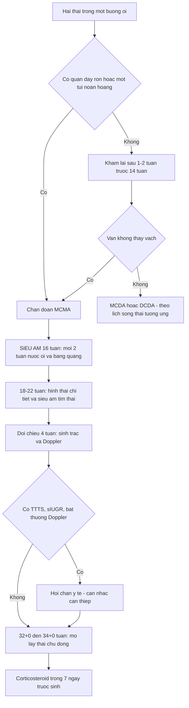
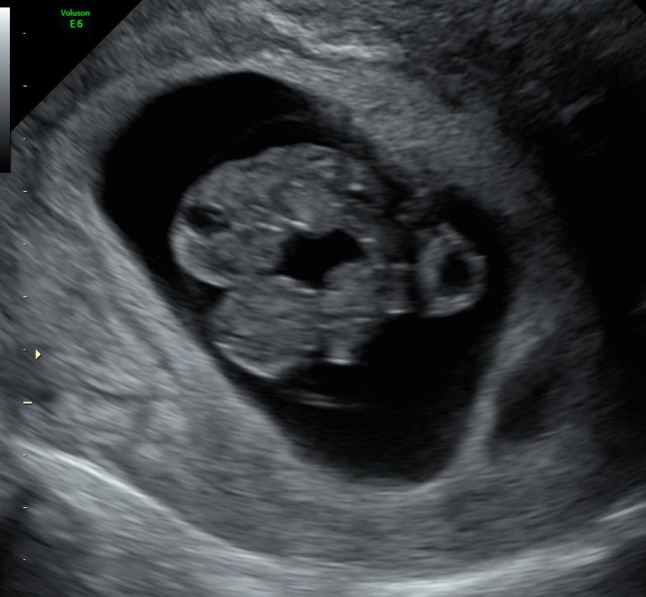
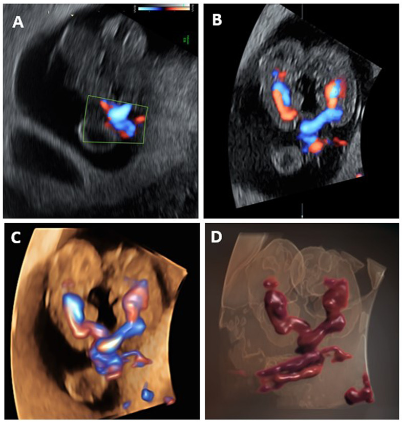
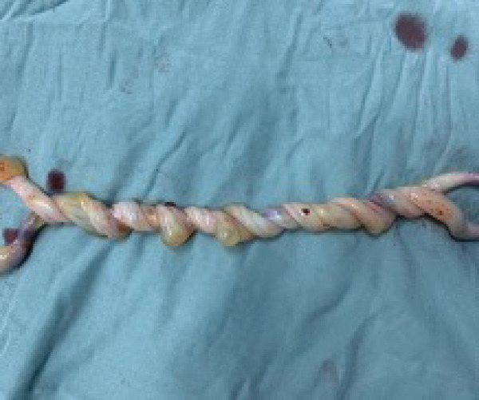
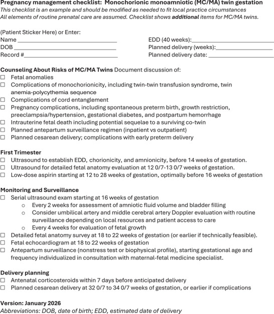

# 586 — Song thai một ối (MCMA): chẩn đoán, quấn dây rốn & thời điểm sinh / Monochorionic monoamniotic twins

**Tags:** `pattern:song-thai-mot-oi` `pattern:quan-day-ron` `vung:thai-nhi` `vung:day-ron` `score:SMFM-2026` `protocol:SA-thai` `protocol:theo-doi-MCMA`
**Mức chắc chắn (certainty):** tổng hợp y văn (literature synthesis) — số liệu lấy từ đoàn hệ Karolinska 22 thai kỳ MCMA (PMC9836963), ca nguyên văn quấn dây 17 vòng (PMC12968075), ca chẩn đoán quấn dây ở 8,5 tuần (PMC11603871) và checklist SMFM 01/2026 (PMC13344341); ảnh minh họa từ bài có bản quyền mở, không phải ca của nhóm.

## 1. Tổng quan bệnh học – cơ chế hình ảnh

### 1.1. Vì sao thành "một ối" — mốc tách phôi quyết định tất cả

- **Định nghĩa:** song thai một ối (monochorionic monoamniotic, MCMA) = **một bánh nhau + một buồng ối**, không có vách ngăn giữa hai thai.
- **Cơ chế:** một trứng thụ tinh tách muộn — khoảng **ngày 8–13 sau thụ tinh** (bài tổng quan ghi 9–13 ngày, ca báo cáo ghi 8–12 ngày; các nguồn lệch nhau ở mốc đầu). Tách **4–8 ngày** → song thai một bánh nhau **hai ối** (MCDA); tách **> 13 ngày** → **dính nhau** (conjoined). Vì vậy MCMA nằm giữa MCDA và thai dính nhau trên cùng một trục thời gian.
- **Dịch tễ:** **8/100.000** thai kỳ; **~1%** tổng số song thai; **~5%** song thai một bánh nhau (PMC11603871).
- **Hệ quả mô học:** màng ối của hai thai nằm chung một khoang, không có lớp đệm (chorion) xen giữa → **không có vách để nhìn**, và **không có hàng rào** ngăn dây rốn hai thai chạm nhau.

### 1.2. TẠI SAO siêu âm "không thấy vách" chưa đủ chẩn đoán — vật lý màng ối

- Vách giữa hai thai trong MCDA chỉ là **hai lớp amnion** áp sát, mỗi lớp rất mỏng (bậc **0,02–0,05 mm**); độ phân giải trục của đầu dò âm đạo tần số cao chỉ đạt ~0,1–0,2 mm và **phụ thuộc góc tới**. Khi tia siêu âm **song song** với mặt vách, vách biến mất khỏi mặt cắt (drop-out) dù vẫn tồn tại.
- Vì vậy **"không thấy vách"** phải được xác nhận bằng **nhiều mặt cắt trực giao + nhiều lần khám**, tốt nhất **trước 14 tuần**; trước **10 tuần** màng còn quá mỏng nên **không được kết luận MCMA chỉ vì không thấy vách**.
- **Một túi noãn hoàng (yolk sac)** hỗ trợ chẩn đoán nhưng **không đáng tin một mình**: hai túi noãn hoàng vẫn gặp ở **tới 1/3** thai MCMA (PMC11603871).
- **Dấu hiệu chắc nhất trong tam cá nguyệt I:** **quấn dây rốn** — chỉ có thể xảy ra khi hai thai ở **cùng một buồng ối**.

### 1.3. TẠI SAO quấn dây rốn gần như luôn có — cơ học, không phải "tai nạn ngẫu nhiên"

- Hai thai chung một khoang ối, cử động tự do quanh nhau → dây rốn **xoắn vào nhau**. Tỷ lệ phát hiện bằng siêu âm **55–100%** (PMC11603871); ca mổ lấy thai ở 32 tuần ghi nhận **17 vòng xoắn** (PMC12968075).
- **Vật lý Doppler giải thích dấu hiệu:** tại điểm hai dây xoắn, hai dòng máu **ngược chiều nhau** nằm sát nhau → trên **power/color Doppler** thấy **hai dòng đỏ–xanh xen kẽ** ("whirlpool"); trên **spectral Doppler** lấy cùng một cửa sổ thu được **hai tần số tim khác nhau** (ca nguyên văn: **162 và 167 bpm**) và **hướng dòng ngược nhau** — đây là bằng chứng chắc chắn của hai tuần hoàn riêng trong một ối.
- **Quấn dây rốn là dấu hiệu nhận diện, không phải chỉ số tiên lượng:** nó có thể **im lặng** suốt thai kỳ hoặc **siết đột ngột** gây suy tuần hoàn cấp; vì vậy theo dõi dựa trên **nguy cơ nền của MCMA**, không dựa trên "mức độ quấn" nhìn thấy.

### 1.4. Ngưỡng định lượng phải nhớ

- **Dị tật bẩm sinh 15–25%**, trong đó **tim chiếm ~1/3** (PMC11603871).
- **TTTS chỉ 2–4%** ở MCMA — thấp hơn nhiều so với MCDA (**> 10%**), và **khó chẩn đoán** vì không có cặp đa ối/thiểu ối điển hình (hai thai chung một ối).
- **Sinh trước 34 tuần: > 55%** (PMC11603871). Đoàn hệ Karolinska: tuổi thai sinh trung bình **32,5 ± 1,5 tuần** (PMC9836963).
- **Thai lưu 30–40%** tính chung; **sau 24 tuần nguy cơ thai lưu 9%** so với **1%** ở song thai hai bánh nhau hai ối — **gấp ~9 lần** (PMC11603871).
- **Khi một thai chết:** **80%** trường hợp chết cả hai; nếu thai còn sống, nguy cơ **tổn thương não nặng 57%** (PMC11603871).
- **Đoàn hệ 22 thai kỳ được quản lý ngoại trú + mổ chủ động 32–34 tuần:** sinh sống **97%** sau 22 tuần, cả hai sống **77%**, sẩy muộn **14%**, không có tử vong sơ sinh, **1** thai lưu đơn thuần (PMC9836963) — cho thấy **theo dõi có hệ thống + sinh chủ động** cải thiện kết cục rất nhiều so với con số 30–70% cũ.

## 2. Mẫu hình + chẩn đoán phân biệt theo vị trí (gamut)

### 2.1. Gamut của "hai thai, KHÔNG thấy vách ngăn"

1. **MCMA thật:** một bánh nhau, một ối, **cùng giới**, không vách; quấn dây rốn; một hoặc hai túi noãn hoàng.
2. **MCDA + một thai thiểu ối nặng ("stuck twin"):** vách bị ép sát vào thai/ thành tử cung nên **không nhìn thấy**, nhưng vẫn tồn tại; thai còn lại thường **đa ối** (dấu hiệu TTTS).
3. **"Giả một ối" mắc phải (pseudomonoamniotic):** vách **đã bị rách** — tự phát hoặc **sau laser TTTS** — hai ối thông nhau, dây rốn có thể quấn. Đây **không phải MCMA bẩm sinh**, nhưng nguy cơ quấn dây tương tự; một nghiên cứu sau laser gọi là **iMAT (iatrogenic monoamniotic twin)** (PMC10614233).
4. **Thai dính nhau (conjoined twins):** không vách + **dính phần cơ thể**, chung tạng; chẩn đoán bằng hình thái, không chỉ bằng "không vách".
5. **Song thai hai bánh nhau hai ối (DCDA) + stuck twin:** hiếm gặp hơn MCDA nhưng cùng cơ chế "vách bị ép"; phân biệt bằng **dấu lambda** ở tam cá nguyệt I.

### 2.2. Gamut biến chứng của MCMA (thứ tự tần suất – mức nguy hiểm)

- **Quấn dây rốn (55–100% phát hiện trên siêu âm):** nguy cơ **suy tuần hoàn cấp**, là nguyên nhân hàng đầu của thai lưu đột ngột.
- **Sinh non (> 55% trước 34 tuần):** do căng tử cung, đa ối, quấn dây, hoặc chỉ định sản khoa.
- **Dị tật bẩm sinh (15–25%):** tim, thành bụng, ống thần kinh; một số dị tật **chỉ phát hiện sau sinh** (đoàn hệ Karolinska: 4/5 ca dị tật phát hiện sau sinh).
- **TTTS (2–4%) và TAPS:** không có cặp đa ối/thiểu ối điển hình → chẩn đoán dựa vào **chênh lệch bàng quang, Doppler, MCA-PSV**.
- **sIUGR / chênh cân nặng:** do chia sẻ bánh nhau không đều.
- **Thai lưu đơn thuần → tổn thương não thai còn lại (57%):** cần **MRI não thai** và tư vấn.

### 2.3. Cách đọc có hệ thống — "nhìn 4 thứ, đừng nhìn 1"

- **(1) Số buồng ối:** hai thai trong **một** khoang, không vách ở mọi mặt cắt trực giao.
- **(2) Số túi noãn hoàng:** một túi gợi ý mạnh, hai túi **không loại trừ**.
- **(3) Dây rốn:** quấn dây, **hai tần số tim** trong cùng cửa sổ Doppler, hai vị trí cắm dây **cách nhau** (ca nguyên văn: **8 mm**).
- **(4) Giới & hình thái:** cùng giới; tìm **dính nhau** và dị tật tim–thành bụng.

## 3. Bảng so sánh phân biệt (ma trận đối chiếu)

| Thực thể (entity) | Hình ảnh điển hình (US) | Chốt vào (rule-in) | Chốt loại (rule-out) | Gợi ý xác nhận |
|---|---|---|---|---|
| **MCMA thật** | Một bánh nhau, **không vách** ở mọi mặt cắt, cùng giới; quấn dây rốn; có thể 1 hoặc 2 túi noãn hoàng | **Quấn dây rốn + hai tần số tim ngược chiều trong một ối**; không vách trước 14 tuần | Thấy **dấu lambda** hoặc vách rõ ở bất kỳ mặt cắt → không phải MCMA | Khám lại 1–2 tuần; Doppler dây rốn; khám sau sinh bánh nhau |
| **MCDA + stuck twin** | Một thai **thiểu ối nặng**, thai kia **đa ối**; vách mờ do bị ép | **Đa ối/thiểu ối lệch + bàng quang một bên căng, một bên không thấy** | Quấn dây rốn **không** gặp trong MCDA (trừ khi vách rách) | Đo DVP, bàng quang, Doppler; theo dõi TTTS |
| **Giả một ối mắc phải (sau laser/vỡ vách)** | Tiền sử **laser TTTS** hoặc thủ thuật; vách không còn; dây quấn | **Tiền sử can thiệp + mất vách đột ngột** trên các lần khám trước đó có vách | Có vách nguyên vẹn ở lần khám trước → không phải bẩm sinh | So phim cũ; theo dõi như MCMA về quấn dây |
| **Thai dính nhau** | Không vách + **dính phần cơ thể**, chung tạng, cùng giới | **Dính da/xương/tạng** thấy rõ; không tách được hai cơ thể | Hai cơ thể tách hoàn toàn → không dính | MRI thai; siêu âm 3D; tư vấn tiên lượng |
| **DCDA + stuck twin** | Vách có thể bị ép mất; **dấu lambda** ở quý I | **Lambda + hai bánh nhau** ở lần khám sớm | Không có lambda, một bánh nhau → nghĩ MC | Khám lại sớm; đếm túi noãn hoàng |

### 3.1. Dấu hiệu chốt trong 3 giây

- **Hai thai + một ối + quấn dây = MCMA** cho tới khi chứng minh ngược lại.
- **Quấn dây một mình không chẩn đoán MCMA** nếu trước đó đã có vách (→ giả một ối mắc phải).
- **Một túi noãn hoàng không phải tiêu chuẩn vàng**; hai túi noãn hoàng không loại trừ MCMA.
- **"Không thấy vách" ở 8 tuần là bình thường** — đừng chốt trước 10–14 tuần.

## 4. Protocol chụp + hệ phân độ/điểm chuẩn hóa

### 4.1. Chẩn đoán & theo dõi theo SMFM 01/2026 (PMC13344341)

| Thời điểm | Việc phải làm | Ngưỡng / chi tiết |
|---|---|---|
| Quý I, **< 14 tuần** | Xác định **số bánh nhau, số ối, số túi noãn hoàng**, giới | Nếu chưa rõ → **khám lại sau 1–2 tuần**, chốt trước 14 tuần |
| **12–13+6 tuần** | Siêu âm hình thái sớm | Đo CRL, NT, tìm dị tật lớn |
| **18–22 tuần** | Hình thái chi tiết + **siêu âm tim thai** | Bắt buộc vì dị tật tim ~1/3 |
| **Từ 16 tuần** | Siêu âm **mỗi 2 tuần**: nước ối (AFV/DVP), bàng quang | Phát hiện TTTS/TAPS dù không có cặp đa–thiểu ối điển hình |
| **Mỗi 4 tuần** | Đo sinh trắc, ước cân nặng, Doppler rốn/MCA khi cần | Phát hiện sIUGR, chênh cân nặng |
| **12–28 tuần** | **Aspirin liều thấp** (thường 81 mg), tốt nhất **< 16 tuần** | Giảm tiền sản giật; không phải để điều trị TTTS |
| **Trước sinh 7 ngày** | **Corticosteroid** | SMFM: dùng **trong vòng 7 ngày trước sinh dự kiến** |
| **32+0 – 34+0 tuần** | **Mổ lấy thai chủ động** | Ngưỡng SMFM 2026; đoàn hệ Karolinska sinh trung bình 32,5 tuần |

- **Nội trú hay ngoại trú?** Không có RCT đủ mạnh. Phân tích gộp của Saccone gợi ý nội trú có thể giảm thai lưu nhưng **không kết luận**; đoàn hệ Karolinska quản lý **ngoại trú** vẫn đạt sinh sống **97%** sau 22 tuần. Quyết định theo **khả năng tiếp cận theo dõi** và nguy cơ cá nhân.
- **Theo dõi tim thai:** từ khi thai đủ lớn, **NST/CTG** theo lịch; tăng tần suất khi có quấn dây dày, đa ối, hoặc mẹ giảm cử động thai.
- **Corticosteroid + magnesium sulfate** khi có nguy cơ sinh **< 32 tuần** (bảo vệ thần kinh thai).

### 4.2. Flowchart quản lý MCMA

> Ghi chú: MCMA **không có hệ RADS riêng**; bảng trên là khuyến cáo SMFM 01/2026, đối chiếu đoàn hệ Karolinska và tổng quan BMC 2024.

## 5. Biến thể bình thường và cạm bẫy

- **Vách "biến mất" do góc tới:** luôn quét **hai mặt phẳng trực giao**, đổi tư thế mẹ, khám lại — đừng chốt MCMA trên một mặt cắt.
- **Hai túi noãn hoàng ở MCMA (tới 1/3):** đây là **biến thể**, không phải bằng chứng loại trừ.
- **Chẩn đoán quá sớm (< 10 tuần):** màng ối quá mỏng; dễ nhầm MCDA thành MCMA → hậu quả là theo dõi quá mức, mổ quá sớm.
- **Nhầm "giả một ối" sau laser thành MCMA bẩm sinh:** tiền sử thủ thuật là chìa khóa; quản lý giống nhau về quấn dây nhưng **khác về nguy cơ PPROM, chorioamnionitis**.
- **Đánh giá "mức độ quấn" để quyết định sinh:** không có ngưỡng số vòng; **17 vòng vẫn sống tốt** (PMC12968075), trong khi quấn ít có thể siết cấp. Không dùng số vòng làm chỉ định sinh.
- **Bỏ sót TTTS vì "không có đa ối/thiểu ối":** ở MCMA, TTTS biểu hiện bằng **chênh bàng quang, chênh Doppler, MCA-PSV**, không phải cặp DVP kinh điển.
- **Thai lưu một bên:** nguy cơ **tổn thương não thai còn lại 57%** → **MRI não thai** và tư vấn, không chỉ theo dõi tim thai.
- **Mổ lấy thai không loại bỏ mọi nguy cơ:** thai lưu có thể xảy ra **trước mổ**; vì vậy theo dõi vẫn là trụ cột.

## 6. Tự lượng giá — Blind Quiz

**Ca 1 — Thai 8,5 tuần, hai thai trong một buồng ối, chỉ thấy một túi noãn hoàng. Đọc ảnh trước, mô tả sau.**

- Gợi ý lâm sàng: thai kỳ sau chuyển phôi, khám vì đau nhẹ; không ra máu.
- Câu hỏi: (1) Có thể chốt MCMA ngay không? (2) Một túi noãn hoàng có đủ không? (3) Cần làm gì tiếp theo?

<b>Bấm để hiện đáp án (findings + chẩn đoán)</b>

- **Findings:** hai phôi trong **một khoang ối**, **một túi noãn hoàng**; CRL 20 và 21 mm (tương ứng 8,4 và 8,5 tuần).
- **Chẩn đoán:** **nghi MCMA** — nhưng ở 8,5 tuần **chưa đủ chốt** vì màng ối rất mỏng; cần **quấn dây rốn** hoặc khám lại sau 1–2 tuần.
- **Không** dùng một túi noãn hoàng làm tiêu chuẩn duy nhất: hai túi noãn hoàng vẫn gặp ở tới **1/3** MCMA.
- Nguồn ảnh: Liberty G et al., *BMC Pregnancy Childbirth* 2024 (PMC11603871), CC BY-NC-ND 4.0 — giữ nguyên, không cắt/ghép.

**Ca 2 — Cùng thai kỳ, bật power Doppler tại điểm hai dây rốn gặp nhau.**

- Câu hỏi: Dấu hiệu nào chứng minh **hai tuần hoàn riêng**? Spectral Doppler sẽ thấy gì?

<b>Bấm để hiện đáp án</b>

- **Findings:** power Doppler 2D/3D cho thấy **điểm quấn** và hai dòng chảy **ngược chiều**; 3D HD hiển thị hai vòng tuần hoàn riêng.
- **Spectral Doppler:** hai **tần số tim khác nhau** (162 và 167 bpm trong ca này) và **hướng dòng ngược nhau** tại cùng cửa sổ — bằng chứng chắc chắn của hai thai trong một ối.
- **Ý nghĩa:** quấn dây rốn **xác nhận amnionicity một ối**, nhưng **không dự báo** mức độ nguy hiểm.
- Nguồn ảnh: Liberty G et al., *BMC Pregnancy Childbirth* 2024 (PMC11603871), CC BY-NC-ND 4.0 — giữ nguyên, không cắt/ghép.

**Ca 3 — Mổ lấy thai 32 tuần vì MCMA; bánh nhau và dây rốn sau sinh.**

- Gợi ý lâm sàng: thai kỳ MCMA, theo dõi ngoại trú đến 31 tuần rồi nhập viện; NST hằng ngày bình thường.
- Câu hỏi: (1) Đây là tổn thương gì? (2) Có phải nguyên nhân tử vong không? (3) Bài học quản lý?

<b>Bấm để hiện đáp án</b>

- **Findings:** hai dây rốn **xoắn chặt vào nhau**, đếm được **17 vòng**; không có nút thắt thật, không huyết khối đại thể.
- **Chẩn đoán:** **quấn dây rốn (umbilical cord entanglement)** — gần như phổ biến ở MCMA; đây là **dấu hiệu của một ối**, không phải chỉ số tiên lượng.
- **Kết cục ca này:** hai bé sống, Apgar 8/9, chỉ cần CPAP ngắn — cho thấy **số vòng không quyết định kết cục**.
- **Bài học:** theo dõi sát + **sinh chủ động 32–34 tuần**; không dùng "mức độ quấn" để quyết định mổ sớm hơn.
- Nguồn ảnh: Alagha M et al., *Case Rep Obstet Gynecol* 2026 (PMC12968075), CC BY 4.0.

**Ca 4 — Đọc checklist quản lý MCMA của SMFM 01/2026.**

- Câu hỏi: Lịch siêu âm nào bắt buộc? Khi nào dùng corticosteroid? Mổ lấy thai ở tuổi thai nào?

<b>Bấm để hiện đáp án</b>

- **Theo dõi:** siêu âm **từ 16 tuần, mỗi 2 tuần** (nước ối, bàng quang); **mỗi 4 tuần** đánh giá sinh trắc; hình thái chi tiết **18–22 tuần**; **siêu âm tim thai 18–22 tuần**.
- **Aspirin liều thấp 12–28 tuần**, tốt nhất trước 16 tuần.
- **Corticosteroid trong vòng 7 ngày trước sinh dự kiến**; **mổ lấy thai 32+0 – 34+0 tuần**.
- **Lưu ý:** checklist ghi rõ đây là **mẫu để chỉnh theo thực hành địa phương**, không phải phác đồ cứng.
- Nguồn ảnh: SMFM (Yao R et al.), *Pregnancy* 2026 (PMC13344341), CC BY-NC 4.0.

## Bài liên quan chéo
- [500 – Tổng quan Hệ Vú & Sản Phụ khoa](../500-tong-quan-vu-san-phu-khoa/lesson.md)
- [566 – Song thai: chorionicity, TTTS & TAPS](../566-song-thai-chorionicity-TTTS-TAPS/lesson.md) (nền tảng MC/DC, Quintero, TAPS)
- [569 – Sinh non ở song thai: sàng lọc cổ tử cung & dự phòng](../569-sinh-non-song-thai/lesson.md) (ngưỡng CL, progesterone, bán khâu)
- [568 – TRAP & thai acardiac](../568-trap-song-thai-acardiac/lesson.md) (song thai MC nguy cơ cao khác)
- [573 – Hở cổ tử cung & bán khâu](../573-ho-co-tu-cung-ban-khau/lesson.md)
- [565 – Sàng lọc hình thái thai & Doppler sản khoa](../565-sang-loc-hinh-thai-va-doppler-san-khoa/lesson.md)

> Không dùng để chẩn đoán độc lập khi chưa có người hướng dẫn.
