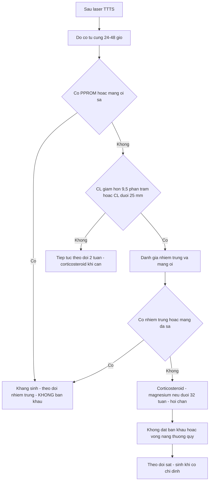
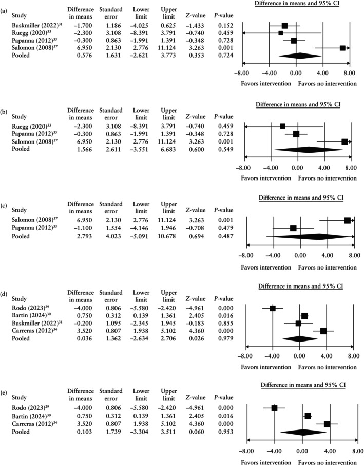
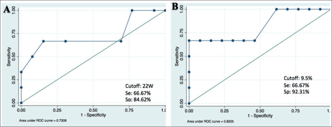

# 587 — Dự phòng sinh non sau laser TTTS: bán khâu, vòng nang, progesterone & theo dõi cổ tử cung / Preterm birth prevention after fetoscopic laser for TTTS

**Tags:** `pattern:sinh-non-sau-laser` `pattern:co-tu-cung-ngan` `vung:co-tu-cung` `vung:thai-nhi` `score:CL-25mm` `protocol:FLS-theo-doi` `protocol:cerclage-pessary`
**Mức chắc chắn (certainty):** tổng hợp y văn (literature synthesis) — số liệu chính từ phân tích gộp 10 nghiên cứu/1.159 thai kỳ (PMC12209700, GRADE rất thấp), đoàn hệ Hà Nội 21 ca sau laser (PMC11813210), và bối cảnh song thai từ PMC11019523; ảnh minh họa từ bài có bản quyền mở, không phải ca của nhóm.

## 1. Tổng quan bệnh học – cơ chế hình ảnh

### 1.1. Vì sao sau laser TTTS vẫn sinh non — ba cơ chế chồng lên nhau

1. **Căng quá mức tử cung (uterine overdistension):** TTTS có **đa ối** ở thai nhận; dù laser làm giảm tuần hoàn bất thường, **thể tích ối và tử cung căng** vẫn tồn tại một thời gian → cổ tử cung ngắn lại và chuyển dạ sớm.
2. **Tổn thương cơ học do fetoscopy (iatrogenic):** trocar/ống soi **xuyên qua màng ối** tạo **khiếm khuyết màng** — cửa vào của **PPROM** và **nhiễm trùng ối**. Đây là lý do sinh non sau laser **không giống** sinh non ở song thai thông thường.
3. **Viêm – nhiễm trùng dưới lâm sàng:** phản ứng viêm tại chỗ sau thủ thuật, chorioamnionitis, **tách màng ối (chorioamniotic separation)** làm màng yếu và dễ vỡ.

- **Hệ quả lâm sàng:** can thiệp "chuẩn" của sinh non (bán khâu, vòng nang, progesterone) nhắm vào **cổ tử cung** — nhưng ở đây ổ bệnh chính có thể nằm ở **màng ối/tử cung căng**, nên hiệu quả bị pha loãng.

### 1.2. Ngưỡng định lượng phải nhớ

- **Song thai nói chung:** sinh < 37 tuần **tới 50%**; < 34 tuần **~20%**; < 32 tuần **~10%** (PMC12209700).
- **Sau laser TTTS (đoàn hệ Hà Nội, 21 ca laser chọn lọc dây rốn — selective laser umbilical cord coagulation):** sinh non **52,6%**; **31,6% < 34 tuần**; tuổi thai sinh trung bình **34,7 ± 4,3 tuần**; thời gian giữ thai sau mổ trung bình **12,97 tuần** (PMC11813210). *Lưu ý phản biện: kỹ thuật này khác FLS tiêu chuẩn (đốt toàn bộ miệng nối), nên số liệu dự báo chỉ mang tính tham chiếu.*
- **Hai yếu tố dự báo mạnh sau laser:**
  - **Cổ tử cung giảm > 9,5% trong 48 giờ sau mổ** → nguy cơ sinh non tăng **8,7 lần** (p = 0,006).
  - **Mổ khi thai > 22 tuần** → nguy cơ sinh non tăng **4,3 lần** (p = 0,025).
- **Bằng chứng can thiệp:** 10 nghiên cứu, **1.159** thai kỳ MCDA có TTTS đã laser; chỉ **1 RCT**; chất lượng bằng chứng **GRADE rất thấp** (PMC12209700).

### 1.3. TẠI SAO bán khâu/vòng nang thất bại — đọc đúng con số

- **Bán khâu (cerclage)** so với không can thiệp, chênh tuổi thai sinh (mean difference, tuần):
  - CL < 30 mm: **+0,58 tuần** (KTC 95% **−2,62 đến 3,73**).
  - CL < 25 mm: **+1,57 tuần** (**−3,55 đến 6,68**).
  - CL < 20 mm: **+2,08 tuần** (**−2,63 đến 6,79**).
  - CL < 15 mm: **+2,79 tuần** (**−5,09 đến 10,68**).
  → **Không có mốc nào đạt ý nghĩa thống kê**; khoảng tin cậy rất rộng vì cỡ mẫu nhỏ.
- **Vòng nang (pessary):** CL < 30 mm **+0,04 tuần** (−2,63 đến 2,71); CL < 25 mm **+0,10 tuần** (−3,30 đến 3,51) — **không khác biệt**.
- **Nghịch lý cần phản biện:** ở nhóm **CL < 30 mm**, bán khâu có **nguy cơ sinh < 32 tuần CAO hơn** (OR **5,20**; 2,17–12,46) và **< 28 tuần** (OR **3,48**; 1,74–6,99). Đây gần như chắc chắn là **confounding by indication** (bán khâu được đặt cho những cổ tử cung xấu nhất, màng đã bong, hoặc sau PPROM) — **không được đọc là "bán khâu gây sinh non"**.

## 2. Mẫu hình + chẩn đoán phân biệt theo vị trí (gamut)

### 2.1. Gamut nguyên nhân sinh non SAU laser (theo thứ tự cần loại trừ)

1. **PPROM do thủ thuật (iatrogenic PPROM):** rỉ ối sớm sau mổ, thường liên quan **vị trí trocar**; màng vỡ không tự liền.
2. **PPROM tự phát / vỡ ối non:** có thể do nhiễm trùng, đa ối, hoặc màng mỏng đi sau can thiệp.
3. **Chuyển dạ sinh non do căng tử cung:** tử cung còn đa ối, cổ tử cung ngắn dần, cơn co xuất hiện.
4. **Nhiễm trùng ối (chorioamnionitis):** sốt, đau tử cung, dịch ối hôi; nguy cơ cao hơn khi thủ thuật kéo dài/nhiều lần chọc.
5. **Hở cổ tử cung / cổ tử cung ngắn:** có thể **có từ trước** hoặc **mới xuất hiện sau laser**; là yếu tố dự báo, không nhất thiết là nguyên nhân.
6. **Tách màng ối (chorioamniotic separation):** màng bong khỏi thành tử cung sau thủ thuật → dễ vỡ, dễ nhiễm trùng.
7. **Chỉ định sinh vì thai:** TTTS tái phát, thai lưu một bên, Doppler rốn bất thường, thai chậm phát triển nặng.

### 2.2. Mẫu hình "cổ tử cung sau laser" — đọc động học, không đọc một lần

- **Đo CL ngay trước laser** (nền), **24–48 giờ sau laser**, rồi **mỗi 2 tuần** đến 28–32 tuần.
- **Dấu hiệu nguy cơ:** CL giảm **> 9,5% trong 48 giờ**; CL < 25 mm; phễu hóa (funneling); màng ối lồi qua lỗ trong.
- **Phân biệt với "cổ tử cung ngắn do co":** đo lại khi hết cơn co, bàng quang trống, cùng một người đo nếu có thể.

## 3. Bảng so sánh phân biệt (ma trận đối chiếu)

> Bảng so sánh **chiến lược dự phòng sinh non sau laser** (không phải bệnh lý) — cột Chốt vào/Chốt loại là **chỉ định và phản chỉ định** theo bằng chứng hiện có.

| Chiến lược (strategy) | Cơ chế nhắm tới | Chốt vào (rule-in) | Chốt loại (rule-out) | Gợi ý xác nhận |
|---|---|---|---|---|
| **Bán khâu (cerclage)** | Cơ học: giữ cổ tử cung | Chỉ **cá thể hóa**: cổ tử cung rất ngắn + tiền sử sinh non + không nhiễm trùng, sau khi hội chẩn | **Không** đặt thường quy sau laser; **không** đặt khi màng ối sa/nhiễm trùng/PPROM | Phân tích gộp: **không tăng tuổi thai** ở mọi ngưỡng CL (GRADE rất thấp) |
| **Vòng nang (pessary)** | Phân bố lực, giữ cổ tử cung | Chỉ trong nghiên cứu/đồng thuận địa phương | **Không** dùng thường quy sau laser | RCT Rodo 2023 (137 ca) **dừng vì vô ích**; gộp **+0,04 tuần** |
| **Progesterone âm đạo** | Giảm co, giữ cổ tử cung | Cân nhắc khi CL ngắn **và** chưa có bằng chứng tốt hơn | **Không** xem là chuẩn sau laser | **Không gộp được** dữ liệu; nghiên cứu duy nhất **không có lợi** |
| **Indomethacin / giảm gò** | Giảm cơn co, hoãn sinh ngắn hạn | Cân nhắc **cơn co cấp** trong lúc chờ steroid | **Không** dùng dài hạn (nguy cơ thiểu ối, đóng ống động mạch thai) | Chỉ **1 nghiên cứu 411 ca** (Mustafa 2022); **không gộp** |
| **Theo dõi + corticosteroid + sinh đúng lúc** | Tối ưu trưởng thành phổi, tránh sinh quá sớm | **Mọi** thai sau laser có nguy cơ sinh non | Không thay thế bằng can thiệp cổ tử cung khi chưa có bằng chứng | Steroid **24+0–33+6 tuần**; magnesium **< 32 tuần** |

### 3.1. Dấu hiệu chốt trong 3 giây

- **Sau laser, cổ tử cung ngắn KHÔNG đồng nghĩa phải đặt bán khâu** — bằng chứng không ủng hộ.
- **Đo CL 24–48 giờ sau mổ** quan trọng hơn một lần đo trước mổ: **giảm > 9,5%** là dấu hiệu nguy cơ.
- **Ưu tiên corticosteroid + theo dõi sát** hơn can thiệp cổ tử cung không bằng chứng.
- **Nghịch lý OR 5,20** là do **chỉ định**, không phải do bán khâu gây hại.

## 4. Protocol chụp + hệ phân độ/điểm chuẩn hóa

### 4.1. Trước laser

- **Siêu âm xác định TTTS** (Quintero), đo **DVP, bàng quang, Doppler rốn/MCA/ống tĩnh mạch**, **đo CL qua ngã âm đạo**.
- **Loại trừ nhiễm trùng** trước thủ thuật (CRP, bạch cầu, cấy âm đạo/cổ tử cung khi có triệu chứng).
- **Tư vấn:** nguy cơ sinh non sau laser **cao**; giải thích rằng can thiệp cổ tử cung **chưa có bằng chứng**.
- **Kỹ thuật:** trocar nhỏ, vào qua thành bụng **tránh mạch máu bánh nhau**, đốt **toàn bộ miệng nối**, **giảm ối** đủ để giảm căng nhưng tránh màng tách quá mức.

### 4.2. Sau laser — lịch theo dõi đề nghị

| Thời điểm | Việc làm | Ngưỡng / ghi chú |
|---|---|---|
| **24–48 giờ** | Đo CL, siêu âm kiểm tra dịch ối, tim thai, màng ối | **CL giảm > 9,5%** = nguy cơ cao |
| **1 tuần** | Siêu âm + CL nếu lần đầu bất thường | Tìm PPROM, tách màng, chorioamnionitis |
| **Mỗi 2 tuần đến 28–32 tuần** | CL + sinh trắc + Doppler | Không có ngưỡng can thiệp được chứng minh; dùng để **tư vấn và chuyển tuyến** |
| **24+0–33+6 tuần** | **Corticosteroid** khi nguy cơ sinh trong 7 ngày | Betamethasone 12 mg × 2 liều cách 24 giờ, hoặc dexamethasone 6 mg × 4 liều cách 12 giờ |
| **< 32 tuần** | **Magnesium sulfate** bảo vệ thần kinh thai | Khi có nguy cơ sinh trong 24 giờ |
| **Khi PPROM** | Kháng sinh phổ rộng (latency), theo dõi nhiễm trùng | **Không đặt bán khâu** khi đã có PPROM/màng sa |
| **≥ 34 tuần** | Cân nhắc sinh nếu có chỉ định sản khoa | Không kéo dài khi có chorioamnionitis |

### 4.3. Flowchart quyết định sau laser

> Ghi chú: **không có hệ RADS** cho tình huống này; flowchart tổng hợp từ PMC12209700 (bằng chứng can thiệp), PMC11813210 (yếu tố dự báo) và thực hành corticosteroid/magnesium chuẩn.

## 5. Biến thể bình thường và cạm bẫy

- **Confounding by indication:** nhóm được đặt bán khâu là nhóm **cổ tử cung xấu nhất** → OR sinh non cao **không** chứng minh bán khâu có hại. Muốn đánh giá đúng phải **RCT**.
- **Chỉ có 1 RCT (Rodo 2023, 137 ca) và dừng vì vô ích**, không phải vì tai biến — đừng trích dẫn thành "pessary gây hại".
- **Cỡ mẫu nhỏ ở nhóm CL < 15 mm:** 58 ca có bán khâu so với 27 ca không — khoảng tin cậy −5 đến +10 tuần, **không thể kết luận**.
- **Progesterone không gộp được:** đừng suy từ đơn thai/ song thai không laser sang nhóm sau laser.
- **Indomethacin:** chỉ 1 nghiên cứu, không gộp; **không dùng dài hạn** vì nguy cơ thiểu ối và đóng sớm ống động mạch.
- **Nhầm tách màng ối với PPROM:** tách màng (chorioamniotic separation) có thể **không rỉ ối** nhưng vẫn tăng nguy cơ; PPROM cần xác nhận bằng dịch ối/ferning/IGFBP-1.
- **Đo CL sau mổ khi màng đang tách:** kết quả có thể **giả ngắn/giả dài** do màng và dịch; đọc cùng hình ảnh, không chỉ số.
- **Áp ngưỡng CL 25 mm của song thai thường (bài 569) vào sau laser:** ngưỡng này **chưa được chứng minh** trong nhóm sau laser — dùng để tư vấn, không để đặt bán khâu mặc định.

## 6. Tự lượng giá — Blind Quiz

**Ca 1 — Đọc biểu đồ rừng: bán khâu và vòng nang sau laser. Đọc trước, kết luận sau.**

- Câu hỏi: (1) Pooled mean difference ở CL < 30 mm là bao nhiêu? (2) Có nhóm nào đạt ý nghĩa? (3) Vì sao khoảng tin cậy rộng?

<b>Bấm để hiện đáp án (findings + kết luận)</b>

- **Findings:** bán khâu CL < 30 mm **+0,58 tuần** (−2,62 đến 3,73); CL < 25 mm **+1,57** (−3,55 đến 6,68); CL < 15 mm **+2,79** (−5,09 đến 10,68). Vòng nang CL < 30 mm **+0,04** (−2,63 đến 2,71); CL < 25 mm **+0,10** (−3,30 đến 3,51).
- **Kết luận:** **không chiến lược nào tăng tuổi thai sinh có ý nghĩa**; bằng chứng **GRADE rất thấp**.
- **Vì sao KTC rộng:** cỡ mẫu nhỏ, ít nghiên cứu, thiếu nhóm chứng trong nhiều bài → ước lượng không chính xác.
- Nguồn ảnh: Eltaweel N et al., *Ultrasound Obstet Gynecol* 2025 (PMC12209700), CC BY 4.0.

**Ca 2 — Ca sau laser: dự báo sinh non bằng thay đổi cổ tử cung. Đọc ROC.**

- Gợi ý lâm sàng: TTTS giai đoạn III–IV, laser ở 16–26 tuần; theo dõi CL trước và sau mổ.
- Câu hỏi: (1) Hai yếu tố nào vào mô hình? (2) Ngưỡng nào có ý nghĩa? (3) Ứng dụng thực hành?

<b>Bấm để hiện đáp án</b>

- **Findings:** mô hình gồm **tuổi thai lúc mổ** (A) và **mức giảm CL trong 48 giờ** (B). Mổ **> 22 tuần** → **Se 66,67%, Sp 84,62%, AUC 0,7308**; **CL giảm > 9,5%** → **Se 66,67%, Sp 92,31%, AUC 0,8205**. Trên phân tích nguy cơ: mổ > 22 tuần **tăng 4,3 lần** (p = 0,025); CL giảm > 9,5% **tăng 8,7 lần** (p = 0,006).
- **Kết cục đoàn hệ:** sinh non **52,6%**, **31,6% < 34 tuần**, tuổi thai sinh trung bình **34,7 ± 4,3 tuần**.
- **Ứng dụng:** đo CL **trước và 24–48 giờ sau laser**; nếu giảm > 9,5% → **theo dõi sát, tư vấn, chuyển tuyến**; **không** tự động đặt bán khâu vì bằng chứng can thiệp chưa có.
- **Phản biện:** đoàn hệ 21 ca, một trung tâm, **kỹ thuật laser chọn lọc dây rốn** (khác FLS tiêu chuẩn), không có nhóm chứng can thiệp — **dự báo tốt hơn điều trị**.
- Nguồn ảnh: Dat DT et al., *Med Arch* 2024 (PMC11813210), CC BY-NC 4.0.

**Ca 3 — Thai 26 tuần sau laser 5 ngày, CL 18 mm, không co, không rỉ ối. Xử trí?**

- Câu hỏi: (1) Có đặt bán khâu không? (2) Cần làm gì trước khi quyết định? (3) Tư vấn gì cho gia đình?

<b>Bấm để hiện đáp án</b>

- **Không đặt bán khâu thường quy:** phân tích gộp **không** cho thấy tăng tuổi thai; đặt trong bối cảnh màng đã tổn thương có thể **tăng nhiễm trùng**.
- **Việc cần làm:** loại trừ **nhiễm trùng ối/PPROM** (khám, CRP/bạch cầu, cấy, xét nghiệm dịch ối nếu rỉ), **đo lại CL**, đánh giá **tách màng ối**, tim thai, Doppler.
- **Tư vấn:** nguy cơ sinh non cao; **corticosteroid** nếu nguy cơ sinh trong 7 ngày; **magnesium** nếu < 32 tuần; theo dõi sát và **hội chẩn bào thai–sơ sinh**.
- **Không hứa** rằng can thiệp cổ tử cung sẽ kéo dài thai kỳ — bằng chứng hiện tại **không ủng hộ**.

## Bài liên quan chéo
- [500 – Tổng quan Hệ Vú & Sản Phụ khoa](../500-tong-quan-vu-san-phu-khoa/lesson.md)
- [566 – Song thai: chorionicity, TTTS & TAPS](../566-song-thai-chorionicity-TTTS-TAPS/lesson.md) (chẩn đoán TTTS, Quintero, chỉ định laser)
- [569 – Sinh non ở song thai: sàng lọc cổ tử cung & dự phòng](../569-sinh-non-song-thai/lesson.md) (ngưỡng CL 25 mm, progesterone, bán khâu, vòng nang)
- [586 – Song thai một ối: chẩn đoán, quấn dây rốn & thời điểm sinh](../586-song-thai-mot-oi-MCMA/lesson.md) (theo dõi song thai MC nguy cơ cao)
- [573 – Hở cổ tử cung & bán khâu](../573-ho-co-tu-cung-ban-khau/lesson.md) (kỹ thuật, chỉ định, biến chứng)
- [568 – TRAP & thai acardiac](../568-trap-song-thai-acardiac/lesson.md) (can thiệp bào thai khác)

> Không dùng để chẩn đoán độc lập khi chưa có người hướng dẫn.
