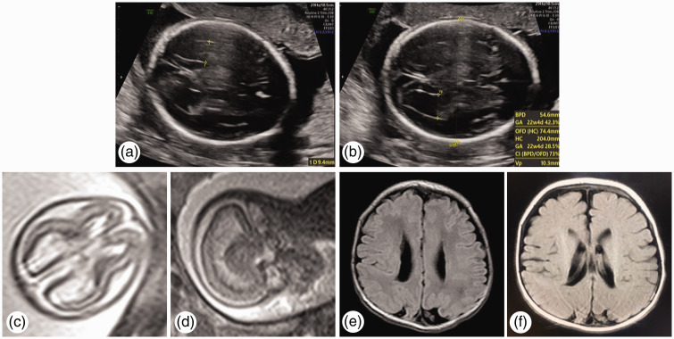
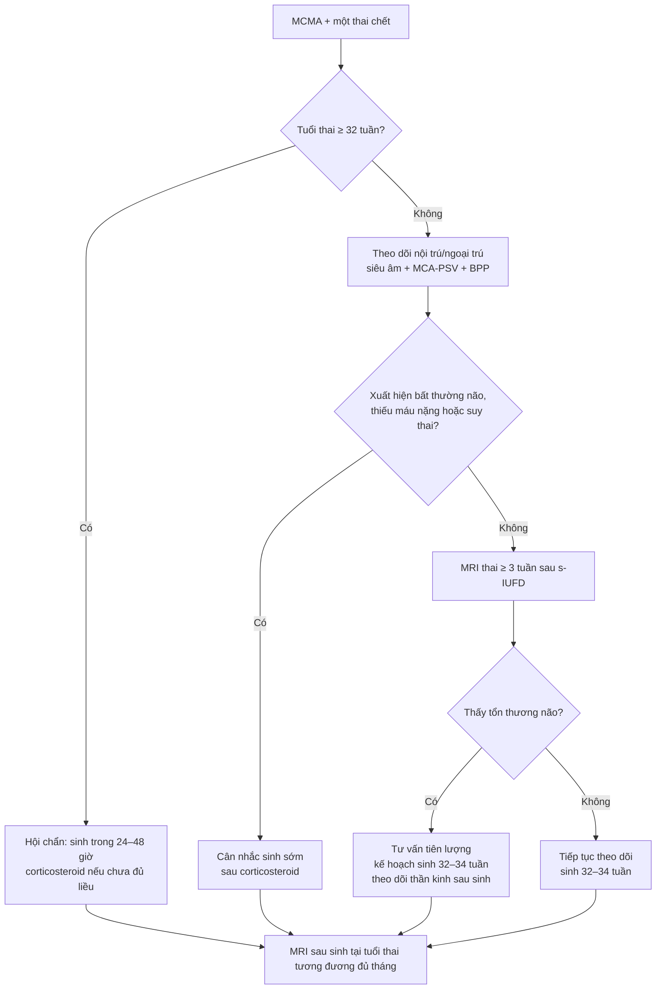
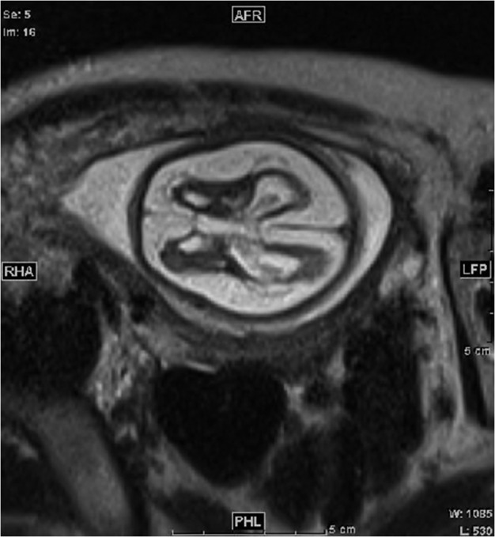
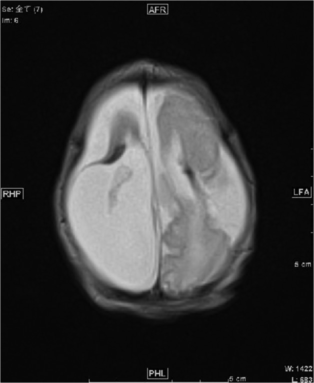

# 588 — Một thai chết trong song thai một ối (MCMA): tổn thương não–thận thai còn lại & theo dõi / Single intrauterine fetal demise in monoamniotic twins

**Tags:** `pattern:song-thai-mot-oi` `pattern:single-IUFD` `pattern:ton-thuong-nao-thai` `vung:thai-nhi` `vung:nao-thai` `vung:than-thai` `protocol:MRI-thai` `protocol:SA-Doppler-MCA` `score:ventriculomegaly`
**Mức chắc chắn (certainty):** tổng hợp y văn (literature synthesis) — số liệu từ đoàn hệ 68 thai kỳ một bánh nhau có một thai chết (PMC10378013), đoàn hệ 90 thai kỳ (PMC12598004), khuyến cáo SMFM 01/2026 (PMC13344341) và ACOG/SMFM (tổng hợp trong PMC12255925); **ca nguyên văn** dùng cho quiz: PMC12378532 (Zhang L et al., 2025) và PMC5241712 (Machino H et al., 2017) — ảnh lấy từ chính các ca này, không phải ca của nhóm biên soạn.

## 1. Tổng quan bệnh học – cơ chế hình ảnh

### 1.1. Chuyện gì xảy ra trong 60 giây "thai kia ngừng tim"

- **Song thai một ối (monochorionic monoamniotic, MCMA)** chiếm **~3% song thai một bánh nhau** và **~0,02% tất cả thai kỳ** (SMFM 01/2026, PMC13344341). Hai thai nằm **cùng một buồng ối**, gần như luôn **quấn dây rốn** — đây là lý do tử vong chu sinh cao.
- Khi **một thai chết (single intrauterine fetal demise, s-IUFD)**, huyết áp trong tuần hoàn thai chết **tụt về 0**. Hai tuần hoàn vẫn nối với nhau qua **nối động mạch–động mạch (arterio-arterial)** và **tĩnh mạch–tĩnh mạch (veno-venous)** trên bánh nhau chung. Chênh áp đột ngột khiến **thai còn lại truyền máu ồ ạt sang thai đã chết** (feto-fetal hemorrhage) → **giảm thể tích, tụt huyết áp, thiếu máu cấp**.
- **TẠI SAO não tổn thương chứ không chỉ "thiếu máu"?** Tụt huyết áp làm giảm tưới máu não → **thiếu máu–thiếu oxy (ischemic-hypoxic)** ở vùng phân thủy (watershed): chất trắng quanh não thất, hạch nền, vỏ não. Sau khi huyết áp hồi phục, **tái tưới máu (reperfusion)** gây stress oxy hóa, phù và chết tế bào lan rộng. Tổn thương **xảy ra ngay lúc thai kia chết**, không phải vài tuần sau — nên thời điểm chụp quyết định thấy được hay không.
- **TẠI SAO thận cũng tổn thương?** Thận thai là cơ quan "nhạy huyết áp": giảm tưới máu → **hoại tử vỏ thận (renal cortical necrosis)** → thận không phát triển → **thiểu sản thận (renal hypoplasia)** và **thiểu ối**. Ca nguyên văn PMC5241712 ghi nhận AFI **1,8 cm** lúc 26 tuần, sau đó **tăng lại 15 cm** lúc 34 tuần — nghĩa là thiểu ối do thận **có thể hồi phục một phần**, đừng vội kết luận "thận hỏng vĩnh viễn".
- **TẠI SAO phổi bị ảnh hưởng?** Thiếu máu–thiếu oxy cấp + hít sặc + viêm tại chỗ có thể gây tổn thương phổi kéo dài ở trẻ sơ sinh (ca PMC12378532: trẻ khó thở, tổn thương phổi viêm kéo dài, xuất viện ngày thứ 10).
- **Mẹ cũng có nguy cơ:** mô thai chết giải phóng **thromboplastin** → **đông máu nội mạch rải rác (DIC)** ở mẹ và thai còn lại; kèm nguy cơ **tiền sản giật, nhiễm trùng, băng huyết sau sinh**. Ca PMC12108043 ghi nhận **D-dimer mẹ tăng tới 9,2 µg/mL** sau khi một thai chết.

### 1.2. Vì sao hình ảnh não thay đổi theo thời gian (vật lý T1/T2/DWI)

- **0–72 giờ:** phù tế bào (cytotoxic edema) → **DWI sáng, ADC tối**; T2 có thể **còn bình thường**. Chụp quá sớm dễ **âm tính giả**.
- **3–7 ngày:** phù lan rộng → **T2/FLAIR tăng tín hiệu**, mất phân biệt xám–trắng, não thất có thể bắt đầu giãn.
- **2–6 tuần:** mô hoại tử được thay bằng dịch → **hang hóa/nang hóa (encephalomalacia)**, **giãn não thất do mất mô (ex vacuo)**, **teo vỏ não**, **mỏng thể chai** do thoái hóa Waller (Wallerian degeneration).
- **TẠI SAO T2 HASTE là chuỗi xung chủ lực ở thai:** HASTE/SSFSE thu ảnh **cực nhanh (~1–2 giây/lát)**, "đóng băng" chuyển động thai; dịch não tủy **rất sáng trên T2** nên dễ đo não thất, thấy nang hóa và mất nhu mô. Lát **3–4 mm** đủ để thấy tổn thương > 2–3 mm.
- **TẠI SAO DWI có ích dù không thấy tổn thương rõ:** nghiên cứu 43 thai còn lại sau s-IUFD cho thấy **ADC giảm ở chất trắng trán–đỉnh–thái dương và tiểu não hai bên** so với song thai khỏe và thai đơn (PMC11877868) — tức là **vi tổn thương cấu trúc** có thể xuất hiện trước khi có bất thường thấy được trên T2.
- **Xuất huyết:** máu bán cấp (methemoglobin) **sáng trên T1**, **tối trên T2\*** do hiệu ứng từ tính; đừng nhầm với canxi hóa (canxi **tối trên T1 và T2**, rất tối trên SWI).

### 1.3. Ngưỡng định lượng phải nhớ (cửa 1 Argon)

- **Tần suất & tiên lượng MCMA:** tử vong chu sinh trước đây **30–70%**; khi theo dõi tích cực sau **24–26 tuần**, giảm còn **8–11%** (PMC9836963). Đoàn hệ Karolinska 22 thai kỳ: **35/44 (80%) trẻ sống sinh**, **97% (35/36) sống nếu đạt 24 tuần**, không có tử vong sơ sinh; tuổi thai sinh trung bình **32,5 tuần** (PMC9836963).
- **Tổn thương não ở thai còn lại sau s-IUFD (một bánh nhau):** **20,6% (14/68)** có tổn thương não, trong đó **8,8% (6/68) tổn thương trước sinh** và **11,8% (8/68) sau sinh** (PMC10378013). Thai chết **tự phát** có tổn thương não **37,5% (6/16)** so với **15,4% (8/52)** sau can thiệp (p = 0,07).
- **Yếu tố dự báo:** tuổi thai lúc thai chết **OR 1,21/tuần** (95% CI 1,04–1,41); thai còn lại **bị thiếu máu** (MCA-PSV cao) **OR 9,27** (95% CI 1,50–57,12) (PMC10378013).
- **Đoàn hệ 90 thai kỳ (7 MCMA):** trong 69 thai kỳ tiếp tục, **10 trẻ có tổn thương não**, **2 trẻ (2,9%) bất thường thần kinh**; sinh non **62,3%**, nhập NICU **50,7%**, tuổi thai sinh **35,1 ± 3,3 tuần** (PMC12598004). Tổn thương não tăng theo tuổi thai lúc thai chết; nguy cơ thấp nhất khi thai chết **trước 25 tuần 6 ngày**.
- **Thời điểm MRI:** chụp **ít nhất 3 tuần sau s-IUFD**, hoặc sớm hơn nếu siêu âm nghi tổn thương (PMC10378013). Siêu âm **2 tuần/lần trong tháng đầu**, sau đó **hàng tháng** (ISUOG/SEGO, dẫn trong PMC10378013).
- **Ngưỡng não thất:** sừng sau não thất bên **> 10 mm** = giãn não thất; **≥ 12–15 mm** = giãn nặng, tiên lượng xấu hơn. Ca PMC5241712 có **giãn não thất nặng + teo nhu mô + thiểu sản thể chai** ở 25–26 tuần.
- **Thận:** chiều dài thận thai bình thường theo tuổi thai; ca PMC5241712 lúc 30 tuần: **14 mm và 17,8 mm** (bình thường **28–40 mm**), sau sinh **18 mm và 31 mm** (bình thường **39–51 mm**) → thiểu sản thận hai bên.
- **Thời điểm sinh MCMA không biến chứng:** **32 0/7 – 34 0/7 tuần** (ACOG/SMFM; tổng hợp tại PMC12255925). Sau s-IUFD, thời điểm sinh **cá thể hóa** nhưng không nên kéo dài quá mốc này nếu thai còn lại ổn định.

## 2. Mẫu hình + chẩn đoán phân biệt theo vị trí (gamut)

### 2.1. Mẫu hình cốt lõi — "một thai đã chết + thai còn lại có não thất giãn"

- **Bối cảnh bắt buộc:** thai kỳ **MCMA** đã xác định (xem [586](../586-song-thai-mot-oi-MCMA/lesson.md)); có **một thai không tim**, thai còn lại tim đập.
- **Chuỗi hình ảnh điển hình:** thai chết ở tuần **17–22** → vài tuần sau thai còn lại **giãn não thất nhẹ** → tiến triển **teo nhu mô, nang hóa, porencephaly, teo thể chai**; kèm **thiểu ối/thận nhỏ**; trẻ sinh ra **đầu nhỏ (microcephaly)**, chậm phát triển.
- **Mẹ:** có thể **D-dimer tăng**, giảm tiểu cầu, tăng men gan, tăng huyết áp — phải theo dõi DIC/tiền sản giật song song.

### 2.2. Gamut "thai còn lại có bất thường não sau khi một thai chết"

1. **Xuất huyết thai–thai cấp (acute feto-fetal hemorrhage)** — **hay nhất** khi thai chết đột ngột trong MCMA; MCA-PSV **> 1,5 MoM** lúc chẩn đoán; tổn thương **đối xứng/không đối xứng** ở chất trắng, hạch nền, vỏ não.
2. **TAPS (twin anemia–polycythemia sequence)** — thiếu máu **mạn**, MCA-PSV cao ở một thai, không có cơn tụt áp cấp; tổn thương chất trắng mạn tính, thường không có porencephaly lớn.
3. **sIUGR / TTTS** — chênh cân nặng, Doppler bất thường, thiểu ối/đa ối; tổn thương não do thiếu máu–thiếu oxy mạn.
4. **Nhiễm trùng bào thai (CMV, toxoplasmosis)** — **vôi hóa quanh não thất** (CMV) hoặc **vôi hóa lan tỏa** (toxo), đầu nhỏ, không liên quan thời điểm thai kia chết; CMV là nguyên nhân **thiểu sản tiểu não mắc phải**.
5. **Bất thường di truyền/chuyển hóa** — không có mốc thời gian rõ, có thể kèm dị tật khác; không giải thích được bằng "một thai chết".
6. **Tổn thương do sinh non (PVL/IVH)** — xảy ra **sau sinh**, ổ quanh não thất, germinal matrix; không có trước sinh.
7. **Ngạt chu sinh/HIE** — bệnh cảnh sinh khó, pH thấp, hạ huyết áp; tổn thương **hạch nền/đồi thị** hoặc **vùng phân thủy**.
8. **Porencephaly do nguyên nhân khác** — đột quỵ thai, rối loạn đông máu, chấn thương, nhiễm trùng; cần loại trừ bằng bối cảnh.

### 2.3. Định vị tổn thương — đọc theo "3 tầng"

- **Tầng vỏ–dưới vỏ:** mất phân biệt xám–trắng, vỏ mỏng, **đa nang hóa (multicystic encephalomalacia)** khi nặng.
- **Tầng chất trắng quanh não thất:** **T2 tăng tín hiệu**, giảm thể tích, **mỏng thể chai**; đây là vùng phân thủy nên nhạy với tụt huyết áp.
- **Tầng hạch nền–đồi thị:** tổn thương **đối xứng** gợi ý thiếu máu–thiếu oxy cấp; **một bên** gợi ý nhồi máu khu trú.
- **Ngoài não:** thận nhỏ/tăng echogenicity, bàng quang nhỏ, **AFI thấp**, phổi tăng echogenicity; tìm thêm **bất thường tim** (suy tim cung lượng cao) nếu thai còn lại phù.

## 3. Bảng so sánh phân biệt (ma trận đối chiếu)

| Thực thể (entity) | Hình ảnh điển hình (US/MRI) | Chốt vào (rule-in) | Chốt loại (rule-out) | Gợi ý xác nhận |
|---|---|---|---|---|
| **Xuất huyết thai–thai cấp sau s-IUFD** | Thai còn lại: **giãn não thất tiến triển**, teo nhu mô, **porencephaly**, có thể phù/thận nhỏ; MCA-PSV **> 1,5 MoM** ngay sau khi thai kia chết | **Mốc thời gian trùng khớp**: bất thường não xuất hiện **sau** khi một thai chết + MCA-PSV cao + thiếu máu | Không có mốc thời gian, bất thường não **có trước** khi thai kia chết; không thiếu máu | Siêu âm 2 tuần/lần tháng đầu; **MRI ≥ 3 tuần** sau s-IUFD; MCA-PSV; DWI/ADC |
| **TAPS** | MCA-PSV **tăng ở một thai**, giảm ở thai kia; bánh nhau dày, không có cơn tụt áp; tổn thương chất trắng mạn | **Chênh MCA-PSV > 1,5 MoM giữa hai thai** + không có thai chết đột ngột | Có một thai chết cấp + phù/thận nhỏ → nghi xuất huyết cấp hơn | Doppler MCA-PSV lặp lại; MRI não thai còn lại |
| **CMV bào thai** | **Vôi hóa quanh não thất**, đầu nhỏ, giãn não thất, **thiểu sản tiểu não**, tăng echogenicity quanh não thất | **Vôi hóa + đầu nhỏ + không liên quan mốc thai kia chết** | Không vôi hóa, tổn thương đúng sau mốc s-IUFD → ít nghĩ CMV | PCR CMV dịch ối; MRI não; siêu âm hình thái |
| **Toxoplasmosis bào thai** | **Vôi hóa lan tỏa** (đặc biệt hạch nền), giãn não thất, đầu nhỏ | **Vôi hóa lan tỏa + huyết thanh mẹ dương tính** | Vôi hóa quanh não thất đơn thuần + bối cảnh s-IUFD → ít nghĩ toxo | Huyết thanh mẹ; PCR dịch ối; MRI |
| **PVL do sinh non** | Ổ **quanh não thất** T2 sáng, giảm thể tích chất trắng, thường **sau sinh**; có thể nang hóa | **Tiền sử sinh non + ổ quanh não thất** + không có bất thường trước sinh | Bất thường **đã có trước sinh**, không tương ứng vùng quanh não thất → loại PVL đơn thuần | MRI sau sinh tại tuổi thai tương đương đủ tháng |
| **Porencephaly do nguyên nhân khác** | Hang dịch **thông với não thất** hoặc màng não, vỏ mỏng; có thể một bên | **Hang dịch + mất nhu mô khu trú** | Không có mốc s-IUFD, không thiếu máu, có yếu tố khác (đột quỵ, đông máu) | MRI T1/T2/DWI; siêu âm Doppler; xét nghiệm đông máu |

*Ca PMC12378532: (a,b) siêu âm 22 tuần 4 ngày — giãn nhẹ sừng sau não thất bên; (c,d) MRI thai; (e,f) MRI sau sinh — giãn não thất và teo nhu mô. Nguồn: Zhang L et al., J Int Med Res 2025, CC BY-NC 4.0.*

### 3.1. Ba câu hỏi chốt khi nhìn ảnh

1. **Có đúng là MCMA không?** Một bánh nhau, **không thấy vách**, hai dây rốn quấn nhau — nếu nghi ngờ, xem lại 8–14 tuần (xem 586).
2. **Bất thường não có trước hay sau khi thai kia chết?** So phim cũ và mốc thai chết; đây là **chốt nguyên nhân**.
3. **Có thiếu máu cấp không?** MCA-PSV **> 1,5 MoM**, phù, thận nhỏ, AFI thấp — giúp phân biệt xuất huyết cấp với bất thường bẩm sinh.

## 4. Protocol chụp + hệ phân độ/điểm chuẩn hóa

### 4.1. Siêu âm theo dõi sau s-IUFD

- **Tần suất:** **2 tuần/lần trong tháng đầu**, sau đó **hàng tháng** (ISUOG/SEGO); nhiều trung tâm làm **1–2 lần/tuần** giai đoạn 24–34 tuần vì nguy cơ thai còn lại tử vong.
- **Nội dung mỗi lần:** sinh trắc (BPD, HC, AC, FL), **đo sừng sau não thất bên** (bình thường **≤ 10 mm**), độ dày vỏ não, echogenicity chất trắng, **MCA-PSV**, Doppler động mạch rốn, AFI, bàng quang, siêu âm tim thai nếu phù.
- **BPP/NST:** khởi động **từ 32 tuần** với MCMA không biến chứng (ACOG/SMFM), nhưng **cá thể hóa sớm hơn** sau s-IUFD.
- **Corticosteroid:** **24–34 tuần** khi dự kiến sinh trong 7 ngày (betamethasone 12 mg × 2 liều cách 24 giờ, hoặc dexamethasone theo phác đồ địa phương) — giảm IVH/RDS.

### 4.2. MRI thai — "chụp đúng lúc mới thấy"

- **Thời điểm:** **≥ 3 tuần sau s-IUFD**; chụp sớm nếu siêu âm thấy bất thường (giãn não thất, mất nhu mô, phù).
- **Máy/chuỗi xung:** **1,5 T** (3 T nếu có); **T2 HASTE/SSFSE** lát **3–4 mm**, 3 mặt phẳng; **T1** (xuất huyết), **DWI/ADC** (phù tế bào), **SWI** nếu nghi chảy máu.
- **Đo:** đường kính sừng sau, thể tích não thất, độ dày vỏ, thể tích chất trắng, đường kính thể chai; so với bảng tuổi thai.
- **Kết luận cần ghi:** có/không giãn não thất, teo nhu mô, nang hóa/porencephaly, tổn thương hạch nền, xuất huyết, bất thường thể chai; **mức độ** và **vị trí** để tư vấn tiên lượng.

### 4.3. MRI sau sinh

- **Thời điểm:** **tuổi thai tương đương đủ tháng (term-equivalent)** hoặc sớm hơn nếu có triệu chứng; chụp lại sau **3–6 tháng** nếu tổn thương tiến triển.
- **Chuỗi xung:** T1, T2, FLAIR, **SWI**, DWI; đo chu vi đầu, thể tích não, não thất.
- **Giá trị:** xác định **porencephaly**, teo vỏ, mỏng thể chai, tổn thương chất trắng — là **cơ sở tư vấn phát triển thần kinh** (bại não, động kinh, chậm phát triển).

### 4.4. Flowchart quản lý sau khi một thai chết trong MCMA

### 4.5. Theo dõi mẹ

- **Xét nghiệm:** công thức máu, tiểu cầu, **fibrinogen, D-dimer**, men gan, creatinine, protein niệu; theo dõi **DIC** (giảm tiểu cầu + fibrinogen thấp + D-dimer cao).
- **Huyết áp/protein niệu:** tầm soát tiền sản giật — có thể xuất hiện **sau** khi thai chết.
- **Sau sinh:** kiểm tra nhau và thai chết (giải phẫu bệnh nếu gia đình đồng ý), tư vấn **nguy cơ tái phát** và kế hoạch thai kỳ sau.

## 5. Biến thể bình thường và cạm bẫy

- **"Giãn não thất nhẹ" có thể thoáng qua:** ca PMC12378532 chỉ giãn **nhẹ** từ 19 tuần nhưng sau sinh vẫn có tổn thương; **không được kết luận "nhẹ nên lành"** khi chưa chụp MRI đúng thời điểm.
- **Thiểu ối có thể hồi phục:** AFI **1,8 cm** → **15 cm** trong ca PMC5241712; đừng dựa vào một lần đo để tiên lượng thận.
- **Chụp MRI quá sớm:** trước 3 tuần có thể **bình thường** vì tổn thương chưa nang hóa; nếu nghi cao, **chụp lại**.
- **Nhầm MCMA với MCDA "giả một ối"** (pseudomonoamniotic do vỡ vách/rách vách): tìm **dấu "T"** ở giai đoạn sớm, hai túi noãn hoàng; nếu bỏ sót sẽ đánh giá sai nguy cơ.
- **Nhầm thai chết bị ép (fetus papyraceus) với TRAP/acardiac:** TRAP có **dòng chảy ngược** trong khối và **tim bơm**; thai chết không có dòng ngược, có hình thái thai co nhỏ.
- **Nhầm thiểu sản thận với IUGR:** thận nhỏ + AFI thấp nhưng **BPD/AC có thể bình thường**; đo chiều dài thận theo tuổi thai và theo dõi AFI.
- **Bỏ sót tổn thương phổi:** trẻ có thể **khó thở, thâm nhiễm phổi** dù não chỉ "giãn nhẹ"; đọc phim ngực sau sinh và theo dõi hô hấp.
- **Sai thời điểm chụp sau sinh:** MRI ngay ngày đầu có thể chưa thấy rõ porencephaly; chụp **term-equivalent** và lặp lại nếu cần.

## 6. Tự lượng giá — Blind Quiz

**Ca 1 — Thai kỳ MCMA, một thai ngừng tim ở 17 tuần 2 ngày. Nhìn ảnh, mô tả trước khi mở đáp án.**

- Gợi ý lâm sàng: mẹ 39 tuổi, khỏe; thai còn lại được theo dõi từ lúc thai kia ngừng tim.
- Câu hỏi: (1) Hai bất thường chính trên siêu âm 22 tuần 4 ngày là gì? (2) MRI sau sinh cho thấy gì? (3) Cơ chế nào giải thích tổn thương não và phổi?

<b>Bấm để hiện đáp án (findings + chẩn đoán)</b>

- **Findings:** (a,b) siêu âm 22 tuần 4 ngày — **giãn nhẹ sừng sau não thất bên hai bên** (đo được trên ảnh); (c,d) MRI thai — giãn não thất, mất thể tích nhu mô; (e,f) MRI sau sinh — **giãn não thất và teo nhu mô não**, phù hợp tổn thương thiếu máu–thiếu oxy.
- **Chẩn đoán:** tổn thương não thai còn lại sau **một thai chết trong MCMA**, do **xuất huyết thai–thai cấp** và thiếu máu–thiếu oxy; kèm tổn thương phổi viêm kéo dài ở trẻ sơ sinh.
- **Vì sao:** nối mạch bánh nhau chung → thai còn lại truyền máu sang thai chết → tụt huyết áp → thiếu máu vùng phân thủy → nang hóa/teo não.
- **Nguồn ảnh:** Zhang L et al., *J Int Med Res* 2025 (PMC12378532), Fig. 1; CC BY-NC 4.0.

**Ca 2 — Thai kỳ MCMA, quấn dây rốn ở 20 tuần, một thai lưu ở 21 tuần. MRI thai ở 25–26 tuần.**

- Gợi ý lâm sàng: thai còn lại phù nhẹ, **MCA-PSV 42 cm/s (> 1,5 MoM)** lúc 21 tuần; AFI 1,8 cm lúc 26 tuần.
- Câu hỏi: (1) Mô tả 3 bất thường trên MRI? (2) Vì sao thận cũng bị ảnh hưởng? (3) Tiên lượng và kế hoạch theo dõi?

<b>Bấm để hiện đáp án (findings + chẩn đoán)</b>

- **Findings:** **giãn não thất nặng**, **teo nhu mô não**, **thiểu sản thể chai**; kèm thiểu ối và thận hai bên nhỏ (14 mm/17,8 mm lúc 30 tuần so với bình thường 28–40 mm).
- **Chẩn đoán:** tổn thương não–thận thai còn lại sau s-IUFD trong MCMA; cơ chế **giảm thể tích–tụt huyết áp** lúc thai kia chết, dẫn tới **hoại tử vỏ thận** và **thiểu sản thận**.
- **Tiên lượng:** nguy cơ **porencephaly, bại não, chậm phát triển**; cần MRI sau sinh, theo dõi thần kinh – thận – hô hấp.
- **Nguồn ảnh:** Machino H et al., *Oxf Med Case Reports* 2017 (PMC5241712), Fig. 1; CC BY-NC 4.0.

**Ca 3 — Trẻ sơ sinh sau sinh 36 tuần, mẹ có MCMA và một thai lưu ở 21 tuần. MRI đầu sau sinh.**

- Gợi ý lâm sàng: đầu nhỏ, chu vi đầu dưới bách phân vị 3; không co giật trong 48 giờ đầu.
- Câu hỏi: (1) Dấu hiệu chính? (2) Phân biệt với PVL và hang màng não? (3) Ý nghĩa tiên lượng?

<b>Bấm để hiện đáp án (findings + chẩn đoán)</b>

- **Findings:** **porencephaly** — hang dịch lớn thông với não thất bên, **mất nhu mô** vùng trán–đỉnh, **đầu nhỏ**, giãn não thất bên còn lại; thể chai mỏng.
- **Chẩn đoán:** di chứng **tổn thương não thiếu máu–thiếu oxy** sau s-IUFD trong MCMA (không phải PVL đơn thuần — PVL thường ổ quanh não thất nhỏ, hai bên, ở trẻ sinh non).
- **Tiên lượng:** nguy cơ **bại não, động kinh, chậm phát triển**; cần theo dõi phát triển, vật lý trị liệu sớm, MRI lặp lại.
- **Nguồn ảnh:** Machino H et al., *Oxf Med Case Reports* 2017 (PMC5241712), Fig. 5; CC BY-NC 4.0.

## Bài liên quan chéo
- [586 – Song thai một ối (MCMA): chẩn đoán, quấn dây rốn & thời điểm sinh](../586-song-thai-mot-oi-MCMA/lesson.md)
- [566 – Song thai: màng đệm–màng ối & TTTS/TAPS](../566-song-thai-chorionicity-TTTS-TAPS/lesson.md)
- [568 – TRAP & thai acardiac](../568-trap-song-thai-acardiac/lesson.md)
- [655 – HIE sơ sinh & dị dạng bẩm sinh thần kinh](../655-hie-so-sinh-va-di-dang-bam-sinh-than-kinh/lesson.md)
- [654 – Tổn thương não sơ sinh không do ngạt](../654-ton-thuong-nao-so-sinh-khong-do-ngat/lesson.md)
- [567 – Sàng lọc lệch bội & dấu hiệu mềm](../567-sang-loc-lech-boi-NIPT-dau-hieu-mem/lesson.md)

## Ảnh
- `588_single-IUFD_US-MRI_PMC12378532-Fig1-CCBYNC.jpg` — US + MRI trước/sau sinh (PMC12378532, Fig. 1), CC BY-NC 4.0.
- `588_nao-thai-con-lai_MRI_PMC5241712-Fig1-CCBYNC.jpg` — MRI thai 25 tuần (PMC5241712, Fig. 1), CC BY-NC 4.0.
- `588_porencephaly_MRI_PMC5241712-Fig5-CCBYNC.jpg` — MRI sau sinh (PMC5241712, Fig. 5), CC BY-NC 4.0.
- Nguồn + giấy phép từng ảnh: `images/CREDITS.md`. Ảnh CC BY-NC **không dùng cho mục đích thương mại**.

> Không dùng để chẩn đoán độc lập khi chưa có người hướng dẫn.
