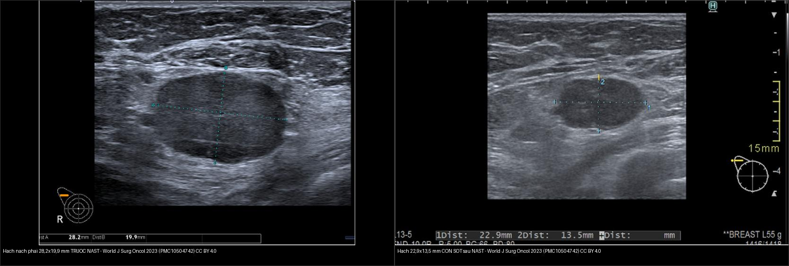
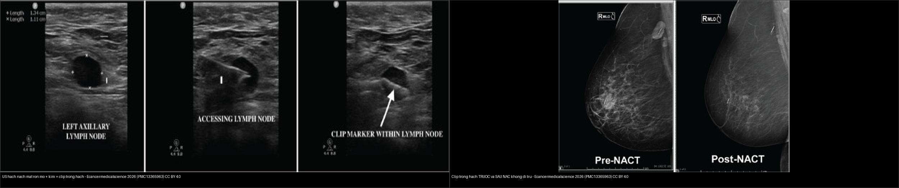
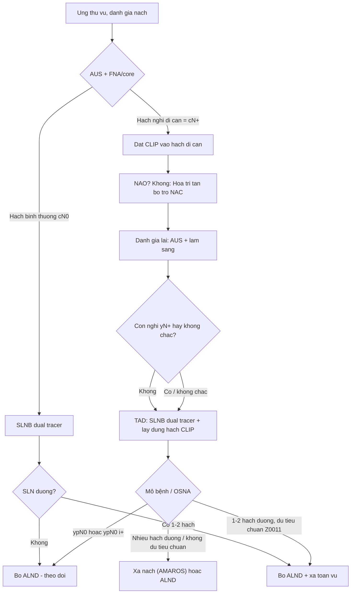
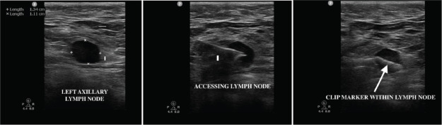
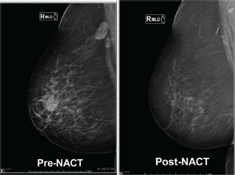
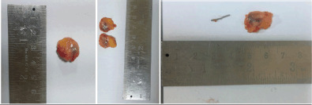
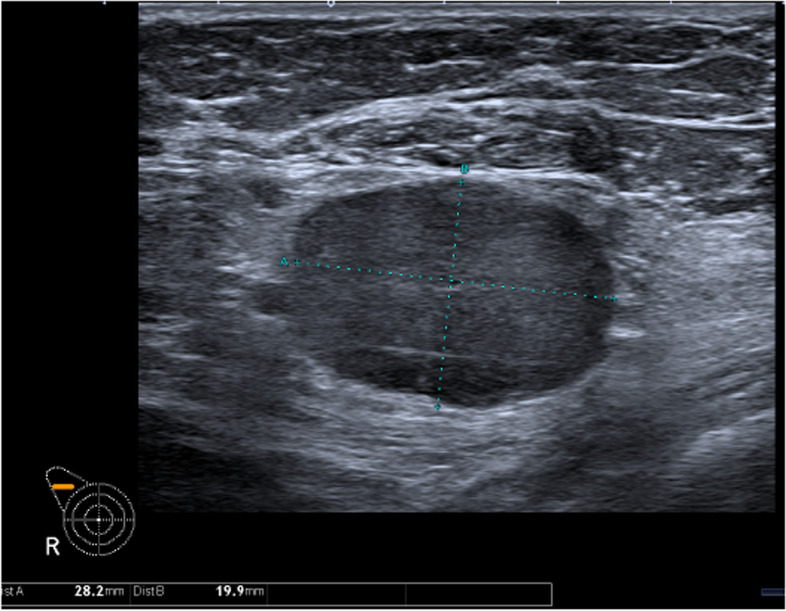
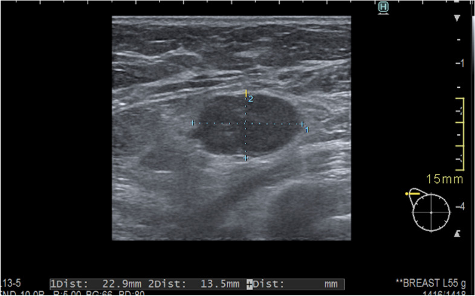

# 589 — Sinh thiết hạch gác nách & sinh thiết hạch được nhắm (TAD) sau hóa trị tân bổ trợ: clip hạch, dual tracer, OSNA / Sentinel lymph node biopsy & targeted axillary dissection after NAC

**Tags:** `pattern:hach-nach` `pattern:clip-hach` `vung:hach-nach` `vung:vu` `score:ACOSOG-Z0011` `score:AMAROS` `protocol:SLNB` `protocol:US-hach-nach` `incidentaloma:clip-di-tru`
**Mức chắc chắn (certainty):** tổng hợp y văn (literature synthesis) — tự biên từ y văn mở (meta-phân tích TAD, thử nghiệm mốc Z0011/AMAROS/Z1071, ca kỹ thuật clip) kèm **ca nguyên văn** trên siêu âm trước–sau NAST (Pislar 2023) và ca titanium clip (Krishna 2026); số liệu đều lấy trực tiếp từ bài gốc.

## 1. Tổng quan bệnh học – cơ chế hình ảnh

- **Vì sao phải đánh giá nách:** di căn hạch nách là **yếu tố tiên lượng mạnh nhất** của ung thư vú; nhưng **nạo hạch nách (axillary lymph node dissection — ALND)** gây **phù bạch mạch tay (lymphedema)** tới **~20–25%** (AMAROS 5 năm: 24,5% sau ALND so với 11,9% sau xạ nách). Vì vậy đích hiện đại là **giảm leo thang (de-escalation)**: chọn đúng người **không cần ALND**.
- **Ba mức nách Berg:** mức I (dưới–ngoài cơ ngực bé), mức II (sau cơ ngực bé, gồm **hạch Rotter**), mức III (trên–trong cơ ngực bé, dưới–trong tĩnh mạch dưới đòn). Bạch mạch tuyến vú dẫn trước hết về **mức I**; thứ tự này là cơ sở để "hạch gác" (sentinel node) đại diện nách.
- **TẠI SAO có "hạch gác":** hạt **99mTc-sulfur colloid / albumin nanocolloid** (kích thước **~0,1–1 µm**) được **đại thực bào (macrophage) thực bào** giữ lại tại hạch gác đầu tiên; thuốc **xanh (blue dye — patent blue/methylene blue)** đi theo bạch mạch và nhuộm hạch trong **5–10 phút**; **ICG (indocyanine green)** phát huỳnh quang hồng ngoại quan sát bằng camera chuyên dụng. Đây là lý do **phải tiêm trước khi rạch da** để dẫn lưu chưa bị xáo trộn.
- **TẠI SAO "dual tracer":** một chất có thể bỏ sót hạch gác **ở ngoài cùng đường dẫn** → dùng **2 dấu (phóng xạ + xanh/ICG)**. ACOSOG Z1071: tỷ lệ âm tính giả (FNR) chung **12,6%** → **10,8%** khi dùng **dual tracer**, và **giảm tiếp khi lấy ≥ 2 hạch gác**. SLNB kinh điển (cN0) gộp: **nhận diện 96%, độ nhạy 93%, độ chính xác 99%, FNR 5–6%** — ngưỡng FNR chấp nhận được là **≤ 10%**.
- **Vì sao phải "đánh dấu hạch" trước hóa trị:** ở bệnh nhân **cN+ đã chuyển yN0**, sau hạch trị tân bổ trợ (neoadjuvant chemotherapy — NAC) hạch di căn có thể **teo xơ tới mức không còn ngấm thuốc/không còn thấy trên siêu âm**, trong khi **hạch này không phải lúc nào cũng là hạch gác** (chỉ **~70%** trùng nhau). Người ta đặt một **clip kim loại** vào hạch đã chứng minh di căn **trước NAC**; **TAD (targeted axillary dissection)** = **SLNB (dual tracer) + lấy hạch có clip**.
- **Định lượng TAD (meta 59 nghiên cứu, Abdelaziz 2026, NPJ Breast Cancer):** **nhận diện hạch đánh dấu 95,1%** (KTC 95% 93,2–96,5); **FNR 6,37%** (5,02–8,04); **độ chính xác 94,68%**; **trùng hạch đánh dấu–hạch gác 73,34%** — các phương tiện đánh dấu (clip, carbon, magnetic, hạt phóng xạ) và định vị (wire, phóng xạ, từ, siêu âm) **tương đương nhau**.
- **TẠI SAO clip vẫn thấy sau NAC:** clip **titanium** (Ligaclip) không tan theo thời gian, **không từ tính** → **không gây nhiễu MRI** và giữ nguyên vị trí trong hạch; một số ca **clip di trú (clip migration/displacement)** theo đường bạch mạch sau sinh thiết. Krishna 2026 (n = 28): **nhận diện hạch clip 100%**, hạch trung bình **20 mm**, **trùng hạch gác 92,5%**, không thấy di trú.
- **Định lượng siêu âm nách (axillary ultrasound — AUS):**
  - **Trước điều trị, cN0:** độ nhạy chỉ **42,4%** (KTC 36,8–48,2), độ đặc hiệu **80,8%**, PPV **51,3%**, NPV **74,7%** (Mun 2025) — **AUS âm không loại trừ di căn vi thể**.
  - **Sau NAC, cN+:** độ nhạy **68%**, độ đặc hiệu **76%**, độ chính xác **72%**, PPV **78%**, **NPV chỉ 66%**; âm tính giả tới **~25%** (Albasini 2026) → **không dùng AUS đơn thuần để quyết định bỏ ALND**.

## 2. Mẫu hình + chẩn đoán phân biệt theo vị trí (Gamut)

- **Hạch gác bình thường:** hình **bầu dục/hạnh nhân**, **rốn mỡ sáng (fatty hilum)**, vỏ mỏng đều. Tiêu chuẩn **bình thường: trục dài > trục ngắn, vỏ ≤ 3 mm, còn rốn mỡ**.
- **Hạch nghi ngờ/di căn (trên AUS):** **vỏ dày khu trú hoặc lan tỏa > 3 mm**, **mất rốn mỡ**, hình **tròn**, **mất ranh giới vỏ–mô mỡ**, hoặc **nhiều hạch dính thành đám (matted)** → chọc hút kim nhỏ/sinh thiết lõi (FNA/core) hạch **nghi nhất**.
- **Gamut theo bối cảnh (quan trọng nhất):**
  1. **Chưa điều trị (cN0):** hạch **phản ứng/viêm** (do nhiễm trùng, sau tiêm vaccine, mèo cào), **lao hạch**, **lymphoma**, **di căn từ cơ quan khác (Krukenberg, melanoma, phổi)** — hình dạng gần giống nhau, **bối cảnh + sinh thiết** quyết định.
  2. **cN+ trước NAC:** di căn vú (vỏ > 3 mm ± mất rốn) → **đánh dấu clip**.
  3. **Sau NAC (yN0 sau lâm sàng):** phân biệt **hạch còn u sống (residual viable tumour)** vs **hạch xơ hóa/hoại tử sau điều trị (treated node)** — **KHÔNG phân biệt được chỉ bằng kích thước**; AUS giảm độ nhạy sau NAC, phải **lấy hạch đã đánh dấu**.
  4. **Cạm bẫy "hạch to còn lại":** hạch **vẫn to nhưng đã âm tính mô bệnh** (xơ, mỡ hóa, chất keo) → nạo nách oan; ngược lại **hạch nhỏ lại mà vẫn còn vi di căn**.
- **Gợi nhớ tiếp cận nách 4 bước:** **(1) Bản đồ dẫn lưu** (mức I→II→III, có vú trong không) → **(2) hình thái hạch** (vỏ/rốn/kích thước) → **(3) xác nhận mô bệnh** (FNA/core, OSNA) → **(4) chiến lược** (SLNB đơn thuần, TAD, ALND hay xạ nách).

## 3. Bảng so sánh phân biệt (ma trận đối chiếu)

| Thực thể (entity) | Hình ảnh điển hình | Chốt vào (rule-in) | Chốt loại (rule-out) | Gợi ý xác nhận |
|---|---|---|---|---|
| Hạch nách lành | Bầu dục, **vỏ ≤ 3 mm**, còn **rốn mỡ** | **Rốn mỡ rõ + vỏ mỏng ≤ 3 mm** | Mất rốn + vỏ > 3 mm → nghi di căn | Theo dõi; không chọc khi không nghi |
| Hạch di căn trước điều trị | **Vỏ dày > 3 mm**, mất rốn mỡ, hình tròn, ± dính đám | **Vỏ > 3 mm khu trú + mất rốn mỡ** | Rốn mỡ còn rõ + vỏ ≤ 3 mm → ít nghĩ di căn | **FNA/core hạch nghi nhất + đặt clip** trước NAC |
| Hạch tồn dư sau NAC | Hạch **còn vỏ dày/mất rốn** dù đã nhỏ lại | **Kích thước còn > 3 mm bất thường trên AUS** | Nhỏ lại và trở về bình thường **không** loại trừ vi di căn | **Lấy đúng hạch đã clip (TAD)** — mô bệnh mới chốt được |
| Hạch xơ hóa sau điều trị | Hạch **to nhưng mô bệnh âm**, xơ/mỡ hóa/chất keo | **Mô bệnh: không tế bào u sống** | Có tế bào u sống → còn bệnh | OSNA/H&E — **không dựa hình ảnh để chốt** |
| Clip hạch (định vị) | **Nốt tăng đậm độ/đậm âm trong hạch** ± vệt kim; X-quang giữ nguyên qua NAC | **Cùng vị trí so phim trước NAC** | Xê dịch ≥ 5 mm → nghi di trú (theo dõi) | X-quang vú/định vị bằng siêu âm trong mổ |

*Trái: hạch nách phải **28,2 × 19,9 mm**, mất rốn mỡ, trước NAST. Phải: hạch **22,9 × 13,5 mm CÒN SÓT** sau NAST — nhỏ hơn nhưng chưa trở về bình thường, phải lấy đúng hạch để biết còn u sống hay chỉ xơ hóa. Nguồn: World J Surg Oncol 2023 (PMC10504742), CC BY 4.0. Ảnh ghép letterbox.*

*Trái: **US hạch nách** — kim tiếp cận hạch, **clip trong hạch** (mũi tên). Phải: **X-quang lúc đặt và sau NAC** cho thấy clip giữ nguyên vị trí, không di trú. Nguồn: Ecancermedicalscience 2026 (PMC13365963), CC BY 4.0. Ảnh ghép letterbox.*

### Trùng nhau giữa hạch đánh dấu và hạch gác (vì sao cần TAD chứ không chỉ lấy clip)
- **Chỉ lấy hạch có clip** là chưa đủ: hạch clip **chỉ là hạch gác ở ~70–73%** ca (meta: trùng **73,34%**; Krishna: **92,5%** — dao động theo cách chọn colon). Phải **kết hợp SLNB dual tracer + hạch clip** để không bỏ sót bệnh ngoài hạch clip.
- **FNR thấp nhất** đạt được khi: **dual tracer** + **lấy ≥ 2–3 hạch gác** + **lấy đúng hạch clip**; đó là lý do TAD trở thành chuẩn cho **cN+ xuống yN0 sau NAC**.

## 4. Protocol chụp + hệ phân độ/điểm chuẩn hóa

- **Siêu âm nách (đầu tay):** đầu dò thẳng **≥ 12 MHz**, bệnh nhân nằm ngửa, **duỗi–dạng tay để lộ nách**; quét mức I–II–III, đo **vỏ dày nhất** và ghi mm; nghi ngờ → **FNA/core hạch nghi nhất** rồi **đặt clip vào hạch đó trước NAC**.
- **Đặt clip:** theo **hệ trục giao (coaxial)** bằng kim 14–18G; clip **titanium** hoặc seed từ (Magseed)/hạt phóng xạ; ghi **tọa độ + ảnh** làm mốc. **X-quang vú** kiểm tra clip ngay sau đặt (2 bình diện).
- **Hóa trị tân bổ trợ (NAC)** theo subtype (HER2+/TN hay đạt pCR hạch nhất).
- **Đánh giá lại trước mổ:** **AUS + lâm sàng** (yN0 vs yN+); **MRI vú** khi cần (bài 514/515). Lưu ý **AUS sau NAC chỉ đạt độ chính xác 72%, NPV 66%** → không đủ để bỏ nách.
- **Trong mổ (TAD):** **SLNB dual tracer** — 99mTc-nanocolloid + **xanh** hoặc **ICG**; **định vị hạch clip** bằng siêu âm trong mổ, dây kim (wire), seed phóng xạ/từ, hoặc **xăm carbon (carbon tattoo)**; **lấy hạch clip + các hạch gác**; một số nơi dùng **OSNA (one-step nucleic acid amplification — CK19 mRNA)** để có kết quả tức thì, đặc biệt nhạy vi di căn.
- **Hệ thống phân độ/tiêu chuẩn:**
  - **AJCC/UICC 8th — pN sau điều trị (ypN):** **ypN0(i+)** = tế bào đơn lẻ/ổ **≤ 0,2 mm / < 200 tế bào**; **ypN1mi** = vi di căn **> 0,2–2,0 mm / 200–2.000 tế bào**; **ypN1** = 1–3 hạch nách; **ypN2** = 4–9; **ypN3** = ≥ 10 (hoặc hạch vú trong/thượng đòn cùng bên).
  - **ACOSOG Z0011 — tiêu chí bỏ ALND:** **T1–T2, cN0, phẫu thuật bảo tồn (BCS), ≤ 2 hạch gác dương, có xạ toàn vú, ≥ 5 năm theo dõi**; nhánh bỏ ALND có **OS 5 năm 98,5% vs 95,2%** và **DFS 97,0% vs 94,4%** (không khác biệt), **không tăng tái phát vùng**.
  - **AMAROS — hạch gác dương, muốn tránh ALND:** **xạ nách** thay ALND cho **kiểm soát vùng và sống còn tương đương, phù tay ít hơn**; (bảng tổng quan: tái phát nách 10 năm **0,93% ALND vs 1,82% xạ nách**; OS 10 năm **81,4% vs 81,0%**; phù 5 năm **24,5% vs 11,9%**).
  - **SENOMAC / POSNOC:** củng cố **bỏ ALND an toàn** ở **1–2 hạch gác có đại thể (macrometastasis)** với xạ ± điều trị toàn thân.

- **Bảng ngưỡng xử trí nhanh:**

| Tình huống | Ngưỡng / tiêu chuẩn | Xử trí |
|---|---|---|
| AUS hạch bình thường | Vỏ ≤ 3 mm, còn rốn mỡ | Không chọc; SLNB khi mổ |
| AUS hạch nghi | Vỏ > 3 mm hoặc mất rốn mỡ | FNA/core + đặt clip |
| Sau NAC | AUS giảm nhạy, NPV 66% | **Không bỏ nách chỉ vì AUS âm** |
| SLN dương 1–2 hạch, Z0011 | T1–T2, BCS, xạ toàn vú | Bỏ ALND |
| SLN dương, không đủ Z0011 | Bất kỳ | Xạ nách (AMAROS) hoặc ALND |
| Lấy hạch clip | Detect 95,1%, FNR 6,37% | TAD = SLNB + hạch clip |

## 5. Biến thể bình thường và cạm bẫy

- **Hạch "phản ứng" sau tiêm vaccine/nhiễm trùng** có thể vỏ dày > 3 mm → **dương tính giả** trên AUS; đối chiếu bệnh sử.
- **AUS âm tính giả** trước mổ tới ~58% (độ nhạy 42,4%) và sau NAC ~32% → **không bao giờ "yên tâm" chỉ vì AUS bình thường**.
- **Hạch còn to sau NAC nhưng hết u sống:** xơ/mỡ hóa/chất keo làm hạch vẫn lớn → **không vội nạo nách**; ngược lại hạch nhỏ lại vẫn có thể còn vi di căn.
- **Bỏ sót hạch clip:** clip có thể **di trú** theo đường bạch mạch; nếu siêu âm trong mổ không thấy, dùng **X-quang bàn mổ/seed phóng xạ/từ** hoặc **xăm carbon** dự phòng; **clip trong mô mỡ nách không đúng vị trí** = đã di trú.
- **Chỉ lấy hạch clip mà bỏ SLNB:** hạch clip không phải hạch gác ở ~27% → **FNR cao**; luôn làm **TAD đầy đủ**.
- **Tác dụng phụ của dấu:** xanh methylene có thể gây **phản vệ** và **hoại tử da** khi tiêm nông; ICG cần **camera hồng ngoại**; hạt phóng xạ cần **phòng y học hạt nhân** → chọn theo hạ tầng.
- **Hội chứng dây nách (axillary web syndrome)** và hạn chế vận động vai sau SLNB — giải thích trước mổ.
- **OSNA vs H&E:** OSNA nhạy vi di căn hơn nhưng có thể **nâng giai đoạn (upstage)** và dẫn tới can thiệp nhiều hơn; cần hiểu ngưỡng CK19 trước khi chốt.

## 6. Tự lượng giá — Blind Quiz

**Ca 1 — Nữ 50 tuổi, ung thư vú phải cN1 (FNA hạch dương), đã đặt clip trước NAC. Siêu âm nách trong mổ hình dưới. Mô tả trước khi xem đáp án.**

- Gợi ý lâm sàng (clinical context): cN1, đã NAC, cần lấy đúng hạch đã chứng minh di căn.
- Câu hỏi: Dấu hiệu nào cho thấy đây là hạch bệnh lý? Kim và clip nằm ở đâu? Vì sao phải lấy hạch này **cùng** hạch gác?

<b>Bấm để hiện đáp án (findings + chẩn đoán)</b>

- Dấu hiệu (findings): (trái) hạch nách trái **mất rốn mỡ**, vỏ dày, đo **2,14 × 1,11 cm**; (giữa) **kim tiếp cận hạch**; (phải) **clip nằm trong hạch** (mũi tên).
- Chẩn đoán (diagnosis): hạch nách **di căn đã đánh dấu clip**; đây là ca kỹ thuật **titanium clip (Ligaclip)** với **nhận diện 100%** và **không di trú**. Phải lấy **cả hạch clip lẫn hạch gác** vì chúng chỉ trùng nhau **73–92%** — đó chính là nguyên lý **TAD**.
- Nguồn ảnh: Ecancermedicalscience 2026 (PMC13365963) Fig. 3, CC BY 4.0.

**Ca 2 — X-quang vú lúc đặt clip và sau NAC của cùng bệnh nhân. Clip có xê dịch không? Vì sao điều này quan trọng?**

- Hỏi: Làm sao chắc chắn hạch lấy ra đúng là hạch đã đánh dấu?

<b>Bấm để hiện đáp án (findings + chẩn đoán)</b>

- Dấu hiệu (findings): clip trong hạch nách **giữ nguyên vị trí** trên ảnh trước và sau NAC (**không di trú**).
- Chẩn đoán (diagnosis): **clip bền vững** làm mốc định vị hạch; nếu clip di trú ≥ 5 mm phải cảnh giác **lấy nhầm mô mỡ** thay vì hạch. Đối chiếu **X-quang bệnh phẩm** để xác nhận clip nằm trong hạch đã cắt.
- Nguồn ảnh: Ecancermedicalscience 2026 (PMC13365963) Fig. 4, CC BY 4.0.

**Ca 3 — Bệnh phẩm hạch đã cắt. Nhìn đại thể, làm sao biết đã lấy trúng hạch có clip?**

- Hỏi: Vai trò của kiểm tra đại thể/X-quang bệnh phẩm trong TAD?

<b>Bấm để hiện đáp án (findings + chẩn đoán)</b>

- Dấu hiệu (findings): **mặt cắt hạch** cho thấy **titanium clip** nằm trong hạch đã cắt.
- Chẩn đoán (diagnosis): xác nhận **hạch đánh dấu đã được lấy** — bước kiểm tra bắt buộc trước khi kết luận ypN. Nguồn ảnh: Ecancermedicalscience 2026 (PMC13365963) Fig. 5, CC BY 4.0.

**Ca 4 — Nữ 48 tuổi cN+ vú phải, siêu âm trước NAST. Hạch có gì bất thường và bước tiếp theo?**

- Hỏi: Vỏ/rốn hạch ra sao? Đo bao nhiêu? Nên làm gì trước khi hóa trị?

<b>Bấm để hiện đáp án (findings + chẩn đoán)</b>

- Dấu hiệu (findings): hạch nách phải **28,2 × 19,9 mm**, **vỏ dày, mất rốn mỡ**.
- Chẩn đoán (diagnosis): hạch **nghi di căn (cN+)**; bước tiếp theo là **FNA/core xác nhận + đặt clip** trước NAST để sau này tìm lại đúng hạch. Nguồn ảnh: World J Surg Oncol 2023 (PMC10504742) Fig. 2, CC BY 4.0.

**Ca 5 — Cùng bệnh nhân sau NAST: hạch 22,9 × 13,5 mm. Đã đủ để bỏ nạo hạch chưa?**

- Hỏi: Hạch nhỏ hơn có nghĩa đã hết bệnh? Quyết định dựa vào đâu?

<b>Bấm để hiện đáp án (findings + chẩn đoán)</b>

- Dấu hiệu (findings): hạch **còn sót 22,9 × 13,5 mm** sau NAST (so 28,2 × 19,9 mm ban đầu) — vẫn bất thường.
- Chẩn đoán (diagnosis): **Không thể chốt bằng siêu âm** — AUS sau NAC chỉ đạt **độ chính xác 72%, NPV 66%**; phải **lấy đúng hạch đã clip (TAD)** rồi mô bệnh/OSNA mới quyết định **bỏ ALND hay không**.
- Nguồn ảnh: World J Surg Oncol 2023 (PMC10504742) Fig. 3, CC BY 4.0.

## Bài liên quan chéo
- [500 – Tổng quan Vú & Sản phụ khoa](../500-tong-quan-vu-san-phu-khoa/lesson.md)
- [514 – Ung thư vú: giai đoạn TNM & MRI đánh giá lan rộng](../514-ung-thu-vu-TNM-MRI-lan-rong/lesson.md)
- [517 – Sinh thiết định vị vú & quản lý clip/kẹp](../517-sinh-thiet-dinh-vi-vu-va-quan-ly-clip/lesson.md)
- [522 – Theo dõi sau điều trị ung thư vú](../522-theo-doi-sau-dieu-tri-ung-thu-vu/lesson.md)
- [572 – Hạch trong ung thư phụ khoa: SLN, hạch chậu–cạnh ĐMC & PET-CT](../572-hach-ung-thu-phu-khoa-SLN-PET/lesson.md) (so sánh kỹ thuật hạch gác khác vùng)

## Ảnh
- `589_clip-trong-hach_US_PMC13365963-Fig3.jpg`, `589_clip-truoc-sau-NAC_Xquang_PMC13365963-Fig4.jpg`, `589_benh-pham-hach-co-clip_PMC13365963-Fig5.jpg`, `589_hach-truoc-NAST_US_PMC10504742-Fig2.jpg`, `589_hach-sau-NAST_US_PMC10504742-Fig3.jpg`, `composite_hach-truoc-vs-sau-NAST.jpg`, `composite_clip-US-vs-Xquang.jpg`. Nguồn + giấy phép từng ảnh trong `images/CREDITS.md`.

> Không dùng để chẩn đoán độc lập khi chưa có người hướng dẫn.
