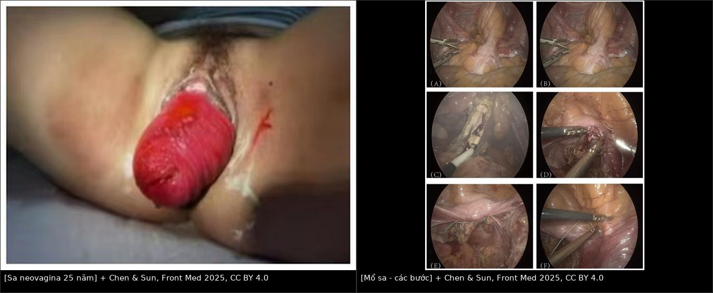
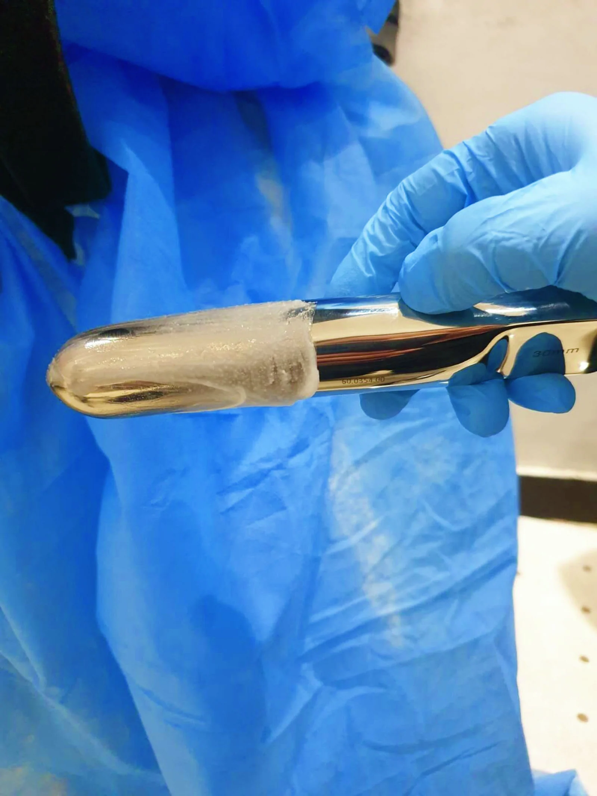
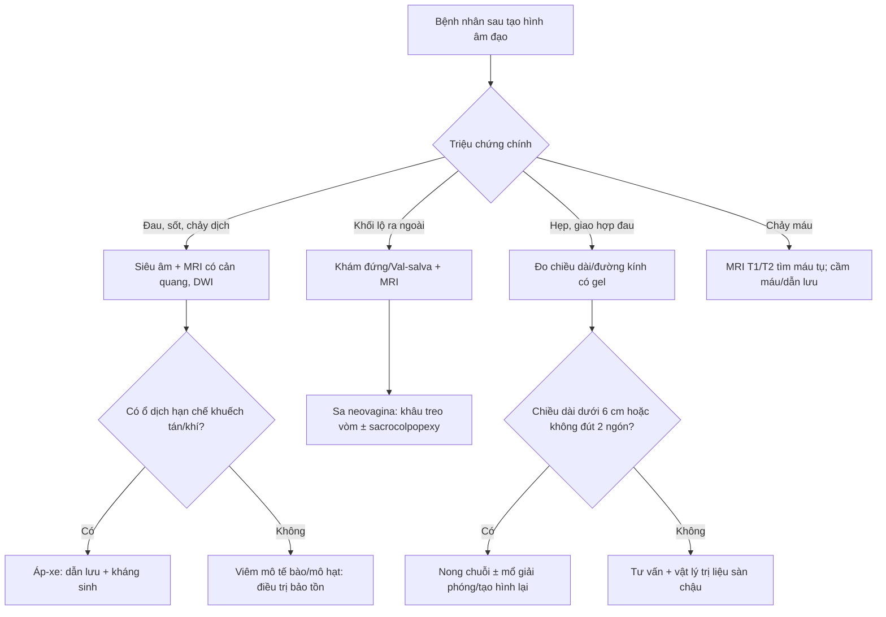
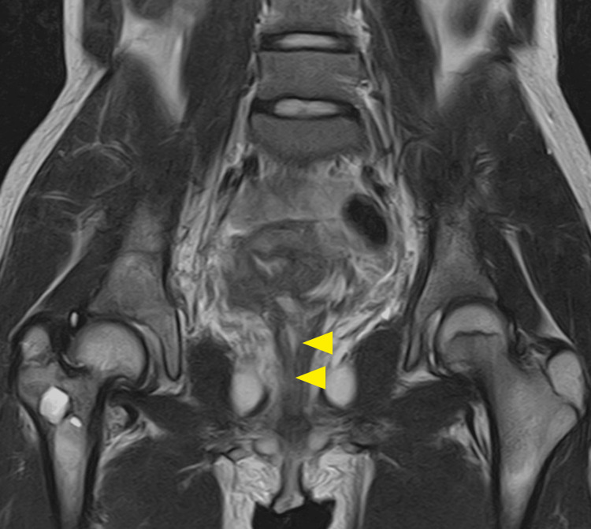
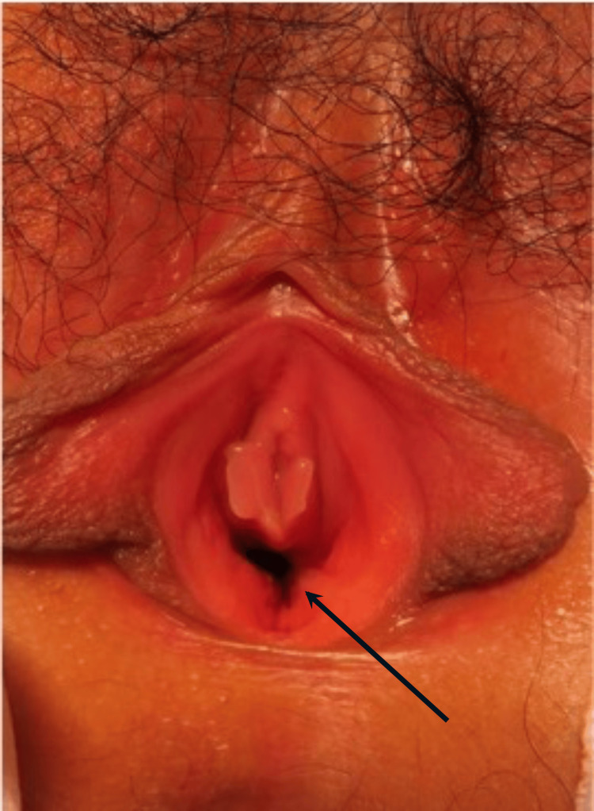
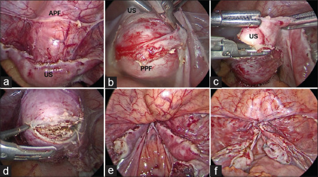
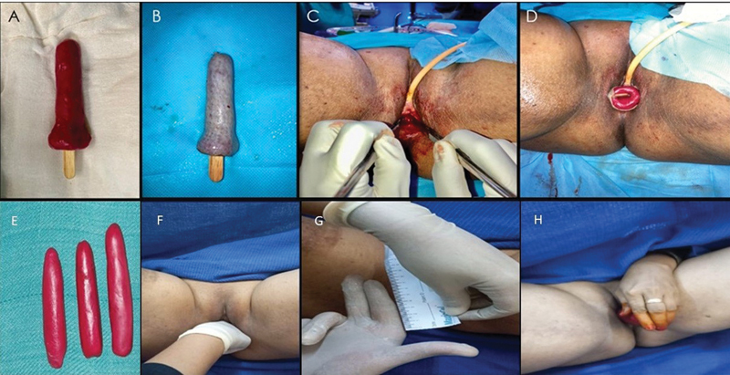

# 590 — Tạo hình âm đạo trong MRKH: chọn kỹ thuật & biến chứng muộn / Vaginoplasty in MRKH: technique choice & long-term complications

**Tags:** `pattern:am-dao-bat-san` `pattern:tao-hinh-am-dao` `pattern:bien-chung-sau-mo` `vung:am-dao` `vung:tieu-khung` `protocol:MRI-tieu-khung` `protocol:nong-am-dao`
**Mức chắc chắn (certainty):** tổng hợp y văn (literature synthesis) — tổng hợp từ các nghiên cứu mở CC BY/CC BY-NC (Saravanakumar *Cureus* 2024; Piróg *Arch Gynecol Obstet* 2025; Begum *Indian J Plast Surg* 2025; Chen & Sun *Front Med* 2025; Goto *Cureus* 2026; Khoiwal *Gynecol Minim Invasive Ther* 2026; Arajy *PRS Glob Open* 2026; so sánh phúc mạc–đại tràng sigma 2025) + đối chiếu bài [521](../521-mayer-rokitansky-MRKH-tao-hinh-am-dao/lesson.md) (chẩn đoán MRKH). Không có ca nguyên văn riêng của nhóm.

## 1. Tổng quan bệnh học – cơ chế hình ảnh

- **Vấn đề cần giải quyết:** MRKH (hội chứng Mayer–Rokitansky–Küster–Hauser) có **bất sản tử cung + 2/3 trên âm đạo**, buồng trứng và nội tiết bình thường; 1/4.000–5.000 trẻ gái. Mục tiêu điều trị **không phải "làm tử cung"** mà là tạo một **ống âm đạo đủ dài – đủ rộng – không hẹp – giao hợp không đau**, dài **≥ 7 cm** (nhiều tác giả chấp nhận **≥ 6 cm**), rộng **2 ngón tay (≈ 2,5–3 cm)**.
- **Nguyên lý vật lý – vì sao hình ảnh sau mổ khác nhau theo kỹ thuật:** tín hiệu MRI phụ thuộc **lớp lót ống mới**:
  - **Mảnh ghép da (McIndoe):** biểu mô lát tầng sừng hóa + tuyến bã/nang lông → T1 có thể **tăng nhẹ do bã**, T2 trung gian, **không có chất nhầy**, đôi khi thấy **lông mọc trong ống**.
  - **Mảnh phúc mạc (Davydov):** một lớp trung biểu mô mỏng, **không tuyến** → thành mỏng, T2 sáng nhẹ, **khô**, phụ thuộc nong để giữ độ rộng.
  - **Đoạn ruột (sigmoid/ileum):** niêm mạc có **tế bào đài tiết nhầy** → dịch T2 **rất sáng**, có nếp niêm mạc, nhu động; dễ nhầm dịch nhầy với **áp-xe** nếu chỉ nhìn T2.
  - **Vạt da–niêm mạc (labia minora, Singapore, pudendal):** có cảm giác, ẩm hơn mảnh ghép da, không co kéo kiểu mảnh ghép rời.
- **Vì sao hẹp (stenosis) là biến chứng trung tâm:** quá trình lành vết thương qua **co rút của nguyên bào sợi – myofibroblast**; mảnh ghép da sống nhờ **thấm huyết tương 48–72 giờ**, tái thông mạch **4–7 ngày**; vùng thiếu mạch/thiếu nong sẽ xơ co → hẹp. Vì vậy **khuôn (mold) + nong sau mổ là bắt buộc**, không phải "hỗ trợ".
- **Ngưỡng định lượng đáng nhớ:**
  - Nong không mổ: **≥ 30 phút/ngày**, trong nhiều tháng, đích **7–8 cm**; thành công **tới ~90%** khi có ê-kíp đa chuyên khoa (Saravanakumar 2024).
  - McIndoe: bóc tách **10–12 cm**, khuôn **3 tháng**; series 7 ca McIndoe có **2/7 (28,6%) biến chứng** (1 mất một phần mảnh ghép, 1 co kéo phải mổ lại) (Begum 2025).
  - Davydov–Moore: thì mổ **82,1 phút**, nằm viện **6 ngày**, chiều dài **10 mm → 81 mm** sau 6 tháng, **FSFI 6,7 → 29,1**, giao hợp lần đầu **17–22 tuần** (Piróg 2025).
  - So sánh phúc mạc vs sigmoid (n = 20 vs 30): biến chứng **15% vs 26,67%**; thời gian đeo khuôn **3,0 ± 2,25 vs 4,7 ± 2,45 tháng**; mùi dịch **25% vs 23,3%** (khác biệt không có ý nghĩa) (2025).
- **TẠI SAO MRI là chìa khóa sau mổ:** siêu âm khó đo ống đã tạo vì **không có mốc giải phẫu tự nhiên** và đầu dò chèn làm biến dạng; MRI **T2 3 mặt phẳng** cho đo chiều dài – đường kính, phân biệt **dịch nhầy (T2 sáng, không hạn chế khuếch tán)** với **áp-xe (T2 sáng + DWI hạn chế + thành ngấm thuốc dày)**, và thấy **máu tụ (T1 sáng)**. Gel siêu âm trong ống giúp dựng thẳng trục đo.

## 2. Mẫu hình + chẩn đoán phân biệt theo vị trí (gamut)

- **Mẫu hình cửa vào:** nữ **46,XX**, vô kinh nguyên phát, tuyến vú và lông mu bình thường, **không có tử cung/cổ** trên MRI → MRKH (đã chẩn đoán theo [521](../521-mayer-rokitansky-MRKH-tao-hinh-am-dao/lesson.md)). Bài này bắt đầu **sau khi đã loại trừ AIS/Turner** và bệnh nhân đồng ý điều trị.
- **Gamut theo kỹ thuật (chọn theo giải phẫu + nguyện vọng):**
  1. **Nong không mổ (Frank/Ingram):** ưu tiên đầu tay khi có **túi cùng âm đạo (vaginal dimple)**; không mổ, ít biến chứng, nhưng cần tuân thủ cao.
  2. **Vecchietti:** kéo giãn dần bằng **hạt ô-liu + chỉ xuyên qua khoang bàng quang–trực tràng**, cố định vào dụng cụ kéo trên xương mu; dùng khi **còn túi cùng**, muốn tránh mổ lớn.
  3. **McIndoe:** tạo khoang, lót **mảnh ghép da mỏng (STSG)** + khuôn; kinh điển, dễ thực hiện, nhưng **co kéo/khô/lông**.
  4. **Davydov (phúc mạc):** bóc phúc mạc tiểu khung làm thành ống, khâu vòm; **ít mùi, không lông**, thời gian đeo khuôn ngắn hơn.
  5. **Sigmoid/ileum:** dùng đoạn ruột làm ống; **tự bôi trơn**, đủ dài, nhưng **mùi, chảy nhầy, biến chứng ruột, sa muộn**.
  6. **Vạt da–niêm mạc (labia minora/horseshoe, Singapore, pudendal):** che phủ tại chỗ, **có cảm giác**, tránh mảnh ghép rời; kỹ thuật khó, sẹo mất thẩm mỹ.
- **Gamut theo biến chứng – chia theo thời gian:**
  - **Sớm (0–30 ngày):** chảy máu/máu tụ, nhiễm trùng vùng mổ, **mất mảnh ghép**, tổn thương **bàng quang/trực tràng/niệu quản**, bí tiểu, huyết khối.
  - **Trung hạn (1–6 tháng):** **hẹp/co kéo**, hẹp lỗ vào (introital stenosis), mô hạt, đau khi giao hợp, **rò âm đạo–trực tràng/bàng quang**.
  - **Muộn (> 6 tháng–nhiều năm):** **sa neovagina**, hẹp tái phát, lông trong ống, dịch/mùi (ruột), **HPV/condyloma và ung thư tế bào vảy tại neovagina** (hiếm, chưa rõ tỷ lệ), rối loạn chức năng tình dục.
- **Gợi nhớ "DAMS-VL"** khi chọn kỹ thuật: **D**imple còn không? **A**natomy (bàng quang/trực tràng/niệu quản), **M**otivation–compliance, **S**car (sẹo vùng chậu/âm hộ), **V**aginal length mong muốn, **L**ong-term follow-up (ai theo dõi được nhiều năm).

## 3. Bảng so sánh phân biệt (ma trận đối chiếu)

| Thực thể (entity) | Hình ảnh điển hình (US/MRI) | Chốt vào (rule-in) | Chốt loại (rule-out) | Gợi ý xác nhận |
|---|---|---|---|---|
| Nong không mổ (Frank/Ingram) | Không có ống thật; **túi cùng sâu 2–7 cm** trước mổ; sau nong ống dài, thành mỏng đều | **Túi cùng còn + ống dài ≥ 6–7 cm sau nong + không có mảnh ghép/khuôn** | Không có túi cùng, đã mổ tạo ống có mảnh ghép → không phải nong đơn thuần | Đo chiều dài bằng thước/que; MRI chỉ khi nghi hẹp |
| Vecchietti | Ống dài, trục thẳng; **không thấy mảnh ghép**; có thể thấy đường hầm chỉ cũ | **Tiền sử đặt hạt ô-liu + kéo trên xương mu; ống không có niêm mạc ruột** | Thấy nếp niêm mạc/tuyến nhầy → không phải Vecchietti | Hỏi kỹ thuật; MRI T2 |
| McIndoe | Ống lót **da**, T1 hơi sáng do bã, T2 trung gian, **không chất nhầy**; có thể thấy lông; khuôn tạo khoảng trống | **Lớp lót kiểu da + không nếp niêm mạc + tiền sử mảnh ghép da** | Nếp niêm mạc + dịch nhầy → ruột; thành mỏng không tuyến → phúc mạc | Khám + MRI T2; sinh thiết chỉ khi nghi loạn sản |
| Davydov (phúc mạc) | Thành ống **mỏng, đều**, T2 sáng nhẹ, **không tuyến**, vòm khâu vào phúc mạc | **Không chất nhầy + không lông + thành rất mỏng + tiền sử nội soi** | Có nếp niêm mạc/tiết nhầy → ruột; lớp da → McIndoe | MRI T2 + hỏi kỹ thuật |
| Sigmoid/ileum | **Nếp niêm mạc + dịch T2 rất sáng**, có nhu động; đôi khi túi cùng/ống dài | **Dịch nhầy T2 sáng, không hạn chế khuếch tán + tiền sử dùng ruột** | DWI hạn chế + thành dày ngấm thuốc → áp-xe, không phải dịch nhầy | MRI DWI/ADC; nội soi khi nghi loạn sản |
| Vạt labia minora/horseshoe | Ống có **da–niêm mạc tại chỗ**, không mảnh ghép rời; lỗ vào rộng, không co kéo | **Vạt tại chỗ + cảm giác tốt + không lông trong ống** | Mảnh ghép da rời có đường khâu chu vi → McIndoe | Khám; MRI nếu đau/hẹp |
| Sa neovagina | Khối **niêm mạc/da lộ ra ngoài màng trinh**, có thể **lộ toàn bộ thành ống**; MRI thấy ống lộn | **Khối sa qua lỗ âm đạo + thấy vòm ống lộn** | Sa tử cung (không có tử cung trong MRKH) → loại | Khám đứng/Val-salva; MRI khi cần |
| Áp-xe quanh neovagina | Ổ dịch **T2 sáng + DWI hạn chế + thành dày ngấm thuốc**, khí trong ổ | **DWI hạn chế + khí + sốt/đau** | Dịch nhầy ruột **không** hạn chế khuếch tán | DWI/ADC + cấy/dẫn lưu |

*Trái: khối sa toàn bộ thành neovagina (đại tràng sigma) lộ ra ngoài, 25 năm sau mổ. Phải: các bước phẫu thuật sa qua đường âm đạo. Nguồn: Chen L, Sun L., *Front Med* 2025, PMC12702906 Fig. 1 & 2, CC BY 4.0. Ảnh ghép letterbox, giữ nguyên tỷ lệ.*

### Hai kiểu "hẹp" cần phân biệt
- **Hẹp lỗ vào (introital stenosis):** vòng xơ ngay sau màng trinh, thường do **co kéo mảnh ghép da** hoặc khâu căng; nong có thể hiệu quả, đôi khi cần **Z-plasty/giải phóng vòng xơ**.
- **Hẹp ống (canal stenosis):** ống ngắn hoặc dính từng đoạn, thường do **không đeo khuôn/nong đủ**; MRI có gel giúp xác định **đoạn hẹp và chiều dài còn lại**. Đừng nhầm ống **xẹp khi không có gel** với hẹp thật.

## 4. Protocol chụp + theo dõi & xử trí

- **Trước mổ:**
  1. **MRI tiểu khung T2 3 mặt phẳng** (lát 3–4 mm) — đo **túi cùng âm đạo**, xác nhận không tử cung/cổ, tìm **mầm tử cung ứ máu**, đánh giá bàng quang–trực tràng–niệu quản; **luôn đọc thận** (30–40% MRKH có bất thường thận).
  2. **Siêu âm** bổ sung khi cần; **không cần cản quang** thường quy.
  3. Loại trừ nhiễm trùng âm hộ/âm đạo trước mổ; tư vấn **không có tử cung → không mang thai tự nhiên**, bảo tồn buồng trứng.
- **Sau mổ — lịch theo dõi tối thiểu:** khám **1 tuần, 1 tháng, 3 tháng, 6 tháng, 12 tháng**, sau đó **hằng năm**. Mỗi lần: đo chiều dài – đường kính, soi lỗ vào, đánh giá mô hạt/hẹp/lông, hỏi **đau khi giao hợp**, FSFI khi đã hoạt động tình dục.
- **Nong sau mổ:** McIndoe đeo khuôn **3 tháng** (series trên); phúc mạc **3,0 tháng**, sigmoid **4,7 tháng**; sau đó **nong duy trì** theo hướng dẫn, đặc biệt **3–6 tháng đầu** — đây là yếu tố quyết định chống hẹp.
- **Thời điểm giao hợp:** thường **4–6 tuần** sau khi vết mổ ổn định; trong nghiên cứu Davydov–Moore là **17–22 tuần** — cá thể hóa theo lành thương và tâm lý.
- **Ngưỡng can thiệp lại:** chiều dài **< 6 cm** hoặc không đút được **2 ngón/không giao hợp được** = **thất bại chức năng**, cần nong chuỗi tích cực ± **mổ giải phóng/tạo hình lại**; hẹp tái phát nhiều lần → cân nhắc **vạt tại chỗ** thay mảnh ghép.
- **Sa neovagina:** khám ở tư thế đứng/Val-salva; MRI khi cần đánh giá độ lộn; xử trí **cắt bớt – khâu treo vòm** (vaginal repair) hoặc **treo vòm vào xương cùng/mỏm nhô** (sacrocolpopexy) ở ca tái phát; báo trước nguy cơ tái phát.
- **Đo "thành công" tại giường:** dùng **que Hegar/thước** đo **chiều sâu × chiều rộng** (ví dụ đạt **8 × 3,2 cm** trong một ca McIndoe cải tiến), ghi cùng tư thế và cùng người đo để so sánh giữa các lần.

*Đo chiều sâu và đường kính neovagina bằng que Hegar sau tạo hình; đây là cách ghi nhận "đủ dài – đủ rộng" tại giường. Nguồn: Arajy ZY et al., PRS Global Open 2026, PMC13596978 Fig. 5, CC BY-NC-ND 4.0 (nguyên bản).*

- **Tầm soát muộn:** **không có đồng thuận quốc tế** về cytology/HPV tại neovagina (2026). Vì đã có ca **condyloma/HPV và SCC tại neovagina**, nhóm biên soạn khuyến nghị **khám hằng năm + lấy tế bào học/HPV từ vòm ống ở người có hoạt động tình dục**, và **sinh thiết mọi tổn thương loét/nốt kéo dài** — ghi rõ đây là **suy luận thực hành**, chưa phải guideline.

## 5. Biến thể bình thường & cạm bẫy

- **Dịch nhầy T2 rất sáng trong neovagina ruột là bình thường**, không phải áp-xe: **DWI không hạn chế**, thành mỏng đều, không khí, không sốt. Chỉ chọc/dẫn lưu khi có **đau khu trú + sốt + DWI hạn chế**.
- **Máu tụ sớm T1 sáng** có thể bị đọc là "mỡ" hoặc "mảnh ghép"; đối chiếu **thời gian mổ, T2, DWI** và theo dõi.
- **Mô hạt ngấm thuốc** ở vòm ống 3–6 tháng đầu là lành thương, không phải u/tái phát — **đừng sinh thiết mù**; sinh thiết khi tổn thương **loét cứng, phát triển, chảy máu kéo dài**.
- **Đo chiều dài khi đang đeo khuôn hoặc bệnh nhân gồng** → sai số lớn; đo khi **nghỉ, có gel**, cùng tư thế mỗi lần.
- **Không thấy ống trên MRI vì ống xẹp** — bơm gel 20–40 mL (nếu dung nạp) trước khi kết luận hẹp/tắc.
- **Sa neovagina có thể xuất hiện sau nhiều thập kỷ** (ca 25 năm) — không loại trừ vì "đã mổ lâu, ổn định".
- **Bỏ sót tổn thương niệu quản/bàng quang** khi mổ: đau hông lưng, rò nước tiểu, creatinin tăng → **CT cystography/US thận** ngay, đừng chỉ nghĩ "đau vết mổ".
- **Tư vấn sai về sinh sản:** buồng trứng còn → trứng khỏe; **không có tử cung → không mang thai tự nhiên**; nhắc **mang thai hộ/ghép tử cung** là lựa chọn tham khảo, không phải chỉ định thường quy.

## 6. Tự lượng giá — Blind Quiz

**Ca 1 — Nữ 47 tuổi, MRKH, tạo hình âm đạo bằng đại tràng sigma cách đây 25 năm, nay thấy khối đỏ lộ ra ngoài khi đứng lâu. Đọc ảnh lâm sàng + các bước mổ.**

- Hỏi: khối sa là gì? Cơ chế? Cần phân biệt với khối gì? Hướng xử trí?

<b>Bấm để hiện đáp án (findings + chẩn đoán)</b>

- Dấu hiệu: khối **niêm mạc đỏ, có nếp**, lộ hoàn toàn ra ngoài qua lỗ âm đạo; ảnh mổ cho thấy **toàn bộ thành ống lộn ra ngoài**, được **cắt bớt và khâu treo lại**.
- Chẩn đoán: **sa toàn bộ neovagina (full-thickness neovaginal prolapse)** sau tạo hình bằng đại tràng sigma — biến chứng muộn hiếm nhưng có thể tới **25 năm**. Cơ chế: **thiếu treo vòm + tăng áp lực ổ bụng mạn + thành ruột nặng, mất trương lực**.
- Phân biệt: **sa tử cung** (không có tử cung trong MRKH), **polyp/khối u neovagina**, **lộn niêm mạc đơn thuần**; khám đứng/Val-salva + MRI giúp xác định.
- Xử trí: **phẫu thuật qua đường âm đạo** (cắt bớt – khâu treo), cân nhắc **treo vòm vào xương cùng** nếu tái phát; tư vấn nguy cơ tái phát và theo dõi dài hạn.
- Nguồn: Chen L, Sun L., *Front Med* 2025, PMC12702906 Fig. 1 & 2, CC BY 4.0.

**Ca 2 — Nữ 19 tuổi, MRKH, tạo hình âm đạo 3 tháng trước. MRI kiểm tra: ống có thông không? Có ổ dịch không?**

- Hỏi: mũi tên vàng chỉ gì? Có bằng chứng hẹp/tắc hay áp-xe? Cần đo gì trên MRI?

<b>Bấm để hiện đáp án (findings + chẩn đoán)</b>

- Dấu hiệu: **ống neovagina thông suốt**, thành mỏng đều (mũi tên vàng), **không có ổ dịch/khí** quanh ống; không thấy tụ dịch vòm.
- Chẩn đoán: **neovagina lành thương tốt, không hẹp/tắc, không áp-xe** sau 3 tháng.
- Cần đo: **chiều dài từ lỗ vào đến vòm**, **đường kính**, độ dày thành; đối chiếu với ngưỡng **≥ 6–7 cm** và **2 ngón**. Nếu ống xẹp, bơm gel rồi chụp lại.
- Nguồn: Goto S et al., *Cureus* 2026, PMC12966936 Fig. 5, CC BY 4.0.

**Ca 3 — Cùng bệnh nhân Ca 2, ảnh lâm sàng 2 năm sau mổ. Đây là kỹ thuật gì và vì sao ống giữ được độ rộng?**

- Hỏi: nhận diện kỹ thuật? Lớp lót là gì? Ưu/nhược điểm so với mảnh ghép da?

<b>Bấm để hiện đáp án (findings + chẩn đoán)</b>

- Dấu hiệu: **lỗ vào rộng, ống niêm mạc hồng, ẩm**, không co kéo; đây là **neovagina tạo bằng đoạn ruột non theo nguyên lý Yang–Monti** (ống ruột non được tạo hình để đủ dài).
- Lớp lót: **niêm mạc ruột non** → tiết nhầy, tự bôi trơn; ưu điểm: **ẩm, đủ dài, ít co kéo**; nhược điểm: **chảy nhầy/mùi, cần mổ bụng, nguy cơ biến chứng ruột**.
- So với McIndoe: McIndoe **khô, có thể mọc lông, co kéo mảnh ghép**, nhưng ít xâm lấn hơn.
- Nguồn: Goto S et al., *Cureus* 2026, PMC12966936 Fig. 7, CC BY 4.0.

**Ca 4 — Nội soi Davydov: nhận diện các mốc và giải thích vì sao dùng phúc mạc.**

- Hỏi: APF, PPF, US là gì? Vì sao phúc mạc là lớp lót tốt? Biến chứng cần cảnh giác?

<b>Bấm để hiện đáp án (findings + chẩn đoán)</b>

- **APF** = vạt phúc mạc trước (anterior peritoneal flap); **PPF** = vạt phúc mạc sau (posterior peritoneal flap); **US** = mỏm tử cung thô sơ/uterosacral vùng sau.
- Phúc mạc **mỏng, trơn, không tuyến bã/lông**, ít co kéo hơn mảnh ghép da; khâu vòm vào phúc mạc tạo **vòm mềm, ẩm tự nhiên**.
- Biến chứng: **chảy máu, tổn thương bàng quang/trực tràng/niệu quản, hẹp vòm, sa**; theo dõi sát 3–6 tháng đầu.
- Nguồn: Khoiwal K et al., *Gynecol Minim Invasive Ther* 2026, PMC12965514 Fig. 2, CC BY-NC-ND 4.0 (giữ nguyên bản, không ghép/crop).

**Ca 5 — Kỹ thuật McIndoe: ảnh trong mổ + kết quả độ sâu/rộng. Đọc và trả lời trước khi mở.**

- Hỏi: mảnh ghép lấy từ đâu? Tại sao phải đeo khuôn? Biến chứng sớm/muộn hay gặp?

<b>Bấm để hiện đáp án (findings + chẩn đoán)</b>

- Ảnh cho thấy **khuôn (mold) + mảnh ghép da mỏng (split-thickness skin graft)** được cuộn quanh khuôn, đưa vào khoang đã bóc tách giữa bàng quang và trực tràng.
- Mảnh ghép lấy từ **mông, đùi hoặc vùng trên xương mu**; khuôn giữ ống mở trong **3 tháng** để mảnh ghép **sống nhờ thấm huyết tương rồi tái thông mạch**, chống co kéo.
- Biến chứng: **mất một phần/mất toàn bộ mảnh ghép, co kéo hẹp, khô, mọc lông, đau khi giao hợp**; series 7 ca McIndoe có **2/7 (28,6%)** biến chứng.
- Nguồn: Begum R et al., *Indian J Plast Surg* 2025, PMC12755944 Fig. 3, CC BY 4.0.

## Bài liên quan chéo
- [521 – MRKH: bất sản tử cung–âm đạo & chẩn đoán](../521-mayer-rokitansky-MRKH-tao-hinh-am-dao/lesson.md)
- [529 – Cổ tử cung & âm đạo bẩm sinh: dị dạng tắc nghẽn](../529-co-tu-cung-am-dao-bam-sinh-tac-nghen/lesson.md)
- [528 – Dị dạng tử cung bẩm sinh ESHRE/ESGE & ASRM](../528-di-dang-tu-cung-bam-sinh-ESHRE-ESGE/lesson.md)
- [547 – Sa tạng chậu nữ: POP-Q & lưới nâng](../547-sa-tang-chau-nu-POP-Q-luoi-nang/lesson.md) (nguyên lý treo vòm/sa)
- [557 – Biến chứng lưới nâng sa](../557-bien-chung-luoi-nang-sa/lesson.md) (xử trí biến chứng vật liệu cấy)
- [500 – Tổng quan Vú & Sản Phụ khoa](../500-tong-quan-vu-san-phu-khoa/lesson.md)

## Ảnh
- Tên file: `590_tao-hinh-am-dao_Modality_SourceID.jpg`; nguồn + giấy phép từng ảnh trong `images/CREDITS.md`.
- Ảnh **CC BY-NC-ND** (Davydov, McIndoe modification) giữ **nguyên bản**, không crop/ghép.
- Ảnh ghép chỉ dùng ảnh **CC BY** (Chen & Sun 2025), letterbox giữ tỷ lệ.

> Không dùng để chẩn đoán độc lập khi chưa có người hướng dẫn.
