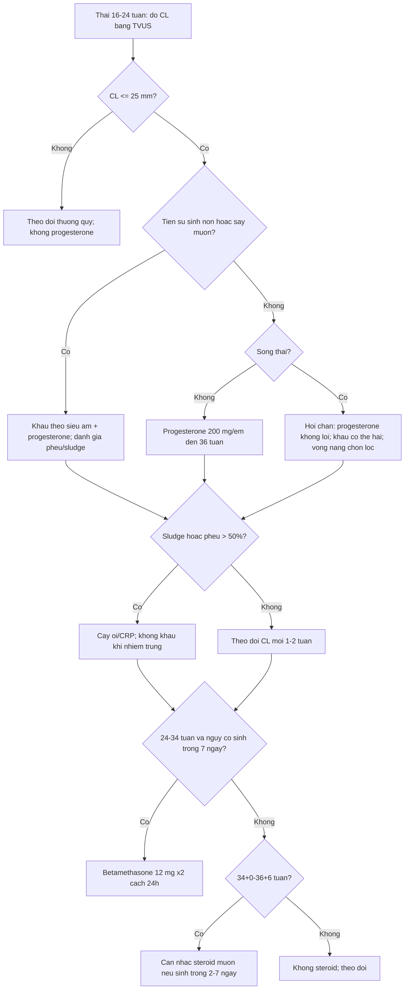
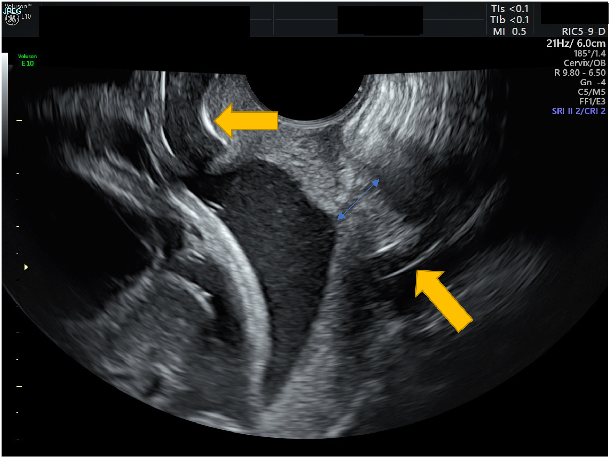
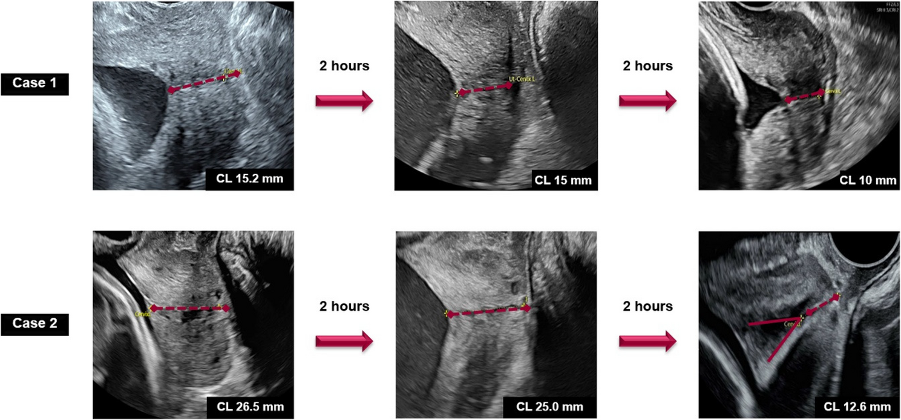
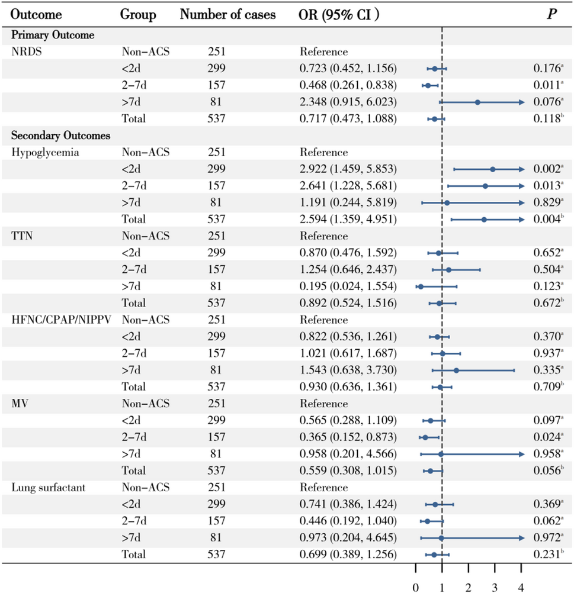

# 591 — Dự phòng sinh non theo nguy cơ: progesterone âm đạo, vòng nang cổ tử cung & corticosteroid / Risk-stratified preterm birth prevention: vaginal progesterone, cervical pessary and antenatal corticosteroids

**Tags:** `pattern:sinh-non` `pattern:co-tu-cung-ngan` `pattern:du-phong-sinh-non` `vung:co-tu-cung` `vung:thai-nhi` `score:CL-25mm` `protocol:TVUS-co-tu-cung` `protocol:progesterone` `protocol:pessary-Arabin` `protocol:corticosteroid`
**Mức chắc chắn (certainty):** tổng hợp y văn (literature synthesis) — tổng hợp 1 phân tích gộp vòng nang 2025 (17 RCT, 5.704 thai), 1 phân tích gộp progesterone 2024 (8 nghiên cứu, 2.741 thai), 1 RCT quản lý theo chiều dài cổ tử cung 2026, 1 đoàn hệ corticosteroid muộn 2026 và 1 đoàn hệ 7.950 trẻ sinh rất non 2025. Có **phản biện** vì các RCT vòng nang không đồng thuận.

## 1. Tổng quan bệnh học – cơ chế hình ảnh

- **Sinh non tự phát (spontaneous preterm birth — sPTB):** sinh trước **37 tuần 0 ngày**. Cổ tử cung không phải “cái nắp thụ động”: trước khi ngắn, cổ đã **tái cấu trúc (remodeling)** — giảm collagen type I/III, tăng nước và glycosaminoglycan, tăng tế bào viêm. Vì vậy **chiều dài cổ tử cung (cervical length — CL)** chỉ là thước đo muộn của một quá trình đã bắt đầu.
- **TẠI SAO hình ảnh học quyết định điều trị:** mọi can thiệp dự phòng đều nhắm vào một trong ba tầng:
  1. **Tầng nội tiết – viêm:** progesterone làm giảm thụ thể oxytocin, giảm connexin-43 (gap junction), giảm IL-6/IL-8 → giữ cơ tử cung ở trạng thái “im lặng” và giảm chín cổ tử cung.
  2. **Tầng cơ học:** vòng nang Arabin đỡ đoạn dưới tử cung, làm **thay đổi góc tử cung–cổ tử cung (uterocervical angle — UCA)** và phân bố lại lực lên lỗ trong; vòng nang **không làm dài cổ tử cung**, nên đo CL sau đặt vòng không dùng để đánh giá hiệu quả.
  3. **Tầng trưởng thành thai:** corticosteroid qua nhau thai, tăng protein surfactant (SP-A/SP-B), tăng compliance phổi, giảm RDS/IVH/hoại tử ruột non. Hiệu ứng **genomic cần ~24 giờ**, nhưng có hiệu ứng **non-genomic sớm** — đoàn hệ 7.950 trẻ 23+0–31+6 tuần cho thấy lợi ích về tử vong **xuất hiện từ 2 giờ** sau liều đầu.
- **Ngưỡng định lượng bắt buộc nhớ:**
  - **CL ≤ 25 mm** ở 16–24 tuần là ngưỡng vào của progesterone đơn thai; **CL ≤ 20 mm** là ngưỡng lợi ích rõ nhất trong các phân tích gộp; **CL ≤ 10 mm + funneling/sludge** là nhóm nguy cơ rất cao, phải loại trừ nhiễm trùng ối trước khi can thiệp.
  - **Progesterone âm đạo 200 mg/đêm** (từ lúc chẩn đoán đến 36 tuần). Phân tích gộp 8 nghiên cứu, **2.741 thai đơn CL < 25 mm**: sinh < 34 tuần **OR 0,67 (95% CI 0,53–0,84)**; < 32 tuần **OR 0,46 (0,28–0,77)**; vào NICU **OR 0,45 (0,30–0,66)**; RDS **OR 0,42 (0,28–0,63)**; IVH **OR 0,40 (0,17–0,95)**; tử vong sơ sinh **OR 0,25 (0,13–0,46)**.
  - **Vòng nang cổ tử cung:** phân tích gộp **17 RCT, 5.704 thai**. Ở **song thai**: sinh < 37 tuần **RR 0,88 (0,81–0,96)**, < 34 tuần **RR 0,79 (0,63–0,99)**. Ở **đơn thai**: không khác biệt có ý nghĩa cho sinh < 34 tuần; so trực tiếp với progesterone cũng **không khác biệt**. Trong phân nhóm song thai **CL < 25 mm**, sinh < 34 tuần **RR 0,41 (0,16–1,06)** — **không có ý nghĩa**.
  - **Corticosteroid muộn 34+0–36+6 tuần** (788 thai đơn): chỉ nhóm **2–7 ngày trước sinh** giảm RDS (**OR 0,468; 0,261–0,838**); **< 2 ngày OR 0,723 (0,452–1,156)** — không có lợi; **> 7 ngày OR 2,348 (0,915–6,023)** — không có lợi. Đổi lại, **hạ đường huyết sơ sinh tăng: OR 2,594 (1,359–4,951)**, rõ ở < 2 ngày và 2–7 ngày.
  - **Quản lý theo CL ở dọa sinh non 24–33+6 tuần, CL 15–30 mm:** RCT 50 thai — chiến lược **chờ đợi + đo CL lặp** giảm “điều trị không phù hợp” từ **98,5% xuống 7,7%** (**RR 0,08; 0,02–0,31**), đồng thời giảm nhịp nhanh, tụt huyết áp, hạ kali và thời gian nằm viện.
  - **Corticosteroid sớm 23+0–31+6 tuần** (7.950 trẻ): khoảng cách **12 giờ – 14 ngày** là tối ưu; lợi ích tử vong bắt đầu **trong 2 giờ** → **không trì hoãn steroid chỉ vì sắp sinh**.

## 2. Mẫu hình + chẩn đoán phân biệt theo vị trí (Gamut)

- **Mẫu hình 1 — cổ tử cung ngắn đơn thuần, không tiền sử:** CL ≤ 25 mm, ống cổ thẳng, không phễu. Điều trị **progesterone âm đạo**; **không** đặt vòng nang, **không** khâu dự phòng đại trà.
- **Mẫu hình 2 — cổ tử cung ngắn + tiền sử sinh non/sẩy muộn:** đây là nhóm **khâu cứu vãn theo siêu âm (ultrasound-indicated cerclage)** có lợi nhất; progesterone vẫn có thể dùng song song. Bài [573](../573-ho-co-tu-cung-ban-khau/lesson.md) và [578](../578-ban-khau-bung-cervicoisthmic-TAC/lesson.md).
- **Mẫu hình 3 — ngắn + phễu/sludge:** màng ối lồi vào ống cổ, đám echo dày quanh lỗ trong → nghĩ **nhiễm trùng trong ối**. Cấy ối/CRP trước, **không khâu khi đang nhiễm trùng**; progesterone không điều trị được nguyên nhân.
- **Mẫu hình 4 — song thai có CL ngắn:** cơ chế chính là **căng quá mức tử cung**, không phải suy cổ tử cung. Progesterone **không giảm sinh non**; khâu **có thể có hại** (RR 2,15); vòng nang có tín hiệu giảm sinh non trong phân tích gộp nhưng **không rõ trong phân nhóm CL < 25 mm** → chỉ định theo từng trung tâm, không phải chuẩn. Bài [569](../569-sinh-non-song-thai/lesson.md).
- **Mẫu hình 5 — dọa sinh non có cơn co nhưng CL 15–30 mm:** **chờ đợi có đo CL lặp** (mỗi 2–4 giờ khi còn co) và chỉ dùng corticosteroid/giảm gò khi **CL giảm > 20% so với ban đầu hoặc < 15 mm**. Đây là thay đổi thực hành lớn: không phải cứ “dọa sinh non” là tiêm steroid.
- **Mẫu hình 6 — ối vỡ non (PPROM) < 34 tuần:** corticosteroid + kháng sinh + magnesium sulfate bảo vệ não; **không giảm gò kéo dài**; theo dõi nhiễm trùng.
- **Mẫu hình 7 — thai 34+0–36+6 tuần:** corticosteroid **chọn lọc** (dự kiến sinh trong 7 ngày, PPROM, đái tháo đường cần cân nhắc); lợi ích chỉ rõ khi sinh trong **2–7 ngày**, cái giá là **hạ đường huyết**.
- **Mẫu hình 8 — sau khoét chóp/LEEP, dị dạng Müller:** theo dõi CL sớm, khâu theo tiền sử nếu có chỉ định; không dựa vào một lần đo.
- **Gợi nhớ “PROMPT”:** **P**rogesterone (đơn thai CL ≤ 25 mm) · **R**escue cerclage (ngắn + tiền sử, hoặc cổ đã mở) · **O**bstetric history (số lần sinh non, sẩy muộn) · **M**easurement (TVUS 3 lần, lấy số ngắn nhất) · **P**essary (chọn lọc, bằng chứng không đồng nhất) · **T**iming of steroids (12 giờ–14 ngày; 2–7 ngày ở muộn).

## 3. Bảng so sánh phân biệt (ma trận đối chiếu)

| Thực thể (entity) | Hình ảnh điển hình | Chốt vào (rule-in) | Chốt loại (rule-out) | Gợi ý xác nhận |
|---|---|---|---|---|
| **Cổ tử cung ngắn đơn thuần** | TVUS dọc: CL **≤ 25 mm**, ống cổ thẳng, không phễu, không sludge | **CL ≤ 25 mm đo 3 lần, lấy trị số ngắn nhất, bàng quang rỗng** | CL ≥ 30 mm, không phễu, không tiền sử → **không** can thiệp | TVUS lặp 1–2 tuần; progesterone 200 mg/đêm |
| **Ngắn + tiền sử sinh non** | CL ≤ 25 mm + tiền sử sinh 16–34 tuần hoặc sẩy muộn | **Tiền sử + CL ≤ 25 mm** = nhóm lợi ích của khâu theo siêu âm | Không tiền sử, CL 20–25 mm → khâu không có lợi | Hồ sơ sản khoa + TVUS; bài 573/578 |
| **Ngắn + phễu/sludge** | Màng ối hình chữ V/U lồi vào ống cổ; đám echo dày quanh lỗ trong | **Phễu > 50% chiều dài hoặc cổ còn lại < 10 mm + sludge** | Ống cổ đóng hoàn toàn, dịch ối trong → không phải mẫu hình này | Cấy ối, CRP, IL-6 nếu cân nhắc khâu |
| **Song thai CL ngắn** | CL ≤ 25 mm, tử cung căng, thường kèm đa ối | **Song thai + CL ≤ 25 mm** → hội chẩn, không mặc định progesterone/khâu | Đơn thai cùng CL → progesterone có lợi | TVUS + đánh giá TTTS (bài 566/569) |
| **Dọa sinh non CL 15–30 mm** | Cơn co, CL trung gian, chưa có thay đổi nhanh | **CL 15–30 mm không giảm thêm** → chờ đợi, đo lặp | CL < 15 mm hoặc giảm > 20% → điều trị | Đo CL mỗi 2–4 giờ khi còn co |
| **PPROM < 34 tuần** | Thiểu ối, màng ối vỡ, có thể thấy túi ối xẹp | **Vỡ ối xác định + < 34 tuần** → steroid + kháng sinh + MgSO₄ | Còn nguyên ối → không phải PPROM | Soi âm đạo vô khuẩn, test IGFBP-1 |
| **Thai 34+0–36+6 tuần** | Thai gần đủ tháng, có cơn co/PPROM | **Dự kiến sinh trong 2–7 ngày** → cân nhắc steroid muộn | Sinh > 7 ngày hoặc không có chỉ định → không dùng | Đếm ngày dự kiến sinh; theo dõi đường huyết |
| **Sau khoét chóp/LEEP** | Cổ tử cung ngắn, biến dạng, sẹo xơ | **Tiền sử phẫu thuật cổ + CL ngắn không tương xứng tuổi thai** | Cổ dài ≥ 30 mm, không tiền sử → loại trừ nguyên nhân cấu trúc | Hồ sơ mổ + TVUS; MRI nếu cần |

- **Ba cặp dễ nhầm nhất:** (1) **CL ngắn đơn thuần vs ngắn + tiền sử** — cùng con số CL nhưng chỉ định khâu khác hẳn; (2) **dọa sinh non vs cổ tử cung ngắn không triệu chứng** — một bên là cơn co cấp, một bên là bất thường cấu trúc mạn; (3) **steroid sớm vs steroid muộn** — cùng thuốc nhưng ngưỡng tuổi thai và khoảng cách sinh quyết định lợi ích.

## 4. Protocol chụp + hệ phân độ/điểm chuẩn hóa

- **Siêu âm đầu dò âm đạo (TVUS) — chuẩn vàng đo CL:**
  - Bàng quang **rỗng**, tư thế sản khoa, đầu dò đặt trong cùng đồ sau, **không ấn ép**.
  - Mặt cắt dọc giữa thấy rõ **lỗ trong – ống cổ – lỗ ngoài**; đo **3 lần**, lấy **trị số ngắn nhất**; tổng thời gian quan sát 3–5 phút để loại cơn co.
  - **Phễu (funneling):** đo **chiều dài phễu**, **chiều dài cổ còn lại (functional length)** và **độ rộng phễu**; ghi rõ % chiều dài cổ bị phễu chiếm.
  - **Sludge:** đám echo dày, không đều, sát lỗ trong — luôn mô tả vì làm đổi xử trí (ưu tiên tìm nhiễm trùng, trì hoãn khâu).
- **Ai được sàng lọc CL:** tiền sử sinh non/sẩy muộn → đo **16–24 tuần, lặp mỗi 2 tuần**; sàng lọc toàn dân còn tranh cãi (2 RCT không giảm sinh non; đoàn hệ rất lớn có giảm nhưng chất lượng bằng chứng thấp).
- **Progesterone âm đạo:** **200 mg/đêm** từ lúc chẩn đoán đến **36 tuần**; thay thế bằng gel **90 mg/ngày** nếu dung nạp kém. **Không dùng cho song thai** (không giảm sinh non) và **không dùng khi CL > 25 mm**.
- **Vòng nang Arabin:** chọn cỡ **65/70/75/80 mm** theo đường kính âm đạo; đặt **18–22 tuần** (hoặc ngay khi phát hiện CL ngắn), tháo **37 tuần**. Theo dõi tiết dịch âm đạo, nhiễm trùng, vòng rơi; **không dùng thay thế khâu ở nhóm có chỉ định khâu**.
- **Corticosteroid:** **betamethasone 12 mg IM × 2, cách 24 giờ** hoặc **dexamethasone 6 mg IM × 4, cách 12 giờ**. Chỉ định kinh điển **24–34 tuần** khi có nguy cơ sinh trong 7 ngày; **34+0–36+6 tuần** cân nhắc chọn lọc. **Không lặp nhiều đợt**; nếu > 14 ngày và còn < 34 tuần, có thể **một đợt nhắc lại**. Theo dõi đường huyết ở đái tháo đường/thai kỳ.
- **Magnesium sulfate bảo vệ não:** cân nhắc khi sinh **< 32 tuần** (liều tải + truyền duy trì theo phác đồ địa phương).
- **Giảm gò (tocolysis):** chỉ để **kéo dài 48 giờ** đủ cho steroid, không điều trị duy trì; không dùng khi PPROM hoặc nhiễm trùng ối.

*Mũi tên vàng: vòng nang Arabin tại eo tử cung; mũi tên xanh: chiều dài cổ tử cung đo được. Ảnh dùng nguyên bản (CC BY-NC-ND, không crop/ghép). Nguồn: Case Reports in Women's Health 2022 (PMC9385544), CC BY-NC-ND 4.0.*

## 5. Biến thể bình thường và cạm bẫy

- **Biến thể bình thường:**
  - Cổ tử cung **dài 30–40 mm**, hơi cong; có thể **ngắn giả** khi bàng quang căng hoặc khi có cơn co đoạn dưới.
  - **Phễu nhẹ** có thể thoáng qua trong cơn co; luôn đo lại sau khi hết co.
  - **Dịch trong ống cổ** không phải sludge nếu không có echo dày, không kèm cơn co/CRP tăng.
- **Cạm bẫy (pitfall):**
  1. **Ấn đầu dò** làm cổ ngắn giả — lỗi phổ biến nhất; đo lại với áp lực tối thiểu.
  2. **Đo bằng đường bụng** khi bàng quang đầy → CL dài giả, bỏ sót cổ ngắn. TVUS là bắt buộc.
  3. **“Cứ dọa sinh non là tiêm steroid”:** RCT cho thấy chờ đợi + đo CL lặp giảm 92% điều trị không phù hợp; steroid < 2 ngày không giảm RDS ở thai muộn và tăng hạ đường huyết.
  4. **Khâu ở song thai:** không có lợi, có thể **hại** (RR 2,15); khác hoàn toàn đơn thai.
  5. **Progesterone ở song thai hoặc CL bình thường:** không giảm sinh non; đừng “cho cho chắc”.
  6. **Vòng nang không phải “khâu thay thế”:** bằng chứng đơn thai yếu, song thai không đồng nhất; không dùng để trấn an khi có chỉ định khâu.
  7. **Bỏ sót nhiễm trùng ối:** sludge + cổ mở nhanh + CRP tăng → cấy ối; đặt khâu vào ổ nhiễm trùng làm tăng nguy cơ.
  8. **Nghỉ ngơi tại giường:** không giảm sinh non, tăng nguy cơ huyết khối — không khuyến cáo.

## 6. Tự lượng giá — Blind Quiz

**Ca 1 — Thai 22 tuần, tiền sử khoét chóp cổ tử cung, CL 18 mm. Ảnh TVUS có vòng nang.**

- Gợi ý: thai phụ không co, không ra dịch, CRP bình thường.
- Câu hỏi: Cấu trúc mũi tên vàng là gì? Đo gì ở mũi tên xanh? Vì sao vòng nang **không** thay thế khâu ở bệnh nhân này?

<b>Bấm để hiện đáp án (findings + chẩn đoán)</b>

- **Mũi tên vàng:** vòng nang Arabin nằm ở eo tử cung, hai cánh áp vào cùng đồ sau và đoạn dưới tử cung.
- **Mũi tên xanh:** chiều dài cổ tử cung còn lại (functional length), đo từ lỗ ngoài đến lỗ trong; đây là số quyết định, **không** phải khoảng cách từ vòng nang đến lỗ ngoài.
- Bệnh nhân **có tiền sử phẫu thuật cổ + CL 18 mm** → nhóm lợi ích của **khâu theo siêu âm**; vòng nang chỉ là lựa chọn thay thế khi không khâu được, không tương đương.
- Nguồn: Case Reports in Women's Health 2022 (PMC9385544), CC BY-NC-ND 4.0.

**Ca 2 — Thai 28 tuần, dọa sinh non, CL đo lặp mỗi 2 giờ.**

- Gợi ý: hai bệnh nhân (Case 1 và Case 2) đều có cơn co; số đo ghi trên ảnh.
- Câu hỏi: Ai nên nhận corticosteroid? Dấu hiệu nào khiến bạn đổi từ “chờ đợi” sang “điều trị”?

<b>Bấm để hiện đáp án (findings + chẩn đoán)</b>

- **Case 1:** CL **15,2 → 15 → 10 mm** — giảm > 20% và xuống < 15 mm → **điều trị** (corticosteroid + giảm gò).
- **Case 2:** CL **26,5 → 25,0 → 12,6 mm** — giảm mạnh trong vài giờ → cũng **điều trị**, dù lần đo đầu còn 26,5 mm.
- Nguyên tắc: **không dựa vào một lần đo**; theo dõi **xu hướng** và ngưỡng **< 15 mm hoặc giảm > 20%**.
- Nguồn: Chaiyakarn S et al., *BMC Pregnancy Childbirth* 2026 (PMC13531936), CC BY-NC-ND 4.0; ảnh nguyên bản.

**Ca 3 — Thai 35 tuần 2 ngày, dọa sinh non, dự kiến sinh trong 5 ngày.**

- Gợi ý: so sánh 3 nhóm < 2 ngày, 2–7 ngày, > 7 ngày với nhóm không dùng corticosteroid.
- Câu hỏi: Có nên tiêm corticosteroid? Lợi ích và tác hại chính trên biểu đồ là gì?

<b>Bấm để hiện đáp án (findings + chẩn đoán)</b>

- **Có thể cân nhắc** vì dự kiến sinh trong 2–7 ngày: nhóm **2–7 ngày** giảm RDS **OR 0,468 (0,261–0,838)** và giảm thở máy **OR 0,365 (0,152–0,873)**.
- **Tác hại:** hạ đường huyết sơ sinh tăng **OR 2,594 (1,359–4,951)**, rõ ở < 2 ngày và 2–7 ngày; **< 2 ngày không giảm RDS** (OR 0,723; 0,452–1,156).
- Kết luận: steroid muộn **không phải “tiêm cho đủ liều”** — phải cân nhắc thời điểm sinh và theo dõi đường huyết.
- Nguồn: *BMC Pregnancy Childbirth* 2026 (PMC13134313), CC BY-NC-ND 4.0; ảnh nguyên bản.

## Bài liên quan chéo
- [579 – Dự báo sinh non bằng cấu trúc cổ tử cung: UCA, elastography & thể tích 3D](../579-du-bao-sinh-non-cau-truc-co-tu-cung/lesson.md) (dự báo trước khi quyết định dự phòng)
- [569 – Sinh non trong song thai: dự phòng & theo dõi](../569-sinh-non-song-thai/lesson.md) (progesterone/vòng nang/khâu ở song thai)
- [573 – Hở cổ tử cung & bán khâu: theo dõi siêu âm cổ tử cung](../573-ho-co-tu-cung-ban-khau/lesson.md) (chỉ định khâu, kỹ thuật McDonald)
- [578 – Bán khâu qua ngả bụng (TAC/LCC) & thất bại bán khâu qua âm đạo](../578-ban-khau-bung-cervicoisthmic-TAC/lesson.md)
- [560 – Nhau cài răng lược (PAS) cấp cứu sản](../560-nhau-cai-rang-luoc-PAS-cap-cuu-san/lesson.md) (chảy máu, sinh non do nhau)
- [550 – Thai sớm, sẩy thai & thai ngoài tử cung](../550-thai-som-say-thai-thai-ngoai-tu-cung/lesson.md)

> Không dùng để chẩn đoán độc lập khi chưa có người hướng dẫn.
