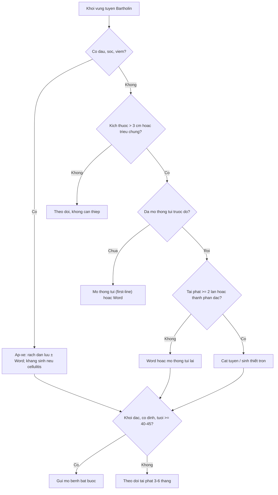
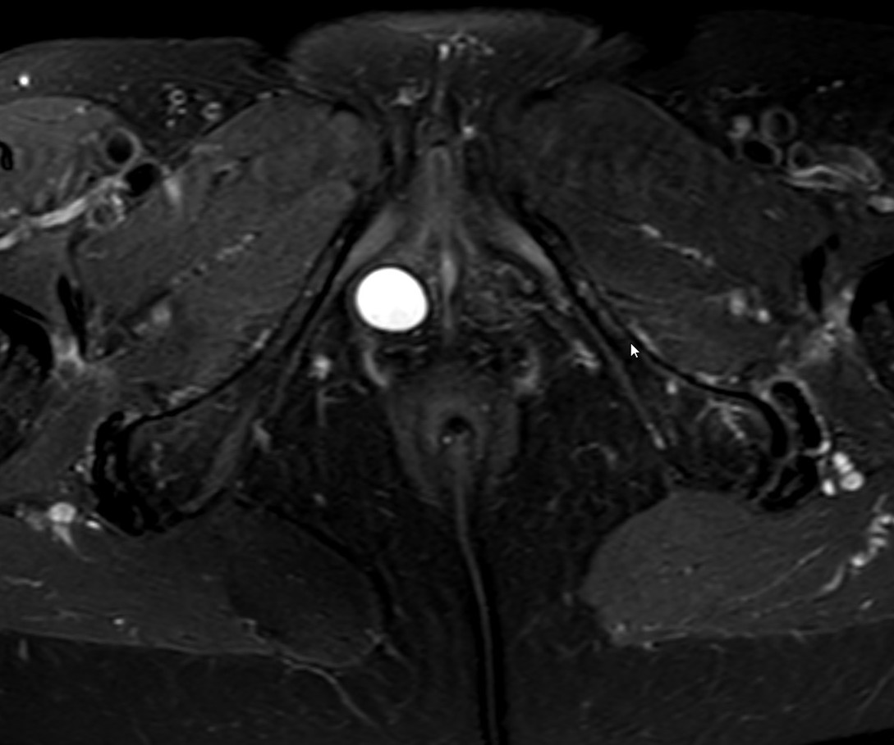
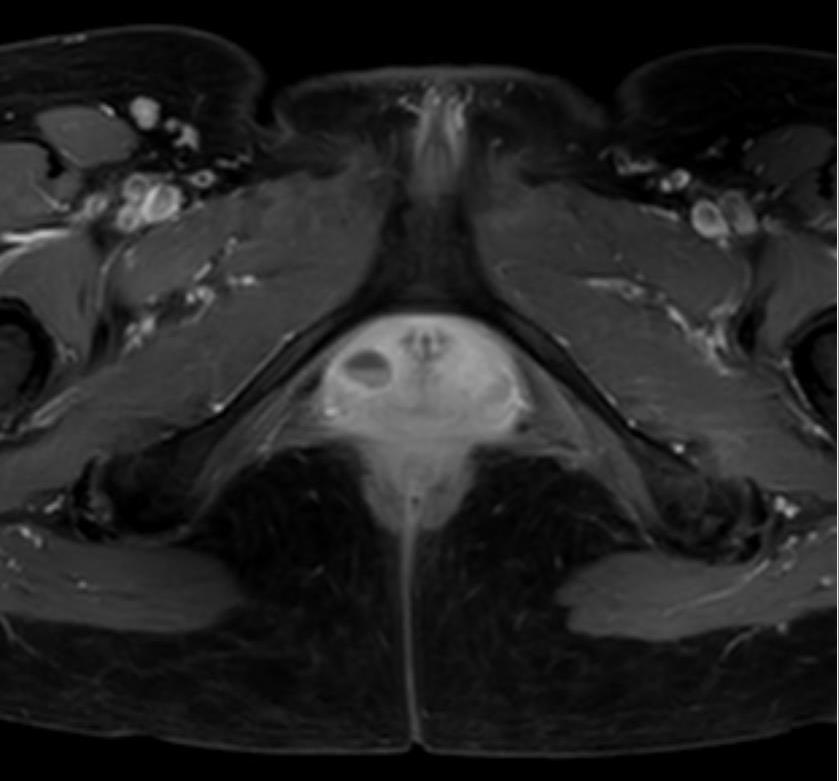

# 592 — Nang Bartholin tái phát: mổ thông túi, ống thông Word hay cắt tuyến — chọn thủ thuật & khi nào gửi mô bệnh / Recurrent Bartholin cyst: marsupialization, Word catheter or gland excision — procedure choice and when to biopsy

**Tags:** `pattern:nang-bartholin` `pattern:apxe-bartholin` `pattern:tai-phat` `pattern:u-am-ho` `vung:am-ho` `vung:tieu-khung` `protocol:US-am-ho` `protocol:MRI-tieu-khung` `protocol:marsupialization` `protocol:Word-catheter` `protocol:cat-tuyen`
**Mức chắc chắn (certainty):** tổng hợp y văn (literature synthesis) — tổng hợp 1 đoàn hệ hồi cứu 196 bệnh nhân so sánh mổ thông túi với ống thông Word (2022), 1 tổng quan MRI âm hộ 2026, 1 tổng quan ung thư tuyến Bartholin 2025, 1 tổng quan nang tiểu khung ESUR 2026 và dữ liệu hình ảnh Wikimedia Commons. Không có ca nguyên văn riêng của nhóm.

## 1. Tổng quan bệnh học – cơ chế hình ảnh

- **Giải phẫu:** tuyến Bartholin (greater vestibular gland) nằm ở **1/3 sau môi lớn**, đổ vào rãnh tiền đình ở **4 giờ và 8 giờ**; ống tuyến dài **2–2,5 cm**. Tuyến tiết nhầy giúp làm ẩm tiền đình.
- **Sinh lý bệnh:** ống tuyến bị tắc → dịch nhầy ứ lại thành **nang (cyst)**; bội nhiễm vi khuẩn (thường hỗn hợp kỵ khí, *E. coli*) → **áp-xe (abscess)**. Nang/áp-xe gặp ở khoảng **2% phụ nữ**, chủ yếu tuổi sinh sản.
- **Vì sao tái phát:** điều trị chỉ mở một lỗ nhỏ hoặc chỉ chọc hút → **lỗ thoát đóng lại**, biểu mô ống tuyến không được “may vào” da → nang tái hình thành. Mổ thông túi (marsupialization) tạo **cửa sổ biểu mô hóa vĩnh viễn**; ống thông Word giữ đường dẫn lưu nhưng phụ thuộc việc bệnh nhân giữ ống đủ lâu. Cắt tuyến (excision) loại bỏ hoàn toàn nang và tuyến nhưng xâm lấn hơn.
- **TẠI SAO hình ảnh học quan trọng:** quyết định thủ thuật dựa trên **thành phần của khối**:
  - **Nang đơn thuần:** dịch **T2 rất sáng**, thành mỏng, **không ngấm**, không có thành phần đặc → thủ thuật bảo tồn.
  - **Áp-xe:** dịch **hỗn hợp echo**, vách dày, **tăng tưới máu quanh**, phù mô, **hạn chế khuếch tán** → dẫn lưu là chính.
  - **Khối đặc/thành phần đặc ngấm mạnh:** không được coi là “nang” — **sinh thiết/cắt trọn** để loại trừ ung thư tuyến Bartholin (BGC) hoặc sarcoma.
- **Ngưỡng định lượng bắt buộc nhớ:**
  - **Kích thước trung bình** trong đoàn hệ 196 ca: **3,66 ± 1,21 cm** (mổ thông túi) và **3,65 ± 0,73 cm** (Word) — đa số 3–4 cm.
  - **Tái phát:** mổ thông túi **8,3% (11/132)** vs ống thông Word **18,8% (12/64)**, **p = 0,034**. Y văn ghi nhận khoảng **2–25%** cho mổ thông túi và **3–17%** cho Word.
  - **Thời gian tái phát:** **7,27 ± 6,46 tháng** (mổ thông túi) vs **5,58 ± 3,34 tháng** (Word).
  - **Thời gian mổ:** Word **15,85 ± 2,88 phút** vs mổ thông túi **21,67 ± 4,87 phút** (p = 0,001) — lợi thế duy nhất của Word.
  - **Hài lòng (VAS 1–5):** mổ thông túi **4 (1–5)** vs Word **3 (1–5)**, p < 0,001; **20,3%** nhóm Word không muốn giới thiệu lại vs **9,1%** nhóm mổ thông túi.
  - **Ung thư tuyến Bartholin (BGC):** **3–7% ung thư âm hộ**, **< 1% ung thư phụ khoa**, tuổi trung vị **53**; **~50% chẩn đoán ở giai đoạn muộn** vì bị nhầm là nang/áp-xe; di căn hạch bẹn **> 40%** (41,1% trong một tổng quan hệ thống); bờ cắt mong muốn **2–3 mm**.
  - **Ngưỡng sinh thiết:** khối **đặc, cố định, không xẹp sau dẫn lưu, tái phát nhanh**, hoặc bệnh nhân **≥ 40–45 tuổi** → **không chỉ dẫn lưu**.

## 2. Mẫu hình + chẩn đoán phân biệt theo vị trí (Gamut)

- **Mẫu hình 1 — nang đơn thuần, không triệu chứng:** khối mềm, không đau, 4/8 giờ, < 3 cm. **Theo dõi**, không can thiệp.
- **Mẫu hình 2 — nang có triệu chứng (đau, vướng, ảnh hưởng sinh hoạt):** **mổ thông túi** là lựa chọn đầu tay; **ống thông Word** nếu bệnh nhân muốn thủ thuật nhanh, ít xâm lấn và chấp nhận giữ ống 4–6 tuần.
- **Mẫu hình 3 — áp-xe:** đau, sưng, nóng, sốt; có thể dao động. **Rạch dẫn lưu** ± đặt Word; kháng sinh khi có cellulitis, sốt, đái tháo đường, suy giảm miễn dịch, thai kỳ hoặc MRSA.
- **Mẫu hình 4 — tái phát sau mổ thông túi:** kiểm tra kỹ **vị trí, số vách, thành phần đặc**; lựa chọn **Word** hoặc **cắt tuyến**; nếu tái phát ≥ 2 lần → **cắt tuyến**.
- **Mẫu hình 5 — khối đặc/thành phần đặc:** **sinh thiết hoặc cắt trọn**, không chọc hút đơn thuần. Nghĩ **BGC (SCC/adenoid cystic/adenocarcinoma)**, sarcoma, angiomyxoma.
- **Mẫu hình 6 — khối lan sâu/qua sàn chậu:** đau nhiều, sốt, khí trong mô → **MRI/CT khẩn**, dẫn lưu rộng, loại trừ **viêm cân mạc hoại tử** và áp-xe lan từ trực tràng/ổ ngồi–trực tràng.
- **Mẫu hình 7 — khối vùng môi lớn nhưng không phải Bartholin:** nang ống Nuck (bẹn–môi lớn), nang Gartner (thành âm đạo trên khớp mu), nang biểu bì, máu tụ, endometrioma — **vị trí so với khớp mu và tiền đình** là chốt (bài [548](../548-nang-lanh-am-ho-am-dao/lesson.md)).
- **Gợi nhớ “4–8–40”:** **4/8 giờ** (vị trí) · **40 tuổi** (ngưỡng sinh thiết) · **4–6 tuần** (thời gian giữ ống Word) · **≥ 2 lần tái phát** (chỉ định cắt tuyến).

## 3. Bảng so sánh phân biệt (ma trận đối chiếu)

| Thực thể (entity) | Hình ảnh điển hình | Chốt vào (rule-in) | Chốt loại (rule-out) | Gợi ý xác nhận |
|---|---|---|---|---|
| **Nang Bartholin đơn thuần** | US: nang **trống âm/hồi âm kém**, bờ rõ, tăng âm sau; MRI: **T2 rất sáng**, thành mỏng, **không ngấm** | **Vị trí 4/8 giờ, dưới khớp mu, thành mỏng, không đau** | Thành dày/ngấm mạnh hoặc có thành phần đặc → không phải nang đơn thuần | US ± MRI; theo dõi nếu không triệu chứng |
| **Áp-xe Bartholin** | US: dịch **hỗn hợp echo**, vách/lắng cặn, **tăng tưới máu quanh**; MRI: vách dày ngấm, phù quanh, **DWI hạn chế** | **Đau + sưng + sốt + vách dày/ngấm** | Nang thành mỏng, không phù, không đau → không áp-xe | Dẫn lưu + cấy; kháng sinh theo bối cảnh |
| **Nang tái phát sau mổ thông túi** | Nang tại vị trí cũ, có thể nhiều vách; không có thành phần đặc | **Tiền sử mổ thông túi + nang tái hình thành** | Khối đặc/ngấm bất thường → nghi u | US + MRI; chọn Word hoặc cắt tuyến |
| **Ung thư tuyến Bartholin (BGC)** | Khối **đặc**, bờ không đều, ngấm mạnh, **DWI hạn chế**, có thể xâm lấn da/cơ; hạch bẹn | **Tuổi ≥ 40–45 + khối cứng/cố định + không xẹp sau dẫn lưu + tái phát nhanh** | Nang đơn thuần đáp ứng dẫn lưu, thành mỏng → ít khả năng | **Sinh thiết/cắt trọn**; MRI chậu + CT ngực–bụng; PET-CT nếu nghi di căn |
| **Sarcoma/angiomyxoma vùng Bartholin** | Khối **đặc–nhầy**, T2 rất sáng có dải tối, ngấm không đều, **xâm lấn/đẩy cơ sàn chậu** | **Khối lớn, phát triển nhanh, không đau kiểu viêm, tái phát sau “dẫn lưu”** | Nang dịch thuần, thành mỏng → loại trừ | MRI + sinh thiết trọn; **không chọc hút đơn thuần** |
| **Nang Gartner** | MRI: nang T2 sáng ở **thành âm đạo trước–bên, trên khớp mu** | **Trên khớp mu + thành bên âm đạo** | Vị trí 4/8 giờ dưới khớp mu → Bartholin | MRI; soát thận cùng bên |
| **Nang ống Nuck** | Nang/hydrocele hình thoi ở **ống bẹn–môi lớn**, thay đổi khi Valsalva; MRI có đường thông phúc mạc (type II) | **Vị trí bẹn–môi lớn + đường thông phúc mạc** | Khu trú tiền đình sau → Bartholin | MRI; phẫu thuật đóng ống Nuck |
| **Máu tụ/endometrioma âm hộ** | T1 **sáng** (máu), T2 tối/biến thiên; không ngấm; tiền sử chấn thương/phẫu thuật | **T1 sáng + tiền sử chấn thương/mổ/endometriosis** | T1 tối, T2 rất sáng → dịch đơn thuần | MRI ± US; theo dõi |

## 4. Protocol chụp + hệ phân độ/điểm chuẩn hóa

- **Siêu âm âm hộ (first-line):** đầu dò linear **7–12 MHz**, quét grayscale + **Doppler màu**; đo **3 chiều**, ghi vị trí theo đồng hồ, độ sâu so với da, số vách, thành phần đặc, tăng tưới máu quanh. So sánh hai bên. Có thể dùng **translabial/transperineal** khi khối lớn.
- **MRI tiểu khung (khi khối lớn, sâu, tái phát, không điển hình, nghi u):**
  - **T2FS axial – coronal – sagittal**, **T1 ± fat-sat** (tách mỡ/máu/protein), **DWI/ADC**, **T1FS sau tiêm**.
  - Mô tả: kích thước, thành, vách, thành phần đặc, **ngấm**, **hạn chế khuếch tán**, tương quan với **khớp mu, niệu đạo, trực tràng, cơ nâng hậu môn**, hạch bẹn.
  - **Nguyên tắc:** nang Bartholin điển hình nằm **sau–ngoài tiền đình, dưới khớp mu**; vị trí trên khớp mu/ thành âm đạo đổi chẩn đoán (Gartner).
- **CT:** không phải lựa chọn đầu tay cho khối lành; dùng khi cần đánh giá lan sâu/khí trong mô hoặc **staging** BGC (ngực–bụng–chậu, hạch bẹn).
- **PET-CT:** chủ yếu tìm di căn xa và hạch; **không có modality nào vừa nhạy vừa đặc hiệu** để loại trừ hạch sâu.
- **Chọn thủ thuật (algorithm):**

- **Kỹ thuật mổ thông túi (marsupialization):** rạch **1,5–3 cm** trên thành nang, dẫn hết dịch, rửa saline, **may mép vỏ nang vào mép da** bằng chỉ tiêu (polyglactin) để tạo cửa sổ biểu mô hóa; gây tê tại chỗ/đặt trong âm đạo.
- **Kỹ thuật ống thông Word:** rạch **5 mm**, đặt ống **15 French, dài 5,5 cm, bóng 3 cm**, bơm **3 mL saline**, cố định bằng một mũi chỉ; giữ **4–6 tuần** (nghiên cứu này giữ **4 tuần**).
- **Cắt tuyến (excision):** chỉ định khi tái phát nhiều lần, thất bại thủ thuật bảo tồn, hoặc nghi u; lấy trọn vỏ nang/tuyến, cầm máu kỹ, đóng da mô dưới da; nguy cơ máu tụ, nhiễm trùng, sẹo co kéo/đau khi giao hợp.
- **Sau thủ thuật:** vệ sinh nước ấm, giảm đau, tránh giao hợp/bơi lội 2–4 tuần; hẹn tái khám 1–2 tuần và hướng dẫn **tái khám ngay** nếu sốt, đau tăng, chảy máu nhiều, ống rơi.

## 5. Biến thể bình thường và cạm bẫy

- **Biến thể bình thường:**
  - Nang Bartholin **nhỏ, không triệu chứng** ở phụ nữ tuổi sinh sản là phát hiện tình cờ, không cần mổ.
  - Tuyến Bartholin có thể **không sờ thấy**; đừng “chẩn đoán nang” chỉ vì vùng môi lớn hơi đầy.
  - Sau mổ thông túi, cửa sổ nhỏ có thể trông như “lỗ rò” lành — không phải tái phát nếu không có túi dịch.
- **Cạm bẫy (pitfall):**
  1. **Mặc định mọi khối vùng Bartholin là lành:** ~50% BGC được chẩn đoán muộn vì bị nhầm nang/áp-xe; **tuổi ≥ 40–45, khối đặc/cố định, không xẹp sau dẫn lưu** = sinh thiết.
  2. **Chỉ rạch dẫn lưu hoặc chọc hút:** tái phát cao; nang cần **mổ thông túi/Word**, áp-xe cần dẫn lưu đủ rộng.
  3. **Word rơi sớm hoặc không giữ đủ 4–6 tuần:** mất tác dụng; hướng dẫn kỹ và hẹn kiểm tra.
  4. **Mổ thông túi trong áp-xe cấp nặng:** mô viêm phù, dễ rách/khó may; có thể dẫn lưu trước, mổ thông túi khi hết viêm.
  5. **Bỏ sót lan sâu/sàn chậu:** đau nhiều ngoài mức, sốt, khí trong mô → **viêm cân mạc hoại tử**, cần MRI/CT và dẫn lưu khẩn, không chờ “nang đơn thuần”.
  6. **Nhầm vị trí:** nang ống Nuck/Gartner/endometrioma có thể bị gọi là “Bartholin tái phát” — MRI và tương quan khớp mu giải quyết.
  7. **Kháng sinh đơn thuần:** không thay thế dẫn lưu; chỉ là hỗ trợ khi có cellulitis/nhiễm trùng hệ thống.
  8. **Thai kỳ:** ưu tiên dẫn lưu/mổ thông túi tối thiểu; tránh cắt tuyến rộng khi chưa cần.

## 6. Tự lượng giá — Blind Quiz

**Ca 1 — Nữ 34 tuổi, khối mềm vùng 7 giờ tiền đình sau, không đau, 3 cm.**

- Gợi ý: khối tồn tại nhiều tháng, không sốt, không đau khi đi lại.
- Câu hỏi: Chẩn đoán? Có cần mổ ngay không? Nếu khối to lên và đau thì chọn thủ thuật nào?

<b>Bấm để hiện đáp án (findings + chẩn đoán)</b>

- **Nang tuyến Bartholin** điển hình: vị trí **4/8 giờ**, dưới khớp mu, mềm, không viêm.
- **Không triệu chứng, < 3 cm** → **theo dõi**, không can thiệp.
- Nếu có triệu chứng: **mổ thông túi** (tái phát 8,3%) hoặc **Word** (18,8%, thủ thuật ngắn hơn nhưng cần giữ 4–6 tuần).
- Nguồn: Wikimedia Commons, tác giả Rossdud93, **CC0**.

**Ca 2 — Nữ 68 tuổi, MRI tiền khung vì lý do khác, tình cờ thấy nang T2 rất sáng cạnh tiền đình.**

- Gợi ý: nang **một bên**, thành mỏng, không có thành phần đặc; bệnh nhân không triệu chứng.
- Câu hỏi: Vì sao T2 sáng? Có cần sinh thiết vì tuổi 68 không? Theo dõi thế nào?

<b>Bấm để hiện đáp án (findings + chẩn đoán)</b>

- **T2 rất sáng** vì nang chứa **dịch nhầy/nước** (thời gian T2 dài); thành mỏng, không ngấm.
- **Không triệu chứng, thành mỏng, không thành phần đặc** → **không sinh thiết ngay**; nhưng ở **≥ 40–45 tuổi** phải **theo dõi sát** và sinh thiết nếu khối **đặc, cố định, lớn nhanh, tái phát** hoặc có thành phần đặc.
- Theo dõi: khám + siêu âm **3–6 tháng**; MRI khi thay đổi hình thái.
- Nguồn: Wikimedia Commons, tác giả Hellerhoff, **CC BY-SA 4.0**; ảnh nguyên bản.

**Ca 3 — Nữ 42 tuổi, tái phát sau 2 lần mổ thông túi; MRI sau tiêm có nang không ngấm, không thành phần đặc.**

- Gợi ý: khối 3,5 cm, không sốt, không đau nhiều; lần tái phát cách lần trước 6 tháng.
- Câu hỏi: Chọn thủ thuật gì? Có cần gửi mô bệnh không? Dấu hiệu nào trên MRI sẽ đổi hướng xử trí?

<b>Bấm để hiện đáp án (findings + chẩn đoán)</b>

- **Tái phát ≥ 2 lần** sau mổ thông túi → **cắt tuyến** là lựa chọn hợp lý; có thể cân nhắc Word nếu bệnh nhân muốn trì hoãn mổ.
- **Vẫn gửi mô bệnh** ở ca tái phát nhiều lần, đặc biệt **≥ 40 tuổi** — không loại trừ BGC/sarcoma chỉ vì MRI “nang không ngấm”.
- Dấu hiệu đổi hướng: **thành phần đặc ngấm mạnh**, **hạn chế khuếch tán**, **xâm lấn cơ/da**, **hạch bẹn** → sinh thiết/cắt trọn + staging.
- Nguồn: Wikimedia Commons, tác giả Hellerhoff, **CC BY-SA 4.0**; ảnh nguyên bản.

## Bài liên quan chéo
- [548 – Nang/khối lành vùng âm hộ – âm đạo: Bartholin, Gartner & ống Nuck](../548-nang-lanh-am-ho-am-dao/lesson.md) (chẩn đoán vị trí & DDx nang lành)
- [580 – U/giả u âm hộ – âm đạo hiếm gặp: angiomyxoma, adenoid cystic, hidradenoma](../580-u-gia-u-am-ho-am-dao-hiem/lesson.md) (khối đặc hiếm)
- [574 – Ung thư âm hộ – âm đạo: FIGO & hạch bẹn](../574-ung-thu-am-ho-am-dao-FIGO-hach-ben/lesson.md) (staging, hạch bẹn)
- [576 – Paget âm hộ & VIN](../576-paget-am-ho-va-VIN/lesson.md) (tổn thương da–niêm mạc)
- [521 – MRKH & tạo hình âm đạo](../521-mayer-rokitansky-MRKH-tao-hinh-am-dao/lesson.md) (giải phẫu âm đạo–tiền đình)

> Không dùng để chẩn đoán độc lập khi chưa có người hướng dẫn.
