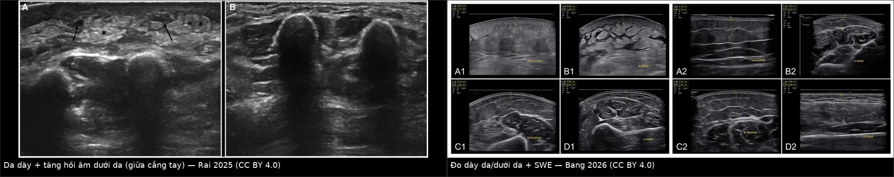
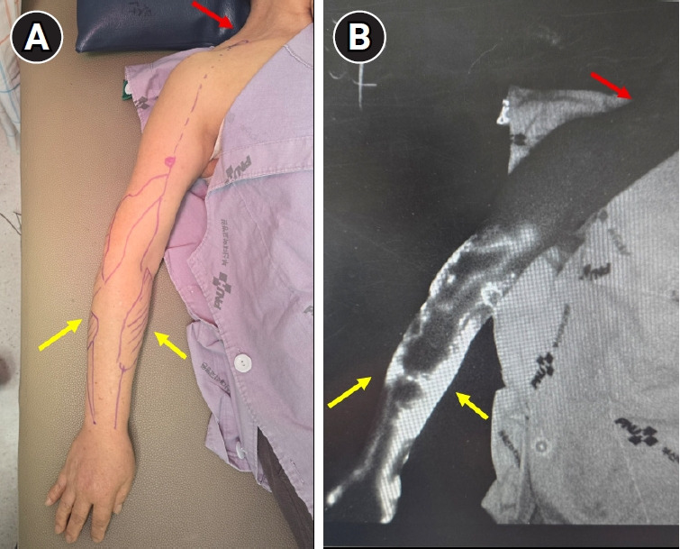
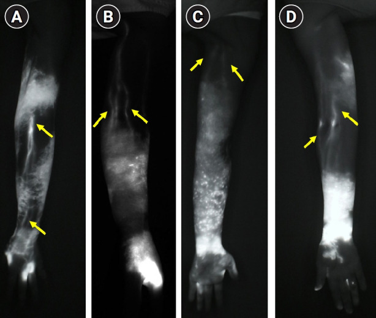
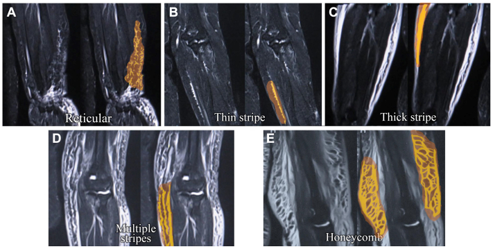
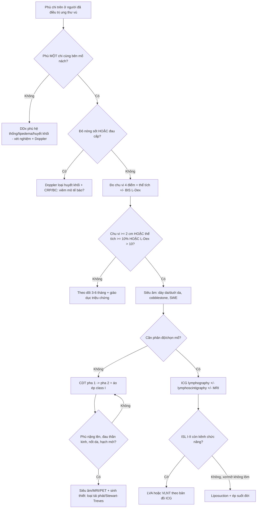

# 593 — Phù bạch mạch chi trên sau điều trị ung thư vú (BCRL): chẩn đoán hình ảnh, phân độ & xử trí / Breast cancer-related lymphedema

**Tags:** `pattern:phu-bach-mach` `pattern:phu-mo-mem` `pattern:day-da` `vung:chi-tren` `vung:vu` `score:ISL` `score:MDACC-ICG` `protocol:sieu-am` `protocol:MRI` `protocol:lymphoscintigraphy` `protocol:ICG`
**Mức chắc chắn (certainty):** tổng hợp y văn (literature synthesis) — nhóm tự biên từ y văn mở (Europe PMC/PMC: *Frontiers in Oncology* 2026, *British Journal of Radiology* 2025, *Diagnostics* 2026, *Ann Rehabil Med* 2026, *J Vasc Surg Venous Lymphat Disord* 2025) + trích số từ bài không mở toàn văn (*Med Oncol* 2024 — review of reviews; số liệu PREVENT trích qua PMC13225956). Ảnh CC BY 4.0 (được ghép) và CC BY-NC(-ND) (giữ nguyên bản).

## 1. Tổng quan — "bơm" bạch mạch hỏng sau mổ nách + cơ chế hình ảnh

- **Định nghĩa:** phù bạch mạch liên quan ung thư vú (breast cancer-related lymphedema — BCRL) là **suy bơm bạch mạch mạn tính (low-output failure)** sau tổn thương hệ bạch mạch nách do **mổ nách ± xạ vùng hạch**, dẫn tới ứ dịch giàu protein ở mô dưới da cánh tay/cẳng tay/bàn tay (và có thể cả vú, thành ngực).
- **Vì sao phải chẩn đoán sớm:** triệu chứng **nặng/nặng tay** xuất hiện **trước** phù khách quan — trong một nghiên cứu, tăng kích thước cánh tay xuất hiện **trung vị 6,1 tháng** trước khi phù đo được; giai đoạn **0 (dưới lâm sàng)** đã có rối loạn vận chuyển nhưng **chưa phù nhìn thấy** → nếu chỉ chờ "nhìn thấy phù" là đã bỏ lỡ cửa sổ điều trị.
- **Ngưỡng định lượng bắt buộc:**
  - **Tần suất:** ~**1/5 (≈20%)** người điều trị ung thư vú; **16–21%** trong các loạt BCRL (PMC13225956; PMC13512224); ước tính **140–250 triệu người** phù bạch mạch toàn cầu.
  - **Theo loại phẫu thuật (5 năm tích lũy):** **ALND 24,9%**, **ALND + xạ vùng hạch 30,1%**, **SLNB 8%**, **SLNB + xạ 10,7%** (PMC13225956).
  - **Theo phẫu thuật (Hàn Quốc, toàn quốc):** chung **12,2%**; **BCS + SLNB 8,0%**, **cắt toàn tuyến + SLNB 10,7%**, **BCS + ALND 23,5%**, **cắt tuyến triệt căn cải biên 28,5%** (PMC13225956).
  - **Yếu tố nguy cơ khác:** cắt toàn tuyến **RR 1,42** (1,15–1,76) so với bảo tồn; **tái tạo vú giảm nguy cơ — IRR 0,58** (0,38–0,87) trên 15.670 bệnh nhân (PMC13225956).
  - **Định nghĩa định lượng:** tăng **thể tích ≥ 10%** hoặc **chu vi ≥ 2 cm**; BIS **L-Dex > 10**; phân độ nặng theo ISL: **nhẹ > 5%**, **trung bình 20–40%**, **nặng > 40%** thể tích chi (PMC12012379).
  - **MFBIA (multifrequency bioimpedance):** ngưỡng tỷ lệ giữa hai chi **≥ 1,139** (tay thuận là bên bệnh) hoặc **≥ 1,066** (tay không thuận là bên bệnh) (PMC13512224).
- **TẠI SAO hình ảnh trông như vậy (vật lý + mô bệnh):**
  - **T2/STIR rất sáng:** dịch bạch mạch giàu protein có **T2 ~600 ms ở 3,0 T** → cần **STIR/T2 fat-sat** mới thấy rõ các kênh bạch mạch giãn và mô dưới da ứ dịch (PMC12012379).
  - **"Honeycomb"/"cobblestone":** dịch quấn quanh vách xơ giữa các tiểu thùy mỡ → hình **tổ ong** trên CT/MRI/US; **không gặp** trong phù do tĩnh mạch hay lipodystrophy (PMC12012379).
  - **Dày da:** ứ dịch + xơ hóa trung bì → da dày, hồi âm tăng; **SWE** tăng độ cứng **chỉ ở giai đoạn lâm sàng** (khi đã xơ), không tăng ở giai đoạn dưới lâm sàng (PMC13512224).
  - **Dermal backflow (DB):** khi kênh dẫn sâu tắc, bạch mạch **ở trung bì** phải gánh dòng → trên ICG thấy "vệt loang" thay vì đường tuyến tính; DB càng lan rộng = bệnh càng nặng (PMC13329518).
  - **Vì sao giai đoạn muộn không còn lõm:** mô mỡ tăng sinh + xơ hóa thay thế dịch → **non-pitting**, đây là lúc **CDT ít hiệu quả** và cần **hút mỡ/liposuction**.
- **Phản biện (fidelity + critique):** hiệu quả của **CDT** có bằng chứng trung bình, nhưng **MLD không thêm lợi ích thể tích** so với phần còn lại của CDT; **bài tập** cải thiện **đau/chất lượng sống** nhiều hơn thể tích; hiệu ứng lớn hơn ở **giai đoạn muộn** (*Med Oncol* 2024, PMID 39438358) → đừng hứa "xẹp tay" bằng MLD đơn thuần.

## 2. Mẫu hình (pattern) + chẩn đoán phân biệt theo bối cảnh (Gamut)

- **Khuôn 1 — Phù mềm, ấn lõm, giảm khi nâng tay/qua đêm.** Gamut: **BCRL giai đoạn I** vs phù do thuốc vs phù do tim–thận vs huyết khối tĩnh mạch. Chốt: **một chi, cùng bên điều trị, Stemmer (+), giảm khi nâng cao** → BCRL.
- **Khuôn 2 — Phù cứng, không lõm, dày da, "tổ ong" dưới da.** Gamut: **BCRL giai đoạn IIb–III (xơ + mỡ)** vs lipedema vs phù do suy tĩnh mạch mạn. Chốt: **tiền sử mổ nách/xạ + honeycomb + dày da + không đối xứng** → BCRL.
- **Khuôn 3 — Phù + đỏ, nóng, đau, sốt.** Gamut: **viêm mô tế bào/erysipelas** (biến chứng của BCRL) vs **huyết khối tĩnh mạch** vs tái phát u. Chốt: **sốt + đỏ lan nhanh + bạch cầu tăng** → nhiễm trùng; **siêu âm Doppler bắt buộc** để loại huyết khối.
- **Khuôn 4 — Phù mạn + nốt/tím/loét mới.** Gamut: **Stewart–Treves (angiosarcoma trên phù bạch mạch)** vs viêm mô tế bào tái diễn vs huyết khối vs tái phát da. Chốt: **nốt/tím không đáp ứng kháng sinh** → sinh thiết (bài [1602](../1602-hemangioma-ton-thuong-mach-lanh-vu/lesson.md)).
- **Khuôn 5 — Phù + đau vai/đau chi + yếu tay.** Gamut: **tái phát hạch nách/xâm lấn đám rối cánh tay** vs **xơ hóa sau xạ (radiation fibrosis)** vs bệnh thần kinh do xạ. Chốt: **đau kiểu thần kinh + yếu/dị cảm + khối hạch** → MRI/PET-CT; xơ xạ không có khối.
- **Khuôn 6 — Phù hai chi hoặc chi đối bên.** Gamut: **phù hệ thống (tim/thận/gan)** vs **lipedema** vs **phù do thuốc** vs BCRL hai bên (hiếm). Chốt: **đối xứng + toàn thân + không liên quan mổ nách** → tìm nguyên nhân hệ thống.
- **Gợi nhớ "RISK" cho BCRL:** **R**adiation vùng hạch, **I**nfection (viêm mô tế bào tái diễn), **S**urgery ALND (nhiều hạch lấy hơn), **K**ilograms (BMI cao).

## 3. Bảng so sánh phân biệt (ma trận đối chiếu)

| Thực thể (entity) | Hình ảnh điển hình | Chốt vào (rule-in) | Chốt loại (rule-out) | Gợi ý xác nhận |
|---|---|---|---|---|
| **BCRL** | Phù một chi cùng bên; US: **dày da, dày dưới da, hồi âm tăng, cobblestone**; MRI STIR/T2FS: **dịch dưới da, honeycomb, dày da**; LS: **DB, chậm/không hiện hạch nách**; ICG: DB theo mức | **Tiền sử ALND/RLNR + phù một chi + Stemmer (+) + honeycomb/dày da** | **Phù đối xứng, toàn thân, không tiền sử mổ nách** → không phải BCRL | Chu vi ≥ 2 cm hoặc thể tích ≥ 10%; L-Dex > 10; US/MRI |
| **Viêm mô tế bào / erysipelas** | Dày da **khu trú, đỏ, nóng**, tăng tưới máu; có thể ổ áp-xe; **không theo giải phẫu bạch mạch** | **Sốt + đỏ nóng lan nhanh + đáp ứng kháng sinh** | **Phù đối xứng, không sốt, mạn tính** → không phải nhiễm trùng | Lâm sàng + CRP/BC; US loại áp-xe/huyết khối |
| **Huyết khối tĩnh mạch (TM dưới đòn/nách)** | TM không xẹp khi ép, **thrombus trong lòng**, Doppler không dòng; phù cấp | **Phù cấp một chi + đau + TM không xẹp khi ép** | **TM xẹp bình thường + phù mạn** → loại huyết khối | Doppler mạch máu |
| **Tái phát hạch nách/xâm lấn đám rối** | Khối hạch **mất rốn mỡ, vỏ dày**, xâm lấn; MRI ngấm, DWI sáng; PET dương | **Khối hạch mới/không đối xứng + đau thần kinh + PET dương** | **Không khối, chỉ phù/dày da** → nghiêng BCRL | Siêu âm + FNA/core; MRI/PET-CT |
| **Stewart–Treves (angiosarcoma)** | Da–dưới da, **nhiều ổ (59,3%)**, bờ **không rõ (92,9%)**; T1 trung gian (84,2%), T2 trung gian/hỗn hợp; **ADC thấp 0,77–0,96 × 10⁻³ mm²/s** | **Chi phù mạn + nốt/tím/loét mới + MYC (+)** | **Chỉ phù đều, không nốt, ổn định** → không phải sarcoma | Sinh thiết sâu + MYC (bài 1602, 523) |
| **Xơ hóa sau xạ / bệnh đám rối do xạ** | Da dày đều trong trường xạ, mô xơ **không ngấm**, không khối; teo cơ, thay đổi tín hiệu thần kinh | **Tiền sử xạ + thay đổi đối xứng theo trường chiếu + không khối** | **Khối/ngấm/DWI sáng** → không phải xơ đơn thuần | MRI; EMG nếu nghi thần kinh |
| **Lipedema / phù hệ thống** | Phù **hai chi đối xứng**, mô mỡ dày, **bàn chân không phù** (lipedema); phù toàn thân kèm báng/tràn dịch | **Đối xứng + bàn chân thoát + toàn thân** | **Một chi, cùng bên mổ nách** → không phải lipedema | Lâm sàng + xét nghiệm tim/thận/gan |
| **Seroma/lymphocele sau mổ** | Tụ dịch khu trú **dưới da/thành ngực**, không ngấm (trừ vỏ), co nhỏ | **Tụ dịch khu trú + không ngấm + giảm dần** | **Dịch lan toàn chi + dày da** → không phải seroma | Siêu âm; chọc hút nếu cần |

*Trái: da dày, mô dưới da **tăng hồi âm** và có vùng dịch (dấu hoa thị) ở giữa cẳng tay — bệnh nhân ung thư vú phải đã mổ + xạ. Phải: kỹ thuật đo **dày da/dưới da** và **shear-wave elastography** ở nhiều vị trí, so sánh hai chi. Ảnh ghép letterbox, CC BY 4.0 (Rai P et al., Br J Radiol 2025, PMC12012379; Bang MH et al., Diagnostics 2026, PMC13512224).*

### Phân độ — dùng đúng thang, đừng trộn
- **ISL (lâm sàng):** **0** — dưới lâm sàng (không phù dù vận chuyển đã rối loạn); **I** — phù mềm, **giảm khi nâng cao chi**, còn lõm; **II** — **không giảm khi nâng cao**; **IIa** còn lõm, **IIb** không lõm (xơ); **III** — **lymphostatic elephantiasis**: da dày sừng, nhú, biến dạng chi.
- **MDACC ICG (hình ảnh chức năng):** **0–V** theo mức **dermal backflow** và mất dần **kênh tuyến tính**; 0–I còn kênh tuyến tính liên tục, IV–V DB lan tỏa/không còn kênh (PMC13329518).
- **Taiwan Lymphoscintigraphy Staging (TLS):** **L-0, P-1, P-2, P-3, T-4, T-5, T-6** dựa trên hiện hình **hạch gần tại 120 phút**, hạch xa, ống dẫn và **DB** (PMC12012379). Thêm **SPECT/CT** làm **thay đổi phân độ 15,4%** ca so với planar — nhưng tăng liều xạ/chi phí.
- **NMRI stage (MRI không cản quang):** dựa trên pattern **reticular → thin stripe → thick stripe → multiple stripes → honeycomb**; **70,8% vùng khảo sát** có bất thường (95,4% bệnh nhân); stage cao tương quan với **ICG stage (rs = 0,83)** và **UEL index (rs = 0,65)** (PMC11999599).

*Bệnh nhân BCRL: (A) chiếu bản đồ mạch nông lên da, (B) ảnh ICG tương ứng — **mũi tên vàng** = dermal backflow, **mũi tên đỏ** = đường thoát cuối. Nguồn: Suami H, Yoon JA, Ann Rehabil Med 2026, Fig. 2, CC BY-NC 4.0 (giữ nguyên bản).*

*Các kiểu DB (khu trú → đoạn → vùng → lan rộng → lan tỏa) và mức còn kênh chức năng; **mũi tên** = mạch bạch mạch còn thông. Đây là cơ sở để chọn vị trí **nối bạch mạch–tĩnh mạch (LVA)** và hướng dẫn MLD. Nguồn: Suami H, Yoon JA, Ann Rehabil Med 2026, Fig. 3, CC BY-NC 4.0 (giữ nguyên bản).*

*T2-weighted DIXON: các kiểu **reticular**, **thin stripe**, **thick stripe**, **multiple stripes**, **honeycomb** — từ nhẹ đến nặng. Nguồn: Kageyama T et al., J Vasc Surg Venous Lymphat Disord 2025, Fig. 2, CC BY-NC-ND 4.0 (giữ nguyên bản).*

## 4. Protocol chẩn đoán – theo dõi – điều trị + lưu đồ

- **Trước mổ (baseline bắt buộc):** đo **chu vi 4 điểm** cả hai chi + **perometry** (nếu có) + **BIS** làm mốc; giáo dục bệnh nhân về triệu chứng nặng/tức.
- **Theo dõi sau mổ:** mỗi **3–6 tháng** trong 2–3 năm đầu (nhóm ALND/RLNR), sau đó **hằng năm**; **BIS** có thể phát hiện **dưới lâm sàng**: trong PREVENT, theo dõi bằng BIS giảm tiến triển **7,9% vs 19,2%** so với đo chu vi (trích trong PMC13225956) — nhưng MASCC chỉ coi BIS là **tùy chọn** (PREVENT có khác biệt yếu tố nền).
- **Chẩn đoán hình ảnh theo câu hỏi lâm sàng:**
  - **Siêu âm (đầu tay):** đo dày da/dưới da ở **giữa cánh tay** (chi trên) hoặc **giữa cẳng chân** (chi dưới); tìm **cobblestone**, tăng hồi âm, dịch; **SWE** tăng độ cứng khi đã xơ. **Bắt buộc Doppler** nếu phù cấp/đau để loại huyết khối.
  - **Lymphoscintigraphy ⁹⁹ᵐTc-nanocolloid:** đánh giá **vận chuyển** và **DB**, phân độ TLS; **SPECT/CT** khi cần định vị (đổi phân độ 15,4%).
  - **ICG lymphography:** **bản đồ kênh chức năng + DB**, độ sâu 2–4 cm (hạn chế ở người béo); là **chuẩn vàng để chọn vị trí LVA** và hướng MLD.
  - **MRI (STIR/T2FS hoặc T2-DIXON):** đo dịch dưới da, honeycomb, dày da; tư thế "superman" cho chi trên; **CE-MRL** (0,5–2 mL gadolinium nội bì/nội hạch, độ phân giải ~1 mm³) khi cần vẽ giải phẫu trước mổ.
  - **CT:** **honeycomb**, dày da, loại trừ hạch/tái phát; **không** là lựa chọn đầu tay vì liều xạ.
- **Điều trị bảo tồn — CDT 2 pha (chuẩn nền):**
  - **Pha 1 (2–4 tuần, intensive):** băng ép nhiều lớp **short-stretch**, **MLD**, bài tập, chăm sóc da; giảm thể tích nhanh.
  - **Pha 2 (duy trì suốt đời):** **áo ép ít nhất class I** khi thức, găng/tay áo chống phù bàn tay; tự MLD/bài tập; **IPC** hỗ trợ; kiểm soát cân nặng.
  - **Bằng chứng cần nói đúng:** CDT giảm thể tích (bằng chứng trung bình); **MLD thêm không cải thiện thể tích**; **bài tập** cải thiện **đau/chất lượng sống** nhiều hơn thể tích (*Med Oncol* 2024).
- **Điều trị ngoại khoa (chọn theo giai đoạn + mô):**
  - **Dự phòng tại lúc mổ nách — LYMPHA/ILR:** nối bạch mạch–tĩnh mạch ngay sau ALND; S-LYMPHA (37 ca, ICG-guided) ghi nhận **2,7%** phù lâm sàng ở 6 tháng — **dữ liệu khả thi/an toàn, chưa đủ chứng minh hiệu quả** (PMC13599758).
  - **LVA (lymphaticovenous anastomosis):** giai đoạn sớm–trung, còn kênh chức năng; chọn vị trí bằng **ICG + siêu âm tần số cao**.
  - **VLNT (vascularized lymph node transfer):** chủ yếu **ISL II–III** (71,3% ca trong tổng quan là độ II; 11,2% độ I; 17,5% độ III).
  - **Hút mỡ (liposuction) ± compression:** **giai đoạn muộn, không lõm**, mô mỡ–xơ chiếm ưu thế; giảm thể tích bền nhưng **phải mang ép suốt đời**.
- **Khi nào nghi tái phát thay vì BCRL:** phù **mới/xấu nhanh**, **đau thần kinh**, **khối/hạch mới**, **nốt da** → siêu âm + MRI/PET-CT + sinh thiết; **đừng quy mọi thứ cho "phù sau mổ"**.

## 5. Biến thể bình thường và cạm bẫy

- **Cạm bẫy "phù là do mổ" — bỏ sót huyết khối:** phù cấp một chi sau ung thư vú **phải loại huyết khối tĩnh mạch** (TM dưới đòn/nách) bằng Doppler trước khi quy cho BCRL.
- **Cạm bẫy "đỏ = nhiễm trùng":** **erysipelas** hay tái diễn trên nền phù bạch mạch; nhưng **viêm mô tế bào** cũng là **yếu tố làm nặng phù** → điều trị nhiễm trùng **và** duy trì CDT, không ngừng ép.
- **Cạm bẫy "đo chu vi là đủ":** chu vi bỏ sót **phù dưới lâm sàng** và không phân biệt **dịch vs mỡ**; ở giai đoạn muộn thể tích tăng do **mỡ**, nên **giảm cân/hút mỡ** khác hoàn toàn **giảm dịch**.
- **Cạm bẫy "BIS thay thế mọi thứ":** L-Dex **không dùng được khi không có baseline** hoặc **phù hai chi**; MASCC xem BIS là **tùy chọn**.
- **Cạm bẫy "MLD là điều trị chính":** MLD **không thêm lợi ích thể tích** khi đã có CDT đầy đủ; đừng bỏ **áo ép + bài tập + chăm sóc da**.
- **Cạm bẫy "phù mạn là lành":** phù bạch mạch mạn là **nền của Stewart–Treves** — nốt/tím/loét mới **phải sinh thiết**, không theo dõi kháng sinh dài.
- **Cạm bẫy sau xạ:** xơ hóa sau xạ gây **dày da + phù + hạn chế vận động** giống BCRL; **khối/ngấm/DWI sáng** mới gợi tái phát.
- **Cạm bẫy "phù hai chi hiếm gặp":** vẫn có thể do **BIS/đo sai vị trí**, **thuốc**, **suy tim**, hoặc **lipedema**; đừng gán BCRL mà bỏ qua bệnh nền.
- **Cạm bẫy hình ảnh:** **honeycomb** trên CT/MRI là dấu hiệu mạnh của phù bạch mạch nhưng **không đặc hiệu cho BCRL** — vẫn cần bối cảnh mổ nách/xạ.

## 6. Tự lượng giá — Blind Quiz

**Ca 1 — Nữ 58 tuổi, 8 tháng sau ALND + xạ vùng hạch, tay phải nặng và to hơn. Đọc siêu âm.**

- Hỏi: hai dấu hiệu nào trên siêu âm ủng hộ BCRL? Cần loại trừ gì trước khi kết luận?

<b>Bấm để hiện đáp án (findings + chẩn đoán)</b>

- **Findings:** da dày, mô dưới da dày và **tăng hồi âm**, có vùng dịch (dấu hoa thị); so sánh với chi đối diện thấy rõ bất đối xứng.
- **Chẩn đoán:** **BCRL** (giai đoạn ISL I–II tùy mức giảm khi nâng tay). Trước đó phải **Doppler** loại huyết khối và loại viêm mô tế bào nếu đỏ/nóng/sốt.
- **Xử trí:** CDT pha 1 → áo ép class I duy trì; đo lại chu vi/thể tích; BIS nếu có baseline.
- Nguồn ảnh: Rai P et al., Br J Radiol 2025, Fig. 2, CC BY 4.0 + Bang MH et al., Diagnostics 2026, Fig. 3, CC BY 4.0 (ảnh ghép letterbox).

**Ca 2 — Cùng bệnh nhân, nghi phù nặng, cần đánh giá chức năng bạch mạch trước khi cân nhắc LVA. Đọc ICG.**

- Hỏi: mũi tên vàng và mũi tên đỏ chỉ gì? DB nói lên điều gì về khả năng mổ?

<b>Bấm để hiện đáp án (findings + chẩn đoán)</b>

- **Findings:** **mũi tên vàng = dermal backflow** (vùng loang, mất đường tuyến tính); **mũi tên đỏ = đường thoát cuối còn hiệu quả**. Còn **kênh tuyến tính** ở một số vùng.
- **Chẩn đoán:** BCRL có **DB khu trú/đoạn** nhưng **còn kênh chức năng** → ứng viên **LVA**; DB càng lan tỏa, càng ít kênh → ưu tiên VLNT/hút mỡ.
- **Bài học:** ICG quyết định **vị trí nối** và **hướng MLD**, không chỉ để "chụp cho đẹp".
- Nguồn ảnh: Suami H, Yoon JA, Ann Rehabil Med 2026, Fig. 2, CC BY-NC 4.0 (giữ nguyên bản).

**Ca 3 — Nữ 62 tuổi, phù tay 6 năm, nay nốt tím trên cẳng tay. Đọc MRI.**

- Hỏi: các kiểu tín hiệu này nói gì về giai đoạn? Khi có nốt tím, MRI đủ để loại sarcoma chưa?

<b>Bấm để hiện đáp án (findings + chẩn đoán)</b>

- **Findings:** các kiểu **reticular → thin stripe → thick stripe → multiple stripes → honeycomb** tương ứng mức ứ dịch tăng dần; stage MRI cao tương quan với **ICG stage (rs = 0,83)** và **UEL index (rs = 0,65)**.
- **Chẩn đoán:** **BCRL** giai đoạn tiến triển (nhiều khả năng ISL IIb–III). **Nốt tím mới** = nghi **Stewart–Treves** → **sinh thiết sâu + MYC**, MRI **không thay thế** mô bệnh.
- Nguồn ảnh: Kageyama T et al., J Vasc Surg Venous Lymphat Disord 2025, Fig. 2, CC BY-NC-ND 4.0 (giữ nguyên bản).

## Bài liên quan chéo
- [500 – Tổng quan Hệ Vú & Sản Phụ khoa](../500-tong-quan-vu-san-phu-khoa/lesson.md)
- [522 – Theo dõi sau điều trị ung thư vú: nhũ ảnh/DBT, siêu âm, MRI & CEM](../522-theo-doi-sau-dieu-tri-ung-thu-vu/lesson.md)
- [523 – Sarcoma mạch do xạ ở vú (RAAS)](../523-sarcoma-mach-do-xa-vu/lesson.md)
- [589 – Sinh thiết hạch gác & cắt hạch nách có định hướng (TAD)](../589-sinh-thiet-hach-gac-nach-targeted-axillary-dissection/lesson.md)
- [1602 – Hemangioma & tổn thương mạch lành tính của vú vs angiosarcoma](../1602-hemangioma-ton-thuong-mach-lanh-vu/lesson.md)
- [376 – U phần mềm KHÔNG mỡ: schwannoma vs sarcoma myxoid](../376-u-phan-mem-khong-mo/lesson.md)

## Ảnh
- `images/composite_sieu-am-phu-bach-mach.jpg`, `images/593_phu-bach-mach_US_PMC12012379.jpg`, `images/593_phu-bach-mach_US-do-day_PMC13512224.jpg`, `images/593_phu-bach-mach_ICG_PMC13329518.jpg`, `images/593_phu-bach-mach_ICG-mau_PMC13329518.jpg`, `images/593_phu-bach-mach_MRI_PMC11999599.jpg`, `images/593_phu-bach-mach_MRI-do_PMC11999599.jpg`. Nguồn + giấy phép từng ảnh trong `images/CREDITS.md`.

> Không dùng để chẩn đoán độc lập khi chưa có người hướng dẫn.
