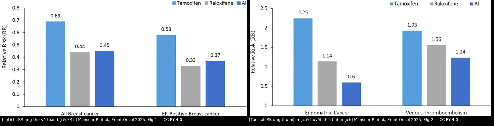
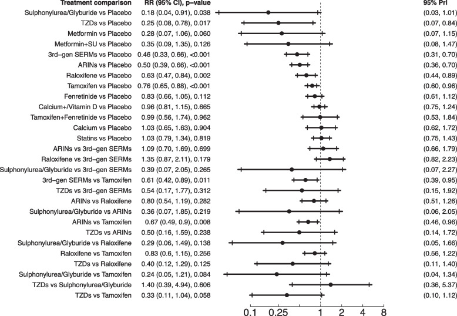
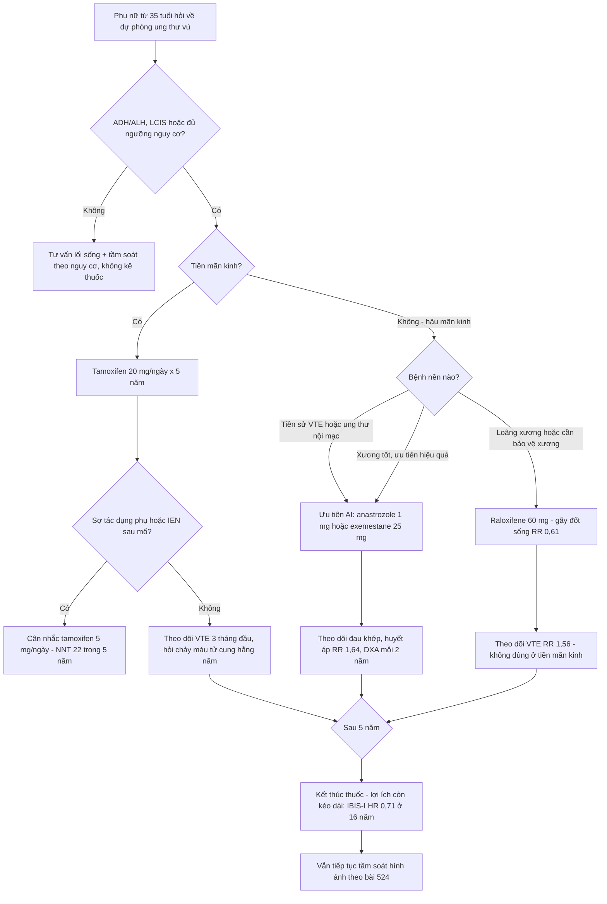

# 594 — Hóa dự phòng ung thư vú nguy cơ cao: chọn thuốc theo mãn kinh, ngưỡng nguy cơ & theo dõi độc tính / Endocrine chemoprevention of breast cancer

**Tags:** `pattern:nguy-co-cao` `pattern:hoa-du-phong` `vung:vu` `score:Gail-BCRAT` `score:IBIS-TyrerCuzick` `score:ASCO-nguy-co` `protocol:tu-van-nguy-co` `protocol:MRI-vu` `anatomy:mo-tuyen-vu`
**Mức chắc chắn (certainty):** tổng hợp y văn (literature synthesis) — nhóm tự biên từ 3 bài tổng quan/toàn văn mở CC BY (Mansour R et al., *Front Oncol* 2025, PMC12209358; Manna EDF et al., *Healthcare* 2023, PMC10454363; Pourali G et al., *Breast Cancer Res* 2025, PMC12211815) + số liệu thử nghiệm gốc được các bài này trích lại (NSABP P-1, IBIS-I, MORE/CORE, RUTH, STAR, MAP.3, IBIS-II, TAM-01, USPSTF 2019). Ảnh: 2 khung CC BY 4.0 được ghép + 1 khung CC BY-NC-ND giữ nguyên bản.

> **Bài này KHÔNG dạy đọc ảnh vú, mà dạy bước *trước* chẩn đoán:** ai đủ ngưỡng nguy cơ để uống thuốc, uống thuốc nào, và theo dõi gì. Bác sĩ CĐHA là người (a) đo mật độ/BPE, (b) chạy mô hình nguy cơ, (c) phát hiện tác dụng phụ trên ảnh — nên cần biết ngưỡng ở đây.

## 1. Tổng quan — vì sao chỉ có 4 thuốc, và vì sao "ER+ mới giảm"

- **Bản chất:** ~**70–75%** ung thư vú là ER+ (thụ thể estrogen dương). Estrogen là "nhiên liệu" tăng sinh tế bào biểu mô tuyến; hóa dự phòng nội tiết cắt nhiên liệu đó ở **2 điểm khác nhau**:
  - **SERM (tamoxifen, raloxifene)** — chiếm/thay đổi cấu hình thụ thể ER ở mô vú → **đối kháng** tại vú (nhưng **đồng vận** tại xương/tử cung: tamoxifen giữ xương nhưng kích nội mạc; raloxifene chọn lọc hơn → ít nội mạc).
  - **Ức chế aromatase (AI: anastrozole, exemestane)** — chặn enzym chuyển androgen → estrogen ở **mô ngoại vi (mỡ, cơ, gan)**. **Hệ quả số 1:** ở phụ nữ **tiền mãn kinh**, buồng trứng vẫn sản xuất estrogen theo chu kỳ và **không phụ thuộc aromatase ngoại vi** → AI **không đủ hiệu quả** (còn có thể kích buồng trứng); **AI chỉ dùng cho hậu mãn kinh**.
- **Vì sao lợi ích chỉ nằm ở ER+:** cả 3 nhóm thuốc đều can thiệp trục estrogen → **giảm mạnh ER+**, **không giảm ER−/triple-negative** (P-1: ER+ giảm **69%**, ER− **không đổi**). Đây là lý do phải nói rõ với bệnh nhân: "thuốc này không phòng được ung thư vú thể ba âm".
- **Ngưỡng định lượng — lợi ích (RR, theo bài tổng quan CC BY PMC12209358, Fig 1):**
  - **Tamoxifen: RR toàn bộ 0,69 — ER+ 0,58** (P-1, IBIS-I, Royal Marsden, Italian).
  - **Raloxifene: RR toàn bộ 0,44 — ER+ 0,33** (MORE/CORE, RUTH, STAR).
  - **AI (anastrozole/exemestane): RR toàn bộ 0,45 — ER+ 0,37** (IBIS-II, MAP.3).
- **Ngưỡng định lượng — tác hại (cùng nguồn, Fig 2):**
  - **Tamoxifen:** ung thư nội mạc tử cung **2,25**; **VTE 1,93**.
  - **Raloxifene:** nội mạc **1,14**; **VTE 1,56**.
  - **AI:** nội mạc **0,60**; **VTE 1,24**.

- **Số tuyệt đối (đừng chỉ nói RR):** P-1 (13.388 phụ nữ, tamoxifen 20 mg/ngày × 5 năm): ung thư vú xâm lấn **42,5 → 24,8/1000 phụ nữ** (RR 0,57; 0,46–0,70). MAP.3 (4.560 phụ nữ, exemestane): **NNT 94** trong 3 năm và **26** trong 5 năm để tránh 1 ung thư xâm lấn. TAM-01 (liều nhỏ 5 mg/ngày): **NNT 22** trong 5 năm, **14** trong 10 năm.
- **TẠI SAO hình ảnh học lại liên quan (cơ chế):**
  - **Mật độ tuyến (FGT) giảm** dưới tamoxifen/AI → nhũ ảnh **nhạy hơn**, nhưng **đừng đọc "mật độ giảm = lành"**; ngược lại, mật độ **tăng** khi dùng HRT.
  - **BPE (tăng ngấm mô tuyến nền) sụp về "minimal"** khi dùng tamoxifen → MRI **dễ đọc hơn** nhưng **dễ bỏ sót tổn thương ngấm yếu** vì nền phẳng; xem [595](../595-bpe-tang-ngam-mo-tuyen-nen-mri-vu/lesson.md).
  - **Tử cung:** tamoxifen làm **dày nội mạc/dịch trong buồng** ở một tỉ lệ — đây là **tác dụng thuốc**, không phải bệnh lý nội mạc; chỉ sinh thiết khi **chảy máu bất thường** (xem 525).
- **Phản biện (fidelity + critique):** hai con số "RR" hay bị trộn —
  - Bài tổng quan PMC12209358 báo **tamoxifen 0,69 / raloxifene 0,44 / AI 0,45** (gộp theo nhóm thuốc, thời gian theo dõi dài).
  - NMA 43 RCT, **337.240 phụ nữ** (PMC12211815) báo **tamoxifen 0,76 / raloxifene 0,63 / AI 0,50** (NNT tương ứng **149,7 / 96,9 / 73,0**). Khác biệt do **bộ thử nghiệm + thời gian + mô hình gộp khác nhau**, không phải mâu thuẫn sinh học → khi trích phải ghi rõ nguồn nào.
  - NMA còn xếp **sulfonylurea (RR 0,18)** và **thiazolidinedione (RR 0,25)** lên đầu bảng SUCRA — nhưng đây là **tín hiệu thứ cấp từ ít thử nghiệm, không phải chỉ định dự phòng** → **không dùng để kê thuốc đái tháo đường cho người khỏe mạnh**.

*Trái: **RR ung thư vú** (toàn bộ và ER+) của tamoxifen 0,69/0,58, raloxifene 0,44/0,33, AI 0,45/0,37. Phải: **RR tác hại** — ung thư nội mạc 2,25/1,14/0,60 và VTE 1,93/1,56/1,24. Đọc cặp hình này cùng nhau: **raloxifene/AI đổi "ít nội mạc hơn" lấy "ít lợi ích hơn tamoxifen"** (và AI có giá trị cao nhất cho ER+ nhưng chỉ hậu mãn kinh). Ảnh ghép letterbox, CC BY 4.0 (Mansour R et al., Front Oncol 2025, Fig 1 + Fig 2, PMC12209358).*

## 2. Mẫu hình (pattern) + chẩn đoán phân biệt theo bối cảnh (Gamut)

"Cùng một câu hỏi — *người này có nên uống thuốc dự phòng?* — nhưng gamut đổi theo **trạng thái mãn kinh**, **bệnh nền** và **nhu cầu sinh sản**":

- **Khuôn 1 — Tiền mãn kinh, còn nhu cầu sinh sản:** chỉ **tamoxifen** là lựa chọn được chứng minh (AI **không** dùng). Bàn thêm: liều nhỏ **5 mg/ngày** (TAM-01) khi lo tác dụng phụ. Nếu đang **mong con** → hoãn/không dùng, tư vấn sau sinh.
- **Khuôn 2 — Hậu mãn kinh, không loãng xương:** **AI (anastrozole 1 mg hoặc exemestane 25 mg)** là ưu tiên hiệu quả cao nhất; **tamoxifen** nếu lo xương; **raloxifene** nếu cần "một mũi hai đích" (xương + vú) và sợ nội mạc.
- **Khuôn 3 — Hậu mãn kinh + loãng xương/nguy cơ gãy xương:** **raloxifene 60 mg** (giảm gãy đốt sống **RR 0,61**; 7 ca/1000 phụ nữ) hoặc **tamoxifen** (giữ mật độ xương) — **tránh AI** nếu xương mỏng vì AI gây đau khớp và giảm mật độ.
- **Khuôn 4 — Tiền sử VTE / đang bất động / béo phì nặng / hút thuốc:** **tránh SERM** (VTE RR 1,93 tamoxifen; 1,56 raloxifene); **AI** là lựa chọn an toàn hơn về VTE (RR 1,24) — nhưng phải hậu mãn kinh.
- **Khuôn 5 — Tiền sử ung thư nội mạc tử cung / chảy máu tử cung bất thường / đang dùng estrogen đơn thuần:** **tránh tamoxifen**; chọn **AI** hoặc **raloxifene** (RR nội mạc 0,60 và 1,14).
- **Khuôn 6 — ADH/ALH, LCIS, DCIS đã cắt toàn tuyến:** nhóm **lợi ích tuyệt đối lớn nhất** (P-1: ALH/ADH **RR 0,14**; LCIS **RR 0,44**) → **nên chủ động mời** hóa dự phòng, đừng chờ "nguy cơ 5 năm ≥ 3%".
- **Khuôn 7 — Mang BRCA1/2 hoặc TP53:** hóa dự phòng **không thay** phẫu thuật giảm nguy cơ; dữ liệu **yếu và chia thể**: một nghiên cứu hồi cứu (935 bệnh nhân) thấy **AI giảm ung thư vú đối bên HR 0,44** ở người mang đột biến, còn **tamoxifen không có lợi ích rõ**; **denosumab** đang thử (BRCA-P). → ưu tiên tư vấn **RRM/RRSO** + theo dõi MRI (bài 524).
- **Gợi nhớ "AGE-DOSE-5":** **A**ge ≥ 35, **G**ail/IBIS đủ ngưỡng, **E**strogen status (chỉ ER+ hưởng lợi), **DOSE** theo mãn kinh, **5** năm — **O**bserve (theo dõi) tác dụng phụ, **S**kip nếu VTE/nội mạc, **E**nd imaging (nhũ ảnh ± MRI nền).

## 3. Bảng so sánh phân biệt (ma trận đối chiếu)

| Thực thể (entity) | Liều & đối tượng | Chốt vào (rule-in) | Chốt loại (rule-out) | Gợi ý xác nhận |
|---|---|---|---|---|
| **Tamoxifen** | **20 mg/ngày × 5 năm**; **≥ 35 tuổi, tiền hoặc hậu mãn kinh** | **Tiền mãn kinh cần dự phòng**; **loãng xương**; ADH/LCIS | **Tiền sử VTE, ung thư nội mạc, chảy máu tử cung bất thường, đục thủy tinh thể nặng** → loại | RR toàn bộ **0,69** (ER+ 0,58); theo dõi VTE **3 tháng đầu** và nội mạc |
| **Tamoxifen liều nhỏ** | **5 mg/ngày** (TAM-01) | **Sợ tác dụng phụ** nhưng vẫn muốn dự phòng; IEN/LCIS/DCIS nhạy cảm hormone sau mổ | Nguy cơ rất cao (BRCA) → liều chuẩn/phẫu thuật | HR **0,58** (0,35–0,95); **NNT 22** (5 năm); không tăng biến cố nặng |
| **Raloxifene** | **60 mg/ngày × 5 năm**; **chỉ hậu mãn kinh** | **Hậu mãn kinh + loãng xương**; sợ ung thư nội mạc | **Tiền mãn kinh** (không có chỉ định dự phòng vú); tiền sử VTE | RR **0,44**; gãy đốt sống **RR 0,61**; VTE **1,56** |
| **Anastrozole** | **1 mg/ngày × 5 năm**; **chỉ hậu mãn kinh** | **Hậu mãn kinh, xương tốt**, ưu tiên hiệu quả + ít nội mạc/VTE | **Tiền mãn kinh**; **loãng xương/đau khớp nặng** | IBIS-II: HR **0,47** (5 năm), **0,51** (dài hạn); tăng huyết áp **RR 1,64** |
| **Exemestane** | **25 mg/ngày × 5 năm**; **chỉ hậu mãn kinh** | Hậu mãn kinh; ưu tiên "không đụng nội mạc" | Tiền mãn kinh; bệnh khớp hoạt động | MAP.3: HR **0,35** (0,18–0,70); **NNT 26** (5 năm) |
| **Cắt tuyến vú dự phòng hai bên (RRM)** | Phẫu thuật | **BRCA1/2, TP53**, nguy cơ trọn đời rất cao | Nguy cơ trung bình; không muốn mổ | **RR 0,11** (0,04–0,32) nhưng **không giảm tử vong chung** (bài 524) |
| **Cắt hai phần phụ dự phòng (RRSO)** | Phẫu thuật | **BRCA1/2** sau khi xong sinh sản | Không mang đột biến | **RR 0,55** (0,45–0,68) (bài 524) |
| **Can thiệp lối sống** | Cân nặng, vận động, rượu | Mọi phụ nữ (nền tảng, không thay thuốc) | — | Tuân thủ ≥ 5 khuyến cáo WCRF/AICR: **HR 0,40** (0,25–0,65) |

- **Cặp hình để nhớ:** `images/composite_loi-ich-tac-dung.jpg` (mục 1) — **lợi ích bên trái, tác hại bên phải, cùng một thang RR** → nhìn "khoảng cách giữa 2 cột" mới thấy thuốc nào đáng uống ở người nào.

*Forest plot NMA: mỗi hàng là một so sánh, chấm = RR, gạch = 95% CI, đường đứt = 1,0. Ba thuốc "có tên trong hướng dẫn" (tamoxifen **0,76**, raloxifene **0,63**, AI **0,50**) đều nằm **bên trái đường 1**; các hàng sulfonylurea/TZD nằm xa nhất nhưng **chỉ vài thử nghiệm** → tín hiệu, không phải chỉ định. Nguồn: Pourali G et al., Breast Cancer Res 2025, Fig 3, CC BY-NC-ND 4.0 (giữ nguyên bản).*

## 4. Protocol: ngưỡng nguy cơ, chọn thuốc, lịch theo dõi + lưu đồ

- **Bước 1 — Định lượng nguy cơ (bắt buộc trước khi kê):** dùng **BCRAT (Gail 2.0)** cho 5 năm và **IBIS/Tyrer-Cuzick** cho 10 năm; ghi **cả hai** vì ngưỡng chỉ định khác nhau. Độ chính xác mô hình chỉ **AUC 0,55–0,65** ở đa số nghiên cứu (chỉ một số đạt **> 0,70**) → **nguy cơ là công cụ tư vấn, không phải chẩn đoán**.
- **Bước 2 — Ngưỡng "đủ vào" (ASCO 2019, trích qua PMC10454363):**
  - **ADH/ALH** hoặc **LCIS** (bất kỳ tuổi ≥ 35), **hoặc**
  - **nguy cơ 5 năm ≥ 3%** (BCRAT/NCI), **hoặc**
  - **nguy cơ 10 năm ≥ 5%** (IBIS/Tyrer-Cuzick), **hoặc**
  - **RR ≥ 4 lần** dân số ở tuổi **40–44**, **RR ≥ 2 lần** ở tuổi **45–69**.
  - **Tuổi tối thiểu 35** — dưới 35 chưa có bằng chứng.
  - **Lưu ý cạm bẫy số học:** ngưỡng **1,66%** là *tiêu chuẩn vào thử nghiệm* (P-1, STAR, MAP.3), **không phải** ngưỡng *lợi ích* hiện hành — dùng 1,66% để kê thuốc là **điều trị thừa**.
- **Bước 3 — Chọn thuốc (theo mãn kinh trước, bệnh nền sau):** xem lưu đồ dưới.
- **Bước 4 — Thời gian:** **5 năm** là chuẩn (mọi thử nghiệm lớn). Lợi ích **kéo dài sau khi ngừng**: IBIS-I ở **16 năm** vẫn **HR 0,71 (0,60–0,83)**; **không giảm tử vong chung** (OR 1,10; 0,88–1,37) → tư vấn đúng: *giảm mắc bệnh, chưa chứng minh giảm chết*.
- **Bước 5 — Theo dõi (lịch cụ thể):**
  - **Trước điều trị:** nhũ ảnh/DBT nền (nếu chưa có trong 12 tháng); **MRI vú** nếu thuộc nhóm nguy cơ cao có chỉ định (bài 524); cân nặng/BMI, huyết áp, **đánh giá nguy cơ VTE** (tiền sử, béo phì, bất động, thuốc), **mật độ xương (DXA)** nếu cân nhắc AI ở người > 60 tuổi hoặc có yếu tố loãng xương.
  - **3 tháng đầu:** hỏi **đau/nề cẳng chân, khó thở, đau ngực** (VTE hay xảy ra sớm, đặc biệt **≥ 50 tuổi** — P-1: PE **RR 3,19** ở nhóm ≥ 50).
  - **Hằng năm:** nhũ ảnh/DBT theo lịch tầm soát; **hỏi chảy máu âm đạo bất thường** (tamoxifen); **đau khớp/carpal tunnel** (AI); **cataract** (tamoxifen RR 1,22; raloxifene ít hơn, RR 0,79 so tamoxifen); **loãng xương** (AI — DXA mỗi 2 năm).
  - **Không siêu âm nội mạc định kỳ** ở người **không triệu chứng** dùng tamoxifen (nội mạc dày/dịch là tác dụng thuốc, dễ dẫn tới sinh thiết oan); **siêu âm ± sinh thiết chỉ khi chảy máu bất thường**.
- **Bước 6 — Khi nào ngừng sớm:** VTE/PE, ung thư nội mạc hoặc chảy máu bất thường chưa giải thích (tamoxifen), đau khớp mức độ nặng/không dung nạp (AI), có thai, hoặc bệnh nhân không muốn tiếp tục (tuân thủ thực tế **16,3%** tổng gộp; **8,7%** ngoài thử nghiệm).

*Dùng làm bảng "tra nhanh" khi tư vấn: nếu bệnh nhân chỉ nhìn cột lợi ích sẽ thấy AI "thắng"; nhưng ở người **tiền mãn kinh** AI **không có chỉ định**, và ở người **loãng xương** thì raloxifene/tamoxifen lại đúng hơn. Ảnh ghép letterbox, CC BY 4.0 (Mansour R et al., Front Oncol 2025, PMC12209358).*

## 5. Biến thể bình thường và cạm bẫy

- **Cạm bẫy 1 — "1,66% là đủ":** 1,66% là **ngưỡng vào thử nghiệm**; ngưỡng tư vấn hiện hành là **5 năm ≥ 3%** hoặc **10 năm ≥ 5%**. Kê thuốc cho người 1,7% = **hại nhiều hơn lợi**.
- **Cạm bẫy 2 — "AI dùng được cho mọi phụ nữ":** AI ở **tiền mãn kinh** không hiệu quả (buồng trứng còn sản xuất estrogen) — đây là **lỗi chỉ định**, không phải "liều yếu".
- **Cạm bẫy 3 — "giảm nguy cơ = giảm tử vong":** IBIS-I **không** giảm tử vong chung; đừng bán hy vọng quá mức. Ngược lại, đừng vì thế mà bỏ qua lợi ích **giảm mắc bệnh + giảm nhũ ảnh phải sinh thiết**.
- **Cạm bẫy 4 — nội mạc trên siêu âm:** tamoxifen gây **dày nội mạc / nang tuyến / dịch buồng** ở tỉ lệ đáng kể; ở người **không chảy máu**, hình ảnh này **không đủ chỉ định sinh thiết** (nguy cơ can thiệp oan). Ngưỡng hành động là **triệu chứng**, không phải mm.
- **Cạm bẫy 5 — mật độ/BPE thay đổi do thuốc:** dưới tamoxifen, **BPE về minimal** và mật độ giảm → ảnh "sạch" giả tạo; **đừng** kết luận "không còn nguy cơ". Ngược lại, **HRT làm tăng mật độ và BPE** → tăng dương tính giả (bài 595). BPE **không phải** FGT: FGT là **cấu trúc**, BPE là **chức năng**.
- **Cạm bẫy 6 — mang đột biến BRCA mà chỉ uống thuốc:** hóa dự phòng **không thay** RRM/RRSO; dữ liệu ở BRCA **mỏng** (P-1 chỉ có **8 BRCA1 + 11 BRCA2** trong số 288 ca) → đừng trấn an bằng "đã uống tamoxifen rồi".
- **Cạm bẫy 7 — đọc NMA như bảng kê đơn:** sulfonylurea/TZD đứng đầu SUCRA nhưng dựa trên **rất ít thử nghiệm và kết cục phụ** → nếu trích, phải ghi "tín hiệu, chưa có chỉ định".
- **Cạm bẫy 8 — bỏ quên thuốc tương tác:** tamoxifen là **ức chế CYP2D6** yếu (và chịu ảnh hưởng của CYP2D6) → cân nhắc với **SSRI mạnh (paroxetine, fluoxetine)** và thuốc chống đông (tăng INR); AI **không** có vấn đề này nhưng **tương tác mạnh với estrogen** (không dùng cùng estrogen).

## 6. Tự lượng giá — Blind Quiz

**Ca 1 — Nữ 46 tuổi, tiền mãn kinh, sinh thiết ADH, 5 năm nguy cơ 2,4% (BCRAT), 10 năm 5,8% (IBIS). Chị hỏi "có thuốc nào phòng được không?". Đọc biểu đồ lợi ích/tác hại.**

- Hỏi: chị **có đủ ngưỡng** không (dùng ngưỡng nào)? Thuốc nào **được phép** ở trạng thái mãn kinh này? Hai tác hại nào phải hỏi trước khi kê?

<b>Bấm để hiện đáp án (findings + chẩn đoán)</b>

- **Đủ ngưỡng:** có — **ADH** là tiêu chuẩn độc lập, **và** nguy cơ **10 năm 5,8% ≥ 5%** (IBIS). Nguy cơ 5 năm 2,4% **dưới 3%** nên **một mình** con số Gail sẽ không đủ → bài học: **phải chạy cả hai mô hình**.
- **Thuốc được phép:** **tamoxifen 20 mg/ngày × 5 năm** (hoặc **5 mg/ngày** nếu lo tác dụng phụ — TAM-01 **NNT 22** trong 5 năm). **Raloxifene và AI bị loại** vì **tiền mãn kinh**.
- **Hai tác hại phải hỏi:** **tiền sử VTE** (RR 1,93; PE **RR 3,19** ở ≥ 50 tuổi, sớm trong 3 năm đầu) và **bất thường tử cung/chảy máu** (ung thư nội mạc **RR 2,25**).
- Nguồn ảnh: Mansour R et al., Front Oncol 2025, Fig 1–2, CC BY 4.0 (ảnh ghép letterbox).

**Ca 2 — Nữ 61 tuổi, hậu mãn kinh, mật độ vú C, DXA bình thường, mẹ bị ung thư vú. IBIS 10 năm 6,2%. Chị sợ "thuốc gây ung thư tử cung".**

- Hỏi: hai lựa chọn nào **không đụng nội mạc**? Chọn cái nào khi xương bình thường? Con số nào trong hình chứng minh điều đó?

<b>Bấm để hiện đáp án (findings + chẩn đoán)</b>

- **Không đụng nội mạc:** **AI** (ung thư nội mạc **RR 0,60**) và **raloxifene** (**RR 1,14**).
- **Chọn:** **anastrozole 1 mg/ngày × 5 năm** (IBIS-II **HR 0,47**; dài hạn **0,51**) hoặc **exemestane 25 mg** (MAP.3 **HR 0,35**, **NNT 26**), vì **hiệu quả ER+ cao nhất** và **xương bình thường**. Nếu sau này loãng xương → chuyển **raloxifene** (gãy đốt sống **RR 0,61**).
- **Theo dõi:** đau khớp/carpal tunnel, **huyết áp (RR 1,64 với anastrozole)**, DXA mỗi 2 năm; **không cần siêu âm nội mạc**.
- Nguồn ảnh: Pourali G et al., Breast Cancer Res 2025, Fig 3, CC BY-NC-ND 4.0 (giữ nguyên bản).

**Ca 3 — Bác sĩ hỏi lại: "Bệnh nhân 52 tuổi, 5 năm 1,9%, chị muốn uống tamoxifen vì 'hàng xóm cũng uống'. Kê không?"**

<b>Bấm để hiện đáp án (findings + chẩn đoán)</b>

- **Không kê (chưa đủ ngưỡng):** 1,9% **vượt 1,66%** (ngưỡng *thử nghiệm*) nhưng **dưới 3%** (ngưỡng *lợi ích* ASCO). Cần kiểm tra thêm **IBIS 10 năm** và **RR so dân số** trước khi kết luận.
- **Nếu 10 năm ≥ 5%** hoặc có **ADH/LCIS** → đủ ngưỡng, kê được. Nếu không → **tư vấn lối sống + tầm soát**; hẹn đánh giá lại khi có biến cố mới (mật độ tăng, sinh thiết lành tính có tăng sinh).
- **Bài học:** **RR tương đối nghe rất mạnh (giảm 31%) nhưng tuyệt đối nhỏ** ở người nguy cơ thấp — cùng một thuốc, **NNT 22** (nguy cơ cao) vs **NNT > 150** (nguy cơ thấp).

## Bài liên quan chéo
- [500 – Tổng quan Hệ Vú & Sản Phụ khoa](../500-tong-quan-vu-san-phu-khoa/lesson.md)
- [510 – Vú: BI-RADS nhũ ảnh – siêu âm – MRI](../510-vu-BIRADS-nhu-anh-sieu-am-MRI/lesson.md)
- [524 – Sàng lọc & quản lý nguy cơ cao ung thư vú](../524-sang-loc-va-quan-ly-nguy-co-cao-ung-thu-vu/lesson.md) (ngưỡng nguy cơ, MRI tầm soát, RRM/RRSO)
- [595 – BPE trên MRI vú: phân độ & xử lý dương tính giả](../595-bpe-tang-ngam-mo-tuyen-nen-mri-vu/lesson.md) (thuốc làm BPE sụp về minimal)
- [525 – Ung thư nội mạc tử cung: FIGO & MRI](../525-ung-thu-noi-mac-co-tu-cung-FIGO-MRI/lesson.md) (tác dụng phụ nội mạc của tamoxifen)
- [522 – Theo dõi sau điều trị ung thư vú](../522-theo-doi-sau-dieu-tri-ung-thu-vu/lesson.md)
- [199 – Quy trình xét nghiệm gen & tầm soát gia đình](../199-quy-trinh-xet-nghiem-gen-tam-soat-gia-dinh/lesson.md)

## Ảnh
- `images/594_loi-ich_PMC12209358.jpg`, `images/594_tac-dung_PMC12209358.jpg` (CC BY 4.0 — dùng để ghép), `images/composite_loi-ich-tac-dung.jpg` (tác phẩm phái sinh CC BY), `images/594_NMA-13-thuoc_PMC12211815.jpg` (CC BY-NC-ND — **giữ nguyên bản**). Nguồn + giấy phép từng ảnh trong `images/CREDITS.md`.
- Không tải: AuntMinnie (paywall) — chỉ dẫn link trong `sources.md`.

> Không dùng để chẩn đoán độc lập khi chưa có người hướng dẫn.
