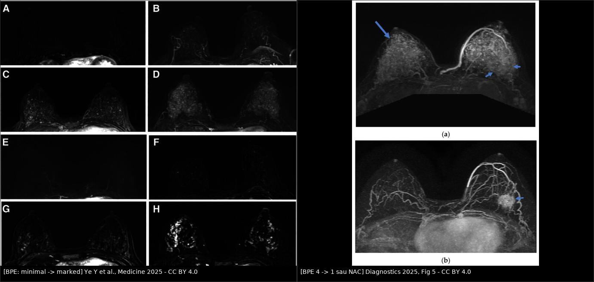
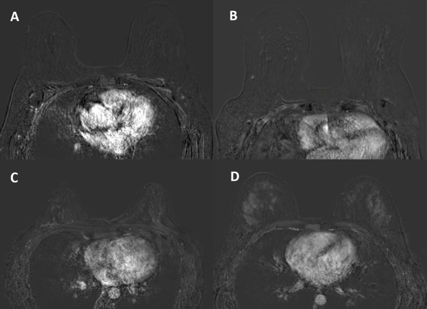
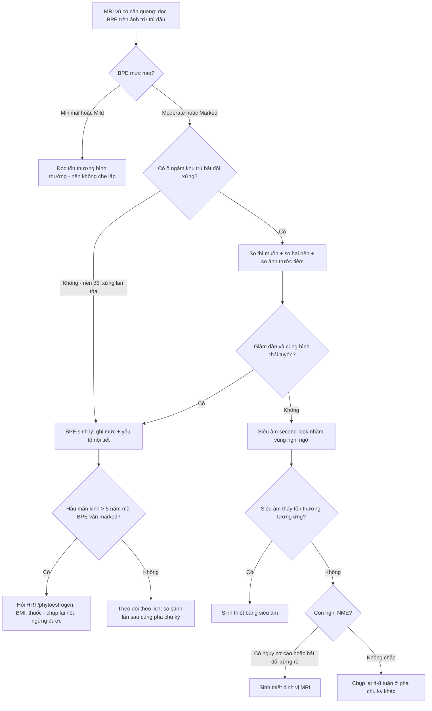
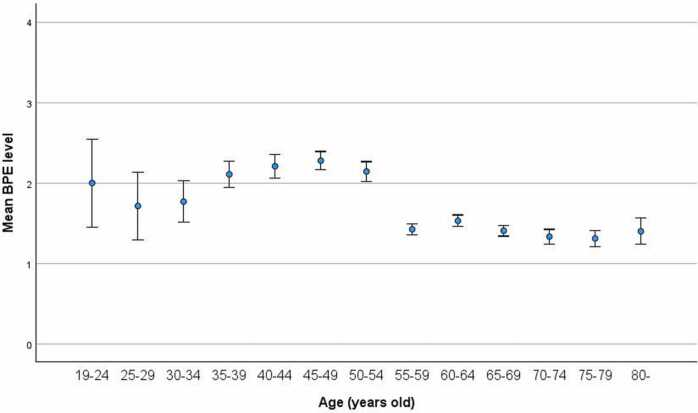

# 595 — Tăng ngấm mô tuyến nền trên MRI vú (BPE): phân độ, dao động theo hormone & cách giảm dương tính giả / Background parenchymal enhancement

**Tags:** `pattern:tang-ngam-mo-tuyen-nen` `pattern:ngam-khong-khoi` `vung:vu` `score:BI-RADS-BPE` `score:FGT` `protocol:MRI-vu-DCE` `protocol:che-subtraction` `anatomy:mo-tuyen-vu`
**Mức chắc chắn (certainty):** tổng hợp y văn (literature synthesis) — nhóm tự biên từ 5 bài mở toàn văn CC BY/CC BY-NC-SA (Ye Y et al., *Medicine* 2025, PMC12499845; Cîrlig IA et al., *Curr Health Sci J* 2025, PMC12831547; Okuma H et al., *Eur J Radiol Open* 2024, PMC11615933; Kim MY et al., *Diagnostics* 2025, PMC12651529; Li XT et al., *Front Oncol* 2025, PMC12582933). Số liệu là của từng cohort, không gộp thành "chuẩn chung".

## 1. Tổng quan — BPE là gì, vì sao nó đổi theo hormone

- **Định nghĩa:** BPE là **mức ngấm thuốc cản quang của mô tuyến vú BÌNH THƯỜNG** sau tiêm gadolinium — tức là **chức năng** của mô tuyến (tưới máu + tính thấm mao mạch), **không phải** khối lượng mô tuyến. ACR **BI-RADS 5th edition (2013)** bắt buộc báo cáo BPE trên **mọi** MRI vú có cản quang.
- **TẠI SAO trông như vậy (vật lý + sinh lý):**
  - Gadolinium làm **ngắn T1** của mô chứa thuốc → trên chuỗi **T1W sau tiêm có xóa mỡ**, mô tuyến **sáng lên**. Vì BPE nằm trong **mô tuyến**, nó **cùng hình dạng và cùng phân bố** với mô tuyến — khác u (u có bờ, khối choán chỗ).
  - Estrogen/progesterone gây **giãn mạch + tăng tính thấm** ở mô tuyến → mô tuyến **ngấm nhiều hơn** khi nội tiết cao (tiền mãn kinh, chu kỳ, HRT, thai–cho con bú) và **ngấm ít** khi nội tiết thấp (hậu mãn kinh, dùng tamoxifen/AI).
  - **Thời điểm đọc quyết định:** BPE được đọc trên **ảnh trừ (subtraction) của thì sau tiêm ĐẦU TIÊN** — đây là lúc nền tuyến ngấm mạnh nhất và **cũng là lúc dễ nhầm với ngấm không khối (NME) nhất**. Đọc thì muộn hơn thì nền **bớt sáng** nhưng u cũng có thể đã **thoát thuốc**.
- **Ngưỡng định lượng (bắt buộc — BI-RADS 4 mức + cách lượng hóa):**
  - **Minimal** — **< 25%** mô tuyến ngấm (gần như chỉ thấy mỡ).
  - **Mild** — **25–50%**.
  - **Moderate** — **50–75%**.
  - **Marked** — **> 75%** mô tuyến ngấm (định nghĩa dùng trong PMC12499845).
- **Phân bố thực tế (để biết "bao nhiêu là thường"):** cohort 353 phụ nữ (PMC12831547): **minimal 49,3%**, **mild 18,1%**, **moderate 22,7%**, **marked 9,9%**. Tức **~1/3 phụ nữ có BPE moderate–marked** — đây là lý do BPE là nguồn dương tính giả lớn, không phải ngoại lệ.
- **BPE đổi theo tuổi/mãn kinh (số cụ thể):**
  - Tuổi **trung vị giảm dần** khi BPE tăng: **53,5 tuổi** (minimal) → **47,5** (mild) → **41** (moderate) → **37** (marked), p < 0,001.
  - **Toàn bộ 35 ca marked đều tiền mãn kinh**; **88,8%** ca moderate là tiền mãn kinh; **77%** ca hậu mãn kinh là minimal (PMC12831547).
  - **Đỉnh không nằm ở "trẻ nhất" mà ở QUANH MÃN KINH:** BPE cao hơn ở nhóm **peri-menopause** so với cả trước và sau mãn kinh (562 bệnh nhân, PMC11615933) → **giảm theo tuổi là KHÔNG tuyến tính**. Đây là điểm hay bị dạy sai ("càng trẻ càng sáng").
  - **Độ đồng thuận giữa 2 bác sĩ:** ICC **0,840** cho BPE và **0,864** cho FGT (gần hoàn hảo) — nhưng **chỉ khi đọc đúng thì và đúng ảnh trừ**.
- **BPE là dấu hiệu chức năng có giá trị tiên lượng (không chỉ là "nhiễu"):**
  - Trong 216 phụ nữ (72 ung thư), **55,6%** ca ung thư có BPE **moderate/marked**; **OR 3,3–5,0** cho ung thư khi BPE moderate/marked so với minimal/mild; mật độ ACR c/d có **OR 4,7–5,8** (PMC12499845).
  - **Sau hóa trị tân bổ trợ (NAC):** BPE **giảm ở mọi thể phân tử**, mạnh nhất ở **TNBC và HER2+**. Ví dụ ER+: **26/16/28/30% → 68/28/4/0%**; TNBC: **47,6/14,3/23,8/14,3% → 76,2/14,3/9,5/0%** (116 bệnh nhân, PMC12651529).
  - Ở TNBC (76 bệnh nhân), **BPE vú đối bên sau NAC** vào mô hình Cox đa biến cho DFS với **HR 6,57** (minimal/mild = 1); nhóm BPE **giảm từ cao → thấp** tái phát ít hơn nhóm **thấp → cao** (p = 0,022) (PMC12582933).
- **Phản biện (fidelity + critique):** các cohort trên **khác thiết kế** (hồi cứu, đơn trung tâm, cỡ 76–562), **khác cách đọc** (2 reader consensus hay 1 reader), và **chưa có ngưỡng BPE định lượng được chuẩn hóa**. Vì vậy: **dùng BPE để mô tả + cảnh báo + tiên lượng, KHÔNG dùng để chẩn đoán một mình**; và đừng trích "OR 5,0" như thể BPE là xét nghiệm sàng lọc.

## 2. Mẫu hình (pattern) + chẩn đoán phân biệt theo hình thái & bối cảnh (Gamut)

- **Khuôn 1 — Nền ngấm ĐỐI XỨNG, lan tỏa, theo đúng phân bố tuyến.** Gamut: **BPE sinh lý (hormone)** vs viêm tuyến lan tỏa vs phù sau xạ hai bên (hiếm). Chốt: **đối xứng + không có bờ + không choán chỗ + giảm ở thì muộn** → BPE.
- **Khuôn 2 — Nền ngấm mạnh + tuyến to, đau, có sữa.** Gamut: **thai/cho con bú (lactational change)** vs **viêm tuyến (mastitis)** vs BPE do HRT. Chốt: **có thai/đang cho bú + đối xứng + không sốt** → sinh lý; **sốt, đỏ, một bên** → viêm (bài 512).
- **Khuôn 3 — Nền ngấm cao + một vùng ngấm "đậm hơn" cùng bên.** Gamut: **BPE không đều (regional)** vs **NME của DCIS** vs tăng sinh lành tính (ADH). Chốt: **cùng hình thái tuyến, không bờ, giảm dần** → BPE; **bờ mờ, có "khe" giữa các ống tuyến, đậm lên hoặc plateau** → NME thật.
- **Khuôn 4 — Hậu mãn kinh > 5 năm mà BPE VẪN marked.** Gamut: **HRT/phytoestrogen** vs **béo phì (aromatase ngoại vi)** vs **tổn thương ngấm thật** vs hiếm: u tiết hormone. Chốt: **hỏi thuốc/hormone trước**, rồi mới kết luận.
- **Khuôn 5 — BPE sụp về minimal sau khi bắt đầu tamoxifen/AI.** Gamut: **tác dụng thuốc (bình thường)** vs **giảm ngấm do mãn kinh/xạ** vs **đáp ứng u**. Chốt: **nền phẳng hai bên + có thuốc** → do thuốc; **giảm một ổ** → đáp ứng u (bài 515).
- **Khuôn 6 — BPE tăng ở vú đối bên trong lúc điều trị NAC.** Gamut: **thay đổi nội tiết do ngừng/đổi thuốc, suy buồng trứng do hóa trị** vs tăng sinh thật. Chốt: **đối xứng, không khối, theo dõi** → không sinh thiết.
- **Gợi nhớ "B-P-E = Background, Pattern, Endocrine":** **B**ackground (nền) — **P**attern (đối xứng/lan tỏa hay khu trú) — **E**ndocrine (nội tiết: tuổi, chu kỳ, HRT, tamoxifen).

## 3. Bảng so sánh phân biệt (ma trận đối chiếu)

| Thực thể (entity) | Hình ảnh điển hình (MRI DCE thì đầu, ảnh trừ) | Chốt vào (rule-in) | Chốt loại (rule-out) | Gợi ý xác nhận |
|---|---|---|---|---|
| **BPE sinh lý** | Ngấm **đối xứng hai bên**, lan tỏa, **cùng hình dạng mô tuyến**, không bờ, **giảm ở thì muộn** | **Đối xứng + không choán chỗ + giảm dần thì muộn** | **Một vùng đậm hơn có bờ/khe** → không phải BPE đơn thuần | Đọc ảnh trừ + so thì muộn; so hai bên |
| **NME của DCIS** | Ngấm **không khối**, bờ mờ, **phân bố đoạn/tuyến tính**, thường **một vùng**, có thể có vi vôi trên nhũ ảnh | **Phân bố đoạn (ductal) + đậm lên/plateau + một bên** | **Đối xứng, lan tỏa, giảm dần** → BPE | Sinh thiết định vị MRI; đối chiếu nhũ ảnh |
| **Viêm tuyến (mastitis)** | Da dày, phù mô đệm, ngấm **lan tỏa một bên**, đau | **Sốt + đỏ + một bên + da dày** | **Đối xứng, không sốt** → không viêm | Lâm sàng + kháng sinh; siêu âm loại áp-xe |
| **Thay đổi do cho con bú** | Tuyến to, ngấm mạnh **hai bên**, nang sữa, mạch máu nổi | **Đang cho bú + đối xứng** | **Một ổ có bờ trong nền sáng** → khối thật | Siêu âm; trì hoãn MRI không cấp |
| **Thay đổi sau sinh thiết/xạ** | Ngấm **khu trú đúng đường kim/trường xạ**, có hematoma, **giảm theo thời gian** | **Đúng vị trí can thiệp + có sẹo/hematoma** | **Ngấm ngoài vùng can thiệp** → tổn thương mới | So phim cũ; MRI ≥ 6 tháng sau xạ nếu không cấp |
| **Fibroadenoma / tăng sinh lành tính** | Khối **bờ rõ**, ngấm **đồng nhất hoặc vách**, T2 sáng | **Bờ rõ + không xâm lấn + T2 sáng** | **Bờ mờ, xâm lấn mô đệm** → nghi ác | Siêu âm; theo dõi/BI-RADS 3 |
| **BPE do HRT / béo phì** | Nền **moderate–marked hai bên**, hậu mãn kinh, không khối | **Đang HRT/béo phì + đối xứng + không khối** | **Có ổ ngấm khu trú** → không quy cho HRT | Ngừng HRT (nếu được) rồi chụp lại — **chưa có ngưỡng thời gian chuẩn, ghi "chưa rõ"** |

*Trái: **4 mức BPE** trên ảnh MIP trừ (A–D: minimal → marked) và trên ảnh trừ có mask (E–H) — cùng một bệnh nhân, cùng một thì; **cách dựng ảnh quyết định "độ sáng" bạn thấy**. Phải: (a) trước NAC, BPE **độ 4 (marked)**, mũi tên dài chỉ u; (b) sau NAC, BPE **độ 1**, u còn lại (mũi tên ngắn) → nền giảm mạnh dù u chưa mất. Ảnh ghép letterbox, CC BY 4.0 (Ye Y et al., Medicine 2025, Fig 2, PMC12499845; Kim MY et al., Diagnostics 2025, Fig 5, PMC12651529).*

*Cùng 4 mức trên **ảnh trừ thì sau tiêm đầu tiên**, ảnh axial: (A) minimal, (B) mild, (C) moderate, (D) marked. Đối chiếu với ảnh ghép ở trên: **nền càng sáng thì càng dễ bỏ sót NME** — không phải "nền sáng = bệnh". Nguồn: Cîrlig IA et al., Curr Health Sci J 2025, Fig 1, CC BY-NC-SA 4.0 (giữ nguyên bản).*

## 4. Protocol chụp, cách đọc & xử lý khi nền quá sáng

- **Protocol tối thiểu để đọc được BPE:**
  - **1,5 T hoặc 3 T**, coil vú chuyên dụng, **nằm sấp**.
  - **DCE T1W có xóa mỡ**, gadolinium **0,1 mmol/kg**, tốc độ **2 mL/s**, **thì đầu sau tiêm ~60–120 giây**, **bề dày 1–2 mm**; **bắt buộc ảnh trừ (subtraction)** và **MIP trừ**.
  - **Trước tiêm:** T1W không xóa mỡ (phân độ FGT), T2W xóa mỡ (nang/phù), DWI/ADC khi cần.
  - **Đọc BPE trên ảnh trừ thì sau tiêm ĐẦU TIÊN**, đánh giá **cả tỷ lệ (%) mô tuyến ngấm và cường độ**, chọn mức **cao nhất** trong hai bên (BI-RADS: lấy mức cao hơn).
- **Thời điểm chụp — điểm đang thay đổi trong thực hành:**
  - **ACR Practice Parameter (2018, sửa 2023)** **không** yêu cầu hẹn theo pha chu kỳ (được trích trong PMC12831547).
  - Nhiều trung tâm vẫn hẹn **ngày 7–14 của chu kỳ** (khi BPE thấp nhất) cho MRI tầm soát/chẩn đoán ở người tiền mãn kinh — **hợp lý về mặt sinh lý, nhưng không còn là yêu cầu bắt buộc**; nếu đã chụp đúng pha thì **ghi lại pha** vì nó ảnh hưởng so sánh lần sau.
- **Cách phân biệt BPE với tổn thương — 4 bước:**
  1. **So ảnh trước tiêm và ảnh trừ:** BPE **trừ hết** phần mô tuyến nền; tổn thương thật **còn lại** sau khi trừ.
  2. **So thì muộn:** BPE **giảm dần**; NME/DCIS thường **plateau hoặc tăng**.
  3. **So hai bên:** BPE **đối xứng**; tổn thương **bất đối xứng** (trừ BPE vùng — regional, dễ nhầm nhất).
  4. **Hình thái:** BPE **không có bờ, ôm theo mô tuyến**; NME có **bờ mờ, khe giữa các ống tuyến, phân bố đoạn**.
- **Khi nền quá sáng (moderate–marked) — các bước giảm dương tính giả:**
  - Dựng **ảnh trừ + MIP trừ** ở **nhiều thì** (không chỉ 1 ảnh).
  - **Đọc trên màn hình có cửa sổ (window/level) thay đổi được** và **so với MRI lần trước** nếu có.
  - **Siêu âm second-look** nhắm đúng vùng nghi ngờ — nếu siêu âm thấy tổn thương tương ứng thì **sinh thiết bằng siêu âm**, không cần sinh thiết định vị MRI.
  - Nếu **vẫn không phân định** được BPE vùng với NME: **chụp lại sau 4–8 tuần ở pha chu kỳ khác (nếu tiền mãn kinh)** hoặc **sinh thiết định vị MRI** khi có yếu tố nguy cơ/bất đối xứng rõ.
  - **Không** dùng "BPE cao" làm lý do **hoãn** đánh giá một ổ ngấm khu trú thật.
- **BPE trên CEM (nhũ ảnh cản quang):** CEM cũng có BPE và cũng phân độ 4 mức, nhưng là ảnh **2D chồng lớp** → tương quan với mật độ **bị thổi phồng** so với MRI (3D thật). Vì vậy **BPE trên CEM không thay thế BPE trên MRI** khi ra quyết định.

*Đường BPE trung bình theo nhóm tuổi 5 năm (562 bệnh nhân): cao ở tiền mãn kinh, **đỉnh ở quanh mãn kinh**, rồi **giảm đều sau mãn kinh** → quan hệ với tuổi là **phi tuyến**. Đây là lý do phải hỏi **trạng thái mãn kinh**, không chỉ hỏi tuổi. Nguồn: Okuma H et al., Eur J Radiol Open 2024, Fig 1, CC BY 4.0.*

## 5. Biến thể bình thường và cạm bẫy

- **Cạm bẫy 1 — lẫn BPE với FGT (mật độ):** FGT là **lượng mô tuyến** (cấu trúc, đọc trên T1 trước tiêm); BPE là **mức ngấm** (chức năng, đọc trên ảnh trừ). **Vú đặc nhưng BPE thấp** và **vú ít đặc nhưng BPE cao** đều tồn tại — nhiều nghiên cứu **không** tìm thấy tương quan chặt giữa hai thứ (ρ chỉ **0,271** trong PMC11615933). Đừng suy BPE từ mật độ.
- **Cạm bẫy 2 — "nền sáng thì không thấy gì = bình thường":** BPE marked **che lấp** NME; phải đọc **nhiều thì + ảnh trừ + thì muộn**, và **không kết luận âm tính** nếu nền che vùng có triệu chứng.
- **Cạm bẫy 3 — BPE vùng (regional) giả NME:** BPE **không đều** theo vùng là biến thể bình thường; chỉ khác biệt **bờ/khe/đậm lên thì muộn** mới là NME. Đây là **dương tính giả hay gặp nhất** trên MRI tầm soát.
- **Cạm bẫy 4 — "càng trẻ càng sáng":** sai một nửa — **đỉnh ở quanh mãn kinh** (PMC11615933). Ở phụ nữ 45–55 tuổi, BPE có thể **cao hơn** cả người 30 tuổi.
- **Cạm bẫy 5 — hậu mãn kinh mà BPE cao:** luôn hỏi **HRT, phytoestrogen, thuốc nam, béo phì**; nếu không giải thích được và có ổ khu trú → **đừng quy cho "nội tiết"**.
- **Cạm bẫy 6 — dùng BPE để đánh giá đáp ứng:** BPE **giảm sau NAC** ở đa số, nhưng **giảm BPE ≠ u chết hoàn toàn** (ảnh (b) trong composite vẫn còn u). Đánh giá đáp ứng phải dựa trên **kích thước + đặc điểm u + ADC**, không dựa vào BPE.
- **Cạm bẫy 7 — BPE tăng sau NAC ở một số ca:** trong loạt 4 ca của PMC12582933 có ca BPE **tăng** — nên **không** dùng quy tắc "sau NAC là BPE luôn giảm"; và **thay đổi BPE hai chiều** mới là thứ mang thông tin tiên lượng (HR 6,57 chỉ trong một cohort TNBC nhỏ — chưa đủ để thành chỉ định).
- **Cạm bẫy 8 — so sánh 2 lần chụp khác pha/khác máy:** BPE phụ thuộc **pha chu kỳ, liều thuốc, thì chụp, cách dựng ảnh trừ**. So BPE giữa hai lần mà khác protocol là **so sai** — ghi lại pha và thông số.
- **Cạm bẫy 9 — thuốc làm BPE sụp:** tamoxifen khiến **toàn bộ 25/25** người dùng trong một cohort ở mức **minimal** (PMC12831547); nền phẳng làm **tổn thương ngấm yếu dễ bị bỏ qua** vì mất "tương phản nền". Đọc kỹ trên ảnh trừ, không dựa vào MIP.

## 6. Tự lượng giá — Blind Quiz

**Ca 1 — Nữ 43 tuổi, tiền mãn kinh, MRI tầm soát vì mẹ bị ung thư vú. Không triệu chứng. Đọc ảnh trừ thì đầu.**

- Hỏi: ảnh nào là mức nào? Có cần sinh thiết vì "nền ngấm nhiều" không? Yếu tố nào phải hỏi trước khi kết luận?

<b>Bấm để hiện đáp án (findings + chẩn đoán)</b>

- **Findings:** (A) minimal, (B) mild, (C) moderate, (D) marked — ngấm **đối xứng hai bên, lan tỏa, cùng hình dạng mô tuyến**, không bờ, không choán chỗ.
- **Chẩn đoán:** **BPE sinh lý** (không phải tổn thương). **Không sinh thiết** chỉ vì BPE cao.
- **Phải hỏi:** **pha chu kỳ** (ngày 7–14 thường thấp nhất), **HRT/thuốc nội tiết**, **đang cho con bú**, và **so với lần chụp trước**. Ghi mức BPE vào báo cáo (BI-RADS yêu cầu).
- Nguồn ảnh: Cîrlig IA et al., Curr Health Sci J 2025, Fig 1, CC BY-NC-SA 4.0 (giữ nguyên bản).

**Ca 2 — Nữ 32 tuổi, TNBC vú trái, đang sau 6 đợt NAC. So MRI trước và sau điều trị.**

- Hỏi: BPE thay đổi thế nào? Có được kết luận "đáp ứng hoàn toàn" vì nền đã phẳng không?

<b>Bấm để hiện đáp án (findings + chẩn đoán)</b>

- **Findings:** (a) BPE **độ 4 (marked)**, u ngấm mạnh (mũi tên dài); (b) BPE **độ 1 (minimal)**, **u vẫn còn** (mũi tên ngắn) → nền giảm nhưng **u chưa mất**.
- **Chẩn đoán:** BPE giảm sau NAC (phù hợp sinh lý: suy buồng trứng do hóa trị + giảm tưới máu tuyến). **Không** kết luận đáp ứng hoàn toàn chỉ vì nền phẳng — phải đo **kích thước u + đặc điểm bờ + ADC**.
- **Con số để nhớ:** trong 116 bệnh nhân, BPE giảm ở **mọi thể**, mạnh nhất ở **TNBC/HER2+** (PMC12651529); nhưng đây là **dấu hiệu chức năng**, không phải tiêu chuẩn đáp ứng.
- Nguồn ảnh: Ye Y et al., Medicine 2025, Fig 2, CC BY 4.0 + Kim MY et al., Diagnostics 2025, Fig 5, CC BY 4.0 (ảnh ghép letterbox).

**Ca 3 — Nữ 58 tuổi, mãn kinh 6 năm, MRI vì mật độ C. BPE marked hai bên, không ổ khu trú. Bác sĩ muốn kết luận "bình thường".**

- Hỏi: BPE marked ở người mãn kinh 6 năm có "bình thường" không? Hỏi gì, làm gì tiếp?

<b>Bấm để hiện đáp án (findings + chẩn đoán)</b>

- **Findings:** BPE **marked, đối xứng, lan tỏa**, không ổ ngấm khu trú → **không phải tổn thương**.
- **Nhưng:** sau mãn kinh BPE thường **minimal** (77% ca hậu mãn kinh là minimal trong PMC12831547) → BPE marked là **bất thường về sinh lý**, phải giải thích: **HRT/phytoestrogen**, **béo phì (aromatase ngoại vi)**, thuốc nội tiết, hoặc hiếm hơn là nguyên nhân buồng trứng.
- **Xử trí:** hỏi thuốc + BMI; nếu ngừng được HRT thì **chụp lại** (chưa có ngưỡng thời gian chuẩn — ghi "chưa rõ"); **vẫn tiếp tục tầm soát** theo mật độ C (siêu âm bổ sung/DBT theo bài 524), và **nhớ BPE cao là yếu tố nguy cơ độc lập** (OR 3,3–5,0 trong PMC12499845) — không phải "chỉ là nhiễu".
- **Bài học:** BPE là **dấu hiệu chức năng có ý nghĩa** — vừa gây dương tính giả, vừa mang thông tin nguy cơ; đừng bỏ qua cả hai mặt.

## Bài liên quan chéo
- [500 – Tổng quan Hệ Vú & Sản Phụ khoa](../500-tong-quan-vu-san-phu-khoa/lesson.md)
- [510 – Vú: BI-RADS nhũ ảnh – siêu âm – MRI](../510-vu-BIRADS-nhu-anh-sieu-am-MRI/lesson.md)
- [524 – Sàng lọc & quản lý nguy cơ cao ung thư vú](../524-sang-loc-va-quan-ly-nguy-co-cao-ung-thu-vu/lesson.md)
- [594 – Hóa dự phòng ung thư vú nguy cơ cao](../594-hoa-du-phong-ung-thu-vu/lesson.md) (tamoxifen/AI làm BPE sụp về minimal)
- [515 – Đáp ứng vú sau hóa trị tân bổ trợ](../515-dap-ung-vu-sau-hoa-tri-tan-bo-tro/lesson.md)
- [516 – Hình ảnh vú sau điều trị](../516-hinh-anh-vu-sau-dieu-tri/lesson.md)
- [522 – Theo dõi sau điều trị ung thư vú](../522-theo-doi-sau-dieu-tri-ung-thu-vu/lesson.md)

## Ảnh
- `images/composite_bpe-phan-do.jpg` (ghép từ 2 ảnh CC BY 4.0), `images/595_BPE_MRI_PMC12499845.jpg`, `images/595_BPE-giam-sau-NAC_MRI_PMC12651529.jpg`, `images/595_BPE-4muc_MRI_PMC12831547.jpg` (CC BY-NC-SA — giữ nguyên bản), `images/595_BPE-theo-tuoi_PMC11615933.jpg` (CC BY 4.0), `images/595_BPE-sau-NAC_MRI_PMC12582933.jpg` (CC BY 4.0). Nguồn + giấy phép từng ảnh trong `images/CREDITS.md`.

> Không dùng để chẩn đoán độc lập khi chưa có người hướng dẫn.
