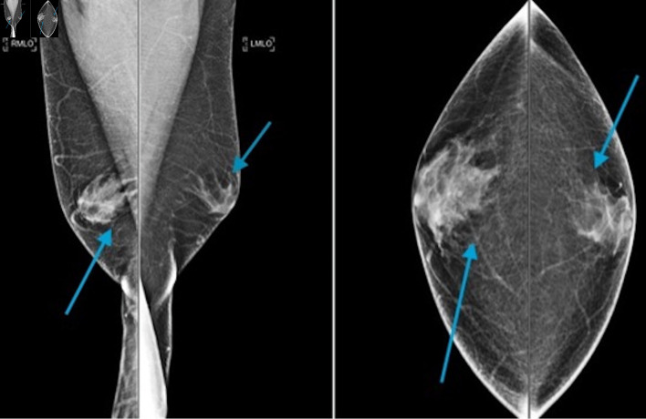
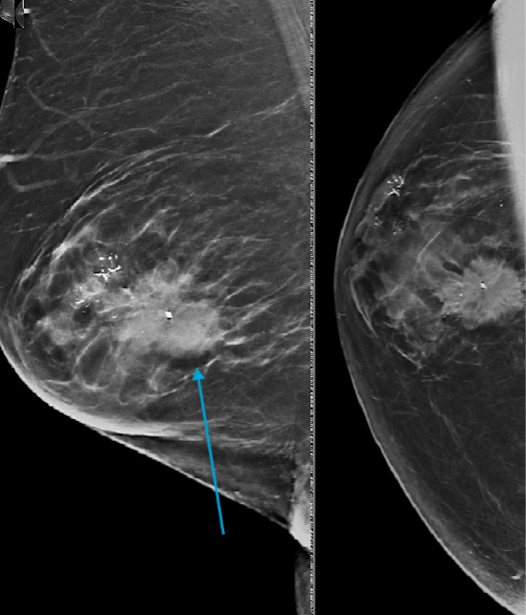
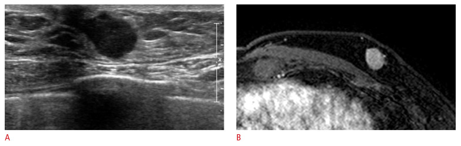
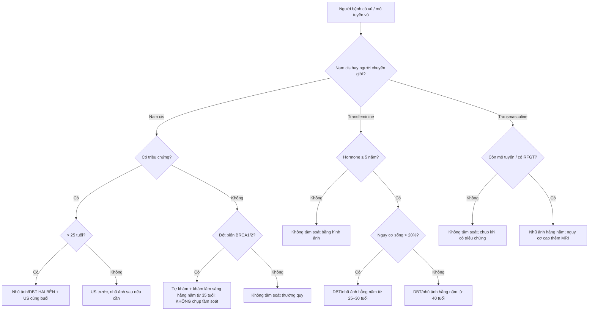

# 596 — Ung thư vú ở nam giới & người chuyển giới: protocol hình ảnh, tầm soát theo nguy cơ & theo dõi / Male and transgender breast cancer

**Tags:** `pattern:khoi-duoi-quang-vu` `pattern:day-tuyen-khong-doi-xung` `vung:vu` `protocol:DBT` `protocol:MRI-vu` `score:BI-RADS` `anatomy:tuyen-vu-nam` `protocol:tam-soat-nguy-co`
**Mức chắc chắn (certainty):** tổng hợp y văn (literature synthesis) — nhóm tự biên từ 5 bài mở toàn văn (J Clin Med Res 2024, PMC11161189; Ultrasonography 2025, PMC11717687; Ann Surg Open 2026, PMC13596940; Ann Surg Open 2026, PMC13016194; Ann Surg Oncol 2025, PMC12689806) + 1 review tổng hợp guideline (Pak J Med Sci 2024, PMC11395358). Số liệu giữ nguyên theo từng cohort, không gộp thành "chuẩn chung".

## 1. Tổng quan — vì sao vú nam khác vú nữ, và vì sao "mổ" ở người chuyển giới không phải cắt toàn bộ tuyến

- **Dịch tễ (ngưỡng định lượng):** ung thư vú nam chiếm **< 1%** toàn bộ ung thư vú; Mỹ ước tính **2.800 ca xâm lấn mới/năm 2023**; tuổi trung vị **67** so với **61** ở nữ (SEER) → **nam mắc muộn hơn ~6 năm** và thường được phát hiện ở giai đoạn muộn hơn vì **không có chương trình tầm soát** và **chỉ số nghi ngờ thấp**.
- **TẠI SAO vú nam chỉ có bệnh ống tuyến (ductal):** vú nam trưởng thành gồm **da, mỡ dưới da, ống tuyến teo nhỏ và mô đệm**; **tiểu thùy (lobule) chỉ phát triển khi có estrogen + progesterone đủ** → các bệnh lý cần tiểu thùy (**ung thư tiểu thùy ILC, LCIS, fibroadenoma, u lá phyllodes**) **rất hiếm** ở nam. Ngược lại, bệnh lý **tăng sinh ống tuyến** — **gynecomastia, IDC, DCIS** — là nhóm gặp ở nam.
  - Hệ quả đọc phim: **không được dùng "không có tiểu thùy nên không cần nghĩ ung thư vú"**; thể mô học hay gặp là **IDC 85–90%**, **DCIS ~5%** (DCIS nam thường dạng **solid hoặc cribriform**, ít khi đứng riêng không kèm IDC).
  - Sinh học khác nữ: **ER/PR dương tính cao hơn, HER2 thấp hơn** → ảnh hưởng điều trị, không ảnh hưởng cách đọc hình ảnh.
- **TẠI SAO hình ảnh nam khó hơn nữ (vật lý chụp):** vú nam **nhỏ, ít mỡ, mô tuyến tập trung sát quầng vú**. Máy nhũ ảnh nén **không đủ mô để dàn mỏng** → tổn thương **chồng lấp với quầng vú/núm** và dễ bị **gynecomastia che khuất**. Đây là lý do **siêu âm (US) là bạn đồng hành bắt buộc**, không phải xét nghiệm thay thế.
- **Gynecomastia — nền tảng giải phẫu của mọi ca vú nam:** gặp ở **40–65% nam giới**; trên nhũ ảnh là **dạng "ngọn lửa" (flame-shaped)** từ quầng vú lan ra mỡ xung quanh, **không có vi vôi hóa**, bờ **hòa dần vào mỡ** (không có bờ rõ như khối). Phân bố có thể **không đối xứng**, và **gynecomastia một bên** vẫn có thể lành tính.
  - **Cạm bẫy cổ điển:** khối ung thư **nằm sau/trong vùng gynecomastia** có thể **bị che mất** — trong loạt 97 ca của Appelbaum, **1 ca ung thư vú nam không thấy được vì bị gynecomastia che khuất** (nguồn PMC11161189).
- **Ngưỡng hiệu năng chẩn đoán (để chọn phương thức):**
  - **Nhũ ảnh:** độ nhạy **92–95%**, độ đặc hiệu **90–95%**; trong loạt 628 bệnh nhân (Munoz Carrasco) nhũ ảnh **nhạy nhất 94,7%** nhưng **US đặc hiệu nhất 95,3%**.
  - **Siêu âm:** độ nhạy **88–100%**, độ đặc hiệu **95–97%**; **nhạy hơn nhũ ảnh trong phát hiện hạch nách**.
  - **MRI:** độ nhạy cao nhất nhưng **không dùng thường quy**; chỉ định giới hạn ở 5 tình huống (mục 4).
- **Người chuyển giới — điểm mấu chốt về GIẢI PHẪU CÒN LẠI:** "gender-affirming mastectomy" là **tên gọi sai về mặt phẫu thuật**: đa số là **cắt tuyến bán phần (subtotal glandular reduction)** để giữ đường nét ngực, **cố ý để lại mô tuyến**. Mô tuyến còn lại (retained fibroglandular tissue — **RFGT**) được ghi nhận ở **50% ca nipple-sparing** và **13% ca skin-sparing** (dẫn trong PMC13596940). Vì vậy **nguy cơ ung thư không về 0**, và **ghi "đã cắt toàn bộ tuyến" trong hồ sơ là lỗi có hại** (dẫn tới ngừng tầm soát, mất bảo hiểm).
  - **Bằng chứng mô bệnh từ chính mảnh mổ:** scoping review 13 nghiên cứu, trong đó 9 nghiên cứu soát **3.869 mảnh mổ GAM** phát hiện **42 ca atypia, 5 DCIS, 1 Paget, 3 IDC**; toàn bộ 13 nghiên cứu có **42 atypia, 6 DCIS, 1 Paget, 10 IDC**, trong đó **7 ung thư xâm lấn + 1 DCIS được phát hiện TRƯỚC mổ** (PMC12689806).
  - **Nguy cơ nền không hề nhỏ:** trong một nghiên cứu 2024 (Ann Surg Oncol, dẫn trong PMC13016194), **> 50% người tìm mổ GACMS có điểm Tyrer–Cuzick ≥ 17%** (ngưỡng "nguy cơ cao" thường dùng) — tức **đánh giá nguy cơ phải làm TRƯỚC mổ**, không phải sau.
- **Người chuyển giới nữ (transfeminine, nam→nữ):** dùng estrogen + kháng androgen **≥ 5 năm** làm **tăng nguy cơ** so với nam cis; cohort Hà Lan báo **tỷ lệ mắc cao gấp 46 lần** nam cis (vẫn thấp hơn nữ cis) (PMC11395358). **< 5 năm hormone** thì nguy cơ **tương đương nam cis** → **không tầm soát bằng hình ảnh**.
- **Phản biện (fidelity + critique):** (a) các số về GACMS đến từ **mảnh mổ hồi cứu**, không phải theo dõi dọc → **không biết nguy cơ tích lũy thật**; (b) "46 lần" là **so với nam cis**, không phải so với nữ cis — **đừng trích như "nguy cơ gần bằng nữ"**; (c) guideline hiện **mâu thuẫn nhau** (mục 4) nên mọi khuyến cáo dưới đây phải đọc kèm **quyết định chia sẻ với người bệnh**.

## 2. Mẫu hình (pattern) + chẩn đoán phân biệt theo vị trí & bối cảnh (Gamut)

- **Khuôn 1 — Đám mờ hình ngọn lửa, đối xứng/không đối xứng, NGAY SAU quầng vú, không vôi hóa.** Gamut: **gynecomastia sinh lý/thuốc** (spironolactone, cimetidine, digoxin, cannabinoid, rượu, xơ gan, suy thận, cường giáp, u tế bào mầm) vs **pseudo-gynecomastia (mỡ)** vs ung thư sớm. Chốt: **không có bờ, hòa vào mỡ, không vôi hóa, đối xứng tương đối** → lành; **bờ rõ/lệch tâm/có vôi hóa** → phải US.
- **Khuôn 2 — Khối dưới quầng vú LỆCH TÂM so với núm, một bên, không đau.** Gamut: **ung thư vú nam (IDC)** vs gynecomastia không đối xứng vs **áp-xe/viêm quanh quầng** vs **nang biểu bì**. Chốt: **lệch tâm + bờ spiculated/không rõ + có vôi hóa** → nghi ác (đây là thể hiện điển hình); **đau, đỏ, sốt** → viêm.
- **Khuôn 3 — Khối + vôi hóa.** Gamut: **DCIS/IDC** vs **vôi hóa lành tính** vs **vôi hóa da**. Chốt: ở nam, **vôi hóa "trông lành" vẫn phải coi là nghi ngờ** — vôi hóa trong ung thư vú nam chỉ gặp **9–31%**, **ít hơn, thô hơn, ít dạng ống (rod-like)** so với nữ, nên **tiêu chuẩn "vôi hóa lành" của nữ không chuyển nguyên sang nam được**.
- **Khuôn 4 — Núm tụt, da dày, hạch nách, không sờ thấy khối.** Gamut: **ung thư vú nam xâm lấn** vs **viêm da/tổn thương lành tính** vs **di căn vú**. Chốt: **di căn tới vú** thường từ **ung thư tuyến tiền liệt** hoặc **SCC đầu–cổ** — bệnh sử là chốt, không phải hình ảnh.
- **Khuôn 5 — Hạch nách di căn, vú bình thường trên nhũ ảnh + US.** Gamut: **ung thư vú nam thể ẩn (occult)** vs lymphoma vs di căn khác. Chốt: **MRI vú** là chỉ định chính thức trong tình huống này (mục 4).
- **Khuôn 6 — Sau mổ GACMS: khối/đau thành ngực.** Gamut: **mô tuyến còn lại (RFGT)** vs **sẹo xơ** vs **tái phát/ung thư mới** vs **nang/biến chứng mổ**. Chốt: **vị trí đúng đường mổ + không tăng theo thời gian** → sẹo; **khối mới, tăng dần, có vôi hóa** → phải chụp + sinh thiết; **không được mặc định "đã mổ nên không thể ung thư"**.
- **Khuôn 7 — Ngực to lan tỏa ở người dùng hormone nữ hóa ≥ 5 năm.** Gamut: **mô tuyến do hormone** vs **ung thư** vs **bệnh lý mô mềm**. Chốt: **đối xứng, không khối, không hạch** → theo dõi; **một bên, có khối** → DBT + US theo protocol nữ.
- **Gợi nhớ "M-A-L-E":** **M**ass eccentric to nipple (khối lệch tâm) — **A**symmetry mới (bất đối xứng mới) — **L**esion with calcification (tổn thương có vôi hóa) — **E**xtent beyond gynecomastia (vượt ra ngoài vùng gynecomastia).

## 3. Bảng so sánh phân biệt (ma trận đối chiếu)

| Thực thể (entity) | Hình ảnh điển hình | Chốt vào (rule-in) | Chốt loại (rule-out) | Gợi ý xác nhận |
|---|---|---|---|---|
| **Gynecomastia** | Đám mờ **hình ngọn lửa** sau quầng vú, lan ra mỡ, **không vôi hóa**, có thể hai bên/không đối xứng | **Không bờ + hòa vào mỡ + không vôi hóa + đối xứng tương đối** | **Bờ rõ, lệch tâm, có vôi hóa, có hạch** → không phải gynecomastia đơn thuần | Nhũ ảnh + US; hỏi thuốc/rượu/xơ gan/suy thận |
| **Ung thư vú nam (IDC)** | **Khối lệch tâm so với núm**, bờ **spiculated/không rõ**, có thể kèm vôi hóa, núm tụt, da dày | **Lệch tâm + bờ spiculated + vôi hóa + hạch nách** | **Hình ngọn lửa không bờ, không vôi hóa** → gynecomastia | Core biopsy dưới US; **không FNA** nếu cần ER/HER2 |
| **DCIS nam** | Vôi hóa **thô, ít, thành đám**; có thể khối; **10%** dạng khối, **7–13%** biến dạng cấu trúc | **Vôi hóa thành đám/thô + không có khối rõ** | **Vôi hóa da, vôi hóa mạch máu** (hình ống, chạy theo mạch) | Nhũ ảnh phóng đại + sinh thiết có định vị |
| **Di căn tới vú** | Khối **tròn, bờ rõ**, thường **không vôi hóa**, có thể nhiều ổ | **Tiền sử ung thư tiền liệt tuyến/SCC đầu–cổ/melanoma** | **Bệnh sử không có ung thư ngoài vú** + hình ảnh điển hình ung thư nguyên phát | Sinh thiết + hóa mô miễn dịch (GATA-3, TTF-1, PSA) |
| **Sẹo/mô tuyến còn lại sau GACMS** | Đám mờ/tổ chức xơ **đúng đường mổ**, bờ không đều, **không vôi hóa**, ổn định | **Đúng vị trí mổ + ổn định qua các lần chụp** | **Khối mới, tăng kích thước, vôi hóa mới** → tái phát/u mới | So phim cũ; US; sinh thiết nếu thay đổi |
| **Viêm/áp-xe quanh quầng** | Da dày, phù, có thể ổ dịch, **đau, đỏ** | **Đau + đỏ + sốt + ổ dịch trên US** | **Khối cứng, không đau, không sốt** → nghi u | US + kháng sinh; dẫn lưu nếu có ổ |
| **Tăng sinh tuyến do hormone (transfeminine)** | Tuyến **đối xứng hai bên**, không khối, không hạch | **Đang hormone ≥ 5 năm + đối xứng + không khối** | **Một bên, có khối, hạch** → chụp theo protocol nữ | DBT + US; MRI nếu nguy cơ cao |

*Nhũ ảnh MLO hai bên: đám mờ dạng ngọn lửa tỏa từ quầng vú ra mỡ, **không có vôi hóa** — mẫu hình lành tính điển hình của gynecomastia. Nguồn: J Clin Med Res 2024 (PMC11161189), CC BY-NC 4.0 — giữ nguyên bản.*

*Nhũ ảnh chẩn đoán: khối bờ không rõ + **vôi hóa đa dạng (pleomorphic)**; sinh thiết cho DCIS ở một vị trí và IDC ở vị trí khác. Nguồn: J Clin Med Res 2024 (PMC11161189), CC BY-NC 4.0 — giữ nguyên bản.*

### Tiểu mục dấu hiệu — đọc đúng 3 dấu hiệu hay bị bỏ
- **"Flame shape" của gynecomastia:** *không có bờ* — đây là điểm phân biệt với khối u (khối u **có bờ**, dù bờ có thể rõ hay không rõ). Nếu bạn mô tả được "bờ", hãy nghĩ lại: rất có thể đó không phải gynecomastia đơn thuần.
- **Vị trí lệch tâm (eccentric):** ung thư vú nam điển hình **dưới quầng vú nhưng lệch tâm so với núm**; gynecomastia **lấy núm làm tâm**. Trên MLO, vẽ đường từ núm ra sau — khối lệch khỏi trục này là dấu hiệu đáng ngờ.
- **Vôi hóa:** ung thư vú nam có vôi hóa **ít hơn (9–31%)**, **thô hơn**, **ít dạng ống** so với nữ. Vì vậy **một cụm vôi hóa nhỏ, thô ở nam vẫn có thể là DCIS** — không được áp tiêu chuẩn "vôi hóa lành tính" của nữ.

## 4. Protocol chụp, tầm soát theo nguy cơ & theo dõi

### 4.1. Nam giới có triệu chứng (chẩn đoán, KHÔNG phải tầm soát)
- **> 25 tuổi:** **nhũ ảnh chẩn đoán trước**, sau đó **US** nếu nhũ ảnh bất thường/không kết luận.
- **< 25 tuổi:** **US trước**, nhũ ảnh sau (ngực ít mỡ, tổn thương lành tính nhiều).
- **Luôn chụp HAI BÊN** (không chụp một bên): để **so đối xứng** và phát hiện bệnh lý bên đối diện — đây là khác biệt thực hành so với nữ có triệu chứng.
- **Kỹ thuật:** DBT/ nhũ ảnh số + **nén vừa phải** (vú nhỏ); **US tuyến vú + hố nách** cùng buổi; đo khối theo 3 chiều, ghi vị trí theo **mặt đồng hồ + khoảng cách từ núm (cm)**.

### 4.2. Chỉ định MRI vú ở nam (đúng 5 nhóm — không mở rộng)
1. Hình ảnh **không kết luận** (nhũ ảnh + US mâu thuẫn).
2. Đánh giá **mức lan ra sau, xâm lấn da/thành ngực**.
3. **Hạch nách di căn + nhũ ảnh/US âm tính** (tìm u nguyên phát ẩn).
4. Nghi **ung thư vú thể viêm** hoặc cần đánh giá xâm lấn da khi lâm sàng nghi.
5. **Bệnh tồn dư sau mổ** — phải chụp **ngay sau mổ, trước khi mô hạt (granulation tissue) hình thành**, vì mô hạt sẽ làm sai lệch tín hiệu.

*Bên trái (A): US — khối dạng bầu dục, **bờ không rõ (non-circumscribed)**, dưới quầng vú. Bên phải (B): MRI trừ sau tiêm — khối ngấm thuốc **bờ rõ hơn** so với trên US, giúp đánh giá mức lan. Nguồn: Ultrasonography 2025 (PMC11717687), CC BY-NC — giữ nguyên bản.*

### 4.3. Tầm soát — ai được chụp, ai KHÔNG (bảng ngưỡng)
| Nhóm | Khuyến cáo | Ngưỡng/độ tuổi |
|---|---|---|
| **Nam BRCA1/2** | **Không** tầm soát bằng nhũ ảnh/MRI; **tự khám + khám lâm sàng hằng năm** | Bắt đầu **35 tuổi** (NCCN) |
| **Nam đã mổ bảo tồn (lumpectomy) vì ung thư vú** | **Nhũ ảnh cùng bên hằng năm** | Sau mổ, bất kể di truyền (ASCO 2020) |
| **Nam đã mắc + có đột biến di truyền** | **Có thể** chụp nhũ ảnh bên đối diện hằng năm | Sau mổ (ASCO 2020) |
| **Nam nguy cơ cao khác** (tiền sử gia đình, gynecomastia, đột biến) | **Có thể** cân nhắc tầm soát | Nghiên cứu Marino: **163 nam/806 phim**, phát hiện **4,9/1.000** — tương đương nữ (5,4/1.000) |
| **Nam sống sót sau ung thư vú giai đoạn sớm** | **Không** chụp theo dõi thường quy | Nguy cơ ung thư vú thứ hai **< 2%** |

### 4.4. Người chuyển giới — tầm soát theo mô tuyến CÒN LẠI, không theo nhãn "đã mổ"
| Nhóm | Khuyến cáo | Ngưỡng |
|---|---|---|
| **Transfeminine, trung bình, hormone ≥ 5 năm** | **DBT/nhũ ảnh hằng năm** (ACR) | **≥ 40 tuổi**; WPATH: theo nữ cùng tuổi; UCSF: **2 năm/lần từ 50**; Canada: **50–69, 2 năm/lần** |
| **Transfeminine, hormone < 5 năm hoặc không dùng** | **Không tầm soát bằng hình ảnh** | Mọi tuổi (nguy cơ ≈ nam cis) |
| **Transfeminine nguy cơ cao (nguy cơ sống > 20%)** | **DBT/nhũ ảnh hằng năm** | **25–30 tuổi** (ACR) |
| **Transmasculine sau GACMS, không còn mô tuyến đáng kể** | **Không tầm soát thường quy**; **chụp khi có triệu chứng** | ACR: không có xét nghiệm hình ảnh phù hợp ở mọi tuổi/mức nguy cơ |
| **Transmasculine sau GACMS, CÓ RFGT được ghi nhận** | **Nhũ ảnh hằng năm** (ý kiến chuyên gia, PMC13596940) | Trung bình: hằng năm; **nguy cơ cao: nhũ ảnh + MRI hằng năm** |
| **Transmasculine sau reduction mammoplasty hoặc chưa mổ** | Theo **guideline nữ cùng tuổi** | Trung bình **≥ 40**; trung gian **≥ 30**; cao **25–30** + MRI bổ trợ |

- **Vì sao nhũ ảnh vẫn có chỗ sau GACMS:** nhũ ảnh **nhạy 87–95% với DCIS** (đặc biệt DCIS dạng vi vôi hóa), trong khi **US chỉ 47–71%**; US **chưa được kiểm chứng làm phương thức tầm soát đơn độc**. Vì vậy **không thay nhũ ảnh bằng US** chỉ vì "ngực nhỏ".
- **Điều bắt buộc trong hồ sơ mổ:** ghi rõ **ý định phẫu thuật (reduction vs mastectomy)**, **thể tích/khối lượng tuyến đã cắt**, và **đánh giá RFGT** — đây là yếu tố quyết định có tầm soát tiếp hay không.

## 5. Biến thể bình thường & cạm bẫy

- **Gynecomastia không đối xứng là BÌNH THƯỜNG.** Đừng sinh thiết chỉ vì hai bên khác nhau; hãy tìm **bờ, vôi hóa, lệch tâm**.
- **Gynecomastia che khối ung thư:** ca đã ghi nhận ung thư **không thấy được trên nhũ ảnh vì bị gynecomastia che** → nếu lâm sàng cứng, **US bắt buộc**, và **MRI** nếu vẫn không kết luận.
- **Vôi hóa "lành tính" ở nam không lành tính chắc chắn:** ung thư vú nam có **ít vôi hóa hơn, thô hơn**; áp tiêu chuẩn nữ sẽ bỏ sót DCIS.
- **Ngực nhỏ ≠ không chụp được:** trong tầm soát nữ, **kích thước ngực không phải tiêu chí loại trừ**; ngực nhỏ vẫn chụp được. Đừng dùng "ngực nhỏ" để bỏ nhũ ảnh.
- **Sai nhãn "mastectomy" sau GACMS:** dẫn tới **ngừng tầm soát oan** và **mất quyền lợi bảo hiểm**. Phải ghi **GACMS/reduction** + **RFGT**.
- **Sẹo sau mổ vs tái phát:** sẹo **ổn định, đúng đường mổ, không vôi hóa**; tái phát **mới, tăng dần, có vôi hóa**. Luôn so phim cũ trước khi kết luận.
- **Siêu âm đơn độc bỏ sót DCIS:** US nhạy **47–71%** với DCIS so với **87–95%** của nhũ ảnh → **không dùng US thay nhũ ảnh** ở người còn mô tuyến.
- **Đừng quên di căn tới vú:** khối vú ở nam có tiền sử **ung thư tiền liệt tuyến/SCC đầu–cổ** phải nghĩ di căn; hóa mô miễn dịch (GATA-3 âm, PSA/TTF-1 dương) là chốt.

## 6. Tự lượng giá — Blind Quiz

**Ca 1 — Nam 58 tuổi, ngực to hai bên 6 tháng, không đau, không sờ thấy khối cứng. Nhìn phim trước, mô tả.**

- Hỏi: mô tả hình dạng đám mờ? Có vôi hóa không? Có bờ không? Chẩn đoán và bước tiếp theo?

<b>Bấm để hiện đáp án</b>

- **Gynecomastia hai bên**: đám mờ **hình ngọn lửa** tỏa từ quầng vú ra mỡ, **không vôi hóa**, **không có bờ rõ** (hòa dần vào mỡ). Có thể không đối xứng hoàn toàn — vẫn lành tính.
- Bước tiếp: **không sinh thiết**; hỏi **thuốc/rượu/xơ gan/suy thận/cường giáp/u tế bào mầm**; US nếu lâm sàng không yên tâm hoặc có vùng cứng khu trú.
- **Phản biện:** nếu đám mờ **lệch tâm, có bờ, hoặc có vôi hóa** → không được gọi là gynecomastia; phải US + sinh thiết.
- Nguồn: J Clin Med Res 2024 (PMC11161189), CC BY-NC 4.0.

**Ca 2 — Nam 66 tuổi, sờ thấy khối cứng dưới quầng vú trái, không đau, núm hơi tụt. Nhũ ảnh dưới đây — có gì và làm gì?**

<b>Bấm để hiện đáp án</b>

- **Khối bờ không rõ + cụm vôi hóa đa dạng (pleomorphic)**; kèm núm tụt → nghi **ung thư vú nam** (DCIS ± IDC).
- Bước tiếp: **US cùng buổi + core biopsy dưới US** (không FNA — cần ER/PR/HER2); chụp **hạch nách**; **MRI** nếu cần đánh giá lan ra sau/xâm lấn da-thành ngực.
- Kết quả mô bệnh của ca nguồn: **DCIS ở một vị trí, IDC ở vị trí khác** → nhắc rằng **nhiều ổ** có thể cùng tồn tại.
- Nguồn: J Clin Med Res 2024 (PMC11161189), CC BY-NC 4.0.

**Ca 3 — Nam 59 tuổi, khối vú trái. US và MRI dưới đây: chẩn đoán, và MRI có vai trò gì?**

<b>Bấm để hiện đáp án</b>

- **IDC vú nam**: US — khối bầu dục **bờ không rõ**, dưới quầng vú; MRI trừ — khối ngấm thuốc tương ứng, **bờ rõ hơn**, đánh giá tốt **mức lan ra sau và xâm lấn da/thành ngực**.
- **Vai trò MRI:** không thường quy; ở ca này thuộc chỉ định **đánh giá mức lan**. Nghiên cứu ghép cặp 61 nam/267 nữ cho thấy **thêm MRI trước mổ không cải thiện DFS/OS** → **không dùng MRI như "chụp cho chắc"**.
- **Tiên lượng cần nhớ:** nam có **DFS 10 năm 70,6% vs 89,2%** và **OS 10 năm 64,4% vs 96,3%** so với nữ ghép cặp — phần lớn do **phát hiện muộn**, không phải do sinh học xấu hơn.
- Nguồn: Ultrasonography 2025 (PMC11717687), CC BY-NC.

## Bài liên quan chéo
- [500 – Tổng quan Vú & Sản Phụ khoa](../500-tong-quan-vu-san-phu-khoa/lesson.md)
- [510 – BI-RADS nhũ ảnh, siêu âm, MRI](../510-vu-BIRADS-nhu-anh-sieu-am-MRI/lesson.md) (từ vựng BI-RADS dùng lại cho nam/người chuyển giới)
- [512 – Vi vôi hóa & túi ngực biến dạng](../512-vi-voi-hoa-tui-nguc-bien-dang/lesson.md) (vôi hóa — đọc khác ở nam)
- [514 – Ung thư vú: TNM, MRI, lan rộng](../514-ung-thu-vu-TNM-MRI-lan-rong/lesson.md)
- [517 – Sinh thiết định vị vú & quản lý clip](../517-sinh-thiet-dinh-vi-vu-va-quan-ly-clip/lesson.md)
- [594 – Hóa dự phòng ung thư vú](../594-hoa-du-phong-ung-thu-vu/lesson.md) (nguy cơ cao, BRCA — cùng nhóm người bệnh)

> Không dùng để chẩn đoán độc lập khi chưa có người hướng dẫn.
