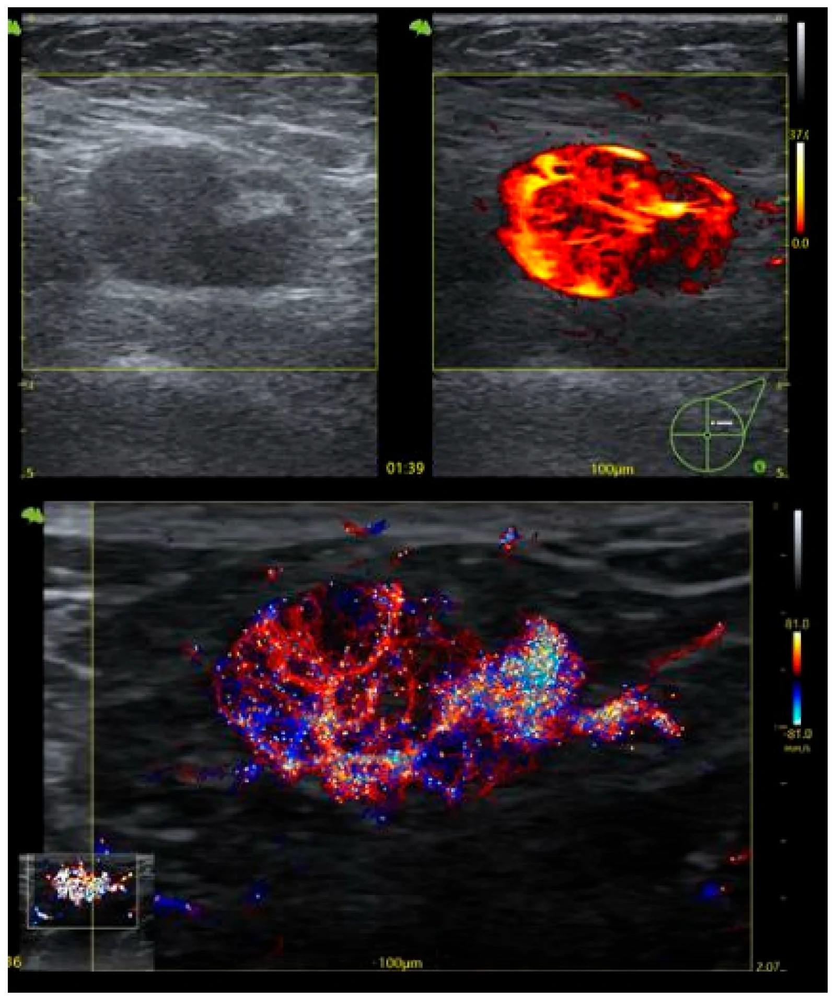
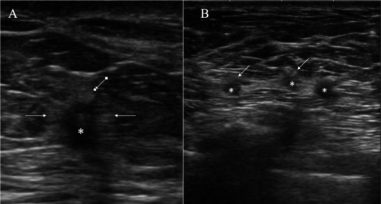
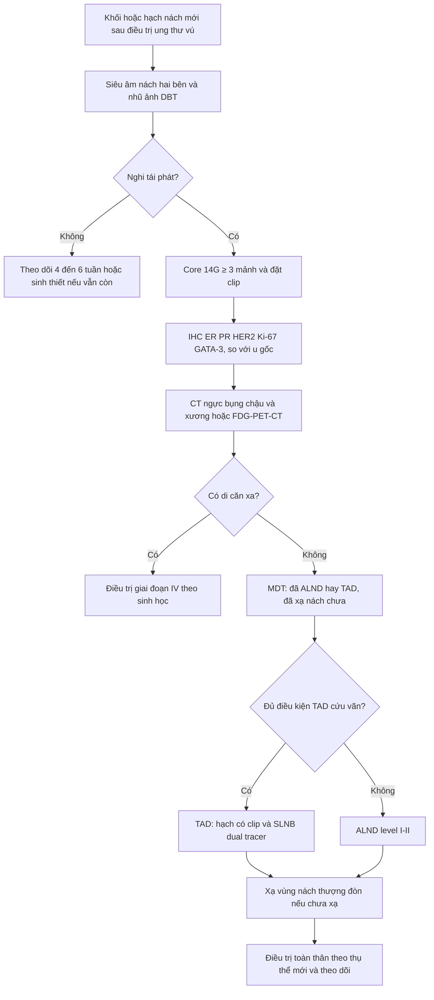
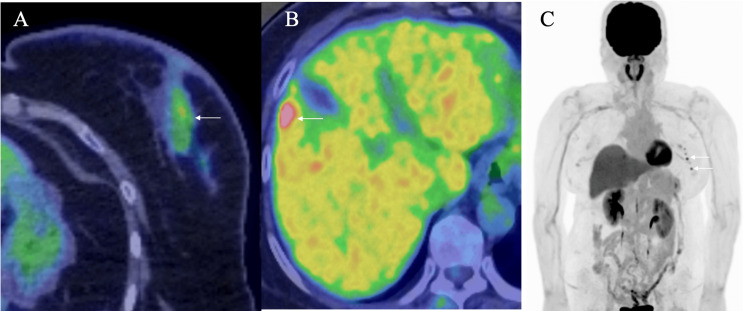

# 597 — Tái phát nách đơn độc sau điều trị bảo tồn & TAD: chẩn đoán, TAD cứu vãn vs ALND / Isolated axillary recurrence

**Tags:** `pattern:hach-nach` `pattern:tai-phat` `vung:hach-nach` `vung:vu` `score:RECIST` `protocol:US-hach-nach` `protocol:TAD` `incidentaloma:hach-nach`
**Mức chắc chắn (certainty):** tổng hợp y văn (literature synthesis) — số liệu từ đoàn hệ 21 ca tái phát nách, phân tích gộp 37 nghiên cứu, AMAROS 10 năm và nghiên cứu sàng lọc siêu âm; chưa có thử nghiệm ngẫu nhiên riêng cho phẫu thuật cứu vãn.

## 1. Tổng quan bệnh học – cơ chế hình ảnh

- **Định nghĩa:** **tái phát nách đơn độc (isolated axillary recurrence — AR)** = ung thư vú tái phát **chỉ ở nách cùng bên**, **không** có tái phát tại vú/thành ngực và **không** có di căn xa tại thời điểm chẩn đoán. Đây là **tái phát vùng (regional recurrence)**, khác di căn xa về tiên lượng và điều trị.
- **Tần suất:** **1–2%**, có chuỗi báo tới **15%**; đa số xuất hiện trong **24–48 tháng** đầu. Sau **SLNB âm tính ở bệnh nhân ban đầu N+ đã hóa trị tân bổ trợ**, phân tích gộp **37 nghiên cứu** cho tỷ lệ **1%** (KTC 95%: 0–1%; I² = 0%). Sau **AMAROS 10 năm**, tái phát nách tích lũy **0,93%** (ALND) vs **1,82%** (xạ nách) — khác biệt không có ý nghĩa (HR 1,71; 0,67–4,39).
- **Vì sao vẫn phải coi trọng dù hiếm:** tái phát vùng đơn độc là **cửa sổ chữa khỏi**. Sống 5 năm sau tái phát vùng đơn độc **45–80%**; sống 10 năm **56%** nếu mổ được + điều trị bổ trợ tích cực. Bỏ sót hoặc điều trị nửa vời = mất cơ hội đó.
- **TẠI SAO hạch tái phát trông như vậy trên siêu âm:** tế bào u xâm nhập **vỏ hạch (cortex)** trước, làm vỏ dày, giảm hồi âm, **xóa mô mỡ rốn hạch (fatty hilum)**; khi u lấp toàn bộ hạch → hạch **tròn, giảm hồi âm, mất rốn**, có thể hoại tử (dịch trong) hoặc vi canxi. Vì vậy **"mất rốn hạch"** là dấu hiệu mạnh nhất, nhưng **không đặc hiệu** (viêm, xơ sau xạ, sarcoid, sau vaccine đều có thể).
- **TẠI SAO FDG-PET/CT hữu ích nhưng không thay thế mô bệnh:** tế bào u tăng đường phân → **SUV tăng**; nhưng hạch **vi di căn** hoặc hạch nhỏ có thể **SUV thấp/âm**, còn hạch **viêm/phản ứng** có thể **SUV 4–5**. Ngưỡng hình ảnh không đủ để chốt — **sinh thiết lõi là bắt buộc** trước khi mổ/xạ.
- **Điều quan trọng nhất về sinh học:** tái phát nách có thể **đổi thụ thể** (ER/PR/HER2) so với u nguyên phát. Đổi thụ thể **đổi phác đồ toàn thân**, nên mẫu mô mới có giá trị điều trị, không chỉ để xác nhận chẩn đoán.

## 2. Mẫu hình + chẩn đoán phân biệt theo vị trí (Gamut)

**Theo hình thái trên siêu âm (pattern) → gamut khối vùng nách sau ung thư vú:**

- **Hạch to, mất rốn, vỏ dày không đều:** **tái phát hạch** (chính); hạch phản ứng sau tiêm vaccine/nhiễm trùng; sarcidosis/lao hạch; lymphoma.
- **Nhiều nốt nhỏ giảm hồi âm có quầng (halo):** **ổ tái phát mô mềm/trong đường bạch mạch** (không có cấu trúc hạch) — bẫy hay gặp; cũng có thể là **hạch thoái hóa mỡ**, u mỡ, nang biểu bì.
- **Khối đặc, không đồng nhất, có canxi:** tái phát hạch hoại tử; **di căn của ung thư khác**; **u mô mềm nguyên phát** (sarcoma mô mềm vùng nách).
- **Dịch/tụ máu, thành dày:** **hoại tử mỡ (fat necrosis)** sau mổ/xạ; **áp-xe**; **u hạt do silicone (silicone granuloma)** ở người đặt túi ngực qua đường nách.
- **Hạch bình thường nhưng toàn bộ nách "đầy" sau xạ:** xơ hóa sau xạ, phù bạch mạch (bài 593) — **không mặc định là tái phát**.

**Theo vị trí (location) — quyết định đường lấy mẫu & trường xạ:**

- **Nách cùng bên level I–II:** vị trí thường gặp nhất; dễ sinh thiết dưới siêu âm.
- **Level III / hạch Rotter / hạch ngực trong:** khó lấy mẫu, thường cần PET/CT để phát hiện; là "vùng chuyển tiếp" giữa tái phát vùng và di căn.
- **Hạch nách đối bên:** **không mặc định là di căn xa** — sau mổ vú + xạ, dẫn lưu bạch mạch có thể chuyển sang nách đối bên → **tái phát vùng đối bên**; vẫn có thể mổ cứu vãn.
- **Nách + hạch thượng đòn:** tái phát vùng lan rộng → tiên lượng xấu hơn, cân nhắc điều trị toàn thân trước.

**Gợi nhớ nhanh — "R-A-N-G-E":** **R**ecurrence (hạch), **A**ccessory breast tissue (mô tuyến lạc chỗ trong nách), **N**ode reactive (phản ứng/viêm), **G**ranuloma (silicone/hoại tử mỡ), **E**xtra-nodal deposit (ổ mô mềm có quầng).

## 3. Bảng so sánh phân biệt (ma trận đối chiếu)

| Thực thể (entity) | Hình ảnh điển hình | Chốt vào (rule-in) | Chốt loại (rule-out) | Gợi ý xác nhận |
|---|---|---|---|---|
| **Tái phát hạch nách** | Hạch tròn, **vỏ dày > 3 mm**, mất rốn mỡ, giảm hồi âm, có thể hoại tử | **Tiền sử ung thư vú + hạch mới/mất rốn + sinh thiết có tế bào biểu mô ác** | **Rốn mỡ còn nguyên, hạch hình thận, vỏ mỏng đều → ít nghĩ tái phát** (nhưng không loại trừ vi di căn) | Core 14G ≥ 3 mảnh + clip; IHC ER/PR/HER2, GATA-3 |
| **Hạch phản ứng (reactive)** | Hạch hình thận, vỏ dày **đều**, rốn còn, đau khi ấn | **Vỏ dày đều + rốn còn + bối cảnh nhiễm trùng/vaccine** | **Mất rốn + bờ không đều + tiền sử ung thư → phải sinh thiết** | Theo dõi 4–6 tuần; sinh thiết nếu không xẹp |
| **Ổ tái phát mô mềm có quầng (halo)** | **Nhiều nốt nhỏ < 1 cm, giảm hồi âm, có quầng sáng bao quanh, xếp thành hàng** — trông như "nhiều hạch" | **Không thấy cấu trúc hạch trên mô bệnh; tế bào u xếp dải/đặc trong mô mỡ** | **Có vỏ hạch + xoang dưới vỏ trên mô bệnh → là hạch thật** | Core + mô bệnh; PET/CT hỗ trợ (SUV 5,67 trong ca minh họa) |
| **Hoại tử mỡ / u hạt silicone** | Khối không đều, có vôi hóa vòng, **không ngấm hoặc ngấm viền**; tiền sử mổ/đặt túi | **Tiền sử chấn thương/mổ/túi ngực + hình thái điển hình + ổn định khi theo dõi** | **To lên nhanh, xâm lấn cơ ngực, hạch trong hố nách mới → phải sinh thiết** | Siêu âm + MRI; sinh thiết khi không chắc |
| **Lymphoma / di căn ung thư khác** | Hạch rất tròn, đồng nhất, **không hoại tử**, có thể nhiều tầng; bệnh nhân có bệnh máu | **IHC: CD45 dương, GATA-3 âm; hoặc dấu ấn cơ quan gốc dương** | **GATA-3 dương + ER dương → nguồn vú** | Core + IHC mở rộng; PET/CT |
| **Mô tuyến lạc chỗ trong nách (accessory breast)** | Mô tuyến đồng tín hiệu với vú, thay đổi theo chu kỳ, có thể đau | **Cấu trúc tuyến–mỡ điển hình, không có hạch, đối xứng theo chu kỳ** | **Cứng, cố định, có canxi đa hình → sinh thiết** | Siêu âm + nhũ ảnh vùng nách; theo dõi chu kỳ |

*Hạch nách dày vỏ lan tỏa: trên (trái) B-mode — hạch giảm hồi âm, mất rốn mỡ, vỏ dày; (trên phải) CEUS — vỏ hạch tăng tưới máu mạnh; (dưới) siêu âm vi mạch (URM) — mạng mạch phân nhánh dày trong vỏ. Đây là "hình thái của hạch nghi tái phát", nhưng chẩn đoán vẫn cần mô bệnh. Nguồn: Pintican R et al., Medical Sciences 2026 (PMC13414471), CC BY 4.0.*

*Siêu âm nách: (A) một khối giảm hồi âm < 1 cm có quầng (mũi tên); (B) nhiều nốt nhỏ xếp thành hàng, mỗi nốt có quầng — trông như chuỗi hạch, nhưng mô bệnh cho thấy **tế bào ung thư xếp dải/đặc trong mô mỡ, KHÔNG có cấu trúc hạch**. Nguồn: Suto T, Oura S, Cureus 2026 (PMC12874194), CC BY 4.0.*

### Hai dấu hiệu quyết định trên siêu âm
- **Mất rốn mỡ (absent fatty hilum) + vỏ dày > 3 mm:** độ nhạy cao cho di căn/tái phát, nhưng độ đặc hiệu trung bình — **không dùng một mình để mổ**.
- **Quầng sáng quanh nốt (halo) KHÔNG phải dấu hiệu của hạch lành:** quầng có thể là mô xơ/viêm quanh ổ tái phát, hoặc mô mỡ bị đẩy; trong ca minh họa, "chuỗi hạch có quầng" hóa ra là **di căn mô mềm không có vỏ hạch**.

## 4. Protocol chẩn đoán – phân giai đoạn – lưu đồ điều trị

**Bước 1 — Xác nhận bằng mô bệnh (bắt buộc, trước mọi quyết định):**
- **Core needle 14G, ≥ 3 mảnh**, dưới hướng dẫn siêu âm; **đặt clip** tại hạch đã sinh thiết (để TAD cứu vãn nếu chọn).
- **IHC tối thiểu:** ER, PR, HER2, Ki-67, **GATA-3** (xác nhận nguồn vú); so sánh với u nguyên phát để phát hiện **đổi thụ thể**.
- Nếu tổn thương khó lấy (level III, ngực trong): cân nhắc sinh thiết dưới CT/PET hoặc mổ sinh thiết.

**Bước 2 — Loại trừ di căn xa và tái phát tại vú:**
- **Nhũ ảnh/DBT + siêu âm vú hai bên** (nếu còn vú); **MRI vú** khi vú đặc hoặc nghi tái phát tại chỗ.
- **CT ngực–bụng–chậu** và **xương** (bone scan hoặc FDG-PET/CT). **FDG-PET/CT** được ưu tiên khi: nhiều hạch, hạch thượng đòn, triệu chứng toàn thân, hoặc sinh học xấu (HER2+, triple-negative).
- Ghi giai đoạn **rT/rN/rM** theo AJCC 8; AR đơn độc = **rN**, không phải M1.

**Bước 3 — Hội chẩn đa chuyên khoa (MDT):** so sánh với phác đồ ban đầu (đã ALND hay TAD? đã xạ nách chưa? đã tái tạo bằng túi ngực qua đường nách?) — quyết định mổ/xạ phụ thuộc hoàn toàn vào "đã làm gì trước đó".

**Bước 4 — Phẫu thuật cứu vãn:**
- **TAD cứu vãn (targeted axillary dissection)** khi: tái phát **một hạch**, **chưa ALND** trước đó, hạch còn clip/dễ đánh dấu, không có xạ nách trước đó, và mô bệnh xác nhận — kỹ thuật: **lấy hạch có clip + SLNB dual tracer**.
- **ALND level I–II** khi: nhiều hạch, đã xạ nách, tái phát sau ALND, hoặc không đủ điều kiện TAD.
- Trong đoàn hệ 21 ca AR: **71,4% ALND, 28,6% TAD**; **không khác biệt PFS** giữa hai nhóm — nhưng cỡ mẫu nhỏ, đây là tín hiệu ủng hộ giảm xâm lấn, **không phải bằng chứng cấp I**.

**Bước 5 — Điều trị bổ trợ (phần quyết định sống còn):**
- **Xạ trị vùng nách/thượng đòn** nếu chưa xạ vùng đó; nếu đã xạ → cân nhắc **xạ lại** theo liều tích lũy (bài 598).
- **Điều trị toàn thân theo sinh học mới:** nội tiết nếu ER+, anti-HER2 nếu HER2+, hóa trị nếu triple-negative/tiến triển nhanh. Trong đoàn hệ trên, **xạ trị bổ trợ và nội tiết tại lúc tái phát gắn với lợi ích PFS có ý nghĩa** — đây là điểm can thiệp mạnh hơn cả lựa chọn dao kéo.

## 5. Biến thể bình thường và cạm bẫy

- **"Chuỗi hạch" có quầng không phải là hạch:** nhiều nốt nhỏ < 1 cm, giảm hồi âm, có quầng, xếp hàng — mô bệnh có thể là **di căn mô mềm không có vỏ hạch**. Nếu chỉ đếm "số hạch" trên siêu âm, bạn sẽ **đánh giá sai giai đoạn và bỏ sót bản chất tổn thương**.
- **Siêu âm sàng lọc nách có độ nhạy rất thấp:** trong 4.430 phụ nữ theo dõi (trung vị 57,2 tháng), chỉ **5 ca tái phát nách (1,1/1.000)**; siêu âm phát hiện **1 ca**, **độ nhạy 20,0%**, độ đặc hiệu 99,4%, tỷ lệ bất thường 0,6%. **Siêu âm bình thường KHÔNG loại trừ tái phát** — triệu chứng, khám lâm sàng và phim chụp định kỳ vẫn là chính.
- **Sau TAD, "mất clip" là bình thường:** hạch có clip đã bị lấy ở lần mổ đầu; đừng tìm clip để xác nhận tái phát, và **phải đặt clip mới** khi sinh thiết hạch tái phát để còn đường dẫn mổ.
- **Nách đối bên không đồng nghĩa di căn xa:** dẫn lưu bạch mạch đổi hướng sau mổ + xạ; tái phát nách đối bên vẫn có thể là **tái phát vùng** và mổ cứu vãn được.
- **PET dương tính giả:** hạch phản ứng sau vaccine, sarcoid, lao, viêm mô tế bào đều có thể **SUV 4–5**; ngược lại hạch **vi di căn có thể PET âm**. Không mổ/xạ dựa trên PET đơn thuần.
- **Xơ hóa sau xạ** làm nách cứng, khó phân biệt trên lâm sàng và siêu âm — so sánh với phim cũ và **sinh thiết khi có bất kỳ thay đổi mới**.
- **Đổi thụ thể là quy luật, không phải ngoại lệ:** bỏ qua IHC trên mẫu tái phát = điều trị toàn thân theo "bản đồ cũ", mất cơ hội (ER âm → dương, HER2 âm → dương).

## 6. Tự lượng giá — Blind Quiz

**Ca 1 — Bệnh nhân ung thư vú, hạch nách dày vỏ lan tỏa trên siêu âm.**

- Hoàn cảnh: hạch nách được đánh giá bằng B-mode, CEUS và siêu âm vi mạch trong một nghiên cứu tiến cứu trên bệnh nhân ung thư vú.
- Câu hỏi: Mô tả 3 dấu hiệu bất thường? Có đủ để mổ không? Bước tiếp theo?

<b>Bấm để hiện đáp án</b>

- **Hạch giảm hồi âm, mất rốn mỡ, vỏ dày lan tỏa**; CEUS/URM cho thấy **tăng tưới máu và mạng mạch dày trong vỏ** — nghi di căn/tái phát.
- **Không đủ để mổ:** hình ảnh không đặc hiệu (viêm, xơ xạ, sarcoid). Bước tiếp: **core 14G ≥ 3 mảnh + clip + IHC** (ER/PR/HER2, GATA-3), rồi **CT/PET loại trừ di căn xa** trước khi bàn TAD/ALND.
- Nguồn ảnh: Pintican R et al., Medical Sciences 2026 (PMC13414471), CC BY 4.0.

**Ca 2 — Nữ 66 tuổi, tiền sử ung thư vú phải, nay nách trái có nhiều nốt nhỏ.**

- Câu hỏi: Đây là chuỗi hạch hay thứ gì khác? Vì sao điều này đổi cách ghi giai đoạn?

<b>Bấm để hiện đáp án</b>

- **Không phải chuỗi hạch:** nhiều nốt < 1 cm, giảm hồi âm, có **quầng**, xếp thành hàng; mô bệnh = **tế bào ung thư xếp dải/đặc trong mô mỡ, không có cấu trúc hạch** → **ổ tái phát mô mềm/đường bạch mạch**.
- Đổi cách ghi: đây là **tái phát vùng/mô mềm**, không phải "N hạch"; đếm hạch trên siêu âm sẽ **đánh giá sai giai đoạn**. Cần **PET/CT** để đánh giá toàn bộ và **sinh thiết** để có IHC.
- Nguồn ảnh: Suto T, Oura S, Cureus 2026 (PMC12874194), CC BY 4.0.

**Ca 3 — Nữ 66 tuổi (ca trên), PET/CT phát hiện nhiều ổ FDG ở nách trái, không thấy ổ nào khác ngoài u gan đã biết.**

- Câu hỏi: PET đủ để chẩn đoán tái phát? Điều trị gì nếu mô bệnh xác nhận và không có di căn xa?

<b>Bấm để hiện đáp án</b>

- **PET không đủ:** SUV tăng (trong ca gốc: **SUVmax 5,67** ở nách, 4,23 ở vú, 14,3 ở gan) vẫn có thể dương tính giả (viêm, sau vaccine) và **âm tính giả với hạch nhỏ/vi di căn**. Phải **sinh thiết + IHC**.
- Nếu xác nhận và **không di căn xa**: **phẫu thuật cứu vãn (TAD nếu đủ điều kiện, hoặc ALND) + xạ vùng nách/thượng đòn nếu chưa xạ + điều trị toàn thân theo thụ thể** — trong đoàn hệ AR, xạ và nội tiết tại lúc tái phát gắn với lợi ích PFS.
- Nguồn ảnh: Suto T, Oura S, Cureus 2026 (PMC12874194), CC BY 4.0.

## Bài liên quan chéo
- [500 – Tổng quan Vú & Sản phụ khoa](../500-tong-quan-vu-san-phu-khoa/lesson.md)
- [589 – Sinh thiết hạch gác & TAD sau hóa trị tân bổ trợ](../589-sinh-thiet-hach-gac-nach-targeted-axillary-dissection/lesson.md)
- [522 – Theo dõi sau điều trị ung thư vú](../522-theo-doi-sau-dieu-tri-ung-thu-vu/lesson.md)
- [523 – Sarcoma mạch do xạ ở vú](../523-sarcoma-mach-do-xa-vu/lesson.md)
- [593 – Phù bạch mạch chi trên sau điều trị ung thư vú](../593-phu-bach-mach-chi-tren-sau-dieu-tri-ung-thu-vu/lesson.md)
- [577 – Theo dõi & phát hiện tái phát ung thư phụ khoa](../577-theo-doi-tai-phat-ung-thu-phu-khoa/lesson.md)

> Không dùng để chẩn đoán độc lập khi chưa có người hướng dẫn.
