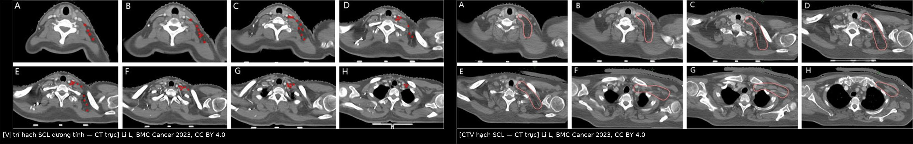
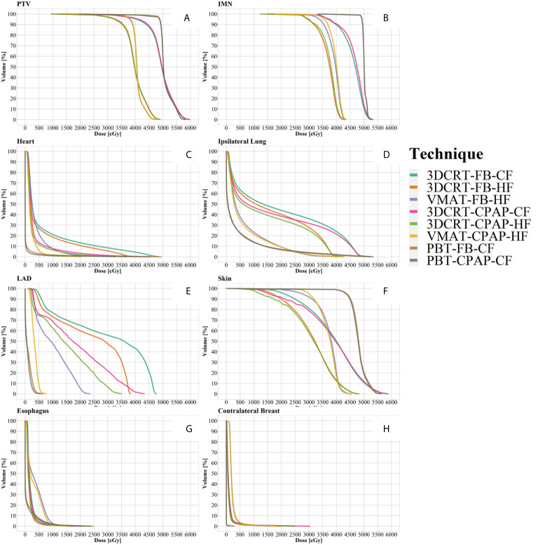
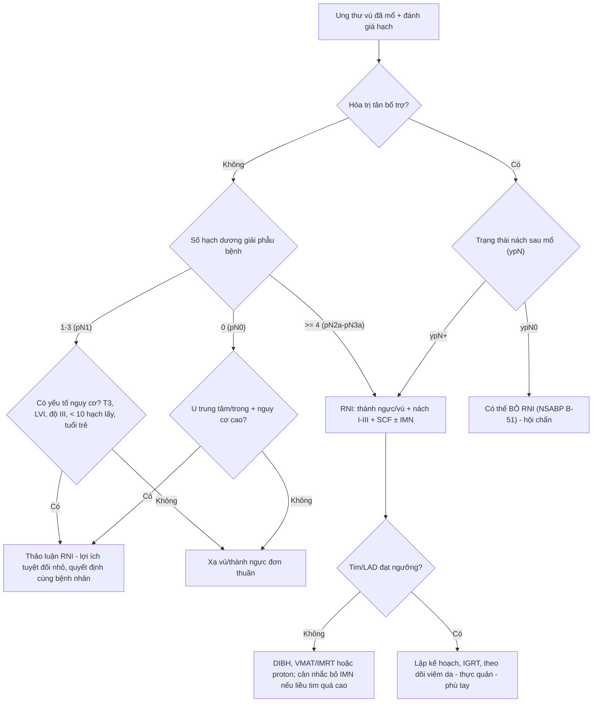
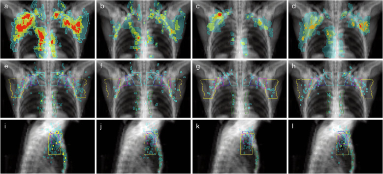
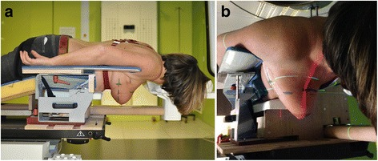
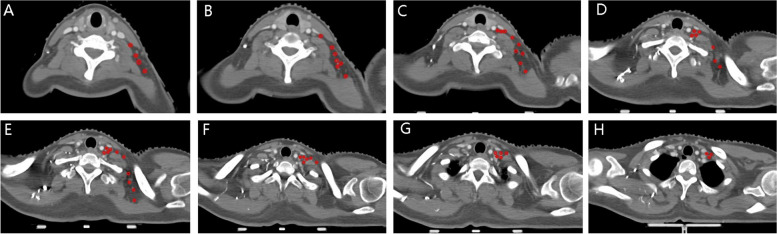

# 598 — Xạ trị vùng hạch sau ung thư vú (RNI): ai cần, vẽ thể tích bia thế nào, liều–phân liều & biến chứng / Regional nodal irradiation for breast cancer

**Tags:** `pattern:xa-tri-vung-hach` `pattern:tai-phat-hach` `vung:vu` `vung:nguc` `score:ESTRO-RTOG-CTV` `score:B51` `protocol:CT-simulation` `protocol:DIBH` `protocol:IMRT-VMAT` `protocol:PET-CT` `incidentaloma:hach-trong-nguc`
**Mức chắc chắn (certainty):** tổng hợp y văn (literature synthesis) — nhóm tự biên từ các bài mở toàn văn (BMC Cancer 2023, PMC10688076; Radiat Oncol 2020, PMC7268399; Radiat Oncol 2017, PMC5259946; Pathol Oncol Res 2022, PMC9272418; Front Oncol 2021, PMC8072050; Radiat Oncol 2017, PMC5446717; World J Clin Cases 2024, PMC11185373; Ann Surg Treat Res 2024, PMC11164658; Technol Cancer Res Treat 2024, PMC11622324) + bản toàn văn thử nghiệm NSABP B-51/RTOG 1304 (NEJM 2025, PMC12269788, CC BY-NC-ND — chỉ trích số, không lấy ảnh). Số liệu giữ đúng theo từng nguồn; chỗ chỉ có trong guideline không mở toàn văn thì ghi rõ tên thử nghiệm.

## 1. Tổng quan — vì sao xạ hạch (chứ không chỉ xạ vú) và vì sao "liều 50 Gy" là câu trả lời cho vi thể

- **Bản chất vấn đề:** sau mổ, phần lớn "bệnh còn lại" nằm ở **hạch vùng** dưới dạng **vi di căn (micrometastasis)**, không thấy trên mọi hình ảnh. Xạ trị vùng hạch (regional nodal irradiation — RNI) không "đốt khối u" mà **diệt ổ vi thể** trong nách độ I–III, hạch Rotter, hạch đỉnh nách/trên đòn (level IV) và chuỗi trong ngực (IMN). Tác dụng lên ổ vi thể lớn hơn nhiều so với u đại thể: xạ hậu phẫu làm **giảm ~33% nguy cơ tái phát vùng** trong các thử nghiệm (PMC11185373).
- **Vì sao phải biết chỉ định:** hạch trên đòn là **vị trí tái phát tại chỗ–vùng đứng thứ hai sau thành ngực**; ở nhóm nhiều hạch nách dương tính, tái phát trên đòn **> 20%** nếu không xạ, và giảm còn **< 10%** khi xạ dự phòng (PMC10688076).
- **Ngưỡng định lượng — 4 thử nghiệm trụ cột (số 10 năm nếu có):**

| Thử nghiệm | Quần thể | Can thiệp | Kết quả chính |
|---|---|---|---|
| **MA.20** (n = 1.832, theo dõi 9,5 năm) | Sau bảo tồn; 90% N+ | WBI + boost **±** SCV/IMN | DFS **82,0% vs 77,0%**; OS **82,8% vs 81,8%** (không khác) (PMC5259946) |
| **EORTC 22922/10925** (n = 4.004, 10,9 năm) | 24% đã cắt toàn tuyến; 44% N0 (u trung tâm/trong) | WBI/TWI **±** SCV/IMN | DFS **72,1% vs 69,1%** (HR 0,89); OS **82,3% vs 80,7%** (HR 0,87; p hiệu chỉnh 0,0496) |
| **DBCG-IMN** (n = 3.089, 8,9 năm) | N+ | Có/không xạ **IMN** | OS 8 năm **75,9% vs 72,2%** (HR 0,82; p = 0,005) |
| **Gộp MA.20 + EORTC** | — | — | OS **HR 0,88** (p = 0,034) |
| **AMAROS** (n = 1.425) | cT1-2N0, SLN (+) | **ALND vs xạ nách I–III + SCV** | Tái phát nách 5 năm **0,4% vs 1,2%**; phù tay (chu vi tăng ≥ 10%) **5,3% vs 12,6%** (PMC5259946; PMC10732511) |
| **NSABP B-51/RTOG 1304** (n = 1.556 phân tích, 59,5 tháng) | cT1-3N1 → **ypN0** sau hóa tân bổ trợ | Có/không RNI | IBCRFI 5 năm **92,7% vs 91,8%** (HR 0,88; KTC 95% 0,60–1,28; p = 0,51) — **không lợi**; độc tính độ 4 **0,5% vs 0,1%** (PMC12269788) |

- **Phản biện (bắt buộc đọc kèm):** B-51 chỉ có **109 biến cố** trong khi cần **172** để đủ lực thống kê → **nguy cơ sai lầm loại II**; theo dõi mới ~5 năm nên chưa trả lời được nhóm HR+/HER2− (tái phát muộn). Phân tích nhóm con trong B-51 cho kết quả **ngược chiều**: TNBC **HR 2,30** (1,00–5,25) bất lợi với RNI, còn HR+/HER2− **HR 0,41** (0,17–0,99) nghiêng có lợi (PMC12686210) — đây là **giả thuyết**, không phải chỉ định. Kết luận thực hành: **B-51 cho phép BỎ RNI ở ypN0 sau hóa trị tân bổ trợ**, không cho phép "bỏ RNI ở mọi N1".
- **TẠI SAO hình ảnh trông như vậy (vật lý + giải phẫu):**
  - **Hạch nằm cạnh mạch, không nằm trong mô tuyến** → thể tích bia phải vẽ **theo mốc mạch máu** (tĩnh mạch cảnh trong, động mạch cảnh, động mạch ngực trong), không theo "khoảng trống" cảm tính. Vì vậy CT mô phỏng **có cản quang** là bắt buộc khi vẽ hạch trên đòn/IMN.
  - **Cửa sổ liều:** tế bào ung thư vú có **α/β thấp (~4 Gy)** nên nhạy với **liều mỗi phân liều**; đó là cơ sở dùng **40–42,5 Gy/15 phân liều** cho vú/thành ngực. Nhưng với **IMN** (nằm sâu, sát tim) bằng chứng phân liều lớn còn yếu, nhiều hướng dẫn vẫn khuyên **phân liều chuẩn** (PMC9272418).
  - **Tim là cơ quan nguy cơ số 1:** nguy cơ biến cố mạch vành tăng **~7,4% mỗi 1 Gy** liều trung bình tim (Darby 2013, NEJM); liều trung bình tim trung bình toàn cầu giảm **4,6 Gy (2014) → 2,6 Gy (2017)**, và kỹ thuật nín thở sâu (DIBH) hạ còn **1,7 Gy** so với **4,5 Gy** khi thở tự do (PMC11622324).
  - **Vì sao VMAT không phải lúc nào cũng "tốt hơn":** VMAT hạ liều **LAD** nhưng **tăng liều thấp vào tim** → liều trung bình tim có thể **cao hơn** 3D-CRT; proton hạ được cả hai (PMC11622324, PMC8072050).

## 2. Mẫu hình (pattern) + chẩn đoán phân biệt theo vị trí (Gamut)

- **Khuôn 1 — Hạch trên đòn/đỉnh nách (level IV) to ra cùng bên.** Gamut: **tái phát/vi di căn SCL** vs **hạch phản ứng sau tiêm vaccine** vs **hạch sau xạ (xơ hóa)** vs **hạch do nhiễm trùng da/thành ngực**.
  Chốt: hạch SCL thật nằm **dọc bờ sau–ngoài tĩnh mạch cảnh trong, quanh góc tĩnh mạch (venous angle)**; trong 42 ca/109 hạch dương tính, **100% hạch nằm ở bờ sau–ngoài TM cảnh trong**, **không có hạch ở phần trước–trong TM cảnh trong/ĐM cảnh** (PMC10688076). Hạch ở **tam giác sau cổ (level V)** chỉ gặp khi **nách dương tính lan rộng**, phân bố dọc **mạch cổ ngang**, giới hạn trong **cơ vai–móng và bó cơ bậc thang**.
- **Khuôn 2 — Hạch nách "mới" sau khi đã RNI.** Gamut: **tái phát trong trường xạ** vs **tái phát bờ (marginal)** vs **tái phát ngoài trường** vs **hạch lành phản ứng**.
  Ngưỡng đáng nhớ: khi đối chiếu 226 hạch tái phát của 69 bệnh nhân với bản đồ thể tích bia, **RTOG: 70% trong, 4% bờ, 27% ngoài**; **ESTRO: 73% trong, 2% bờ, 25% ngoài**; phủ **toàn bộ** hạch tái phát chỉ ở **38% (RTOG) vs 57% (ESTRO)** số bệnh nhân — thêm thể tích **vùng cổ sau (RADCOMP posterior neck)** nâng lên **48% vs 70%** (PMC7268399).
- **Khuôn 3 — Hạch trong ngực (IMN) dương tính.** Gamut: **di căn IMN** vs **hạch cạnh tim lành** vs **nốt phổi trong rãnh** vs **di căn màng phổi/trung thất**.
  Chốt: IMN nằm trong **khoang giữa sụn sườn và màng phổi, dọc ĐM ngực trong, gian sườn 1–3(–4)**; trên CT chỉ thấy rõ khi **có cản quang** và cửa sổ mô mềm. Xạ IMN có lợi sống còn (DBCG-IMN) nhưng **đổi bằng liều tim** — đây là chỗ quyết định kỹ thuật (DIBH, VMAT/proton, chấp nhận 46–48 Gy ở IMN).
- **Khuôn 4 — Dày da/thành ngực sau xạ, không có hạch.** Gamut: **tái phát thành ngực/da** vs **viêm da xạ** vs **xơ hóa** vs **angiosarcoma do xạ (Stewart–Treves)**. Chốt: tổn thương **mới, nốt/tím, không theo hình dạng trường xạ** → sinh thiết; xơ xạ **theo đúng hình chiếu trường**, không ngấm, teo dần.
- **Ghi nhớ 4 tầng hạch theo mạch — "R.I.V.E.":** **R**otter (giữa cơ ngực lớn–bé), **I**–III nách (bờ ngoài cơ ngực bé / sau cơ ngực bé / dưới–trong), **V**ênous angle–SCL (bờ sau–ngoài TM cảnh trong), **E**ndothoracic (IMN, gian sườn 1–3).

## 3. Bảng so sánh phân biệt (ma trận đối chiếu)

| Tình huống / thực thể | Hình ảnh & dấu hiệu điển hình | Chốt vào (rule-in) | Chốt loại (rule-out) | Gợi ý xác nhận |
|---|---|---|---|---|
| **pN2a–pN3a (≥ 4 hạch dương)** sau cắt toàn tuyến | Không cần thấy hạch trên ảnh; thành ngực + nách I–III + SCV ± IMN | **≥ 4 hạch dương giải phẫu bệnh** | **ypN0 sau hóa trị tân bổ trợ** (B-51) → cân nhắc bỏ | Chỉ định theo giải phẫu bệnh; RNI + xạ thành ngực |
| **pN1 (1–3 hạch) + yếu tố nguy cơ** | T3, LVI, độ mô học III, < 10 hạch lấy, tuổi trẻ | **≥ 1 hạch dương + ≥ 1 yếu tố nguy cơ** → **thảo luận RNI** (lợi ích tuyệt đối nhỏ) | **N0 thực sự + u nhỏ, không yếu tố nguy cơ** → không RNI | Hội chẩn; MA.20/EORTC là nền |
| **ypN0 sau hóa trị tân bổ trợ (cT1-3N1)** | Không còn hạch bệnh lý; có thể còn xơ/vi vôi hóa hạch | **ypN0 xác nhận mô học** → **có thể bỏ RNI** (B-51: 92,7% vs 91,8%) | **ypN+ còn sót** → vẫn RNI; **TNBC/HR+ phân nhóm** chỉ là giả thuyết | Giải phẫu bệnh sau mổ; hội chẩn đa chuyên khoa |
| **SLN (+) 1–2 hạch, dự định bỏ ALND** | Hạch nách còn lại bình thường trên US/MRI | **Xạ NÁCH (levels I–II) thay ALND** — AMAROS: tái phát 0,4% vs 1,2%; phù tay 5,3% vs 12,6% | **Xạ nách ≠ RNI đầy đủ**: nếu cần SCV/IMN thì phải mở rộng thể tích | Đánh dấu clip hạch; lập kế hoạch xạ nách có chủ đích |
| **Hạch SCL/level IV nghi tái phát** | Hạch **mất rốn mỡ, vỏ dày, bờ sau–ngoài TM cảnh trong**; PET dương | **Vị trí đúng bờ sau–ngoài TM cảnh trong/góc TM** + lớn dần | **Hạch trước–trong TM cảnh trong/ĐM cảnh** → thường không phải đường lan của vú | PET/CT + FNA; đối chiếu bản đồ liều |
| **Hạch nách mới sau RNI** | So sánh với CT lập kế hoạch: nằm **trong / bờ / ngoài** CTV | **Ngoài CTV + lớn nhanh** → tái phát ngoài trường (25–27% ca tái phát nằm ngoài CTV) | **Nằm trong vùng xơ xạ, không lớn sau 6–12 tháng** → nghiêng xơ | Chồng hình CT lập kế hoạch; PET/CT; sinh thiết |
| **Hạch nách sau tiêm vaccine (cùng bên tiêm)** | Hạch **giữ rốn mỡ**, vỏ mỏng, đối xứng theo đường tiêm, giảm sau 4–6 tuần | **Tiền sử tiêm 1–4 tuần + giữ rốn mỡ + tự giảm** | **Mất rốn mỡ, vỏ dày > 3 mm, không giảm sau 6 tuần** → không phải phản ứng đơn thuần | Siêu âm lặp; FNA nếu còn sau 6 tuần ở bệnh nhân ung thư vú |
| **Dày da/thành ngực sau xạ** | Dày da **theo hình trường chiếu**, mô xơ không ngấm | **Đúng hình trường xạ, ổn định/teo dần** | **Nốt/tím ngoài trường, ngấm, lớn nhanh** → tái phát/angiosarcoma | Sinh thiết (bài 523, 1602) |

*Trái (A–H, 8 lát từ cao xuống thấp): tâm các hạch trên đòn **dương tính** của 42 bệnh nhân được chiếu lên CT mẫu thành vòng đỏ 4 mm — toàn bộ nằm **dọc bờ sau–ngoài tĩnh mạch cảnh trong/góc tĩnh mạch**. Phải (A–H): **CTV hạch trên đòn** (đường đỏ) được vẽ theo mốc mạch và cơ: trên = bờ dưới sụn giáp, dưới = nơi đầu xương đòn biến mất, trong = bó cơ bậc thang + bờ ngoài mạch cổ, ngoài = bờ trong cơ ức đòn chũm/cơ vai–móng, trước = sau TM cảnh trong, sau = trước cơ thang. Nguồn: Li L et al., BMC Cancer 2023 (PMC10688076), CC BY 4.0 — ảnh ghép letterbox, không crop.*

## 4. Protocol (mô phỏng – thể tích bia – liều – OAR) & thuật toán chỉ định

- **Mô phỏng CT (CT simulation):** nằm **ngửa**, tay giơ cao trên giá đỡ (wing board), **bơm cản quang tĩnh mạch** (cần thấy TM cảnh trong, ĐM ngực trong, mạch nách), lát **2,5–3 mm**, quét từ **đỉnh phổi đến dưới vòm hoành** để không cắt mất IMN/thượng đòn.
- **Tư thế thay thế:** **nằm sấp** (prone) hữu ích cho vú to/sa, giảm liều tim–phổi ở một số ca; nghiên cứu so sánh prone vs supine cho thấy khác biệt liều phụ thuộc giải phẫu từng người, **không có tư thế "tốt nhất" chung** (PMC5446717) → chọn theo **kế hoạch so sánh** (plan comparison), không theo thói quen.
- **Nín thở sâu (DIBH)** khi xạ **vú trái ± IMN**: hạ liều trung bình tim từ **4,5 Gy → 1,7 Gy** (PMC11622324).
- **Thể tích bia theo atlas:** nách **độ I–III + hạch Rotter**; **hạch trên đòn = "level IV"**; **IMN = gian sườn 1–3(–4)** cùng bên, theo đường ĐM ngực trong. Khác biệt atlas có ý nghĩa thực hành (PMC7268399):
  - **ESTRO** thêm **0,5 cm** bờ ngoài–trong quanh mạch IMN, thêm **CTV hạch giữa cơ ngực (interpectoral/Rotter)**, và hạ **bờ trên SCF** từ **sụn giáp** xuống **0,5 cm trên TM dưới đòn**.
  - **RTOG** lấy bờ trên SCF cao tới **sụn giáp**, không có CTV Rotter riêng.
  - **Vùng cổ sau (posterior neck, RADCOMP)** không nằm trong cả hai atlas — thêm vào giúp phủ **70%** ca tái phát trọn vẹn (so với 57% khi chỉ dùng ESTRO).
- **Liều – phân liều (PMC9272418):**
  - **Chuẩn: 50 Gy/25 phân (2 Gy/ngày, 5 ngày/tuần)** khi có **IMN** trong thể tích bia.
  - **Giảm phân liều: 40–42,5 Gy/15 phân (2,67 Gy)** chấp nhận cho vú/thành ngực ± SCF; **với IMN còn tranh luận** (khuyến cáo mức 3) — nếu chọn, phải ghi rõ trong kế hoạch.
  - **Boost** u/giường u **10–16 Gy** (hoặc 10 Gy × 1 HDR) khi có yếu tố nguy cơ tại chỗ.
- **OAR — ngưỡng lập kế hoạch (dùng để so sánh kế hoạch, không phải "luật"):**

| Cơ quan | Ngưỡng tham chiếu | Nguồn/lý do |
|---|---|---|
| Tim (mean heart dose) | càng thấp càng tốt; mục tiêu **< 2,5–3,3 Gy**; mỗi **+1 Gy** tăng **~7,4%** biến cố mạch vành | PMC11622324; Darby 2013 |
| LAD | Dmax **< 45,4 Gy**; VMAT hạ LAD nhưng tăng liều thấp tim | PMC11622324 |
| Phổi cùng bên | **V20 ≤ 30%**, liều trung bình **< 20 Gy** (viêm phổi xạ có triệu chứng < 20%) | QUANTEC (ngưỡng lập kế hoạch) |
| Thực quản | **AV30 < 2,39 mL** (AUC 0,996; Se 90,9%/Sp 91,1%) và **AV35 < 0,71 mL** — ngưỡng dự báo viêm thực quản độ 2 | PMC11185373 |
| Đám rối cánh tay | Dmax **≤ 60–66 Gy** (nguy cơ bệnh thần kinh < 5%) | QUANTEC |
| Da/thành ngực | bolus theo chỉ định; theo dõi viêm da độ 2–3 | PMC9272418 |

- **Kỹ thuật:** 3D-CRT (2 tiếp tuyến + trường hạch) là mức tối thiểu; **IMRT/VMAT** khi cần che tim–phổi hoặc thể tích lõm; **proton** khi tim/LAD không đạt ngưỡng bằng photon. So sánh DVH cho thấy proton giữ **liều tim, LAD, phổi, thực quản** thấp nhất, VMAT giảm LAD nhưng **tăng liều thấp vào tim** so với 3D-CRT (PMC8072050).

*DVH của PTV, IMN, tim (C), phổi cùng bên (D), LAD (E), da (F), thực quản (G), vú đối bên (H) theo 8 kỹ thuật. Đọc nhanh: đường **xanh lá (3DCRT-CPAP)** đẩy liều tim/phổi cao nhất; **tím/hồng (VMAT)** hạ LAD nhưng "đuôi" liều thấp vào tim rộng hơn; **nâu (proton)** thấp nhất ở gần như mọi OAR. Nguồn: Ko H et al., Front Oncol 2021 (PMC8072050), CC BY 4.0.*

- **Thuật toán chỉ định (flowchart):**

## 5. Cạm bẫy (pitfall) & biến thể bình thường

- **Hai atlas, hai bờ trên khác nhau:** dùng RTOG nhưng đọc theo ESTRO (hoặc ngược lại) → **thiếu/thừa vùng hạch ở đỉnh**. Luôn ghi rõ **atlas nào** trong kế hoạch; nếu bệnh nhân có hạch **level V/tam giác sau cổ**, cân nhắc thêm **posterior neck** (thêm 13% ca được phủ trọn).
- **Hạch Rotter bị bỏ sót:** nằm **giữa cơ ngực lớn và bé**, không nằm trong 2 tiếp tuyến chuẩn → phải vẽ riêng (ESTRO có CTV riêng).
- **IMN "không thấy" ≠ "không có":** không cản quang/không đúng cửa sổ mô mềm → bỏ sót; nhưng **đừng đuổi theo IMN bằng mọi giá**: liều tim tăng là đánh đổi đã biết, có ca phải **chấp nhận 46–48 Gy** ở IMN thay vì 50 Gy (PMC9272418).
- **Phù tay đo SAU xạ là đo sai thời điểm:** trong 113 bệnh nhân RNI, **30,1% đã có phù trước khi kết thúc xạ**, chỉ **17,7%** khởi phát sau xạ (trung vị **20,2 tháng**) → **đo chu vi/thể tích chi TRƯỚC xạ** làm mốc nền, nếu không sẽ quy oan cho xạ (PMC11164658).
- **Viêm thực quản có "lịch" riêng:** độ 1 xuất hiện **sau phân liều thứ 5**, độ 2 sau **phân liều thứ 7**, đỉnh ở **phân 10–15**, tự hết trong **30 ngày** — đừng đổi kế hoạch giữa chừng chỉ vì nuốt đau độ 1 (PMC11185373).
- **Hạch "to" sau tiêm vaccine/viêm da:** giữ **rốn mỡ**, vỏ mỏng, giảm sau 4–6 tuần; ở bệnh nhân ung thư vú vẫn phải **siêu âm lặp + FNA** nếu không giảm sau 6 tuần.
- **Bẫy hình học kinh điển (mặt cắt):** trên CT trục, **IMN** nằm sau sụn sườn và **trước màng phổi**, cạnh mạch ngực trong; một **nốt phổi nhỏ ở rãnh** hoặc **hạch cạnh tim** có thể bị vẽ nhầm vào CTV → luôn xác nhận bằng **cửa sổ phổi + đối chiếu PET**.

*69 bệnh nhân/226 hạch tái phát vùng được chiếu lên CT mẫu: (a–d) hạch tái phát, (e–h) tâm hạch tái phát chồng lên **CTV**, (i–l) nhìn nghiêng. Đường viền màu: xanh lơ = trên đòn, vàng = nách độ I, hồng = nách độ II, xanh dương = độ III. Điểm cần nhớ: **~25–27% tâm hạch tái phát nằm NGOÀI CTV** của cả RTOG và ESTRO. Nguồn: Beaton L et al., Radiat Oncol 2020 (PMC7268399), CC BY 4.0.*

*Tư thế nằm sấp trên giá đỡ: vú rơi tự do khỏi thành ngực, tay giơ cao để mở nách. Đây là lựa chọn **thay thế** nằm ngửa, phải chứng minh bằng **so sánh kế hoạch** mới có lợi (không mặc định tốt hơn). Nguồn: Deseyne P et al., Radiat Oncol 2017 (PMC5446717), CC BY 4.0.*

## 6. Tự lượng giá — Blind Quiz

**Ca 1 — Nữ 48 tuổi, ung thư vú trái, đã mổ + hóa trị, nay lập kế hoạch xạ. Nhìn 8 lát CT trục từ cao xuống thấp (bên trái ảnh ghép): các vòng đỏ là tâm hạch dương tính của 42 bệnh nhân. Chúng nằm ở đâu so với mốc mạch–cơ? Nếu chỉ vẽ CTV theo cảm tính "vùng hõm trên đòn", bạn sẽ thiếu vùng nào?**

- Hỏi thêm: bờ trên CTV nên lấy **sụn giáp** hay **0,5 cm trên TM dưới đòn**? Hai lựa chọn đó thuộc atlas nào?

<b>Bấm để hiện đáp án</b>

- Toàn bộ hạch nằm **dọc bờ sau–ngoài tĩnh mạch cảnh trong, tập trung ở góc tĩnh mạch**; **không có hạch ở phần trước–trong TM cảnh trong/ĐM cảnh**. Vì vậy CTV phải **bám bờ sau–ngoài TM cảnh trong**, không phải "lấp đầy" cả hõm.
- Nếu vẽ cảm tính, dễ **thiếu vùng sau–ngoài (quanh TM cảnh trong)** và **vùng tam giác sau cổ (level V)** khi nách dương tính lan rộng.
- Bờ trên: **sụn giáp** = RTOG; **0,5 cm trên TM dưới đòn** = ESTRO (thấp hơn, bám thể tích 3D-CRT lịch sử). Ghi rõ atlas trong kế hoạch.
- Nguồn: Li L et al., BMC Cancer 2023 (PMC10688076), CC BY 4.0.

**Ca 2 — Bản đồ tái phát: 226 hạch tái phát vùng được chồng lên CTV. Bao nhiêu phần trăm nằm ngoài CTV, và điều đó thay đổi kế hoạch của bạn thế nào?**

<b>Bấm để hiện đáp án</b>

- **RTOG: 27% ngoài, 4% bờ; ESTRO: 25% ngoài, 2% bờ.** Phủ trọn mọi hạch tái phát chỉ ở **38% (RTOG)** và **57% (ESTRO)** số bệnh nhân.
- Thêm **vùng cổ sau (RADCOMP posterior neck)** → **48%** và **70%**. Với ca có **nách dương tính lan rộng**, cân nhắc mở bờ trên/ra sau và thêm vùng cổ sau.
- Đối chiếu ca cụ thể với **CT lập kế hoạch**: hạch mới **trong CTV** = tái phát trong trường; **ngoài CTV** = vấn đề thể tích bia, không phải "xạ thất bại".
- Nguồn: Beaton L et al., Radiat Oncol 2020 (PMC7268399), CC BY 4.0.

**Ca 3 — Nữ 44 tuổi, cT2N1, hóa trị tân bổ trợ, mổ bảo tồn: ypN0 (0/6 hạch), HR+/HER2−. Bệnh nhân hỏi "có cần xạ hạch không?". Trả lời theo bằng chứng nào, và điều gì chưa biết?**

<b>Bấm để hiện đáp án</b>

- **NSABP B-51/RTOG 1304:** ở cT1-3N1 → ypN0 sau hóa trị tân bổ trợ, thêm RNI **không cải thiện** IBCRFI (5 năm **92,7% vs 91,8%**, HR 0,88; 0,60–1,28; p = 0,51); độc tính độ 4 **0,5% vs 0,1%** → **có thể bỏ RNI**, vẫn xạ vú.
- **Chưa biết:** thử nghiệm **thiếu lực** (109 biến cố/172 cần), theo dõi ~5 năm; nhóm **HR+/HER2−** có tín hiệu nghiêng có lợi (HR 0,41; 0,17–0,99) và **TNBC** tín hiệu bất lợi (HR 2,30) — cả hai là **phân tích nhóm con**, không dùng để đảo ngược chỉ định.
- Cách làm đúng: **hội chẩn xạ–nội–ngoại**, trình bày lợi ích tuyệt đối nhỏ và nguy cơ tim/phù tay; ghi rõ quyết định.
- Nguồn: NEJM 2025 (PMC12269788), bình luận PMC12686210.

## Bài liên quan chéo
- [500 – Tổng quan Vú & Sản phụ khoa](../500-tong-quan-vu-san-phu-khoa/lesson.md)
- [589 – Sinh thiết hạch gác nách & TAD](../589-sinh-thiet-hach-gac-nach-targeted-axillary-dissection/lesson.md) (bước trước của RNI)
- [597 – Tái phát nách đơn độc](../597-tai-phat-nach-don-doc-sau-dieu-tri/lesson.md) (khi đã tái phát)
- [522 – Theo dõi sau điều trị ung thư vú](../522-theo-doi-sau-dieu-tri-ung-thu-vu/lesson.md)
- [523 – Sarcoma mạch do xạ ở vú](../523-sarcoma-mach-do-xa-vu/lesson.md) (biến chứng muộn của xạ)
- [593 – Phù bạch mạch chi trên sau điều trị ung thư vú](../593-phu-bach-mach-chi-tren-sau-dieu-tri-ung-thu-vu/lesson.md) (đo phù tay trước/sau xạ)
- [516 – Hình ảnh vú sau điều trị](../516-hinh-anh-vu-sau-dieu-tri/lesson.md) (đọc phim sau xạ)
- [1601 – Ung thư vú trong thai kỳ](../1601-ung-thu-vu-trong-thai-ky/lesson.md) (bối cảnh đặc biệt)

> Không dùng để chẩn đoán độc lập khi chưa có người hướng dẫn.
